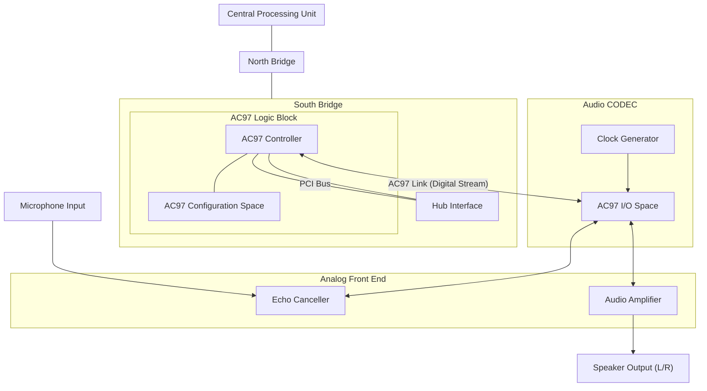
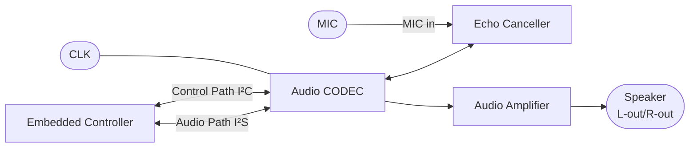
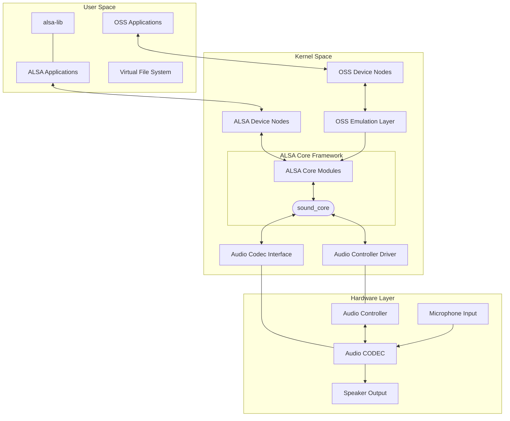
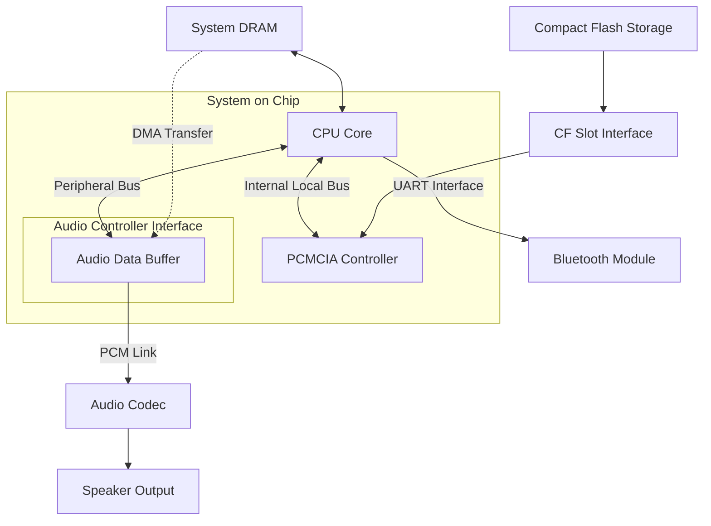
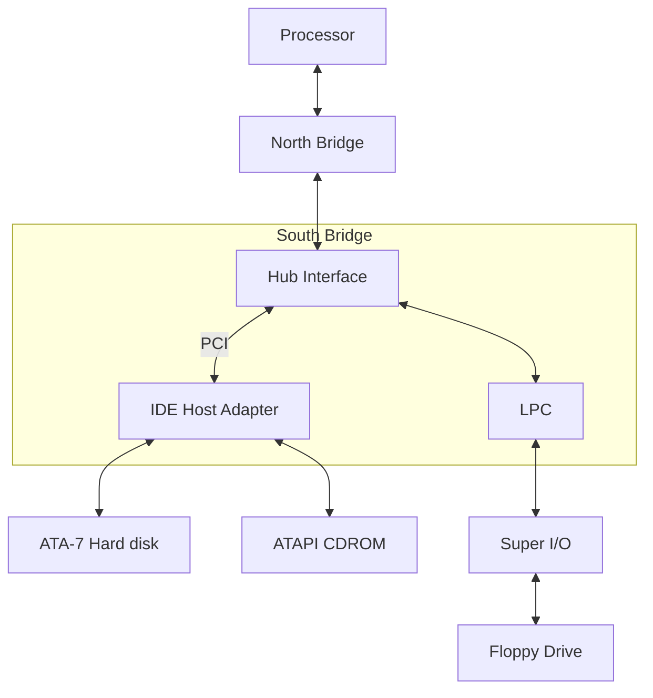
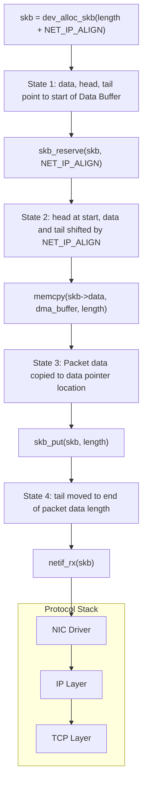
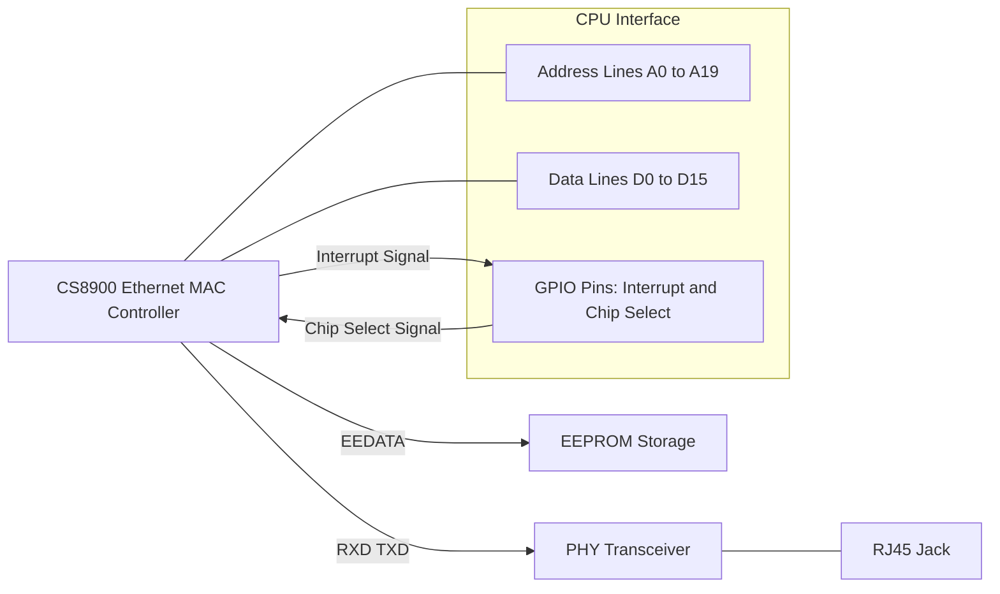
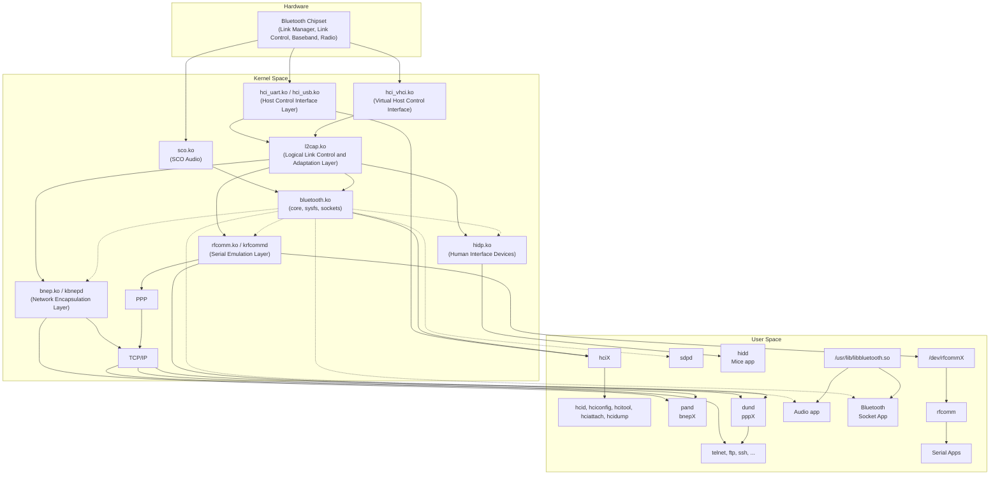
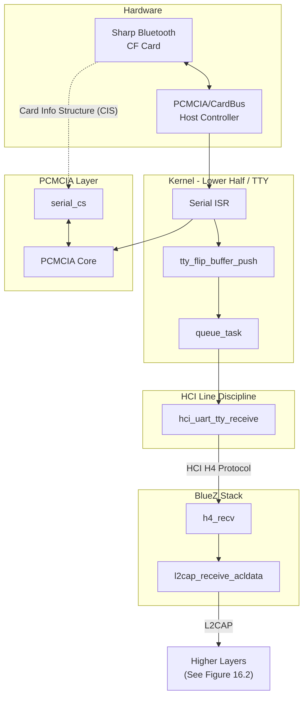
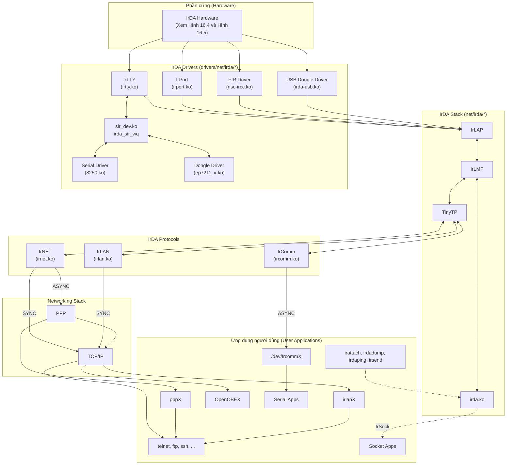

# Chương 12: Trình điều khiển Video (Video Drivers)

```
Trong chương này

• Kiến trúc hiển thị ................... 356
• Hệ thống con Video trong Linux ........ 359
• Các tham số hiển thị ................. 361
• API Frame Buffer .................... 362
• Trình điều khiển Frame Buffer ........ 365
• Trình điều khiển Console ............. 380
• Gỡ lỗi (Debugging) .................. 387
• Khảo sát mã nguồn .................... 388
```

Phần cứng video tạo ra đầu ra trực quan để hệ thống máy tính hiển thị. Trong chương này, chúng ta hãy tìm hiểu cách kernel hỗ trợ các bộ điều khiển video (video controller) và khám phá những ưu điểm mà lớp trừu tượng frame buffer mang lại. Chúng ta cũng sẽ học cách viết các trình điều khiển console (console driver) để hiển thị các thông điệp được xuất ra từ kernel.

## Kiến trúc hiển thị (Display Architecture)

Hình 12.1 minh họa cụm hiển thị trên một hệ thống tương thích PC. Bộ điều khiển đồ họa (graphics controller) nằm trong Cầu Bắc (North Bridge - xem khung bên "Cầu Bắc") kết nối với các loại thiết bị hiển thị khác nhau bằng cách sử dụng một số tiêu chuẩn giao tiếp (xem khung bên "Tiêu chuẩn cáp video").

**Hình 12.1. Kết nối hiển thị trên hệ thống PC.**

*Video Graphics Array* (VGA) là tiêu chuẩn hiển thị ban đầu do IBM giới thiệu, nhưng ngày nay nó mang ý nghĩa là một thông số kỹ thuật về độ phân giải nhiều hơn. VGA đề cập đến độ phân giải 640x480, trong khi các tiêu chuẩn mới hơn như *eXtended Graphics Array* (XGA) và *Super Video Graphics Array* (SVGA) hỗ trợ độ phân giải cao hơn là 800x600 và 1024x768. Các tấm nền *Quarter VGA* (QVGA) có độ phân giải 320x240 rất phổ biến trên các thiết bị nhúng (embedded device), chẳng hạn như thiết bị cầm tay và điện thoại thông minh.

Các bộ điều khiển đồ họa trong thế giới x86 tương thích với VGA và các biến thể của nó cung cấp chế độ văn bản dựa trên ký tự (character-based text mode) và chế độ đồ họa dựa trên pixel (pixel-based graphics mode). Tuy nhiên, không gian nhúng phi x86 (non-x86 embedded space) thì không phải là VGA và không có khái niệm về chế độ văn bản chuyên dụng.

### Cầu Bắc (The North Bridge)

Trong các chương trước, bạn đã tìm hiểu về các bus ngoại vi (peripheral bus) như LPC, I2C, PCMCIA, PCI và USB, tất cả đều bắt nguồn từ Cầu Nam (South Bridge) trên các hệ thống tập trung vào PC. Tuy nhiên, kiến trúc hiển thị lại đưa chúng ta đi sâu vào Cầu Bắc (North Bridge). Cầu Bắc trong kiến trúc PC dựa trên nền tảng Intel hoặc là *Graphics and Memory Controller Hub* (GMCH) hoặc là *Memory Controller Hub* (MCH). Thành phần trước chứa bộ điều khiển bộ nhớ (memory controller), bộ điều khiển *Front Side Bus* (FSB) và bộ điều khiển đồ họa. Thành phần sau không có bộ điều khiển đồ họa tích hợp nhưng cung cấp kênh *Accelerated Graphics Port* (AGP) để kết nối phần cứng đồ họa ngoại vi.

Hãy xem xét, ví dụ, chipset Cầu Bắc Intel 855 GMCH. Bộ điều khiển FSB trong 855 GMCH giao tiếp với các bộ vi xử lý Pentium M. Bộ điều khiển bộ nhớ hỗ trợ các chip nhớ *Dual Data Rate* (DDR) SDRAM. Bộ điều khiển đồ họa tích hợp cho phép bạn kết nối với các thiết bị hiển thị sử dụng VGA analog, LVDS hoặc DVI (xem khung bên "Tiêu chuẩn cáp video"). 855 GMCH cho phép bạn đồng thời gửi đầu ra tới hai màn hình, do đó, ví dụ, bạn có thể gửi các thông tin giống nhau hoặc khác nhau tới tấm nền LCD của máy tính xách tay và một màn hình CRT bên ngoài cùng một lúc.

Các chipset Cầu Bắc gần đây, chẳng hạn như AMD 690G, bao gồm hỗ trợ cho HDMI (xem khung bên tiếp theo) ngoài VGA và DVI.

### Các tiêu chuẩn cáp video

Một số tiêu chuẩn giao tiếp quy định kết nối giữa các bộ điều khiển video (video controller) và thiết bị hiển thị. Các thiết bị hiển thị và công nghệ cáp mà chúng sử dụng bao gồm:

- Màn hình tương tự (analog display) như màn hình *cathode ray tube* (CRT) có đầu nối VGA tiêu chuẩn.
- Màn hình phẳng kỹ thuật số (digital flat-panel display) như màn hình LCD *Thin Film Transistor* (TFT) của máy tính xách tay có đầu nối truyền tín hiệu vi sai điện áp thấp (*low-voltage differential signaling* - LVDS).
- Màn hình hiển thị tuân theo thông số kỹ thuật *Digital Visual Interface* (DVI). DVI là một tiêu chuẩn do nhóm làm việc về màn hình kỹ thuật số (*Digital Display Working Group* - DDWG) phát triển để truyền tải video chất lượng cao. Có ba phân nhóm DVI: *chỉ kỹ thuật số* (DVI-D), *chỉ tương tự* (DVI-A), và *cả kỹ thuật số và tương tự* (DVI-I).
- Màn hình hiển thị tuân theo thông số kỹ thuật *High-Definition Television* (HDTV) sử dụng giao diện đa phương tiện độ nét cao (*High-Definition Multimedia Interface* - HDMI). HDMI là một tiêu chuẩn cáp âm thanh-video kỹ thuật số hiện đại hỗ trợ tốc độ dữ liệu cao. Không giống như các tiêu chuẩn chỉ có video như DVI, HDMI có thể truyền tải cả hình ảnh và âm thanh.

Các SoC nhúng thường tích hợp bộ điều khiển LCD trên chip (on-chip LCD controller), như được minh họa trong Hình 12.2. Đầu ra phát ra từ bộ điều khiển LCD là các tín hiệu TTL (*Transistor-Transistor Logic*) chứa dữ liệu video màn hình phẳng 18-bit, với mỗi 6-bit dành cho ba màu cơ bản: đỏ, xanh lá và xanh dương. Một số thiết bị cầm tay và điện thoại sử dụng các tấm nền LCD nội bộ loại QVGA nhận trực tiếp dữ liệu video màn hình phẳng TTL do các bộ điều khiển LCD cung cấp.

```
                     Embedded Controller
        +---------------------------------------------+
        |                 [ CPU Core ]                |
        |                        |                    |
        |              Internal Local Bus             |
        |        _________|______________             |
        |       |                      |              |
        |  [ USB Controller ]  ....[ LCD Controller ] |
        |                                |            |
        +--------------------------------|------------+
                                         |
                                         |
                                 18-bit Flat Panel data
                                         v
                                   [ QVGA LCD Panel ]
```

**Hình 12.2. Kết nối màn hình trên một hệ thống nhúng.**

Thiết bị nhúng, như trong Hình 12.3, hỗ trợ hai tấm nền hiển thị: một LCD màn hình phẳng LVDS nội bộ và một màn hình DVI ngoại vi. LCD TFT nội bộ nhận đầu nối LVDS làm đầu vào, do đó một chip truyền tín hiệu LVDS (LVDS transmitter) được sử dụng để chuyển đổi các tín hiệu màn hình phẳng thành LVDS. Một ví dụ về chip truyền LVDS là DS90C363B của National Semiconductor. Màn hình DVI ngoại vi chỉ nhận đầu nối DVI, vì vậy một bộ truyền DVI được sử dụng để chuyển đổi các tín hiệu video 18-bit thành DVI-D. Giao diện I2C được cung cấp để trình điều khiển thiết bị (device driver) có thể cấu hình các thanh ghi (register) của bộ truyền DVI. Một ví dụ về chip truyền DVI là SiI164 từ Silicon Image.

[Xem ảnh kích thước đầy đủ]

**Hình 12.3. Các kết nối LVDS và DVI trên một hệ thống nhúng.**

## Hệ thống con Video trong Linux

Khái niệm bộ đệm khung (frame buffer) đóng vai trò trung tâm đối với video trên Linux, vì vậy trước tiên chúng ta hãy tìm hiểu xem nó cung cấp những gì.

Vì các bộ điều hợp video (video adapter) có thể dựa trên các kiến trúc phần cứng khác nhau, việc triển khai các tầng nhân (kernel layer) cấp cao hơn và các ứng dụng có thể cần phải thay đổi tùy theo từng card video. Điều này dẫn đến các cơ chế không đồng nhất để xử lý các card video khác nhau. Sự thiếu khả năng diport (nonportability) và mã nguồn bổ sung đi kèm đòi hỏi phải đầu tư và bảo trì lớn hơn. Khái niệm frame buffer giải quyết vấn đề này bằng cách mô tả một sự trừu tượng hóa tổng quát (general abstraction) và xác định một giao diện lập trình cho phép các ứng dụng và các tầng kernel cấp cao hơn được viết theo cách độc lập với nền tảng (platform-independent). Hình 12.4 cho bạn thấy ưu điểm của frame buffer.

```
      [ GUIs, Consoles, Movie players, ... ]
                        |
                        v
            [ Common Framebuffer API ]
                 /                 \
                /                   \
               v                     v
      [ Framebuffer Driver I ]   [ Framebuffer Driver N ]
               |                         |
               v                         v
        [ Video Card I ]   ...  [ Video Card N ]

       (Video cards having different graphics controllers)
```

**Hình 12.4. Ưu điểm của frame buffer.**

Do đó, giao diện frame buffer của kernel cho phép các ứng dụng độc lập với sự biến động của phần cứng đồ họa bên dưới. Các ứng dụng chạy không thay đổi trên nhiều loại phần cứng video khác nhau nếu chúng và các trình điều khiển hiển thị tuân thủ giao diện frame buffer. Như bạn sẽ sớm nhận ra, giao diện lập trình frame buffer chung cũng mang lại tính độc lập về phần cứng cho các tầng kernel, chẳng hạn như trình điều khiển console frame buffer.

Ngày nay, một số ứng dụng, chẳng hạn như trình duyệt web và trình phát Phim, hoạt động trực tiếp trên giao diện frame buffer. Các ứng dụng như vậy có thể thực hiện đồ họa mà không cần sự trợ giúp từ hệ thống cửa sổ (windowing system).

X Windows server (`Xfbdev`) có khả năng hoạt động thông qua giao diện bộ đệm khung hình (frame buffer interface), như được minh họa trong Hình 12.5.

[Xem hình kích thước đầy đủ]

**Hình 12.5. Hệ thống con Linux-Video (Linux-Video subsystem).**

Hệ thống con Linux-Video hiển thị trong Hình 12.5 là một tập hợp gồm các trình điều khiển hiển thị (display driver) cấp thấp, các tầng bảng điều khiển (console) và frame buffer tầng trung, trình điều khiển terminal ảo (virtual terminal driver) cấp cao, các trình điều khiển chế độ người dùng (user mode driver) thuộc X Windows, và các tiện ích để cấu hình thông số hiển thị. Hãy cùng phân tích hình vẽ theo chiều từ trên xuống:

- Giao diện đồ họa người dùng X Windows (X Windows GUI) có hai tùy chọn để hoạt động trên các card đồ họa (video card). Nó có thể sử dụng một trình điều khiển không gian người dùng (user-space driver) tích hợp phù hợp cho card hoặc hoạt động thông qua hệ thống con frame buffer.
- Các console chế độ văn bản (text mode console) hoạt động thông qua trình điều khiển ký tự terminal ảo (virtual terminal character driver). Các terminal ảo (virtual terminal), được giới thiệu trong phần "Trình điều khiển TTY" (TTY Drivers) ở Chương 6, "Trình điều khiển Nối tiếp" (Serial Drivers), là các terminal dựa trên văn bản toàn màn hình mà bạn nhận được khi đăng nhập ở chế độ văn bản. Giống như X Windows, các console văn bản có hai lựa chọn vận hành. Chúng có thể hoạt động thông qua một trình điều khiển console chuyên dụng cho card, hoặc sử dụng trình điều khiển console frame buffer chung (*fbcon*) nếu kernel hỗ trợ một trình điều khiển frame buffer cấp thấp cho card đang xét.

## Thông số hiển thị (Display Parameters)

Đôi khi, việc cấu hình các thuộc tính liên quan đến bảng hiển thị (display panel) của bạn có thể là thay đổi trình điều khiển duy nhất mà bạn cần thực hiện để bật video trên thiết bị của mình, vì vậy hãy bắt đầu tìm hiểu về các trình điều khiển video bằng cách xem xét các thông số hiển thị phổ biến. Chúng ta sẽ giả định rằng trình điều khiển liên quan tuân thủ giao diện frame buffer và sử dụng tiện ích *fbset* để lấy các đặc tính hiển thị:

### bash> fbset

```
mode "1024x768-60"
## D: 65.003 MHz, H: 48.365 kHz, V: 60.006 Hz
 geometry 1024 768 1024 768 8
 timings 15384 168 16 30 2 136 6
 hsync high
 vsync high
 rgba 8/0,8/0,8/0,0/0
endmode
```

Giá trị D: trong kết quả đầu ra viết tắt cho *dotclock* (tần số chấm), đây là tốc độ mà phần cứng video vẽ các điểm ảnh (pixel) trên màn hình. Giá trị 65.003MHz ở kết quả đầu ra trước đó có nghĩa là sẽ mất (1/65.003\*1000000) hay khoảng 15.384 picosecond để bộ điều khiển video (video controller) vẽ một pixel duy nhất. Khoảng thời gian này được gọi là *pixclock* (xung nhịp pixel) và được hiển thị là tham số số đầu tiên trong dòng bắt đầu bằng `timings`. Các con số đứng sau "geometry" thông báo rằng độ phân giải khả kiến và ảo là 1024x768 (SVGA) và số bit cần thiết để lưu trữ thông tin liên quan đến một pixel là 8.

Giá trị H: chỉ định tốc độ quét ngang (horizontal scan rate), là số dòng hiển thị ngang được quét bởi phần cứng video trong một giây. Đây là nghịch đảo của pixclock nhân với độ phân giải X. Giá trị V: là tốc độ mà toàn bộ màn hình được làm mới (refresh rate). Đây là nghịch đảo của pixclock nhân với độ phân giải X khả kiến và độ phân giải Y khả kiến, vào khoảng 60Hz trong ví dụ này. Nói cách khác, màn hình LCD được làm mới 60 lần trong một giây.

Bộ điều khiển video phát ra xung đồng bộ ngang (horizontal sync - HSYNC) ở cuối mỗi dòng và xung đồng bộ dọc (vertical sync - VSYNC) sau mỗi khung hiển thị. Thời lượng của HSYNC (tính bằng số pixel) và VSYNC (tính bằng số dòng pixel) được hiển thị là hai tham số cuối cùng trong dòng bắt đầu bằng "timings". Màn hình của bạn càng lớn, các giá trị HSYNC và VSYNC có thể càng lớn. Bốn con số trước thời lượng HSYNC trong dòng `timings` lần lượt thông báo độ dài của lề phải màn hình (hoặc horizontal front porch), lề trái (hoặc horizontal back porch), lề dưới (hoặc vertical front porch), và lề trên (hoặc vertical back porch). *Documentation/fb/framebuffer.txt* và trang man của *fb.modes* minh họa trực quan các thông số này.

Để kết nối các thông số này lại với nhau, hãy tính toán giá trị pixclock cho một tốc độ làm mới cho trước, là 60.006Hz trong ví dụ của chúng ta:

```
dotclock = (X-resolution + left margin + right margin
 + HSYNC length) * (Y-resolution + upper margin
 + lower margin + VSYNC length) * refresh rate
 = (1024 + 168 + 16 + 136) * (768 + 30 + 2 + 6) * 60.006
 = 65.003 MHz
pixclock = 1/dotclock
 = 15384 picoseconds (khớp với kết quả fbset ở trên)
```

## API Frame Buffer

Tiếp theo, chúng ta hãy làm quen với API frame buffer. Tầng lõi frame buffer (frame buffer core layer) xuất các nút thiết bị (device node) ra không gian người dùng (user space) để các ứng dụng có thể truy cập từng thiết bị video được hỗ trợ. */dev/fbX* là nút liên quan đến thiết bị frame buffer *X*. Sau đây là các cấu trúc dữ liệu chính mà những người sử dụng API frame buffer quan tâm. Bên trong kernel, chúng được định nghĩa trong *include/linux/fb.h*, trong khi ở vùng đất người dùng (user land), các định nghĩa của chúng nằm trong */usr/include/linux/fb.h*:

Thông tin biến đổi liên quan đến card video mà bạn đã thấy trong kết quả đầu ra của fbset ở phần trước được lưu giữ trong cấu trúc `struct fb_var_screeninfo`. Cấu trúc này chứa các trường như độ phân giải X, độ phân giải Y, số bit cần thiết để chứa một pixel, pixclock, thời lượng HSYNC, thời lượng VSYNC, và độ dài các lề. Các giá trị này có thể lập trình được bởi người dùng: **1.**

```c
struct fb_var_screeninfo {
 __u32 xres; /* Visible resolution in the X axis */
 __u32 yres; /* Visible resolution in the Y axis */
 /* ... */
 __u32 bits_per_pixel; /* Number of bits required to hold a
 pixel */
 /* ... */
 __u32 pixclock; /* Pixel clock in picoseconds */
 __u32 left_margin; /* Time from sync to picture */
 __u32 right_margin; /* Time from picture to sync */
 /* ... */
 __u32 hsync_len; /* Length of horizontal sync */
 __u32 vsync_len; /* Length of vertical sync */
 /* ... */
};
```

Các thông tin cố định về phần cứng video (video hardware), chẳng hạn như địa chỉ bắt đầu (start address) và kích thước của bộ nhớ frame buffer (frame buffer memory), được lưu giữ trong `struct fb_fix_screeninfo`. Các giá trị này không thể bị thay đổi bởi người dùng (user): **2.**

```c
struct fb_fix_screeninfo {
 char id[16]; /* Identification string */
 unsigned long smem_start; /* Start of frame buffer memory */
 __u32 smem_len; /* Length of frame buffer memory */
 /* ... */
};
```

Cấu trúc `fb_cmap` chỉ định bản đồ màu (color map), được sử dụng để truyền tải định nghĩa màu sắc của người dùng đến phần cứng video bên dưới. Bạn có thể sử dụng cấu trúc này để xác định tỷ lệ RGB (Red, Green, Blue - Đỏ, Xanh lá, Xanh dương) mà bạn mong muốn cho các màu sắc khác nhau: **3.**

```c
struct fb_cmap {
 __u32 start; /* First entry */
 __u32 len; /* Number of entries */
 __u16 *red; /* Red values */
 __u16 *green; /* Green values */
 __u16 *blue; /* Blue values */
 __u16 *transp; /* Transparency. Discussed later on */
};
```

Liệt kê 12.1 (Listing 12.1) là một ứng dụng đơn giản hoạt động dựa trên API frame buffer. Chương trình tiến hành xóa màn hình bằng cách thao tác trên */dev/fb0*, nút thiết bị (device node) frame buffer tương ứng với màn hình hiển thị. Đầu tiên, chương trình giải mã các độ phân giải khả kiến (visible resolutions) và số bit trên mỗi pixel (*bits per pixel*) theo cách độc lập với phần cứng (hardware-independent) bằng cách sử dụng API frame buffer, `FBIOGET_VSCREENINFO`. Lệnh giao tiếp này thu thập các tham số thay đổi được của màn hình hiển thị bằng cách thao tác trên cấu trúc `fb_var_screeninfo`. Sau đó, chương trình tiếp tục gọi `mmap()` để ánh xạ bộ nhớ frame buffer và xóa từng bit pixel cấu thành.

**Liệt kê 12.1. Xóa màn hình theo cách độc lập với phần cứng**

```c
## include <stdio.h>
## include <fcntl.h>
## include <linux/fb.h>
## include <sys/mman.h>
## include <stdlib.h>
struct fb_var_screeninfo vinfo;
int
main(int argc, char *argv[])
{
 int fbfd, fbsize, i;
 unsigned char *fbbuf;
 /* Open video memory */
 if ((fbfd = open("/dev/fb0", O_RDWR)) < 0) {
 exit(1);
 }
 /* Get variable display parameters */
 if (ioctl(fbfd, FBIOGET_VSCREENINFO, &vinfo)) {
 printf("Bad vscreeninfo ioctl\n");
 exit(2);
 }
 /* Size of frame buffer =
 (X-resolution * Y-resolution * bytes per pixel) */
 fbsize = vinfo.xres*vinfo.yres*(vinfo.bits_per_pixel/8);
 /* Map video memory */
 if ((fbbuf = mmap(0, fbsize, PROT_READ|PROT_WRITE,
 MAP_SHARED, fbfd, 0)) == (void *) -1){
 exit(3);
 }
 /* Clear the screen */
 for (i=0; i<fbsize; i++) {
 *(fbbuf+i) = 0x0;
 }
 munmap(fbbuf, fbsize);
 close(fbfd);
}
```

Chúng ta sẽ xem xét một ứng dụng frame buffer khác khi học cách truy cập các vùng nhớ từ không gian người dùng (user space) trong Chương 19, "Trình điều khiển trong không gian người dùng" (Drivers in User Space).

## Trình điều khiển Frame Buffer (Frame Buffer Drivers)

Bây giờ bạn đã có cái nhìn tổng quan về API frame buffer và cách nó cung cấp tính độc lập với phần cứng, hãy cùng khám phá kiến trúc của một trình điều khiển thiết bị (device driver) frame buffer cấp thấp bằng cách sử dụng ví dụ về một hệ thống định vị (navigation system).

```

## Ví dụ về thiết bị: Hệ thống định vị (Navigation System)

Hình 12.6 cho thấy hoạt động video trên một hệ thống định vị xe hơi mẫu được xây dựng xoay quanh một SoC nhúng (embedded SoC). Bộ thu GPS truyền các tọa độ (coordinates) đến SoC thông qua giao diện UART. Một ứng dụng tạo ra đồ họa từ thông tin vị trí nhận được và cập nhật một vùng đệm khung hình (frame buffer) trong bộ nhớ hệ thống (system memory). Trình điều khiển bộ đệm khung hình (frame buffer driver) thực hiện truyền dữ liệu hình ảnh này bằng DMA (Direct Memory Access) tới các bộ đệm hiển thị vốn là một phần của bộ điều khiển LCD (LCD controller) trên SoC. Bộ điều khiển này chuyển tiếp dữ liệu điểm ảnh (pixel data) tới tấm nền LCD QVGA để hiển thị.

```

Embedded SoC
----------------------------------------------------

|                    [ CPU Core ]                  |
|                          |                       |
|                    Internal Local Bus            |
|                _________|__________              |
|               |                    |             |
|            [ UART ]          [ LCD Controller ]  |
|               ^                 [ Buffer ]----------> [ QVGA LCD Panel ]
----------------|-----------------------------------
|                     ^
GPS Receiver |                     |
[ GPS Receiver ]           |

|
Frame Buffer               |   DMA
[ DRAM ] ---------------------------'
^

|
'------------------> [ CPU Core ]

```

**Hình 12.6. Màn hình hiển thị trên một thiết bị định vị Linux.**

Mục tiêu của chúng ta là phát triển phần mềm video cho hệ thống này. Hãy giả định rằng Linux hỗ trợ SoC được sử dụng trên thiết bị định vị này và tất cả các giao diện phụ thuộc kiến trúc (architecture-dependent interfaces) chẳng hạn như DMA đều được kernel hỗ trợ.

Một cài đặt phần cứng khả thi của thiết bị được thể hiện trong Hình 12.6 là sử dụng SoC Freescale i.MX21. Lõi CPU trong trường hợp đó là lõi ARM9, và bộ điều khiển video trên chip (on-chip video controller) là Bộ điều khiển Tinh thể Lỏng (Liquid Crystal Display Controller - LCDC). Các SoC thường có một bus cục bộ nội bộ hiệu năng cao (high-performance internal local bus) kết nối với các bộ điều khiển như DRAM và video. Trong trường hợp của i.MX21, bus này được gọi là Bus Hiệu năng Cao Tiên tiến (Advanced High-Performance Bus - AHB). LCDC kết nối với AHB.

Phần mềm video của hệ thống định vị được kiến trúc hóa tổng quát như một ứng dụng GPS hoạt động trên nền trình điều khiển bộ đệm khung hình cấp thấp (low-level frame buffer driver) dành cho bộ điều khiển LCD. Ứng dụng lấy các tọa độ vị trí từ bộ thu GPS bằng cách đọc */dev/ttySX*, trong đó *X* là số hiệu UART được kết nối với bộ thu. Sau đó, ứng dụng dịch thông tin vị trí địa lý thành một hình ảnh và ghi dữ liệu điểm ảnh (pixel data) vào bộ đệm khung hình liên kết với bộ điều khiển LCD. Quá trình này được thực hiện theo các dòng mã của Liệt kê 12.1 (Listing 12.1), ngoại trừ việc dữ liệu hình ảnh được truyền đi thay vì các số không (zeros) để làm sạch màn hình.

Phần còn lại của mục này chỉ tập trung vào trình điều khiển thiết bị bộ đệm khung hình cấp thấp (low-level frame buffer device driver). Giống như nhiều hệ thống con trình điều khiển (driver subsystems) khác, toàn bộ tập hợp các tính năng, chế độ và tùy chọn do tầng cốt lõi bộ đệm khung hình (frame buffer core layer) cung cấp rất phức tạp và chỉ có thể nắm vững thông qua kinh nghiệm lập trình. Trình điều khiển bộ đệm khung hình cho hệ thống định vị mẫu có tính chất tương đối đơn giản và chỉ là điểm khởi đầu cho những khám phá sâu hơn.

Bảng 12.1 mô tả mô hình thanh ghi (register model) của bộ điều khiển LCD được thể hiện trong Hình 12.6. Trình điều khiển bộ đệm khung hình trong Liệt kê 12.2 (Listing 12.2) hoạt động dựa trên các thanh ghi này.

**Bảng 12.1. Bố cục thanh ghi của bộ điều khiển LCD được thể hiện trong Hình 12.6**

| Tên thanh ghi (Register Name) | Dùng để cấu hình (Used to Configure) |
|-------------------------------|-------------------------------------------------------------------------------------------------------------|
| SIZE_REG                      | Kích thước X và Y tối đa của tấm nền LCD (LCD panel) |
| HSYNC_REG                     | Thời gian xung đồng bộ hàng (HSYNC duration) |
| VSYNC_REG                     | Thời gian xung đồng bộ khung (VSYNC duration) |
| CONF_REG                      | Số bit trên mỗi điểm ảnh (bits per pixel), cực tính điểm ảnh (pixel polarity), các bộ chia xung nhịp để tạo ra<br>pixclock, chế độ màu/đơn sắc (color/monochrome mode), v.v. |
| CTRL_REG                      | Bật/tắt bộ điều khiển LCD, xung nhịp và DMA |
| DMA_REG                       | Địa chỉ bắt đầu DMA của bộ đệm khung hình, độ dài cụm (burst length), và<br>kích thước ngưỡng nước (watermark sizes) |
| STATUS_REG                    | Các giá trị trạng thái (Status values) |
| CONTRAST_REG                  | Mức độ tương phản (Contrast level) |

Trình điều khiển bộ đệm khung hình của chúng tôi (có tên là *myfb*) được triển khai như một trình điều khiển nền tảng (platform driver) trong Liệt kê 12.2. Như bạn đã học ở Chương 6, một nền tảng (platform) là một bus giả (pseudo bus) thường được sử dụng để kết nối các thiết bị hạng nhẹ được tích hợp trong SoC với mô hình thiết bị của kernel (kernel's device model). Mã thiết lập đặc thù theo kiến trúc (trong *arch/your-arch/your-platform/*) thêm nền tảng bằng cách sử dụng platform\_device\_add(); nhưng để đơn giản hóa, phương thức probe() của trình điều khiển myfb thực hiện việc này trước khi tự đăng ký nó như một platform driver. Hãy tham khảo lại mục "Device Example: Cell Phone" (Ví dụ về thiết bị: Điện thoại di động) trong Chương 6 để biết kiến trúc tổng quát của một platform driver và các điểm vào (entry points) liên quan.

## Cấu trúc dữ liệu (Data Structures)

Hãy cùng xem xét các cấu trúc dữ liệu và phương thức (methods) chính liên quan đến các trình điều khiển frame buffer (frame buffer drivers), sau đó đi sâu vào `myfb`. Hai cấu trúc chính sau đây là:

Cấu trúc `struct fb_info` là cấu trúc dữ liệu cốt lõi của các trình điều khiển frame buffer. Cấu trúc này được định nghĩa trong *include/linux/fb.h* như sau: **1.**

```

struct fb_info {
/* ... */
struct fb_var_screeninfo var; /* Thông tin màn hình thay đổi (Variable

```

```

Discussed earlier. */ screen information). Đã thảo luận trước đó. */
struct fb_fix_screeninfo fix; /* Thông tin màn hình cố định (Fixed screen
information).
Đã thảo luận trước đó. */
/* ... */
struct fb_cmap cmap; /* Bảng màu (Color map).
Đã thảo luận trước đó. */
/* ... */
struct fb_ops *fbops; /* Các thao tác của driver (Driver operations).
Sẽ thảo luận tiếp theo. */
/* ... */
char __iomem *screen_base; /* Địa chỉ ảo của
frame buffer */
unsigned long screen_size; /* Kích thước của frame buffer */
/* ... */
/* Từ đây trở đi mọi thứ đều phụ thuộc vào thiết bị (device dependent) */
void *par; /* Vùng nhớ riêng tư (Private area) */
};

```

Bộ nhớ cho `fb_info` được cấp phát bởi `framebuffer_alloc()`, một hàm thư viện do nhân frame buffer (frame buffer core) cung cấp. Hàm này cũng nhận kích thước của một vùng nhớ riêng tư (private area) làm đối số và gắn thêm phần đó vào cuối của `fb_info` đã được cấp phát. Vùng nhớ riêng tư này có thể được tham chiếu bằng con trỏ `par` trong cấu trúc `fb_info`. Ngữ nghĩa của các trường trong `fb_info` như `fb_var_screeninfo` và `fb_fix_screeninfo` đã được thảo luận trong phần "Giao diện Lập trình Frame Buffer" (The Frame Buffer API).

Cấu trúc `struct fb_ops` chứa địa chỉ của tất cả các điểm nhập (entry points) do trình điều khiển frame buffer mức thấp (low-level frame buffer driver) cung cấp. Một số phương thức đầu tiên trong `fb_ops` là bắt buộc để driver hoạt động, trong khi các phương thức còn lại là tùy chọn nhằm cung cấp khả năng tăng tốc đồ họa (graphics acceleration). Trách nhiệm của từng hàm được giải thích ngắn gọn trong các chú thích: **2.**

```

struct fb_ops {
struct module *owner;
/* Mở driver */
int (*fb_open)(struct fb_info *info, int user);
/* Đóng driver */
int (*fb_release)(struct fb_info *info, int user);
/* ... */
/* Kiểm tra tính hợp lệ của các tham số video */
int (*fb_check_var)(struct fb_var_screeninfo *var,
struct fb_info *info);
/* Cấu hình các thanh ghi bộ điều khiển video */
int (*fb_set_par)(struct fb_info *info);
/* Tạo bản đồ bảng màu giả (pseudo color palette map) */
int (*fb_setcolreg)(unsigned regno, unsigned red,
unsigned green, unsigned blue,
unsigned transp, struct fb_info *info);
/* Tắt/bật màn hình (Blank/unblank display) */
int (*fb_blank)(int blank, struct fb_info *info);
/* ... */
/* Phương thức tăng tốc để tô một hình chữ nhật với các dòng pixel */
void (*fb_fillrect)(struct fb_info *info,
const struct fb_fillrect *rect);
/* Phương thức tăng tốc để sao chép vùng hình chữ nhật từ vùng màn hình này sang vùng khác */
void (*fb_copyarea)(struct fb_info *info,

```

```

const struct fb_copyarea *region);
/* Phương thức tăng tốc để vẽ một hình ảnh lên màn hình hiển thị */
void (*fb_imageblit)(struct fb_info *info,
const struct fb_image *image);
/* Phương thức tăng tốc để xoay màn hình */
void (*fb_rotate)(struct fb_info *info, int angle);
/* Giao diện Ioctl để hỗ trợ các lệnh đặc thù của thiết bị */
int (*fb_ioctl)(struct fb_info *info, unsigned int cmd,
unsigned long arg);
/* ... */
};

```

Bây giờ, hãy xem xét các phương thức driver mà Liệt kê (Listing) 12.2 thực thi cho trình điều khiển `myfb`.

### Kiểm tra và Thiết lập Tham số

Phương thức `fb_check_var()` thực hiện việc kiểm tra tính hợp lệ (sanity check) của các biến như độ phân giải theo trục X (X-resolution), độ phân giải theo trục Y (Y-resolution), và số bit trên mỗi pixel (bits per pixel). Do đó, nếu bạn sử dụng `fbset` để thiết lập độ phân giải X nhỏ hơn mức tối thiểu được hỗ trợ bởi bộ điều khiển LCD (64 trong ví dụ của chúng tôi), hàm này sẽ giới hạn nó về mức tối thiểu cho phép bởi phần cứng (hardware).

`fb_check_var()` cũng thiết lập định dạng RGB phù hợp. Ví dụ của chúng tôi sử dụng 16 bit mỗi pixel, và bộ điều khiển ánh xạ (map) mỗi từ dữ liệu (data word) trong bộ đệm khung màn hình (frame buffer) thành mã RGB565 thông dụng: 5 bit cho màu đỏ, 6 bit cho màu xanh lá, và 5 bit cho màu xanh dương. Các khoảng dịch bit (offset) trong từ dữ liệu cho mỗi ba màu cũng được thiết lập tương ứng.

Phương thức `fb_set_par()` cấu hình các thanh ghi (registers) của bộ điều khiển LCD tùy thuộc vào các giá trị được tìm thấy trong `fb_info.var`. Quá trình này bao gồm việc thiết lập:

- Thời lượng đồng bộ ngang (Horizontal sync duration), lề trái (left margin), và lề phải (right margin) trong `HSYNC_REG`
- Thời lượng đồng bộ dọc (Vertical sync duration), lề trên (upper margin), và lề dưới (lower margin) trong `VSYNC_REG`
- Độ phân giải hiển thị X và Y trong `SIZE_REG`
- Các tham số DMA trong `DMA_REG`

Giả sử rằng ứng dụng GPS cố gắng thay đổi độ phân giải của màn hình QVGA thành 50x50. Chuỗi sự kiện diễn ra như sau:

Màn hình ban đầu ở độ phân giải QVGA: **1.**

```

bash> fbset
mode "320x240-76"

## D: 5.830 MHz, H: 18.219 kHz, V: 75.914 Hz

geometry 320 240 320 240 16
timings 171521 0 0 0 0 0 0
rgba 5/11,6/5,5/0,0/0

```

### endmode

Ứng dụng thực hiện một thao tác đại loại như sau: **2.**

```

struct fb_var_screeninfo vinfo;
fbfd = open("/dev/fb0", O_RDWR);
vinfo.xres = 50;
vinfo.yres = 50;
vinfo.bits_per_pixel = 8;
ioctl(fbfd, FBIOPUT_VSCREENINFO, &vinfo);
Lưu ý rằng điều này tương đương với lệnh fbset -xres 50 -yres 50 -depth 8.

```

Lệnh `ioctl` `FBIOPUT_VSCREENINFO` ở bước trước kích hoạt lời gọi đến hàm `myfb_check_var()`. Phương thức trình điều khiển (driver method) này thể hiện sự không đồng tình và làm tròn độ phân giải được yêu cầu lên mức tối thiểu được hỗ trợ bởi phần cứng, trong trường hợp này là 64x64. **3.**

- `myfb_set_par()` được gọi bởi lõi frame buffer (frame buffer core), hàm này lập trình các tham số hiển thị mới vào các thanh ghi của bộ điều khiển LCD. **4.**
- `fbset` bây giờ xuất ra các tham số mới: **5.**

```

bash> fbset
mode "64x64-1423"

## D: 5.830 MHz, H: 91.097 kHz, V: 1423.386 Hz

geometry 64 64 320 240 16
timings 171521 0 0 0 0 0 0
rgba 5/11,6/5,5/0,0/0
endmode

```

### Chế độ Màu (Color Modes)

Các chế độ màu thông dụng được hỗ trợ bởi phần cứng video bao gồm *màu giả* (*pseudo color*) và *màu thực* (*true color*). Trong chế độ đầu tiên, các số chỉ mục (index numbers) được ánh xạ tới các mã hóa pixel RGB. Bằng cách chọn một tập hợp con các màu có sẵn và sử dụng các chỉ mục tương ứng với các màu thay vì chính giá trị pixel, bạn có thể giảm bớt yêu cầu về bộ nhớ frame buffer. Tuy nhiên, phần cứng của bạn cần phải hỗ trợ sơ đồ tập hợp màu có thể thay đổi được này (hoặc *bảng màu* - *palette*).

Ở chế độ màu thực (chế độ mà bộ điều khiển LCD trong ví dụ của chúng tôi hỗ trợ), các bảng màu có thể thay đổi không còn liên quan nữa. Tuy nhiên, bạn vẫn phải đáp ứng các yêu cầu của trình điều khiển bảng điều khiển frame buffer (frame buffer console driver), vốn chỉ sử dụng 16 màu. Để làm điều này, bạn phải tạo một bảng màu giả (pseudo palette) bằng cách mã hóa 16 giá trị RGB thô tương ứng thành các bit có thể được đưa trực tiếp vào phần cứng. Bảng màu giả này được lưu trữ trong trường `pseudo_palette` của cấu trúc `fb_info`. Trong Liệt kê (Listing) 12.2, `myfb_setcolreg()` điền dữ liệu vào đó như sau:

```

((u32*)(info->pseudo_palette))[color_index] =
(red << info->var.red.offset) |
(green << info->var.green.offset) |
(blue << info->var.blue.offset) |
(transp << info->var.transp.offset);

```

Bộ điều khiển LCD của chúng tôi sử dụng 16 bit trên mỗi pixel và định dạng RGB565, do đó như bạn đã thấy trước đó, phương thức `fb_check_var()` đảm bảo rằng các giá trị đỏ, xanh lá và xanh dương nằm ở các vị trí dịch bit lần lượt là 11, 5 và 0. Ngoài chỉ mục màu và các giá trị đỏ, xanh dương, xanh lá, `fb_setcolreg()` còn nhận một tham số `transp` để chỉ định các hiệu ứng độ trong suốt mong muốn. Cơ chế này, được gọi là *pha trộn alpha* (*alpha blending*), kết hợp giá trị pixel được chỉ định với màu nền. Bộ điều khiển LCD trong ví dụ này không hỗ trợ pha trộn alpha, vì vậy `myfb_check_var()` thiết lập phần dịch bit (offset) và độ dài (length) của `transp` về bằng không.

Sừ trừu tượng hóa frame buffer (frame buffer abstraction) đủ mạnh mẽ để cách ly các ứng dụng khỏi các đặc tính của tấm nền hiển thị—dù đó là RGB hay BGR hoặc định dạng khác. Các khoảng dịch bit đỏ, xanh dương và xanh lá được thiết lập bởi `fb_check_var()` lan truyền đến không gian người dùng (*user space*) thông qua cấu trúc `fb_var_screeninfo` được điền dữ liệu bởi lệnh `ioctl()` `FBIOGET_VSCREENINFO`. Bởi vì các ứng dụng như X Windows tuân thủ frame buffer, chúng vẽ các pixel vào frame buffer theo các khoảng dịch màu được trả về bởi lệnh `ioctl()` này.

Độ dài tính bằng bit được sử dụng bởi bộ mã hóa RGB (trong trường hợp này là 5+6+5=16) được gọi là *độ sâu màu* (*color depth*), được sử dụng bởi trình điều khiển frame buffer console để chọn tệp logo hiển thị trong quá trình khởi động (xem phần "Logo Khởi động" - "Boot Logo").

### Tắt màn hình (Screen Blanking)

Phương thức `fb_blank()` cung cấp khả năng hỗ trợ tắt (blank) và bật (unblank) màn hình hiển thị. Tính năng này chủ yếu được sử dụng cho việc quản lý nguồn (power management). Để tắt màn hình của hệ thống định vị sau khoảng thời gian 10 phút không hoạt động, hãy thực hiện lệnh sau:

### bash> setterm -blank 10

Lệnh này truyền xuống các tầng (layer) bên dưới cho đến tầng bộ đệm khung (frame buffer layer) và dẫn đến việc gọi hàm `myfb_blank()`, hàm này sẽ lập trình các bít (bit) thích hợp trong thanh ghi `CTRL_REG`.

### Các phương thức tăng tốc (Accelerated Methods)

Nếu giao diện người dùng (user interface) của bạn cần thực hiện các thao tác video nặng như hòa trộn (blending), kéo giãn (stretching), di chuyển bitmap (moving bitmaps), hoặc tạo gradient động (dynamic gradient generation), bạn rất có thể cần đến tăng tốc đồ họa (graphics acceleration) để đạt được hiệu năng chấp nhận được. Chúng ta hãy điểm qua nhanh các phương thức `fb_ops` mà bạn có thể tận dụng nếu phần cứng video của bạn hỗ trợ tăng tốc đồ họa.

Phương thức `fb_imageblit()` vẽ một ảnh lên màn hình. Điểm đầu vào (entry point) này cung cấp cơ hội cho trình điều khiển (driver) của bạn tận dụng bất kỳ tính năng đặc biệt nào mà bộ điều khiển video (video controller) có thể sở hữu để đẩy nhanh thao tác này. `cfb_imageblit()` là một hàm thư viện chung do nhân frame buffer (frame buffer core) cung cấp để đạt được điều này nếu bạn có phần cứng không hỗ trợ tăng tốc (nonaccelerated hardware). Nó được sử dụng, ví dụ, để xuất một logo lên màn hình trong quá trình khởi động. `fb_copyarea()` sao chép một vùng hình chữ nhật từ vùng màn hình này sang vùng màn hình khác. `cfb_copyarea()` cung cấp một cách tối ưu để thực hiện việc này nếu bộ điều khiển đồ họa của bạn không có bất kỳ tính năng đặc biệt nào để tăng tốc thao tác này. Phương thức `fb_fillrect()` thực hiện việc tô màu nhanh chóng cho một hình chữ nhật bằng các dòng điểm ảnh (pixel lines). `cfb_fillrect()` cung cấp một cách thức chung không tăng tốc để đạt được điều này. Bộ điều khiển LCD trong hệ thống định vị của chúng ta không hỗ trợ tăng tốc, vì vậy trình điều khiển mẫu sẽ điền các phương thức này bằng cách sử dụng các hàm thông thường được tối ưu hóa bằng phần mềm do nhân frame buffer cung cấp.

### DirectFB

DirectFB (www.directfb.org) là một thư viện được xây dựng trên nền tảng giao diện frame buffer, cung cấp một framework quản lý cửa sổ đơn giản, các điểmóc (hook) cho tăng tốc đồ họa phần cứng và các giao diện ảo cho phép nhiều ứng dụng frame buffer cùng tồn tại. DirectFB, đi kèm với một trình điều khiển thiết bị frame buffer có hỗ trợ tăng tốc ở phía hạ nguồn (downstream) và một engine dựng hình nhận biết DirectFB (DirectFB-aware rendering engine) như Cairo (www.cairographics.org) ở phía thượng nguồn (upstream), đôi khi được sử dụng trên các thiết bị nhúng đòi hỏi đồ họa nặng (graphics-intensive embedded devices) thay vì các giải pháp truyền thống hơn như X Windows.

## DMA từ Frame Buffer

Bộ điều khiển LCD trong hệ thống định vị chứa một engine DMA (DMA engine) để nạp các khung hình (picture frames) từ bộ nhớ hệ thống (system memory). Bộ điều khiển điều phối dữ liệu đồ họa thu được đến tấm nền hiển thị (display panel). Tốc độ DMA duy trì tần số quét (refresh rate) của màn hình. Một vùng nhớ frame buffer không thể cache (non-cacheable frame buffer) thích hợp cho việc truy cập đồng bộ (coherent access) được cấp phát bằng cách sử dụng hàm `dma_alloc_coherent()` từ `myfb_probe()`. (Chúng ta đã thảo luận về ánh xạ DMA đồng bộ - coherent DMA mapping - trong Chương 10, "Peripheral Component Interconnect"). `myfb_set_par()` ghi địa chỉ DMA đã được cấp phát này vào thanh ghi `DMA_REG` trong bộ điều khiển LCD.

Khi trình điều khiển bật DMA bằng cách gọi `myfb_enable_controller()`, bộ điều khiển bắt đầu vận chuyển dữ liệu điểm ảnh (pixel data) từ frame buffer đến màn hình bằng DMA đồng bộ (synchronous DMA). Do đó, khi ứng dụng GPS ánh xạ frame buffer (sử dụng `mmap()`) và ghi thông tin vị trí vào đó, các điểm ảnh sẽ được vẽ lên màn hình LCD.

### Độ tương phản và Đèn nền (Backlight)

Bộ điều khiển LCD (LCD controller) trong hệ thống định vị hỗ trợ điều khiển độ tương phản thông qua thanh ghi `CONTRAST_REG`. Trình điều khiển (driver) xuất (export) tính năng này ra không gian người dùng (user space) thông qua hàm `myfb_ioctl()`. Ứng dụng GPS điều khiển độ tương phản như sau:

```

unsigned int my_fd, desired_contrast_level = 100;
/* Mở frame buffer */
my_fd = open("/dev/fb0", O_RDWR);
ioctl(my_fd, MYFB_SET_BRIGHTNESS, &desired_contrast_level);

```

Tấm nền LCD trên hệ thống định vị được chiếu sáng bằng một đèn nền (backlight). Bộ vi xử lý điều khiển mạch nghịch lưu đèn nền (backlight inverter) thông qua các đường GPIO, do đó bạn có thể bật hoặc tắt đèn bằng cách thay đổi trạng thái (wiggle) các chân tương ứng. Kernel trừu tượng hóa một giao diện đèn nền chung (generic backlight interface) thông qua các node sysfs. Để liên kết với giao diện này, driver của bạn phải điền dữ liệu vào cấu trúc `backlight_ops` với các phương thức để lấy và cập nhật độ sáng đèn nền, sau đó đăng ký nó với kernel bằng hàm `backlight_device_register()`. Hãy tìm bên trong thư mục *drivers/video/backlight/* để xem mã nguồn giao diện đèn nền và sử dụng lệnh `grep` đệ quy trên cây thư mục *drivers/* đối với `backlight_device_register()` để định vị các driver video đang sử dụng giao diện này. Liệt kê (Listing) 12.2 không thực hiện các thao tác thao túng đèn nền.

### Liệt kê 12.2. Trình điều khiển Frame Buffer cho Hệ thống Định vị

```

## include <linux/fb.h>

## include <linux/dma-mapping.h>

## include <linux/platform_device.h>

/* Bản đồ địa chỉ của các thanh ghi bộ điều khiển LCD */

## define LCD_CONTROLLER_BASE 0x01000D00

## define SIZE_REG (*(volatile u32 *)(LCD_CONTROLLER_BASE))

## define HSYNC_REG (*(volatile u32 *)(LCD_CONTROLLER_BASE + 4))

## define VSYNC_REG (*(volatile u32 *)(LCD_CONTROLLER_BASE + 8))

## define CONF_REG (*(volatile u32 *)(LCD_CONTROLLER_BASE + 12))

```

```

## define CTRL_REG (*(volatile u32 *)(LCD_CONTROLLER_BASE + 16))

## define DMA_REG (*(volatile u32 *)(LCD_CONTROLLER_BASE + 20))

## define STATUS_REG (*(volatile u32 *)(LCD_CONTROLLER_BASE + 24))

## define CONTRAST_REG (*(volatile u32 *)(LCD_CONTROLLER_BASE + 28))

## define LCD_CONTROLLER_SIZE 32

/* Tài nguyên cho thiết bị nền tảng (platform device) bộ điều khiển LCD */
static struct resource myfb_resources[] = {
[0] = {
.start = LCD_CONTROLLER_BASE,
.end = LCD_CONTROLLER_SIZE,
.flags = IORESOURCE_MEM,
},
};
/* Định nghĩa platform device */
static struct platform_device myfb_device = {
.name = "myfb",
.id = 0,
.dev = {
.coherent_dma_mask = 0xffffffff,
},
.num_resources = ARRAY_SIZE(myfb_resources),
.resource = myfb_resources,
};
/* Thiết lập các tham số bộ điều khiển LCD */
static int
myfb_set_par(struct fb_info *info)
{
unsigned long adjusted_fb_start;
struct fb_var_screeninfo *var = &info->var;
struct fb_fix_screeninfo *fix = &info->fix;
/* 16 bit cao của HSYNC_REG chứa thời gian HSYNC, 8 bit tiếp theo chứa
lề trái (left margin), trong khi 8 bit thấp chứa lề phải (right margin) */
HSYNC_REG = (var->hsync_len << 16) |
(var->left_margin << 8)|
(var->right_margin);
/* 16 bit cao của VSYNC_REG chứa thời gian VSYNC, 8 bit tiếp theo chứa
lề trên (upper margin), trong khi 8 bit thấp chứa lề dưới (lower margin) */
VSYNC_REG = (var->vsync_len << 16) |
(var->upper_margin << 8)|
(var->lower_margin);
/* 16 bit cao của SIZE_REG chứa xres, 16 bit thấp chứa yres */
SIZE_REG = (var->xres << 16) | (var->yres);
/* Đặt số bit trên mỗi pixel (bits per pixel), cực tính pixel (pixel polarity),
bộ chia xung nhịp cho pixclock, và chế độ màu/ đơn sắc (color/monochrome mode) trong CONF_REG */
/* ... */
/* Điền DMA_REG bằng địa chỉ bắt đầu của frame buffer
được cấp phát đồng nhất (coherently allocated) từ myfb_probe(). Điều chỉnh địa chỉ này
để tính đến bất kỳ độ lệch (offset) nào tới vùng bắt đầu màn hình */
adjusted_fb_start = fix->smem_start +
(var->yoffset * var->xres_virtual + var->xoffset) *
(var->bits_per_pixel) / 8;
__raw_writel(adjusted_fb_start, (unsigned long *)DMA_REG);

```

```

/* Đặt độ dài burst DMA và kích thước watermark trong DMA_REG */
/* ... */
/* Thiết lập thông tin cố định */
fix->accel = FB_ACCEL_NONE; /* Không có tăng tốc phần cứng */
fix->visual = FB_VISUAL_TRUECOLOR; /* Chế độ màu thực (True color mode) */
fix->line_length = var->xres_virtual * var->bits_per_pixel/8;
return 0;
}
/* Bật bộ điều khiển LCD */
static void
myfb_enable_controller(struct fb_info *info)
{
/* Bật bộ điều khiển LCD, khởi động DMA, bật xung nhịp và nguồn
bằng cách ghi vào CTRL_REG */
/* ... */
}
/* Tắt bộ điều khiển LCD */
static void
myfb_disable_controller(struct fb_info *info)
{
/* Tắt bộ điều khiển LCD, dừng DMA, tắt xung nhịp và nguồn
bằng cách ghi vào CTRL_REG */
/* ... */
}
/* Kiểm tra tính hợp lệ (sanity check) và điều chỉnh các biến */
static int
myfb_check_var(struct fb_var_screeninfo *var, struct fb_info *info)
{
/* Làm tròn lên đến độ phân giải tối thiểu được hỗ trợ bởi
bộ điều khiển LCD */
if (var->xres < 64) var->xres = 64;
if (var->yres < 64) var->yres = 64;
/* ... */
/* Phần cứng này hỗ trợ định dạng màu RGB565.
Xem phần "Color Modes" để biết thêm chi tiết */
if (var->bits_per_pixel == 16) {
/* Mã hóa màu Đỏ (Red) */
var->red.length = 5;
var->red.offset = 11;
/* Mã hóa màu Xanh lá (Green) */
var->green.length = 6;
var->green.offset = 5;
/* Mã hóa màu Xanh dương (Blue) */
var->blue.length = 5;
var->blue.offset = 0;
/* Không có hỗ trợ phần cứng cho alpha blending */
var->transp.length = 0;
var->transp.offset = 0;
}
return 0;
}
/* Làm tối/sáng màn hình (Blank/unblank screen) */
static int

```

```c

myfb_blank(int blank_mode, struct fb_info *info)
{
switch (blank_mode) {
case FB_BLANK_POWERDOWN:
case FB_BLANK_VSYNC_SUSPEND:
case FB_BLANK_HSYNC_SUSPEND:
case FB_BLANK_NORMAL:
myfb_disable_controller(info);
break;
case FB_BLANK_UNBLANK:
myfb_enable_controller(info);
break;
}
return 0;
}
/* Configure pseudo color palette map */
static int
myfb_setcolreg(u_int color_index, u_int red, u_int green,
u_int blue, u_int transp, struct fb_info *info)
{
if (info->fix.visual == FB_VISUAL_TRUECOLOR) {
/* Do any required translations to convert red, blue, green and
transp, to values that can be directly fed to the hardware */
/* ... */
((u32 *)(info->pseudo_palette))[color_index] =
(red << info->var.red.offset) |
(green << info->var.green.offset) |
(blue << info->var.blue.offset) |
(transp << info->var.transp.offset);
}
return 0;
}
/* Device-specific ioctl definition */

## define MYFB_SET_BRIGHTNESS _IOW('M', 3, int8_t)

/* Device-specific ioctl */
static int
myfb_ioctl(struct fb_info *info, unsigned int cmd,
unsigned long arg)
{
u32 blevel ;
switch (cmd) {
case MYFB_SET_BRIGHTNESS :
copy_from_user((void *)&blevel, (void *)arg,
sizeof(blevel)) ;
/* Write blevel to CONTRAST_REG */
/* ... */
break;
default:
return –EINVAL;
}
return 0;
}
/* The fb_ops structure */
static struct fb_ops myfb_ops = {

```

```c

.owner = THIS_MODULE,
.fb_check_var = myfb_check_var,/* Sanity check */
.fb_set_par = myfb_set_par, /* Program controller registers */
.fb_setcolreg = myfb_setcolreg,/* Set color map */
.fb_blank = myfb_blank, /* Blank/unblank display */
.fb_fillrect = cfb_fillrect, /* Generic function to fill
rectangle */
.fb_copyarea = cfb_copyarea, /* Generic function to copy area */
.fb_imageblit = cfb_imageblit, /* Generic function to draw */
.fb_ioctl = myfb_ioctl, /* Device-specific ioctl */
};
/* Platform driver's probe() routine */
static int __init
myfb_probe(struct platform_device *pdev)
{
struct fb_info *info;
struct resource *res;
info = framebuffer_alloc(0, &pdev->dev);
/* ... */
/* Obtain the associated resource defined while registering the
corresponding platform_device */
res = platform_get_resource(pdev, IORESOURCE_MEM, 0);
/* Get the kernel's sanction for using the I/O memory chunk
starting from LCD_CONTROLLER_BASE and having a size of
LCD_CONTROLLER_SIZE bytes */
res = request_mem_region(res->start, res->end - res->start + 1,
pdev->name);
/* Fill the fb_info structure with fixed (info->fix) and variable
(info->var) values such as frame buffer length, xres, yres,
bits_per_pixel, fbops, cmap, etc */
initialize_fb_info(info, pdev); /* Not expanded */
info->fbops = &myfb_ops;
fb_alloc_cmap(&info->cmap, 16, 0);
/* DMA-map the frame buffer memory coherently. info->screen_base
holds the CPU address of the mapped buffer,
info->fix.smem_start carries the associated hardware address */
info->screen_base = dma_alloc_coherent(0, info->fix.smem_len,
(dma_addr_t *)&info->fix.smem_start,
GFP_DMA | GFP_KERNEL);
/* Set the information in info->var to the appropriate
LCD controller registers */
myfb_set_par(info);
/* Register with the frame buffer core */
register_framebuffer(info);
return 0;
}
/* Platform driver's remove() routine */
static int
myfb_remove(struct platform_device *pdev)
{
struct fb_info *info = platform_get_drvdata(pdev);
struct resource *res;

```

```c

/* Disable screen refresh, turn off DMA,.. */
myfb_disable_controller(info);
/* Unregister frame buffer driver */
unregister_framebuffer(info);
/* Deallocate color map */
fb_dealloc_cmap(&info->cmap);
kfree(info->pseudo_palette);
/* Reverse of framebuffer_alloc() */
framebuffer_release(info);
/* Release memory region */
res = platform_get_resource(pdev, IORESOURCE_MEM, 0);
release_mem_region(res->start, res->end - res->start + 1);
platform_set_drvdata(pdev, NULL);
return 0;
}
/* The platform driver structure */
static struct platform_driver myfb_driver = {
.probe = myfb_probe,
.remove = myfb_remove,
.driver = {
.name = "myfb",
},
};
/* Module Initialization */
int __init
myfb_init(void)
{
platform_device_add(&myfb_device);
return platform_driver_register(&myfb_driver);
}
/* Module Exit */
void __exit
myfb_exit(void)
{
platform_driver_unregister(&myfb_driver);
platform_device_unregister(&myfb_device);
}
module_init(myfb_init);
module_exit(myfb_exit);

```

## Trình điều khiển Console (Console Drivers)

Một *console* là một thiết bị hiển thị các thông điệp `printk()` do kernel tạo ra. Nếu bạn quan sát Hình 12.5, bạn có thể thấy rằng các trình điều khiển console (console drivers) nằm ở hai tầng (tier): tầng trên cùng bao gồm các trình điều khiển như trình điều khiển terminal ảo (virtual terminal driver), trình điều khiển console máy in (printer console driver), và trình điều khiển console USB_UART mẫu (sẽ được thảo luận sớm thôi); và tầng dưới chịu trách nhiệm cho các thao tác nâng cao. Do đó, có hai cấu trúc định nghĩa giao diện chính được sử dụng bởi các trình điều khiển console. Các trình điều khiển console tầng trên xoay quanh `struct console`, cấu trúc này định nghĩa các thao tác cơ bản như `setup()` và `write()`. Các trình điều khiển tầng dưới tập trung vào `struct consw`, cấu trúc chỉ định các thao tác nâng cao như thiết lập thuộc tính con trỏ, chuyển đổi console, làm trống màn hình (blanking), thay đổi kích thước (resizing), và thiết lập thông tin bảng màu (palette). Các cấu trúc này được định nghĩa trong tệp *include/linux/console.h* như sau:

```c

struct console {
char name[8];
void (*write)(struct console *, const char *, unsigned);
int (*read)(struct console *, char *, unsigned);
/* ... */
void (*unblank)(void);
int (*setup)(struct console *, char *);
/* ... */
};
1.
struct consw {
struct module *owner;
const char *(*con_startup)(void);
void (*con_init)(struct vc_data *, int);
void (*con_deinit)(struct vc_data *);
void (*con_clear)(struct vc_data *, int, int, int, int);
void (*con_putc)(struct vc_data *, int, int, int);
void (*con_putcs)(struct vc_data *,
const unsigned short *, int, int, int);
void (*con_cursor)(struct vc_data *, int);
int (*con_scroll)(struct vc_data *, int, int, int, int);
/* ... */
};
2.

```

Như bạn có thể đoán được khi nhìn vào Hình 12.5, hầu hết các thiết bị console đều cần cả hai cấp độ trình điều khiển (driver) hoạt động song song. Driver *vt* là console driver cấp cao (top-level) trong nhiều trường hợp. Trên các hệ thống tương thích PC, VGA console driver (*vgacon*) thường là console driver cấp thấp (bottom-level); trong khi trên các thiết bị nhúng (embedded device), frame buffer console driver (*fbcon*) thường đóng vai trò là driver cấp thấp. Do tính gián tiếp mà lớp trừu tượng (abstraction) frame buffer mang lại, fbcon không phụ thuộc vào phần cứng (hardware-independent), khác với các console driver cấp thấp khác.

Chúng ta hãy cùng xem xét sơ lược về kiến trúc của cả hai cấp độ console driver:

Driver cấp cao sẽ điền dữ liệu vào một `struct console` với các điểm vào (entry point) được quy định sẵn và đăng ký nó với kernel sử dụng hàm `register_console()`. Việc hủy đăng ký (unregister) được thực hiện bằng cách dùng `unregister_console()`. Đây là driver tương tác trực tiếp với `printk()`. Các điểm vào thuộc về driver này sẽ gọi đến các dịch vụ của console driver cấp thấp tương ứng.

Console driver cấp thấp điền dữ liệu vào một `struct consw` với các điểm vào được chỉ định và đăng ký nó với kernel bằng hàm `register_con_driver()`. Việc hủy đăng ký được thực hiện thông qua `unregister_con_driver()`. Khi hệ thống hỗ trợ nhiều console driver, driver có thể thay vào đó gọi hàm `take_over_console()` để tự đăng ký và chiếm quyền điều khiển console hiện tại. `give_up_console()` thực hiện thao tác ngược lại. Đối với các màn hình hiển thị thông thường, các driver cấp thấp tương tác với vt console driver cấp cao và character driver *vc_screen* cho phép truy cập vào bộ nhớ virtual console.

Một số console đơn giản, chẳng hạn như máy in dòng (line printer) và USB_UART sẽ được thảo luận tiếp theo, chỉ cần đến một console driver cấp cao.

Driver fbcon trong kernel 2.6 cũng hỗ trợ xoay console (console rotation). Các tấm nền hiển thị (display panel) trên thiết bị PDA và điện thoại di động thường được lắp theo hướng dọc (portrait orientation), trong khi bảng điều khiển ô tô (automotive dashboard) và điện thoại IP là những ví dụ về hệ thống mà tấm nền hiển thị có khả năng nằm ở chế độ ngang (landscape mode). Thỉnh thoảng, vì lý do kinh tế hoặc các yếu tố khác, một thiết bị nhúng có thể yêu cầu lắp đặt màn hình LCD ngang ở chế độ dọc hoặc ngược lại. Tính năng hỗ trợ xoay console trở nên rất hữu ích trong những tình huống như vậy. Vì fbcon không phụ thuộc vào phần cứng, việc triển khai tính năng xoay console cũng mang tính tổng quát (generic). Để bật tính năng xoay console, hãy kích hoạt `CONFIG_FRAMEBUFFER_CONSOLE_ROTATION` trong quá trình cấu hình kernel (kernel configuration) và thêm `fbcon=rotate:X` vào dòng lệnh kernel (kernel command line), trong đó X là 0 cho hướng thông thường, 1 cho góc xoay 90 độ, 2 cho góc xoay 180 độ và 3 cho góc xoay 270 độ.

## Ví Dụ Về Thiết Bị: Nhìn Lại Thiết Bị Điện Thoại Di Động

Để tìm hiểu cách viết các driver điều khiển thiết bị console (console driver), chúng ta hãy cùng nhìn lại chiếc điện thoại di động chạy Linux đã được sử dụng trong Chương 6. Nhiệm vụ của chúng ta trong phần này là phát triển một console driver hoạt động thông qua các cổng USB_UART trên điện thoại di động. Để thuận tiện, Hình 12.7 tái tạo lại sơ đồ điện thoại di động từ Hình 6.5 trong Chương 6. Chúng ta hãy viết một console driver để đưa các thông điệp `printk()` ra ngoài thông qua một giao diện USB_UART. Các thông điệp này sẽ được thu nhận bởi một máy tính chủ (PC host) và hiển thị cho người dùng thông qua một phiên giả lập thiết bị đầu cuối (terminal emulator session).

```

Linux Cell Phone
---------------------------------------------------------

|                                                       |
|   [ GSM/GPRS ]                                        |
|       ^  ^                                            |
|       |  |  UART1                                     |
|     (2-way)                                           |
|       |  |          UART3/UART4                       |
|   [ Embedded SoC ] <-----------> [ CPLD ]             |
|       ^  ^                         ^  ^               |
|       |  |  UART2                  |   \ Serial       |
|     (2-way)                        |    \             |
|       |  |                         |     v            |
|   [ Bluetooth ]                    |  [ USB-to-Serial |
|                                    |    Converter ]   |
|                                    |        |         |
|                                    |       USB        |
|                                    |        v         |
|                                    |    /dev/ttyUU1   |
|                                    |                  |
|                                    |->[ USB-to-Serial |
|                                         Converter ]   |
|                                             |         |
|                                            USB        |
|                                             v         |
|                                         /dev/ttyUU0   |
---------------------------------------------------------

/dev/ttyUSB0  (trên PC/laptop)  <--- "Cell Phone's console over USB"

```

**Hình 12.7. Console qua giao diện USB_UART.**

Liệt kê (Listing) 12.3 phát triển console driver hoạt động trên các cổng USB_UART. Cấu trúc `usb_uart_port[]` và một vài định nghĩa được sử dụng bởi driver USB_UART trong Chương 6 cũng được bao gồm trong danh sách này nhằm tạo ra một driver hoàn chỉnh. Các chú thích đi kèm với đoạn mã sẽ giải thích cách thức hoạt động của driver.

Hình 12.7 cho thấy vị trí của ví dụ driver console USB_UART của chúng ta bên trong hệ thống phụ Linux-Video (Linux-Video subsystem). Như bạn có thể thấy, USB_UART là một thiết bị đơn giản chỉ cần một console driver ở tầng cao nhất (top-level console driver).

**Liệt kê 12.3. Console qua giao diện USB_UART**

```c

## include <linux/console.h>

## include <linux/serial_core.h>

## include <asm/io.h>

## define USB_UART_PORTS 2 /* Thiết bị di động có 2

cổng USB_UART */
/* Mỗi USB_UART có tập thanh ghi 3 byte bao gồm
UU_STATUS_REGISTER tại offset 0, UU_READ_DATA_REGISTER tại
offset 1, và UU_WRITE_DATA_REGISTER tại offset 2, như được thể hiện
trong Bảng 1 của Chương 6, "Serial Drivers" */

## define USB_UART1_BASE 0xe8000000 /* Vùng nhớ cơ sở cho USB_UART1 */

## define USB_UART2_BASE 0xe9000000 /* Vùng nhớ cơ sở cho USB_UART1 */

## define USB_UART_REGISTER_SPACE 0x3

/* Ý nghĩa các bit trong thanh ghi trạng thái (status register) */

## define USB_UART_TX_FULL 0x20

## define USB_UART_RX_EMPTY 0x10

## define USB_UART_STATUS 0x0F

## define USB_UART1_IRQ 3

## define USB_UART2_IRQ 4

## define USB_UART_CLK_FREQ 16000000

## define USB_UART_FIFO_SIZE 32

/* Tham số của từng cổng USB_UART được hỗ trợ */
static struct uart_port usb_uart_port[] = {
{
.mapbase = (unsigned int)USB_UART1_BASE,
.iotype = UPIO_MEM, /* Ánh xạ bộ nhớ (Memory mapped) */
.irq = USB_UART1_IRQ, /* Ngắt (IRQ) */
.uartclk = USB_UART_CLK_FREQ, /* Tần số xung nhịp HZ */
.fifosize = USB_UART_FIFO_SIZE, /* Kích thước của FIFO */
.flags = UPF_BOOT_AUTOCONF, /* Cờ cổng UART */
.line = 0, /* Số hiệu tuyến (Line number) UART */
},
{
.mapbase = (unsigned int)USB_UART2_BASE,
.iotype = UPIO_MEM, /* Ánh xạ bộ nhớ (Memory mapped) */
.irq = USB_UART2_IRQ, /* Ngắt (IRQ) */
.uartclk = USB_UART_CLK_FREQ, /* Tần số xung nhịp HZ */
.fifosize = USB_UART_FIFO_SIZE, /* Kích thước của FIFO */
.flags = UPF_BOOT_AUTOCONF, /* Cờ cổng UART */
.line = 1, /* Số hiệu tuyến (Line number) UART */
}
};
/* Ghi một ký tự vào cổng USB_UART */
static void
usb_uart_putc(struct uart_port *port, unsigned char c)
{

```

```c

/* Chờ cho đến khi có khoảng trống trong bộ đệm TX FIFO của USB_UART.
Phát hiện điều này bằng cách quan sát bit USB_UART_TX_FULL
trong thanh ghi trạng thái */
while (__raw_readb(port->membase) & USB_UART_TX_FULL);
/* Ghi ký tự vào cổng dữ liệu */
__raw_writeb(c, (port->membase+1));
}
/* Ghi console */
static void
usb_uart_console_write(struct console *co, const char *s,
u_int count)
{
int i;
/* Ghi từng ký tự */
for (i = 0; i < count; i++, s++) {
usb_uart_putc(&usb_uart_port[co->index], *s);
}
}
/* Lấy các tham số truyền thông */
static void __init
usb_uart_console_get_options(struct uart_port *port,
int *baud, int *parity, int *bits)
{
/* Đọc các thiết lập hiện tại (có thể được thiết lập bởi bootloader)
hoặc trả về các giá trị mặc định cho parity, số bit dữ liệu,
và tốc độ baud (baud rate) */
*parity = 'n';
*bits = 8;
*baud = 115200;
}
/* Thiết lập các tham số truyền thông cho console */
static int __init
usb_uart_console_setup(struct console *co, char *options)
{
struct uart_port *port;
int baud, bits, parity, flow;
/* Kiểm tra tính hợp lệ của số hiệu cổng và lấy một handle trỏ đến
cấu trúc phù hợp */
if (co->index == -1 || co->index >= USB_UART_PORTS) {
co->index = 0;
}
port = &usb_uart_port[co->index];
/* Sử dụng các hàm được cung cấp bởi tầng serial để phân tích cú pháp các tùy chọn */
if (options) {
uart_parse_options(options, &baud, &parity, &bits, &flow);
} else {
usb_uart_console_get_options(port, &baud, &parity, &bits);
}
return uart_set_options(port, co, baud, parity, bits, flow);
}
/* Điền dữ liệu cho cấu trúc console */

```

```c

static struct console usb_uart_console = {
.name = "ttyUU", /* Tên console */
.write = usb_uart_console_write, /* Cách in printk ra console */
.device = uart_console_device, /* Được cung cấp bởi serial core */
.setup = usb_uart_console_setup, /* Cách thiết lập console */
.flags = CON_PRINTBUFFER, /* Cờ mặc định */
.index = -1, /* Khởi tạo về giá trị không hợp lệ */
};
/* Khởi tạo Console */
static int __init
usb_uart_console_init(void)
{
/* ... */
/* Đăng ký console này */
register_console(&usb_uart_console);
return 0;
}
console_initcall(usb_uart_console_init); /* Đánh dấu khởi tạo console */

```

Sau khi driver này được build như một phần của kernel (nhân hệ điều hành), bạn có thể kích hoạt nó bằng cách nối thêm `console=ttyUUX` (với X là 0 hoặc 1) vào dòng lệnh của kernel (kernel command line).

## Boot Logo

Một tính năng phổ biến được cung cấp bởi hệ thống con frame buffer (frame buffer subsystem) là logo khởi động (boot logo). Để hiển thị logo, hãy bật `CONFIG_LOGO` trong quá trình cấu hình kernel và chọn một logo có sẵn. Bạn cũng có thể thêm một hình ảnh logo tùy chỉnh trong thư mục *drivers/video/logo/*.

*CLUT224* là một định dạng hình ảnh boot logo được sử dụng phổ biến, hỗ trợ 224 màu. Hoạt động của định dạng này tương tự như các bảng màu giả (pseudo palettes) được mô tả trong phần "Chế độ Màu" (Color Modes). Một hình ảnh CLUT224 là một file C chứa hai cấu trúc:

- Một CLUT (*Color Look Up Table* - Bảng tra cứu màu), là một mảng ký tự gồm 224 bộ giá trị RGB (do đó có kích thước 224\*3 byte). Mỗi phần tử CLUT 3 byte là sự kết hợp của các màu đỏ, xanh lá và xanh dương.
- Một mảng dữ liệu (data array) mà mỗi byte trong đó là một chỉ số (index) trỏ vào CLUT. Các chỉ số bắt đầu từ 32 và kéo dài đến 255 (do đó hỗ trợ 224 màu). Chỉ số 32 trỏ đến phần tử đầu tiên trong CLUT. Mã nguồn xử lý logo (trong *drivers/video/fbmem.c*) tạo ra dữ liệu điểm ảnh (pixel data) của frame buffer từ bộ giá trị CLUT tương ứng với mỗi chỉ số trong mảng dữ liệu. Việc hiển thị hình ảnh được thực hiện bằng cách sử dụng phương thức `fb_imageblit()` của driver frame buffer tầng thấp (low-level frame buffer driver), như được chỉ ra trong phần "Phương thức Tăng tốc" (Accelerated Methods).

Các định dạng logo được hỗ trợ khác là *vga16* 16 màu và *mono* đen trắng. Các script có sẵn trong thư mục gốc *scripts/* để chuyển đổi các file *Portable Pixel Map* (PPM) tiêu chuẩn sang các định dạng logo được hỗ trợ.

Nếu thiết bị frame buffer cũng đồng thời là console, các thông điệp khởi động sẽ cuộn bên dưới logo. Bạn có thể muốn vô hiệu hóa các thông điệp console trên các hệ thống cấp độ sản xuất (production-level systems) (bằng cách thêm `console=/dev/null` vào dòng lệnh của kernel) và hiển thị một hình ảnh "màn hình chào" (splash screen) CLUT224 do khách hàng cung cấp làm logo khởi động.

## Gỡ lỗi (Debugging)

Driver ảo của frame buffer (virtual frame buffer driver), được bật bằng cách thiết lập `CONFIG_FB_VIRTUAL` trong menu cấu hình, hoạt động trên một bộ điều hợp đồ họa giả lập (pseudo graphics adapter). Bạn có thể sử dụng sự hỗ trợ của driver này để gỡ lỗi hệ thống con frame buffer.

Một số driver frame buffer, chẳng hạn như *intelfb*, cung cấp một tùy chọn cấu hình bổ sung mà bạn có thể bật để tạo ra thông tin gỡ lỗi đặc trưng cho driver đó.

Để thảo luận về các vấn đề liên quan đến driver frame buffer, hãy đăng ký tham gia danh sách gửi thư linux-fbdev-devel tại https://lists.sourceforge.net/lists/listinfo/linux-fbdev-devel/.

Gỡ lỗi các driver console không phải là một công việc dễ dàng bởi vì bạn không thể gọi hàm `printk()` từ bên trong driver. Nếu bạn có một thiết bị console dự phòng chẳng hạn như cổng nối tiếp (serial port), trước tiên bạn có thể triển khai một driver console dưới hình thái UART/tty (như chúng ta đã làm ở Chương 6 đối với thiết bị `USB_UART` được sử dụng trong chương này) và gỡ lỗi driver đó bằng cách thao tác trên */dev/tty* và in các thông điệp ra console dự phòng. Sau đó, bạn có thể đóng gói lại các vùng mã nguồn đã được gỡ lỗi thành dạng một driver console.

## Xem xét Mã nguồn (Looking at the Sources)

Tầng lõi frame buffer (frame buffer core layer) và các driver frame buffer tầng thấp nằm trong thư mục *drivers/video/*. Các cấu trúc frame buffer chung được định nghĩa trong *include/linux/fb.h*, trong khi các header đặc trưng cho chipset nằm bên trong *include/video/*. Driver fbmem, *drivers/video/fbmem.c*, tạo ra các thiết bị ký tự (character devices) */dev/fbX* và đóng vai trò là giao diện trước (front end) để xử lý các lệnh ioctl của frame buffer do các ứng dụng người dùng (user applications) phát ra.

Driver intelfb, *drivers/video/intelfb/\**, là driver frame buffer tầng thấp cho một số bộ điều hợp đồ họa Intel chẳng hạn như bộ điều hợp tích hợp với cầu bắc 855 GME (855 GME North Bridge). Driver radeonfb, *drivers/video/aty/\**, là driver frame buffer cho phần cứng đồ họa Radeon Mobility AGP từ ATI technologies. Các file mã nguồn *drivers/video/\*fb.c* đều là các driver frame buffer cho các bộ điều hợp đồ họa, bao gồm cả những driver được tích hợp trong một số SoC. Bạn có thể sử dụng *drivers/video/skeletonfb.c* làm điểm khởi đầu nếu bạn đang viết một driver frame buffer tầng thấp tùy chỉnh. Hãy xem *Documentation/fb/\** để biết thêm tài liệu về tầng frame buffer.

Trang chủ của dự án Linux frame buffer là www.linux-fbdev.org. Trang web này chứa các tài liệu hướng dẫn (HOWTOs), các liên kết đến các driver và tiện ích frame buffer, cùng với các con trỏ (pointers) dẫn đến các trang web liên quan.

Các driver console, bao gồm cả loại dựa trên frame buffer và các loại khác, nằm bên trong *drivers/video/console/*. Để tìm hiểu cách `printk()` ghi log các thông điệp kernel vào một bộ đệm nội bộ (internal buffer) và gọi các driver console, hãy xem *kernel/printk.c*.
```

Bảng 12.2 chứa các cấu trúc dữ liệu chính được sử dụng trong chương này và vị trí của chúng trong cây mã nguồn (source tree). Bảng 12.3 liệt kê các giao diện lập trình kernel (Kernel Programming Interface) chính mà bạn đã sử dụng trong chương này kèm theo vị trí định nghĩa của chúng.

| Bảng 12.2. Tóm tắt các Cấu trúc Dữ liệu |                         |                                                                                                                                       |
|-----------------------------------------|-------------------------|---------------------------------------------------------------------------------------------------------------------------------------|
| Cấu trúc Dữ liệu (Data Structure)       | Vị trí (Location)       | Mô tả (Description)                                                                                                                   |
| fb_info                                 | include/linux/fb.h      | Cấu trúc dữ liệu trung tâm được sử dụng bởi<br>các driver frame buffer mức thấp                                                        |
| fb_ops                                  | include/linux/fb.h      | Chứa địa chỉ của tất cả các điểm vào (entry point)<br>được cung cấp bởi các driver frame buffer<br>mức thấp                              |
| fb_var_screeninfo                       | include/linux/fb.h      | Chứa thông tin thay đổi được liên quan<br>đến phần cứng video như độ phân giải X,<br>độ phân giải Y, và thời gian HSYNC/VSYNC         |
| fb_fix_screeninfo                       | include/linux/fb.h      | Thông tin cố định về phần cứng video<br>như địa chỉ bắt đầu của frame buffer                                                           |
| fb_cmap                                 | include/linux/fb.h      | Bảng màu RGB cho một thiết bị frame buffer<br>                                                                                         |
| console                                 | include/linux/console.h | Biểu diễn của một driver console mức cao<br>(top-level console driver)                                                                |
| consw                                   | include/linux/console.h | Biểu diễn của một driver console mức thấp<br>(bottom-level console driver)                                                            |

**Bảng 12.3. Tóm tắt các Giao diện Lập trình Kernel**

| Giao diện Kernel (Kernel Interface)            | Vị trí (Location)                    | Mô tả (Description)                                                                          |
|------------------------------------------------|--------------------------------------|----------------------------------------------------------------------------------------------|
| register_framebuffer()                         | drivers/video/fbmem.c                | Đăng ký một driver frame buffer mức thấp.                                                    |
| unregister_framebuffer() drivers/video/fbmem.c |                                      | Giải phóng một driver frame buffer mức thấp.                                                 |
| framebuffer_alloc()                            | drivers/video/fbsysfs.c              | Cấp phát bộ nhớ cho một cấu trúc `fb_info`.                                                  |
| framebuffer_release()                          | drivers/video/fbsysfs.c              | Ngược lại với framebuffer_alloc().                                                           |
| fb_alloc_cmap()                                | drivers/video/fbcmap.c               | Cấp phát bảng màu.                                                                           |
| fb_dealloc_cmap()                              | drivers/video/fbcmap.c               | Giải phóng bảng màu.                                                                          |
| dma_alloc_coherent()                           | include/asm<br>generic/dma-mapping.h | Cấp phát và ánh xạ một DMA buffer đồng nhất (coherent).<br>Xem `pci_alloc_consistent()` trong Chương 10. |
| dma_free_coherent()                            | include/asm<br>generic/dma-mapping.h | Giải phóng một DMA buffer đồng nhất (coherent).<br>Xem `pci_free_consistent()` trong Chương 10. |
| register_console()                             | kernel/printk.c                      | Đăng ký một driver console mức cao.                                                          |
| unregister_console()                           | kernel/printk.c                      | Hủy đăng ký một driver console mức cao.                                                      |
| register_con_driver()<br>take_over_console()   | drivers/char/vt.c                    | Đăng ký/gắn kết một driver console<br>mức thấp.                                               |
| unregister_con_driver()<br>give_up_console()   | drivers/char/vt.c                    | Hủy đăng ký/gỡ gắn kết một driver<br>console mức thấp.                                        |

# Chương 13. Trình điều khiển Âm thanh (Audio Drivers)

## **Trong Chương này** Kiến trúc Âm thanh 392 Hệ thống con Âm thanh Linux (Linux-Sound Subsystem) 394 Ví dụ về Thiết bị: Máy nghe nhạc MP3 396 Gỡ lỗi (Debugging) 412 Xem xét Mã nguồn 412

Phần cứng âm thanh cung cấp cho hệ thống máy tính khả năng tạo ra và thu nhận âm thanh. Âm thanh là một thành phần không thể thiếu cả trong không gian máy tính cá nhân (PC) lẫn hệ thống nhúng (embedded space), dùng để trò chuyện trên máy tính xách tay, gọi điện thoại di động, nghe máy nghe nhạc MP3, phát trực tuyến đa phương tiện (streaming multimedia) từ một set-top box, hoặc phát thông báo trên hệ thống y tế chuyên dụng. Nếu bạn chạy Linux trên bất kỳ thiết bị nào trong số này, bạn cần các dịch vụ được cung cấp bởi hệ thống con âm thanh Linux (Linux-Sound subsystem).

Trong chương này, chúng ta hãy cùng tìm hiểu cách nhân hệ điều hành (Kernel) hỗ trợ các bộ điều khiển âm thanh (audio controller) và bộ mã hóa giải mã (codec). Chúng ta sẽ tìm hiểu kiến trúc của hệ thống con âm thanh Linux (Linux-Sound subsystem) và mô hình lập trình mà nó cung cấp.

## Kiến trúc Âm thanh (Audio Architecture)

Hình 13.1 minh họa kết nối âm thanh trên một hệ thống tương thích với PC. Bộ điều khiển âm thanh trên Cầu Nam (South Bridge), cùng với một codec bên ngoài, giao tiếp với mạch âm thanh tương tự (analog audio circuitry).

**Hình 13.1. Âm thanh trong môi trường PC.**

[Xem hình ở kích thước đầy đủ]



Một *codec âm thanh* (audio codec) chuyển đổi dữ liệu âm thanh số (digital audio data) thành tín hiệu âm thanh tương tự (analog sound signal) để phát qua loa và thực hiện thao tác ngược lại để ghi âm qua micrô. Các ngõ vào và ngõ ra âm thanh phổ biến khác giao tiếp với codec bao gồm tai nghe chụp tai (headsets), tai nghe nhét tai (earphones), ống nghe điện thoại (handsets), thiết bị rảnh tay (hands-free), ngõ vào đường truyền (line-in), và ngõ ra đường truyền (line-out). Codec cũng cung cấp chức năng *bộ trộn* (mixer) kết nối nó với sự kết hợp của các ngõ vào và ngõ ra âm thanh này, đồng thời điều khiển độ lợi âm lượng (volume gain) của các tín hiệu âm thanh liên quan.[1]

[1] Định nghĩa này về bộ trộn (mixer) được nhìn từ góc độ phần mềm. *Trộn âm thanh* (sound mixing) hoặc *trộn dữ liệu* (data mixing) đề cập đến khả năng của một số codec trong việc trộn nhiều luồng âm thanh để tạo thành một luồng duy nhất. Điều này rất cần thiết, ví dụ, khi bạn muốn chèn một thông báo trong khi cuộc gọi thoại đang diễn ra trên điện thoại IP. Thư viện alsa-lib, được thảo luận ở phần sau của chương này, hỗ trợ tính năng trình cắm (plug-in) gọi là *dmix* thực hiện việc trộn dữ liệu bằng phần mềm nếu codec của bạn không có khả năng thực hiện thao tác này bằng phần cứng.

Dữ liệu âm thanh số (digital audio data) thu được bằng cách lấy mẫu các tín hiệu âm thanh tương tự ở các tốc độ bit cụ thể bằng một kỹ thuật gọi là *điều chế mã xung* (pulse code modulation - PCM). Chất lượng CD, ví dụ, là âm thanh được lấy mẫu ở tần số 44.1KHz, sử dụng 16 bit cho mỗi mẫu. Codec chịu trách nhiệm ghi lại âm thanh bằng cách lấy mẫu ở các tốc độ bit PCM được hỗ trợ và phát lại âm thanh vốn được lấy mẫu ban đầu ở các tốc độ bit PCM khác nhau.

Một card âm thanh có thể hỗ trợ một hoặc nhiều codec. Ngược lại, mỗi codec có thể hỗ trợ một hoặc nhiều luồng phụ âm thanh (audio substream) ở chế độ đơn kênh (mono) hoặc song kênh (stereo).

Chuẩn Audio Codec'97 (AC'97) và bus âm thanh Inter-IC Sound (I2S) là các ví dụ về giao diện chuẩn công nghiệp kết nối các bộ điều khiển âm thanh với codec:

- Tiêu chuẩn Intel AC'97, có thể tải xuống từ [http://download.intel.com/,](http://download.intel.com/) quy định ngữ nghĩa và vị trí của các thanh ghi âm thanh. Các thanh ghi cấu hình là một phần của bộ điều khiển âm thanh, trong khi không gian thanh ghi I/O nằm bên trong codec. Các yêu cầu thao tác trên thanh ghi I/O được chuyển tiếp bởi bộ điều khiển âm thanh tới codec thông qua liên kết AC'97 (AC'97 link). Thanh ghi điều khiển âm lượng ngõ vào (line-in volume), ví dụ, nằm ở độ lệch (offset) 0x10 trong không gian I/O của AC'97. Hệ thống PC trong Hình 13.1 sử dụng AC'97 để giao tiếp với một codec bên ngoài.
- Tiêu chuẩn I2S, có thể tải xuống từ www.nxp.com/acrobat\_download/various/I2SBUS.pdf, là một chuẩn giao diện

codec được phát triển bởi Philips. Thiết bị nhúng được hiển thị trong Hình 13.2 sử dụng I2S để gửi dữ liệu âm thanh đến codec. Việc lập trình các thanh ghi I/O của codec được thực hiện thông qua bus I2C.



**Hình 13.2. Kết nối âm thanh trên hệ thống nhúng.**

AC'97 có các giới hạn liên quan đến số lượng kênh được hỗ trợ và tốc độ bit (bit rate). Các dòng chipset South Bridge gần đây của Intel tích hợp một công nghệ mới gọi là High Definition (HD) Audio, mang lại chất lượng cao hơn, âm thanh vòm (surround sound) và các tính năng đa luồng (multistreaming).

##

## **Trong Chương này** Kiến trúc Âm thanh 392 Hệ thống con Âm thanh Linux 394 Ví dụ về Thiết bị: Máy nghe nhạc MP3 396 Gỡ lỗi 412 Xem xét Mã nguồn 412

Phần cứng âm thanh cung cấp cho các hệ thống máy tính khả năng tạo và thu âm thanh. Âm thanh là một thành phần không thể thiếu trong cả không gian máy tính cá nhân (PC) và thiết bị nhúng (embedded space), dùng để trò chuyện trên máy tính xách tay, thực hiện cuộc gọi từ điện thoại di động, nghe máy nghe nhạc MP3, phát trực tuyến đa phương tiện (streaming multimedia) từ một set-top box, hoặc phát thông báo trên hệ thống cấp độ y tế (medical-grade system). Nếu bạn chạy Linux trên bất kỳ thiết bị nào trong số này, bạn cần các dịch vụ được cung cấp bởi hệ thống con âm thanh Linux (Linux-Sound subsystem).

Trong chương này, chúng ta sẽ tìm hiểu cách nhân hệ điều hành (kernel) hỗ trợ các bộ điều khiển âm thanh (audio controller) và codec. Chúng ta sẽ tìm hiểu kiến trúc của hệ thống con âm thanh Linux và mô hình lập trình mà nó cung cấp (export).

## Kiến trúc Âm thanh

Hình 13.1 minh họa kết nối âm thanh trên một hệ thống tương thích PC. Bộ điều khiển âm thanh trên South Bridge, cùng với một codec bên ngoài, giao tiếp với mạch âm thanh tương tự (analog audio circuitry).

**Hình 13.1. Âm thanh trong môi trường PC.**

[Xem hình kích thước đầy đủ]

Một *codec âm thanh* (*audio codec*) chuyển đổi dữ liệu âm thanh số (digital audio data) thành tín hiệu âm thanh tương tự (analog sound signal) để phát qua loa và thực hiện thao tác ngược lại để ghi âm qua micrô. Các đầu vào và đầu ra âm thanh phổ biến khác giao tiếp với codec bao gồm tai nghe chụp tai (headset), tai nghe nhét tai (earphone), thiết bị cầm tay (handset), thiết bị rảnh tay (hands-free), đầu vào đường truyền (line-in) và đầu ra đường truyền (line-out). Codec cũng cung cấp chức năng *trộn* (*mixer*) kết nối nó với sự kết hợp của các đầu vào và đầu ra âm thanh này, đồng thời điều khiển độ lợi âm lượng (volume gain) của các tín hiệu âm thanh liên quan.[1]

[1] Định nghĩa này về mixer xét từ góc độ phần mềm. *Trộn âm thanh* (*Sound mixing*) hoặc *trộn dữ liệu* (*data mixing*) đề cập đến khả năng của một số codec trong việc trộn nhiều luồng âm thanh và tạo ra một luồng duy nhất. Điều này là cần thiết, chẳng hạn, nếu bạn muốn chèn một thông báo chồng lên trong khi một cuộc gọi thoại đang diễn ra trên điện thoại IP. Thư viện alsa-lib, được thảo luận ở phần sau của chương này, hỗ trợ tính năng trình cắm (plug-in) gọi là *dmix* thực hiện việc trộn dữ liệu trong phần mềm nếu codec của bạn không có khả năng thực hiện thao tác này trong phần cứng.

Dữ liệu âm thanh số thu được bằng cách lấy mẫu các tín hiệu âm thanh tương tự ở các tốc độ bit cụ thể bằng sử dụng kỹ thuật gọi là *điều chế mã xung* (*pulse code modulation* - PCM). Chất lượng CD, ví dụ, là âm thanh được lấy mẫu ở tần số 44.1KHz, sử dụng 16 bit cho mỗi mẫu. Codec chịu trách nhiệm ghi âm bằng cách lấy mẫu ở các tốc độ bit PCM được hỗ trợ và phát lại âm thanh vốn được lấy mẫu ban đầu ở các tốc độ bit PCM khác nhau.

Một card âm thanh có thể hỗ trợ một hoặc nhiều codec. Ngược lại, mỗi codec có thể hỗ trợ một hoặc nhiều luồng phụ âm thanh (audio substream) ở dạng đơn kênh (mono) hoặc âm thanh nổi (stereo).

Audio Codec'97 (AC'97) và bus Inter-IC Sound (I2S) là các ví dụ về giao diện chuẩn công nghiệp kết nối các bộ điều khiển âm thanh với các codec:

- Tiêu chuẩn Intel AC'97, có thể tải xuống từ [http://download.intel.com/,](http://download.intel.com/) quy định ngữ nghĩa và vị trí của các thanh ghi âm thanh. Các thanh ghi cấu hình là một phần của bộ điều khiển âm thanh, trong khi không gian thanh ghi I/O nằm bên trong codec. Các yêu cầu thao tác trên thanh ghi I/O được chuyển tiếp bởi bộ điều khiển âm thanh đến codec thông qua liên kết AC'97. Ví dụ: thanh ghi điều khiển âm lượng line-in nằm ở độ lệch (offset) `0x10` trong không gian I/O của AC'97. Hệ thống PC trong Hình 13.1 sử dụng AC'97 để giao tiếp với một codec bên ngoài.
- Tiêu chuẩn I2S, có thể tải xuống từ `www.nxp.com/acrobat_download/various/I2SBUS.pdf`, là một tiêu chuẩn giao diện codec được phát triển bởi Philips. Thiết bị nhúng được hiển thị trong Hình 13.2 sử dụng I2S để gửi dữ liệu âm thanh đến codec. Việc lập trình các thanh ghi I/O của codec được thực hiện thông qua bus I2C.

**Hình 13.2. Kết nối âm thanh trên hệ thống nhúng.**

AC'97 có các giới hạn liên quan đến số lượng kênh được hỗ trợ và tốc độ bit. Các dòng chipset South Bridge gần đây của Intel tích hợp một công nghệ mới gọi là High Definition (HD) Audio, mang lại chất lượng cao hơn, âm thanh vòm và các tính năng đa luồng.

## Hệ thống con Linux-Sound (Linux-Sound Subsystem)

*Advanced Linux Sound Architecture* (ALSA) là hệ thống con âm thanh (sound subsystem) được lựa chọn trong kernel 2.6. *Open Sound System* (OSS), tầng âm thanh trong kernel 2.4, nay đã lỗi thời và không còn được khuyến nghị sử dụng (deprecated). Để hỗ trợ quá trình chuyển đổi từ OSS sang ALSA, ALSA cung cấp tính năng mô phỏng OSS (OSS emulation) cho phép các ứng dụng tuân thủ API của OSS có thể chạy mà không cần sửa đổi trên nền ALSA. Các framework âm thanh trên Linux như ALSA và OSS giúp các ứng dụng âm thanh độc lập với phần cứng bên dưới, giống như các tiêu chuẩn codec như AC'97 và I2S loại bỏ nhu cầu phải viết các trình điều khiển (driver) âm thanh riêng biệt cho từng card âm thanh.

Hãy quan sát Hình 13.3 để hiểu rõ kiến trúc của hệ thống con Linux-Sound. Các thành phần cấu thành của hệ thống con này bao gồm:

- Phần nhân âm thanh (sound core): Đây là một cơ sở mã nguồn (code base) bao gồm các hàm (routine) và cấu trúc (structure) khả dụng cho các thành phần khác của tầng Linux-Sound. Giống như các tầng nhân cốt lõi (core layers) thuộc các hệ thống con driver khác, sound core cung cấp một mức độ gián tiếp (level of indirection) giúp cho từng thành phần trong hệ thống con âm thanh độc lập với các thành phần còn lại. Phần nhân cốt lõi này cũng đóng vai trò quan trọng trong việc xuất ALSA API cho các ứng dụng ở tầng trên. Các nút thiết bị (device node) */dev/snd/\** sau đây được hiển thị trong Hình 13.3 do ALSA core tạo ra và quản lý: */dev/snd/controlC0* là một nút điều khiển (mà các ứng dụng sử dụng để điều khiển độ lợi âm lượng - volume gain và các thông số tương tự), */dev/snd/pcmC0D0p* là một thiết bị phát lại (chữ *p* ở cuối tên thiết bị là viết tắt của *playback*), và */dev/snd/pcmC0D0c* là một thiết bị ghi âm (chữ *c* ở cuối tên thiết bị là viết tắt của *capture*). Trong các tên thiết bị này, số nguyên đứng sau chữ *C* là số hiệu card (card number), và số đứng sau chữ *D* là số hiệu thiết bị (device number). Một driver ALSA cho một card có codec thoại dùng cho viễn thông và một codec stereo dùng cho âm nhạc có thể xuất ra */dev/snd/pcmC0D0p* để đọc các luồng âm thanh hướng tới thiết bị thoại và */dev/snd/pcmC0D1p* để định tuyến âm nhạc hướng tới thiết bị stereo.
- Các driver điều khiển âm thanh (audio controller driver) dành riêng cho phần cứng controller. Ví dụ, để điều khiển audio controller có mặt trong các dòng chipset Intel ICH South Bridge, hãy sử dụng driver *snd\_intel8x0*.
- Các giao diện audio codec hỗ trợ giao tiếp giữa controller và các codec. Đối với các codec AC'97, hãy sử dụng các module *snd\_ac97\_codec* và *ac97\_bus*.
- Một tầng mô phỏng OSS (OSS emulation layer) đóng vai trò là cầu nối giữa các ứng dụng nhận thức OSS (OSS-aware applications) và kernel hỗ trợ ALSA. Tầng này xuất ra các nút */dev* phản ánh những gì mà tầng OSS từng cung cấp trong các kernel dòng 2.4. Các nút này, chẳng hạn như */dev/dsp*, */dev/adsp*, và */dev/mixer*, cho phép các ứng dụng OSS chạy mà không cần thay đổi trên ALSA. Nút */dev/dsp* của OSS ánh xạ tới các nút ALSA */dev/snd/pcmC0D0\**, */dev/adsp* tương ứng với */dev/snd/pcmC0D1\**, và */dev/mixer* liên kết với */dev/snd/controlC0*.
- Các cài đặt giao diện procfs và sysfs để truy cập thông tin thông qua */proc/asound/* và */sys/class/sound/*.
- Thư viện ALSA ở không gian người dùng (user-space), *alsa-lib*, cung cấp đối tượng *libasound.so*. Thư viện này làm cho công việc của lập trình viên ứng dụng ALSA trở nên dễ dàng hơn bằng cách cung cấp sẵn một số hàm đóng gói để truy cập các driver ALSA.
- Gói *alsa-utils* bao gồm các tiện ích như *alsamixer*, *amixer*, *alsactl*, và *aplay*. Sử dụng alsamixer hoặc amixer để thay đổi mức âm lượng của các tín hiệu âm thanh như line-in, line-out hoặc microphone, và sử dụng alsactl để điều khiển các cấu hình cho driver ALSA. Để phát âm thanh thông qua ALSA, hãy sử dụng aplay.

**Hình 13.3. Hệ thống con Linux-Sound (ALSA).**



Để hiểu rõ hơn về kiến trúc của tầng Linux-Sound, hãy xem xét các module driver ALSA đang chạy trên một máy tính xách tay kết hợp với Hình 13.3 (được sử dụng để đính kèm các chú thích):

**bash> lsmod|grep snd**

| snd_intel8x0   | 33148 0 |                                                  | Audio Controller Driver |

|----------------|---------|--------------------------------------------------|-------------------------|
| snd_ac97_codec |         | 92000 1 snd_intel8x0                             | Audio Codec Interface   |
| ac97_bus       | 3104    | 1 snd_ac97_codec                                 | Audio Codec Bus         |
| snd_pcm_oss    | 40512 0 |                                                  | OSS Emulation           |
| snd_mixer_oss  |         | 16640 1 snd_pcm_oss                              | OSS Volume Control      |
| snd_pcm        |         | 73316 3 snd_intel8x0,snd_ac97_codec,snd_pcm_oss  |                         |
|                |         |                                                  | Core layer (Tầng lõi)   |
| snd_timer      |         | 22148 1 snd_pcm                                  | Core layer (Tầng lõi)   |
| snd            |         | 50820 6 snd_intel8x0,snd_ac97_codec,snd_pcm_oss, |                         |
|                |         | snd_mixer_oss,snd_pcm,snd_timer                  |                         |
|                |         |                                                  | Core layer (Tầng lõi)   |
| soundcore      | 8960    | 1 snd                                            | Core layer (Tầng lõi)   |
| snd_page_alloc |         | 10344 2 snd_intel8x0,snd_pcm                     | Core layer (Tầng lõi)   |

## Ví dụ về thiết bị: Máy nghe nhạc MP3

Hình 13.4 minh họa hoạt động âm thanh trên một ví dụ về máy nghe nhạc MP3 Bluetooth chạy Linux được xây dựng dựa trên một SoC nhúng (embedded SoC). Bạn có thể lập trình chiếc điện thoại di động Linux (mà chúng ta đã sử dụng trong Chương 6, "Serial Drivers" và Chương 12, "Video Drivers") để tải xuống các bài hát từ Internet vào ban đêm khi cước phí điện thoại có lẽ rẻ hơn và tải lên đĩa *Compact Flash* (CF) của máy nghe nhạc MP3 thông qua Bluetooth để bạn có thể nghe các bài hát vào ngày hôm sau trên đường đi làm.



**Hình 13.4. Âm thanh trên máy nghe nhạc MP3 Linux.**

Nhiệm vụ của chúng ta là phát triển phần mềm âm thanh cho thiết bị này. Một ứng dụng trên máy nghe nhạc đọc các bài hát từ đĩa CF và giải mã chúng vào bộ nhớ hệ thống (System Memory). Trình điều khiển ALSA trong kernel (Kernel ALSA Driver) thu thập dữ liệu âm thanh từ bộ nhớ hệ thống và phân phối nó đến các bộ đệm truyền (transmit buffer) thuộc bộ điều khiển âm thanh của SoC. Dữ liệu PCM này được chuyển tiếp đến codec, thiết bị này sẽ phát nhạc qua loa của thiết bị. Giống như trường hợp hệ thống dẫn đường được thảo luận trong chương trước, chúng ta sẽ giả định rằng Linux hỗ trợ SoC này và tất cả các dịch vụ phụ thuộc kiến trúc (architecture-dependent services) như DMA đều được kernel hỗ trợ.

Do đó, phần mềm âm thanh cho máy nghe nhạc MP3 bao gồm hai phần:

Một chương trình người dùng (user program) giải mã các tệp MP3 đọc từ đĩa CF và chuyển đổi chúng thành dữ liệu PCM thô (raw PCM). Để viết một ứng dụng giải mã ALSA thuần túy (native ALSA decoder application), bạn có thể tận dụng các hàm trợ giúp do thư viện *alsa-lib* cung cấp. Phần "ALSA Programming" xem xét cách các ứng dụng ALSA tương tác với các trình điều khiển ALSA. **1.**

Bạn cũng có tùy chọn tùy chỉnh các máy nghe nhạc MP3 mã nguồn mở cộng đồng (public domain MP3 players) như *madplay* [\(http://sourceforge.net/projects/mad/\)](http://sourceforge.net/projects/mad/) cho phù hợp với thiết bị này.

**2.** Một trình điều khiển âm thanh ALSA ở tầng thấp trong kernel (low-level kernel ALSA audio driver). Phần tiếp theo sẽ dành riêng cho việc viết trình điều khiển này.

Một trong những triển khai phần cứng khả thi của thiết bị được hiển thị trong Hình 13.4 là sử dụng SoC PowerPC 405LP và codec âm thanh Texas Instruments TLV320. Nhân CPU trong trường hợp đó là bộ xử lý 405 và bộ điều khiển âm thanh trên chip là Giao diện nối tiếp Codec (Codec Serial Interface - CSI). Các SoC thường có một bus cục bộ nội bộ hiệu năng cao (internal local bus) kết nối với các bộ điều khiển, chẳng hạn như DRAM và video, và một bus ngoại vi trên chip riêng biệt (on-chip peripheral bus) để giao tiếp với các thiết bị ngoại vi tốc độ thấp như cổng nối tiếp (serial port), I2C và GPIO. Trong trường hợp của 405LP, bus trước được gọi là Processor Local Bus (PLB) và bus sau được gọi là Onchip Peripheral Bus (OPB). Bộ điều khiển PCMCIA/CF gắn liền với PLB, trong khi giao diện bộ điều khiển âm thanh kết nối với OPB.

Một trình điều khiển âm thanh được xây dựng từ ba thành phần chính:

- **1.** Các hàm xử lý việc phát lại (playback)
- **2.** Các hàm xử lý việc thu âm (capture)
- **3.** Các chức năng điều khiển bộ trộn (mixer control functions)

Trình điều khiển của chúng ta thực hiện việc phát lại, nhưng không hỗ trợ ghi âm vì máy nghe nhạc MP3 trong ví dụ không có micrô. Trình điều khiển này cũng đơn giản hóa chức năng bộ trộn (mixer). Thay vì cung cấp đầy đủ các tùy chọn điều khiển âm lượng, chẳng hạn như loa (speaker), tai nghe (earphone) và đầu ra đường truyền (line-out), nó chỉ cho phép một điều khiển âm lượng chung duy nhất.

Bố cục thanh ghi (register layout) của phần cứng âm thanh trên máy nghe nhạc MP3 được thể hiện trong Bảng 13.1 phản ánh các giả định và sự đơn giản hóa này, đồng thời không tuân theo các tiêu chuẩn như AC'97 đã đề cập trước đó. Do đó, codec có một thanh ghi `SAMPLING_RATE_REGISTER` để cấu hình tốc độ lấy mẫu phát lại (digital-to-analog), nhưng không có thanh ghi nào để thiết lập tốc độ thu âm (analog-to-digital). Thanh ghi `VOLUME_REGISTER` cấu hình một âm lượng toàn cục (global volume) duy nhất.

**Bảng 13.1. Bố cục thanh ghi của phần cứng âm thanh trong Hình 13.4**

| Tên thanh ghi (Register Name) | Mô tả (Description) | | |
|------------------------|-----------------------------------------------------------------------------------------------------------------------------------------------------------------|--|--|
| VOLUME_REGISTER | Điều khiển âm lượng toàn cục (global volume) của codec. | | |
| SAMPLING_RATE_REGISTER | Thiết lập tốc độ lấy mẫu của codec cho quá trình chuyển đổi<br>từ số sang tương tự (digital-to-analog). | | |
| CLOCK_INPUT_REGISTER | Cấu hình nguồn xung nhịp (clock source), bộ chia (divisors) của codec, v.v. | | |
| CONTROL_REGISTER | Bật ngắt (interrupts), cấu hình nguyên nhân ngắt (chẳng hạn như<br>hoàn tất quá trình truyền bộ đệm), thiết lập lại phần cứng,<br>bật/tắt hoạt động của bus, v.v. | | |
| STATUS_REGISTER | Trạng thái của các sự kiện âm thanh codec. | | |
| DMA_ADDRESS_REGISTER | Phần cứng ví dụ hỗ trợ một bộ mô tả bộ đệm DMA<br>(DMA buffer descriptor) duy nhất. Các card thực tế có thể hỗ trợ nhiều<br>bộ mô tả và có thể có các thanh ghi bổ sung để giữ | | |

| Tên thanh ghi (Register Name) | Mô tả (Description)<br>các bộ mô tả và có thể có các thanh ghi bổ sung để giữ |
|-------------------|----------------------------------------------------------------------|
| | các tham số như bộ mô tả đang được xử lý hiện tại,<br>vị trí của mẫu hiện tại bên trong bộ đệm, v.v.<br>Quá trình DMA được thực hiện đối với các bộ đệm trong bộ điều khiển âm thanh (audio controller),<br>do đó thanh ghi này nằm trong không gian bộ nhớ (memory space) của bộ điều khiển. |
| DMA_SIZE_REGISTER | Lưu trữ kích thước của quá trình truyền DMA đến/từ SoC. Thanh ghi<br>này cũng nằm bên trong bộ điều khiển âm thanh. |

Liệt kê (Listing) 13.1 là một trình điều khiển (driver) âm thanh ALSA khung sườn cho máy nghe nhạc MP3 và sử dụng linh hoạt mã giả (bên trong các chú thích) để loại bỏ các chi tiết không cần thiết. ALSA là một framework phức tạp, và các driver âm thanh tuân thủ thường dài hàng nghìn dòng. Liệt kê 13.1 chỉ giúp bạn bắt đầu quá trình khám phá driver âm thanh của mình. Hãy tiếp tục học hỏi bằng cách tìm hiểu các mã nguồn Linux-Sound mạnh mẽ bên trong thư mục cấp cao *sound/*.

## Các Phương thức và Cấu trúc của Driver

Driver mẫu của chúng ta được triển khai dưới dạng một platform driver (driver nền tảng). Hãy cùng xem xét các bước được thực hiện bởi phương thức `probe()` của platform driver, cụ thể là hàm `mycard_audio_probe()`. Chúng ta sẽ đi chệch hướng một chút ở mỗi bước để giải thích các khái niệm liên quan và các cấu trúc dữ liệu quan trọng mà chúng ta gặp phải, qua đó sẽ dẫn chúng ta đến các phần khác của driver và giúp kết nối mọi thứ lại với nhau.

Hàm `mycard_audio_probe()` thực hiện các công việc sau:

**1.** Tạo một thể hiện (instance) của card âm thanh bằng cách gọi hàm `snd_card_new()`:

```c
struct snd_card *card = snd_card_new(-1, id[dev->id], THIS_MODULE, 0);
```

Đối số đầu tiên của `snd_card_new()` là chỉ mục của card (xác định card này trong số nhiều card âm thanh có trong hệ thống), đối số thứ hai là ID sẽ được lưu trữ trong trường `id` của cấu trúc `snd_card` được trả về, đối số thứ ba là module sở hữu (owner module), và đối số cuối cùng là kích thước của một trường dữ liệu riêng tư (private data field) sẽ được cung cấp thông thường qua trường `private_data` của cấu trúc `snd_card` trả về (thường dùng để lưu trữ dữ liệu đặc thù của chip như mức ngắt và địa chỉ I/O).

`snd_card` đại diện cho card âm thanh được tạo và được định nghĩa như sau trong tệp *include/sound/core.h*:

```c
struct snd_card {
 int number; /* Chỉ mục Card */
 char id[16]; /* ID Card */
 /* ... */
 struct module *module; /* Module sở hữu */
 void *private_data; /* Dữ liệu riêng tư */
 /* ... */
 struct list_head controls;
 /* Tất cả các điều khiển cho card này */
 struct device *dev; /* Thiết bị được gán cho card này*/
 /* ... */
};
```

Hàm đối ứng với phương thức `remove()` là `mycard_audio_remove()`, có nhiệm vụ giải phóng `snd_card` khỏi framework ALSA bằng cách sử dụng `snd_card_free()`.

**2.** Tạo một thể hiện phát lại PCM (PCM playback instance) và liên kết nó với card đã tạo ở Bước 1, sử dụng `snd_pcm_new()`:

```c
int snd_pcm_new(struct snd_card *card, char *id,
 int device,
 int playback_count, int capture_count,
 struct snd_pcm **pcm);
```

Các đối số lần lượt là: thể hiện card âm thanh được tạo ở Bước 1, một chuỗi định danh, chỉ mục thiết bị, số lượng luồng phát lại (playback stream) được hỗ trợ, số lượng luồng thu âm (capture stream) được hỗ trợ (bằng 0 trong ví dụ của chúng ta), và một con trỏ để lưu trữ thể hiện PCM được cấp phát. Thể hiện PCM được cấp phát này được định nghĩa như sau trong *include/sound/pcm.h*:

## Xem mã nguồn (Code View):

```c
struct snd_pcm {
 struct snd_card *card; /* snd_card liên quan */
 /* ... */
 struct snd_pcm_str streams[2]; /* Các luồng phát lại và thu âm của thành phần PCM này. 
 Mỗi luồng có thể hỗ trợ các luồng con (substream) nếu phần cứng của bạn hỗ trợ 
 */
 /* ... */
 struct device *dev; /* Thiết bị phần cứng liên quan */
};
```

Hàm `snd_device_new()` nằm ở cốt lõi của `snd_pcm_new()` và các hàm khởi tạo thành phần tương tự khác. `snd_device_new()` liên kết một thành phần và một tập hợp các thao tác với `snd_card` tương ứng (xem Bước 3).

**3.** Kết nối các thao tác phát lại với thể hiện PCM được tạo ở Bước 2, bằng cách gọi `snd_pcm_set_ops()`. Cấu trúc `snd_pcm_ops` chỉ định các thao tác này để truyền dữ liệu âm thanh PCM tới codec. Liệt kê 13.1 (Listing 13.1) thực hiện việc này như sau:

```c
/* Các toán tử cho luồng phát lại PCM */
static struct snd_pcm_ops mycard_playback_ops = {
 .open = mycard_pb_open, /* Mở */
 .close = mycard_pb_close, /* Đóng */
 .ioctl = snd_pcm_lib_ioctl, /* Dùng để xử lý các lệnh đặc biệt, nếu không 
 hãy chỉ định trình xử lý ioctl chung 
 snd_pcm_lib_ioctl() */
 .hw_params = mycard_hw_params, /* Được gọi khi các tầng cao hơn thiết lập các tham số 
 phần cứng như định dạng âm thanh. Việc cấp phát vùng đệm 
 DMA cũng được thực hiện từ đây */
 .hw_free = mycard_hw_free, /* Giải phóng tài nguyên được cấp phát trong 
 mycard_hw_params() */
 .prepare = mycard_pb_prepare, /* Chuẩn bị truyền luồng âm thanh. 
 Thiết lập định dạng âm thanh như S16_LE 
 (sẽ được giải thích sớm), bật ngắt,... */
 .trigger = mycard_pb_trigger, /* Được gọi khi công bộ (engine) PCM khởi động, 
 dừng hoặc tạm dừng. Đối số thứ hai 
 chỉ định lý do nó được gọi. Hàm này 
 không được phép ngủ (go to sleep) */
};
/* Kết nối các thao tác với thể hiện PCM */
snd_pcm_set_ops(pcm, SNDRV_PCM_STREAM_PLAYBACK, &mycard_playback_ops);
```

Trong Liệt kê 13.1, `mycard_pb_prepare()` cấu hình tần số lấy mẫu (sampling rate) vào thanh ghi `SAMPLING_RATE_REGISTER`, nguồn xung nhịp (clock source) vào `CLOCKING_INPUT_REGISTER`, và việc cho phép ngắt hoàn thành truyền (transmit complete interrupt enablement) vào thanh ghi `CONTROL_REGISTER`. Phương thức trigger, `mycard_pb_trigger()`, ánh xạ một vùng đệm âm thanh được điền dữ liệu bởi framework ALSA một cách tức thời (on-the-fly) sử dụng `dma_map_single()`. (Chúng ta đã thảo luận về streaming DMA trong Chương 10, "Peripheral Component Interconnect".) Địa chỉ vùng đệm DMA đã ánh xạ được lập trình vào thanh ghi `DMA_ADDRESS_REGISTER`. Thanh ghi này là một phần của bộ điều khiển âm thanh (audio controller) trong SoC, khác với các thanh ghi trước đó nằm bên trong codec. Bộ điều khiển âm thanh chuyển tiếp dữ liệu đã qua DMA tới codec để phát lại.

Một đối tượng liên quan khác là cấu trúc `snd_pcm_hardware`, dùng để thông báo các khả năng phần cứng của thành phần PCM. Đối với thiết bị ví dụ của chúng ta, cấu trúc này được định nghĩa trong Liệt kê 13.1 như sau:

```c
/* Hardware capabilities of the PCM playback stream */
static struct snd_pcm_hardware mycard_playback_stereo = {
 .info = (SNDRV_PCM_INFO_MMAP | SNDRV_PCM_INFO_PAUSE |
 SNDRV_PCM_INFO_RESUME); /* mmap() is supported. The stream has
 pause/resume capabilities */
 .formats = SNDRV_PCM_FMTBIT_S16_LE,/* Signed 16 bits per channel, little
 endian */
 .rates = SNDRV_PCM_RATE_8000_48000,/* DAC Sampling rate range */
 .rate_min = 8000, /* Minimum sampling rate */
 .rate_max = 48000, /* Maximum sampling rate */
 .channels_min = 2, /* Supports a left and a right channel */
 .channels_max = 2, /* Supports a left and a right channel */
 .buffer_bytes_max = 32768, /* Max buffer size */
};
```

Đối tượng này được liên kết với `snd_pcm` tương ứng từ toán tử `open()`, `mycard_playback_open()`, bằng cách sử dụng thể hiện (instance) *runtime* của PCM. Mỗi luồng (stream) PCM được mở đều có một đối tượng runtime gọi là `snd_pcm_runtime`, chứa toàn bộ thông tin cần thiết để quản lý luồng đó. Đây là một cấu trúc khổng lồ gồm các cấu hình phần mềm và phần cứng được định nghĩa trong *include/sound/pcm.h* và chứa `snd_pcm_hardware` như một trong các trường thành phần của nó.

- **4.** Cấp phát trước (preallocate) các bộ đệm bằng hàm `snd_pcm_lib_preallocate_pages_for_all()`. Các bộ đệm DMA sau đó được lấy từ vùng đã cấp phát trước này bởi `mycard_hw_params()` sử dụng `snd_pcm_lib_malloc_pages()` và được lưu trữ trong thể hiện runtime của PCM đã đề cập ở Bước 3. `mycard_pb_trigger()` thực hiện ánh xạ DMA (DMA-maps) bộ đệm này trong khi khởi động một thao tác PCM và hủy ánh xạ (unmaps) nó khi dừng thao tác PCM.
- **5.** Liên kết một phần tử điều khiển mixer với sound card bằng `snd_ctl_add()` để điều khiển âm lượng tổng thể (global volume control):

```
snd_ctl_add(card, snd_ctl_new1(&mycard_playback_vol, &myctl_private));
```

`snd_ctl_new1()` nhận một cấu trúc `snd_kcontrol_new` làm đối số đầu tiên và trả về một con trỏ trỏ đến cấu trúc `snd_kcontrol`. Liệt kê (Listing) 13.1 định nghĩa điều này như sau:

```
static struct snd_kcontrol_new mycard_playback_vol = {
 .iface = SNDRV_CTL_ELEM_IFACE_MIXER,
 /* Ctrl element is of type MIXER */
 .name = "MP3 volume", /* Name */
 .index = 0, /* Codec No: 0 */
 .info = mycard_pb_vol_info, /* Volume info */
 .get = mycard_pb_vol_get, /* Get volume */
 .put = mycard_pb_vol_put, /* Set volume */
};
```

Cấu trúc `snd_kcontrol` mô tả một phần tử điều khiển (control element). Trình điều khiển (driver) của chúng ta sử dụng nó như một núm vặn để điều khiển âm lượng chung. `snd_ctl_add()` đăng ký một phần tử `snd_kcontrol` với framework ALSA. Các phương thức điều khiển thành phần sẽ được gọi khi các ứng dụng người dùng (User Space) như *alsamixer* được thực thi. Trong Liệt kê 13.1, phương thức put() của `snd_kcontrol`, `mycard_playback_volume_put()`, sẽ ghi các thiết lập âm lượng được yêu cầu vào `VOLUME_REGISTER` của codec.

**6.** Và cuối cùng, đăng ký sound card với framework ALSA:

```
snd_card_register(card);
```

`codec_write_reg()` (được sử dụng nhưng để trống phần cài đặt trong Liệt kê 13.1) ghi các giá trị vào thanh ghi của codec thông qua việc giao tiếp trên bus kết nối bộ điều khiển âm thanh trong SoC với codec bên ngoài. Ví dụ, nếu giao thức bus bên dưới là I2C hoặc SPI, `codec_write_reg()` sẽ sử dụng các hàm giao diện đã được thảo luận trong Chương 8, "Giao thức I2C (The Inter-Integrated Circuit Protocol)."

Nếu bạn muốn tạo một giao diện */proc* trong trình điều khiển của mình để kết xuất (dump) các thanh ghi trong quá trình gỡ lỗi (debug) hoặc để xuất một tham số trong quá trình hoạt động bình thường, hãy sử dụng các dịch vụ của `snd_card_proc_new()` cùng các hàm liên quan. Liệt kê 13.1 không sử dụng các tệp giao diện */proc*.

Nếu bạn biên dịch và nạp (load) module driver trong Liệt kê 13.1, bạn sẽ thấy hai nút thiết bị (device node) mới xuất hiện trên máy nghe nhạc MP3: */dev/snd/pcmC0D0p* và */dev/snd/controlC0*. Nút đầu tiên là giao diện cho phát lại âm thanh (audio playback), và nút thứ hai là giao diện để điều khiển mixer. Ứng dụng giải mã MP3, với sự trợ giúp của *alsa-lib*, sẽ truyền phát (stream) nhạc bằng cách thao tác thông qua các nút thiết bị này.

**Liệt kê 13.1. Trình điều khiển ALSA cho Máy nghe nhạc MP3 trên Linux**

```
include <linux/platform_device.h>
## include <linux/soundcard.h>
## include <sound/driver.h>
## include <sound/core.h>
## include <sound/pcm.h>
## include <sound/initval.h>
## include <sound/control.h>
/* Playback rates supported by the codec */
static unsigned int mycard_rates[] = {
 8000,
 48000,
};
/* Hardware constraints for the playback channel */
static struct snd_pcm_hw_constraint_list mycard_playback_rates = {
 .count = ARRAY_SIZE(mycard_rates),
 .list = mycard_rates,
```

```
 .mask = 0,
};
static struct platform_device *mycard_device;
static char *id[SNDRV_CARDS] = SNDRV_DEFAULT_STR;
/* Hardware capabilities of the PCM stream */
static struct snd_pcm_hardware mycard_playback_stereo = {
 .info = (SNDRV_PCM_INFO_MMAP | SNDRV_PCM_INFO_BLOCK_TRANSFER),
 .formats = SNDRV_PCM_FMTBIT_S16_LE, /* 16 bits per channel, little endian */
 .rates = SNDRV_PCM_RATE_8000_48000, /* DAC Sampling rate range */
 .rate_min = 8000, /* Minimum sampling rate */
 .rate_max = 48000, /* Maximum sampling rate */
 .channels_min = 2, /* Supports a left and a right channel */
 .channels_max = 2, /* Supports a left and a right channel */
 .buffer_bytes_max = 32768, /* Maximum buffer size */
};
/* Open the device in playback mode */
static int
mycard_pb_open(struct snd_pcm_substream *substream)
{
 struct snd_pcm_runtime *runtime = substream->runtime;
 /* Initialize driver structures */
 /* ... */
 /* Initialize codec registers */
 /* ... */
 /* Associate the hardware capabilities of this PCM component */
 runtime->hw = mycard_playback_stereo;
 /* Inform the ALSA framework about the constraints that
 the codec has. For example, in this case, it supports
 PCM sampling rates of 8000Hz and 48000Hz only */
 snd_pcm_hw_constraint_list(runtime, 0,
 SNDRV_PCM_HW_PARAM_RATE,
 &mycard_playback_rates);
 return 0;
}
/* Close */
static int
mycard_pb_close(struct snd_pcm_substream *substream)
{
 /* Disable the codec, stop DMA, free data structures */
 /* ... */
 return 0;
}
/* Write to codec registers by communicating over
 the bus that connects the SoC to the codec */
void
codec_write_reg(uint codec_register, uint value)
{
 /* ... */
}
/* Prepare to transfer an audio stream to the codec */
static int
mycard_pb_prepare(struct snd_pcm_substream *substream)
```

```c
{
 /* Bật ngắt hoàn thành Transmit DMA bằng cách ghi vào
 CONTROL_REGISTER sử dụng hàm codec_write_reg() */
 /* Thiết lập tần số lấy mẫu (sampling rate) bằng cách ghi vào SAMPLING_RATE_REGISTER */
 /* Cấu hình nguồn xung nhịp (clock source) và bật xung nhịp bằng cách ghi
 vào CLOCK_INPUT_REGISTER */
 /* Cấp phát các DMA descriptor cho việc truyền dữ liệu âm thanh */
 return 0;
}
/* Kích hoạt/dừng/.. âm thanh */
static int
mycard_pb_trigger(struct snd_pcm_substream *substream, int cmd)
{
 switch (cmd) {
 case SNDRV_PCM_TRIGGER_START:
 /* Ánh xạ bộ đệm âm thanh runtime (vốn là một
 offset trong runtime->dma_area) sử dụng hàm dma_map_single(),
 gán địa chỉ nhận được vào DMA_ADDRESS_REGISTER của bộ điều khiển âm thanh (audio controller),
 và thực hiện DMA */
 /* ... */
 break;
 case SNDRV_PCM_TRIGGER_STOP:
 /* Dừng luồng. Hủy ánh xạ bộ đệm DMA sử dụng hàm dma_unmap_single() */
 /* ... */
 break;
 default:
 return -EINVAL;
 break;
 }
 return 0;
}
/* Cấp phát bộ đệm DMA sử dụng bộ nhớ được cấp phát trước cho DMA từ
 phương thức probe(). Các hàm dma_[map|unmap]_single() thao tác trên vùng nhớ này
 sau đó */
static int
mycard_hw_params(struct snd_pcm_substream *substream,
 struct snd_pcm_hw_params *hw_params)
{
 /* Sử dụng bộ nhớ được cấp phát trước từ mycard_audio_probe() để
 đáp ứng yêu cầu bộ nhớ này */
 return snd_pcm_lib_malloc_pages(substream,
 params_buffer_bytes(hw_params));
}
/* Ngược lại với mycard_hw_params() */
static int
mycard_hw_free(struct snd_pcm_substream *substream)
{
 return snd_pcm_lib_free_pages(substream);
}
```

```c
/* Thông tin âm lượng (Volume info) */
static int
mycard_pb_vol_info(struct snd_kcontrol *kcontrol,
 struct snd_ctl_elem_info *uinfo)
{
 uinfo->type = SNDRV_CTL_ELEM_TYPE_INTEGER;
 /* Kiểu số nguyên */
 uinfo->count = 1; /* Số lượng giá trị */
 uinfo->value.integer.min = 0; /* Độ lợi âm lượng tối thiểu (Minimum volume gain) */
 uinfo->value.integer.max = 10; /* Độ lợi âm lượng tối đa (Maximum volume gain) */
 uinfo->value.integer.step = 1; /* Bước nhảy là 1 */
 return 0;
}
/* Núm vặn âm lượng phát lại (Playback volume knob) */
static int
mycard_pb_vol_put(struct snd_kcontrol *kcontrol,
 struct snd_ctl_elem_value *uvalue)
{
 int global_volume = uvalue->value.integer.value[0];
 /* Ghi global_volume vào VOLUME_REGISTER
 sử dụng codec_write_reg() */
 /* ... */
 /* Nếu âm lượng thay đổi so với giá trị hiện tại, trả về 1.
 Nếu có lỗi, trả về mã âm. Ngược lại trả về 0 */
}
/* Lấy âm lượng phát lại */
static int
mycard_pb_vol_get(struct snd_kcontrol *kcontrol,
 struct snd_ctl_elem_value *uvalue)
{
 /* Đọc global_volume từ VOLUME_REGISTER
 và trả về thông qua uvalue->integer.value[0] */
 /* ... */
 return 0;
}
/* Điểm vào cho mixer phát lại */
static struct snd_kcontrol_new mycard_playback_vol = {
 .iface = SNDRV_CTL_ELEM_IFACE_MIXER,
 /* Điều khiển thuộc loại MIXER */
 .name = "MP3 Volume", /* Tên */
 .index = 0, /* Số hiệu Codec: 0 */
 .info = mycard_pb_vol_info, /* Thông tin âm lượng */
 .get = mycard_pb_vol_get, /* Lấy âm lượng */
 .put = mycard_pb_vol_put, /* Đặt âm lượng */
};
/* Các toán tử cho luồng phát lại PCM (PCM playback stream) */
static struct snd_pcm_ops mycard_playback_ops = {
 .open = mycard_playback_open, /* Mở */
 .close = mycard_playback_close, /* Đóng */
 .ioctl = snd_pcm_lib_ioctl, /* Trình xử lý ioctl chung */
 .hw_params = mycard_hw_params, /* Tham số phần cứng */
 .hw_free = mycard_hw_free, /* Giải phóng tham số phần cứng */
 .prepare = mycard_playback_prepare, /* Chuẩn bị truyền luồng âm thanh */
 .trigger = mycard_playback_trigger, /* Được gọi khi công cụ PCM (PCM engine) */
```

```c
 khởi động/dừng/tạm dừng */
};
/* Phương thức probe() của platform driver */
static int __init
mycard_audio_probe(struct platform_device *dev)
{
 struct snd_card *card;
 struct snd_pcm *pcm;
 int myctl_private;
 /* Khởi tạo một cấu trúc snd_card */
 card = snd_card_new(-1, id[dev->id], THIS_MODULE, 0);
 /* Tạo một thể hiện (instance) PCM mới với 1 substream phát lại
 và 0 substream thu âm */
 snd_pcm_new(card, "mycard_pcm", 0, 1, 0, &pcm);
 /* Thiết lập các bộ đệm DMA ban đầu của chúng ta */
 snd_pcm_lib_preallocate_pages_for_all(pcm,
 SNDRV_DMA_TYPE_CONTINUOUS,
 snd_dma_continuous_data
 (GFP_KERNEL), 256*1024,
 256*1024);
 /* Kết nối các thao tác phát lại với thể hiện PCM */
 snd_pcm_set_ops(pcm, SNDRV_PCM_STREAM_PLAYBACK,
 &mycard_playback_ops);
 /* Liên kết một phần tử điều khiển mixer với card này */
 snd_ctl_add(card, snd_ctl_new1(&mycard_playback_vol,
 &myctl_private));
 strcpy(card->driver, "mycard");
 /* Đăng ký card âm thanh */
 snd_card_register(card);
 /* Lưu trữ card để truy cập từ các phương thức khác */
 platform_set_drvdata(dev, card);
 return 0;
}
/* Phương thức remove() của platform driver */
static int
mycard_audio_remove(struct platform_device *dev)
{
 snd_card_free(platform_get_drvdata(dev));
 platform_set_drvdata(dev, NULL);
 return 0;
}
/* Định nghĩa platform driver */
static struct platform_driver mycard_audio_driver = {
 .probe = mycard_audio_probe, /* Phương thức probe */
 .remove = mycard_audio_remove, /* Phương thức remove */
 .driver = {
 .name = "mycard_ALSA",
```

```
 },
};
/* Driver Initialization */
static int __init
mycard_audio_init(void)
{
 /* Register the platform driver and device */
 platform_driver_register(&mycard_audio_driver);
 mycard_device = platform_device_register_simple("mycard_ALSA",
 -1, NULL, 0);
 return 0;
}
/* Driver Exit */
static void __exit
mycard_audio_exit(void)
{
 platform_device_unregister(mycard_device);
 platform_driver_unregister(&mycard_audio_driver);
}
module_init(mycard_audio_init);
module_exit(mycard_audio_exit);
MODULE_LICENSE("GPL");
```

## Lập trình ALSA (ALSA Programming)

Để hiểu cách thư viện `alsa-lib` ở User Space tương tác với các trình điều khiển (driver) ALSA ở Kernel Space, chúng ta hãy viết một ứng dụng đơn giản để thiết lập độ lợi âm lượng (volume gain) của máy nghe nhạc MP3. Chúng ta sẽ ánh xạ các dịch vụ của `alsa-lib` được sử dụng bởi ứng dụng tới các phương thức điều khiển mixer được định nghĩa trong Liệt kê (Listing) 13.1. Hãy bắt đầu bằng cách nạp driver (load driver) và kiểm tra các khả năng của mixer:

#### bash> amixer contents

```
...
numid=3,iface=MIXER,name="MP3 Volume"
 ; type=INTEGER,...
...
```

Trong ứng dụng điều khiển âm lượng, trước tiên hãy cấp phát bộ nhớ (allocate space) cho các đối tượng `alsa-lib` cần thiết để thực hiện thao tác điều khiển âm lượng:

## include <alsa/asoundlib.h>

snd_ctl_elem_value_t *nav_control;
snd_ctl_elem_id_t *nav_id;
snd_ctl_elem_info_t *nav_info;
snd_ctl_elem_value_alloca(&nav_control);
snd_ctl_elem_id_alloca(&nav_id);
snd_ctl_elem_info_alloca(&nav_info);

```

Tiếp theo, đặt loại giao diện (interface type) thành `SND_CTL_ELEM_IFACE_MIXER` như được chỉ định trong cấu trúc `mycard_playback_vol` trong Liệt kê 13.1:

```

snd_ctl_elem_id_set_interface(nav_id, SND_CTL_ELEM_IFACE_MIXER);

```

Bây giờ, hãy thiết lập `numid` cho âm lượng MP3 lấy từ đầu ra của lệnh `amixer` ở trên:

```

snd_ctl_elem_id_set_numid(nav_id, 3); /* num_id=3 */

```

Mở nút mixer (mixer node), `/dev/snd/controlC0`. Đối số thứ ba của hàm `snd_ctl_open()` chỉ định số hiệu card (card number) trong tên nút:

```

snd_ctl_open(&nav_handle, card, 0);
/* Connect data structures */
snd_ctl_elem_info_set_id(nav_info, nav_id);
snd_ctl_elem_info(nav_handle, nav_info);

```

Truy xuất trường `type` trong cấu trúc `snd_ctl_elem_info` được định nghĩa trong `mycard_pb_vol_info()` tại Liệt kê 13.1 như sau:

```

if (snd_ctl_elem_info_get_type(nav_info) !=
SND_CTL_ELEM_TYPE_INTEGER) {
printk("Mismatch in control type\n");
}

```

Lấy dải âm lượng (volume range) của codec được hỗ trợ bằng cách giao tiếp với phương thức driver `mycard_pb_vol_info()`:

```

long desired_volume = 5;
long min_volume = snd_ctl_elem_info_get_min(nav_info);
long max_volume = snd_ctl_elem_info_get_max(nav_info);
/* Ensure that the desired_volume is within min_volume and
max_volume */
/* ... */

```

Theo định nghĩa của `mycard_pb_vol_info()` trong Liệt kê 13.1, các giá trị tối thiểu và tối đa được trả về bởi các hàm hỗ trợ `alsa-lib` ở trên lần lượt là 0 và 10.

Cuối cùng, thiết lập mức âm lượng mong muốn và ghi nó vào codec:

```

snd_ctl_elem_value_set_integer(nav_control, 0, desired_volume);
snd_ctl_elem_write(nav_handle, nav_control);

```

Lời gọi hàm `snd_ctl_elem_write()` dẫn đến việc kích hoạt hàm `mycard_pb_vol_put()`, hàm này sẽ ghi độ lợi âm lượng mong muốn vào thanh ghi `VOLUME_REGISTER` của codec.

#### Độ phức tạp khi giải mã MP3 (MP3 Decoding Complexity)

Ứng dụng giải mã MP3 chạy trên thiết bị phát, như được minh họa trong Hình 13.4, yêu cầu tốc độ cung cấp các khung (frame) MP3 từ đĩa CF có thể duy trì tốc độ lấy mẫu MP3 thông thường là 128KBps. Điều này thường không phải là vấn đề đối với hầu hết các thiết bị có năng lực xử lý thấp (low-MIPs), nhưng trong trường hợp cần thiết, hãy cân nhắc việc đệm (buffer) từng bài hát vào bộ nhớ trước khi giải mã nó. (Các khung MP3 ở tốc độ 128KBps tiêu thụ khoảng 1MB cho mỗi phút âm nhạc.)

Việc giải mã MP3 có trọng lượng nhẹ (lightweight) và thường có thể được thực hiện ngay lập tức (on-the-fly), nhưng việc mã hóa MP3 lại nặng về tính toán (heavy-duty) và không thể đạt được trong thời gian thực (real-time) nếu không có sự hỗ trợ của phần cứng. Tuy nhiên, các codec giọng nói như G.711 và G.729 được sử dụng trong các môi trường Truyền giọng nói trên giao thức Internet (Voice over IP - VoIP) có thể mã hóa và giải mã dữ liệu âm thanh trong thời gian thực.

```

## Gỡ lỗi (Debugging)

Bạn có thể bật các tùy chọn trong mục *Device Drivers Sound Advanced Linux Sound Architecture* trong menu cấu hình kernel (kernel configuration menu) để bao gồm mã nguồn gỡ lỗi ALSA (CONFIG\_SND\_DEBUG), các thông điệp `printk()` chi tiết (CONFIG\_SND\_VERBOSE\_PRINTK), và nội dung procfs chi tiết (CONFIG\_SND\_VERBOSE\_PROCFS).

Thông tin Procfs liên quan đến các trình điều khiển (driver) ALSA nằm ở */proc/asound/*. Hãy xem bên trong */sys/class/sound/* để tìm thông tin mô hình thiết bị (device model) liên quan đến từng thiết bị thuộc lớp âm thanh (sound-class device).

Nếu bạn cho rằng mình đã tìm thấy một lỗi (bug) trong driver ALSA, hãy gửi thông báo lên danh sách thư tín (mailing list) alsa-devel tại [\(http://mailman.alsa](http://mailman.alsa-)project.org/mailman/listinfo/alsa-devel). Danh sách thư tín linux-audio-dev [\(http://music.columbia.edu/mailman/listinfo/linux-audio-dev/](http://music.columbia.edu/mailman/listinfo/linux-audio-dev/)), còn được gọi là danh sách *Linux Audio Developers* (LAD), thảo luận các câu hỏi liên quan đến kiến trúc âm thanh Linux (Linux-sound architecture) và các ứng dụng âm thanh.

## Xem xét Mã nguồn (Looking at the Sources)

Lõi âm thanh (sound core), các bus âm thanh, các kiến trúc, và bộ công cụ OSS cũ (obsolete OSS suite) đều có các thư mục con riêng biệt nằm dưới *sound/*. Đối với việc cài đặt giao diện AC'97, hãy xem bên trong *sound/pci/ac97/*. Để có một ví dụ về driver âm thanh dựa trên I2S, hãy xem *sound/soc/at91/at91-ssc.c*, driver âm thanh cho các SoC nhúng dựa trên ARM dòng AT91 của Atmel. Hãy sử dụng *sound/drivers/dummy.c* làm điểm khởi đầu để phát triển driver ALSA tùy chỉnh của riêng bạn nếu bạn không tìm thấy một driver nào tương đồng hơn.

Thư mục *Documentation/sound/\** chứa thông tin về các driver ALSA và OSS. *Documentation/sound/alsa/DocBook/* chứa tài liệu DocBook về cách viết driver ALSA. Hướng dẫn cấu hình ALSA có sẵn trong *Documentation/sound/alsa/ALSA-Configuration.txt*. Tài liệu Sound-HOWTO, có thể tải xuống từ <http://tldp.org/HOWTO/Sound-HOWTO/>, giải đáp một số câu hỏi thường gặp liên quan đến việc Linux hỗ trợ các thiết bị âm thanh.

*Madplay* là một trình phát và giải mã MP3 bằng phần mềm (software MP3 decoder and player) hỗ trợ cả ALSA và OSS. Bạn có thể tham khảo mã nguồn của nó để lấy các mẹo về lập trình âm thanh ở không gian người dùng (user-space audio programming).

Hai công cụ OSS tối giản (no-frills) dùng để phát và ghi âm cơ bản là *rawplay* và *rawrec*, mã nguồn của chúng có thể tải xuống từ [http://rawrec.sourceforge.net/.](http://rawrec.sourceforge.net/)

Bạn có thể tìm thấy trang chủ của dự án Linux-ALSA tại www.alsa-project.org. Tại đây, bạn sẽ tìm thấy các tin tức mới nhất về các driver ALSA, chi tiết về API lập trình ALSA, và thông tin đăng ký theo dõi các danh sách thư tín liên quan. Mã nguồn của alsa-utils và alsa-lib, có thể tải xuống từ trang này, có thể hỗ trợ bạn trong quá trình phát triển các ứng dụng hỗ trợ ALSA (ALSA-aware applications).

Bảng 13.2 chứa các cấu trúc dữ liệu chính được sử dụng trong chương này và vị trí của chúng trong cây mã nguồn (source tree). Bảng 13.3 liệt kê các giao diện lập trình kernel (kernel programming interfaces) chính mà bạn đã sử dụng trong chương này cùng với vị trí định nghĩa của chúng.

**Bảng 13.2. Tóm tắt các Cấu trúc Dữ liệu**

| Cấu trúc Dữ liệu | Vị trí | Mô tả |
|-------------------|----------------------|----------------------------------------------------------------------|
| snd_card | include/sound/core.h | Biểu diễn của một card âm thanh (sound card) |
| snd_pcm | include/sound/pcm.h | Một thể hiện (instance) của đối tượng PCM |
| snd_pcm_ops | include/sound/pcm.h | Được sử dụng để liên kết các thao tác với một đối tượng PCM<br> |
| snd_pcm_substream | include/sound/pcm.h | Thông tin về luồng âm thanh (audio stream) hiện tại |
| snd_pcm_runtime | include/sound/pcm.h | Chi tiết thời gian chạy (runtime) của luồng âm thanh |
| snd_kcontrol_new | include/sound/control.h | Biểu diễn của một phần tử điều khiển (control element) ALSA |

**Bảng 13.3. Tóm tắt các Giao diện Lập trình Kernel**

| Giao diện Kernel | Vị trí | Mô tả |
|------------------|-------------------|------------------------------------|
| snd_card_new() | sound/core/init.c | Khởi tạo thể hiện của cấu trúc snd_card |
| snd_card_free() | sound/core/init.c | Giải phóng một snd_card đã được khởi tạo |

| Giao diện Kernel | Vị trí | Mô tả |
|--------------------------------------------------------------------------------------------------|----------------------|-----------------------------------------------------------------------------------------------|
| snd_card_register() | sound/core/init.c | Đăng ký một card âm thanh với framework<br>ALSA |
| snd_pcm_lib_preallocate_pages_for_all() sound/core/pcm_memory.c Cấp phát trước (preallocate) các vùng đệm (buffer) cho một card âm thanh | | |

| snd_pcm_lib_malloc_pages()                                                                       |                      | sound/core/pcm_memory.c Cấp phát các bộ đệm DMA (DMA buffer) cho một card âm thanh |
| snd_pcm_new()                                                                                    | sound/core/pcm.c     | Tạo một thể hiện (instance) của đối tượng PCM                                      |
| snd_pcm_set_ops()                                                                                | sound/core/pcm_lib.c | Kết nối các thao tác phát lại (playback) hoặc thu âm (capture) với một đối tượng PCM |
| snd_ctl_add()                                                                                    | sound/core/control.c | Liên kết một phần tử điều khiển mixer (mixer control element) với một card âm thanh |
| snd_ctl_new1()                                                                                   | sound/core/control.c | Cấp phát cấu trúc `snd_kcontrol` và khởi tạo nó với các thao tác điều khiển được cung cấp |
| snd_card_proc_new()                                                                              | sound/core/info.c    | Tạo một mục (entry) trong `/proc` và gán nó cho một thể hiện card                  |

# Chương 14. Trình điều khiển Khối (Block Drivers)

| Trong Chương này                            |     |
|----------------------------------------------|-----|
| Công nghệ Lưu trữ                            | 416 |
| Tầng I/O Khối Linux (Linux Block I/O Layer) | 421 |
| Bộ lập lịch I/O (I/O Schedulers)             | 422 |
| Cấu trúc Dữ liệu và Phương thức của Trình điều khiển Khối | 423 |
| Ví dụ Thiết bị: Bộ điều khiển Lưu trữ Đơn giản (Simple Storage Controller) | 426 |
| Các Chủ đề Nâng cao                          | 434 |
| Gỡ lỗi (Debugging)                           | 436 |
| Xem xét Mã nguồn                              | 437 |

Thiết bị khối (block device) là các phương tiện lưu trữ có khả năng truy cập ngẫu nhiên (random access). Không giống như thiết bị ký tự (character device), thiết bị khối có thể chứa dữ liệu hệ thống tập tin (filesystem). Trong chương này, chúng ta hãy tìm hiểu cách Linux hỗ trợ các bus và thiết bị lưu trữ.

## Công nghệ Lưu trữ (Storage Technologies)

Hãy bắt đầu bằng một chuyến tham quan các công nghệ lưu trữ phổ biến được tìm thấy trong các hệ thống máy tính ngày nay. Chúng ta cũng sẽ liên kết các công nghệ này với các hệ thống con trình điều khiển thiết bị (device driver subsystem) tương ứng trong cây mã nguồn kernel (kernel source tree).

*Integrated Drive Electronics* (IDE) là công nghệ giao diện lưu trữ phổ biến được sử dụng trong môi trường PC. ATA (viết tắt của *Advanced Technology Attachment*) là tên chính thức cho các thông số kỹ thuật liên quan. Tiêu chuẩn IDE/ATA

bắt đầu với ATA-1; phiên bản mới nhất là ATA-7 và hỗ trợ băng thông lên tới 133MBps. Các phiên bản trung gian của thông số kỹ thuật là ATA-2, giới thiệu *đánh địa chỉ khối logic* (logical block addressing - LBA); ATA-3, cho phép các đĩa hỗ trợ SMART (được thảo luận sau); ATA-4, mang lại hỗ trợ cho Ultra DMA và thông lượng 33MBps đi kèm; ATA-5, tăng tốc độ truyền tối đa lên 66MBps; và ATA-6, cung cấp tốc độ dữ liệu 100MBps.

Các thiết bị lưu trữ như ổ đĩa CD-ROM và băng từ (tape) kết nối với cáp IDE chuẩn bằng cách sử dụng một giao thức đặc biệt gọi là *ATA Packet Interface* (ATAPI).[1] ATAPI được giới thiệu cùng với ATA-4.

[1] Giao thức ATAPI gần với SCSI hơn là IDE.

Bộ điều khiển ổ đĩa mềm (floppy disk controller) trong các hệ thống PC vốn là một phần của chipset Super I/O mà chúng ta đã tìm hiểu ở Chương 6, "Trình điều khiển Nối tiếp" (Serial Drivers). Tuy nhiên, trong môi trường PC ngày nay, các ổ đĩa bên trong này đã nhường chỗ cho các ổ đĩa mềm USB bên ngoài nhanh hơn.

Hình 14.1 minh họa ổ đĩa cứng ATA-7 được kết nối với một bộ điều hợp máy chủ (host adapter) IDE vốn là một phần của chipset South Bridge trên hệ thống PC. Cũng được hiển thị kết nối là ổ đĩa CD-ROM ATAPI và ổ đĩa mềm (floppy drive).

**Hình 14.1. Phương tiện lưu trữ trong hệ thống PC.**



IDE/ATA là công nghệ bus song song (thỉnh thoảng gọi là *Parallel ATA* hoặc PATA) và không thể mở rộng quy mô lên tốc độ cao, như bạn đã học khi thảo luận về PCIe ở Chương 10, "Giao interconnect Ngoại vi" (Peripheral Component Interconnect). *Serial ATA* (SATA) là một sự tiến hóa của bus nối tiếp hiện đại từ PATA, hỗ trợ tốc độ truyền trong khoảng 300MBps trở lên. Ngoài việc cung cấp thông lượng cao hơn PATA, SATA mang lại các tính năng như cắm nóng (hot swapping). Công nghệ SATA đang dần thay thế PATA. Hãy xem khung thông tin bên lề (sidebar) "libATA" để tìm hiểu về hệ thống con ATA mới trong kernel hỗ trợ cả SATA và PATA.

### libATA

*libATA* là hệ thống con (subsystem) ATA mới trong Linux kernel. Nó bao gồm một tập hợp các hàm thư viện ATA và một tập hợp các trình điều khiển (driver) cấp thấp sử dụng các hàm đó. libATA hỗ trợ cả SATA và PATA. Các SATA driver trong libATA đã xuất hiện từ lâu dưới thư mục *drivers/scsi/*, nhưng các PATA driver và thư mục *drivers/ata/* mới (nơi chứa toàn bộ mã nguồn libATA hiện tại) được giới thiệu từ phiên bản kernel 2.6.19.

Nếu hệ thống của bạn hỗ trợ lưu trữ SATA, bạn cần các dịch vụ của libATA kết hợp cùng với hệ thống con SCSI (SCSI subsystem). Việc libATA hỗ trợ PATA vẫn đang trong giai đoạn thử nghiệm (experimental), và theo mặc định, các PATA driver vẫn tiếp tục sử dụng các IDE driver cũ nằm trong *drivers/ide/*.

Giả sử hệ thống của bạn được hỗ trợ SATA thông qua chipset Intel ICH7 South Bridge. Bạn cần các thành phần libATA sau để truy cập đĩa của mình:

- **The libATA core—** Để bật tính năng này, hãy cấu hình `CONFIG_ATA` trong quá trình cấu hình kernel. Để xem danh sách các hàm thư viện do nhân cốt lõi (core) cung cấp, hãy sử dụng lệnh grep tìm `EXPORT_SYMBOL_GPL` bên trong thư mục *drivers/ata/*. **1.**
- **Hỗ trợ Advanced Host Controller Interface (AHCI)—** AHCI quy định giao diện thanh ghi (register interface) được hỗ trợ bởi các bộ điều hợp máy chủ SATA và được kích hoạt bằng cách chọn `CONFIG_AHCI` tại thời điểm cấu hình. **2.**
- **3. Trình điều khiển bộ điều hợp máy chủ (host controller adapter driver)—** Đối với ICH7, hãy bật `CONFIG_ATA_PIIX`.

Ngoài ra, bạn cần các SCSI driver tầng trung (mid-level) và tầng trên (upper-level) (`CONFIG_SCSI` và các cấu hình liên quan). Sau khi tải tất cả các thành phần kernel này, các phân vùng đĩa SATA của bạn sẽ xuất hiện trong hệ thống dưới dạng */dev/sd\**, giống như các phân vùng lưu trữ dung lượng lớn SCSI hoặc USB.

Trang chủ của dự án libATA là [http://linux-ata.org/.](http://linux-ata.org/) Tài liệu DocBook có sẵn như một phần của cây mã nguồn kernel tại *Documentation/DocBook/libata.tmpl*. Hướng dẫn dành lập trình viên libATA có tại www.kernel.org/pub/linux/kernel/people/jgarzik/libata.pdf.

*Small Computer System Interface* (SCSI) là công nghệ lưu trữ được lựa chọn hàng đầu trong các máy chủ (server) và máy trạm cao cấp (high-end workstation). SCSI nhanh hơn SATA một chút và hỗ trợ tốc độ cỡ khoảng 320MBps. SCSI theo truyền thống là một chuẩn giao diện song song (parallel interface), nhưng giống như ATA, gần đây đã chuyển sang hoạt động nối tiếp (serial operation) với sự ra đời của công nghệ bus có tên là *Serial Attached SCSI* (SAS).

Hệ thống con SCSI của kernel được kiến trúc thành ba tầng (layer): top-level driver cho các thiết bị lưu trữ như đĩa, ổ CD-ROM và băng từ; middle-level layer quét bus SCSI và cấu hình thiết bị; và low-level host adapter driver. Chúng ta đã tìm hiểu về các tầng này trong phần "Mass Storage" ở Chương 11, "Universal Serial Bus." Hãy xem lại Hình 11.4 trong chương đó để thấy các thành phần khác nhau của hệ thống con SCSI tương tác với nhau như thế nào.[2] Các ổ đĩa lưu trữ dung lượng lớn USB sử dụng bộ nhớ flash bên trong nhưng giao tiếp với hệ thống máy chủ bằng giao thức SCSI.

[2] Hỗ trợ SCSI cũng được thảo luận ở các phần khác trong cuốn sách này. Phần "User Mode SCSI" trong Chương 19, "Drivers in User Space," thảo luận về giao diện *SCSI Generic* (sg) cho phép bạn trực tiếp gửi lệnh từ không gian người dùng (user space) đến các thiết bị SCSI. Phần "iSCSI" trong Chương 20, "More Devices and Drivers," giới thiệu sơ lược về giao thức iSCSI, cho phép truyền các gói tin SCSI đến một thiết bị khối từ xa (remote block device) qua mạng TCP/IP.

*Redundant array of inexpensive disks* (RAID) là công nghệ được tích hợp sẵn trong một số bộ điều khiển SCSI và SATA nhằm đạt được tính dự phòng (redundancy) và độ tin cậy (reliability). Nhiều cấp độ RAID khác nhau đã được định nghĩa. Ví dụ, RAID-1 quy định *disk mirroring* (phản chiếu đĩa), trong đó dữ liệu được nhân bản trên các đĩa riêng biệt. Các driver Linux hiện có sẵn cho một số ổ đĩa có khả năng chạy RAID. Kernel cũng cung cấp một multidisk driver (md driver) thực hiện hầu hết các cấp độ RAID bằng phần mềm.

Lưu trữ thu nhỏ (Miniature storage) là xu hướng chủ đạo trong lĩnh vực điện tử tiêu dùng nhúng (embedded consumer electronics space). Tốc độ truyền dữ liệu trong lĩnh vực này thấp hơn nhiều so với các công nghệ được thảo luận từ đầu đến giờ. Thẻ *Secure Digital* (SD) và các biến thể có kích thước nhỏ hơn (miniSD và microSD) là các phương tiện lưu trữ phổ biến[3] trong các thiết bị như máy ảnh, điện thoại di động và máy nghe nhạc. Các thẻ tuân thủ phiên bản 1.01 của thông số kỹ thuật thẻ SD hỗ trợ tốc độ truyền lên tới 10MBps. Lưu trữ SD đã phát triển từ một công nghệ cũ hơn, chậm hơn nhưng tương thích có tên là *MultiMediaCard* (MMC) hỗ trợ tốc độ dữ liệu 2.5MBps. Kernel chứa một hệ thống con SD/MMC trong thư mục *drivers/mmc/*.

[3] Xem mục bên "WiFi over SDIO" trong Chương 16, "Linux Without Wires," để tìm hiểu về các công nghệ không phải lưu trữ có sẵn ở định dạng SD.

Phần "PCMCIA Storage" trong Chương 9, "PCMCIA and Compact Flash," đã xem xét các loại thẻ lưu trữ PCMCIA/CF khác nhau và các kernel driver tương ứng của chúng. Thẻ nhớ PCMCIA chẳng hạn như microdrives hỗ trợ hoạt động IDE thực sự (true IDE operation), trong khi những thẻ sử dụng bộ nhớ bán dẫn (solid-state memory) bên trong sẽ giả lập IDE và xuất ra mô hình lập trình IDE cho kernel. Trong cả hai trường hợp này, hệ thống con IDE của kernel có thể được sử dụng để kích hoạt thẻ.

Bảng 14.1 tóm tắt các công nghệ lưu trữ quan trọng và vị trí của các trình điều khiển thiết bị (device driver) liên quan trong cây mã nguồn Kernel (kernel source tree).

**Bảng 14.1. Công nghệ lưu trữ và các trình điều khiển thiết bị liên quan**

| Công nghệ lưu trữ (Storage Technology) | Mô tả (Description)                                                                                                                                     | Tệp mã nguồn (Source File)                                                 |
|----------------------------------------|---------------------------------------------------------------------------------------------------------------------------------------------------------|----------------------------------------------------------------------------|
| IDE/ATA                                | Công nghệ giao diện lưu trữ trong môi trường PC.<br>Hỗ trợ tốc độ dữ liệu lên đến<br>133MBps đối với ATA-7.                                             | drivers/ide/ide-disk.c,<br>driver/ide/ide-io.c,<br>drivers/ide/ide-probe.c |
|                                        |                                                                                                                                                         | hoặc                                                                       |
|                                        |                                                                                                                                                         | drivers/ata/<br>(Thử nghiệm - Experimental)                                |
| ATAPI                                  | Các thiết bị lưu trữ như ổ CD-ROM và<br>băng từ kết nối với cáp IDE tiêu chuẩn<br>sử dụng giao thức ATAPI.                                                | drivers/ide/ide-cd.c                                                       |
|                                        |                                                                                                                                                         | hoặc                                                                       |
|                                        |                                                                                                                                                         | drivers/ata/<br>(Thử nghiệm - Experimental)                                |
| Floppy (nội bộ)                        | Bộ điều khiển đĩa mềm nằm trong chip Super<br>I/O trên bus LPC trong các hệ thống tương thích<br>PC. Hỗ trợ tốc độ truyền dữ liệu khoảng 150KBps.         | drivers/block/floppy.c                                                     |
| SATA                                   | Sự tiến hóa nối tiếp (serial evolution) của IDE/ATA. Hỗ trợ<br>tốc độ từ 300MBps trở lên.                                                                 | drivers/ata/, drivers/scsi/                                                |
| SCSI                                   | Công nghệ lưu trữ phổ biến trong môi trường máy chủ<br>(server). Hỗ trợ tốc độ truyền dữ liệu<br>320MBps đối với Ultra320 SCSI.                          | drivers/scsi/                                                              |

| Công nghệ lưu trữ (Storage Technology) | Mô tả (Description)                                                                                                                                                                             | Tệp mã nguồn (Source File)                           |  |
|----------------------------------------|-------------------------------------------------------------------------------------------------------------------------------------------------------------------------------------------------|------------------------------------------------------|--|
| USB Mass Storage                       | Thuật ngữ này chỉ các ổ đĩa cứng USB, bút nhớ USB (pen drive),<br>ổ CD-ROM và ổ đĩa mềm. Hãy xem phần "Mass Storage" trong Chương 11.<br>Các thiết bị USB 2.0 có thể giao tiếp ở<br>tốc độ lên tới 60MBps. | drivers/usb/storage/,<br>drivers/scsi/               |  |
| RAID:                                  |                                                                                                                                                                                                 |                                                      |  |
| Hardware RAID                          | Đây là tính năng được tích hợp sẵn trong các bộ điều khiển đĩa<br>SCSI/SATA cao cấp nhằm đạt được tính dự phòng và độ tin cậy.                                                                   | drivers/scsi/, drivers/ata/                          |  |
| Software RAID                          | Trên Linux, trình điều khiển đa đĩa (multidisk - md)<br>triển khai một số cấp độ RAID bằng phần mềm.                                                                                              | drivers/md/                                          |  |
| SD/miniSD/microSD                      | Phương tiện lưu trữ kích thước nhỏ (small form-factor) phổ biến<br>trong các thiết bị điện tử tiêu dùng như máy ảnh và điện thoại di động.<br>Hỗ trợ tốc độ truyền dữ liệu lên đến 10MBps.         | drivers/mmc/                                         |  |

| MMC | Chuẩn lưu trữ di động đời cũ tương thích với thẻ SD. Hỗ trợ tốc độ dữ liệu 2.5MBps. | drivers/mmc/ | |
| PCMCIA/ CF storage | Thẻ nhớ nhỏ gọn theo định dạng PCMCIA/CF mô phỏng ổ đĩa IDE, hoặc thẻ nhớ bán dẫn mô phỏng IDE. Xem mục "PCMCIA Storage" trong Chương 9. | drivers/ide/legacy/ide-cs.c<br>hoặc<br>drivers/ata/pata_pcmcia.c<br>(thử nghiệm) | |
| Block device emulation<br>over flash memory | Mô phỏng một ổ đĩa cứng trên bộ nhớ flash. Xem mục "Block Device Emulation" trong Chương 17, "Memory Technology Devices." | drivers/mtd/mtdblock.c,<br>drivers/mtd/mtd_blkdevs.c | |
| Virtual block devices on Linux: | | | |
| RAM disk | Triển khai hỗ trợ sử dụng một vùng RAM như một thiết bị khối (Block Device). | drivers/block/rd.c | |
| Loopback device | Triển khai hỗ trợ sử dụng một tập tin thông thường như một thiết bị khối (Block Device). | drivers/block/loop.c | |

## Chapter 15. Network Interface Cards

## **In This Chapter** Driver Data Structures 440 Talking with Protocol Layers 448 Buffer Management and Concurrency Control 450 Device Example: Ethernet NIC 451 ISA Network Drivers 457 Asynchronous Transfer Mode 458 Network Throughput 459 Looking at the Sources 461

Khả năng kết nối mang lại sự thông minh. Bạn hiếm khi bắt gặp một hệ thống máy tính nào ngày nay lại không hỗ trợ một hình thức kết nối mạng nào đó. Trong chương này, chúng ta sẽ tập trung vào các trình điều khiển thiết bị (device drivers) cho *thẻ giao diện mạng* (*Network Interface Cards* - NIC) truyền tải lưu lượng *Giao thức Internet* (*Internet Protocol* - IP) trên một *mạng cục bộ* (*Local Area Network* - LAN). Phần lớn nội dung trong chương này không phụ thuộc vào Bus (bus agnostic), nhưng bất cứ khi nào cần các đặc tả chi tiết về bus, nó sẽ mặc định là PCI. Để mang lại cho bạn cái nhìn về các công nghệ mạng khác, chúng ta cũng sẽ đề cập đến *Chế độ Truyền tải Bất đồng bộ* (*Asynchronous Transfer Mode* - ATM). Chúng ta sẽ kết thúc chương bằng việc suy ngẫm về hiệu năng và thông lượng (throughput).

Các trình điều khiển NIC khác với các lớp trình điều khiển khác ở chỗ chúng không dựa vào `/dev` hoặc `/sys` để giao tiếp với không gian người dùng (*user space*). Thay vào đó, các ứng dụng tương tác với trình điều khiển NIC thông qua một giao diện mạng (ví dụ: `eth0` cho giao diện Ethernet đầu tiên) nhằm trừu tượng hóa một ngăn xếp giao thức (protocol stack) bên dưới.

## Cấu trúc Dữ liệu Trình điều khiển (Driver Data Structures)

Khi bạn viết một thiết bị điều khiển (device driver) cho một NIC (Network Interface Card), bạn phải thao tác trên ba lớp cấu trúc dữ liệu:

- Các cấu trúc tạo thành khối xây dựng của ngăn xếp giao thức mạng (network protocol stack). Socket buffer hoặc `struct sk_buff` được định nghĩa trong *include/linux/sk_buff.h* là cấu trúc chính được sử dụng bởi ngăn xếp TCP/IP của kernel (TCP/IP stack). **1.**
- Các cấu trúc định nghĩa giao diện giữa NIC driver và ngăn xếp giao thức. `struct net_device` được định nghĩa trong *include/linux/netdevice.h* là cấu trúc lõi tạo nên giao diện này. **2.**
- **3.** Các cấu trúc liên quan đến bus I/O. PCI và các biến thể của nó là các bus phổ biến được sử dụng bởi các NIC hiện nay.

Chúng ta sẽ xem xét chi tiết về socket buffer và giao diện `net_device` trong hai phần tiếp theo. Chúng ta đã đề cập đến các cấu trúc dữ liệu PCI trong Chương 10, "Peripheral Component Interconnect," nên chúng ta sẽ không nhắc lại ở đây.

## Socket Buffer (Socket Buffers)

`sk_buff` cung cấp cơ chế xử lý buffer và điều khiển luồng (flow-control mechanisms) hiệu quả cho các tầng mạng (networking layers) của Linux. Giống như các DMA descriptor chứa siêu dữ liệu (metadata) trên các DMA buffer, `sk_buff` giữ thông tin điều khiển mô tả các bộ nhớ đệm liên kết mang các gói tin mạng (network packets) (xem Hình 15.1). `sk_buff` là những cấu trúc lớn có hàng chục phần tử, nhưng trong chương này, chúng ta giới hạn bản thân ở những phần tử liên quan đến người viết device driver mạng. Một `sk_buff` liên kết chính nó với packet buffer tương ứng bằng cách sử dụng năm trường chính:

- `head`, trỏ đến điểm bắt đầu của gói tin
- `data`, trỏ đến điểm bắt đầu của payload gói tin (packet payload)
- `tail`, trỏ đến điểm kết thúc của payload gói tin
- `end`, trỏ đến điểm kết thúc của gói tin
- `len`, lượng dữ liệu mà gói tin chứa

**Hình 15.1. Các thao tác trên sk_buff (sk_buff operations).**

```mermiad

flowchart TD
%% Các bước xử lý Code
ALLOC["skb = dev_alloc_skb(length + NET_IP_ALIGN)"]
RESERVE["skb_reserve(skb, NET_IP_ALIGN)"]
COPY["memcpy(skb->data, dma_buffer, length)"]
PUT["skb_put(skb, length)"]
NETIF["netif_rx(skb)"]

%% Trạng thái của Buffer tương ứng
ST1["State 1: data, head, tail point to start of Data Buffer"]
ST2["State 2: head at start, data and tail shifted by NET_IP_ALIGN"]
ST3["State 3: Packet data copied to data pointer location"]
ST4["State 4: tail moved to end of packet data length"]

%% Luồng logic
ALLOC --> ST1
ST1 --> RESERVE
RESERVE --> ST2
ST2 --> COPY
COPY --> ST3
ST3 --> PUT
PUT --> ST4
ST4 --> NETIF

%% Tầng xử lý Protocol Stack
subgraph Protocol_Stack["Protocol Stack"]
NIC[NIC Driver]
IP[IP Layer]
TCP[TCP Layer]
end

NETIF --> NIC
NIC --> IP
IP --> TCP

```

Giả sử `skb` trỏ đến một `sk_buff`, `skb->head`, `skb->data`, `skb->tail`, và `skb->end` dịch chuyển qua lại trên packet buffer tương ứng khi gói tin đi qua ngăn xếp giao thức theo bất kỳ hướng nào. Ví dụ, `skb->data` trỏ đến phần tiêu đề (header) của giao thức hiện đang xử lý gói tin. Khi một gói tin đến tầng IP thông qua đường dẫn nhận (receive path), `skb->data` trỏ đến tiêu đề IP (IP header); tuy nhiên, khi gói tin chuyển sang TCP, `skb->data` di chuyển đến điểm bắt đầu của tiêu đề TCP (TCP header). Và khi gói tin đi qua các giao thức khác nhau để thêm hoặc loại bỏ dữ liệu tiêu đề, `skb->len` cũng được cập nhật. `sk_buff` cũng chứa các con trỏ khác ngoài bốn con trỏ chính đã đề cập trước đó. Ví dụ, `skb->nh` ghi nhớ vị trí của tiêu đề giao thức mạng (network protocol header) bất kể vị trí hiện tại của `skb->data`.

Để minh họa cách một NIC driver làm việc với `sk_buff`, Hình 15.1 hiển thị các chuyển đổi dữ liệu trên đường dẫn dữ liệu nhận (receive data path). Để thuận tiện cho việc minh họa, hình vẽ đơn giản giả định rằng các thao tác được hiển thị thực hiện tuần tự. Tuy nhiên, để đạt hiệu quả hoạt động trong thế giới thực, hai bước đầu tiên (`dev_alloc_skb()` và `skb_reserve()`) được thực hiện trong quá trình cấp phát trước (preallocate) một vòng (ring) các receive buffer; bước thứ ba được thực hiện bởi phần cứng NIC khi nó thực hiện DMA trực tiếp gói tin nhận được vào một `sk_buff` đã được cấp phát trước; và hai bước cuối cùng (`skb_put()` và `netif_rx()`) được thực thi từ trình xử lý ngắt nhận (receive interrupt handler).

Để tạo một `sk_buff` chứa gói tin nhận được, Hình 15.1 sử dụng `dev_alloc_skb()`. Đây là một hàm an toàn ngắt (interrupt-safe routine) cấp phát bộ nhớ cho `sk_buff` và liên kết nó với một packet payload buffer. `dev_kfree_skb()` thực hiện chức năng ngược lại với `dev_alloc_skb()`. Tiếp theo, Hình 15.1 gọi `skb_reserve()` để thêm phần đệm 2 byte (2-byte padding) giữa điểm bắt đầu của packet buffer và điểm bắt đầu của payload. Điều này giúp tiêu đề IP bắt đầu tại một ranh giới 16-byte tối ưu hiệu suất (performance-friendly) bởi vì các tiêu đề Ethernet đứng trước dài 14 byte. Các câu lệnh mã nguồn còn lại trong Hình 15.1 điền dữ liệu vào payload buffer bằng gói tin nhận được và di chuyển `skb->data`, `skb->tail`, và `skb->len` để phản ánh thao tác này.

Có nhiều hàm truy cập `sk_buff` khác liên quan đến một số NIC driver. Ví dụ, `skb_clone()` tạo ra một bản sao của một `sk_buff` được cung cấp mà không cần sao chép nội dung của packet buffer liên quan. Hãy xem bên trong *net/core/skbuff.c* để có danh sách đầy đủ các hàm thư viện `sk_buff`.

## Giao diện Thiết bị Mạng (The Net Device Interface)

Các trình điều khiển (driver) NIC sử dụng một giao diện chuẩn để tương tác với ngăn xếp (stack) TCP/IP. Cấu trúc `net_device` — thậm chí còn đồ sộ hơn cả cấu trúc `sk_buff` — định nghĩa giao diện truyền thông này. Để chuẩn bị cho việc khám phá các chi tiết bên trong của cấu trúc `net_device`, trước tiên chúng ta hãy theo dõi các bước thực hiện của một driver NIC trong quá trình khởi tạo. Hãy tham khảo `init_mycard()` trong Liệt kê (Listing) 15.1 khi chúng ta đi qua các bước sau:

Driver cấp phát một cấu trúc `net_device` bằng cách sử dụng `alloc_netdev()`. Phổ biến hơn, nó sử dụng một hàm bao (wrapper) thích hợp xung quanh `alloc_netdev()`. Ví dụ, một driver Ethernet NIC gọi `alloc_etherdev()`. Một driver WiFi (được thảo luận trong chương tiếp theo) gọi `alloc_ieee80211()`, và một driver IrDa gọi `alloc_irdadev()`. Tất cả các hàm này nhận kích thước của vùng dữ liệu riêng tư (private data area) làm tham số và tạo ra vùng này bên cạnh cấu trúc `net_device`:

```c

struct net_device *netdev;
struct priv_struct *mycard_priv;
netdev = alloc_etherdev(sizeof(struct
priv_struct));
mycard_priv = netdev->priv; /* Vùng dữ liệu riêng tư được tạo
bởi alloc_etherdev() */

```

- Tiếp theo, driver điền thông tin vào các trường (field) khác nhau trong `net_device` mà nó đã cấp phát và đăng ký `net_device` đã được cấu hình với tầng mạng (network layer) bằng cách sử dụng `register_netdev(netdev)`.
- Driver đọc địa chỉ *Media Access Control* (MAC) của NIC từ một chip EEPROM đi kèm và cấu hình *Wake-On-LAN* (WOL) nếu cần thiết. Các bộ điều khiển Ethernet thường đi kèm với một EEPROM không bay hơi (nonvolatile) để lưu trữ thông tin như địa chỉ MAC và mẫu WOL của chúng, như được minh họa trong Hình 15.2. Địa chỉ MAC trước đó là một địa chỉ 48-bit duy nhất được gán trên phạm vi toàn cầu. Mẫu WOL là một chuỗi phép thuật (magic sequence); nếu tìm thấy trong dữ liệu nhận được, nó sẽ đánh thức NIC nếu thiết bị đang ở chế độ tạm nghỉ (suspend mode).
- Nếu NIC cần firmware trên bo mạch để hoạt động, driver sẽ tải xuống bằng cách sử dụng `request_firmware()`, như đã thảo luận trong phần "Tải xuống Microcode" (Microcode Download) ở Chương 4, "Đặt nền móng" (Laying the Groundwork).

Bây giờ chúng ta hãy xem xét các phương thức (method) định nghĩa giao diện `net_device`. Chúng ta phân loại chúng thành sáu nhóm để đơn giản hóa. Bất cứ khi nào thích hợp, phần này sẽ dẫn bạn đến driver NIC mẫu được phát triển trong Liệt kê 15.1 thuộc phần "Ví dụ về thiết bị: Ethernet NIC" (Device Example: Ethernet NIC).

## Kích hoạt (Activation)

Giao diện `net_device` yêu cầu các phương thức thông thường như `open()`, `close()` và `ioctl()`. Kernel mở một giao diện khi bạn kích hoạt nó bằng một công cụ như *ifconfig:*

#### bash> ifconfig eth0 up

`open()` thiết lập các descriptor DMA nhận và truyền cùng các cấu trúc dữ liệu khác của driver. Nó cũng đăng ký trình xử lý ngắt (interrupt handler) của NIC bằng cách gọi `request_irq()`. Cấu trúc `net_device` được truyền làm tham số `devid` cho `request_irq()` để trình xử lý ngắt có quyền truy cập trực tiếp vào `net_device` liên quan. (Xem `mycard_open()` và `mycard_interrupt()` trong Liệt kê 15.1 để tìm hiểu cách thực hiện việc này.)

Kernel gọi `close()` khi bạn tắt một giao diện mạng đang hoạt động. Thao tác này thực hiện các bước ngược lại với `open()`.

## Truyền dữ liệu (Data Transfer)

Các phương thức truyền dữ liệu tạo nên cốt lõi của giao diện `net_device`. Trong đường dẫn truyền đi (transmit path), trình điều khiển (driver) cung cấp một phương thức gọi là `hard_start_xmit`, mà tầng giao thức (protocol layer) sẽ gọi để chuyển các gói tin (packet) xuống cho việc truyền tiếp:

```

netdev->hard_start_xmit = &mycard_xmit_frame; /* Phương thức truyền. Xem Liệt kê 15.1 */

```

Cho đến gần đây, các trình điều khiển mạng không cung cấp phương thức `net_device` nào để thu thập dữ liệu nhận được. Thay vào đó, chúng ngắt (interrupt) tầng giao thức một cách bất đồng bộ với tải trọng gói tin (packet payload). Tuy nhiên, giao diện cũ này đã nhường chỗ cho *API mới* (New API - NAPI), là sự kết hợp giữa cơ chế đẩy do trình điều khiển điều khiển bằng ngắt (interrupt-driven driver push) và cơ chế kéo do giao thức thăm dò (poll-driver protocol pull). Do đó, một trình điều khiển hỗ trợ NAPI cần cung cấp phương thức `poll()` và một trọng số (weight) đi kèm để kiểm soát tính công bằng trong việc thăm dò (polling):

```

netdev->poll = &mycard_poll; /* Phương thức thăm dò. Xem Liệt kê 15.1 */
netdev->weight = 64;

```

Chúng tôi sẽ giải thích chi tiết hơn về các phương thức truyền dữ liệu trong phần "Giao tiếp với các tầng giao thức" (Talking with Protocol Layers).

### Trình canh gác (Watchdog)

Giao diện `net_device` cung cấp một móc nối (hook) để đưa một NIC (Network Interface Card) không phản hồi trở lại trạng thái hoạt động. Nếu tầng giao thức không phát hiện thấy quá trình truyền nào trong một khoảng thời gian được định trước, nó sẽ giả định rằng NIC đã bị treo và gọi phương thức khluk phục do trình điều khiển cung cấp để thiết lập lại (reset) card. Trình điều khiển thiết lập thời gian chờ của watchdog thông qua `netdev->watchdog_timeo` và đăng ký địa chỉ của hàm khôi phục thông qua `netdev->tx_timeout`:

```

netdev->tx_timeout = &mycard_timeout; /* Phương thức để reset NIC */
netdev->watchdog_timeo = 8*HZ; /* Reset nếu không phát hiện phản hồi
trong 8 giây */

```

Vì phương thức khôi phục thực thi trong ngữ cảnh ngắt bộ hẹn giờ (timer-interrupt context), nó thường lên lịch (schedule) một tác vụ bên ngoài ngữ cảnh đó để reset NIC.

## Thống kê (Statistics)

Để cho phép không gian người dùng (user space / user land) thu thập các thống kê mạng, trình điều khiển NIC sẽ điền dữ liệu vào cấu trúc `net_device_stats` và cung cấp phương thức `get_stats()` để truy xuất cấu trúc đó. Về cơ bản, trình điều khiển thực hiện các bước sau:

Cập nhật các loại thống kê khác nhau từ các điểm nhập (entry point) liên quan: **1.**

```

## include <linux/netdevice.h>

struct net_device_stats mycard_stats;
static irqreturn_t
mycard_interrupt(int irq, void *dev_id)
{
/* ... */
if (packet_received_without_errors) {
mycard_stats.rx_packets++; /* Thêm một gói tin
được nhận */
}
/* ... */
}

```

Triển khai phương thức `get_stats()` để truy xuất các thống kê: **2.**

```

static struct net_device_stats
*mycard_get_stats(struct net_device *netdev)
{
/* Dọn dẹp/Quản lý nội bộ */
/* ... */
return(&mycard_stats);
}

```

Cung cấp phương thức truy xuất cho các tầng cao hơn: **3.**

```

netdev->get_stats = &mycard_get_stats;
/* ... */
register_netdev(netdev);

```

Để thu thập thống kê từ NIC của bạn, hãy kích hoạt việc gọi `mycard_get_stats()` bằng cách chạy một lệnh chế độ người dùng (user mode command) phù hợp. Ví dụ, để tìm số lượng gói tin nhận được thông qua giao diện `eth0`, hãy thực hiện lệnh sau:

**bash> cat /sys/class/net/eth0/statistics/rx\_packets 124664**

Các trình điều khiển WiFi cần theo dõi một số tham số không liên quan đến các NIC thông thường, vì vậy chúng triển khai một phương thức thu thập thống kê gọi là `get_wireless_stats()` bên cạnh `get_stats()`. Cơ chế đăng ký `get_wireless_stats()` để phục vụ các tiện ích không gian người dùng (user space utilities) hỗ trợ WiFi được thảo luận trong phần "WiFi" ở chương tiếp theo.

### Cấu hình (Configuration)

Các trình điều khiển NIC (NIC drivers) cần hỗ trợ các công cụ ở không gian người dùng (user space tools) chịu trách nhiệm thiết lập và lấy các tham số của thiết bị. *Ethtool* cấu hình các tham số cho các Ethernet NIC. Để hỗ trợ ethtool, trình điều khiển NIC bên dưới thực hiện các bước sau:

Điền dữ liệu vào cấu trúc `ethtool_ops`, được định nghĩa trong *include/linux/ethtool.h* với các điểm vào (entry points) được quy định: **1.**

```

## include <linux/ethtool.h>

/* Ethtool_ops methods */
struct ethtool_ops mycard_ethtool_ops = {
/* ... */
.get_eeprom = mycard_get_eeprom, /* Dump EEPROM
contents */
/* ... */
};

```

Hiện thực (implement) các phương thức là một phần của `ethtool_ops`: **2.**

```

static int
mycard_get_eeprom(struct net_device *netdev,
struct ethtool_eeprom *eeprom,
uint8_t *bytes)
{
/* Access the accompanying EEPROM and pull out data */
/* ... */
}

```

Xuất (export) địa chỉ của `ethtool_ops` của nó: **3.**

```

netdev->ethtool_ops = &mycard_ethtool_ops;
/* ... */
register_netdev(netdev);

```

Sau khi hoàn tất các bước này, ethtool có thể hoạt động trên Ethernet NIC của bạn. Để kết xuất (dump) nội dung EEPROM bằng ethtool, hãy thực hiện lệnh sau:

#### bash> ethtool -e eth0

```

Offset Values
------ ------
0x0000 00 0d 60 79 32 0a 00 0b ff ff 10 20 ff ff ff ff
...

```

Ethtool được đóng gói sẵn với một số bản phân phối Linux; nhưng nếu bạn chưa có, hãy tải xuống từ <http://sourceforge.net/projects/gkernel/>. Hãy tham khảo trang man page để biết toàn bộ các tính năng của nó.

Có nhiều phương thức liên quan đến cấu hình hơn mà một trình điều khiển NIC cung cấp cho các tầng phía trên (higher layers). Một ví dụ là phương thức thay đổi kích thước MTU của giao diện mạng. Để hỗ trợ điều này, hãy cung cấp phương thức tương ứng cho `net_device`:

```

netdev->change_mtu = &mycard_change_mtu;
/* ... */
register_netdev(netdev);

```

Kernel gọi hàm `mycard_change_mtu()` khi bạn thực thi một lệnh người dùng phù hợp để thay đổi MTU của card mạng:

**bash> echo 1500 > /sys/class/net/eth0/mtu**

## Đặc thù Bus (Bus Specific)

Tiếp theo là các chi tiết cụ thể về bus (bus-specific) như địa chỉ bắt đầu và kích thước bộ nhớ trên card của NIC. Đối với trình điều khiển PCI NIC, cấu hình này sẽ trông như sau:

```

netdev->mem_start = pci_resource_start(pdev, 0);
netdev->mem_end = netdev->mem_start + pci_resource_len(pdev, 0);

```

Chúng ta đã thảo luận về các hàm tài nguyên PCI (PCI resource functions) trong Chương 10.

##

## **Trong Chương này (In This Chapter)** Cấu trúc dữ liệu của Trình điều khiển (Driver Data Structures) 440 Giao tiếp với các Tầng Giao thức (Talking with Protocol Layers) 448 Quản lý Bộ đệm và Kiểm soát Tương tranh (Buffer Management and Concurrency Control) 450 Ví dụ về Thiết bị: Ethernet NIC (Device Example: Ethernet NIC) 451 Trình điều khiển Mạng ISA (ISA Network Drivers) 457 Chế độ Truyền không đồng bộ (Asynchronous Transfer Mode) 458 Lưu lượng mạng (Network Throughput) 459 Xem xét Mã nguồn (Looking at the Sources) 461

Khả năng kết nối mang lại sự thông minh. Bạn hiếm khi bắt gặp một hệ thống máy tính nào ngày nay mà không hỗ trợ một hình thức mạng nào đó. Trong chương này, chúng ta hãy tập trung vào các trình điều khiển thiết bị (device drivers) cho các *thẻ giao diện mạng* (network interface cards - NIC) truyền lưu lượng *Giao thức Internet* (Internet Protocol - IP) trên *mạng cục bộ* (local area network - LAN). Phần lớn chương này không phụ thuộc vào bus (bus agnostic), nhưng bất cứ nơi nào cần các chi tiết cụ thể về bus, nó sẽ giả định là PCI. Để mang lại cho bạn cái nhìn về các công nghệ mạng khác, chúng ta cũng đề cập đến *Chế độ Truyền không đồng bộ* (Asynchronous Transfer Mode - ATM). Chúng ta kết thúc chương này bằng việc suy ngẫm về hiệu năng và thông lượng (throughput).

Các trình điều khiển NIC khác với các lớp trình điều khiển khác ở chỗ chúng không dựa vào */dev* hoặc */sys* để giao tiếp với không gian người dùng (user space). Thay vào đó, các ứng dụng tương tác với trình điều khiển NIC thông qua một giao diện mạng (ví dụ: eth0 cho giao diện Ethernet đầu tiên) nhằm trừu tượng hóa một ngăn xếp giao thức (protocol stack) bên dưới.

## Cấu trúc Dữ liệu Trình điều khiển (Driver Data Structures)

Khi bạn viết một device driver (trình điều khiển thiết bị) cho một NIC (Card Giao tiếp Mạng), bạn phải làm việc với ba tầng cấu trúc dữ liệu:

- Các cấu trúc tạo thành các khối xây dựng (building block) của stack giao thức mạng (network protocol stack). Socket buffer hoặc `struct sk_buff` được định nghĩa trong *include/linux/sk_buff.h* là cấu trúc quan trọng nhất được sử dụng bởi stack TCP/IP của kernel (Kernel Space). **1.**
- Các cấu trúc xác định giao diện (interface) giữa NIC driver và protocol stack. `struct net_device` được định nghĩa trong *include/linux/netdevice.h* là cấu trúc cốt lõi tạo nên giao diện này. **2.**
- **3.** Các cấu trúc liên quan đến bus I/O. PCI và các biến thể của nó là những bus phổ biến được sử dụng bởi các NIC hiện nay.

Chúng ta sẽ tìm hiểu chi tiết về socket buffer và giao diện `net_device` trong hai phần tiếp theo. Chúng ta đã đề cập đến các cấu trúc dữ liệu PCI trong Chương 10, "Peripheral Component Interconnect," nên sẽ không nhắc lại ở đây.

## Socket Buffer

`sk_buff` cung cấp các cơ chế xử lý buffer hiệu quả và điều khiển luồng (flow-control) cho các tầng mạng của Linux. Giống như các descriptor DMA (DMA descriptor) chứa metadata về các buffer DMA, `sk_buff` nắm giữ thông tin điều khiển mô tả các memory buffer (vùng nhớ đệm) đính kèm mang các gói tin mạng (xem Hình 15.1). `sk_buff` là những cấu trúc cồng kềnh với hàng chục thành phần, nhưng trong chương này chúng ta chỉ giới hạn ở những thành phần mà lập trình viên viết network device driver quan tâm. Một `sk_buff` liên kết với packet buffer tương ứng của nó thông qua năm trường chính:

- `head`, trỏ đến điểm bắt đầu của gói tin
- `data`, trỏ đến điểm bắt đầu của payload gói tin (packet payload)
- `tail`, trỏ đến điểm kết thúc của payload gói tin
- `end`, trỏ đến điểm kết thúc của gói tin
- `len`, lượng dữ liệu mà gói tin chứa

**Hình 15.1. Các thao tác trên sk_buff.**



Giả sử `skb` trỏ đến một `sk_buff`, các trường `skb->head`, `skb->data`, `skb->tail` và `skb->end` dịch chuyển trên packet buffer tương ứng khi gói tin đi qua protocol stack theo bất kỳ hướng nào. Ví dụ, `skb->data` trỏ đến header của giao thức hiện đang xử lý gói tin. Khi một gói tin đến tầng IP thông qua đường dẫn nhận (receive path), `skb->data` trỏ đến IP header; tuy nhiên, khi gói tin chuyển sang TCP, `skb->data` dịch chuyển đến điểm bắt đầu của TCP header. Và khi gói tin di chuyển qua các giao thức khác nhau để thêm hoặc loại bỏ dữ liệu header, `skb->len` cũng được cập nhật. `sk_buff` cũng chứa các con trỏ khác ngoài bốn con trỏ chính đã đề cập trước đó. Ví dụ, `skb->nh` ghi nhớ vị trí của network protocol header bất kể vị trí hiện tại của `skb->data`.

Để minh họa cách một NIC driver làm việc với `sk_buff`, Hình 15.1 hiển thị các chuyển đổi dữ liệu trên đường dẫn dữ liệu nhận (receive data path). Để thuận tiện cho việc minh họa, hình vẽ đơn giản hóa giả định rằng các thao tác được hiển thị thực hiện tuần tự. Tuy nhiên, để đạt hiệu suất hoạt động trong thế giới thực, hai bước đầu tiên (`dev_alloc_skb()` và `skb_reserve()`) được thực hiện trong quá trình phân bổ trước (preallocate) một vòng (ring) các receive buffer; bước thứ ba được thực hiện bởi phần cứng NIC khi nó trực tiếp thực hiện DMA gói tin nhận được vào một `sk_buff` đã được phân bổ trước; và hai bước cuối cùng (`skb_put()` và `netif_rx()`) được thực thi từ trình xử lý ngắt nhận (receive interrupt handler).

Để tạo một `sk_buff` chứa gói tin nhận được, Hình 15.1 sử dụng `dev_alloc_skb()`. Đây là một hàm an toàn trong ngắt (interrupt-safe routine) cấp phát bộ nhớ cho `sk_buff` và liên kết nó với một buffer payload gói tin. `dev_kfree_skb()` thực hiện chức năng ngược lại với `dev_alloc_skb()`. Tiếp theo, Hình 15.1 gọi `skb_reserve()` để thêm phần đệm 2 byte (padding) giữa điểm bắt đầu của packet buffer và phần đầu của payload. Điều này giúp IP header bắt đầu tại ranh giới 16 byte tối ưu hiệu suất vì các Ethernet header đứng trước dài 14 byte. Các câu lệnh mã nguồn còn lại trong Hình 15.1 điền payload buffer bằng gói tin nhận được và dịch chuyển `skb->data`, `skb->tail`, cùng `skb->len` để phản ánh thao tác này.

Có nhiều hàm truy cập `sk_buff` khác liên quan đến một số NIC driver. Ví dụ, `skb_clone()` tạo ra một bản sao của một `sk_buff` được cung cấp mà không cần sao chép nội dung của packet buffer tương ứng. Hãy tra cứu bên trong *net/core/skbuff.c* để có danh sách đầy đủ các hàm thư viện `sk_buff`.

## Giao diện Thiết bị Mạng (Net Device Interface)

Các trình điều khiển NIC (NIC driver) sử dụng một giao diện chuẩn để tương tác với ngăn xếp (stack) TCP/IP. Cấu trúc `net_device`, thậm chí còn khổng lồ hơn cả cấu trúc `sk_buff`, định nghĩa giao diện truyền thông này. Để chuẩn bị cho việc khám phá cấu trúc bên trong của `net_device`, trước tiên chúng ta hãy theo dõi các bước mà một NIC driver thực hiện trong quá trình khởi tạo. Hãy tham khảo hàm `init_mycard()` trong Liệt kê (Listing) 15.1 khi chúng ta tiếp tục:

Driver cấp phát một cấu trúc `net_device` bằng cách sử dụng `alloc_netdev()`. Phổ biến hơn, nó sử dụng một hàm bao (wrapper) phù hợp xung quanh `alloc_netdev()`. Ví dụ, một Ethernet NIC driver gọi `alloc_etherdev()`. Một driver WiFi (được thảo luận trong chương tiếp theo) gọi `alloc_ieee80211()`, và một driver IrDa gọi `alloc_irdadev()`. Tất cả các hàm này nhận kích thước của vùng dữ liệu riêng (private data area) làm đối số và tạo ra vùng này ngoài cấu trúc `net_device`:

```c

struct net_device *netdev;
struct priv_struct *mycard_priv;
netdev = alloc_etherdev(sizeof(struct
priv_struct));
mycard_priv = netdev->priv; /* Vùng riêng được tạo
bởi alloc_etherdev() */

```

- Tiếp theo, driver điền thông tin vào các trường (field) khác nhau trong `net_device` mà nó đã cấp phát và đăng ký `net_device` đã được cấu hình với tầng mạng (network layer) bằng cách sử dụng `register_netdev(netdev)`.
- Driver đọc địa chỉ *Media Access Control* (MAC) của NIC từ một EEPROM đi kèm và cấu hình tính năng *Wake-On-LAN* (WOL) nếu cần thiết. Các bộ điều khiển Ethernet thường có một EEPROM phi bay hơi (nonvolatile EEPROM) đi kèm để lưu trữ thông tin như địa chỉ MAC và mẫu WOL của chúng, như được thể hiện trong Hình 15.2. Địa chỉ trước là một địa chỉ 48-bit duy nhất được cấp phát trên toàn cầu. Địa chỉ sau là một chuỗi đặc biệt (magic sequence); nếu tìm thấy trong dữ liệu nhận được, nó sẽ đánh thức NIC nếu thiết bị đang ở chế độ tạm ngưng (suspend mode).
- Nếu NIC cần firmware trên thẻ để hoạt động, driver sẽ tải xuống bằng cách sử dụng `request_firmware()`, như đã thảo luận trong phần "Tải xuống Vi mã" (Microcode Download) ở Chương 4, "Đặt nền móng" (Laying the Groundwork).

Bây giờ, chúng ta hãy xem xét các phương thức (method) định nghĩa giao diện `net_device`. Chúng ta phân loại chúng thành sáu nhóm để đơn giản hóa. Bất cứ khi nào có liên quan, phần này sẽ dẫn bạn đến ví dụ về NIC driver được phát triển trong Liệt kê 15.1 của mục "Ví dụ về Thiết bị: Ethernet NIC" (Device Example: Ethernet NIC).

## Kích hoạt (Activation)

Giao diện `net_device` yêu cầu các phương thức thông thường như `open()`, `close()` và `ioctl()`. Nhân hệ điều hành (kernel) mở một giao diện khi bạn kích hoạt nó bằng một công cụ như *ifconfig:*

#### bash> ifconfig eth0 up

`open()` thiết lập các descriptor DMA nhận và truyền cùng với các cấu trúc dữ liệu khác của driver. Nó cũng đăng ký trình xử lý ngắt (interrupt handler) của NIC bằng cách gọi `request_irq()`. Cấu trúc `net_device` được truyền làm đối số `devid` cho `request_irq()` để trình xử lý ngắt có thể truy cập trực tiếp vào `net_device` liên quan. (Xem `mycard_open()` và `mycard_interrupt()` trong Liệt kê 15.1 để tìm hiểu cách thực hiện việc này).

Nhân hệ điều hành gọi `close()` khi bạn hạ một giao diện mạng đang hoạt động xuống. Thao tác này thực hiện các bước ngược lại với `open()`.

## Truyền Dữ Liệu (Data Transfer)

Các phương thức truyền dữ liệu tạo nên cốt lõi của giao diện `net_device`. Trên đường truyền (transmit path), trình điều khiển (driver) cung cấp một phương thức gọi là `hard_start_xmit`, mà tầng giao thức (protocol layer) sẽ gọi để chuyển các gói tin (packet) xuống để truyền đi tiếp:

```

netdev->hard_start_xmit = &mycard_xmit_frame; /* Phương thức truyền. Xem Liệt kê 15.1 */

```

Cho đến gần đây, các trình điều khiển mạng không cung cấp phương thức `net_device` nào để thu thập dữ liệu nhận được. Thay vào đó, chúng ngắt (interrupt) tầng giao thức một cách bất đồng bộ với tải trọng gói tin (packet payload). Tuy nhiên, giao diện cũ này đã nhường chỗ cho một *API Mới* (New API - NAPI), là sự kết hợp giữa cơ chế đẩy (push) của trình điều khiển dựa trên ngắt và cơ chế kéo (pull) của giao thức điều khiển bằng thăm dò (poll-driver protocol). Do đó, một trình điều khiển tương thích với NAPI cần phải cung cấp một phương thức `poll()` và một trọng số (weight) liên quan để kiểm soát tính công bằng trong việc thăm dò:

```

netdev->poll = &mycard_poll; /* Phương thức thăm dò. Xem Liệt kê 15.1 */
netdev->weight = 64;

```

Chúng ta sẽ bàn chi tiết hơn về các phương thức truyền dữ liệu trong phần "Giao tiếp với các Tầng Giao thức" (Talking with Protocol Layers).

### Watchdog

Giao diện `net_device` cung cấp một móc nối (hook) để khôi phục trạng thái hoạt động của một NIC (Card giao diện mạng) khi nó không phản hồi. Nếu tầng giao thức không phát hiện thấy hoạt động truyền nào trong một khoảng thời gian xác định trước, nó sẽ giả định rằng NIC đã bị treo và gọi phương thức khôi phục do trình điều khiển cung cấp để thiết lập lại (reset) card. Trình điều khiển thiết lập thời gian chờ của watchdog thông qua `netdev->watchdog_timeo` và đăng ký địa chỉ của hàm khôi phục thông qua `netdev->tx_timeout`:

```

netdev->tx_timeout = &mycard_timeout; /* Phương thức reset NIC */
netdev->watchdog_timeo = 8*HZ; /* Reset nếu không phát hiện phản hồi
trong vòng 8 giây */

```

Vì phương thức khôi phục thực thi trong ngữ cảnh ngắt bộ định thời (timer-interrupt context), nó thường lên lịch (schedule) cho một tác vụ bên ngoài ngữ cảnh đó để thực hiện reset NIC.

## Thống Kê (Statistics)

Để cho phép không gian người dùng (user land) thu thập các số liệu thống kê mạng, trình điều khiển NIC sẽ điền dữ liệu vào cấu trúc `net_device_stats` và cung cấp phương thức `get_stats()` để truy xuất nó. Về cơ bản, trình điều khiển thực hiện những việc sau:

Cập nhật các loại thống kê khác nhau từ các điểm vào (entry point) liên quan: **1.**

```

## include <linux/netdevice.h>

struct net_device_stats mycard_stats;
static irqreturn_t
mycard_interrupt(int irq, void *dev_id)
{
/* ... */
if (packet_received_without_errors) {
mycard_stats.rx_packets++; /* Thêm một gói tin
được nhận */
}
/* ... */
}

```

Triển khai phương thức `get_stats()` để truy xuất các thống kê: **2.**

```

static struct net_device_stats
*mycard_get_stats(struct net_device *netdev)
{
/* Dọn dẹp/Quản lý nội bộ */
/* ... */
return(&mycard_stats);
}

```

Cung cấp phương thức truy xuất cho các tầng cao hơn: **3.**

```

netdev->get_stats = &mycard_get_stats;
/* ... */
register_netdev(netdev);

```

Để thu thập số liệu thống kê từ NIC của bạn, hãy kích hoạt việc gọi hàm `mycard_get_stats()` bằng cách thực thi một lệnh chế độ người dùng (user mode command) phù hợp. Ví dụ, để tìm số lượng gói tin nhận được thông qua giao diện `eth0`, hãy chạy lệnh sau:

**bash> cat /sys/class/net/eth0/statistics/rx_packets 124664**

Các trình điều khiển WiFi cần theo dõi một số tham số không có liên quan đối với các NIC thông thường, vì vậy chúng triển khai một phương thức thu thập thống kê có tên là `get_wireless_stats()` bên cạnh `get_stats()`. Cơ chế đăng ký `get_wireless_stats()` để phục vụ cho các tiện ích không gian người dùng (user space utilities) hỗ trợ WiFi sẽ được thảo luận trong phần "WiFi" ở chương tiếp theo.

### Cấu hình (Configuration)

Các trình điều khiển NIC (NIC drivers) cần hỗ trợ các công cụ ở user space (không gian người dùng) chịu trách nhiệm thiết lập và lấy các tham số của thiết bị. *Ethtool* cấu hình các tham số cho các Ethernet NIC. Để hỗ trợ ethtool, trình điều khiển NIC bên dưới thực hiện các bước sau:

Điền dữ liệu vào cấu trúc ethtool\_ops, được định nghĩa trong *include/linux/ethtool.h* với các điểm vào (entry points) được quy định: **1.**

```

## include <linux/ethtool.h>

/* Ethtool_ops methods */
struct ethtool_ops mycard_ethtool_ops = {
/* ... */
.get_eeprom = mycard_get_eeprom, /* Dump EEPROM
contents */
/* ... */
};

```

Triển khai các phương thức là một phần của ethtool\_ops: **2.**

```

static int
mycard_get_eeprom(struct net_device *netdev,
struct ethtool_eeprom *eeprom,
uint8_t *bytes)
{
/* Access the accompanying EEPROM and pull out data */
/* ... */
}

```

Xuất địa chỉ (exports) của ethtool\_ops: **3.**

```

netdev->ethtool_ops = &mycard_ethtool_ops;
/* ... */
register_netdev(netdev);

```

Sau khi hoàn tất các bước này, ethtool có thể hoạt động trên Ethernet NIC của bạn. Để kết xuất (dump) nội dung EEPROM bằng ethtool, hãy thực hiện lệnh sau:

#### bash> ethtool -e eth0

```

Offset Values
------ ------
0x0000 00 0d 60 79 32 0a 00 0b ff ff 10 20 ff ff ff ff
...

```

Ethtool được đóng gói sẵn với một số bản phân phối Linux; nhưng nếu bạn chưa có, hãy tải xuống từ <http://sourceforge.net/projects/gkernel/>. Hãy tham khảo trang man page để biết toàn bộ các tính năng của nó.

Có nhiều phương thức liên quan đến cấu hình hơn mà trình điều khiển NIC cung cấp cho các tầng phía trên (higher layers). Một ví dụ là phương thức thay đổi kích thước MTU của giao diện mạng. Để hỗ trợ điều này, hãy cung cấp phương thức có liên quan cho net\_device:

```

netdev->change_mtu = &mycard_change_mtu;
/* ... */
register_netdev(netdev);

```

Kernel (nhân hệ điều hành) sẽ gọi hàm mycard\_change\_mtu() khi bạn thực thi một lệnh người dùng phù hợp để thay đổi MTU của thẻ mạng:

**bash> echo 1500 > /sys/class/net/eth0/mtu**

## Đặc thù Bus (Bus Specific)

Tiếp theo là các chi tiết cụ thể về bus như địa chỉ bắt đầu và kích thước bộ nhớ trên card của NIC. Đối với trình điều khiển PCI NIC, cấu hình này sẽ trông như sau:

```

netdev->mem_start = pci_resource_start(pdev, 0);
netdev->mem_end = netdev->mem_start + pci_resource_len(pdev, 0);

```

Chúng ta đã thảo luận về các hàm tài nguyên PCI (PCI resource functions) trong Chương 10.

## Giao tiếp với các Tầng Giao thức (Talking with Protocol Layers)

Trong phần trước, bạn đã tìm hiểu các phương thức trình điều khiển được yêu cầu bởi giao diện net\_device. Bây giờ, hãy xem xét kỹ hơn cách dữ liệu mạng luân chuyển qua giao diện này.

## Đường dẫn Nhận dữ liệu (Receive Path)

Bạn đã học trong Chương 4 rằng các softirq là cơ chế nửa dưới (bottom half mechanisms) được sử dụng bởi các hệ thống con nhạy cảm về hiệu năng. Các trình điều khiển NIC sử dụng NET\_RX\_SOFTIRQ để giảm tải công việc chuyển các gói dữ liệu đã nhận tới các tầng giao thức. Trình điều khiển đạt được điều này bằng cách gọi netif\_rx() từ trình xử lý ngắt nhận (receive interrupt handler) của nó:

```

netif_rx(skb); /* struct sk_buff *skb */

```

NAPI, được nhắc đến trước đó, cải thiện thuật toán nhận dựa trên ngắt thông thường này để giảm áp lực lên mức sử dụng CPU. Khi tải mạng lớn, hệ thống có thể bị trì trệ do số lượng lớn các ngắt phát sinh. Chiến lược của NAPI là sử dụng chế độ thăm dò (polled mode) khi hoạt động mạng lớn và quay trở lại chế độ ngắt (interrupt mode) khi lưu lượng truy cập giảm nhẹ. Các trình điều khiển hỗ trợ NAPI chuyển đổi giữa chế độ ngắt và chế độ thăm dò dựa trên tải mạng. Quá trình này được thực hiện như sau:

Ở chế độ ngắt, trình xử lý ngắt chuyển các gói dữ liệu đã nhận đến các tầng giao thức bằng cách lên lịch NET\_RX\_SOFTIRQ. Sau đó, nó vô hiệu hóa các ngắt của NIC và chuyển sang chế độ thăm dò bằng cách thêm thiết bị vào danh sách thăm dò (poll list): **1.**

```

if (netif_rx_schedule_prep(netdev)) /* Housekeeping */ {
/* Disable NIC interrupt */
disable_nic_interrupt();
/* Post the packet to the protocol layer and
add the device to the poll list */
__netif_rx_schedule(netdev);
}

```

- **2.** Trình điều khiển cung cấp một phương thức poll() thông qua cấu trúc net\_device của nó.
- Ở chế độ thăm dò, phương thức poll() của trình điều khiển sẽ xử lý các gói tin trong hàng đợi đến (ingress queue). Khi hàng đợi trống, trình điều khiển sẽ kích hoạt lại các ngắt và quay trở lại chế độ ngắt bằng cách gọi netif\_rx\_complete(). **3.**

Hãy xem các hàm mycard\_interrupt(), init\_mycard(), và mycard\_poll() trong Bảng 15.1 để thấy NAPI hoạt động thực tế.

## Đường truyền phát (Transmit Path)

Đối với việc truyền dữ liệu, sự tương tác giữa các tầng giao thức (protocol layers) và trình điều khiển NIC (NIC driver) rất đơn giản. Ngăn xếp giao thức (protocol stack) gọi phương thức `hard_start_xmit()` của trình điều khiển với tham số là `sk_buff` của gói tin đang được gửi đi. Trình điều khiển đưa gói tin ra ngoài bằng cách thực hiện DMA (Direct Memory Access) dữ liệu gói tin đến NIC. DMA và việc quản lý các cấu trúc dữ liệu liên quan cho các trình điều khiển PCI NIC đã được thảo luận ở Chương 10.

Trình điều khiển lập trình cho NIC để ngắt (interrupt) bộ xử lý sau khi nó hoàn tất việc truyền một số lượng gói tin được định trước. Chỉ khi ngắt hoàn tất truyền (transmit-complete interrupt) báo hiệu việc hoàn thành một thao tác truyền xảy ra thì trình điều khiển mới có thể thu hồi hoặc giải phóng các tài nguyên như bộ mô tả DMA (DMA descriptors), bộ đệm DMA (DMA buffers) và các `sk_buff` liên quan đến gói tin đã được truyền.

## Điều khiển luồng (Flow Control)

Trình điều khiển truyền đạt trạng thái sẵn sàng hoặc chưa sẵn sàng chấp nhận dữ liệu giao thức lần lượt bằng cách gọi `netif_start_queue()` và `netif_stop_queue()`.

Trong quá trình gọi `open()` của thiết bị, trình điều khiển NIC gọi `netif_start_queue()` để yêu cầu tầng giao thức bắt đầu thêm các gói tin truyền vào hàng đợi đi (egress queue). Tuy nhiên, trong quá trình hoạt động bình thường, trình điều khiển đôi khi có thể yêu cầu tạm dừng việc xếp hàng đợi đi. Các ví dụ bao gồm cửa sổ thời gian khi trình điều khiển đang làm đầy lại các cấu trúc dữ liệu, hoặc khi nó đang đóng thiết bị. Việc điều tiết luồng hạ lưu (downstream flow) được thực hiện bằng cách gọi `netif_stop_queue()`. Để yêu cầu ngăn xếp mạng khởi động lại việc xếp hàng đợi đi, chẳng hạn như khi có đủ bộ đệm trống, trình điều khiển NIC gọi `netif_wake_queue()`. Để kiểm tra trạng thái điều khiển luồng hiện tại, hãy thực hiện một lệnh gọi tới `netif_queue_stopped()`.

## Quản lý bộ đệm và Kiểm soát đồng thời (Buffer Management and Concurrency Control)

Một trình điều khiển NIC hiệu suất cao là một phần mềm phức tạp đòi hỏi phải quản lý cấu trúc dữ liệu tinh vi. Như đã thảo luận trong phần "Truyền dữ liệu" ("Data Transfer") ở Chương 10, một trình điều khiển NIC duy trì các danh sách liên kết (hoặc "vòng" - rings) các bộ mô tả DMA truyền và nhận, đồng thời triển khai các vùng chứa (pools) trống và đang sử dụng để quản lý bộ đệm. Trình điều khiển thường triển khai một chiến lược đa hướng để duy trì các mức bộ đệm: cấp phát trước một vòng các bộ mô tả DMA và các `sk_buff` liên quan trong quá trình mở thiết bị, làm đầy lại các vùng chứa trống bằng cách cấp phát bộ nhớ mới nếu các bộ đệm khả dụng giảm xuống dưới mức đánh dấu (watermark) được định trước, và thu hồi các bộ đệm đã sử dụng vào vùng chứa trống khi NIC tạo ra các ngắt hoàn tất truyền và ngắt nhận.

Ví dụ, mỗi phần tử trong vòng nhận (receive ring) của trình điều khiển NIC được điền như sau:

```c

/* Allocate an sk_buff and the associated data buffer.
See Figure 15.1 */
skb = dev_alloc_skb(MAX_NIC_PACKET_SIZE);
/* Align the data pointer */
skb_reserve(skb, NET_IP_ALIGN);
/* DMA map for NIC access. The following invocation assumes a PCI
NIC. pdev is a pointer to the associated pci_dev structure */
pci_map_single(pdev, skb->data, MAX_NIC_PACKET_SIZE,
PCI_DMA_FROMDEVICE);
/* Create a descriptor containing this sk_buff and add it
to the RX ring */
/* ... */

```

Trong quá trình nhận, NIC trực tiếp DMA dữ liệu vào một `sk_buff` trong vòng đã được cấp phát trước đó và ngắt bộ xử lý. Trình xử lý ngắt nhận (receive interrupt handler), ngược lại, chuyển gói tin lên các tầng giao thức cao hơn. Việc phát triển các cấu trúc dữ liệu dạng vòng sẽ làm cho cuộc thảo luận này cũng như trình điều khiển mẫu trong phần tiếp theo trở nên nặng đô, vì vậy hãy tham khảo mã nguồn của trình điều khiển Intel PRO/1000 trong thư mục *drivers/net/e1000/* để có cái nhìn minh họa hoàn chỉnh.

Bảo vệ truy cập đồng thời (Concurrent access protection) đi song song với việc quản lý các cấu trúc dữ liệu phức tạp như vậy khi đối mặt với nhiều luồng thực thi (execution threads) khác nhau như truyền, nhận, ngắt hoàn tất truyền, ngắt nhận và bỏ phiếu NAPI (NAPI polling). Chúng ta đã thảo luận về một số kỹ thuật kiểm soát đồng thời (concurrency control techniques) trong Chương 2, "Nhìn sâu vào bên trong Kernel" ("A Peek Inside the Kernel").

## Ví dụ về thiết bị: Ethernet NIC

Bây giờ bạn đã có nền tảng kiến thức, đã đến lúc viết một trình điều khiển (driver) NIC bằng cách kết hợp các phần đã thảo luận từ đầu đến giờ. Danh mục 15.1 (Listing 15.1) hiện thực hóa một trình điều khiển Ethernet NIC dạng khung cơ bản (skeletal). Nó chỉ hiện thực các phương thức `net_device` chính. Để được trợ giúp trong việc phát triển các phương thức còn lại, hãy tham khảo trình điều khiển *e1000* đã được đề cập trước đó. Danh mục 15.1 nhìn chung độc lập với bus I/O bên dưới nhưng có phần nghiêng về PCI. Nếu bạn đang viết một trình điều khiển PCI NIC, bạn phải kết hợp Danh mục 15.1 với ví dụ trình điều khiển PCI được hiện thực trong Chương 10.

#### Danh mục 15.1. Trình điều khiển Ethernet NIC

```

## include <linux/netdevice.h>

## include <linux/etherdevice.h>

## include <linux/skbuff.h>

## include <linux/ethtool.h>

struct net_device_stats mycard_stats; /* Thống kê */
/* Điền các phương thức ethtool_ops từ một vị trí phù hợp trong driver */
struct ethtool_ops mycard_ethtool_ops = {
/* ... */
.get_eeprom = mycard_get_eeprom, /* Đọc nội dung EEPROM */
/* ... */
};
/* Khởi tạo/dò tìm (probe) card. Đối với các card PCI, hàm này được gọi
từ (hoặc chính là) phương thức probe(). Trong trường hợp đó,
hàm được khai báo là:
static struct net_device *init_mycard(struct pci_dev *pdev, const
struct pci_device_id *id)
*/
static struct net_device *
init_mycard()
{
struct net_device *netdev;
struct priv_struct mycard_priv;
/* ... */
netdev = alloc_etherdev(sizeof(struct priv_struct));
/* Các phương thức chung */
netdev->open = &mycard_open;
netdev->stop = &mycard_close;
netdev->do_ioctl = &mycard_ioctl;
/* Truyền dữ liệu */
netdev->hard_start_xmit = &mycard_xmit_frame; /* Truyền (Transmit) */
netdev->poll = &mycard_poll; /* Nhận (Receive) - NAPI */
netdev->weight = 64; /* Tính công bằng (Fairness) */
/* Watchdog */
netdev->tx_timeout = &mycard_timeout; /* Hàm phục hồi */
netdev->watchdog_timeo = 8*HZ; /* Thời gian timeout 8 giây */
/* Thống kê và cấu hình */
netdev->get_stats = &mycard_get_stats; /* Hỗ trợ thống kê */
netdev->ethtool_ops = &mycard_ethtool_ops; /* Hỗ trợ Ethtool */

```

```

netdev->set_mac_address = &mycard_set_mac; /* Thay đổi MAC */
netdev->change_mtu = &mycard_change_mtu; /* Thay đổi MTU */
strncpy(netdev->name, pci_name(pdev),
sizeof(netdev->name) - 1); /* Tên (cho PCI) */
/* Các tham số đặc trưng cho bus. Đối với PCI NIC, nó có dạng như sau */
netdev->mem_start = pci_resource_start(pdev, 0);
netdev->mem_end = netdev->mem_start + pci_resource_len(pdev, 0);
/* Đăng ký giao diện (interface) */
register_netdev(netdev);
/* ... */
/* Lấy địa chỉ MAC từ EEPROM đi kèm */
/* ... */
/* Tải xuống microcode nếu cần */
/* ... */
}
/* Trình xử lý ngắt (Interrupt handler) */
static irqreturn_t
mycard_interrupt(int irq, void *dev_id)
{
struct net_device *netdev = dev_id;
struct sk_buff *skb;
unsigned int length;
/* ... */
if (receive_interrupt) {
/* Chúng ta bị ngắt do việc nhận gói tin. Tại thời điểm này,
NIC đã thực hiện DMA dữ liệu nhận được vào một sk_buff đã được
cấp phát trước và ánh xạ (map) trong quá trình mở thiết bị (open).
Lấy địa chỉ của sk_buff tùy thuộc vào thiết kế cấu trúc dữ liệu của bạn
và gán nó cho 'skb'. 'length' cũng được lấy tương tự từ NIC
bằng cách đọc bộ mô tả (descriptor) được sử dụng để DMA dữ liệu từ card.
Bây giờ, skb->data chứa dữ liệu nhận được. */
/* ... */
/* Đối với các card PCI, thực hiện pci_unmap_single() trên
buffer nhận được để cho phép CPU truy cập vào nó */
/* ... */
/* Cho phép dữ liệu đi đến cuối gói tin bằng cách di chuyển
skb->tail xuống một lượng 'length' byte và tăng
skb->len tương ứng */
skb_put(skb, length)
/* Chuyển gói tin cho ngăn xếp TCP/IP (TCP/IP stack) */

## if !defined (USE_NAPI) /* Thực hiện theo cách cũ */

netif_rx(skb);

## else /* Thực hiện theo cách NAPI */

if (netif_rx_schedule_prep(netdev))) {
/* Vô hiệu hóa ngắt NIC. Phần hiện thực không được hiển thị. */
disable_nic_interrupt();

```

```

/* Gửi gói tin lên tầng giao thức và
thêm thiết bị vào danh sách poll */
__netif_rx_schedule(netdev);
}

## endif

} else if (tx_complete_interrupt) {
/* Ngắt hoàn thành truyền (Transmit Complete Interrupt) */
/* ... */
/* Hủy ánh xạ (unmap) và giải phóng tài nguyên truyền như
các bộ mô tả DMA và buffer. Giải phóng các sk_buff hoặc
thu hồi chúng vào một pool trống */
/* ... */
}
}
/* Mở driver (Driver open) */
static int
mycard_open(struct net_device *netdev)
{
/* ... */
/* Yêu cầu ngắt (irq) */
request_irq(irq, mycard_interrupt, IRQF_SHARED,
netdev->name, dev);
/* Điền đầy các vòng ring truyền và nhận */
/* Xem phần,
"Quản lý Buffer và Kiểm soát Đồng thời" (Buffer Management and Concurrency Control) */
/* ... */
/* Cung cấp các địa chỉ bộ mô tả trống cho card */
/* ... */
/* Thể hiện sự sẵn sàng chấp nhận dữ liệu từ
ngăn xếp mạng (networking stack) */
netif_start_queue(netdev);
/* ... */
}
/* Đóng driver (Driver close) */
static int
mycard_close(struct net_device *netdev)
{
/* ... */
/* Yêu cầu ngăn xếp mạng ngừng gửi dữ liệu xuống */
netif_stop_queue(netdev);
/* ... */
}
/* Được gọi khi thiết bị bị rút ra hoặc khi module bị
gỡ bỏ. Đối với các card PCI, hàm này được gọi từ (hoặc chính là)
phương thức remove(). Trong trường hợp đó, hàm được khai báo là:
static void __devexit mycard_remove(struct pci_dev *pdev)
*/
static void __devexit
mycard_remove()

```

```c

{
struct net_device *netdev;
/* ... */
/* Đối với một card PCI, lấy netdev tương ứng như sau,
giả sử rằng phương thức probe() đã thực hiện lệnh
pci_set_drvdata(pdev, netdev) tương ứng sau khi cấp phát netdev */
netdev = pci_get_drvdata(pdev); /*
unregister_netdev(netdev); /* Ngược lại với register_netdev() */
/* ... */
free_netdev(netdev); /* Ngược lại với alloc_netdev() */
/* ... */
}
/* Phương thức Suspend. Đối với các thiết bị PCI, đây là một phần của
cấu trúc pci_driver đã được thảo luận trong Chương 10 */
static int
mycard_suspend(struct pci_dev *pdev, pm_message_t state)
{
/* ... */
netif_device_detach(netdev);
/* ... */
}
/* Phương thức Resume. Đối với các thiết bị PCI, đây là một phần của
cấu trúc pci_driver đã được thảo luận trong Chương 10 */
static int
mycard_resume(struct pci_dev *pdev)
{
/* ... */
netif_device_attach(netdev);
/* ... */
}
/* Lấy các thống kê (statistics) */
static struct net_device_stats *
mycard_get_stats(struct net_device *netdev)
{
/* Dọn dẹp/Quản lý nội bộ */
/* ... */
return(&mycard_stats);
}
/* Dump nội dung EEPROM. Đây là một thao tác ethtool_ops */
static int
mycard_get_eeprom(struct net_device *netdev,
struct ethtool_eeprom *eeprom, uint8_t *bytes)
{
/* Đọc dữ liệu từ EEPROM đi kèm */
/* ... */
}

```

```c

/* Phương thức Poll */
static int
mycard_poll(struct net_device *netdev, int *budget)
{
/* Đẩy các gói tin lên tầng giao thức (protocol layer) sử dụng
netif_receive_skb() */
/* ... */
if (no_more_ingress_packets()){
/* Gỡ thiết bị khỏi danh sách đang poll */
netif_rx_complete(netdev);
/* Quay trở lại chế độ ngắt (interrupt mode). Mã nguồn thực thi không được hiển thị */
enable_nic_interrupt();
return 0;
}
}
/* Phương thức Transmit */
static int
mycard_xmit_frame(struct sk_buff *skb, struct net_device *netdev)
{
/* Thực hiện DMA gói tin truyền từ sk_buff liên kết
vào bộ nhớ của card */
/* ... */
/* Quản lý các bộ đệm (buffers) */
/* ... */
}

```

#### Ethernet PHY

Các bộ điều khiển Ethernet (Ethernet controllers) thực thi tầng MAC (MAC layer) và phải được sử dụng song song với một bộ thu phát tầng Vật lý (Physical layer - PHY transceiver). Tầng trước tương ứng với tầng liên kết dữ liệu (datalink layer) của mô hình Kết nối hệ thống mở (Open Systems Interconnect - OSI), trong khi tầng sau thực thi tầng vật lý. Một số SoC có tích hợp sẵn MAC kết nối với các PHY bên ngoài. Giao diện độc lập truyền thông (Media Independent Interface - MII) là một giao diện chuẩn kết nối MAC Fast Ethernet với một PHY. Trình điều khiển thiết bị Ethernet (Ethernet device driver) giao tiếp với PHY thông qua MII để cấu hình các tham số như PHY ID, tốc độ đường truyền, chế độ song công (duplex mode), và quá trình tự động đàm phán (auto negotiation). Hãy xem *include/linux/mii.h* để biết các định nghĩa thanh ghi MII.

## Trình điều khiển mạng ISA (ISA Network Drivers)

Bây giờ chúng ta hãy xem xét một NIC chuẩn ISA. CS8900 là một chip điều khiển Ethernet 10Mbps từ hãng Crystal Semiconductor (nay là Cirrus Logic). Chip này thường được sử dụng để tích hợp tính năng Ethernet cho các thiết bị nhúng (embedded devices), đặc biệt là cho các mục đích gỡ lỗi (debug). Hình 15.2 cho thấy sơ đồ kết nối xung quanh một chip CS8900. Tùy thuộc vào bộ vi xử lý trên bo mạch của bạn và tín hiệu chọn chip (chip-select) được sử dụng để điều khiển chip đó, các thanh ghi CS8900 ánh xạ tới các vùng khác nhau trong không gian địa chỉ I/O (I/O address space) của CPU. Trình điều khiển thiết bị cho bộ điều khiển này là một trình điều khiển kiểu ISA (xem mục "ISA and MCA" trong Chương 20, "Các thiết bị và trình điều khiển khác" - "More Devices and Drivers"), thực hiện quét (probe) các vùng địa chỉ ứng viên để phát hiện sự hiện diện của bộ điều khiển. Phương thức probe của ISA xác định địa chỉ cơ sở I/O (I/O base address) của bộ điều khiển bằng cách tìm kiếm một chữ ký (signature) chẳng hạn như ID của chip.



**Hình 15.2. Sơ đồ kết nối xung quanh bộ điều khiển Ethernet CS8900.**

Hãy xem *drivers/net/cs89x0.c* để tham khảo mã nguồn của trình điều khiển CS8900. Hàm `cs89x0_probe1()` thực hiện quét các dải địa chỉ I/O để nhận biết chip CS8900. Sau đó, nó đọc cấu hình hiện tại của chip. Trong bước này, nó truy cập vào EEPROM đi kèm của CS8900 và thu thập địa chỉ MAC của bộ điều khiển. Giống như trình điều khiển trong Liệt kê (Listing) 15.1, *cs89x0.c* cũng được xây dựng bằng cách sử dụng các hàm giao diện `netif_*()` và `skb_*()`.

Một số nền tảng sử dụng CS8900 cho phép thực hiện DMA. Các thiết bị ISA, không giống như các card PCI, không có khả năng làm chủ DMA (DMA mastering capabilities), vì vậy chúng cần một bộ điều khiển DMA bên ngoài để truyền dữ liệu.

## Asynchronous Transfer Mode

ATM là một công nghệ đường trục (backbone technology) tốc độ cao, hướng kết nối (connection-oriented). ATM đảm bảo *chất lượng dịch vụ* (*quality of service* - QoS) cao và độ trễ thấp, vì vậy nó được sử dụng để truyền tải lưu lượng âm thanh (audio) và video bên cạnh dữ liệu.

Dưới đây là tóm tắt nhanh về giao thức ATM: Giao tiếp ATM diễn ra theo các đơn vị là các gói tin (cell) 53-byte. Mỗi cell bắt đầu bằng một phần đầu (header) 5-byte mang *mã định danh đường ảo* (*virtual path identifier* - VPI) và *mã định danh kênh ảo* (*virtual circuit identifier* - VCI). Các kết nối ATM có thể là *mạch ảo được chuyển mạch* (*switched virtual circuits* - SVCs) hoặc *mạch ảo thường trực* (*permanent virtual circuits* - PVCs). Trong quá trình thiết lập SVC, các cặp VPI/VCI được cấu hình trong các bộ chuyển mạch (switch) ATM trung gian để định tuyến các cell đến các cổng ra (egress port) phù hợp. Đối với PVC, các cặp VPI/VCI được cấu hình vĩnh viễn trong các switch ATM và không phải thiết lập hay giải phóng cho từng kết nối.

Có ba cách để bạn chạy TCP/IP trên ATM, tất cả đều được hỗ trợ bởi Linux-ATM:

- IP cổ điển trên ATM (Classical IP over ATM - CLIP) như được quy định trong RFC[1] 1577. **1.**
  - [1] *Request For Comments* (RFC) là các tài liệu quy định các tiêu chuẩn mạng.
- **2.** Mô phỏng một mạng LAN trên mạng ATM. Điều này được gọi là *Mô phỏng mạng LAN* (*LAN Emulation* - LANE).
- **3.** *Đa giao thức trên ATM* (*Multi Protocol over ATM* - MPoA). Đây là một kỹ thuật định tuyến giúp cải thiện hiệu suất.

Linux-ATM là một tập hợp các trình điều khiển kernel (kernel driver), tiện ích user space và daemon mang tính thử nghiệm. Bạn sẽ tìm thấy các driver và giao thức ATM lần lượt tại thư mục *drivers/atm/* và *net/atm/* trong cây mã nguồn (source tree). [http://linux](http://linux-)atm.sourceforge.net/ là nơi lưu trữ các chương trình user-space cần thiết để sử dụng Linux-ATM. Linux cũng tích hợp một API socket ATM bao gồm SVC socket (`AF_ATMSVC`) và PVC socket (`AF_ATMPVC`).

Một giao thức có tên là *Chuyển mạch nhãn đa giao thức* (*Multiprotocol Label Switching* - MPLS) đang dần thay thế ATM. Dự án Linux-MPLS, được lưu trữ tại [http://mpls-linux.sourceforge.net/,](http://mpls-linux.sourceforge.net/) chưa phải là một phần của mainline kernel.

Chúng ta sẽ xem xét một số vấn đề về thông lượng (throughput) liên quan đến ATM trong phần tiếp theo.

## Network Throughput

Có sẵn một số công cụ để đo lường hiệu năng mạng (benchmark). *Netperf*, có sẵn miễn phí từ www.netperf.org, có thể thiết lập các kịch bản kết nối TCP/UDP phức tạp. Bạn có thể sử dụng các tập lệnh (script) để kiểm soát các đặc tính như tham số giao thức, số lượng phiên đồng thời và kích thước của các khối dữ liệu. Việc đánh giá hiệu năng (benchmark) được hoàn thành bằng cách so sánh thông lượng thu được với băng thông thực tế tối đa mà công nghệ mạng đó đạt được. Ví dụ, một card mạng (adapter) ATM 155Mbps tạo ra thông lượng IP tối đa là 135Mbps, khi tính đến kích thước header của cell ATM, chi phí overhead do *Tầng thích ứng ATM* (*ATM Adaptation Layer* - AAL), và các cell bảo trì không thường xuyên được gửi bởi tầng *Mạng quang đồng bộ* (*Synchronous Optical Networking* - SONET) vật lý.

Để đạt được thông lượng tối ưu, bạn phải thiết kế NIC driver của mình sao cho đạt hiệu suất cao. Thêm vào đó, bạn cần có sự hiểu biết sâu sắc về giao thức mạng mà driver của bạn đang truyền tải.

## Hiệu năng Driver

Hãy cùng xem xét một số vấn đề thiết kế driver có thể ảnh hưởng đến công suất (horsepower) của NIC của bạn:

- Giảm thiểu số lượng chỉ thị (instruction) trong đường dẫn dữ liệu chính (main data path) là tiêu chí cốt lõi khi thiết kế driver cho các NIC tốc độ cao. Hãy xem xét một bộ điều hợp Ethernet 1Gbps với 1MB bộ nhớ tích hợp (on-board memory). Ở tốc độ đường truyền (line rate), bộ nhớ của card có thể chứa tới 8 mili-giây dữ liệu nhận được. Điều này chuyển đổi trực tiếp thành độ dài đường dẫn chỉ thị tối đa cho phép (maximum allowable instruction path length). Trong giới hạn độ dài đường dẫn này, các gói tin đến phải được lắp ráp lại (reassembled), thực hiện DMA vào bộ nhớ (DMAed to memory), được xử lý bởi driver, được bảo vệ khỏi việc truy cập đồng thời (concurrent access), và được bàn giao cho các giao thức tầng trên (higher layer protocols).
- Trong quá trình *I/O được lập trình* (Programmed I/O - PIO), dữ liệu di chuyển toàn bộ từ thiết bị đến CPU trước khi được ghi vào bộ nhớ. Hơn nữa, CPU bị ngắt (interrupted) bất cứ khi nào thiết bị cần truyền dữ liệu, và điều này góp phần gây ra độ trễ (latencies) cùng các độ trễ chuyển đổi ngữ cảnh (context switch delays). DMA không gặp phải những điểm nghẽn này, nhưng có thể tốn kém hơn PIO nếu lượng dữ liệu cần truyền nhỏ hơn một ngưỡng nhất định. Lý do là các thao tác DMA nhỏ có chi phí chung (overhead) tương đối cao để xây dựng các mô tả (descriptors) và xóa sạch các dòng cache của bộ xử lý tương ứng (processor cache lines) nhằm đảm bảo tính nhất quán dữ liệu (data coherency). Một driver thiết bị nhạy cảm với hiệu năng có thể sử dụng PIO cho các gói tin nhỏ và DMA cho các gói lớn, sau khi xác định ngưỡng thông qua thực nghiệm.
- Đối với các card mạng PCI có khả năng làm chủ DMA (DMA mastering capability), bạn phải xác định kích thước chuỗi bùng nổ DMA tối ưu (optimal DMA burst size), đây là khoảng thời gian card kiểm soát bus trong một lần liên tục. Nếu card thực hiện burst trong thời gian dài, nó có thể chiếm dụng bus (hog the bus) và ngăn cản bộ xử lý theo kịp dữ liệu đã được DMA trước đó. Các driver PCI lập trình kích thước burst thông qua một thanh ghi (register) trong không gian cấu hình PCI (PCI configuration space). Thông thường, kích thước burst của NIC được lập trình bằng với kích thước dòng cache (cache line size) của bộ xử lý, chính là số byte mà bộ xử lý đọc từ bộ nhớ hệ thống (system memory) mỗi khi xảy ra lỗi cache (cache miss). Tuy nhiên, trên thực tế, bạn có thể cần kết nối một bộ phân tích bus (bus analyzer) để xác định khoảng thời gian burst có lợi nhất, bởi vì các yếu tố như sự hiện diện của bus phân chia (split bus - nhiều loại bus như ISA và PCI) trên hệ thống của bạn có thể ảnh hưởng đến giá trị tối ưu.
- Nhiều NIC tốc độ cao cung cấp khả năng giảm tải (offload) các phép tính ngốn CPU của tổng kiểm tra TCP (TCP checksums) khỏi ngăn xếp giao thức (protocol stack). Một số hỗ trợ DMA scatter-gather mà chúng ta đã đề cập ở Chương 10. Driver cần tận dụng các khả năng này để đạt được băng thông thực tế tối đa mà mạng nền tảng (underlying network) mang lại.
- Đôi khi, việc tối ưu hóa driver có thể tạo ra những điểm chậm trễ bất ngờ nếu nó không nhạy bén với các chi tiết cài đặt của các giao thức tầng trên. Hãy xem xét một hệ thống file được gắn kết qua NFS (NFS-mounted filesystem) trên một máy tính được trang bị NIC tốc độ cao. Giả sử driver NIC chỉ nhận các ngắt hoàn thành truyền (transmit complete interrupts) thỉnh thoảng để giảm thiểu độ trễ, nhưng việc cài đặt máy chủ NFS lại sử dụng cơ chế giải phóng các bộ đệm truyền (transmit buffers) của nó như một cơ chế điều khiển luồng (flow-control mechanism). Do driver chỉ giải phóng các bộ đệm truyền NFS trong các ngắt hoàn thành truyền thưa thớt đó, nên các thao tác sao chép file qua NFS trở nên cực kỳ chậm chạp (crawl), ngay cả khi các tệp tải xuống từ Internet vẫn chạy vù vù (zip along) đạt thông lượng tối đa.

## Hiệu suất Giao thức (Protocol Performance)

Bây giờ chúng ta hãy cùng đào sâu vào một số đặc tính cụ thể của giao thức có thể cải thiện hoặc làm suy giảm thông lượng mạng (network throughput):

- Kích thước cửa sổ TCP (TCP window size) có thể tác động đến thông lượng. Kích thước cửa sổ cung cấp một thước đo lượng dữ liệu có thể được truyền đi trước khi nhận được một xác nhận (acknowledgment). Đối với các card mạng (NIC) tốc độ cao, kích thước cửa sổ nhỏ có thể khiến TCP phải ở trạng thái rỗi (idle), chờ đợi các xác nhận cho các gói tin đã được truyền đi. Ngay cả với kích thước cửa sổ lớn, chỉ cần một số lượng nhỏ gói tin TCP bị mất cũng có thể ảnh hưởng đến hiệu suất, bởi vì các khung dữ liệu bị mất có thể làm đầy cửa sổ ở tốc độ đường truyền (line speed). Trong trường hợp của UDP, kích thước cửa sổ không liên quan vì UDP không hỗ trợ các cơ chế xác nhận. Tuy nhiên, việc mất gói tin nhỏ có thể leo thang thành sự sụt giảm tốc độ nghiêm trọng do sự vắng mặt của các cơ chế điều khiển luồng (flow-control mechanisms).
- Khi kích thước khối (block size) của dữ liệu ứng dụng ghi vào các socket TCP tăng lên, số lượng bộ đệm (buffer) được sao chép từ không gian người dùng (user space) sang không gian nhân (kernel space) sẽ giảm xuống. Điều này làm giảm nhu cầu sử dụng bộ xử lý (processor utilization) và mang lại lợi ích cho hiệu suất. Tuy nhiên, nếu kích thước khối vượt qua MTU tương ứng với giao thức mạng, các chu kỳ bộ xử lý sẽ bị lãng phí cho việc phân đoạn (fragmentation). Do đó, kích thước khối mong muốn chính là MTU của giao diện đầu ra (outgoing interface), hoặc gói tin lớn nhất có thể được gửi đi mà không bị phân đoạn qua một đường dẫn IP nếu các cơ chế phát hiện đường dẫn MTU (Path MTU discovery) đang hoạt động. Ví dụ, khi chạy giao thức IP trên nền ATM, do lớp thích ứng ATM (ATM adaptation layer) có MTU 64K, hầu như không có giới hạn trên về kích thước khối. (RFC 1626 mặc định giá trị này là 9180.) Tuy nhiên, nếu bạn đang chạy IP trên nền ATM LANE, kích thước khối phải phản ánh kích thước MTU của công nghệ LAN tương ứng đang được mô phỏng. Do đó, nó phải là 1500 đối với Ethernet chuẩn, 8000 đối với Gigabit Ethernet khung lớn (jumbo), và 18K đối với Token Ring 16Mbps.

## Khám phá Mã nguồn (Looking at the Sources)

Thư mục *drivers/net/* chứa mã nguồn của các trình điều khiển NIC (NIC driver) khác nhau. Hãy tìm bên trong *drivers/net/e1000/* để xem một ví dụ về trình điều khiển NIC. Bạn sẽ tìm thấy các cài đặt giao thức mạng trong thư mục *net/*. Cácroutines truy cập `sk_buff` nằm ở *net/core/skbuff.c*. Các routines thư viện hỗ trợ việc cài đặt giao diện `net_device` của trình điều khiển nằm ở *net/core/dev.c* và *include/linux/netdevice.h*.

### Trình điều khiển TUN/TAP (TUN/TAP Driver)

Trình điều khiển thiết bị TUN/TAP *drivers/net/tun.c*, được sử dụng cho việc đóng gói đường hầm giao thức (protocol tunneling), là một ví dụ về sự kết hợp giữa trình điều khiển mạng ảo (virtual network driver) và trình điều khiển thiết bị ký tự giả lập (pseudo char driver). Thiết bị ký tự giả lập (*/dev/net/tun*) đóng vai trò là phần cứng cơ sở cho giao diện mạng ảo (*tunX*), do đó thay vì truyền các khung dữ liệu đến một mạng vật lý, trình điều khiển mạng TUN sẽ gửi chúng đến một ứng dụng đang đọc từ */dev/net/tun*. Tương tự, thay vì nhận dữ liệu từ một mạng vật lý, trình điều khiển TUN chấp nhận dữ liệu từ một ứng dụng ghi vào */dev/net/tun*. Hãy xem *Documentation/networking/tuntap.txt* để có thêm các giải thích và kịch bản sử dụng. Vì cả phần mạng và phần ký tự của trình điều khiển không phải đối mặt với sự phức tạp của việc tương tác phần cứng, nó đóng vai trò là một ví dụ trình điều khiển rất dễ đọc, mặc dù có phần đơn giản.

Các tệp nằm dưới */sys/class/net/* cho phép bạn thao tác trên các tham số của trình điều khiển NIC. Sử dụng các nút (node) dưới */proc/sys/net/* để cấu hình các biến cụ thể của giao thức. Ví dụ, để thiết lập kích thước cửa sổ truyền TCP tối đa, hãy ghi giá trị mong muốn vào */proc/sys/net/core/wmem\_max*. Thư mục */proc/net/* chứa một tập hợp các thông tin mạng đặc thù của hệ thống. Hãy kiểm tra */proc/net/dev* để xem thống kê về tất cả các NIC trên hệ thống của bạn và xem */proc/net/arp* để biết bảng ARP.

Bảng 15.1 chứa các cấu trúc dữ liệu chính được sử dụng trong chương này và vị trí của chúng trong cây mã nguồn. Bảng 15.2 liệt kê các giao diện lập trình nhân (kernel programming interfaces) chính mà bạn đã sử dụng trong chương này cùng với vị trí định nghĩa của chúng.

|                  | Bảng 15.1. Tóm tắt các Cấu trúc Dữ liệu |                                                                                                          |
|------------------|---------------------------------------|----------------------------------------------------------------------------------------------------------|
| Cấu trúc Dữ liệu | Vị trí                                | Mô tả                                                                                                    |
| sk_buff          | include/linux/skbuff.h                | `sk_buff` cung cấp việc xử lý bộ đệm hiệu quả<br>và các cơ chế điều khiển luồng cho<br>các lớp mạng Linux. |
| net_device       | include/linux/netdevice.h             | Giao diện giữa các trình điều khiển NIC và<br>ngăn xếp TCP/IP (TCP/IP stack).                              |
| net_device_stats | include/linux/netdevice.h             | Các thống kê liên quan đến một thiết bị mạng.                                                            |
| ethtool_ops      | include/linux/ethtool.h               | Các điểmเข้า (entry point) để liên kết trình điều khiển NIC<br>với tiện ích ethtool.                       |

|                  |                                        | Bảng 15.2. Tóm tắt các Giao diện Lập trình Kernel (Kernel Programming Interfaces)                      |
| Giao diện Kernel | Vị trí                                 | Mô tả                                                                                                   |
| alloc_netdev()   | net/core/dev.c                         | Cấp phát một net_device                                                                                 |

| Giao diện Kernel                                         | Vị trí                                                 | Mô tả                                                                                                   |
|----------------------------------------------------------|--------------------------------------------------------|---------------------------------------------------------------------------------------------------------|
| alloc_etherdev()<br>alloc_ieee80211()<br>alloc_irdadev() | net/ethernet/eth.c<br>net/ieee80211/ieee80211_module.c | Các hàm bọc (wrapper) cho alloc_netdev()                                                                |
|                                                          | net/irda/irda_device.c                                 |                                                                                                         |
| free_netdev()                                            | net/core/dev.c                                         | Thao tác ngược lại của alloc_netdev()                                                                   |
| register_netdev()                                        | net/core/dev.c                                         | Đăng ký một net_device                                                                                  |
| unregister_netdev()                                      | net/core/dev.c                                         | Hủy đăng ký một net_device                                                                              |
| dev_alloc_skb()                                          | include/linux/skbuff.h                                 | Cấp phát bộ nhớ cho một sk_buff và<br>liên kết nó với một bộ đệm tải trọng gói tin (packet payload buffer) |
| dev_kfree_skb()                                          | include/linux/skbuff.h<br>net/core/skbuff.c            | Thao tác ngược lại của dev_alloc_skb()                                                                  |
| skb_reserve()                                            | include/linux/skbuff.h                                 | Thêm khoảng đệm (padding) giữa điểm bắt đầu của<br>bộ đệm gói tin và phần đầu của tải trọng (payload)  |
| skb_clone()                                              | net/core/skbuff.c                                      | Tạo một bản sao của sk_buff được cung cấp<br>mà không cần sao chép nội dung của<br>bộ đệm gói tin liên quan |
| skb_put()                                                | include/linux/skbuff.h                                 | Cho phép dữ liệu gói tin đi đến phần đuôi<br>của gói tin                                                |
| netif_rx()                                               | net/core/dev.c                                         | Chuyển một gói tin mạng đến ngăn xếp TCP/IP<br>(TCP/IP stack)                                           |
| netif_rx_schedule_prep()<br>netif_rx_schedule()          | include/linux/netdevice.h<br>net/core/dev.c            | Chuyển một gói tin mạng đến ngăn xếp TCP/IP<br>(NAPI)                                                   |
| netif_receive_skb()                                      | net/core/dev.c                                         | Đưa gói tin lên tầng giao thức (protocol layer) từ phương thức<br>poll() (NAPI)                         |
| netif_rx_complete()                                      | include/linux/netdevice.h                              | Gỡ thiết bị khỏi danh sách được thăm dò (polled list) (NAPI)                                           |
| netif_device_detach()                                    | net/core/dev.c                                         | Ngắt kết nối thiết bị (thường được gọi<br>trong quá trình chuyển sang trạng thái ngủ - power suspend)   |
| netif_device_attach()                                    | net/core/dev.c                                         | Kết nối lại thiết bị (thường được gọi<br>trong quá trình thức dậy - power resume)                       |
| netif_start_queue()                                      | include/linux/netdevice.h                              | Thông báo sẵn sàng nhận dữ liệu từ<br>ngăn xếp mạng (networking stack)                                  |
| netif_stop_queue()                                       | include/linux/netdevice.h                              | Yêu cầu ngăn xếp mạng dừng việc gửi<br>dữ liệu xuống                                                    |

| netif_wake_queue()                                       | include/linux/netdevice.h                              | Khởi động lại hàng đợi truyền dữ liệu (egress queuing)                                                  |
| netif_queue_stopped()                                    | include/linux/netdevice.h                              | Kiểm tra trạng thái điều khiển luồng (flow-control state)                                                |

# Chương 16. Linux Không Dây (Linux Without Wires)

## Trong Chương Này

| Bluetooth |
|-----------|
|           |

Hồng ngoại (Infrared)

WiFi

Mạng di động (Cellular Networking)

Xu hướng hiện tại

Một vài thiết bị có kích thước nhỏ gọn (small-footprint devices) hoạt động nhờ sự kết hợp kép giữa công nghệ không dây và Linux. Bluetooth, Hồng ngoại, WiFi và mạng di động là những công nghệ không dây đã được thiết lập sẵn với sự hỗ trợ đắc lực từ Linux. Bluetooth giúp loại bỏ cáp kết nối, đưa tính năng thông minh vào các thiết bị đơn giản (dumb devices), và mở ra vô số ứng dụng mới lạ. Hồng ngoại là công nghệ không dây chi phí thấp, tầm hoạt động ngắn, tốc độ trung bình, có thể kết nối mạng giữa các máyδ, kết nối thiết bị cầm tay, hoặc gửi một tài liệu tới máy in. WiFi tương đương với mạng LAN Ethernet nhưng không dây. Mạng di động sử dụng dịch vụ *General Packet Radio Service* (GPRS) hoặc *code division multiple access* (CDMA) giúp bạn luôn kết nối Internet khi đang di chuyển, miễn là phạm vi di chuyển của bạn nằm trong vùng phủ sóng của nhà cung cấp dịch vụ.

Vì các công nghệ không dây này rất phổ biến dưới nhiều hình thức (form factors), sớm hay muộn bạn cũng sẽ gặp phải trường hợp sở hữu một chiếc thẻ (card) không hoạt động ngay trên Linux. Trước khi bắt đầu làm việc để hỗ trợ một thiết bị chưa được hỗ trợ, bạn cần nắm chi tiết cách nhân hệ điều hành (kernel) triển khai hỗ trợ cho công nghệ tương ứng đó. Trong chương này, chúng ta hãy tìm hiểu cách Linux hỗ trợ Bluetooth, Hồng ngoại, WiFi và mạng di động.

### Sự đánh đổi trong công nghệ không dây (Wireless Trade-Offs)

Bluetooth, Hồng ngoại, WiFi và GPRS phục vụ các phân khúc khác nhau. Sự đánh đổi có thể được đánh giá dựa trên các tiêu chí: tốc độ, tầm hoạt động, chi phí, mức tiêu thụ điện năng, độ dễ dàng trong việc đồng thiết kế phần cứng/phần mềm (hardware/software co-design), và diện tích sử dụng trên bo mạch (PCB real estate).

Bảng 16.1 cung cấp cho bạn cái nhìn tổng quan về các thông số này, nhưng bạn sẽ phải đối mặt với một vài biến số khi đo lường các con số thực tế ngoài đời. Tốc độ được liệt kê là mức tối đa về mặt lý thuyết. Mức tiêu thụ điện năng được chỉ ra mang tính tương đối, nhưng trong thế giới thực, chúng cũng phụ thuộc vào kỹ thuật triển khai của nhà vendor, phân lớp công nghệ (technology subclass) và chế độ hoạt động. Kinh tế chi phí phụ thuộc vào hình thức của chip và việc chip có chứa các vi mã (microcode) được tích hợp sẵn để triển khai một số tầng giao thức (protocol layers) hay không. Diện tích bo mạch tiêu thụ không chỉ phụ thuộc vào bộ chipset, mà còn phụ thuộc vào các bộ thu phát (transceivers), ăng-ten, và việc bạn có xây dựng bằng các module thương mại sẵn có hay không (*off-the-shelf* - OTS).

```

Bluetooth
720Kbps
10m đến 100m
**
**
**
**
Infrared Data
4Mbps (Fast IR)
Lên tới 1 mét trong góc hình nón 30 độ
*
*
*
*
WiFi
54Mbps
150 mét (trong nhà)
****
***
***
***
GPRS
170Kbps
Vùng phủ sóng của nhà cung cấp dịch vụ
***
****
*
***

```

Lưu ý: Bốn cột cuối cùng đưa ra các phép đo tương đối (dựa trên số lượng ký hiệu \*) thay vì các giá trị tuyệt đối.

#### Bảng 16.1. Sự đánh đổi trong công nghệ không dây

| Tốc độ (Speed) | Tầm hoạt động (Range) | Công suất (Power) | Chi phí (Cost) | Nỗ lực đồng thiết kế (Co-Design Effort) | Diện tích bo mạch (Board Real Estate) |
|----------------|-----------------------|-------------------|----------------|-----------------------------------------|--------------------------------------|
|                |                       |                   |                |                                         |                                      |

Một số phần trong chương này tập trung nhiều hơn vào "lập trình hệ thống" (system programming) thay vì trình điều khiển thiết bị (device drivers). Lý do là vì các vùng tương ứng của ngăn xếp giao thức (protocol stack) (ví dụ: Bluetooth RFCOMM và mạng hồng ngoại) đã có sẵn trong kernel và bạn có nhiều khả năng thực hiện các tùy chỉnh ở chế độ người dùng (user mode) liên quan hơn là phát triển nội dung giao thức hoặc trình điều khiển thiết bị.

## Bluetooth

*Bluetooth* là một công nghệ thay thế cáp kết nối tầm ngắn, hỗ trợ truyền cả dữ liệu (data) và âm thanh (voice). Công nghệ này hỗ trợ tốc độ lên tới 723Kbps (bất đối xứng) và 432Kbps (đối xứng). Các thiết bị Bluetooth *Class 3* có phạm vi hoạt động khoảng 10 mét, trong khi các bộ phát *Class 1* có thể giao tiếp ở khoảng cách lên tới 100 mét.

Bluetooth được thiết kế để loại bỏ các dây cáp gây vướng víu và bừa bộn trong môi trường của bạn. Ví dụ, nó có thể biến chiếc đồng hồ đeo tay của bạn thành một giao diện đầu cuối (front-end) cho một thiết bị *Global Positioning System* (GPS) cồng kềnh ẩn bên trong ba lô. Hoặc nó có thể cho phép bạn điều hướng một bài thuyết trình thôngผ่าน thiết bị cầm tay của mình. Hơn nữa, Bluetooth có thể là giải pháp nếu bạn muốn máyδ tính xách tay của mình đóng vai trò là một trung tâm (hub) cung cấp kết nối Internet cho máy nghe nhạc MP3 tích hợp Bluetooth. Nếu đồng hồ đeo tay, thiết bị cầm tay, máy tính xách tay hoặc máy nghe nhạc MP3 của bạn đang chạy Linux, việc nắm vững cấu trúc bên trong của ngăn xếp (stack) Bluetooth trên Linux sẽ giúp bạn khai thác tối đa hiệu năng từ thiết bị của mình.

Theo đặc tả kỹ thuật của Bluetooth, ngăn xếp giao thức bao gồm các tầng (layer) được minh họa ở Hình 16.1 . Tầng vô tuyến (radio), bộ điều khiển liên kết (link controller), và trình quản lý liên kết (link manager) tương ứng với các tầng vật lý (physical), liên kết dữ liệu (data link), và tầng mạng (network) trong mô hình tham chiếu chuẩn *Open Systems Interconnect* (OSI). *Host Control Interface* (HCI) là giao thức vận chuyển dữ liệu đến/từ phần cứng và do đó, ánh xạ tới tầng giao vận (transport layer). Giao thức điều khiển và thích ứng liên kết logic *Logical Link Control and Adaptation Protocol* (L2CAP) của Bluetooth nằm ở tầng phiên (session layer). Việc mô phỏng cổng nối tiếp sử dụng *Radio Frequency Communication* (RFCOMM), mô phỏng Ethernet sử dụng *Bluetooth Network Encapsulation Protocol* (BNEP), và *Service Discovery Protocol* (SDP) là các thành phần thuộc tầng trình bày (presentation layer) giàu tính năng. Trên đỉnh của ngăn xếp là các môi trường ứng dụng khác nhau được gọi là các *profile*. Tầng vô tuyến, bộ điều khiển liên kết và trình quản lý liên kết thường là một phần của phần cứng Bluetooth, vì vậy việc hỗ trợ từ hệ điều hành (operating system) sẽ bắt đầu từ tầng HCI.

```text

+------------------+        +---------------------------+

|     OSI Model    |        |      Bluetooth Stack      |
+------------------+        +---------------------------+

| Application      | <----> | Profiles                  |
| Presentation     | <----> | RFCOMM / BNEP / SDP       |
| Session          | <----> | L2CAP                     |
| Transport        | <----> | Host Control Interface    |
| Network          | <----> | Link Manager              |
| Data Link        | <----> | Link Layer                |
| Physical         | <----> | Radio                     |
+------------------+        +---------------------------+

Linux BlueZ
(Bluetooth Chipset)

```

**Hình 16.1. Ngăn xếp Bluetooth.**

Một phương pháp phổ biến để kết nối phần cứng Bluetooth với vi điều khiển (microcontroller) là nối các đường dữ liệu của chipset với các chân UART của bộ điều khiển. Hình 13.4 trong Chương 13, "Trình điều khiển âm thanh" (Audio Drivers), cho thấy một chip Bluetooth trên máy nghe nhạc MP3 giao tiếp với vi xử lý (processor) thông qua giao diện UART. USB là một phương thức giao tiếp phổ biến khác với các chipset Bluetooth. Hình 11.2 trong Chương 11, "Universal Serial Bus", cho thấy một chip Bluetooth trên thiết bị nhúng (embedded device) giao tiếp với vi xử lý qua USB. Bất kể bạn sử dụng UART hay USB (chúng ta sẽ xem xét cả hai loại thiết bị này sau), định dạng gói tin (packet format) được sử dụng để truyền dữ liệu Bluetooth chính là HCI.

## BlueZ

Triển khai Bluetooth BlueZ là một phần của mainline kernel (nhân chính thống) và là Bluetooth stack (ngăn xếp Bluetooth) chính thức của Linux.

Hình 16.2 cho thấy cách BlueZ ánh xạ các tầng giao thức Bluetooth (Bluetooth protocol layers) tới các kernel module (mô-đun nhân), kernel thread (luồng nhân), user space daemon (tiến trình nền ở không gian người dùng), công cụ cấu hình, tiện ích và thư viện. Các thành phần chính của BlueZ được giải thích như sau:

- *bluetooth.ko* chứa cơ sở hạ tầng cốt lõi của BlueZ. Tất cả các mô-đun BlueZ khác đều sử dụng các dịch vụ của nó. Nó cũng chịu trách nhiệm export (xuất) họ socket Bluetooth (`AF_BLUETOOTH`) ra user space (không gian người dùng) và khởi tạo các mục sysfs liên quan. **1.**
- Để truyền tải các gói tin Bluetooth HCI (Host Control Interface) qua UART, mô-đun BlueZ HCI tương ứng là *hci_uart.ko*. Đối với giao tiếp USB, đó là *hci_usb.ko*. **2.**
- *l2cap.ko* thực hiện tầng thích ứng L2CAP (Logical Link Control and Adaptation Layer) chịu trách nhiệm phân đoạn và lắp ráp lại (segmentation and reassembly). Nó cũng thực hiện ghép kênh (multiplexing) giữa các giao thức tầng trên khác. **3.**
- Để chạy các ứng dụng TCP/IP qua Bluetooth, bạn phải mô phỏng các cổng Ethernet qua L2CAP sử dụng BNEP (Bluetooth Network Encapsulation Protocol). Điều này được thực hiện bởi *bnep.ko*. Để phục vụ các kết nối BNEP, BlueZ tạo ra một kernel thread có tên là *kbnepd*. **4.**
- Để chạy các ứng dụng cổng nối tiếp (serial port application) như các bộ mô phỏng đầu cuối (terminal emulator) qua Bluetooth, bạn cần mô phỏng các cổng nối tiếp qua L2CAP. Điều này được thực hiện bởi *rfcomm.ko*. RFCOMM cũng hoạt động như trụ cột hỗ trợ mạng qua PPP. Để phục vụ các kết nối RFCOMM đến, *rfcomm.ko* tạo ra một kernel thread có tên là *krfcommd*. Để thiết lập và duy trì kết nối tới các kênh RFCOMM riêng lẻ trên thiết bị đích, hãy sử dụng tiện ích *rfcomm*. **5.**
- Tầng *Human Interface Devices* (HID) được thực hiện thông qua *hidp.ko*. User mode daemon (tiến trình nền ở chế độ người dùng) *hidd*, cho phép BlueZ xử lý các thiết bị đầu vào như chuột Bluetooth. **6.**
- **7.** Âm thanh (Audio) được xử lý thông qua tầng *Synchronous Connection Oriented* (SCO) được thực hiện bởi *sco.ko*.

**Hình 16.2. Các tầng giao thức Bluetooth được ánh xạ tới các kernel module của BlueZ.**

[Xem hình ảnh kích thước đầy đủ]



Bây giờ chúng ta hãy theo dõi luồng mã nguồn nhân (kernel code flow) cho hai thiết bị Bluetooth mẫu: thẻ *Compact Flash* (CF) và một bộ điều hợp USB (USB adapter).

## Ví dụ về Thiết bị: Thẻ CF

Thẻ Sharp Bluetooth Compact Flash được xây dựng dựa trên một chipset Silicon Wave và sử dụng cơ chế truyền dữ liệu nối tiếp (serial transport) để mang các gói tin HCI (HCI packets). Có ba cách khác nhau để các gói tin HCI được truyền qua giao diện nối tiếp:

H4 (UART), được sử dụng bởi thẻ Sharp CF. H4 là phương thức tiêu chuẩn để truyền dữ liệu Bluetooth qua các giao diện UART do thông số kỹ thuật Bluetooth định nghĩa. Hãy xem *drivers/bluetooth/hci\_h4.c* để tham khảo bản cài đặt trong BlueZ. **1.**

- **2.** H3 (RS232). Các thiết bị sử dụng H3 rất khó tìm. BlueZ không hỗ trợ H3.
- *BlueCore Serial Protocol* (BCSP), đây là một giao thức độc quyền từ *Cambridge Silicon Radio* (CSR) hỗ trợ kiểm tra lỗi (error checking) và truyền lại (retransmission). BCSP được sử dụng trên các thiết bị không phải USB dựa trên các chip CSR BlueCore bao gồm thẻ PCMCIA và CF. Bản cài đặt BCSP của BlueZ nằm trong *drivers/bluetooth/hci\_bcsp.c* . **3.**

Đường dẫn dữ liệu đọc (read data path) cho thẻ Sharp Bluetooth được thể hiện ở Hình 16.3. Điểm tiếp xúc đầu tiên giữa thẻ và kernel (nhân hệ điều hành) là ở driver UART (UART driver). Như bạn đã thấy trong Hình 9.5 của Chương 9, "PCMCIA và Compact Flash", driver Dịch vụ Thẻ Nối tiếp (serial Card Services driver), *drivers/serial/serial\_cs.c* , cho phép phần còn lại của hệ điều hành nhìn thấy thẻ Sharp giống như thể nó là một thiết bị nối tiếp (serial device). Driver nối tiếp chuyển tiếp các gói tin HCI nhận được sang BlueZ. BlueZ cài đặt quá trình xử lý HCI dưới dạng một kỷ luật dòng trong kernel (kernel line discipline). Như bạn đã học ở Chương 6, "Driver Nối tiếp" (Serial Drivers), các kỷ luật dòng (line disciplines) nằm bên trên driver nối tiếp và định hình hành vi của nó. Kỷ luật dòng HCI gọi các hàm xử lý giao thức liên quan (trong trường hợp này là H4) để hỗ trợ xử lý dữ liệu. Kể từ đó, L2CAP và các tầng BlueZ cao hơn sẽ đảm nhận quyền điều khiển.

**Hình 16.3. Đường dẫn dữ liệu đọc từ thẻ Sharp Bluetooth CF.**

[Xem hình ảnh kích thước đầy đủ]



## Ví dụ về thiết bị: Bộ điều hợp USB (USB Adapter)

Bây giờ, hãy xem xét một thiết bị sử dụng USB để truyền các gói tin HCI (HCI packets). Bộ điều hợp Bluetooth USB của Belkin là một ví dụ như vậy. Trong trường hợp này, tầng USB của Linux (`drivers/usb/*`), trình điều khiển truyền dẫn HCI USB (`drivers/bluetooth/hci_usb.c`), và ngăn xếp giao thức BlueZ (`net/bluetooth/*`) là các thành phần chính (main players) giúp đưa dữ liệu vào hoạt động. Hãy xem ba tầng kernel này tương tác với nhau như thế nào.

Như bạn đã học ở Chương 11, các thiết bị USB trao đổi dữ liệu bằng cách sử dụng một hoặc nhiều trong số bốn đường ống (pipes). Đối với các thiết bị Bluetooth USB, mỗi đường ống chịu trách nhiệm truyền tải một loại dữ liệu cụ thể:

- **1.** Đường ống điều khiển (Control pipes) được sử dụng để truyền các lệnh HCI (HCI commands).
- **2.** Đường ống ngắt (Interrupt pipes) chịu trách nhiệm truyền các sự kiện HCI (HCI events).
- **3.** Đường ống hàng loạt (Bulk pipes) truyền dữ liệu Bluetooth *không đồng bộ không kết nối* (Asynchronous Connectionless - ACL).
- **4.** Đường ống đẳng thời (Isochronous pipes) truyền dữ liệu âm thanh SCO.

Bạn cũng đã thấy trong Chương 11 rằng khi một thiết bị USB được cắm vào hệ thống, trình điều khiển host controller sẽ liệt kê (enumerates) thiết bị đó bằng một đường ống điều khiển và gán các địa chỉ endpoint từ 1 đến 127. Mô tả cấu hình (configuration descriptor) được đọc bởi hệ thống con USB (USB subsystem) trong quá trình liệt kê chứa thông tin về thiết bị, chẳng hạn như lớp (class), lớp con (subclass), và giao thức (protocol). Đặc tả Bluetooth định nghĩa các mã (class, subclass, protocol) của thiết bị Bluetooth USB là `(0xE, 0x01, 0x01)`. Trình điều khiển truyền dẫn HCI USB (`hci_usb`) đăng ký các giá trị này với nhân USB (USB core) trong quá trình khởi tạo. Khi bộ điều hợp USB Belkin được cắm vào, USB core sẽ đọc thông tin (class, subclass, protocol) từ mô tả cấu hình thiết bị. Vì thông tin này khớp với các giá trị do `hci_usb` đăng ký, trình điều khiển này được gắn kết (attached) với bộ điều hợp USB Belkin. `hci_usb` đọc dữ liệu Bluetooth từ bốn đường ống USB đã mô tả trước đó và chuyển tiếp nó đến ngăn xếp giao thức BlueZ. Các ứng dụng Linux giờ đây có thể chạy mượt mà trên thiết bị này, như được thể hiện trong Hình 16.2.

## RFCOMM

RFCOMM giả lập các cổng nối tiếp (serial ports) qua Bluetooth. Các ứng dụng như trình giả lập thiết bị đầu cuối (terminal emulators) và các giao thức như PPP có thể chạy mà không cần sửa đổi trên các giao diện nối tiếp ảo do RFCOMM tạo ra.

#### Ví dụ về thiết bị: Máy nhả thuốc (Pill Dispenser)

Lấy một ví dụ, giả sử bạn có một máy nhả thuốc tích hợp Bluetooth. Khi bạn lấy một viên thuốc ra khỏi máy, nó sẽ gửi một thông 메시지 (message) qua kênh Bluetooth RFCOMM. Một chiếc điện thoại di động chạy Linux, chẳng hạn như chiếc được hiển thị trong Hình 6.5 của Chương 6, sẽ đọc cảnh báo này bằng một ứng dụng đơn giản thiết lập kết nối RFCOMM đến máy nhả thuốc. Sau đó, điện thoại sẽ gửi thông tin này đến máy chủ của nhà cung cấp dịch vụ chăm sóc sức khỏe trên Internet thông qua giao diện GPRS của nó.

Một ứng dụng khung (skeletal application) trên điện thoại di động Linux đọc dữ liệu đến từ máy nhả thuốc bằng cách sử dụng API socket BlueZ được minh họa trong Liệt kê 16.1 (Listing 16.1). Liệt kê này giả định rằng bạn đã quen thuộc với các kiến thức cơ bản về lập trình socket (socket programming).

#### Liệt kê 16.1. Giao tiếp với máy nhả thuốc qua RFCOMM

```c

## include <sys/socket.h>

## include <bluetooth/rfcomm.h> /* For struct sockaddr_rc */

void
sense_dispenser()
{
int pillfd;
struct sockaddr_rc pill_rfcomm;
char buffer[1024];
/* ... */
/* Create a Bluetooth RFCOMM socket */
if ((pillfd = socket(PF_BLUETOOTH, SOCK_STREAM, BTPROTO_RFCOMM))
< 0) {

```

```c

printf("Bad Bluetooth RFCOMM socket");
exit(1);
}
/* Connect to the pill dispenser */
pill_rfcomm.rc_family = AF_BLUETOOTH;
pill_rfcomm.rc_bdaddr = PILL_DISPENSER_BLUETOOTH_ADDR;
pill_rfcomm.rc_channel = PILL_DISPENSER_RFCOMM_CHANNEL;
if (connect(pillfd, (struct sockaddr *)&pill_rfcomm,
sizeof(pill_rfcomm))) {
printf("Cannot connect to Pill Dispenser\n");
exit(1);
}
printf("Connection established to Pill Dispenser\n");
/* Poll until data is ready */
select(pillfd, &fds, NULL, NULL, &timeout);
/* Data is available on this RFCOMM channel */
if (FD_ISSET(pillfd, fds)) {
/* Read pill removal alerts from the dispenser */
read(pillfd, buffer, sizeof(buffer));
/* Take suitable action; e.g., send a message to the health
care provider's server on the Internet via the GPRS
interface */
/* ... */
}
/* ... */
}

```

## Networking (Mạng)

Hãy dò theo đường dẫn mã nguồn từ hộp *telnet/ftp/ssh* trong Hình 16.2 để xem cách kiến trúc mạng được xây dựng trên BlueZ Bluetooth. Như bạn có thể thấy, có hai cách khác nhau để kết nối mạng qua Bluetooth:

- **1.** Bằng cách chạy TCP/IP trực tiếp trên BNEP. Mạng kết quả được gọi là *mạng cá nhân* (PAN - *personal area network*).
- **2.** Bằng cách chạy TCP/IP qua PPP trên RFCOMM. Cách này được gọi là *mạng quay số* (DUN - *dialup networking*).

Việc cài đặt trong Kernel (Kernel implementation) của mạng Bluetooth có lẽ không làm các lập trình viên viết trình điều khiển thiết bị (device driver writer) hứng thú nên sẽ không được đi sâu khám phá. Tuy nhiên, Bảng 16.2 trình bày các bước cần thiết để thiết lập mạng giữa hai máy tính xách tay sử dụng PAN. Việc kết nối mạng bằng DUN cũng tương tự như vậy nên sẽ không được xem xét chi tiết. Hai máy tính xách tay lần lượt được trang bị khả năng Bluetooth sử dụng thẻ Sharp CF và bộ chuyển đổi Belkin USB đã thảo luận trước đó. Bạn có thể cắm thẻ CF vào khe cắm PCMCIA của máy tính xách tay thứ nhất bằng cách sử dụng một bộ chuyển đổi thụ động CF sang PCMCIA. Hãy quan sát Hình 16.2 song song với Bảng 16.2 để hiểu các ánh xạ tới các thành phần BlueZ tương ứng. Bảng 16.2 sử dụng **bash-sharp>** và **bash-belkin>** làm dấu nhắc lệnh (shell prompt) tương ứng của hai máy tính xách tay.

Khởi động các tiến ngầm (daemon) HCI và khám phá dịch vụ (service discovery): **1.**

```

bash-sharp> hcid
bash-sharp> sdpd

```

Vì thiết bị này sở hữu giao diện UART, bạn phải gắn (attach) ngăn xếp (stack) BlueZ vào cổng nối tiếp (serial port) thích hợp. Trong trường hợp này, giả sử rằng *serial\_cs* đã cấp phát */dev/ttyS3* cho thẻ:

```

bash-sharp> hciattach ttyS3 any

```

Xác minh rằng giao diện HCI đã hoạt động (up): **2.**

```

bash-sharp> hciconfig -a
hci0: Type: UART
BD Address: 08:00:1F:10:3B:13 ACL MTU: 60:20 SCO MTU: 31:1
UP RUNNING PSCAN ISCAN
...
Manufacturer: Silicon Wave (11)

```

Xác minh rằng các mô-đun (module) BlueZ cơ bản đã được nạp (load): **3.**

#### bash-sharp> lsmod

```

Module Size Used by
hci_uart 16728 3
l2cap 26144 2
bluetooth 47684 6 hci_uart,l2cap
...

```

Chèn (insert) mô-đun BlueZ thực hiện việc đóng gói mạng (network encapsulation): **4.**

```

bash-sharp> modprobe bnep

```

Lắng nghe các kết nối PAN đến:[1] **5.**

```

bash-sharp> pand –s

```

Trên máy tính xách tay có bộ chuyển đổi Bluetooth Belkin USB

- Khởi động các tiến trình ngầm như hcid và sdpd, đồng thời chèn các mô-đun nhân (kernel module) cần thiết, chẳng hạn như *bluetooth.ko* và *l2cap.ko* . **1.**
- Vì đây là một thiết bị USB, bạn không cần gọi lệnh hciattach, nhưng hãy đảm bảo rằng mô-đun *hci\_usb.ko* đã được chèn vào. **2.**
- Xác minh rằng giao diện HCI đã hoạt động: **3.**

UP RUNNING PSCAN ISCAN

```

```

```

bash-belkin> hciconfig -a
hci0: Type: USB BD Address: 00:02:72:B0:33:AB ACL MTU: 192:8 SCO MTU: 64:8

```

```

...
Manufacturer: Cambridge Silicon Radio (10)

```

Tìm kiếm và khám phá các thiết bị ở vùng lân cận: **4.**

```

bash-belkin> hcitool -i hci0 scan --flush
Scanning....
08:00:1F:10:3B:13 bash-sharp

```

Thiết lập PAN với máy tính xách tay thứ nhất. Bạn có thể lấy địa chỉ Bluetooth của nó (08:00:1F:10:3B:13) từ đầu ra lệnh hciconfig của máy đó: **5.**

```

bash-belkin> pand -c 08:00:1F:10:3B:13

```

Nếu bây giờ bạn nhìn vào đầu ra của lệnh ifconfig trên cả hai máy tính xách tay, bạn sẽ thấy một giao diện mới có tên là bnep0 xuất hiện ở cả hai đầu. Hãy gán địa chỉ IP cho cả hai giao diện và sẵn sàng sử dụng telnet cũng như FTP!

**Bảng 16.2. Kết nối mạng giữa hai máy tính xách tay sử dụng Bluetooth PAN**

> [!NOTE]
> [1] Một tùy chọn dòng lệnh (command-line option) hữu ích cho lệnh pand là --persist, tùy chọn này sẽ tự động thử kết nối lại khi kết nối bị rớt. Hãy đào sâu vào các trang hướng dẫn (man pages) để biết thêm các tùy chọn gọi lệnh khác.

## Thiết bị Giao diện Người dùng (Human Interface Devices)

Hãy tham khảo các phần "USB and Bluetooth Keyboards" và "USB and Bluetooth Mice" trong Chương 7, "Input Drivers," để thảo luận về các thiết bị giao diện người dùng (human interface devices) Bluetooth.

## Âm thanh (Audio)

Hãy lấy ví dụ về tai nghe Bluetooth HBH-30 Sony Ericsson để hiểu về âm thanh SCO (SCO audio) Bluetooth. Trước khi tai nghe có thể bắt đầu giao tiếp với thiết bị Linux, tầng liên kết (link layer) Bluetooth trên thiết bị Linux phải dò tìm (discover) thiết bị tai nghe. Để thực hiện việc này, hãy đặt tai nghe ở chế độ *dò tìm* (*discover*) bằng cách nhấn nút được chỉ định dùng riêng cho việc dò tìm thiết bị. Ngoài ra, bạn phải cấu hình BlueZ với mã định danh cá nhân (*personal identification number* - PIN) của tai nghe bằng cách thêm nó vào */etc/bluetooth/pin*. Một ứng dụng trên thiết bị Linux sử dụng các API SCO của BlueZ giờ đây có thể gửi dữ liệu âm thanh đến tai nghe. Dữ liệu âm thanh phải ở định dạng mà tai nghe có thể hiểu được. HBH-30 sử dụng định dạng PCM luật A (*A-law PCM* - *pulse code modulation*). Có các tiện ích mã nguồn mở (public domain utilities) dùng để chuyển đổi âm thanh sang các định dạng PCM khác nhau.

Các chipset Bluetooth thường có các chân giao tiếp PCM ngoài giao tiếp vận chuyển HCI (HCI transport interface). Nếu một thiết bị hỗ trợ, ví dụ, cả Bluetooth và *Hệ thống Toàn cầu cho Thông tin Di động* (*Global System for Mobile Communication* - GSM), các đường tín hiệu PCM từ chipset GSM có thể được nối dây trực tiếp tới các đường âm thanh PCM của chip Bluetooth. Khi đó, bạn có thể phải cấu hình chip Bluetooth để nhận và gửi các gói dữ liệu âm thanh SCO qua giao tiếp HCI thay vì giao tiếp PCM của nó.

## Gỡ lỗi (Debugging)

Có hai công cụ BlueZ hữu ích cho việc gỡ lỗi:

*hcidump* bắt các gói tin HCI truyền qua lại và phân tích chúng thành dạng con người có thể đọc được. Dưới đây là một ví dụ về bản kết xuất (dump) khi quá trình truy vấn thiết bị đang diễn ra: **1.**

#### bash> hcidump -i hci0

```

HCIDump - HCI packet analyzer ver 1.11
device: hci0 snap_len: 1028 filter: 0xffffffff
HCI Command: Inquiry (0x01|0x0001) plen 5
HCI Event: Command Status (0x0f) plen 4
HCI Event: Inquiry Result (0x02) plen 15
...
HCI Event: Inquiry Complete (0x01) plen 1 < HCI Command:
Remote Name Request (0x01|0x0019) plen 10
...

```

Trình điều khiển (driver) HCI ảo (*hci\_vhci.ko*), như được hiển thị trong Hình 16.2, giả lập một giao diện Bluetooth nếu bạn không có phần cứng thực tế. **2.**

## Tìm hiểu về Mã nguồn (Looking at the Sources)

Hãy tìm bên trong *drivers/bluetooth/* để xem các trình điều khiển mức thấp (low-level drivers) của BlueZ. Khám phá *net/bluetooth/* để có cái nhìn sâu sắc về việc thực thi giao thức (protocol implementation) BlueZ.

Các ứng dụng Bluetooth thuộc về các *cấu hình* (*profiles*) khác nhau dựa trên cách chúng hoạt động. Ví dụ, cấu hình điện thoại không dây (cordless telephony profile) xác định cách một thiết bị Bluetooth có thể triển khai một điện thoại không dây. Chúng ta đã thảo luận về các cấu hình cho PAN và truy cập nối tiếp (serial access), nhưng vẫn còn rất nhiều cấu hình khác như cấu hình fax, *Cấu hình Trao đổi Đối tượng Chung* (*General Object Exchange Profile* - GOEP) và *Cấu hình Truy cập SIM* (*SIM Access Profile* - SAP). Gói *bluez-utils*, có thể tải xuống từ www.bluez.org, cung cấp hỗ trợ cho một số cấu hình Bluetooth.

Trang web chính thức của Bluetooth là www.bluetooth.org. Nó chứa các tài liệu thông số kỹ thuật Bluetooth và thông tin về *Nhóm Quan tâm Đặc biệt Bluetooth* (*Bluetooth Special Interest Group* - SIG).

*Affix* là một ngăn xếp (stack) Bluetooth thay thế trên Linux. Bạn có thể tải xuống Affix từ http://affix.sourceforge.net/.

Bảng 15.1. Tóm tắt các Cấu trúc Dữ liệu (Data Structures)
========================================

Cấu trúc Dữ liệu      Vị trí                          Mô tả
----------------      --------                        -----------
sk_buff               include/linux/skbuff.h          sk_buff cung cấp cơ chế xử lý bộ đệm hiệu quả và
điều khiển luồng cho các tầng mạng Linux.

net_device            include/linux/netdevice.h       Giao diện giữa các driver NIC và ngăn xếp TCP/IP.

net_device_stats      include/linux/netdevice.h       Các thống kê liên quan đến một thiết bị mạng.

ethtool_ops           include/linux/ethtool.h         Các điểm đầu vào để liên kết driver NIC với tiện ích ethtool.

Bảng 15.2. Tóm tắt các Giao diện Lập trình Kernel (Kernel Programming Interfaces)
======================================================

Giao diện Kernel            Vị trí                              Mô tả
----------------            --------                            -----------
alloc_netdev()              net/core/dev.c                      Cấp phát một net_device

alloc_etherdev()            net/ethernet/eth.c                  Các hàm bọc (wrappers) cho alloc_netdev()
alloc_ieee80211()           net/ieee80211/ieee80211_module.c
alloc_irdadev()             net/irda/irda_device.c

free_netdev()               net/core/dev.c                      Ngược lại với alloc_netdev()

register_netdev()           net/core/dev.c                      Đăng ký một net_device

unregister_netdev()         net/core/dev.c                      Hủy đăng ký một net_device

dev_alloc_skb()             include/linux/skbuff.h              Cấp phát bộ nhớ cho một sk_buff và
liên kết nó với một bộ đệm payload gói tin

dev_kfree_skb()             include/linux/skbuff.h              Hàm ngược lại của dev_alloc_skb()
net/core/skbuff.c

skb_reserve()               include/linux/skbuff.h              Thêm một khoảng đệm (padding) giữa điểm bắt
đầu của bộ đệm gói tin (packet buffer) và phần
bắt đầu của dữ liệu tải trọng (payload)

skb_clone()                 net/core/skbuff.c                   Tạo một bản sao (copy) của một sk_buff được
cung cấp mà không cần sao chép nội dung của
bộ đệm gói tin đi kèm

skb_put()                   include/linux/skbuff.h              Cho phép dữ liệu gói tin đi đến cuối (tail)
của gói tin

netif_rx()                  net/core/dev.c                      Chuyển một gói tin mạng (network packet) cho
stack TCP/IP

netif_rx_schedule_prep()    include/linux/netdevice.h           Chuyển một gói tin mạng cho stack TCP/IP
__netif_rx_schedule()       net/core/dev.c                      (NAPI)

netif_receive_skb()         net/core/dev.c                      Đưa gói tin lên tầng giao thức (protocol layer)
từ phương thức poll() (NAPI)

netif_rx_complete()         include/linux/netdevice.h           Gỡ thiết bị khỏi danh sách được polling (NAPI)

netif_device_detach()       net/core/dev.c                      Ngắt kết nối thiết bị (thường được gọi trong
quá trình chuyển sang chế độ ngủ - power suspend)

netif_device_attach()       net/core/dev.c                      Kết nối lại thiết bị (thường được gọi trong
quá trình phục hồi nguồn - power resume)

netif_start_queue()         include/linux/netdevice.h           Thông báo trạng thái sẵn sàng nhận dữ liệu từ
stack mạng (networking stack)

netif_stop_queue()          include/linux/netdevice.h           Yêu cầu stack mạng dừng gửi dữ liệu xuống

netif_wake_queue()          include/linux/netdevice.h           Khởi động lại hàng đợi xuất (egress queuing)

netif_queue_stopped()       include/linux/netdevice.h           Kiểm tra trạng thái điều khiển luồng (flow-control)

##

## Trong Chương Này

| Bluetooth |
|-----------|
|           |

Hồng ngoại (Infrared)

WiFi

Mạng di động (Cellular Networking)

Xu hướng hiện tại

Một số thiết bị có dung lượng nhỏ gọn (small-footprint devices) hoạt động nhờ sự kết hợp kép giữa công nghệ không dây và Linux. Bluetooth, Hồng ngoại (Infrared), WiFi và mạng di động là những công nghệ không dây đã được thiết lập sẵn, có sự hỗ trợ mạnh mẽ trên Linux. Bluetooth loại bỏ cáp kết nối, đưa trí thông minh vào các thiết bị thông thường và mở ra cánh cửa cho hàng loạt ứng dụng mới mẻ. Hồng ngoại là công nghệ không dây chi phí thấp, tầm ngắn, tốc độ trung bình, có thể kết nối mạng giữa các máy tính xách tay, kết nối thiết bị cầm tay hoặc gửi tài liệu tới máy in. WiFi là phiên bản không dây tương đương với mạng LAN Ethernet. Mạng di động sử dụng *Dịch vụ vô tuyến gói tổng hợp* (*General Packet Radio Service* - GPRS) hoặc *đa truy cập phân chia theo mã* (*code division multiple access* - CDMA) giúp bạn duy trì kết nối Internet khi đang di chuyển, miễn là phạm vi di chuyển của bạn nằm trong vùng phủ sóng của nhà cung cấp dịch vụ.

Vì các công nghệ không dây này có sẵn rộng rãi ở các định dạng phổ biến, bạn rất có thể sẽ sớm gặp phải một chiếc card mạng không hoạt động ngay lập tức trên Linux. Trước khi bắt đầu làm việc để hỗ trợ một chiếc card chưa được hỗ trợ, bạn cần nắm chi tiết cách nhân hệ điều hành (kernel) triển khai hỗ trợ cho công nghệ tương ứng. Trong chương này, chúng ta hãy cùng tìm hiểu cách Linux hỗ trợ Bluetooth, Hồng ngoại, WiFi và mạng di động.

### Sự đánh đổi trong công nghệ không dây (Wireless Trade-Offs)

Bluetooth, Hồng ngoại (Infrared), WiFi và GPRS phục vụ các phân khúc khác nhau. Các yếu tố đánh đổi có thể được đo lường thông qua tốc độ (speed), tầm hoạt động (range), chi phí (cost), mức độ tiêu thụ điện năng (power consumption), độ phức tạp trong thiết kế đồng thời phần cứng/phần mềm (hardware/software co-design), và diện tích chiếm dụng trên bo mạch (PCB real estate usage).

Bảng 16.1 cung cấp cho bạn cái nhìn tổng quan về các thông số này, nhưng bạn sẽ phải đối mặt với nhiều biến số khác khi đo lường các giá trị thực tế hiện trường. Các tốc độ được liệt kê là mức tối đa trên lý thuyết. Mức tiêu thụ điện năng được chỉ ra mang tính tương đối, nhưng trong thế giới thực, chúng còn phụ thuộc vào kỹ thuật triển khai của nhà vendor, phân subclasses công nghệ, và chế độ hoạt động (operating mode). Kinh tế chi phí phụ thuộc vào hệ số hình dạng chip (chip form factor) và việc chip có chứa microcode tích hợp sẵn để thực hiện một số lớp giao thức (protocol layers) hay không. Diện tích bo mạch tiêu thụ không chỉ phụ thuộc vào chipset mà còn phụ thuộc vào các bộ thu phát (transceivers), ăng-ten (antennae), và việc bạn có xây dựng bằng các mô-đun thương mại có sẵn (*off-the-shelf* - OTS) hay không.

```

Bluetooth
720Kbps
10m đến 100m
**
**
**
**
Infrared Data
4Mbps (Fast IR)
Lên tới 1 mét trong góc hình nón 30 độ
*
*
*
*
WiFi
54Mbps
150 mét (trong nhà)
****
***
***
***
GPRS
170Kbps
Vùng phủ sóng của nhà cung cấp dịch vụ
***
****
*
***

```

Lưu ý: Bốn cột cuối cùng đưa ra các phép đo tương đối (tùy thuộc vào số lượng ký hiệu \*) thay vì các giá trị tuyệt đối.

#### Bảng 16.1. Sự đánh đổi trong công nghệ không dây

| Tốc độ (Speed) | Tầm hoạt động (Range) | Công suất (Power) | Chi phí (Cost) | Nỗ lực đồng thiết kế (Co-Design Effort) | Diện tích bo mạch (Board Real Estate) |
|----------------|------------------------|-------------------|----------------|----------------------------------------|---------------------------------------|
|                |                        |                   |                |                                        |                                       |

Một số phần trong chương này tập trung nhiều hơn vào "lập trình hệ thống" (system programming) thay vì các trình điều khiển thiết bị (device drivers). Điều này là do các vùng tương ứng của ngăn xếp giao thức (protocol stack) (ví dụ: Bluetooth RFCOMM và mạng hồng ngoại) đã có sẵn trong kernel và bạn có nhiều khả năng thực hiện việc tùy chỉnh ở chế độ người dùng (user mode) liên quan hơn là phát triển nội dung giao thức hoặc device drivers.

## Bluetooth

*Bluetooth* là công nghệ thay thế cáp tầm ngắn, truyền cả dữ liệu và giọng nói. Nó hỗ trợ tốc độ lên tới 723Kbps (bất đối xứng) và 432Kbps (đối xứng). Các thiết bị Bluetooth *Class 3* có tầm hoạt động 10 mét, trong khi các bộ phát *Class 1* có thể giao tiếp lên tới 100 mét.

Bluetooth được thiết kế để loại bỏ dây cáp vốn gây vướng víu và bừa bộn cho môi trường xung quanh bạn. Ví dụ, nó có thể biến chiếc đồng hồ đeo tay của bạn thành một giao diện (front-end) cho hệ thống định vị toàn cầu *Global Positioning System* (GPS) cồng kềnh được giấu bên trong ba lô của bạn. Hoặc nó có thể cho phép bạn điều hướng một bài thuyết trình thông через thiết bị cầm tay của mình. Ngoài ra, Bluetooth có thể là giải pháp nếu bạn muốn máy tính xách tay của mình trở thành một trung tâm (hub) có thể kết nối Internet cho máy nghe nhạc MP3 hỗ trợ Bluetooth của bạn. Nếu đồng hồ đeo tay, thiết bị cầm tay, máyδ xách tay hoặc máy nghe nhạc MP3 của bạn đang chạy Linux, việc nắm vững kiến thức về phần lõi của ngăn xếp Bluetooth trong Linux (Linux Bluetooth stack) sẽ giúp bạn khai thác tối đa hiệu suất từ thiết bị của mình.

Theo đặc tả Bluetooth, ngăn xếp giao thức bao gồm các lớp được thể hiện trong Hình 16.1. Bộ thu phát vô tuyến (radio), bộ điều khiển liên kết (link controller) và trình quản lý liên kết (link manager) tương ứng với các lớp vật lý, liên kết dữ liệu và mạng trong mô hình tham chiếu tiêu chuẩn *Open Systems Interconnect* (OSI). *Host Control Interface* (HCI) là giao thức truyền dữ liệu đến/từ phần cứng và do đó, ánh xạ tới lớp vận tải (transport layer). *Logical Link Control and Adaptation Protocol* (L2CAP) của Bluetooth nằm ở lớp phiên (session layer). Mô phỏng cổng nối tiếp sử dụng *Radio Frequency Communication* (RFCOMM), mô phỏng Ethernet sử dụng *Bluetooth Network Encapsulation Protocol* (BNEP), và *Service Discovery Protocol* (SDP) là một phần của lớp trình bày (presentation layer) phong phú tính năng. Nằm ở trên cùng của ngăn xếp là các môi trường ứng dụng khác nhau được gọi là *profiles*. Radio, link controller và link manager thường là một phần của phần cứng Bluetooth, vì vậy sự hỗ trợ của hệ điều hành bắt đầu từ lớp HCI.

**Hình 16.1. Ngăn xếp Bluetooth.**

Một phương pháp phổ biến để giao tiếp phần cứng Bluetooth với vi điều khiển (microcontroller) là kết nối các đường dữ liệu của chipset với các chân UART của bộ điều khiển. Hình 13.4 trong Chương 13, "Audio Drivers," cho thấy một chip Bluetooth trên máy nghe nhạc MP3 giao tiếp với bộ xử lý thông qua giao diện UART. USB là một phương tiện thường được sử dụng khác để giao tiếp với các chipset Bluetooth. Hình 11.2 trong Chương 11, "Universal Serial Bus," cho thấy một chip Bluetooth trên thiết bị nhúng giao tiếp với bộ xử lý qua USB. Bất kể bạn sử dụng UART hay USB (chúng ta sẽ xem xét cả hai loại thiết bị này sau), định dạng gói tin (packet format) được sử dụng để truyền dữ liệu Bluetooth chính là HCI.

## BlueZ

Việc triển khai Bluetooth BlueZ là một phần của mainline kernel (nhân chính thống) và là Bluetooth stack (ngăn xếp Bluetooth) chính thức của Linux.

Hình 16.2 minh họa cách BlueZ ánh xạ các tầng giao thức Bluetooth (Bluetooth protocol layers) tới các kernel module (mô-đun nhân), kernel thread (luồng nhân), user space daemon (tiến trình nền không gian người dùng), công cụ cấu hình, tiện ích và thư viện. Các thành phần chính của BlueZ được giải thích dưới đây:

- *bluetooth.ko* chứa cơ sở hạ tầng cốt lõi của BlueZ. Tất cả các mô-đun BlueZ khác đều sử dụng các dịch vụ của nó. Nó cũng chịu trách nhiệm export (xuất) họ socket Bluetooth (`AF_BLUETOOTH`) ra User Space (không gian người dùng) và khởi tạo các mục sysfs liên quan. **1.**
- Để truyền tải các gói tin Bluetooth HCI (Bluetooth HCI packets) qua UART, mô-đun BlueZ HCI tương ứng là *hci_uart.ko*. Đối với truyền tải qua USB, đó là *hci_usb.ko*. **2.**
- *l2cap.ko* thực hiện tầng thích ứng L2CAP (L2CAP adaptation layer), chịu trách nhiệm phân mảnh và lắp ráp lại (segmentation and reassembly). Nó cũng thực hiện việc ghép kênh (multiplexing) giữa các giao thức tầng cao hơn. **3.**
- Để chạy các ứng dụng TCP/IP qua Bluetooth, bạn phải mô phỏng các cổng Ethernet trên L2CAP sử dụng BNEP. Việc này được thực hiện bởi *bnep.ko*. Để phục vụ các kết nối BNEP, BlueZ tạo ra một kernel thread gọi là *kbnepd*. **4.**
- Để chạy các ứng dụng cổng nối tiếp (serial port applications) như trình giả lập thiết bị đầu cuối qua Bluetooth, bạn cần mô phỏng các cổng nối tiếp trên L2CAP. Việc này được thực hiện bởi *rfcomm.ko*. RFCOMM cũng đóng vai trò là trụ cột hỗ trợ mạng qua PPP. Để phục vụ các kết nối RFCOMM đến, *rfcomm.ko* tạo ra một kernel thread gọi là *krfcommd*. Để thiết lập và duy trì kết nối đến từng kênh RFCOMM riêng lẻ trên thiết bị đích, hãy sử dụng tiện ích *rfcomm*. **5.**
- Tầng *Human Interface Devices* (HID) được thực hiện thông qua *hidp.ko*. User mode daemon (tiến trình nền chế độ người dùng), *hidd*, cho phép BlueZ xử lý các thiết bị đầu vào chẳng hạn như chuột Bluetooth. **6.**
- **7.** Âm thanh (Audio) được xử lý thông qua tầng *Synchronous Connection Oriented* (SCO) được triển khai bởi *sco.ko*.

**Hình 16.2. Các tầng giao thức Bluetooth được ánh xạ tới các kernel module của BlueZ.**

[Xem hình ảnh đầy đủ kích thước]


Bây giờ chúng ta hãy truy vết luồng mã nguồn trong nhân (kernel code flow) cho hai thiết bị Bluetooth mẫu: thẻ *Compact Flash* (CF) và bộ chuyển đổi USB (USB adapter).

## Ví dụ về Thiết bị: Thẻ CF

Thẻ Sharp Bluetooth Compact Flash được xây dựng dựa trên chipset Silicon Wave và sử dụng phương thức truyền nối tiếp (serial transport) để mang các gói tin HCI. Có ba cách khác nhau để truyền các gói tin HCI qua giao tiếp nối tiếp (serial):

H4 (UART), được sử dụng bởi thẻ Sharp CF. H4 là phương pháp tiêu chuẩn để truyền dữ liệu Bluetooth qua các UART theo định nghĩa của đặc tả kỹ thuật Bluetooth. Hãy tham khảo *drivers/bluetooth/hci\_h4.c* để xem quá trình cài đặt (implementation) của BlueZ. **1.**

- **2.** H3 (RS232). Các thiết bị sử dụng H3 rất khó tìm. BlueZ không hỗ trợ H3.
- *BlueCore Serial Protocol* (BCSP), đây là một giao thức độc quyền từ *Cambridge Silicon Radio* (CSR) hỗ trợ kiểm tra lỗi (error checking) và truyền lại (retransmission). BCSP được sử dụng trên các thiết bị không phải USB dựa trên các chip CSR BlueCore bao gồm các thẻ PCMCIA và CF. Quá trình cài đặt BCSP của BlueZ nằm trong *drivers/bluetooth/hci\_bcsp.c* . **3.**

Đường dẫn dữ liệu đọc (read data path) cho thẻ Sharp Bluetooth được minh họa trong Hình 16.3. Điểm tiếp xúc đầu tiên giữa thẻ và kernel là ở driver UART. Như bạn đã thấy trong Hình 9.5 của Chương 9, "PCMCIA and Compact Flash", driver Dịch vụ Thẻ nối tiếp (serial Card Services driver), *drivers/serial/serial\_cs.c*, cho phép phần còn lại của hệ điều hành nhìn nhận thẻ Sharp giống như một thiết bị nối tiếp (serial device). Driver serial chuyển tiếp các gói tin HCI nhận được cho BlueZ. BlueZ thực thi việc xử lý HCI dưới dạng một kỷ luật dòng trong kernel (kernel line discipline). Như bạn đã học ở Chương 6, "Serial Drivers", các kỷ luật dòng (line disciplines) nằm phía trên driver serial và định hình hành vi của nó. Kỷ luật dòng HCI gọi các hàm xử lý giao thức liên quan (trong trường hợp này là H4) để hỗ trợ xử lý dữ liệu. Kể từ đó, L2CAP và các tầng BlueZ cao hơn sẽ đảm nhận tiếp quyền kiểm soát.

**Hình 16.3. Đường dẫn dữ liệu đọc từ thẻ Sharp Bluetooth CF.**

[Xem hình ảnh kích thước đầy đủ]


## Ví dụ về thiết bị: Bộ điều hợp USB (USB Adapter)

Bây giờ, chúng ta hãy xem xét một thiết bị sử dụng USB để truyền các gói tin HCI (HCI packet). Bộ điều hợp Bluetooth USB của Belkin là một trong những thiết bị như vậy. Trong trường hợp này, tầng USB của Linux (`drivers/usb/*`), trình điều khiển truyền tải HCI USB (`drivers/bluetooth/hci_usb.c`), và ngăn xếp giao thức (protocol stack) BlueZ (`net/bluetooth/*`) là các thành phần chính (main player) chịu trách nhiệm vận hành dữ liệu. Hãy cùng tìm hiểu cách ba tầng nhân (kernel layer) này tương tác với nhau.

Như bạn đã học ở Chương 11, các thiết bị USB trao đổi dữ liệu thông qua một hoặc nhiều trong số bốn đường ống (pipe). Đối với các thiết bị Bluetooth USB, mỗi đường ống chịu trách nhiệm truyền một loại dữ liệu cụ thể:

- **1.** Đường ống điều khiển (Control pipe) được sử dụng để truyền các lệnh HCI (HCI command).
- **2.** Đường ống ngắt (Interrupt pipe) chịu trách nhiệm truyền các sự kiện HCI (HCI event).
- **3.** Đường ống hàng loạt (Bulk pipe) truyền dữ liệu Bluetooth không đồng bộ không kết nối (*asynchronous connectionless* - ACL).
- **4.** Đường ống đẳng thời (Isochronous pipe) truyền dữ liệu âm thanh SCO.

Bạn cũng đã thấy ở Chương 11 rằng khi một thiết bị USB được cắm vào hệ thống, trình điều khiển trình điều khiển bộ điều khiển máy chủ (host controller driver) sẽ định danh nó (enumerate) bằng một đường ống điều khiển và gán các địa chỉ điểm cuối (endpoint address) từ 1 đến 127. Bộ mô tả cấu hình (configuration descriptor) được đọc bởi hệ thống con USB (USB subsystem) trong quá trình định danh chứa thông tin về thiết bị, chẳng hạn như lớp (class), lớp con (subclass), và giao thức (protocol). Đặc tả kỹ thuật Bluetooth định nghĩa các mã (class, subclass, protocol) của thiết bị Bluetooth USB là `(0xE, 0x01, 0x01)`. Trình điều khiển truyền tải HCI USB (`hci_usb`) đăng ký các giá trị này với lõi USB (USB core) trong quá trình khởi tạo. Khi bộ điều hợp USB Belkin được cắm vào, lõi USB sẽ đọc thông tin (class, subclass, protocol) từ bộ mô tả cấu hình của thiết bị. Vì thông tin này khớp với các giá trị đã được đăng ký bởi `hci_usb`, trình điều khiển này sẽ được liên kết với bộ điều hợp USB Belkin. `hci_usb` đọc dữ liệu Bluetooth từ bốn đường ống USB được mô tả ở trên và chuyển tiếp nó đến ngăn xếp giao thức BlueZ. Các ứng dụng Linux giờ đây có thể chạy mượt mà trên thiết bị này, như được minh họa trong Hình 16.2.

## RFCOMM

RFCOMM mô phỏng các cổng nối tiếp (serial port) qua Bluetooth. Các ứng dụng như trình giả lập thiết bị đầu cuối (terminal emulator) và các giao thức như PPP có thể chạy mà không cần sửa đổi trên các giao diện nối tiếp ảo được tạo bởi RFCOMM.

#### Ví dụ về thiết bị: Hộp đựng thuốc thông minh (Pill Dispenser)

Lấy một ví dụ, giả sử bạn có một hộp đựng thuốc hỗ trợ Bluetooth. Khi bạn lấy một viên thuốc ra khỏi hộp, nó sẽ gửi một thông điệp qua kênh RFCOMM của Bluetooth. Một chiếc điện thoại di động Linux, chẳng hạn như thiết bị được hiển thị trong Hình 6.5 của Chương 6, sẽ đọc cảnh báo này bằng cách sử dụng một ứng dụng đơn giản thiết lập kết nối RFCOMM tới hộp đựng thuốc. Sau đó, điện thoại sẽ chuyển thông tin này đến máy chủ của nhà cung cấp dịch vụ y tế trên Internet thông qua giao diện GPRS của nó.

Một ứng dụng phác thảo (skeletal application) trên điện thoại di động Linux để đọc dữ liệu đến từ hộp đựng thuốc sử dụng API socket BlueZ được minh họa trong Liệt kê 16.1 (Listing 16.1). Đoạn mã liệt kê này giả định rằng bạn đã quen thuộc với các khái niệm cơ bản về lập trình socket (socket programming).

#### Liệt kê 16.1. Giao tiếp với hộp đựng thuốc qua RFCOMM

```c

## include <sys/socket.h>

## include <bluetooth/rfcomm.h> /* For struct sockaddr_rc */

void
sense_dispenser()
{
int pillfd;
struct sockaddr_rc pill_rfcomm;
char buffer[1024];
/* ... */
/* Create a Bluetooth RFCOMM socket */
if ((pillfd = socket(PF_BLUETOOTH, SOCK_STREAM, BTPROTO_RFCOMM))
< 0) {

```

```c

printf("Bad Bluetooth RFCOMM socket");
exit(1);
}
/* Connect to the pill dispenser */
pill_rfcomm.rc_family = AF_BLUETOOTH;
pill_rfcomm.rc_bdaddr = PILL_DISPENSER_BLUETOOTH_ADDR;
pill_rfcomm.rc_channel = PILL_DISPENSER_RFCOMM_CHANNEL;
if (connect(pillfd, (struct sockaddr *)&pill_rfcomm,
sizeof(pill_rfcomm))) {
printf("Cannot connect to Pill Dispenser\n");
exit(1);
}
printf("Connection established to Pill Dispenser\n");
/* Poll until data is ready */
select(pillfd, &fds, NULL, NULL, &timeout);
/* Data is available on this RFCOMM channel */
if (FD_ISSET(pillfd, fds)) {
/* Read pill removal alerts from the dispenser */
read(pillfd, buffer, sizeof(buffer));
/* Take suitable action; e.g., send a message to the health
care provider's server on the Internet via the GPRS
interface */
/* ... */
}
/* ... */
}

```

## Networking (Mạng)

Lần theo luồng mã nguồn (code path) từ hộp *telnet/ftp/ssh* trong Hình 16.2 để xem kiến trúc mạng được thiết kế như thế nào trên nền BlueZ Bluetooth. Như bạn có thể thấy, có hai cách khác nhau để kết nối mạng qua Bluetooth:

- **1.** Chạy TCP/IP trực tiếp qua BNEP. Mạng thu được gọi là *mạng khu vực cá nhân* (personal area network - PAN).
- **2.** Chạy TCP/IP qua PPP trên RFCOMM. Phương pháp này được gọi là *mạng truy cập qua điện thoại* (dialup networking - DUN).

Việc cài đặt Bluetooth networking trong kernel (Kernel Space) có vẻ không thu hút các lập trình viên viết trình điều khiển thiết bị (device driver writer) nên sẽ không được khám phá chi tiết. Tuy nhiên, Bảng 16.2 minh họa các bước cần thiết để kết nối mạng giữa hai máy tính xách tay sử dụng PAN. Việc kết nối mạng với DUN cũng tương tự như vậy nên sẽ không được xem xét. Hai máy tính xách tay lần lượt được trang bị Bluetooth sử dụng thẻ Sharp CF và bộ chuyển đổi Belkin USB đã thảo luận trước đó. Bạn có thể lắp thẻ CF vào khe cắm PCMCIA của máy tính xách tay thứ nhất bằng cách sử dụng bộ chuyển đổi thụ động CF sang PCMCIA. Hãy quan sát Hình 16.2 song song với Bảng 16.2 để hiểu rõ sự ánh xạ tới các thành phần BlueZ tương ứng. Bảng 16.2 sử dụng **bash-sharp>** và **bash-belkin>** lần lượt làm dấu nhắc lệnh (shell prompt) của hai máy tính xách tay.

Khởi động HCI và các tiến trình nền (daemon) phát hiện dịch vụ: **1.**

```

bash-sharp> hcid
bash-sharp> sdpd

```

Vì thiết bị này sở hữu giao diện UART, bạn phải gắn (attach) stack BlueZ vào cổng nối tiếp (serial port) phù hợp. Trong trường hợp này, giả sử rằng *serial\_cs* đã cấp phát */dev/ttyS3* cho thẻ:

```

bash-sharp> hciattach ttyS3 any

```

Xác minh rằng giao diện HCI đang hoạt động (up): **2.**

```

bash-sharp> hciconfig -a
hci0: Type: UART
BD Address: 08:00:1F:10:3B:13 ACL MTU: 60:20 SCO MTU: 31:1
UP RUNNING PSCAN ISCAN
...
Manufacturer: Silicon Wave (11)

```

Xác minh rằng các mô-đun BlueZ cơ bản đã được nạp (load): **3.**

#### bash-sharp> lsmod

```

Module Size Used by
hci_uart 16728 3
l2cap 26144 2
bluetooth 47684 6 hci_uart,l2cap
...

```

Chèn mô-đun BlueZ thực hiện việc đóng gói mạng (network encapsulation): **4.**

```

bash-sharp> modprobe bnep

```

Lắng nghe các kết nối PAN đến:[1] **5.**

```

bash-sharp> pand –s

```

Trên máy tính xách tay có gắn bộ chuyển đổi Belkin USB Bluetooth:

- Khởi động các tiến trình nền như hcid và sdpd, đồng thời chèn các mô-đun kernel cần thiết như *bluetooth.ko* và *l2cap.ko*. **1.**
- Vì đây là thiết bị USB, bạn không cần gọi hciattach, nhưng hãy đảm bảo rằng mô-đun *hci\_usb.ko* đã được chèn. **2.**
- Xác minh rằng giao diện HCI đang hoạt động: **3.**

```

```

```

bash-belkin> hciconfig -a
hci0: Type: USB BD Address: 00:02:72:B0:33:AB ACL MTU: 192:8 SCO MTU: 64:8
UP RUNNING PSCAN ISCAN

```

```

...
Manufacturer: Cambridge Silicon Radio (10)

```

Tìm kiếm và khám phá các thiết bị xung quanh: **4.**

```

bash-belkin> hcitool -i hci0 scan --flush
Scanning....
08:00:1F:10:3B:13 bash-sharp

```

Thiết lập một kết nối PAN với máy tính xách tay thứ nhất. Bạn có thể lấy địa chỉ Bluetooth của nó (08:00:1F:10:3B:13) từ đầu ra lệnh hciconfig: **5.**

```

bash-belkin> pand -c 08:00:1F:10:3B:13

```

Nếu bây giờ bạn xem đầu ra của lệnh ifconfig trên cả hai máy tính xách tay, bạn sẽ thấy một giao diện mới tên là bnep0 xuất hiện ở cả hai đầu. Hãy gán địa chỉ IP cho cả hai giao diện và sẵn sàng sử dụng telnet cũng như FTP!

**Bảng 16.2. Kết nối mạng giữa hai máy tính xách tay sử dụng Bluetooth PAN**

> [!NOTE]
> [1] Một tùy chọn dòng lệnh hữu ích cho pand là --persist, tùy chọn này sẽ tự động thử kết nối lại khi kết nối bị rớt. Hãy đào sâu vào các trang hướng dẫn (man page) để biết thêm các tùy chọn gọi lệnh khác.

## Thiết bị Giao diện Người dùng (Human Interface Devices)

Xem các mục "Bàn phím USB và Bluetooth" (USB and Bluetooth Keyboards) và "Chuột USB và Bluetooth" (USB and Bluetooth Mice) trong Chương 7, "Trình điều khiển Đầu vào" (Input Drivers), để thảo luận về các thiết bị giao diện người dùng (human interface devices) Bluetooth.

## Âm thanh (Audio)

Chúng ta hãy lấy ví dụ về tai nghe Bluetooth HBH-30 Sony Ericsson để hiểu về âm thanh Bluetooth SCO (Synchronous Connection-Oriented). Trước khi tai nghe có thể bắt đầu giao tiếp với một thiết bị Linux, tầng liên kết (link layer) Bluetooth trên thiết bị Linux phải phát hiện ra (discover) tai nghe đó. Để làm điều này, hãy đặt tai nghe ở chế độ *phát hiện* (discover) bằng cách nhấn nút dành riêng cho việc tìm kiếm thiết bị. Thêm vào đó, bạn phải cấu hình BlueZ với *mã định danh cá nhân* (PIN - personal identification number) của tai nghe bằng cách thêm nó vào */etc/bluetooth/pin*. Một ứng dụng trên thiết bị Linux sử dụng các API BlueZ SCO giờ đây có thể gửi dữ liệu âm thanh đến tai nghe. Dữ liệu âm thanh phải ở định dạng mà tai nghe có thể hiểu được. HBH-30 sử dụng định dạng A-law PCM (*điều chế mã xung* - pulse code modulation). Có các tiện ích mã nguồn mở công cộng (public domain utilities) dùng để chuyển đổi âm thanh sang các định dạng PCM khác nhau.

Các chipset Bluetooth thường có các chân giao diện PCM bên cạnh giao diện truyền tải HCI (Host Controller Interface). Nếu một thiết bị hỗ trợ, ví dụ, cả Bluetooth và *Hệ thống Toàn cầu cho Truyền thông Di động* (GSM - Global System for Mobile Communication), các đường PCM từ chipset GSM có thể được nối trực tiếp với các đường âm thanh PCM của chip Bluetooth. Khi đó, bạn có thể phải cấu hình chip Bluetooth để nhận và gửi các gói tin âm thanh SCO qua giao diện HCI thay vì giao diện PCM của nó.

## Gỡ lỗi (Debugging)

Có hai công cụ BlueZ hữu ích cho việc gỡ lỗi (debugging):

*hcidump* bắt các gói tin HCI truyền qua lại, và phân tích chúng thành dạng con người có thể đọc được. Dưới đây là một ví dụ về bản kết xuất (dump) trong khi quá trình truy vấn thiết bị (device inquiry) đang diễn ra: **1.**

#### bash> hcidump -i hci0

```

HCIDump - HCI packet analyzer ver 1.11
device: hci0 snap_len: 1028 filter: 0xffffffff
HCI Command: Inquiry (0x01|0x0001) plen 5
HCI Event: Command Status (0x0f) plen 4
HCI Event: Inquiry Result (0x02) plen 15
...
HCI Event: Inquiry Complete (0x01) plen 1 < HCI Command:
Remote Name Request (0x01|0x0019) plen 10
...

```

Trình điều khiển HCI ảo (*hci\_vhci.ko*), như được hiển thị trong Hình 16.2, mô phỏng (emulate) một giao diện Bluetooth nếu bạn không có phần cứng thực tế. **2.**

## Tìm hiểu Mã nguồn (Looking at the Sources)

Xem bên trong *drivers/bluetooth/* để tìm các trình điều khiển cấp thấp (low-level drivers) của BlueZ. Khám phá *net/bluetooth/* để có cái nhìn sâu sắc về việc thực thi giao thức BlueZ.

Các ứng dụng Bluetooth thuộc về các *hồ sơ* (profile) khác nhau dựa trên cách chúng hoạt động. Ví dụ, hồ sơ điện thoại không dây (cordless telephony profile) chỉ định cách một thiết bị Bluetooth có thể triển khai một điện thoại không dây. Chúng ta đã thảo luận về các hồ sơ cho PAN (Personal Area Network) và truy cập nối tiếp (serial access), nhưng vẫn còn rất nhiều hồ sơ khác như hồ sơ fax, *Hồ sơ Trao đổi Đối tượng Chung* (GOEP - General Object Exchange Profile) và *Hồ sơ Truy cập SIM* (SAP - SIM Access Profile). Gói *bluez-utils*, có thể tải xuống từ www.bluez.org, cung cấp hỗ trợ cho một số hồ sơ Bluetooth.

Trang web chính thức của Bluetooth là www.bluetooth.org. Nó chứa các tài liệu đặc tả (specification) Bluetooth và thông tin về *Nhóm Đặc quan Tâm Bluetooth* (SIG - Bluetooth Special Interest Group).

*Affix* là một ngăn xếp (stack) Bluetooth thay thế trên Linux. Bạn có thể tải xuống Affix từ http://affix.sourceforge.net/.

## Hồng ngoại (Infrared)

Tia *hồng ngoại* (*Infrared* - IR) là các sóng quang học nằm giữa vùng khả kiến và vùng vi sóng của phổ điện từ. Một trong những ứng dụng của IR là truyền dữ liệu điểm-điểm (point-to-point data communication). Sử dụng IR, bạn có thể trao đổi danh thiếp giữa các thiết bị trợ giúp kỹ thuật số cá nhân (PDA), kết nối mạng giữa hai máy tính xách tay, hoặc gửi một tài liệu đến máy in. IR có phạm vi hoạt động lên đến 1 mét trong một hình nón góc 30 độ, trải rộng từ –15 đến +15 độ.

Có hai loại giao tiếp IR phổ biến: *Standard IR* (SIR) - hỗ trợ tốc độ lên tới 115.20 Kbaud; và *Fast IR* (FIR) - có băng thông 4 Mbps.

Hình 16.4 minh họa kết nối IR trên một máy tính xách tay. UART1 trong chip Super I/O được tích hợp khả năng hỗ trợ IR, do đó một bộ thu phát IR (IR transceiver) được kết nối trực tiếp với nó. Các máy tính xách tay không hỗ trợ IR trong chip Super I/O có thể dựa vào một thiết bị dongle IR ngoài (xem mục "Ví dụ về thiết bị: Dongle IR") tương tự như thiết bị được kết nối với UART0. Hình 16.5 minh họa kết nối IR trên một SoC nhúng (embedded SoC) có sẵn một bộ dongle IR tích hợp được kết nối với một UART của hệ thống (system UART).

```text

System Architecture Diagram
============================

[Processor]

|
[North Bridge]

|
[South Bridge]

|
[Super I/O]
/        \
UART0        UART1

|             |
[RS232]    [IR Transceiver]
|          (SIR/FIR)
[IR Dongle]

```

**Hình 16.4. IrDA trên máy tính xách tay.**

**Hình 16.5. IrDA trên thiết bị nhúng (ví dụ: EP7211).**

```text

Embedded SoC Architecture
==========================

+-----------------------------------------------+

|                 Embedded SoC                  |
|                                               |
|   [CPU Core]                                  |
|       |                                       |
|       |--- Peripheral Bus                     |
|       |                                       |
|   [UART] ---RX---> [Infrared Controller] ---RXIR---> [Optical IR]
|             <--TX---   (SIR Dongle)    <---TXIR---   [Transceiver]
|                                               |
+-----------------------------------------------+

```

Linux hỗ trợ giao tiếp IR trên hai mặt trận:

- Truyền dữ liệu thông minh thông qua các giao thức được quy định bởi hiệp hội *Infrared Data Association* (IrDA). Điều này được hiện thực hóa bởi dự án Linux-IrDA. **1.**
- Điều khiển các ứng dụng thông qua bộ điều khiển từ xa (remote control). Điều này được hiện thực hóa bởi dự án *Linux Infrared Remote Control* (LIRC). **2.**

Phần này chủ yếu khám phá Linux-IrDA nhưng sẽ lược qua một cách nhanh chóng về LIRC trước khi kết thúc.

## Linux-IrDA

Dự án Linux-IrDA (<http://irda.sourceforge.net/>) mang lại khả năng kết nối hồng ngoại (IrDA) cho kernel. Để có cái nhìn tổng quan về cách các thành phần Linux-IrDA liên kết với stack IrDA và các cấu hình phần cứng có thể có, chúng ta hãy cùng phân tích Hình 16.6 (Figure 16.6):

- Device driver tạo thành tầng dưới cùng. Các chipset SIR tương thích chuẩn 16550 có thể tái sử dụng serial driver gốc của Linux sau khi định hình lại hành vi của nó bằng cách sử dụng IrDA line discipline, IrTTY. Một giải pháp thay thế cho sự kết hợp này là IrPort driver. Các chipset FIR có các driver đặc biệt của riêng chúng. **1.**
- Tiếp theo là core protocol stack (stack giao thức cốt lõi). Stack này bao gồm *IR Link Access Protocol* (IrLAP), *IR Link Management Protocol* (IrLMP), *Tiny Transport Protocol* (TinyTP) và giao diện *IrDA socket* (IrSock). IrLAP cung cấp cơ chế truyền tải đáng tin cậy (reliable transport) cũng như máy trạng thái (state machine) để phát hiện các thiết bị lân cận. IrLMP đóng vai trò là một bộ ghép kênh (multiplexer) nằm trên IrLAP. TinyTP cung cấp tính năng phân đoạn (segmentation), lắp ráp lại (reassembly) và điều khiển luồng (flow control). IrSock cung cấp giao diện socket nằm trên IrLMP và TinyTP. **2.**

- Các tầng cao hơn của stack kết hợp IrDA với các ứng dụng truyền dữ liệu. IrLAN và IrNET hỗ trợ kết nối mạng (networking), trong khi IrComm cho phép giao tiếp nối tiếp (serial communication). **3.**
- Bạn cũng cần các ứng dụng quyết định sự thành bại của công nghệ này. Một ví dụ là *openobex* [\(http://openobex.sourceforge.net/\)](http://openobex.sourceforge.net/), thứ thực thi giao thức *OBject EXchange* (OBEX) được sử dụng để trao đổi các đối tượng như tài liệu và danh thiếp. Để cấu hình Linux-IrDA, bạn cần gói phần mềm *irda-utils* được đi kèm sẵn với nhiều bản phân phối (distribution). Gói này cung cấp các công cụ như *irattach*, *irdadump* và *irdaping*. **4.**

**Hình 16.6. Giao tiếp qua Linux-IrDA (Figure 16.6. Communicating over Linux-IrDA).**

[Xem hình ảnh đầy đủ kích thước]



### Ví dụ về thiết bị: Chip Super I/O

Để có cái nhìn đầu tiên về Linux-IrDA, hãy thử kết nối hai máy tính xách tay (laptop) giao tiếp với nhau qua hồng ngoại (IR). Mỗi laptop đều được trang bị tính năng IR thông qua chip Super I/O NSC PC87382 của National Semiconductor.[2] UART1 trong Hình 16.4 minh họa kịch bản kết nối này. Chip PC87382 có thể hoạt động ở cả chế độ SIR và FIR. Chúng ta sẽ lần lượt tìm hiểu từng chế độ.

Các chip SIR cung cấp giao diện UART cho máy chủ (host computer). Để giao tiếp ở chế độ SIR, hãy gắn cổng UART tương ứng (trong ví dụ này là */dev/ttyS1*) của mỗi laptop vào ngăn xếp (stack) IrDA:

<sup>[2]</sup> Các chipset Super I/O thường hỗ trợ một số thiết bị ngoại vi bên cạnh IrDA, chẳng hạn như cổng nối tiếp (serial port), cổng song song (parallel port), *Giao diện Kỹ thuật số Nhạc cụ* (Musical Instrument Digital Interface - MIDI), và bộ điều khiển ổ đĩa mềm (floppy controller).

#### bash> irattach /dev/ttyS1 -s

Xác minh rằng các module kernel IrDA (*irda.ko*, *sir\_dev.ko*, và *irtty\_sir.ko*) đã được tải (load) và luồng kernel (kernel thread) *irda\_sir\_wq* đang chạy. Giao diện irda0 cũng sẽ xuất hiện trong đầu ra của lệnh ifconfig. Tùy chọn `-s` cho lệnh irattach kích hoạt quá trình quét các hoạt động IR xung quanh. Nếu bạn đặt hai laptop sao cho các bộ thu phát IR của chúng nằm trong vùng nón phủ sóng (range cone), chúng sẽ có thể phát hiện lẫn nhau:

```

bash> cat /proc/net/irda/discovery
nickname: localhost, hint: 0x4400, saddr: 0x55529048, daddr: 0x8fefb350

```

Laptop còn lại cũng đưa ra thông báo tương tự, nhưng với địa chỉ nguồn và đích (saddr và daddr) bị đảo ngược. Bạn có thể thiết lập tốc độ giao tiếp mong muốn bằng cách sử dụng lệnh stty trên ttyS1. Để đặt tốc độ baud thành 19200, hãy thực hiện lệnh sau:

```

bash> stty speed 19200 < /dev/ttyS1

```

Cách dễ nhất để nắm bắt hoạt động IR từ không khí là sử dụng công cụ gỡ lỗi (debug tool) *irdadump*. Dưới đây là một mẫu kết quả thu được trong quá trình thiết lập kết nối trước đó, cho thấy các tham số đã được thỏa thuận (negotiated):

```

```

```

bash> irdadump -i irda0
...
22:05:07.831424 snrm:cmd ca=fe pf=1 6fb7ff33 > 2c0ce8b6 new-ca=40
LAP QoS: Baud Rate=19200bps Max Turn Time=500ms Data Size=2048B Window Size=7 Add
BOFS=0 Min Turn Time=5000us Link Disc=12s (32)
22:05:07.987043 ua:rsp ca=40 pf=1 6fb7ff33 < 2c0ce8b6
LAP QoS: Baud Rate=19200bps Max Turn Time=500ms Data Size=2048B Window Size=7 Add
BOFS=0 Min Turn Time=5000us Link Disc=12s (31)
...

```

Bạn cũng có thể lấy thông tin gỡ lỗi (debug information) từ ngăn xếp IrDA bằng cách điều chỉnh mức độ chi tiết (verbosity level) trong */proc/sys/net/irda/debug*.

Để chuyển các laptop sang chế độ FIR, hãy hủy liên kết ttyS1 khỏi trình điều khiển serial gốc (native serial driver) và thay vào đó gắn nó vào trình điều khiển FIR của NSC là *nsc-ircc.ko*:

```

bash> setserial /dev/ttyS1 uart none
bash> modprobe nsc-ircc dongle_id=0x09
bash> irattach irda0 -s

```

`dongle_id` phụ thuộc vào phần cứng IR của bạn và có thể tìm thấy trong tài liệu phần cứng. Giống như bạn đã làm với SIR, hãy kiểm tra */proc/net/irda/discovery* để xem mọi thứ đã ổn thỏa chưa. Đôi khi, giao tiếp FIR bị treo ở tốc độ cao hơn. Nếu irdadump cho thấy hiện tượng đóng băng giao tiếp (communication freeze), bạn có thể chọn khoác áo "hacker kernel" để sửa mã nguồn, hoặc thử hạ tốc độ đã thỏa thuận bằng cách tinh chỉnh */proc/sys/net/irda/max\_baud\_rate*.

Lưu ý rằng không giống như tầng vật lý (physical layer) của Bluetooth có thể thiết lập kết nối một-nhều (one-to-many), IR chỉ có thể hỗ trợ một kết nối duy nhất cho mỗi thiết bị vật lý tại một thời điểm.

## Ví dụ về thiết bị: IR Dongle

*Dongle* là các thiết bị hồng ngoại (IR device) cắm vào cổng nối tiếp (serial) hoặc USB. Một số vi điều khiển (microcontroller) (chẳng hạn như EP7211 của Cirrus Logic được thể hiện trong Hình 16.5) có bộ điều khiển IR tích hợp trên chip (on-chip) được nối dây với các UART của chúng cũng được coi là dongle.

Trình điều khiển dongle (dongle driver) là một tập hợp các phương thức điều khiển chịu trách nhiệm cho các hoạt động như thay đổi tốc độ truyền thông (communication speed). Chúng có bốn điểm vào (entry point): open(), reset(), change\_speed(), và close(). Các điểm vào này được định nghĩa như một phần của cấu trúc `dongle_driver` và được gọi từ ngữ cảnh của tiến trình nhân (kernel thread) IrDA, *irda\_sir\_wq*. Các phương thức của dongle driver được phép chặn (block) vì chúng được gọi từ ngữ cảnh tiến trình (process context) mà không giữ bất kỳ khóa (lock) nào. Lõi IrDA (IrDA core) cung cấp ba hàm hỗ trợ (helper function) cho các trình điều khiển dongle: sirdev\_raw\_write() và sirdev\_raw\_read() để trao đổi dữ liệu điều khiển với UART liên kết, và sirdev\_set\_dtr\_rts() để điều khiển các đường điều khiển modem (modem control line) kết nối với UART.

Vì bạn có nhiều khả năng sẽ thêm hỗ trợ kernel cho dongle hơn là chỉnh sửa các phần khác của Linux-IrDA, hãy cùng thực thi một trình điều khiển dongle mẫu. Giả sử rằng bạn đang kích hoạt một thiết bị serial IR dongle đơn giản chưa được hỗ trợ, chỉ giao tiếp ở tốc độ baud 19200 hoặc 57600. Giả sử thêm rằng khi người dùng muốn chuyển đổi tốc độ baud giữa hai giá trị này, bạn phải giữ chân *Request-to-Send* (RTS) của UART ở mức thấp (low) trong 50 micro giây và kéo nó trở lại mức cao (high) trong 25 micro giây. Liệt kê 16.2 thực thi một dongle driver cho thiết bị này.

**Liệt kê 16.2. Một ví dụ về Trình điều khiển Dongle**

```

## include <linux/delay.h>

## include <net/irda/irda.h>

## include "sir-dev.h" /* Giả sử driver mẫu này nằm trong

drivers/net/irda/ */
/* Phương thức Open. Hàm này được gọi khi lệnh irattach được thực thi trên
UART liên kết */
static int
mydongle_open(struct sir_dev *dev)
{
struct qos_info *qos = &dev->qos;
/* Cấp nguồn cho dongle bằng cách thiết lập các đường điều khiển modem, DTR/RTS. */
sirdev_set_dtr_rts(dev, TRUE, TRUE);
/* Các tốc độ mà mydongle có thể chấp nhận */
qos->baud_rate.bits &= IR_19200|IR_57600;
irda_qos_bits_to_value(qos); /* Thiết lập QoS */
return 0;
}
/* Thay đổi tốc độ baud */
static int
mydongle_change_speed(struct sir_dev *dev, unsigned speed)
{
if ((speed == 19200) || (speed = 57600)){
/* Chuyển đổi tốc độ bằng cách tạo xung RTS ở mức thấp
trong 50 us và trở lại mức cao trong 25 us */
sirdev_set_dtr_rts(dev, TRUE, FALSE);
udelay(50);
sirdev_set_dtr_rts(dev, TRUE, TRUE);
udelay(25);
return 0;
} else {
return -EINVAL;

```

```

}
}
/* Reset */
static int
mydongle_reset(struct sir_dev *dev)
{
/* Reset dongle theo thông số kỹ thuật, ví dụ:
bằng cách kéo DTR xuống mức thấp trong 50 us */
sirdev_set_dtr_rts(dev, FALSE, TRUE);
udelay(50);
sirdev_set_dtr_rts(dev, TRUE, TRUE);
dev->speed = 19200; /* Tốc độ reset là 19200 baud */
return 0;
}
/* Close */
static int
mydongle_close(struct sir_dev *dev)
{
/* Tắt nguồn dongle theo thông số kỹ thuật,
ví dụ: bằng cách kéo DTR và RTS xuống mức thấp... */
sirdev_set_dtr_rts(dev, FALSE, FALSE);
return 0;
}
/* Các phương thức của Dongle Driver */
static struct dongle_driver mydongle = {
.owner = THIS_MODULE,
.type = MY_DONGLE, /* Thêm cái này vào phần liệt kê (enumeration)
trong include/linux/irda.h */
.open = mydongle_open, /* Open */
.reset = mydongle_reset, /* Reset */
.set_speed = mydongle_change_speed, /* Thay đổi tốc độ */
.close = mydongle_close, /* Close */
};
/* Khởi tạo */
static int __init
mydongle_init(void)
{
/* Đăng ký các điểm vào */
return irda_register_dongle(&mydongle);
}
/* Giải phóng */
static void __exit
mydongle_cleanup(void)
{
/* Hủy đăng ký các điểm vào */
irda_unregister_dongle(&mydongle);
}
module_init(mydongle_init);
module_exit(mydongle_cleanup);

```

Đối với các ví dụ thực tế, hãy xem *drivers/net/irda/tekram.c* và *drivers/net/irda/ep7211\_ir.c*.

Bây giờ bạn đã có tầng vật lý (physical layer) hoạt động, hãy cùng mạo hiểm khám phá các giao thức IrDA.

## IrComm

IrComm mô phỏng các cổng nối tiếp (serial port). Các ứng dụng như trình giả lập dòng lệnh (terminal emulator) và các giao thức như PPP có thể chạy mà không cần sửa đổi trên các giao diện nối tiếp ảo do IrComm tạo ra. IrComm được triển khai bởi hai module có liên quan là *ircomm.ko* và *ircomm\_tty.ko*. Module đầu tiên cung cấp hỗ trợ giao thức lõi (core protocol), trong khi module thứ hai tạo và quản lý các nút cổng nối tiếp được mô phỏng */dev/ircommX*.

### Mạng (Networking)

Có ba cách để chạy các ứng dụng TCP/IP qua IrDA:

- **1.** PPP bất đồng bộ (Asynchronous PPP) qua IrComm
- **2.** PPP đồng bộ (Synchronous PPP) qua IrNET
- **3.** Giả lập Ethernet (Ethernet emulation) với IrLAN

Mạng qua IrComm tương đương với việc chạy PPP bất đồng bộ qua cổng nối tiếp, vì vậy không có gì bất thường trong kịch bản này.

PPP bất đồng bộ cần đánh dấu điểm đầu và điểm cuối của các khung dữ liệu (frame) bằng cách sử dụng các kỹ thuật như chèn byte (byte stuffing), nhưng nếu PPP chạy qua các liên kết dữ liệu như Ethernet, nó không cần phải gánh chịu chi phí chung (overhead) của một giao thức đóng khung (framing protocol). Điều này được gọi là PPP đồng bộ và được sử dụng để định cấu hình mạng qua IrNET.[3] Việc đi qua lớp PPP cung cấp các tính năng như định cấu hình địa chỉ IP theo yêu cầu (on-demand), nén (compression) và xác thực (authentication).

[3] Để có một thảo luận mang tính học thuật về mạng qua IrNET, hãy đọc tại www.hpl.hp.com/personal/Jean\_Tourrilhes/Papers/IrNET.Demand.html.

Để khởi động IrNET, hãy nạp module *irnet.ko*. Thao tác này cũng tạo ra nút thiết bị ký tự (character device node) */dev/irnet*, đây là một kênh điều khiển mà qua đó bạn có thể đính kèm tiến trình nền PPP (PPP daemon):

**bash> pppd /dev/irnet 9600 noauth a.b.c.d:a.b.c.e**

Thao tác này tạo ra các giao diện mạng `pppX` ở cả hai đầu với các địa chỉ IP tương ứng được thiết lập là `a.b.c.d` và `a.b.c.e`. Các giao diện bây giờ có thể truyền các gói tin TCP/IP.

IrLAN cung cấp tính năng giả lập Ethernet thô (raw Ethernet emulation) qua IrDA. Để kết nối mạng các máy tính xách tay của bạn sử dụng IrLAN, hãy thực hiện các bước sau ở cả hai đầu:

- Nạp module *irlan.ko*. Thao tác này tạo ra giao diện mạng `irlanX`, trong đó `X` là số hiệu giao diện được chỉ định.
- Định cấu hình các giao diện `irlanX`. Để thiết lập địa chỉ IP, hãy thực hiện lệnh sau:

#### bash> ifconfig irlanX a.b.c.d

Hoặc tự động hóa việc đó bằng cách thêm dòng sau vào tệp */etc/sysconfig/network-scripts/-ifcfg-irlan0*: [4]

[4] Vị trí của tệp này phụ thuộc vào bản phân phối Linux (distribution).

```

DEVICE=irlanX IPADDR=a.b.c.d

```

Bây giờ bạn có thể thực hiện telnet giữa các máy tính xách tay thông qua các giao diện `irlanX`.

## Socket IrDA

Để phát triển các ứng dụng tùy chỉnh qua IrDA, hãy sử dụng giao diện IrSock. Để tạo một socket qua TinyTP, hãy thực hiện như sau:

```

int fd = socket(AF_IRDA, SOCK_STREAM, 0);

```

Đối với một socket datagram qua IrLMP, hãy thực hiện như sau:

```

int fd = socket(AF_IRDA, SOCK_DGRAM, 0);

```

Hãy tham khảo thư mục *irsockets/* trong gói phần mềm *irda-utils* để xem các mã nguồn ví dụ.

## Điều khiển từ xa hồng ngoại trên Linux (Linux Infrared Remote Control)

Mục tiêu của dự án LIRC là cho phép bạn điều khiển máy tính Linux của mình thông qua điều khiển từ xa (remote). Ví dụ, bạn có thể sử dụng LIRC để điều khiển các ứng dụng phát nhạc MP3 hoặc phim DVD thông qua các nút trên điều khiển từ xa. LIRC được kiến trúc thành:

- **1.** Một module LIRC cơ sở có tên là *lirc\_dev*.
- Một trình điều khiển tầng vật lý đặc tả phần cứng (hardware-specific physical layer driver). Phần cứng hồng ngoại (IR) giao tiếp qua cổng nối tiếp (serial port) sử dụng *lirc\_serial*. Để cho phép *lirc\_serial* thực hiện công việc của mình mà không bị can thiệp bởi trình điều khiển cổng nối tiếp của kernel (kernel serial driver), hãy ngắt kết nối trình điều khiển sau như bạn đã làm trước đó đối với FIR: **2.**

```

bash> setserial /dev/ttySX uart none

```

Bạn có thể cần phải thay thế *lirc\_serial* bằng một trình điều khiển LIRC mức thấp (low-level driver) phù hợp hơn tùy thuộc vào thiết bị IR của bạn.

- Một tiến độ ngầm (daemon) ở chế độ người dùng (user mode daemon) có tên là *lircd* chạy trên trình điều khiển LIRC mức thấp. Lircd giải mã các tín hiệu đến từ điều khiển từ xa và là trung tâm của LIRC. Hỗ trợ cho nhiều thiết bị điều khiển từ xa được triển khai dưới dạng các trình điều khiển không gian người dùng (user-space drivers) là một phần của lircd. Lircd xuất ra một giao diện socket miền UNIX (UNIX-domain socket interface) tại */dev/lircd* cho các ứng dụng cấp cao hơn. Kết nối với lircd thông qua */dev/lircd* là chìa khóa để viết các ứng dụng nhận thức LIRC (LIRC-aware applications). **3.**
- Một daemon chuột LIRC có tên là *lircmd* chạy trên đỉnh của lircd. Lircmd chuyển đổi các thông báo từ lircd thành các sự kiện chuột (mouse events). Các sự kiện này có thể được đọc từ một đường ống có tên (named pipe) */dev/lircm* và đưa vào các chương trình như *gpm* hoặc X Windows. **4.**

Các công cụ như *irrecord* và *irsend*. Công cụ trước ghi lại các tín hiệu nhận được từ điều khiển từ xa của bạn và giúp bạn tạo các tệp cấu hình IR cho một thiết bị điều khiển từ xa mới. Công cụ sau truyền phát (streams) các lệnh IR từ máy tính Linux của bạn. **5.**

Truy cập trang chủ LIRC được lưu trữ tại www.lirc.org để tải xuống tất cả những thứ này và thu thập thông tin chi tiết về thiết kế cũng như cách sử dụng của nó.

### Trình điều khiển ký tự IR (IR Char Drivers)

Nếu thiết bị nhúng (embedded device) của bạn chỉ yêu cầu các tính năng nhận hồng ngoại đơn giản, nó có thể đang sử dụng một bộ thu IR thu nhỏ (chẳng hạn như chip TSOP1730 từ Vishay Semiconductors). Một ứng dụng mẫu là thiết bị định vị IR được lắp đặt trong các phòng bệnh viện để đọc dữ liệu phát ra từ các thẻ định danh IR (IR badges) mà y tá đeo. Trong kịch bản này, ngăn xếp IrDA (IrDA stack) không liên quan do không có sự tương tác giaoโต thức IrDA. Việc port (cổng hóa) LIRC sang thiết bị định vị cũng có thể là quá mức cần thiết (overkill) nếu nó đang sử dụng một giao thức độc quyền gọn nhẹ để phân tích cú pháp dữ liệu nhận được. Một giải pháp dễ dàng có thể là triển khai một trình điều khiển ký tự (char driver) chỉ đọc nhỏ gọn hoặc trình điều khiển hỗn hợp (misc driver) xuất dữ liệu IR thô ra một ứng dụng phù hợp thông qua giao diện */dev* hoặc */sys*.

## Xem xét mã nguồn

Hãy nhìn vào bên trong *drivers/net/irda/* cho các trình điều khiển mức thấp IrDA, *net/irda/* cho việc triển khai giao thức, và *include/net/irda/* cho các tệp tiêu đề (header files). Thử nghiệm với *proc/sys/net/irda/\** để tinh chỉnh ngăn xếp IrDA và khám phá */proc/net/irda/\** để lấy thông tin trạng thái liên quan đến các tầng IrDA khác nhau.

Bảng 16.3 chứa các cấu trúc dữ liệu chính được sử dụng trong phần này và vị trí của chúng trong cây mã nguồn (source tree). Bảng 16.4 liệt kê các giao diện lập trình kernel (kernel programming interfaces) chính mà bạn đã sử dụng trong phần này cùng với vị trí định nghĩa của chúng.

| Bảng 16.3. Tóm tắt các Cấu trúc Dữ liệu |  |
|----------------------------------------|--|
|----------------------------------------|--|

| Cấu trúc Dữ liệu | Vị trí                     | Mô tả                           |
|------------------|----------------------------|---------------------------------|
| dongle_driver    | drivers/net/irda/sir-dev.h | Các điểm vào trình điều khiển dongle (dongle driver entry points) |
| sir_dev          | drivers/net/irda/sir-dev.h | Biểu diễn của một thiết bị SIR  |
| qos_info         | include/net/irda/qos.h     | Thông tin Chất lượng Dịch vụ (Quality-of-Service) |

**Bảng 16.4. Tóm tắt các Giao diện Lập trình Kernel**

| Giao diện Kernel         | Vị trí                                                  | Mô tả                                                                          |  |
|--------------------------|---------------------------------------------------------|--------------------------------------------------------------------------------|--|
| irda_register_dongle()   | drivers/net/irda/sir_dongle.c Đăng ký một trình điều khiển dongle |                                                                                |  |
| irda_unregister_dongle() |                                                         | drivers/net/irda/sir_dongle.c Hủy đăng ký một trình điều khiển dongle          |  |
| sirdev_set_dtr_rts()     | drivers/net/irda/sir_dev.c                              | Thay đổi trạng thái các đường điều khiển modem trên cổng nối tiếp gắn với thiết bị IR |  |
| sirdev_raw_write()       | drivers/net/irda/sir_dev.c                              | Ghi vào cổng nối tiếp<br>gắn với thiết bị IR                          |  |

| Giao diện Kernel  | Vị trí                     | Mô tả                                                   |
|-------------------|----------------------------|---------------------------------------------------------|

| sirdev_raw_read() | drivers/net/irda/sir_dev.c | Đọc từ cổng nối tiếp (serial port)<br>được kết nối với thiết bị IR |

## WiFi

WiFi, hay *mạng cục bộ không dây* (WLAN - *wireless local-area network*), là một giải pháp thay thế cho mạng LAN có dây (wired LAN) và thường được sử dụng trong phạm vi khuôn viên. Tiêu chuẩn WLAN IEEE 802.11a sử dụng dải tần ISM (*Industrial, Scientific, Medical*) 5GHz và hỗ trợ tốc độ lên tới 54Mbps. Các tiêu chuẩn 802.11b và 802.11g sử dụng dải tần 2.4GHz và hỗ trợ tốc độ lần lượt là 11Mbps và 54Mbps.

WLAN giống với Ethernet có dây ở điểm cả hai đều được gán địa chỉ MAC từ cùng một pool địa chỉ và đều hiển thị với hệ điều hành như các giao diện mạng (network interfaces) thông thường. Ví dụ, bảng *Address Resolution Protocol* (ARP) chứa các địa chỉ MAC của WLAN bên cạnh các địa chỉ MAC của Ethernet.

Tuy nhiên, WLAN và Ethernet có dây khác nhau đáng kể ở tầng liên kết (link layer):

- Tiêu chuẩn WLAN 802.11 sử dụng cơ chế tránh xung đột (CSMA/CA - *collision avoidance*) thay vì phát hiện xung đột (CSMA/CD - *collision detection*) được sử dụng bởi Ethernet có dây.
- Các khung (frames) WLAN, không giống như các khung Ethernet, có cơ chế xác nhận (acknowledged).
- Do các vấn đề bảo mật vốn có trong mạng không dây, WLAN sử dụng cơ chế mã hóa gọi là *Wired Equivalent Privacy* (WEP) để cung cấp mức độ bảo mật tương đương với Ethernet có dây. WEP kết hợp khóa 40-bit hoặc 104-bit với một vector khởi tạo ngẫu nhiên (initialization vector) 24-bit để mã hóa và giải mã dữ liệu.

WLAN hỗ trợ hai chế độ truyền thông:

- **1.** *Chế độ Ad-hoc* (Ad-hoc mode), nơi một nhóm nhỏ các trạm ở gần giao tiếp trực tiếp với nhau mà không cần sử dụng điểm truy cập (access point).
- *Chế độ cơ sở hạ tầng* (Infrastructure mode), nơi việc trao đổi dữ liệu thông qua một điểm truy cập (access point). Các điểm truy cập định kỳ quảng bá một *service set identifier* (SSID hoặc ESSID) để nhận dạng mạng WLAN này với mạng WLAN khác. **2.**

Hãy cùng tìm hiểu cách Linux hỗ trợ WLAN.

## Cấu hình

Dự án *Wireless Extensions* định nghĩa một API Linux chung để cấu hình các trình điều khiển thiết bị (device drivers) WLAN theo cách độc lập với thiết bị. Dự án này cũng cung cấp một tập hợp các công cụ chung để thiết lập và truy cập thông tin từ các trình điều khiển WLAN. Các trình điều khiển riêng lẻ sẽ triển khai hỗ trợ Wireless Extensions để kết nối chúng với giao diện chung và do đó, kết nối với các công cụ này.

Với Wireless Extensions, có ba cách chính để giao tiếp với các trình điều khiển WLAN:

Các thao tác chuẩn sử dụng tiện ích *iwconfig*. Để liên kết trình điều khiển của bạn với iwconfig, bạn cần triển khai các hàm được chỉ định tương ứng với các lệnh thiết lập các tham số như ESSID và khóa WEP. **1.**

- Các thao tác chuyên dụng sử dụng *iwpriv*. Để sử dụng iwpriv với trình điều khiển của bạn, hãy định nghĩa các ioctl riêng tư (private ioctls) liên quan đến phần cứng của bạn và triển khai các hàm xử lý tương ứng. **2.**
- Các thống kê đặc thù của WiFi thông qua */proc/net/wireless*. Đối với việc này, hãy triển khai phương thức get\_wireless\_stats() trong trình điều khiển của bạn. Phương thức này bổ sung cho phương thức get\_stats() được triển khai bởi các trình điều khiển NIC để thu thập thống kê chung như được mô tả trong phần "Thống kê" ("Statistics") ở Chương 15, "Thẻ Giao diện Mạng" ("Network Interface Cards"). **3.**

Các trình điều khiển WLAN liên kết ba thông tin này bên trong một cấu trúc có tên là iw\_handler\_def, được định nghĩa trong *include/net/iw\_handler.h*. Địa chỉ của cấu trúc này được cung cấp cho kernel thông qua cấu trúc net\_device của thiết bị (được thảo luận trong Chương 15) trong quá trình khởi tạo. Liệt kê 16.3 hiển thị một trình điều khiển WLAN khung (skeletal) triển khai hỗ trợ cho Wireless Extensions. Các chú thích trong phần liệt kê giải thích mã nguồn đi kèm.

**Liệt kê 16.3. Hỗ trợ Wireless Extensions**

```

## include <net/iw_handler.h>

## include <linux/wireless.h>

/* Điền thông tin vào cấu trúc iw_handler_def với vị trí và số lượng
của các trình xử lý chuẩn và riêng tư, chi tiết đối số của các
trình xử lý riêng tư, và vị trí của get_wireless_stats() */
static struct iw_handler_def mywifi_handler_def = {
.standard = mywifi_std_handlers,
.num_standard = sizeof(mywifi_std_handlers) /
sizeof(iw_handler),
.private = (iw_handler *) mywifi_pvt_handlers,
.num_private = sizeof(mywifi_pvt_handlers) /
sizeof(iw_handler),
.private_args = (struct iw_priv_args *)mywifi_pvt_args,
.num_private_args = sizeof(mywifi_pvt_args) /
sizeof(struct iw_priv_args),
.get_wireless_stats = mywifi_stats,
};
/* Các trình xử lý tương ứng với iwconfig */
static iw_handler mywifi_std_handlers[] = {
NULL, /* SIOCSIWCOMMIT */
mywifi_get_name, /* SIOCGIWNAME */
NULL, /* SIOCSIWNWID */
NULL, /* SIOCGIWNWID */
mywifi_set_freq, /* SIOCSIWFREQ */
mywifi_get_freq, /* SIOCGIWFREQ */
mywifi_set_mode, /* SIOCSIWMODE */
mywifi_get_mode, /* SIOCGIWMODE */
/* ... */
};

## define MYWIFI_MYPARAMETER SIOCIWFIRSTPRIV

/* Các trình xử lý tương ứng với iwpriv */
static iw_handler mywifi_pvt_handlers[] = {
mywifi_set_myparameter,
/* ... */
};
/* Mô tả đối số của các trình xử lý riêng tư */

```

```

static const struct iw_priv_args mywifi_pvt_args[] = {
{ MYWIFI_MYPARAMATER,
IW_PRIV_TYPE_INT | IW_PRIV_SIZE_FIXED | 1, 0, "myparam"},
}
struct iw_statistics mywifi_stats; /* Thống kê WLAN */
/* Phương thức thiết lập tần số hoạt động được cung cấp thông qua mywifi_std_handlers.
Tương tự, hãy triển khai các phương thức còn lại */
mywifi_set_freq()
{
/* Đặt tần số theo chỉ định trong bảng thông số kỹ thuật (data sheet) */
/* ... */
}
/* Được gọi khi bạn đọc /proc/net/wireless */
static struct iw_statistics *
mywifi_stats(struct net_device *dev)
{
/* Điền các trường trong mywifi_stats */
/* ... */
return(&mywifi_stats);
}
/* Khởi tạo thiết bị. Đối với các thẻ dựa trên PCI, hàm này được gọi từ phương thức
probe(). Hãy xem lại init_mycard() trong Liệt kê 15.1 ở Chương 15
để có thảo luận đầy đủ */
static int
init_mywifi_card()
{
struct net_device *netdev;
/* Cấp phát thiết bị mạng WiFi. Gọi nội bộ
alloc_etherdev() */
netdev = alloc_ieee80211(sizeof(struct mywifi_priv));
/* ... */
/* Đăng ký hỗ trợ Wireless Extensions */
netdev->wireless_handlers = &mywifi_handler_def;
/* ... */
register_netdev(netdev);
}

```

Với hỗ trợ Wireless Extensions được biên dịch sẵn, bạn có thể sử dụng `iwconfig` để cấu hình ESSID và khóa WEP, xem trước các lệnh riêng tư (private commands) được hỗ trợ, và kết xuất (dump) các thống kê mạng:

```

bash> iwconfig eth1 essid blue key 1234-5678-9012-3456-7890-1234-56

```

```

bash> iwconfig eth1
eth1 IEEE 802.11b ESSID:"blue" Nickname:"ipw2100"
Mode:Managed Frequency:2.437 GHz Access Point: 00:40:96:5E:07:2E
...

```

```

Encryption key:1234-5678-9012-3456-7890-1234-56
Security mode:open
...
bash> dhcpcd eth1
bash> ifconfig
eth1 Link encap:Ethernet Hwaddr 00:13:E8:02:EE:18
inet addr:192.168.0.41 Bcasr:192.168.0.255
Mask:255.255.255.0
...
bash> iwpriv eth1
eth1 Available private ioctls:
myparam (8BE2): set 2 int & get 0
bash> cat /proc/net/wireless
Inter-| sta-| Quality | Discarded packets | Missed | WE
face | tus |link level noise|nwid crypt frag retry misc| beacon | 19
eth1: 0004 100. 207. 0. 0 0 0 2 1 0

```

Các tham số `iwconfig` cục bộ như ESSID và khóa WEP phải khớp với cấu hình tại điểm truy cập (access point).

Có một dự án khác mang tên *cfg80211* có các mục tiêu tương tự như Wireless Extensions. Dự án này đã được hợp nhất vào mainline kernel bắt đầu từ phiên bản phát hành kernel 2.6.22.

## Trình điều khiển thiết bị (Device Drivers)

Có hàng trăm nhà sản xuất thiết bị gốc (original equipment manufacturers - OEM) WLAN trên thị trường, và các card mạng xuất hiện dưới nhiều hệ số hình thức (form factor) khác nhau như PCI, Mini PCI, CardBus, PCMCIA, Compact Flash, USB và SDIO (xem khung bên "WiFi over SDIO"). Tuy nhiên, số lượng chip điều khiển (controller chip) nằm ở trung tâm của các thiết bị này, và do đó số lượng trình điều khiển thiết bị (device driver) trên Linux, lại tương đối ít hơn. Chipset Intersil Prism, Lucent Hermes, Atheros và Intel Pro/Wireless nằm trong số các bộ điều khiển WLAN phổ biến. Sau đây là các thiết bị ví dụ được xây dựng bằng cách sử dụng các bộ điều khiển này:

- **Thẻ Intersil Prism2 WLAN Compact Flash —** Trình điều khiển WLAN Orinoco, một phần của cây mã nguồn kernel (kernel source tree), hỗ trợ cả các card dựa trên Prism và Hermes. Hãy xem *orinoco.c* và *hermes.c* trong *drivers/net/wireless/* để tìm mã nguồn. *orinoco_cs* cung cấp hỗ trợ Dịch vụ Thẻ PCMCIA/CF (PCMCIA/CF Card Services).
- **Bộ điều hợp Cisco Aironet CardBus —** Card này sử dụng chipset Atheros. Dự án *Madwifi* ([http://madwifi.org/](http://madwifi.org/)) cung cấp một trình điều khiển Linux hoạt động trên phần cứng được xây dựng bằng bộ điều khiển Atheros. Cơ sở mã nguồn Madwifi không phải là một phần của cây mã nguồn kernel chủ yếu do các vấn đề về cấp phép. Một trong các module của trình điều khiển Madwifi gọi là *Hardware Access Layer* (HAL) là mã nguồn đóng. Điều này là do chip Atheros có khả năng hoạt động ở các tần số nằm ngoài các dải ISM cho phép và có thể hoạt động ở nhiều mức công suất khác nhau. *Ủy ban Truyền thông Liên bang* (Federal Communications Commission - FCC) Hoa Kỳ quy định rằng các cài đặt như vậy không được để cho người dùng dễ dàng thay đổi. Một phần của HAL được phân phối dưới dạng chỉ có tệp nhị phân (binary-only) để tuân thủ các quy định của FCC. Phần chỉ có nhị phân này độc lập với phiên bản kernel.
- **Card Intel Pro/Wireless Mini PCI (và PCIe Mini) được tích hợp trên nhiều máy tính xách tay —** Cây mã nguồn kernel chứa các trình điều khiển cho các card này. Trình điều khiển cho các card dòng 2100 và 2200 BG lần lượt là *drivers/net/wireless/ipw2100.c* và *drivers/net/wireless/ipw2200.c*. Các thiết bị này cần firmware trên card để hoạt động. Bạn có thể tải xuống firmware từ <http://ipw2100.sourceforge.net/> hoặc <http://ipw2200.sourceforge.net/> tùy thuộc vào việc bạn có card 2100 hay 2200. Mục "Microcode Download" trong Chương 4, "Laying the Groundwork", đã mô tả các bước cần thiết để tải xuống

firmware vào các card này. Các điều khoản phân phối firmware của Intel rất hạn chế.

**Thiết bị WLAN USB —** Trình điều khiển Atmel USB WLAN (<http://atmelwlandriver.sourceforge.net/>) hỗ trợ các thiết bị WLAN USB được xây dựng bằng chipset Atmel.

Nhiệm vụ của trình điều khiển WLAN là giúp card của bạn xuất hiện như một giao diện mạng (network interface) thông thường. Các triển khai trình điều khiển thường được chia thành các phần sau:

- **Giao diện giao tiếp với ngăn xếp mạng Linux (Linux networking stack) —** Chúng ta đã thảo luận chi tiết về điều này trong phần "Giao diện Thiết bị Mạng" (The Net Device Interface) ở Chương 15. Bạn có thể sử dụng Liệt kê 15.1 (Listing 15.1) trong chương đó làm mẫu để triển khai phần này cho trình điều khiển WLAN của bạn. **1.**
- **Mã nguồn đặc thù theo hệ số hình thức (Form factor–specific code) —** Nếu card của bạn là card PCI, nó phải được kiến trúc để tuân thủ hệ thống phụ PCI của kernel như được mô tả trong Chương 10, "Peripheral Component Interconnect". Tương tự, các card PCMCIA và USB phải liên kết với các tầng lõi (core layer) tương ứng của chúng. **2.**
- **Phần đặc thù theo chipset (Chipset specific part) —** Đây là nền tảng của trình điều khiển WLAN và dựa trên các thông số kỹ thuật về thanh ghi (register) trong bảng dữ liệu (data sheet) của chip. Tuy nhiên, nhiều công ty không phát hành tài liệu đầy đủ để viết trình điều khiển thiết bị mã nguồn mở, do đó phần này của một số trình điều khiển WLAN Linux ít nhất được xây dựng một phần dựa trên kỹ thuật đảo ngược (reverse engineering). **3.**
- **4. Hỗ trợ Wireless Extensions —** Liệt kê 16.3 (Listing 16.3), được trình bày trước đó, triển khai một ví dụ.

Các phần độc lập phần cứng (hardware-independent portions) của stack 802.11 có thể tái sử dụng giữa các driver khác nhau, do đó chúng được hiện thực hóa như một tập hợp các hàm thư viện chung (common library functions) nằm trong thư mục *net/ieee80211/*. *ieee80211* là module giao thức cốt lõi (core protocol module), nhưng nếu bạn muốn cấu hình các khóa WEP thông qua lệnh `iwconfig`, bạn cũng phải nạp (load) cả *ieee80211\_crypt* và *ieee80211\_crypt\_wep*. Để tạo ra các thông tin đầu ra gỡ lỗi (debugging output) từ stack 802.11, hãy bật tùy chọn `CONFIG_IEEE80211_DEBUG` khi cấu hình kernel của bạn. Bạn có thể sử dụng */proc/net/ieee80211/debug\_level* như một núm điều chỉnh (knob) để tinh chỉnh loại thông điệp gỡ lỗi mà bạn muốn xem. Kể từ phiên bản 2.6.22, kernel có một stack 802.11 thay thế (*net/mac80211/*) được đóng góp bởi một công ty có tên là Devicescape. Các driver thiết bị WiFi có thể sẽ chuyển sang sử dụng stack mới này trong tương lai.

### WiFi qua SDIO

Giống như các thẻ PCMCIA có chức năng được mở rộng từ lưu trữ sang nhiều công nghệ khác nhau, thẻ SD không còn bị giới hạn trong không gian bộ nhớ của thiết bị điện tử tiêu dùng nữa. Chuẩn *Secure Digital Input/Output* (SDIO) mang các công nghệ như WiFi, Bluetooth và GPS đến với thế giới thẻ SD. Dự án Linux-SDIO được lưu trữ tại <http://sourceforge.net/projects/sdio-linux/> cung cấp các driver cho một số thẻ SDIO.

Hãy truy cập www.sdcard.org để duyệt trang web của Hiệp hội Thẻ SD (SD Card Association). Các chuẩn mới nhất được hiệp hội áp dụng là microSD và miniSD, đây là các phiên bản có hệ số hình dạng thu nhỏ (miniature form factor versions) của thẻ SD.

### Xem xét Mã nguồn

Các driver thiết bị WiFi nằm ở *drivers/net/wireless/*. Hãy tìm bên trong *net/wireless/* để xem các hiện thực hóa của Wireless Extensions và giao diện cấu hình *cfg80211* mới. Hai stack Linux 802.11 lần lượt nằm dưới các thư mục *net/ieee80211/* và *net/mac80211/*.

## Mạng di động (Cellular Networking)

*Global System for Mobile Communications* (GSM) là một chuẩn di động số nổi bật. Các mạng GSM được gọi là mạng 2G hoặc thế hệ thứ hai (second-generation). GPRS đại diện cho sự tiến hóa từ 2G lên 2.5G. Không giống như các mạng 2G, mạng 2.5G luôn ở trạng thái "luôn kết nối" ("always on"). So với thông lượng (throughput) 9.6Kbps của GSM, GPRS hỗ trợ tốc độ lý thuyết lên tới 170Kbps. GPRS 2.5G đã nhường chỗ cho các mạng 3G dựa trên các công nghệ như CDMA mang lại tốc độ cao hơn.

Trong phần này, chúng ta hãy cùng xem xét GPRS và CDMA.

## GPRS

Vì các chip GPRS là các modem di động (cellular modems), chúng cung cấp giao diện UART cho hệ thống và thường không yêu cầu các driver Linux chuyên dụng. Dưới đây là cách Linux hỗ trợ phần cứng GPRS phổ biến:

- Đối với một hệ thống được tích hợp sẵn hỗ trợ GPRS, chẳng hạn như một bo mạch có module Siemens MC-45 được nối dây với kênh UART của vi điều khiển (microcontroller), driver nối tiếp Linux thôngهای (conventional Linux serial driver) có thể điều khiển liên kết này. **1.**
- Đối với thiết bị GPRS dạng PCMCIA/CF như thẻ Options GPRS, *serial\_cs* - driver Dịch vụ Thẻ nối tiếp chung (generic serial Card Services driver) - cho phép phần còn lại của hệ điều hành nhìn nhận thẻ như một thiết bị nối tiếp. Thiết bị nối tiếp chưa sử dụng đầu tiên (*/dev/ttySX*) sẽ được cấp phát cho thẻ. Hãy xem Hình 9.5 trong Chương 9 để có cái nhìn minh họa. **2.**
- Đối với các modem USB GPRS, bộ chuyển đổi USB sang nối tiếp (USB-to-serial converter) thường chuyển đổi cổng USB thành một cổng nối tiếp ảo (virtual serial port). Driver *usbserial* cho phép phần còn lại của hệ thống nhìn nhận modem USB như một thiết bị nối tiếp (*/dev/ttyUSBX*). Mục "USB-Serial" trong Chương 11 đã thảo luận về các bộ chuyển đổi USB sang nối tiếp. **3.**

Các mô tả driver ở trên cũng áp dụng cho việc điều khiển các bộ thu *Global Positioning System* (GPS) và truyền thông mạng qua GSM.

Sau khi liên kết nối tiếp được thiết lập, bạn có thể thiết lập một kết nối mạng thông qua các lệnh AT, một ngôn ngữ chuẩn để giao tiếp với các modem. Các thiết bị di động hỗ trợ tập lệnh AT mở rộng. Chuỗi lệnh chính xác phụ thuộc vào công nghệ di động cụ thể đang được sử dụng. Hãy xem xét ví dụ, chuỗi AT để kết nối qua GPRS. Trước khi chuyển sang chế độ dữ liệu và kết nối với một mạng bên ngoài thông qua một *gateway GPRS support node* (GGSN), một thiết bị GPRS phải xác định một ngữ cảnh (context) bằng cách sử dụng lệnh AT. Dưới đây là một ví dụ về chuỗi ngữ cảnh:

```

'AT+CGDCONT=1,"IP","internet1.voicestream.com","0.0.0.0",0,0'

```

trong đó 1 đại diện cho số hiệu ngữ cảnh (context number), IP là loại gói tin, internet1.voicestream.com là một *access point name* (APN) cụ thể của nhà cung cấp dịch vụ, và 0.0.0.0 yêu cầu nhà cung cấp dịch vụ tự chọn địa chỉ IP. Hai tham số cuối liên quan đến việc nén dữ liệu và tiêu đề (data and header compression). Tên người dùng (username) và mật khẩu (password) thường không bắt buộc.

Như bạn đã thấy ở Chương 9, PPP được sử dụng làm phương tiện để mang tải trọng TCP/IP (TCP/IP payload) chạy trên GPRS. Cú pháp phổ biến để gọi tiến trình nền PPP daemon, *pppd*, là:

**bash> pppd ttySX call connection-script**

trong đó ttySX là cổng nối tiếp mà PPP chạy trên đó, và connection-script là một tệp nằm trong thư mục */etc/ppp/peers*/ [5] chứa chuỗi lệnh AT để thiết lập liên kết. Sau khi thiết lập kết nối và hoàn tất xác thực (authentication), PPP khởi chạy một *Network Control Protocol* (NCP) chẳng hạn như *Internet Protocol Control Protocol* (IPCP). Khi IPCP đàm phán thành công các địa chỉ IP, PPP bắt đầu giao tiếp với stack TCP/IP.

[5] Đường dẫn có thể thay đổi tùy thuộc vào bản phân phối (distribution) mà bạn sử dụng.

Dưới đây là một tập lệnh kết nối PPP mẫu (*/etc/ppp/peer/gprs-seq*) để kết nối với nhà cung cấp dịch vụ GPRS ở tốc độ baud 57600. Để biết ngữ nghĩa của tất cả các dòng cấu thành trong tập lệnh, hãy tham khảo trang hướng dẫn (man page) của *pppd*:

```

57600
connect "/usr/sbin/chat -s -v "" AT+CGDCONT=1,"IP",
"internet2.voicestream.com","0.0.0.0",0,0 OK AT+CGDATA="PPP",1"
crtscts
noipdefault
modem
usepeerdns
defaultroute
connect-delay 3000

```

### CDMA

Vì lý do hiệu năng (performance), nhiều thẻ CDMA PC Card có một bộ điều khiển USB (USB controller) bên trong mà qua đó modem CDMA được kết nối. Khi các thẻ này được cắm vào, hệ thống sẽ nhìn thấy một hoặc nhiều cầu nối PCI-to-USB mới trên buýt PCI (PCI bus). Hãy lấy ví dụ về một thẻ Huawei CDMA CardBus. Hãy quan sát các mục bổ sung trong đầu ra của lệnh *lspci* sau khi cắm thẻ này vào khe cắm CardBus của máy tính xách tay:

```

bash> lspci -v
...
07:00:0 USB Controller: NEC Corporation USB (rev 43) (prog-if 10 [OHCI])
07:00:1 USB Controller: NEC Corporation USB (rev 43) (prog-if 10 [OHCI])
07:00:2 USB Controller: NEC Corporation USB 2.0 (rev 04) (prog-if 20 [EHCI])

```

Đây là các bộ điều khiển OHCI và EHCI tiêu chuẩn, vì vậy các trình điều khiển bộ điều khiển máy chủ (host controller driver) trên Linux có thể giao tiếp với chúng một cách mượt mà. Tuy nhiên, nếu một thẻ CDMA sử dụng bộ điều khiển máy chủ không được kernel hỗ trợ, bạn sẽ phải đối mặt với công việc khó khăn là viết một trình điều khiển bộ điều khiển máy chủ USB mới. Hãy quan sát kỹ hơn các buýt USB mới trong đầu ra *lspci* ở trên và xem liệu chúng ta có thể tìm thấy bất kỳ thiết bị nào được kết nối với chúng hay không:

```

bash> cat /proc/bus/usb/devices
T: Bus=07 Lev=00 Prnt=00 Port=00 Cnt=00 Dev#= 1 Spd=480 MxCh= 2
B: Alloc= 0/800 us ( 0%), #Int= 0, #Iso= 0
D: Ver= 2.00 Cls=09(hub ) Sub=00 Prot=01 MxPS=64 #Cfgs= 1
...
T: Bus=06 Lev=00 Prnt=00 Port=00 Cnt=00 Dev#= 1 Spd=12 MxCh= 1
B: Alloc= 0/900 us ( 0%), #Int= 0, #Iso= 0
D: Ver= 1.10 Cls=09(hub ) Sub=00 Prot=00 MxPS=64 #Cfgs= 1
...
T: Bus=05 Lev=00 Prnt=00 Port=00 Cnt=00 Dev#= 1 Spd=12 MxCh= 1
B: Alloc= 0/900 us ( 0%), #Int= 1, #Iso= 0

```

```

D: Ver= 1.10 Cls=09(hub ) Sub=00 Prot=00 MxPS=64 #Cfgs= 1
...
T: Bus=05 Lev=01 Prnt=01 Port=00 Cnt=01 Dev#= 3 Spd=12 MxCh= 0
D: Ver= 1.01 Cls=00(>ifc ) Sub=00 Prot=00 MxPS=16 #Cfgs= 1
P: Vendor=12d1 ProdID=1001 Rev= 0.00
S: Manufacturer=Huawei Technologies
S: Product=Huawei Mobile
C:* #Ifs= 2 Cfg#= 1 Atr=e0 MxPwr=100mA
I: If#= 0 Alt= 0 #EPs= 3 Cls=ff(vend.) Sub=ff Prot=ff Driver=pl2303
E: Ad=81(I) Atr=03(Int.) MxPS= 16 Ivl=128ms
E: Ad=8a(I) Atr=02(Bulk) MxPS= 64 Ivl=0ms
E: Ad=0b(O) Atr=02(Bulk) MxPS= 64 Ivl=0ms
I: If#= 1 Alt= 0 #EPs= 2 Cls=ff(vend.) Sub=ff Prot=ff Driver=pl2303
E: Ad=83(I) Atr=02(Bulk) MxPS= 64 Ivl=0ms
E: Ad=06(O) Atr=02(Bulk) MxPS= 64 Ivl=0ms
...

```

Ba mục trên cùng (bus7, bus6 và bus5) tương ứng với ba bộ điều khiển máy chủ có trong thẻ CDMA. Mục cuối cùng cho thấy một thiết bị USB tốc độ đầy đủ (full-speed - 12Mbps) được kết nối với buýt 5. Thiết bị này có `vendorID` là `0x12d1` và `productID` là `0x1001`. Như đã rõ từ phần đầu ra trước đó, lõi USB (USB core) đã liên kết thiết bị này với trình điều khiển *pl2303*. Nếu bạn xem tệp nguồn của trình điều khiển bộ chuyển đổi USB sang nối tiếp Prolific PL2303 (*drivers/usb/serial/pl2303.c*), bạn sẽ tìm thấy thành viên sau trong bảng `usb_device_id`:

```

static struct usb_device_id id_table [] = {
/* ... */
{USB_DEVICE(HUAWEI_VENDOR_ID, HUAWEI_PRODUCT_ID)},
/* ... */
};

```

Một cái nhìn lướt qua *pl2303.h* nằm trong cùng thư mục xác nhận rằng `HUAWEI_VENDOR_ID` và `HUAWEI_PRODUCT_ID` khớp với các giá trị mà bạn vừa thu thập được từ */proc/bus/usb/devices*. Trình điều khiển pl2303 cung cấp một giao diện nối tiếp (serial interface), */dev/ttyUSB0*, thông qua bộ chuyển đổi USB sang nối tiếp được phát hiện. Bạn có thể gửi các lệnh AT đến modem CDMA qua giao diện này. Gắn *pppd* vào thiết bị này và kết nối với internet. Bây giờ bạn đã là một lướt sóng 3G (3G surfer)!

## Xu hướng hiện tại

Ở một đầu của phổ kết nối di động ngày nay, có các tiêu chuẩn cho phép kết nối giữa mạng di động (cellular network) và WiFi nhằm cung cấp các giải pháp mạng tiết kiệm chi phí hơn. Ở đầu kia, các công nghệ như Bluetooth và Hồng ngoại (Infrared) đang được tích hợp vào điện thoại di động GPRS để kết nối các thiết bị điện tử tiêu dùng với Internet. Hình 16.7 minh họa một kịch bản mẫu.

**Hình 16.7. Sự kết hợp giữa các công nghệ không dây.**

Song song với việc kết hợp các tiêu chuẩn và công nghệ hiện có, liên tục có các tiêu chuẩn truyền thông mới xuất hiện trong lĩnh vực không dây.

Zigbee (www.zigbee.org) áp dụng tiêu chuẩn 802.15.4 mới dành cho mạng không dây trong không gian hệ thống nhúng (embedded space), đặc trưng bởi phạm vi, tốc độ, mức tiêu thụ năng lượng và dung lượng mã nguồn (code footprint) đều thấp. Nó chủ yếu hướng tới tự động hóa gia đình và công nghiệp. Trong số các giao thức không dây được thảo luận trong chương này, Zigbee gần giống với Bluetooth nhất nhưng được coi là mang tính bổ sung hơn là cạnh tranh với nó.

WiMax (*Worldwide interoperability for Microwave access* - Khả năng tương tác toàn cầu vi波 truy nhập), dựa trên tiêu chuẩn IEEE 802.16, là một biến thể mạng khu vực đô thị (*metropolitan-area network* - MAN) của WiFi có phạm vi hoạt động lên tới vài kilômét. Nó hỗ trợ kết nối cố định cho nhà ở và văn phòng, cùng với phiên bản di động dành cho kết nối mạng khi đang di chuyển. WiMax là một giải pháp hiệu quả về mặt chi phí để giải quyết bài toán kết nối dặm cuối (last-mile connectivity) — tương tự như công việc di chuyển từ ga tàu điện ngầm gần nhất về đến nhà bạn — và tạo ra các đám mây băng thông rộng phủ sóng trên diện tích lớn. Diễn đàn WiMax được lưu trữ tại www.wimaxforum.org.

MIMO (*Multiple In Multiple Out* - Nhiều đầu vào nhiều đầu ra) là một công nghệ đa ăng-ten mới được sử dụng bởi các sản phẩm WiFi và WiMax nhằm nâng cao tốc độ, phạm vi và khả năng kết nối của chúng.

Các nhóm công tác đang phát triển các tiêu chuẩn mới nằm trong phạm vi của mạng thế hệ thứ tư hoặc 4G. 4G sẽ đánh dấu sự hội tụ của một số công nghệ truyền thông.

Một số công nghệ truyền thông mới có tính trong suốt (transparent) đối với hệ điều hành và hoạt động không thay đổi với các trình điều khiển (driver) và ngăn xếp giao thức (protocol stack) hiện có. Các công nghệ khác như Zigbee lại cần các driver và protocol stack mới nhưng hiện vẫn chưa có các triển khai mã nguồn mở (open source implementation) được chấp nhận rộng rãi. Linux phản ánh sát sao các công nghệ tân tiến nhất (state of the art), vì vậy hãy chú ý đón chờ hỗ trợ cho các tiêu chuẩn mới này trong các phiên bản kernel (kernel release) trong tương lai.
