# Chương 18. Nhúng Linux (Embedding Linux)

| Trong Chương Này      |     |  |
|----------------------|-----|--|
| Thách thức           | 528 |  |
| Lựa chọn linh kiện  | 530 |  |
| Chuỗi công cụ (Tool Chains) | 531 |  |
| Bộ khởi động nhúng (Embedded Bootloaders) | 531 |  |
| Bố cục bộ nhớ (Memory Layout)        | 535 |  |
| Porting Kernel       | 537 |  |
| Trình điều khiển nhúng (Embedded Drivers) | 538 |  |
| Hệ thống tập tin gốc (The Root Filesystem)  | 544 |  |
| Hạ tầng kiểm thử (Test Infrastructure)  | 548 |  |
| Gỡ lỗi (Debugging)            | 548 |  |

Linux đang thâm nhập mạnh mẽ vào các lĩnh vực công nghiệp như điện tử tiêu dùng, viễn thông, mạng, quốc phòng và y tế. Với sự phổ biến tăng vọt trong không gian nhúng (embedded space), khả năng cao là bạn sẽ sử dụng các kỹ năng viết Linux device driver của mình cho các thiết bị nhúng thay vì các hệ thống kế thừa (legacy systems). Trong chương này, chúng ta hãy bước vào thế giới Linux nhúng dưới góc độ của một lập trình viên phát triển device driver. Hãy cùng xem xét các thành phần phần mềm của một giải pháp Linux nhúng tiêu biểu và tìm hiểu cách các lớp thiết bị mà bạn đã thấy trong các chương trước gắn kết với phần cứng nhúng phổ biến như thế nào.

## Thách thức (Challenges)

Các hệ thống nhúng (Embedded Systems) đặt ra một số thách thức đáng kể về phần mềm:

- Phần mềm nhúng phải được dịch chéo (cross-compiled) và sau đó tải xuống thiết bị đích (target device) để kiểm thử và xác thực.
- Các hệ thống nhúng, không giống như máy tính tương thích PC, không có bộ vi xử lý tốc độ cao, bộ nhớ đệm lớn (fat caches) và dung lượng lưu trữ dồi dào.
- Thường rất khó để có được các công cụ phát triển và gỡ lỗi hoàn thiện cho phần cứng nhúng một cách miễn phí.
- Cộng đồng Linux có nhiều kinh nghiệm hơn trên nền tảng x86, vì vậy bạn ít có khả năng nhận được sự trợ giúp trực tuyến tức thời từ các chuyên gia nếu bạn làm việc trên máy tính nhúng.
- Phần cứng tiến hóa theo từng giai đoạn. Bạn có thể phải bắt đầu phát triển phần mềm trên một nguyên mẫu chứng minh khái niệm (proof-of-concept prototype) hoặc bo mạch tham chiếu (reference board), sau đó dần chuyển sang phần cứng gỡ lỗi cấp độ kỹ thuật (engineering-level debug hardware) và một vài vòng các thiết bị cấp độ sản xuất (production-level units).

Tất cả những điều này dẫn đến một chu kỳ phát triển kéo dài hơn.

Từ góc độ của lập trình viên device driver, các nhà phát triển phần mềm nhúng thường phải đối mặt với các giao diện không phổ biến trên máy tính thông thường. Hình 18.1 (là phiên bản mở rộng của Hình 4.2 trong Chương 4, "Đặt nền móng" - "Laying the Groundwork") minh họa một thiết bị nhúng giả định có thể là thiết bị cầm tay, điện thoại thông minh, thiết bị đầu cuối điểm bán hàng (*point-of-sale* - POS), ki-ốt, hệ thống định vị, thiết bị chơi game, thiết bị đo đạc từ xa trên bảng điều khiển ô tô, điện thoại IP, máy nghe nhạc, hộp giải mã tín hiệu số (digital set-top box), hoặc thậm chí là một bộ lập trình máy tạo nhịp tim. Thiết bị này được xây dựng xung quanh một SoC và có sự kết hợp của bộ nhớ flash, SDRAM, màn hình LCD, màn hình cảm ứng, USB OTG, cổng nối tiếp, audio codec, khả năng kết nối (connectivity), bộ điều khiển SD/MMC, Compact Flash, các thiết bị I2C, thiết bị SPI, JTAG, sinh trắc học, giao diện thẻ thông minh (smart card), bàn phím, đèn LED, công tắc và các linh kiện điện tử đặc thù của lĩnh vực công nghiệp. Việc sửa đổi và gỡ lỗi driver cho một số thiết bị này có thể khó khăn hơn bình thường: các driver flash NAND phải xử lý các vấn đề như block lỗi (bad block) và bit lỗi, không giống như các driver lưu trữ IDE tiêu chuẩn. Các hệ thống tập tin dựa trên flash như JFFS2 sẽ phức tạp hơn khi gỡ lỗi so với hệ thống tập tin EXT2 hoặc EXT3. Driver USB OTG đòi hỏi nhiều công sức hơn driver USB OHCI. Hệ thống con SPI trên kernel chưa đạt độ hoàn thiện cao bằng, ví dụ như lớp nối tiếp (serial layer). Hơn nữa, lĩnh vực công nghiệp sử dụng thiết bị nhúng có thể áp đặt các yêu cầu cụ thể như thời gian phản hồi nhanh hoặc khởi động nhanh (fast boot).

**Hình 18.1. Sơ đồ khối của một thiết bị nhúng giả định.**

```mermaid
graph TB

    %% CPU Core at center
    CPU["CPU Core"]

    %% Internal Local Bus
    BUS["Internal Local Bus<br>(ADDR/Data/Chipselect)"]

    %% External Bus interfaces on SoC
    LCD_CTRL["LCD Controller"]
    NAND_CTRL["NAND UART Controller"]
    GPIO["GPIO Ports"]

    %% Bus Peripherals
    I2C_BUS["I²C"]
    I2S_BUS["I²S"]
    SPI_BUS["SPI"]
    USB_OTG["USB OTG"]
    SD_BUS["SD"]
    PCMCIA_BUS["PCMCIA"]

    %% External Memory & Storage
    NAND["NAND"]
    NOR["NOR"]
    SDRAM["SDRAM"]

    %% Debug & Programming
    JTAG["JTAG"]
    DEBUG_SERIAL["Debug<br>Serial Port"]

    %% Connectivity
    CPLD_FPGA["CPLD/FPGA"]
    CONNECTIVITY["Connectivity"]
    DOMAIN["Domain-specific electronics /<br>Bluetooth / Infrared / GSM / GPRS /<br>GPS / 3G / Biometrics / SmartCard / Encryption"]

    %% I2C peripherals
    RTC["RTC"]
    CODEC["CODEC"]
    AMPLIFIER["Amplifier"]
    SMART_BATTERY["Smart Battery"]

    %% I2S peripherals
    %% (shared with CODEC)

    %% SPI peripherals
    LCD_PANEL["LCD Panel<br>Touch Panel"]
    TOUCH_CTRL["Touch Controller"]
    SPI_OUT["SPI/USB/<br>Serial/ADC"]

    %% USB OTG peripherals
    USB_HOST["USB Host Port"]
    EEPROM["EEPROM"]
    USB_DEVICE["USB Device Port"]

    %% SD peripherals
    SD_SLOT["SD Slot"]

    %% PCMCIA peripherals
    CF_SLOT["CF Slot"]

    %% GPIO peripherals
    KEYS["Keys,<br>Buttons,<br>LEDs"]

    %% UART/USB/I2C/SPI/CAN bus
    UART_BUS["UART/USB/I2C/SPI/CAN"]

    %% CPU to Bus
    CPU <--> BUS
    CPU <--> UART_BUS

    %% Bus to controllers
    BUS --> LCD_CTRL
    BUS --> NAND_CTRL
    BUS --> GPIO
    BUS --> I2C_BUS
    BUS --> I2S_BUS
    BUS --> SPI_BUS
    BUS --> USB_OTG
    BUS --> SD_BUS
    BUS --> PCMCIA_BUS

    %% External memory
    NAND_CTRL --> NAND
    BUS --> NOR
    BUS --> SDRAM

    %% Debug
    BUS --> JTAG
    UART_BUS --> DEBUG_SERIAL

    %% Connectivity path
    UART_BUS --> CONNECTIVITY
    CONNECTIVITY --> CPLD_FPGA
    CONNECTIVITY --> DOMAIN

    %% LCD Controller
    LCD_CTRL --> LCD_PANEL

    %% I2C peripherals
    I2C_BUS --> RTC
    I2C_BUS --> CODEC
    CODEC --> AMPLIFIER
    I2C_BUS --> SMART_BATTERY

    %% SPI peripherals
    SPI_BUS --> TOUCH_CTRL
    TOUCH_CTRL --> SPI_OUT
    TOUCH_CTRL --> LCD_PANEL

    %% USB OTG
    USB_OTG --> USB_HOST
    USB_OTG --> EEPROM
    USB_OTG --> USB_DEVICE

    %% SD
    SD_BUS --> SD_SLOT

    %% PCMCIA
    PCMCIA_BUS --> CF_SLOT

    %% GPIO
    GPIO --> KEYS

    %% Subgraphs
    subgraph EmbeddedSoC["Embedded SoC"]
        CPU
        BUS
        UART_BUS
        LCD_CTRL
        NAND_CTRL
        GPIO
        I2C_BUS
        I2S_BUS
        SPI_BUS
        USB_OTG
        SD_BUS
        PCMCIA_BUS
    end

    subgraph ExternalMemory["External Memory"]
        NAND
        NOR
        SDRAM
    end

    subgraph DebugPorts["Debug / Programming"]
        JTAG
        DEBUG_SERIAL
    end

    subgraph ConnectivityBlock["Connectivity"]
        CPLD_FPGA
        CONNECTIVITY
        DOMAIN
    end

    subgraph I2CPeripherals["I2C Peripherals"]
        RTC
        CODEC
        AMPLIFIER
        SMART_BATTERY
    end

    subgraph SPIPeripherals["SPI Peripherals"]
        LCD_PANEL
        TOUCH_CTRL
        SPI_OUT
    end

    subgraph USBPeripherals["USB Peripherals"]
        USB_HOST
        EEPROM
        USB_DEVICE
    end

    subgraph SDPeripherals["SD / PCMCIA"]
        SD_SLOT
        CF_SLOT
    end

    subgraph GPIOPeripherals["GPIO Peripherals"]
        KEYS
    end
```

