# Chương 18: Nhúng Linux (Embedding Linux)

| Trong Chương Này | Trang | |
|----------------------|-----|--|
| Thách thức | 528 | |
| Lựa chọn linh kiện | 530 | |
| Chuỗi công cụ (Toolchains) | 531 | |
| Embedded Bootloader | 531 | |
| Bố cục bộ nhớ (Memory Layout) | 535 | |
| Porting Kernel | 537 | |
| Driver nhúng (Embedded Drivers) | 538 | |
| Hệ thống tập tin gốc (Root Filesystem) | 544 | |
| Hạ tầng kiểm thử (Test Infrastructure) | 548 | |
| Gỡ lỗi (Debugging) | 548 | |

Linux đang thâm nhập mạnh mẽ vào nhiều lĩnh vực công nghiệp như điện tử tiêu dùng, viễn thông, mạng, quốc phòng và y tế. Với sự phổ biến bùng nổ trong không gian nhúng (embedded space), nhiều khả năng bạn sẽ áp dụng các kỹ năng viết Linux device driver của mình để vận hành các thiết bị nhúng thay vì các hệ thống truyền thống (legacy systems). Trong chương này, chúng ta hãy bước vào thế giới Linux nhúng dưới góc nhìn của một nhà phát triển device driver. Hãy cùng điểm qua các thành phần phần mềm trong một giải pháp Linux nhúng điển hình và tìm hiểu cách các lớp thiết bị (device classes) đã học ở các chương trước kết hợp với phần cứng nhúng phổ biến như thế nào.

## Thách thức

Các hệ thống nhúng (Embedded Systems) đặt ra một số thách thức đáng kể về mặt phần mềm:

- Phần mềm nhúng phải được biên dịch chéo (cross-compiled), sau đó tải xuống thiết bị đích (target device) để kiểm thử và xác thực.
- Không giống như máy tính cá nhân (PC), các hệ thống nhúng không sở hữu bộ vi xử lý tốc độ cao, bộ nhớ cache dung lượng lớn hay không gian lưu trữ dồi dào.
- Thường rất khó để có được miễn phí các công cụ phát triển và gỡ lỗi (debug) hoàn thiện dành riêng cho phần cứng nhúng.
- Cộng đồng Linux có nhiều kinh nghiệm hơn trên nền tảng x86, do đó bạn ít có cơ hội nhận được sự hỗ trợ trực tuyến tức thì từ các chuyên gia nếu làm việc trên các máy tính nhúng.
- Phần cứng tiến hóa theo từng giai đoạn. Bạn có thể phải bắt đầu phát triển phần mềm trên một nguyên mẫu chứng minh tính khả thi (proof-of-concept prototype) hoặc bo mạch tham chiếu (reference board), sau đó dần chuyển sang phần cứng gỡ lỗi cấp độ kỹ thuật (engineering-level debug hardware) và trải qua một vài thế hệ thiết bị thương mại (production-level units).

Tất cả những yếu tố này dẫn đến một chu kỳ phát triển sản phẩm bị kéo dài.

Dưới góc độ lập trình device driver, các nhà phát triển phần mềm nhúng thường phải đối mặt với những giao diện hiếm khi xuất hiện trên máy tính thông thường. **Hình 18.1** (phiên bản mở rộng của Hình 4.2 trong Chương 4, "Đặt nền móng") minh họa một thiết bị nhúng giả định — có thể là thiết bị cầm tay, điện thoại thông minh, máy chấp nhận thanh toán (*point-of-sale* - POS), trạm tra cứu (kiosk), hệ thống định vị, máy chơi game, thiết bị đo đạc từ xa trên bảng điều khiển ô tô, điện thoại IP, máy nghe nhạc, hộp giải mã truyền hình (digital set-top box), hoặc thậm chí là bộ lập trình máy tạo nhịp tim. Thiết bị này được xây dựng xung quanh một System-on-Chip (SoC) và tích hợp kết hợp nhiều thành phần như bộ nhớ flash, SDRAM, màn hình LCD, màn hình cảm ứng, USB OTG, cổng nối tiếp, audio codec, mô-đun kết nối, bộ điều khiển SD/MMC, Compact Flash, các thiết bị I²C, thiết bị SPI, JTAG, sinh trắc học, giao diện thẻ thông minh (smart card), bàn phím, đèn LED, công tắc và các linh kiện điện tử đặc thù của từng ngành. Việc chỉnh sửa và gỡ lỗi driver cho một số thiết bị này có thể phức tạp hơn bình thường: driver flash NAND phải xử lý các vấn đề như khối hỏng (bad block) và lỗi bit (failed bit), không giống như các driver lưu trữ IDE tiêu chuẩn. Các hệ thống tập tin dựa trên flash như JFFS2 phức tạp hơn khi gỡ lỗi so với hệ thống tập tin EXT2 hoặc EXT3. Driver USB OTG đòi hỏi xử lý nhiều logic hơn driver USB OHCI. Hệ thống con SPI trong kernel chưa thực sự hoàn thiện bằng lớp nối tiếp (serial layer). Hơn nữa, từng lĩnh vực ứng dụng thiết bị nhúng còn có thể đưa ra các yêu cầu đặc thù như thời gian phản hồi tức thì hoặc tốc độ khởi động nhanh (fast boot).

**Hình 18.1. Sơ đồ khối của một thiết bị nhúng giả định.**

```mermaid
graph TB

    %% CPU Core at center
    CPU["Lõi CPU (CPU Core)"]

    %% Internal Local Bus
    BUS["Bus nội bộ Local Bus<br>(ADDR/Data/Chipselect)"]

    %% External Bus interfaces on SoC
    LCD_CTRL["Bộ điều khiển LCD"]
    NAND_CTRL["Bộ điều khiển NAND/UART"]
    GPIO["Các cổng GPIO"]

    %% Bus Peripherals
    I2C_BUS["I²C"]
    I2S_BUS["I²S"]
    SPI_BUS["SPI"]
    USB_OTG["USB OTG"]
    SD_BUS["SD"]
    PCMCIA_BUS["PCMCIA"]

    %% External Memory & Storage
    NAND["NAND Flash"]
    NOR["NOR Flash"]
    SDRAM["SDRAM"]

    %% Debug & Programming
    JTAG["JTAG"]
    DEBUG_SERIAL["Cổng Serial Debug"]

    %% Connectivity
    CPLD_FPGA["CPLD/FPGA"]
    CONNECTIVITY["Kết nối"]
    DOMAIN["Linh kiện chuyên ngành /<br>Bluetooth / Infrared / GSM / GPRS /<br>GPS / 3G / Biometrics / SmartCard / Encryption"]

    %% I2C peripherals
    RTC["RTC"]
    CODEC["CODEC"]
    AMPLIFIER["Mạch khuếch đại"]
    SMART_BATTERY["Smart Battery"]

    %% I2S peripherals
    %% (shared with CODEC)

    %% SPI peripherals
    LCD_PANEL["Màn hình LCD<br>Màn hình cảm ứng"]
    TOUCH_CTRL["Bộ điều khiển cảm ứng"]
    SPI_OUT["SPI/USB/<br>Serial/ADC"]

    %% USB OTG peripherals
    USB_HOST["Cổng USB Host"]
    EEPROM["EEPROM"]
    USB_DEVICE["Cổng USB Device"]

    %% SD peripherals
    SD_SLOT["Khe cắm SD"]

    %% PCMCIA peripherals
    CF_SLOT["Khe cắm CF"]

    %% GPIO peripherals
    KEYS["Phím bấm,<br>Nút nhấn,<br>Đèn LED"]

    %% UART/USB/I2C/SPI/CAN bus
    UART_BUS["UART/USB/I2C/SPI/CAN"]

    %% CPU to Bus
    CPU <--> BUS
    CPU <--> UART_BUS

    %% Bus to controllers
    BUS --> LCD_CTRL
    BUS --> NAND_CTRL
    BUS --> GPIO
    BUS --> I2C_BUS
    BUS --> I2S_BUS
    BUS --> SPI_BUS
    BUS --> USB_OTG
    BUS --> SD_BUS
    BUS --> PCMCIA_BUS

    %% External memory
    NAND_CTRL --> NAND
    BUS --> NOR
    BUS --> SDRAM

    %% Debug
    BUS --> JTAG
    UART_BUS --> DEBUG_SERIAL

    %% Connectivity path
    UART_BUS --> CONNECTIVITY
    CONNECTIVITY --> CPLD_FPGA
    CONNECTIVITY --> DOMAIN

    %% LCD Controller
    LCD_CTRL --> LCD_PANEL

    %% I2C peripherals
    I2C_BUS --> RTC
    I2C_BUS --> CODEC
    CODEC --> AMPLIFIER
    I2C_BUS --> SMART_BATTERY

    %% SPI peripherals
    SPI_BUS --> TOUCH_CTRL
    TOUCH_CTRL --> SPI_OUT
    TOUCH_CTRL --> LCD_PANEL

    %% USB OTG
    USB_OTG --> USB_HOST
    USB_OTG --> EEPROM
    USB_OTG --> USB_DEVICE

    %% SD
    SD_BUS --> SD_SLOT

    %% PCMCIA
    PCMCIA_BUS --> CF_SLOT

    %% GPIO
    GPIO --> KEYS

    %% Subgraphs
    subgraph EmbeddedSoC["SoC Nhúng (Embedded SoC)"]
        CPU
        BUS
        UART_BUS
        LCD_CTRL
        NAND_CTRL
        GPIO
        I2C_BUS
        I2S_BUS
        SPI_BUS
        USB_OTG
        SD_BUS
        PCMCIA_BUS
    end

    subgraph ExternalMemory["Bộ nhớ ngoài"]
        NAND
        NOR
        SDRAM
    end

    subgraph DebugPorts["Gỡ lỗi / Nạp phần mềm"]
        JTAG
        DEBUG_SERIAL
    end

    subgraph ConnectivityBlock["Kết nối (Connectivity)"]
        CPLD_FPGA
        CONNECTIVITY
        DOMAIN
    end

    subgraph I2CPeripherals["Ngoại vi I²C"]
        RTC
        CODEC
        AMPLIFIER
        SMART_BATTERY
    end

    subgraph SPIPeripherals["Ngoại vi SPI"]
        LCD_PANEL
        TOUCH_CTRL
        SPI_OUT
    end

    subgraph USBPeripherals["Ngoại vi USB"]
        USB_HOST
        EEPROM
        USB_DEVICE
    end

    subgraph SDPeripherals["SD / PCMCIA"]
        SD_SLOT
        CF_SLOT
    end

    subgraph GPIOPeripherals["Ngoại vi GPIO"]
        KEYS
    end
```

