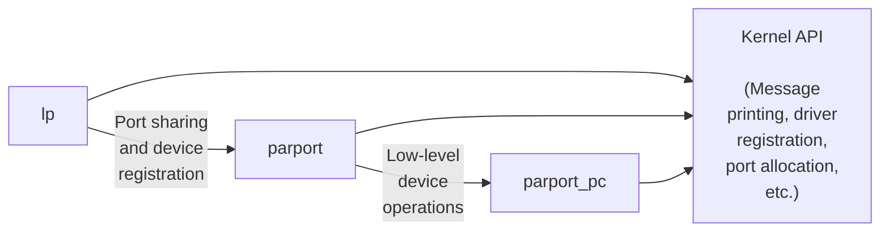

# Chương 2: Xây dựng và Chạy các Module

Đã đến lúc chúng ta bắt đầu lập trình. Chương này giới thiệu tất cả các khái niệm thiết yếu về module (module) và lập trình nhân (kernel programming). Chỉ trong vài trang này, chúng ta sẽ xây dựng và chạy một module hoàn chỉnh (dù là khá vô dụng), đồng thời xem xét một số mã nguồn cơ bản được chia sẻ bởi tất cả các module. Việc phát triển sự thành thạo này là nền tảng thiết yếu cho bất kỳ loại driver dạng module (modularized driver) nào. Để tránh việc đưa ra quá nhiều khái niệm cùng một lúc, chương này chỉ bàn về các module mà không đề cập đến bất kỳ lớp thiết bị (device class) cụ thể nào.

Tất cả các thành phần của nhân (hàm, biến, tệp tiêu đề và macro) được giới thiệu ở đây sẽ được mô tả trong phần tài liệu tham khảo ở cuối chương.

## Thiết lập Hệ thống Thử nghiệm của Bạn

Bắt đầu từ chương này, chúng tôi sẽ trình bày các module ví dụ để minh họa cho các khái niệm lập trình. (Tất cả các ví dụ này đều có sẵn trên trang FTP của O'Reilly, như đã giải thích ở Chương 1.) Việc xây dựng, nạp (load) và chỉnh sửa các ví dụ này là cách tốt nhất để nâng cao sự hiểu biết của bạn về cách các driver hoạt động và tương tác với nhân (kernel).

Các module ví dụ sẽ hoạt động với hầu hết mọi kernel phiên bản 2.6.x, kể cả các kernel do các nhà cung cấp bản distribution (bản phân phối) cung cấp. Tuy nhiên, chúng tôi khuyên bạn nên lấy một kernel "chính thống" (mainline) trực tiếp từ mạng lưới máy chủ nhân bản *kernel.org* và cài đặt nó lên hệ thống của mình. Các kernel của nhà phân phối có thể đã được vá (patch) rất nhiều và khác biệt so với dòng chính (mainline); đôi khi, các bản vá của nhà phân phối có thể thay đổi API của nhân (kernel API) mà các driver thiết bị nhìn thấy. Nếu bạn đang viết một driver phải hoạt động trên một bản phân phối cụ thể, chắc chắn bạn sẽ muốn xây dựng và thử nghiệm dựa trên các kernel liên quan đó. Nhưng đối với mục đích học tập cách viết driver, một kernel chuẩn là lựa chọn tốt nhất.

Bất kể nguồn gốc của kernel là gì, việc xây dựng các module cho phiên bản 2.6.x yêu cầu bạn phải có một cây mã nguồn nhân (kernel source tree) đã được cấu hình và biên dịch trên hệ thống của mình. Yêu cầu này là một sự thay đổi so với các phiên bản nhân trước đây, nơi chỉ cần một tập hợp các tệp tiêu đề (header files) hiện tại là đủ. Các module của phiên bản 2.6 được liên kết (linked) với các tệp đối tượng (object files) có trong cây mã nguồn nhân; kết quả là tạo ra một trình nạp module (module loader) mạnh mẽ hơn, nhưng đồng thời cũng đòi hỏi các tệp đối tượng đó phải có sẵn.

Do đó, công việc đầu tiên của bạn là chuẩn bị một cây mã nguồn nhân (từ mạng lưới *kernel.org* hoặc gói mã nguồn nhân của nhà phân phối), xây dựng một kernel mới và cài đặt nó lên hệ thống của bạn. Vì những lý do mà chúng ta sẽ thấy sau này, mọi việc thường sẽ dễ dàng nhất nếu bạn thực sự đang chạy kernel mục tiêu khi xây dựng các module của mình, mặc dù điều này không bắt buộc.

Bạn cũng nên suy nghĩ về nơi mình sẽ tiến hành thử nghiệm, phát triển và kiểm tra module. Chúng tôi đã cố gắng hết sức để làm cho các module ví dụ của mình an toàn và chính xác, nhưng khả năng xảy ra lỗi (bug) luôn luôn tồn tại. Các lỗi trong mã nguồn nhân có thể dẫn đến việc kết thúc một tiến trình người dùng (user process) hoặc thỉnh thoảng là toàn bộ hệ thống (system crash). Chúng thường không gây ra các vấn đề nghiêm trọng hơn, chẳng hạn như hỏng đĩa (disk corruption). Tuy nhiên, bạn vẫn nên thực hiện việc thử nghiệm nhân trên một hệ thống không chứa dữ liệu quan trọng mà bạn không thể chịu mất, và hệ thống đó không thực hiện các dịch vụ thiết yếu. Các lập trình viên nhân (kernel hacker) thường giữ một hệ thống "hy sinh" (sacrificial system) để phục vụ cho mục đích kiểm tra mã nguồn mới.

Vì vậy, nếu bạn chưa có một hệ thống thích hợp với cây mã nguồn nhân đã được cấu hình và biên dịch trên đĩa, thì bây giờ là thời điểm tốt để thiết lập điều đó. Chúng tôi sẽ chờ. Một khi nhiệm vụ đó đã được giải quyết, bạn sẽ sẵn sàng bắt đầu vọc vạch với các kernel module.

## Module "Hello World"

Nhiều cuốn sách lập trình bắt đầu với ví dụ "hello world" như một cách để hiển thị chương trình đơn giản nhất có thể. Cuốn sách này đề cập đến các Linux Kernel Module (nhân mô-đun) thay vì các chương trình thông thường; vì vậy, đối với độc giả thiếu kiên nhẫn, đoạn mã sau đây là một module "hello world" hoàn chỉnh:

```
## include <linux/init.h>
## include <linux/module.h>
MODULE_LICENSE("Dual BSD/GPL");
static int hello_init(void)
{
 printk(KERN_ALERT "Hello, world\n");
 return 0;
}
static void hello_exit(void)
{
 printk(KERN_ALERT "Goodbye, cruel world\n");
}
module_init(hello_init);
module_exit(hello_exit);
```

Module này định nghĩa hai hàm, một hàm được gọi khi module được nạp (load) vào trong kernel (*hello\_init*) và một hàm dành cho lúc module bị gỡ bỏ (*hello\_exit*). Các dòng *module\_init* và *module\_exit* sử dụng các macro đặc biệt của kernel để chỉ định vai trò của hai hàm này. Một macro đặc biệt khác (*MODULE\_LICENSE*) được sử dụng để thông báo cho kernel biết rằng module này mang giấy phép tự mã nguồn mở (free license); nếu không có khai báo như vậy, kernel sẽ đưa ra cảnh báo khi module được nạp.

Hàm *printk* được định nghĩa trong Linux Kernel và cung cấp cho các module; nó hoạt động tương tự như hàm *printf* của thư viện chuẩn C. Kernel cần hàm in ấn của riêng nó vì nó chạy độc lập, không có sự trợ giúp từ thư viện C. Module có thể gọi *printk* bởi vì, sau khi *insmod* nạp nó vào, module được liên kết (linked) với kernel và có thể truy cập các ký hiệu (symbol) công khai của kernel (các hàm và biến, như được trình bày chi tiết trong phần tiếp theo). Chuỗi `KERN_ALERT` là mức ưu tiên (priority) của thông điệp.\* Chúng ta đã chỉ định mức ưu tiên cao trong module này, bởi vì một thông điệp với mức ưu tiên mặc định có thể không hiển thị ở bất kỳ nơi hữu ích nào, tùy thuộc vào phiên bản kernel bạn đang chạy, phiên bản của tiến ngầm (daemon) *klogd*, và cấu hình của bạn. Bạn có thể bỏ qua vấn đề này lúc này; chúng tôi sẽ giải thích nó trong Chương 4.

Bạn có thể kiểm tra module với các tiện ích *insmod* và *rmmod*, như được hiển thị bên dưới. Lưu ý rằng chỉ có siêu người dùng (superuser - root) mới có thể nạp và gỡ bỏ một module.

```
% make
make[1]: Entering directory `/usr/src/linux-2.6.10'
 CC [M] /home/ldd3/src/misc-modules/hello.o
 Building modules, stage 2.
 MODPOST
 CC /home/ldd3/src/misc-modules/hello.mod.o
 LD [M] /home/ldd3/src/misc-modules/hello.ko
make[1]: Leaving directory `/usr/src/linux-2.6.10'
% su
root# insmod ./hello.ko
Hello, world
root# rmmod hello
Goodbye cruel world
root#
```

Xin lưu ý một lần nữa rằng, để chuỗi lệnh trên hoạt động, bạn phải có một cây mã nguồn kernel (kernel tree) đã được cấu hình và biên dịch đúng cách ở một vị trí mà tệp makefile có thể tìm thấy nó (*/usr/src/linux-2.6.10* trong ví dụ được hiển thị). Chúng tôi sẽ đi sâu vào chi tiết về cách các module được biên dịch trong phần "Biên dịch và Nạp" (Compiling and Loading).

Tùy thuộc vào cơ chế mà hệ thống của bạn sử dụng để chuyển các dòng thông điệp, đầu ra của bạn có thể khác nhau. Cụ thể, ảnh chụp màn hình trước đó được lấy từ một text console (bảng điều khiển văn bản); nếu bạn đang chạy *insmod* và *rmmod* từ một trình giả lập đầu cuối (terminal emulator) chạy dưới hệ thống cửa sổ đồ họa (window system), bạn sẽ không thấy gì trên màn hình của mình. Thông điệp sẽ đi đến một trong các tệp nhật ký hệ thống (system log file), chẳng hạn như */var/log/messages* (tên của tệp thực tế

Mức ưu tiên chỉ đơn giản là một chuỗi, chẳng hạn như `<1>`, được nối vào trước chuỗi định dạng của *printk*. Lưu ý việc thiếu dấu phẩy sau `KERN_ALERT`; việc thêm dấu phẩy ở đó là một lỗi đánh máy phổ biến và phiền phức (may mắn là trình biên dịch có thể phát hiện được).

có sự khác biệt giữa các bản phân phối Linux). Cơ chế được sử dụng để chuyển các thông điệp kernel được mô tả trong Chương 4.

Như bạn có thể thấy, việc viết một module không khó như bạn mong đợi—ít nhất là chừng nào module đó không bắt buộc phải làm bất kỳ điều gì có giá trị thực tế. Phần khó là hiểu về thiết bị của bạn và cách tối đa hóa hiệu suất. Chúng tôi sẽ đi sâu hơn vào việc mô-đun hóa trong suốt chương này và để lại các vấn đề cụ thể về thiết bị cho các chương sau.

## Kernel Module và Ứng dụng (Kernel Modules Versus Applications)

Trước khi đi sâu hơn, chúng ta cần nhấn mạnh những điểm khác biệt cơ bản giữa một kernel module (mô-đun nhân) và một ứng dụng (application).

Trong khi hầu hết các ứng dụng cỡ nhỏ và trung bình thực hiện một tác vụ đơn lẻ từ đầu đến cuối, thì mọi kernel module chỉ đơn giản là tự đăng ký chính nó để phục vụ các yêu cầu trong tương lai, và hàm khởi tạo (initialization function) của nó sẽ kết thúc ngay lập tức. Nói cách khác, nhiệm vụ của hàm khởi tạo trong module là chuẩn bị cho việc gọi các hàm của module đó về sau; giống như thể module đang nói rằng: "Tôi đây, và đây là những gì tôi có thể làm". Hàm kết thúc (exit function) của module (hạ tầng *hello\_exit* trong ví dụ) được gọi ngay trước khi module bị gỡ tải (unload). Nó sẽ thông báo với kernel (nhân hệ điều hành) rằng: "Tôi không còn ở đó nữa; đừng yêu cầu tôi làm gì khác nhé". Cách tiếp cận lập trình này tương tự như lập trình hướng sự kiện (event-driven programming), nhưng trong khi không phải mọi ứng dụng đều hướng sự kiện, thì tất cả mọi kernel module đều như vậy. Một điểm khác biệt lớn nữa giữa các ứng dụng hướng sự kiện và mã nguồn kernel nằm ở hàm kết thúc: trong khi một ứng dụng sắp kết thúc có thể lười biếng trong việc giải phóng tài nguyên hoặc tránh hoàn toàn việc dọn dẹp, thì hàm kết thúc của một module phải cẩn thận hoàn tác mọi thứ mà hàm *init* đã tạo dựng, nếu không các thành phần đó sẽ tiếp tục tồn tại cho đến khi hệ thống được khởi động lại (reboot).

Nhân tiện, khả năng gỡ tải một module là một trong những tính năng của tính mô-đun hóa (modularization) mà bạn sẽ đánh giá cao nhất, bởi vì nó giúp cắt giảm thời gian phát triển; bạn có thể thử nghiệm các phiên bản kế tiếp của trình điều khiển (driver) mới mà không phải trải qua chu kỳ tắt/khởi động lại (shutdown/reboot) tốn thời gian mỗi lần.

Là một lập trình viên, bạn biết rằng một ứng dụng có thể gọi các hàm mà nó không định nghĩa: giai đoạn liên kết (linking stage) giải quyết các tham chiếu ngoại vi (external references) bằng cách sử dụng thư viện hàm thích hợp. *printf* là một trong những hàm có thể gọi như vậy và được định nghĩa trong *libc*. Ngược lại, một module chỉ được liên kết với kernel, và các hàm duy nhất mà nó có thể gọi là những hàm do kernel xuất ra (exported); không có thư viện nào để liên kết cùng. Ví dụ, hàm *printk* được sử dụng trong *hello.c* trước đó, chính là phiên bản *printf* được định nghĩa bên trong kernel và được xuất ra cho các module. Nó hoạt động tương tự như hàm gốc, với một vài điểm khác biệt nhỏ, điểm chính là việc thiếu hỗ trợ dấu chấm động (floating-point support).

Hình 2-1 minh họa cách các lệnh gọi hàm (function calls) và con trỏ hàm (function pointers) được sử dụng trong một module để thêm chức năng mới vào một kernel đang chạy.

```text
┌─────────────────────────────────────────────────────────────────────────┐
│                                                                         │
│  insmod ──→ ┌───────────────┐ ···→ blk_init_queue()                    │
│             │ init function │                                           │
│             └───────────────┘ ···→ add_disk()                          │
│                                         :                               │
│                                         :         ┌──────────────┐     │
│                                         :         │ struct       │     │
│   block_device ops                      ···→····→ │ gendisk      │     │
│  ┌──────────────────┐                             └──────┬───────┘     │
│  │ ════════════════ │ ←────────────────────────────────  │             │
│  │ ════════════════ │                                     ↓             │
│  │ ════════════════ │                          ┌──────────────────┐    │
│  └────────┬─────────┘                    ···→  │  request_queue_  │    │
│           │                                    └──────────────────┘    │
│  ┌────────┴──────┐                                      ↑              │
│  │  request()    │ ──→                                  │              │
│  └───────────────┘                                      │              │
│  ┌───────────────────┐ ···→ ─────────────────────────── │              │
│  │                   │ ···→ ──────────────────────────→ ┘              │
│  └───────────────────┘ ···→ ──────────────────────────→                │
│                                                                         │
│  rmmod ──→ ┌───────────────┐ ···→ del_gendisk()                        │
│            │   cleanup     │                                            │
│            │   function    │ ···→ blk_cleanup_queue()                  │
│            └───────────────┘                                            │
│                                                                         │
└─────────────────────────────────────────────────────────────────────────┘

LEGEND:
  ·····→   Data operation
  ─────→   Data pointer
  -- →     Function call
  ───→     Function pointer

  ╔══════════════════╗   Multiple functions
  ╚══════════════════╝

  ┌──────────────────┐   Single function
  └──────────────────┘

  ████████████████████   Data
```

Hình 2-1. Liên kết một module với kernel

Vì không có thư viện nào được liên kết với các module, các tệp nguồn không bao giờ được bao gồm (include) các tệp tiêu đề (header files) thông thường như *<stdarg.h>*, trừ những tình huống rất đặc biệt. Chỉ những hàm thực sự thuộc về bản thân kernel mới có thể được sử dụng trong các kernel module. Mọi thứ liên quan đến kernel đều được khai báo trong các tệp tiêu đề nằm trong cây mã nguồn kernel (kernel source tree) mà bạn đã thiết lập và cấu hình; phần lớn các tệp tiêu đề liên quan nằm trong `include/linux` và `include/asm`, nhưng các thư mục con khác của `include` cũng đã được bổ sung để chứa các thành phần liên quan đến các hệ thống con (subsystem) cụ thể của kernel.

Vai trò của từng tệp tiêu đề kernel riêng lẻ sẽ được giới thiệu xuyên suốt cuốn sách khi mỗi tệp đó cần được sử dụng.

Một điểm khác biệt quan trọng nữa giữa lập trình kernel và lập trình ứng dụng là cách mỗi môi trường xử lý lỗi (fault): trong khi một lỗi phân vùng (segmentation fault) là vô hại trong quá trình phát triển ứng dụng và một trình gỡ lỗi (debugger) luôn có thể được sử dụng để truy vết lỗi đến đúng vấn đề trong mã nguồn, thì một lỗi kernel sẽ làm chết tiến trình hiện tại (Process), nếu không muốn nói là làm sập toàn bộ hệ thống (System). Chúng ta sẽ tìm hiểu cách truy vết các lỗi kernel trong Chương 4.

### User Space và Kernel Space

Một module chạy trong *kernel space* (không gian kernel), trong khi các ứng dụng chạy trong *user space* (không gian người dùng). Khái niệm này là nền tảng của lý thuyết hệ điều hành.

Vai trò của hệ điều hành, trên thực tế, là cung cấp cho các chương trình một góc nhìn nhất quán về phần cứng của máy tính. Thêm vào đó, hệ điều hành phải đảm bảo hoạt động độc lập của các chương trình và bảo vệ chống lại việc truy cập tài nguyên trái phép. Nhiệm vụ không tầm thường này chỉ có thể thực thi được nếu CPU bắt buộc phần mềm hệ thống phải được bảo vệ khỏi các ứng dụng.

Mọi bộ vi xử lý hiện đại đều có khả năng thực thi hành vi này. Phương pháp được chọn là triển khai các chế độ (hoặc cấp độ) vận hành khác nhau ngay bên trong CPU. Các cấp độ này có vai trò khác nhau và một số thao tác không được phép thực hiện ở các cấp độ thấp hơn; mã chương trình chỉ có thể chuyển đổi từ cấp độ này sang cấp độ khác thông qua một số lượng giới hạn các cổng (gate). Các hệ thống Unix được thiết kế để tận dụng tính năng phần cứng này, sử dụng hai cấp độ như vậy. Tất cả các bộ vi xử lý hiện nay đều có ít nhất hai cấp độ bảo vệ, và một số dòng, như dòng x86, có nhiều cấp độ hơn; khi có nhiều cấp độ tồn tại, cấp độ cao nhất và thấp nhất sẽ được sử dụng. Dưới hệ điều hành Unix, kernel thực thi ở cấp độ cao nhất (còn gọi là *supervisor mode* - chế độ giám sát), nơi mọi thứ đều được cho phép, trongขณะ các ứng dụng thực thi ở cấp độ thấp nhất (gọi là *user mode* - chế độ người dùng), nơi bộ vi xử lý điều tiết quyền truy cập trực tiếp vào phần cứng và quyền truy cập bộ nhớ trái phép.

Chúng ta thường gọi các chế độ thực thi này là *kernel space* và *user space*. Các thuật ngữ này không chỉ bao hàm các mức đặc quyền khác nhau vốn có trong hai chế độ, mà còn bao gồm cả thực tế là mỗi chế độ có thể có ánh xạ bộ nhớ (memory mapping) của riêng mình—tức là không gian địa chỉ (address space) của riêng nó.

Unix chuyển quyền thực thi từ user space sang kernel space bất cứ khi nào một ứng dụng thực hiện một system call (lệnh gọi hệ thống) hoặc bị tạm dừng bởi một ngắt phần cứng (hardware interrupt). Mã kernel thực thi một system call đang hoạt động trong ngữ cảnh của một tiến trình (process context)—nó hoạt động thay mặt cho tiến trình gọi và có thể truy cập dữ liệu trong không gian địa chỉ của tiến trình đó. Ngược lại, mã xử lý ngắt (interrupt handler) hoạt động bất đồng bộ đối với các tiến trình và không liên quan đến bất kỳ tiến trình cụ thể nào.

Vai trò của một module là mở rộng chức năng của kernel; mã được mô-đun hóa sẽ chạy trong kernel space. Thông thường, một trình điều khiển (driver) thực hiện cả hai tác vụ đã nêu trước đó: một số hàm trong module được thực thi như một phần của system call, và một số hàm chịu trách nhiệm xử lý ngắt.

### Tính đồng thời trong Kernel

Một trong những điểm khiến việc lập trình kernel (kernel programming) khác biệt rất lớn so với lập trình ứng dụng thông thường là vấn đề tính đồng thời (concurrency). Hầu hết các ứng dụng, ngoại trừ các ứng dụng đa luồng (multithreading applications), thường chạy tuần tự từ đầu đến cuối mà không cần phải bận tâm đến việc có điều gì khác đang xảy ra có thể làm thay đổi môi trường của chúng. Mã nguồn kernel không chạy trong một thế giới đơn giản như vậy, và ngay cả những module kernel đơn giản nhất cũng phải được viết với ý thức rằng có nhiều thứ có thể xảy ra cùng một lúc.

Có một vài nguồn gây ra tính đồng thời trong lập trình kernel. Đương nhiên, các hệ thống Linux chạy nhiều tiến trình (process), và có thể có nhiều hơn một tiến trình đang cố gắng sử dụng trình điều khiển (driver) của bạn cùng một lúc. Hầu hết các thiết bị đều có khả năng ngắt (interrupt) bộ xử lý; các trình xử lý ngắt (interrupt handler) chạy một cách bất đồng bộ (asynchronously) và có thể được gọi vào thời điểm trình điều khiển của bạn đang cố gắng làm một việc khác. Một số sự trừu tượng hóa phần mềm (như bộ định thời kernel - kernel timer, được giới thiệu ở Chương 7) cũng chạy bất đồng bộ. Hơn nữa, tất nhiên, Linux có thể chạy trên các hệ thống đa xử lý đối xứng (Symmetric Multiprocessor - SMP), dẫn đến việc trình điều khiển của bạn có thể đang thực thi đồng thời trên nhiều hơn một CPU. Cuối cùng, trong phiên bản 2.6, mã nguồn kernel đã được thiết kế thành có thể ngắt quyền (preemptible); thay đổi này khiến cho ngay cả các hệ thống đơn xử lý (uniprocessor system) cũng gặp phải nhiều vấn đề về tính đồng thời tương tự như hệ thống đa xử lý.

Kết quả là, mã nguồn Linux kernel, bao gồm cả mã nguồn driver, phải có tính *tái nhập* (*reentrant*) — nó phải có khả năng chạy ở nhiều ngữ cảnh (context) cùng một lúc. Các cấu trúc dữ liệu phải được thiết kế cẩn thận để giữ cho nhiều luồng thực thi (thread of execution) tách biệt nhau, và mã nguồn phải cẩn trọng khi truy cập dữ liệu được chia sẻ (shared data) theo các cách ngăn chặn việc hỏng dữ liệu (corruption of the data). Việc viết mã nguồn xử lý tính đồng thời và tránh tình trạng tranh chấp (race condition) (các tình huống mà một thứ tự thực thi bất lợi gây ra hành vi không mong muốn) đòi hỏi phải suy kỹ lưỡng và có thể rất phức tạp. Việc quản lý tính đồng thời đúng đắn là yêu cầu bắt buộc để viết được mã nguồn kernel chính xác; vì lý do đó, mọi driver mẫu trong cuốn sách này đều được viết với ý thức về tính đồng thời. Các kỹ thuật được sử dụng sẽ được giải thích khi chúng ta gặp chúng; Chương 5 cũng được dành riêng cho vấn đề này và các nguyên thủy (primitive) của kernel có sẵn để quản lý tính đồng thời.

Một sai lầm phổ biến của các lập trình viên viết driver là giả định rằng tính đồng thời không phải là vấn đề miễn là một đoạn mã cụ thể không đi vào trạng thái ngủ (sleep) (hoặc "chặn" - block). Ngay cả trong các kernel trước đây (vốn không có tính năng ngắt quyền - preemptive), giả định này cũng không còn đúng trên các hệ thống đa xử lý. Trong phiên bản 2.6, mã nguồn kernel (hầu như) không bao giờ có thể giả định rằng nó nắm giữ bộ xử lý trong suốt một đoạn mã cho trước. Nếu bạn không viết mã nguồn của mình với ý thức về tính đồng thời, nó sẽ phải chịu những lỗi thảm khốc mà việc gỡ lỗi (debug) có thể cực kỳ khó khăn.

### Tiến trình hiện tại (The Current Process)

Mặc dù các kernel module (mô-đun nhân) không thực thi tuần tự như các ứng dụng, nhưng hầu hết các hành động do kernel thực hiện đều được tiến hành thay mặt cho một tiến trình (process) cụ thể. Mã nguồn của kernel (kernel code) có thể tham chiếu đến tiến trình hiện tại bằng cách truy cập vào mục toàn cục `current`, được định nghĩa trong *<asm/current.h>*, trả về một con trỏ trỏ tới cấu trúc `struct task_struct`, được định nghĩa bởi *<linux/sched.h>*. Con trỏ `current` trỏ tới tiến trình đang thực thi tại thời điểm đó. Trong quá trình thực thi một system call (lệnh gọi hệ thống), chẳng hạn như `open` hoặc `read`, tiến trình hiện tại chính là tiến trình đã gọi lệnh đó. Mã nguồn kernel có thể sử dụng thông tin cụ thể của tiến trình bằng cách sử dụng `current`, nếu cần thiết. Một ví dụ về kỹ thuật này được trình bày trong Chương 6.

Thực ra, `current` không hẳn là một biến toàn cục (global variable). Nhu cầu hỗ trợ các hệ thống SMP (Symmetric Multiprocessing) đã buộc các nhà phát triển kernel phải xây dựng một cơ chế để tìm tiến trình hiện tại trên CPU phù hợp. Cơ chế này cũng phải đảm bảo tốc độ nhanh, vì các tham chiếu đến `current` diễn ra rất thường xuyên. Kết quả là một cơ chế phụ thuộc vào kiến trúc (architecture-dependent), thường ẩn một con trỏ trỏ đến cấu trúc `struct task_struct` nằm trên kernel stack (ngăn xếp nhân). Tuy nhiên, các chi tiết triển khai vẫn được giấu kín đối với các hệ thống con (subsystem) khác của kernel, và một device driver (trình điều khiển thiết bị) chỉ cần bao gồm tệp tiêu đề *<linux/sched.h>* và tham chiếu đến tiến trình hiện tại. Ví dụ,

câu lệnh sau in ra ID của tiến trình và tên lệnh của tiến trình hiện tại bằng cách truy cập vào các trường nhất định trong `struct task_struct`:

```c
printk(KERN_INFO "The process is \"%s\" (pid %i)\n",
 current->comm, current->pid);
```

Tên lệnh được lưu trữ trong `current->comm` là tên cơ sở của tệp chương trình (được cắt gọn thành 15 ký tự nếu cần thiết) đang được thực thi bởi tiến trình hiện tại.

### Một vài chi tiết khác (A Few Other Details)

Lập trình kernel khác với lập trình ở user space (không gian người dùng) theo nhiều cách. Chúng tôi sẽ chỉ ra các điểm khác biệt này khi chúng ta đề cập đến chúng trong suốt cuốn sách, nhưng có một số vấn đề cốt lõi tuy không cần một mục riêng biệt nhưng vẫn đáng được nhắc tới. Vì vậy, khi bạn tìm hiểu sâu về kernel, cần ghi nhớ những vấn đề sau đây.

Các ứng dụng được bố trí trong bộ nhớ ảo (virtual memory) với một vùng stack rất lớn. Tất nhiên, stack được sử dụng để lưu trữ lịch sử gọi hàm và tất cả các biến tự động (automatic variable) được tạo bởi các hàm đang hoạt động. Ngược lại, kernel có một stack rất nhỏ; nó có thể nhỏ bằng một trang (page) duy nhất kích thước 4096 byte. Các hàm của bạn phải chia sẻ stack đó với toàn bộ chuỗi gọi hàm trong kernel space (không gian nhân). Do đó, việc khai báo các biến tự động lớn không bao giờ là một ý hay; nếu bạn cần các cấu trúc lớn hơn, bạn nên cấp phát chúng một cách động (dynamically) tại thời điểm gọi.

Thường thì khi xem xét kernel API (giao diện lập trình ứng dụng nhân), bạn sẽ gặp các tên hàm bắt đầu bằng hai dấu gạch dưới (`__`). Các hàm được đánh dấu như vậy thường là các thành phần cấp thấp (low-level component) của giao diện và nên được sử dụng một cách thận trọng. Về cơ bản, hai dấu gạch dưới nói với lập trình viên rằng: "Nếu bạn gọi hàm này, hãy chắc chắn rằng bạn biết mình đang làm gì."

Mã nguồn kernel không thể thực hiện các phép toán số học dấu chấm động (floating point arithmetic). Việc bật tính năng dấu chấm động sẽ yêu cầu kernel phải lưu và khôi phục trạng thái của bộ xử lý dấu chấm động ở mỗi lần đi vào và đi ra khỏi kernel space — ít nhất là trên một số kiến trúc. Xét thấy thực sự không có nhu cầu sử dụng số dấu chấm động trong mã nguồn kernel, chi phí phát sinh (overhead) thêm này là không đáng giá.

## Biên dịch và Tải (Compiling and Loading)

Ví dụ "hello world" ở phần đầu chương này bao gồm một phần minh họa ngắn gọn về cách xây dựng (build) một module và tải (load) nó vào hệ thống. Tất nhiên, toàn bộ quá trình đó còn có nhiều điều phức tạp hơn những gì chúng ta đã thấy cho đến nay. Phần này cung cấp thêm chi tiết về cách một tác giả viết module biến mã nguồn (source code) thành một hệ thống con (subsystem) đang thực thi bên trong nhân (kernel).

### Biên dịch Module (Compiling Modules)

Là bước đầu tiên, chúng ta cần xem xét một chút về cách các module phải được xây dựng. Quá trình xây dựng module khác biệt đáng kể so với quá trình được sử dụng cho các ứng dụng không gian người dùng (user-space applications); kernel là một chương trình lớn, độc lập với các yêu cầu chi tiết và rõ ràng về cách các thành phần của nó được ghép lại với nhau. Quá trình xây dựng này cũng khác so với cách mọi thứ được thực hiện với các phiên bản kernel trước đó; hệ thống build mới dễ sử dụng hơn và mang lại kết quả chính xác hơn, nhưng nó trông rất khác so với những gì có trước đây. Hệ thống build của kernel là một thực thể phức tạp, và chúng ta chỉ xem xét một phần rất nhỏ trong đó. Các tệp nằm trong thư mục *Documentation/kbuild* trong mã nguồn kernel là tài liệu bắt buộc phải đọc cho bất kỳ ai muốn hiểu tất cả những gì thực sự đang diễn ra bên dưới bề mặt.

Có một số điều kiện tiên quyết mà bạn phải hoàn thành trước khi có thể xây dựng các kernel module. Đầu tiên là đảm bảo rằng bạn có các phiên bản trình biên dịch (compiler), tiện ích module (module utilities) và các công cụ cần thiết khác đủ mới. Tệp *Documentation/Changes* trong thư mục tài liệu kernel luôn liệt kê các phiên bản công cụ bắt buộc; bạn nên tham khảo tệp này trước khi tiến xa hơn. Cố gắng xây dựng một kernel (và các module của nó) với các phiên bản công cụ sai có thể dẫn đến vô số vấn đề tinh tế và khó khăn. Lưu ý rằng, đôi khi, một phiên bản trình biên dịch quá mới có thể gây ra vấn đề tương tự như phiên bản quá cũ; mã nguồn kernel đưa ra rất nhiều giả định về trình biên dịch, và các bản phát hành mới đôi khi có thể làm hỏng mọi thứ trong một thời gian.

Nếu bạn vẫn chưa có sẵn cây thư mục kernel (kernel tree), hoặc chưa cấu hình và xây dựng kernel đó, thì đây là lúc để làm điều đó. Bạn không thể xây dựng các module có thể tải (loadable modules) cho kernel phiên bản 2.6 mà không có cây thư mục này trên hệ thống tệp (filesystem) của mình. Việc thực sự đang chạy kernel mà bạn đang xây dựng cũng rất hữu ích (mặc dù không bắt buộc).

Một khi bạn đã thiết lập mọi thứ xong xuôi, việc tạo một makefile cho module của bạn sẽ trở nên rất đơn giản. Trên thực tế, đối với ví dụ "hello world" được hiển thị ở phần trước trong chương này, một dòng duy nhất là đủ:

```
obj-m := hello.o
```

Những độc giả đã quen thuộc với *make*, nhưng chưa quen với hệ thống build kernel 2.6, có lẽ đang tự hỏi makefile này hoạt động như thế nào. Xét cho cùng, dòng trên không giống với một makefile truyền thống. Tất nhiên, câu trả lời là hệ thống build kernel sẽ xử lý phần còn lại. Phép gán ở trên (tận dụng cú pháp mở rộng do GNU *make* cung cấp) nêu rõ rằng có một module được xây dựng từ tệp đối tượng (object file) *hello.o*. Module kết quả có tên là *hello.ko* sau khi được xây dựng từ tệp đối tượng.

Nếu thay vào đó, bạn có một module tên là *module.ko* được tạo ra từ hai tệp mã nguồn (giả sử là *file1.c* và *file2.c*), câu lệnh chính xác sẽ là:

```
obj-m := module.o
module-objs := file1.o file2.o
```

Để một makefile giống như những gì được hiển thị ở trên hoạt động, nó phải được gọi trong ngữ cảnh của hệ thống build kernel lớn hơn. Nếu cây mã nguồn kernel của bạn nằm ở, giả sử,

thư mục *~/kernel-2.6* của bạn, lệnh *make* cần thiết để xây dựng module của bạn (được gõ trong thư mục chứa mã nguồn module và makefile) sẽ là:

```
make -C ~/kernel-2.6 M=`pwd` modules
```

Lệnh này bắt đầu bằng cách chuyển thư mục của nó sang thư mục được cung cấp với tùy chọn `-C` (đó là thư mục mã nguồn kernel của bạn). Ở đó, nó tìm thấy makefile cấp cao nhất của kernel. Tùy chọn `M=` khiến makefile đó quay trở lại thư mục mã nguồn module của bạn trước khi cố gắng xây dựng mục tiêu (target) `modules`. Mục tiêu này, lần lượt, tham chiếu đến danh sách các module được tìm thấy trong biến `obj-m`, mà chúng ta đã đặt thành *module.o* trong các ví dụ của mình.

Việc gõ lệnh *make* trước đó có thể trở nên nhàm chาม sau một thời gian, vì vậy các nhà phát triển kernel đã phát triển một dạng thành ngữ makefile (makefile idiom), giúp cuộc sống dễ dàng hơn cho những ai xây dựng module bên ngoài cây mã nguồn kernel. Bí quyết là viết makefile của bạn như sau:

```
## Nếu KERNELRELEASE được định nghĩa, chúng ta đã được gọi từ
## hệ thống build kernel và có thể sử dụng ngôn ngữ của nó.
ifneq ($(KERNELRELEASE),)
 obj-m := hello.o
## Ngược lại, chúng ta được gọi trực tiếp từ dòng lệnh;
## gọi hệ thống build kernel.
else
 KERNELDIR ?= /lib/modules/$(shell uname -r)/build
 PWD := $(shell pwd)
default:
 $(MAKE) -C $(KERNELDIR) M=$(PWD) modules
endif
```

Một lần nữa, chúng ta đang thấy cú pháp GNU *make* mở rộng đang hoạt động. Makefile này được đọc hai lần trong một quá trình build thông thường. Khi makefile được gọi từ dòng lệnh, nó nhận thấy rằng biến `KERNELRELEASE` chưa được thiết lập. Nó định vị thư mục mã nguồn kernel bằng cách tận dụng thực tế là liên kết tượng trưng (symbolic link) *build* trong thư mục module đã cài đặt trỏ ngược về cây thư mục build kernel. Nếu bạn không thực sự chạy kernel mà bạn đang xây dựng, bạn có thể cung cấp tùy chọn `KERNELDIR=` trên dòng lệnh, thiết lập biến môi trường `KERNELDIR`, hoặc viết lại dòng thiết lập `KERNELDIR` trong makefile. Một khi cây mã nguồn kernel đã được tìm thấy, makefile sẽ gọi mục tiêu `default:`, chạy lệnh *make* thứ hai (được tham số hóa trong makefile là `$(MAKE)`) để gọi hệ thống build kernel như đã mô tả trước đó. Ở lần đọc thứ hai, makefile thiết lập `obj-m`, và các makefile của kernel sẽ lo việc thực sự xây dựng module.

Cơ chế xây dựng (building) module này có phần hơi cồng kềnh và khó hiểu đối với bạn. Tuy nhiên, một khi đã quen thuộc, rất có thể bạn sẽ đánh giá cao các tính năng đã được lập trình sẵn trong hệ thống build của Linux Kernel. Cần lưu ý rằng đoạn mã trên không phải là một Makefile hoàn chỉnh; một Makefile thực tế sẽ bao gồm các mục tiêu (target) thông thường dùng để dọn dẹp các tệp không cần thiết, cài đặt module, v.v. Hãy tham khảo các Makefile trong thư mục mã nguồn ví dụ để có một ví dụ hoàn chỉnh.

### Nạp và Gỡ Module (Loading and Unloading Modules)

Sau khi module được biên dịch (built), bước tiếp theo là nạp (load) nó vào kernel. Như chúng ta đã chỉ ra, *insmod* sẽ giúp bạn làm việc đó. Chương trình này nạp mã và dữ liệu của module vào kernel, từ đó thực hiện một chức năng tương tự như *ld*, đó là liên kết (link) bất kỳ ký hiệu (symbol) chưa được giải quyết nào trong module với bảng ký hiệu (symbol table) của kernel. Tuy nhiên, không giống như trình liên kết (linker), kernel không chỉnh sửa tệp trên đĩa của module, mà thay vào đó là một bản sao nằm trong bộ nhớ (in-memory copy). *insmod* chấp nhận một số tùy chọn dòng lệnh (xem manpage để biết chi tiết), và nó có thể gán giá trị cho các tham số (parameters) trong module của bạn trước khi liên kết nó với kernel hiện tại. Do đó, nếu một module được thiết kế chính xác, nó có thể được cấu hình tại thời điểm nạp (load-time); cấu hình tại thời điểm nạp mang lại cho người dùng sự linh hoạt hơn so với cấu hình tại thời điểm biên dịch (compile-time), mặc dù cách sau đôi khi vẫn được sử dụng. Cấu hình tại thời điểm nạp được giải thích ở phần "Tham số Module" (Module Parameters) sau trong chương này.

Bạn đọc quan tâm có thể muốn tìm hiểu cách kernel hỗ trợ *insmod*: nó dựa vào một System Call được định nghĩa trong *kernel/module.c*. Hàm *sys\_init\_module* cấp phát bộ nhớ kernel để chứa một module (bộ nhớ này được cấp phát bằng *vmalloc*; xem phần "vmalloc và các hàm liên quan" trong Chương 8); sau đó nó sao chép phần văn bản (text) của module vào vùng nhớ đó, giải quyết các tham chiếu đến kernel trong module thông qua bảng ký hiệu của kernel, và gọi hàm khởi tạo (initialization function) của module để bắt đầu mọi thứ.

Nếu bạn thực sự nhìn vào mã nguồn của kernel, bạn sẽ thấy rằng tên của các System Call có tiền tố là sys\_. Điều này đúng với tất cả System Call và không có hàm nào khác; rất hữu ích khi ghi nhớ điều này lúc sử dụng lệnh grep để tìm kiếm System Call trong mã nguồn.

Tiện ích *modprobe* cũng đáng được nhắc đến nhanh qua. *modprobe*, giống như *insmod*, nạp một module vào kernel. Nó khác biệt ở chỗ nó sẽ kiểm tra module chuẩn bị được nạp xem nó có tham chiếu đến bất kỳ ký hiệu nào chưa được định nghĩa trong kernel hay không. Nếu tìm thấy bất kỳ tham chiếu nào như vậy, *modprobe* sẽ tìm kiếm các module khác trong đường dẫn tìm kiếm module hiện tại mà định nghĩa các ký hiệu liên quan đó. Khi *modprobe* tìm thấy các module đó (vốn cần thiết cho module đang được nạp), nó cũng đồng thời nạp chúng vào kernel. Nếu bạn sử dụng *insmod* trong trường hợp này, lệnh sẽ thất bại kèm theo thông báo "unresolved symbols" (các ký hiệu chưa được giải quyết) được ghi lại trong tệp nhật ký (logfile) của hệ thống.

Như đã đề cập trước đó, các module có thể bị gỡ khỏi kernel bằng tiện ích *rmmod*. Lưu ý rằng việc gỡ bỏ module sẽ thất bại nếu kernel cho rằng module đó vẫn đang được sử dụng (ví dụ: một chương trình vẫn đang mở tệp cho một thiết bị do module xuất ra), hoặc nếu kernel được cấu hình để không cho phép gỡ bỏ module. Bạn có thể cấu hình kernel để cho phép gỡ bỏ module một cách "bắt buộc" (forced), ngay cả khi chúng có vẻ đang bận. Tuy nhiên, nếu bạn đã đi đến điểm mà bạn đang cân nhắc sử dụng tùy chọn này, có lẽ mọi thứ đã trở nên tồi tệ đến mức khởi động lại hệ thống (reboot) có thể là phương án hành động tốt hơn.

Chương trình *lsmod* tạo ra danh sách các module hiện đang được nạp trong kernel. Một số thông tin khác, chẳng hạn như bất kỳ module nào khác đang sử dụng một module cụ thể, cũng được cung cấp. *lsmod* hoạt động bằng cách đọc tệp ảo */proc/modules*. Thông tin về các module hiện đang được nạp cũng có thể được tìm thấy trong hệ thống tệp ảo sysfs tại đường dẫn */sys/module*.

### Phụ thuộc phiên bản (Version Dependency)

Hãy ghi nhớ rằng mã nguồn của module (module's code) phải được biên dịch lại (recompile) cho mỗi phiên bản của nhân (kernel) mà nó liên kết tới — ít nhất là khi không sử dụng tính năng `modversions` (tính năng không được đề cập ở đây vì nó phù hợp với các nhà phát triển bản phân phối hơn là các lập trình viên). Các module gắn kết chặt chẽ với các cấu trúc dữ liệu (data structures) và nguyên mẫu hàm (function prototypes) được định nghĩa trong một phiên bản kernel cụ thể; giao diện (interface) mà một module nhìn thấy có thể thay đổi đáng kể từ phiên bản kernel này sang phiên bản tiếp theo. Điều này đặc biệt đúng với các kernel đang phát triển (development kernels), dĩ nhiên là vậy.

Kernel không chỉ đơn thuần giả định rằng một module cho trước được xây dựng dựa trên phiên bản kernel phù hợp. Một trong những bước trong quá trình xây dựng (build process) là liên kết module của bạn với một tệp (gọi là *vermagic.o*) từ cây mã nguồn kernel (kernel tree) hiện tại; đối tượng này chứa một lượng lớn thông tin về kernel mà module được xây dựng cho nó, bao gồm phiên bản kernel đích (target kernel version), phiên bản trình biên dịch (compiler version), và các thiết lập của một số biến cấu hình quan trọng. Khi có một cố gắng tải một module (load a module), thông tin này có thể được kiểm tra tính tương thích với kernel đang chạy. Nếu mọi thứ không khớp, module sẽ không được tải; thay vào đó, bạn sẽ thấy thông báo đại loại như:

#### insmod hello.ko

Error inserting './hello.ko': -1 Invalid module format

Một cái nhìn vào tệp nhật ký hệ thống (system log file) (*/var/log/messages* hoặc bất kỳ tệp nào mà hệ thống của bạn được cấu hình để sử dụng) sẽ tiết lộ vấn đề cụ thể khiến module không thể tải được.

Nếu bạn cần biên dịch một module cho một phiên bản kernel cụ thể, bạn sẽ cần sử dụng hệ thống xây dựng (build system) và cây mã nguồn (source tree) cho phiên bản cụ thể đó. Một thay đổi đơn giản đối với biến `KERNELDIR` trong tệp makefile ví dụ được trình bày trước đó là có thể giải quyết được vấn đề.

Các giao diện kernel thường thay đổi giữa các bản phát hành. Nếu bạn đang viết một module nhằm mục đích hoạt động với nhiều phiên bản kernel khác nhau (đặc biệt là nếu nó phải hoạt động trên các bản phát hành chính khác nhau - major releases), rất có thể bạn sẽ phải sử dụng các macro và cấu trúc `#ifdef` để làm cho mã nguồn của bạn xây dựng thành công. Phiên bản này của cuốn sách chỉ đề cập đến một phiên bản chính (major version) của kernel, vì vậy bạn sẽ không thường xuyên thấy các kiểm tra phiên bản trong mã nguồn ví dụ của chúng tôi. Nhưng nhu cầu về chúng đôi khi vẫn phát sinh. Trong những trường hợp như vậy, bạn sẽ muốn tận dụng các định nghĩa có trong *linux/version.h*. Tệp tiêu đề (header file) này, được tự động bao gồm bởi *linux/module.h*, định nghĩa các macro sau:

UTS\_RELEASE

Macro này mở rộng thành một chuỗi mô tả phiên bản của cây kernel này. Ví dụ: "2.6.10".

#### LINUX\_VERSION\_CODE

Macro này mở rộng thành biểu diễn nhị phân (binary representation) của phiên bản kernel, một byte cho mỗi phần của số phát hành phiên bản. Ví dụ: mã cho 2.6.10 là 132618 (tức là, 0x02060a).\* Với thông tin này, bạn có thể (hầu như) dễ dàng xác định phiên bản kernel mà bạn đang xử lý.

#### KERNEL\_VERSION(major,minor,release)

Đây là macro được sử dụng để xây dựng một mã phiên bản số nguyên (integer version code) từ các số riêng lẻ cấu thành một số phiên bản. Ví dụ: `KERNEL_VERSION(2,6,10)` mở rộng thành 132618. Macro này rất hữu ích khi bạn cần so sánh phiên bản hiện tại và một điểm kiểm tra (checkpoint) đã biết.

Hầu hết các phần phụ thuộc dựa trên phiên bản kernel có thể được xử lý bằng các điều kiện tiền xử lý (preprocessor conditionals) thông qua việc khai thác `KERNEL_VERSION` và `LINUX_VERSION_CODE`. Tuy nhiên, sự phụ thuộc phiên bản không nên làm rối mã nguồn trình điều khiển (driver code) bằng các điều kiện `#ifdef` phức tạp; cách tốt nhất để đối phó với sự không tương thích là giới hạn chúng trong một tệp tiêu đề cụ thể. Theo nguyên tắc chung, mã phụ thuộc rõ ràng vào phiên bản (hoặc nền tảng - platform) nên được ẩn đằng sau một macro hoặc hàm cấp thấp (low-level). Mã cấp cao (high-level) sau đó có thể chỉ cần gọi các hàm đó mà không cần quan tâm đến các chi tiết cấp thấp. Mã được viết theo cách này thường dễ đọc hơn và ổn định hơn.

### Sự phụ thuộc vào nền tảng (Platform Dependency)

Mỗi nền tảng máy tính (computer platform) đều có những đặc thù riêng, và các nhà thiết kế nhân (kernel designer) có toàn quyền tận dụng những đặc thù đó để đạt được hiệu suất tốt hơn trong tệp đối tượng đích (target object file).

Không giống như các nhà phát triển ứng dụng (application developer)—những người phải liên kết (link) mã nguồn của mình với các thư viện được biên dịch sẵn và tuân theo các quy ước truyền tham số—các nhà phát triển nhân (kernel developer) có thể dành riêng một số thanh ghi bộ xử lý (processor register) cho các vai trò cụ thể, và thực tế họ đã làm như vậy. Hơn nữa, mã nguồn nhân (kernel code) có thể được tối ưu hóa cho một bộ xử lý cụ thể trong một dòng CPU để tận dụng tối đa nền tảng đích: không giống như các ứng dụng thường được phân phối dưới định dạng nhị phân (binary format), một bản dịch tùy chỉnh của nhân (kernel) có thể được tối ưu hóa cho một tập hợp máy tính cụ thể.

Ví dụ, kiến trúc IA32 (x86) đã được chia nhỏ thành nhiều loại bộ xử lý khác nhau. Bộ xử lý 80386 cũ vẫn được hỗ trợ (tạm thời), mặc dù tập lệnh (instruction set) của nó khá hạn chế theo tiêu chuẩn hiện đại. Các bộ xử lý hiện đại hơn trong kiến trúc này đã giới thiệu một số tính năng mới, bao gồm các lệnh nhanh hơn để chuyển đổi vào nhân (kernel), khóa liên vi xử lý (interprocessor locking), sao chép dữ liệu, v.v. Các bộ xử lý mới hơn cũng có thể, khi hoạt động ở chế độ chính xác, sử dụng các địa chỉ vật lý (physical address) 36-bit (hoặc

Điều này cho phép có tới 256 phiên bản phát triển giữa các phiên bản ổn định.

lớn hơn), cho phép chúng truy cập (address) hơn 4 GB bộ nhớ vật lý (physical memory). Các dòng bộ xử lý khác cũng có những cải tiến tương tự. Nhân (kernel), tùy thuộc vào các tùy chọn cấu hình (configuration option) khác nhau, có thể được xây dựng để tận dụng các tính năng bổ sung này.

Rõ ràng, nếu một module muốn hoạt động với một nhân (kernel) cho trước, nó phải được xây dựng với cùng một sự hiểu biết về bộ xử lý đích giống như nhân đó. Một lần nữa, tệp đối tượng *vermagic.o* lại phát huy tác dụng. Khi một module được tải (load), nhân sẽ kiểm tra các tùy chọn cấu hình đặc thù của bộ xử lý dành cho module đó và đảm bảo chúng khớp với nhân đang chạy. Nếu module được biên dịch với các tùy chọn khác nhau, nó sẽ không được tải.

Nếu bạn đang lên kế hoạch viết một trình điều khiển (driver) để phân phối rộng rãi, bạn có thể tự hỏi làm thế nào bạn có thể hỗ trợ tất cả các biến thể khác nhau này. Câu trả lời tốt nhất, dĩ nhiên, là phát hành trình điều khiển của bạn theo giấy phép tương thích với GPL (GPL-compatible license) và đóng góp nó vào nhân chính tuyến (mainline kernel). Nếu không làm được điều đó, việc phân phối trình điều khiển của bạn dưới dạng mã nguồn (source form) kèm theo một tập lệnh để biên dịch nó trên hệ thống của người dùng có thể là giải pháp tốt nhất. Một số nhà供應商 (vendor) đã phát hành các công cụ để làm cho tác vụ này trở nên dễ dàng hơn. Nếu bạn bắt buộc phải phân phối trình điều khiển của mình dưới dạng nhị phân, bạn cần xem xét các phiên bản nhân khác nhau do các bản phân phối (distribution) đích của bạn cung cấp, và cung cấp một phiên bản module cho mỗi loại. Hãy chắc chắn tính đến bất kỳ bản vá lỗi nhân (errata kernel) nào có thể đã được phát hành kể từ khi bản phân phối được sản xuất. Sau đó, có các vấn đề về cấp phép cần phải xem xét, như chúng ta đã thảo luận trong phần "Điều khoản cấp phép" (License Terms) ở Chương 1. Theo nguyên tắc chung, phân phối dưới dạng mã nguồn là con đường dễ dàng hơn để bạn hành nghề.

Chúng ta đã thấy cách *insmod* phân giải các ký hiệu chưa được định nghĩa (undefined symbol) dựa trên bảng các ký hiệu công khai của nhân (public kernel symbols). Bảng này chứa địa chỉ của các mục toàn cục trong nhân (global kernel items)—các hàm (function) và biến (variable)—cần thiết để triển khai các trình điều khiển được mô-đun hóa (modularized driver). Khi một module được tải, bất kỳ ký hiệu nào được xuất ra (export) bởi module đó sẽ trở thành một phần của bảng ký hiệu nhân (kernel symbol table). Trong trường hợp thông thường, một module tự triển khai chức năng của chính nó mà không cần phải xuất ra bất kỳ ký hiệu nào cả. Tuy nhiên, bạn cần xuất các ký hiệu bất cứ khi nào các module khác có thể hưởng lợi từ việc sử dụng chúng.

Các module mới có thể sử dụng các ký hiệu được xuất ra bởi module của bạn, và bạn có thể xếp chồng các module mới lên trên các module khác (module stacking). Việc xếp chồng module cũng được triển khai trong mã nguồn nhân chính thống (mainline kernel sources): hệ thống tệp *msdos* dựa vào các ký hiệu được xuất ra bởi module *fat*, và mỗi module thiết bị USB đầu vào đều xếp chồng lên các module *usbcore* và *input*.

Việc xếp chồng module rất hữu ích trong các dự án phức tạp. Nếu một sự trừu tượng hóa (abstraction) mới được triển khai dưới dạng một trình điều khiển thiết bị (device driver), nó có thể cung cấp một điểm cắm (plug) cho các triển khai đặc thù của phần cứng. Ví dụ, tập hợp trình điều khiển video-for-linux được chia thành một module chung (generic module) chuyên xuất ra các ký hiệu được sử dụng bởi các trình điều khiển thiết bị cấp thấp hơn dành cho phần cứng cụ thể. Tùy thuộc vào thiết lập của bạn, bạn sẽ tải module video chung và module cụ thể cho phần cứng đã được cài đặt của mình. Hỗ trợ cho các cổng song song (parallel port) và nhiều loại thiết bị

có thể gắn kèm được xử lý theo cách tương tự, cũng giống như hệ thống con nhân USB (USB kernel subsystem). Việc xếp chồng trong hệ thống con cổng song song được thể hiện ở Hình 2-2; các mũi tên hiển thị quá trình giao tiếp giữa các module và với giao diện lập trình nhân (kernel programming interface).

Hình 2-2. Xếp chồng các module trình điều khiển cổng song song (parallel port driver modules)



Khi sử dụng các module lồng nhau (stacked modules), việc nắm rõ tiện ích *modprobe* sẽ rất hữu ích. Như chúng ta đã mô tả trước đó, *modprobe* hoạt động tương tự như *insmod*, nhưng nó cũng tự động tải bất kỳ module nào khác được yêu cầu bởi module mà bạn muốn nạp. Do đó, một lệnh *modprobe* đôi khi có thể thay thế cho nhiều lần gọi *insmod* (mặc dù bạn vẫn cần *insmod* khi tải các module của riêng mình từ thư mục hiện tại, bởi vì *modprobe* chỉ tìm kiếm trong các thư mục module được cài đặt tiêu chuẩn).

Việc sử dụng kỹ thuật lồng nhau (stacking) để chia nhỏ module thành nhiều tầng (layers) có thể giúp giảm thời gian phát triển bằng cách đơn giản hóa từng tầng. Điều này tương tự như sự tách biệt giữa cơ chế (mechanism) và chính sách (policy) mà chúng ta đã thảo luận ở Chương 1.

Các tệp tiêu đề (header files) của Linux Kernel cung cấp một cách thuận tiện để quản lý tính hiển thị của các ký hiệu (symbol visibility), qua đó làm giảm sự ô nhiễm không gian tên (namespace pollution — tình trạng làm đầy không gian tên bằng các tên có thể xung đột với các tên được định nghĩa ở nơi khác trong nhân) và thúc đẩy việc ẩn thông tin (information hiding) đúng đắn. Nếu module của bạn cần xuất các ký hiệu (export symbols) để các module khác sử dụng, các macro sau đây nên được sử dụng:

```c
EXPORT_SYMBOL(name);
EXPORT_SYMBOL_GPL(name);
```

Một trong hai macro trên làm cho ký hiệu được chỉ định có sẵn bên ngoài module. Phiên bản dành cho GPL chỉ làm cho ký hiệu có sẵn đối với các module được cấp phép theo giấy phép GPL. Các ký hiệu phải được xuất ở phần toàn cục (global part) của tệp module, nằm bên ngoài bất kỳ hàm nào, bởi vì các macro này được mở rộng thành khai báo của một biến đặc biệt dự kiến có thể truy cập được ở phạm vi toàn cục. Biến này được lưu trữ trong một phần đặc biệt của tệp thực thi module (một "ELF section") được kernel sử dụng tại thời điểm nạp để tìm các biến do module xuất ra. (Những độc giả quan tâm có thể xem tại `<linux/module.h>` để biết chi tiết, mặc dù các chi tiết này không bắt buộc phải nắm rõ để làm cho mọi thứ hoạt động).

## Các bước chuẩn bị (Preliminaries)

Chúng ta đang tiến2 gần hơn đến việc xem xét một số mã nguồn module thực tế. Nhưng trước tiên, chúng ta cần xem xét một số thành phần khác phải xuất hiện trong các tệp mã nguồn module của bạn. Kernel là một môi trường độc đáo và nó áp đặt các yêu cầu riêng đối với mã nguồn muốn giao tiếp (interface) với nó.

Hầu hết mã nguồn kernel cuối cùng đều bao gồm một số lượng tương đối lớn các tệp tiêu đề để nhận định nghĩa về các hàm, kiểu dữ liệu và biến. Chúng ta sẽ kiểm tra các tệp này khi gặp chúng, nhưng có một số tệp dành riêng cho các module và phải xuất hiện trong mọi loadable module (module có thể tải). Do đó, hầu như toàn bộ mã nguồn module đều có các dòng sau:

```c
## include <linux/module.h>
## include <linux/init.h>
```

*module.h* chứa rất nhiều định nghĩa về các ký hiệu và hàm cần thiết cho các loadable module. Bạn cần *init.h* để chỉ định các hàm khởi tạo (initialization) và dọn dẹp (cleanup) của mình, như chúng ta đã thấy trong ví dụ "hello world" ở trên và sẽ quay lại trong phần tiếp theo. Hầu hết các module cũng bao gồm *moduleparam.h* để cho phép truyền các tham số vào module tại thời điểm nạp (load time); chúng ta sẽ tìm hiểu điều đó ngay sau đây.

Tuy không hoàn toàn bắt buộc, nhưng module của bạn thực sự nên chỉ định giấy phép (license) nào áp dụng cho mã nguồn của nó. Việc này chỉ đơn giản là thêm một dòng `MODULE_LICENSE`:

```c
MODULE_LICENSE("GPL");
```

Các giấy phép cụ thể được kernel công nhận là "GPL" (cho bất kỳ phiên bản nào của Giấy phép Công cộng GNU - GNU General Public License), "GPL v2" (chỉ dành cho GPL phiên bản hai), "GPL and additional rights" (GPL và các quyền bổ sung), "Dual BSD/GPL", "Dual MPL/GPL" và "Proprietary" (Độc quyền). Trừ khi module của bạn được đánh dấu rõ ràng là thuộc một giấy phép tự do được kernel công nhận, nó sẽ mặc định được coi là mã nguồn độc quyền (proprietary) và kernel sẽ bị "vấy bẩn" (tainted) khi module được nạp. Như chúng tôi đã đề cập trong phần "Điều khoản cấp phép" (License Terms) ở Chương 1, các nhà phát triển kernel thường không mấy hào hứng trong việc hỗ trợ những người dùng gặp sự cố sau khi nạp các module độc quyền.

Các định nghĩa mô tả khác có thể được bao gồm trong một module bao gồm `MODULE_AUTHOR` (nêu rõ ai đã viết module), `MODULE_DESCRIPTION` (tuyên bố dễ đọc đối với con người về những gì module làm), `MODULE_VERSION` (để ghi số phiên bản mã nguồn; hãy xem các nhận xét trong *<linux/module.h>* về các quy ước sử dụng khi tạo chuỗi phiên bản), `MODULE_ALIAS` (một tên khác mà module này có thể được gọi) và `MODULE_DEVICE_TABLE` (để thông báo cho user space về các thiết bị mà module hỗ trợ). Chúng ta sẽ thảo luận về `MODULE_ALIAS` trong Chương 11 và `MODULE_DEVICE_TABLE` trong Chương 12.

Các khai báo `MODULE_` khác nhau có thể xuất hiện ở bất kỳ đâu trong tệp mã nguồn của bạn bên ngoài một hàm. Tuy nhiên, một quy ước tương đối gần đây trong mã nguồn kernel là đặt các khai báo này ở cuối tệp.

## Khởi tạo và Tắt (Initialization and Shutdown)

Như đã đề cập, hàm khởi tạo của module (module initialization function) sẽ đăng ký bất kỳ tính năng (facility) nào do module cung cấp. Theo *tính năng*, chúng ta muốn nói đến một chức năng mới, có thể là toàn bộ một driver hoặc một sự trừu tượng hóa phần mềm mới (new software abstraction), mà một ứng dụng có thể truy cập được. Định nghĩa thực tế của hàm khởi tạo luôn có dạng:

```c
static int __init initialization_function(void)
{
 /* Mã nguồn khởi tạo ở đây */
}
module_init(initialization_function);
```

Các hàm khởi tạo nên được khai báo là `static`, vì chúng không cần phải hiển thị bên ngoài tệp cụ thể đó; tuy nhiên, không có quy tắc cứng nhắc nào về việc này, vì không có hàm nào được xuất (export) ra phần còn lại của kernel trừ khi được yêu cầu một cách rõ ràng. Token `__init` trong định nghĩa có vẻ hơi lạ; đó là một gợi ý cho kernel rằng hàm được chỉ định chỉ được sử dụng tại thời điểm khởi tạo (initialization time). Trình nạp module (module loader) sẽ loại bỏ hàm khởi tạo sau khi module được tải (loaded), làm cho vùng nhớ của nó khả dụng cho các mục đích sử dụng khác. Có một thẻ tương tự (`__initdata`) dành cho dữ liệu chỉ được sử dụng trong quá trình khởi tạo. Việc sử dụng `__init` và `__initdata` là tùy chọn, nhưng rất đáng để thực hiện. Chỉ cần đảm bảo không sử dụng chúng cho bất kỳ hàm (hoặc cấu trúc dữ liệu - data structure) nào mà bạn sẽ dùng sau khi quá trình khởi tạo hoàn tất. Bạn cũng có thể bắt gặp `__devinit` và `__devinitdata` trong mã nguồn kernel; những thẻ này chỉ dịch thành `__init` và `__initdata` nếu kernel không được cấu hình cho các thiết bị có thể cắm nóng (hotpluggable devices). Chúng ta sẽ xem xét hỗ trợ cắm nóng (hotplug support) trong Chương 14.

Việc sử dụng `module_init` là bắt buộc. Macro này thêm một phần đặc biệt (special section) vào mã đối tượng (object code) của module, nêu rõ vị trí tìm thấy hàm khởi tạo của module. Nếu không có định nghĩa này, hàm khởi tạo của bạn sẽ không bao giờ được gọi.

Các module có thể đăng ký nhiều loại tính năng khác nhau, bao gồm các loại thiết bị khác nhau, hệ thống tệp (filesystems), các phép biến đổi mã hóa (cryptographic transforms), v.v. Đối với mỗi tính năng, có một hàm kernel cụ thể thực hiện việc đăng ký này. Các đối số truyền cho hàm đăng ký của kernel thường là con trỏ trỏ tới các cấu trúc dữ liệu mô tả tính năng mới và tên của tính năng đang được đăng ký. Cấu trúc dữ liệu thường chứa các con trỏ trỏ tới các hàm của module, đó là cách các hàm trong phần thân module được gọi.

Các mục có thể đăng ký vượt ra ngoài danh sách các loại thiết bị được đề cập trong Chương 1. Chúng bao gồm, trong số những thứ khác, các cổng nối tiếp (serial ports), các thiết bị hỗn hợp (miscellaneous devices), các mục sysfs (sysfs entries), các tệp */proc* (*proc files*), các miền thực thi (executable domains), và các quy tắc dòng lệnh (line disciplines). Nhiều mục có thể đăng ký đó hỗ trợ các hàm không liên quan trực tiếp đến phần cứng nhưng vẫn nằm trong lĩnh vực "trừu tượng hóa phần mềm" (software abstractions). Các mục đó có thể được đăng ký, bởi vì chúng được tích hợp vào chức năng của driver dù sao đi nữa (ví dụ như tệp */proc* và quy tắc dòng lệnh).

Có các tính năng khác có thể được đăng ký như các tiện ích bổ sung (add-ons) cho một số driver nhất định, nhưng việc sử dụng chúng quá đặc thù nên không đáng để bàn tới; chúng sử dụng kỹ thuật xếp tầng (stacking technique), như được mô tả trong phần "Bảng ký hiệu Kernel" (The Kernel Symbol Table). Nếu bạn muốn tìm hiểu sâu hơn, bạn có thể sử dụng `grep` để tìm `EXPORT_SYMBOL` trong mã nguồn kernel, và tìm các điểm entry point do các driver khác nhau cung cấp. Hầu hết các hàm đăng ký đều có tiền tố là `register_`, vì vậy một cách khác có thể để tìm chúng là `grep` từ khóa `register_` trong mã nguồn kernel.

### Hàm Dọn Dẹp (Cleanup Function)

Mọi module không tầm thường đều cần có một hàm dọn dẹp (cleanup function), có nhiệm vụ hủy đăng ký các giao diện (interface) và trả lại tất cả tài nguyên cho hệ thống trước khi module bị gỡ bỏ. Hàm này được định nghĩa như sau:

```
static void __exit cleanup_function(void)
{
 /* Mã nguồn dọn dẹp ở đây */
}
module_exit(cleanup_function);
```

Hàm dọn dẹp không trả về giá trị nào, do đó nó được khai báo là `void`. Từ khóa bổ trợ (modifier) `__exit` đánh dấu mã nguồn này chỉ dành cho việc gỡ bỏ module (bằng cách khiến trình biên dịch đặt nó vào một section ELF đặc biệt). Nếu module của bạn được biên dịch trực tiếp vào trong nhân (kernel), hoặc nếu kernel của bạn được cấu hình để không cho phép gỡ bỏ module, các hàm được đánh dấu `__exit` sẽ đơn giản bị loại bỏ. Vì lý do này, một hàm được đánh dấu `__exit` *chỉ* có thể được gọi tại thời điểm gỡ bỏ module hoặc tắt hệ thống (system shutdown); bất kỳ mục đích sử dụng nào khác đều là lỗi. Một lần nữa, khai báo `module_exit` là cần thiết để cho phép kernel tìm thấy hàm dọn dẹp của bạn.

Nếu module của bạn không định nghĩa hàm dọn dẹp, kernel sẽ không cho phép gỡ bỏ module đó.

### Xử Lý Lỗi Trong Quá Trình Khởi Tạo (Initialization)

Một điều bạn phải luôn ghi nhớ khi đăng ký các tiện ích (facility) với kernel là quá trình đăng ký có thể thất bại. Ngay cả hành động đơn giản nhất cũng thường yêu cầu cấp phát bộ nhớ (memory allocation), và bộ nhớ được yêu cầu có thể không khả dụng. Vì vậy, mã nguồn module phải luôn kiểm tra các giá trị trả về và đảm bảo rằng các thao tác được yêu cầu đã thực sự thành công.

Nếu bất kỳ lỗi nào xảy ra khi bạn đăng ký các tiện ích, ưu tiên hàng đầu là quyết định xem module có thể tiếp tục tự khởi tạo hay không. Thường thì module có thể tiếp tục hoạt động sau một thất bại đăng ký, với tính năng bị suy giảm (degraded functionality) nếu cần thiết. Bất cứ khi nào có thể, module của bạn nên tiếp tục tiến lên và cung cấp những khả năng có thể sau khi xảy ra sự cố.

Nếu hóa ra module của bạn đơn giản là không thể tải (load) sau một loại thất bại cụ thể nào đó, bạn phải hoàn tác mọi hoạt động đăng ký đã được thực hiện trước khi xảy ra lỗi. Linux không duy trì một registry theo từng module cho các tiện ích đã được đăng ký, vì vậy module phải tự rút lui khỏi mọi thứ nếu quá trình khởi tạo gặp lỗi tại một thời điểm nào đó. Nếu bạn không hủy đăng ký những gì đã nhận được, kernel sẽ rơi vào trạng thái không ổn định (unstable state); nó chứa các con trỏ nội bộ trỏ đến mã nguồn không còn tồn tại nữa. Trong những tình huống như vậy, biện pháp khắc phục duy nhất thường là khởi động lại hệ thống (reboot). Bạn thực sự phải cẩn trọng để làm đúng việc khi xảy ra lỗi khởi tạo.

Việc khôi phục lỗi đôi khi được xử lý tốt nhất bằng câu lệnh `goto`. Chúng ta thường không thích sử dụng `goto`, nhưng theo quan điểm của chúng tôi, đây là một tình huống mà nó hữu ích. Việc cẩn thận sử dụng `goto` trong các tình huống lỗi có thể loại bỏ rất nhiều logic "có cấu trúc" phức tạp, thụt lề sâu. Do đó, trong kernel, `goto` thường được sử dụng như minh họa dưới đây để xử lý lỗi.

Đoạn mã mẫu sau đây (sử dụng các hàm đăng ký và hủy đăng ký giả định) hoạt động chính xác nếu quá trình khởi tạo thất bại tại bất kỳ điểm nào:

```
int __init my_init_function(void)
{
 int err;
 /* đăng ký nhận một con trỏ và một tên */
 err = register_this(ptr1, "skull");
 if (err) goto fail_this;
 err = register_that(ptr2, "skull");
 if (err) goto fail_that;
 err = register_those(ptr3, "skull");
 if (err) goto fail_those;
 return 0; /* thành công */
 fail_those: unregister_that(ptr2, "skull");
 fail_that: unregister_this(ptr1, "skull");
 fail_this: return err; /* lan truyền lỗi */
 }
```

Đoạn mã này cố gắng đăng ký ba tiện ích (giả định). Câu lệnh `goto` được sử dụng trong trường hợp xảy ra lỗi để chỉ thực hiện việc hủy đăng ký đối với các tiện ích đã được đăng ký thành công trước khi sự cố xảy ra.

Một tùy chọn khác, không đòi hỏi các câu lệnh `goto` phức tạp, là theo dõi những gì đã được đăng ký thành công và gọi hàm dọn dẹp của module trong trường hợp có bất kỳ lỗi nào. Hàm dọn dẹp chỉ cuộn ngược lại các bước đã được hoàn thành thành công. Tuy nhiên, giải pháp thay thế này đòi hỏi nhiều mã nguồn hơn và nhiều thời gian CPU hơn, vì vậy trong các đường dẫn nhanh (fast paths), bạn vẫn phải nhờ đến `goto` như là công cụ khôi phục lỗi tốt nhất.

Giá trị trả về của `my_init_function`, `err`, là một mã lỗi (error code). Trong Linux Kernel, các mã lỗi là các số âm thuộc tập hợp được định nghĩa trong `<linux/errno.h>`. Nếu bạn muốn tạo mã lỗi của riêng mình thay vì trả về những gì nhận được từ các hàm khác, bạn nên bao gồm (include) `<linux/errno.h>` để sử dụng các giá trị biểu tượng (symbolic values) như `-ENODEV`, `-ENOMEM`, v.v. Việc trả về các mã lỗi phù hợp luôn là một thực hành tốt (good practice), bởi vì các chương trình ở User Space (User Space) có thể chuyển đổi chúng thành các chuỗi có ý nghĩa bằng cách sử dụng `perror` hoặc các phương thức tương tự.

Rõ ràng, hàm dọn dẹp của module phải hoàn tác bất kỳ việc đăng ký nào được thực hiện bởi hàm khởi tạo, và thông lệ chung (nhưng thường không bắt buộc) là hủy đăng ký các tiện ích theo thứ tự ngược lại với thứ tự được dùng để đăng ký chúng:

```
void __exit my_cleanup_function(void)
{
 unregister_those(ptr3, "skull");
 unregister_that(ptr2, "skull");
 unregister_this(ptr1, "skull");
 return;
}
```

Nếu quá trình khởi tạo (initialization) và dọn dẹp (cleanup) phức tạp hơn việc xử lý một vài mục (items), cách tiếp cận dùng `goto` có thể trở nên khó quản lý, bởi vì toàn bộ mã lệnh dọn dẹp phải được lặp lại bên trong hàm khởi tạo, với nhiều nhãn (labels) đan xen vào nhau. Do đó, đôi khi một bố cục mã nguồn khác sẽ tỏ ra hiệu quả hơn.

Những gì bạn nên làm để giảm thiểu việc trùng lặp mã nguồn (code duplication) và giữ cho mọi thứ gọn gàng là gọi hàm dọn dẹp ngay từ bên trong hàm khởi tạo bất cứ khi nào xảy ra lỗi. Khi đó, hàm dọn dẹp phải kiểm tra trạng thái của từng mục trước khi hủy đăng ký (unregister) nó. Ở dạng đơn giản nhất, mã nguồn sẽ có cấu trúc như sau:

```
struct something *item1;
struct somethingelse *item2;
int stuff_ok;
void my_cleanup(void)
{
 if (item1)
 release_thing(item1);
 if (item2)
 release_thing2(item2);
 if (stuff_ok)
 unregister_stuff( );
 return;
 }
int __init my_init(void)
{
 int err = -ENOMEM;
 item1 = allocate_thing(arguments);
 item2 = allocate_thing2(arguments2);
 if (!item2 || !item2)
 goto fail;
 err = register_stuff(item1, item2);
 if (!err)
```

```
 stuff_ok = 1;
 else
 goto fail;
 return 0; /* thành công */
 fail:
 my_cleanup( );
 return err;
}
```

Như được minh họa trong đoạn mã này, bạn có thể cần hoặc không cần các cờ (flags) bên ngoài để đánh dấu sự thành công của bước khởi tạo, tùy thuộc vào ngữ nghĩa của hàm đăng ký/cấp phát mà bạn gọi. Dù có cần cờ hay không, kiểu khởi tạo này có khả năng mở rộng (scales well) tốt cho số lượng lớn các mục và thường tốt hơn so với kỹ thuật được trình bày trước đó. Tuy nhiên, cần lưu ý rằng hàm dọn dẹp không thể được đánh dấu là `__exit` khi nó được gọi bởi mã nguồn không phải là mã thoát (nonexit code), giống như trong ví dụ trước.

### Các điều kiện tranh chấp khi tải Module (Module-Loading Races)

Cho đến nay, thảo luận của chúng ta vẫn chưa đi sâu vào một khía cạnh quan trọng của quá trình tải module: điều kiện tranh chấp (Race Condition). Nếu không cẩn thận trong cách viết hàm khởi tạo, bạn có thể tạo ra các tình huống làm tổn hại đến sự ổn định của toàn bộ hệ thống. Chúng ta sẽ thảo luận về Race Condition chi tiết hơn ở các phần sau của cuốn sách này; hiện tại, một vài điểm lưu ý nhanh sẽ là đủ.

Điểm đầu tiên là bạn phải luôn ghi nhớ rằng một phần nào đó khác của kernel có thể sử dụng bất kỳ tiện ích (facility) nào mà bạn đăng ký ngay sau khi quá trình đăng ký đó hoàn tất. Nói cách khác, hoàn toàn có khả năng kernel sẽ gọi vào module của bạn trong khi hàm khởi tạo của bạn vẫn đang chạy. Vì vậy, mã nguồn của bạn phải luôn sẵn sàng để được gọi ngay sau khi nó hoàn thành việc đăng ký đầu tiên. Tuyệt đối không đăng ký bất kỳ tiện ích nào cho đến khi tất cả các quá trình khởi tạo nội bộ cần thiết để hỗ trợ tiện ích đó đã được hoàn tất.

Bạn cũng phải cân nhắc điều gì sẽ xảy ra nếu hàm khởi tạo của bạn quyết định trả về lỗi (fail), nhưng một phần nào đó của kernel đã và đang sử dụng tiện ích mà module của bạn vừa đăng ký. Nếu tình huống này có thể xảy ra với module của bạn, bạn nên nghiêm túc cân nhắc việc không để quá trình khởi tạo thất bại (không trả về lỗi). Rốt cuộc, module đó rõ ràng đã xuất (export) thành công một cái gì đó hữu ích. Nếu việc khởi tạo bắt buộc phải thất bại, nó phải cẩn thận tránh né mọi hoạt động có thể đang diễn ra ở nơi khác trong kernel cho đến khi các hoạt động đó hoàn tất.

## Tham số Module (Module Parameters)

Một số tham số mà một driver cần biết có thể thay đổi tùy theo từng hệ thống (system). Các giá trị này có thể dao động từ số thiết bị (device number) cần sử dụng (như chúng ta sẽ thấy ở chương tiếp theo) cho đến nhiều khía cạnh khác nhau về cách thức hoạt động của driver. Ví dụ, các driver cho bộ điều hợp SCSI (SCSI adapters) thường có các tùy chọn điều khiển việc sử dụng xếp hàng lệnh được gắn thẻ (tagged command queuing), và các driver Integrated Device Electronics (IDE) cho phép người dùng điều khiển các thao tác DMA. Nếu driver của bạn điều khiển phần cứng cũ hơn, nó cũng có thể cần được chỉ định rõ ràng vị trí tìm thấy các cổng I/O (I/O ports) hoặc địa chỉ bộ nhớ I/O (I/O memory addresses) của phần cứng đó. Nhân hệ điều hành (kernel) hỗ trợ các nhu cầu này bằng cách cho phép driver định chỉ định các tham số có thể được thay đổi khi module của driver được nạp (loaded).

Các giá trị tham số này có thể được gán tại thời điểm nạp (load time) bởi *insmod* hoặc *modprobe*; công cụ sau cũng có thể đọc việc gán tham số từ tệp cấu hình của nó (*/etc/modprobe.conf*). Các lệnh này chấp nhận việc chỉ định một số loại giá trị trên dòng lệnh (command line). Để minh họa tính năng này, hãy tưởng tượng một bản nâng cao rất cần thiết cho module "hello world" (có tên là *hellop*) được hiển thị ở phần đầu của chương này. Chúng ta thêm hai tham số: một giá trị số nguyên có tên là howmany và một chuỗi ký tự có tên là whom. Do đó, module có tính năng hoạt động phong phú hơn nhiều của chúng ta tại thời điểm nạp sẽ chào whom không chỉ một lần, mà là howmany lần. Một module như vậy sau đó có thể được nạp bằng một dòng lệnh như sau:

```bash
insmod hellop howmany=10 whom="Mom"
```

Khi được nạp theo cách đó, *hellop* sẽ nói "Hello, Mom" 10 lần.

Tuy nhiên, trước khi *insmod* có thể thay đổi các tham số của module, module phải cung cấp sẵn các tham số đó. Các tham số được khai báo bằng macro `module_param`, được định nghĩa trong *moduleparam.h*. `module_param` nhận ba tham số: tên của biến, kiểu dữ liệu của nó, và một mặt nạ quyền (permissions mask) sẽ được sử dụng cho một mục nhập sysfs (sysfs entry) đi kèm. Macro này nên được đặt bên ngoài bất kỳ hàm nào và thường nằm ở phần đầu của tệp mã nguồn (source file). Vì vậy, *hellop* sẽ khai báo các tham số của nó và làm cho chúng khả dụng đối với *insmod* như sau:

```c
static char *whom = "world";
static int howmany = 1;
module_param(howmany, int, S_IRUGO);
module_param(whom, charp, S_IRUGO);
```

Nhiều kiểu dữ liệu được hỗ trợ cho các tham số module:

bool

invbool

Một giá trị kiểu boolean (đúng hoặc sai) (biến được liên kết phải có kiểu int). Kiểu invbool sẽ đảo ngược giá trị, sao cho các giá trị đúng thành sai và ngược lại.

charp

Một giá trị con trỏ ký tự (char pointer). Bộ nhớ được cấp phát cho các chuỗi do người dùng cung cấp và con trỏ được thiết lập tương ứng.

int long short uint ulong ushort

> Các giá trị số nguyên cơ bản có độ dài khác nhau. Các phiên bản bắt đầu bằng u dành cho các giá trị không dấu (unsigned).

Các tham số mảng (array parameters), trong đó các giá trị được cung cấp dưới dạng danh sách ngăn cách bằng dấu phẩy, cũng được hỗ trợ bởi trình nạp module (module loader). Để khai báo một tham số mảng, hãy sử dụng:

```c
module_param_array(name, type, num, perm);
```

Trong đó name là tên mảng của bạn (và cũng là tên tham số), type là kiểu dữ liệu của các phần tử mảng, num là một biến số nguyên, và perm là giá trị quyền thông thường. Nếu tham số mảng được thiết lập tại thời điểm nạp, num được đặt thành số lượng giá trị được cung cấp. Trình nạp module sẽ từ chối chấp nhận nhiều giá trị hơn mức có thể chứa trong mảng.

Nếu bạn thực sự cần một kiểu dữ liệu không có trong danh sách trên, có các hook trong mã nguồn module cho phép bạn định nghĩa chúng; hãy xem *moduleparam.h* để biết chi tiết về cách thực hiện việc đó. Tất cả các tham số module nên được gán một giá trị mặc định; *insmod* chỉ thay đổi giá trị nếu được người dùng chỉ định rõ ràng. Module có thể kiểm tra các tham số tường minh bằng cách so sánh các tham số với giá trị mặc định của chúng.

Trường `module_param` cuối cùng là giá trị quyền (permission value); bạn nên sử dụng các định nghĩa được tìm thấy trong *<linux/stat.h>*. Giá trị này kiểm soát ai có thể truy cập biểu diễn của tham số module trong sysfs. Nếu perm được đặt thành 0, sẽ khôngมี mục nhập sysfs nào cả; nếu không, nó sẽ xuất hiện bên dưới */sys/module*** với tập quyền đã cho. Sử dụng `S_IRUGO` cho một tham số có thể được đọc bởi tất cả mọi người (world) nhưng không thể thay đổi; `S_IRUGO|S_IWUSR` cho phép người dùng root thay đổi tham số. Lưu ý rằng nếu một tham số bị thay đổi bởi sysfs, giá trị của tham số đó như module của bạn nhìn thấy sẽ thay đổi, nhưng module của bạn không nhận được thông báo nào khác. Có lẽ bạn không nên làm cho các tham số module có thể ghi được (writable), trừ khi bạn đã chuẩn bị để phát hiện sự thay đổi và phản ứng lại cho phù hợp.

## Thực Hiện Trong User Space

Một lập trình viên Unix khi lần đầu tiên giải quyết các vấn đề liên quan đến kernel (nhân hệ điều hành) có thể cảm thấy lo lắng khi phải viết một module. Việc viết một chương trình user-space (không gian người dùng) đọc và ghi trực tiếp vào các cổng thiết bị (device port) có thể sẽ dễ dàng hơn.

Thật vậy, có một số lập luận ủng hộ việc lập trình trong user space, và đôi khi việc viết cái gọi là trình điều khiển thiết bị ở user space (user-space device driver) là một giải pháp thay thế khôn ngoan cho việc can thiệp sâu vào kernel (kernel hacking). Trong phần này, chúng ta sẽ thảo luận về một số lý do tại sao bạn có thể muốn viết một driver trong

Tại thời điểm viết bài này, tuy nhiên, cũng có những thảo luận về việc di chuyển các tham số sang nơi khác trong `sysfs`.

user space. Tuy nhiên, cuốn sách này nói về các driver ở kernel-space (không gian nhân), vì vậy chúng ta sẽ không đi xa hơn phần thảo luận nhập môn này.

Các ưu điểm của driver chạy ở user space là:

- Toàn bộ thư viện C (C library) có thể được liên kết (linked in). Driver có thể thực hiện nhiều tác vụ đặc thù mà không cần nhờ đến các chương trình bên ngoài (các chương trình tiện ích thực hiện các chính sách sử dụng thường được phân phối cùng với chính bản thân driver đó).
- Lập trình viên có thể chạy một trình gỡ lỗi (debugger) thông thường trên mã nguồn của driver mà không phải trải qua các bước phức tạp để gỡ lỗi một kernel đang chạy.
- Nếu một driver chạy ở user space bị treo (hang), bạn có thể đơn giản là tiêu diệt (kill) tiến trình đó. Các vấn đề với driver khó có thể làm treo toàn bộ hệ thống, trừ khi phần cứng đang được điều khiển thực sự hoạt động sai lệch trầm trọng.
- Bộ nhớ của người dùng (user memory) có thể hoán đổi (swappable), không giống như bộ nhớ kernel (kernel memory). Một thiết bị ít khi được sử dụng với một driver khổng lồ sẽ không chiếm dụng RAM mà các chương trình khác có thể đang cần, ngoại trừ khi nó thực sự được sử dụng.
- Một chương trình driver được thiết kế tốt vẫn có thể, giống như các driver ở kernel-space, cho phép truy cập đồng thời (concurrent access) vào một thiết bị.
- Nếu bạn bắt buộc phải viết một driver mã nguồn đóng (closed-source), tùy chọn chạy ở user space giúp bạn dễ dàng tránh được các tình huống phức tạp về giấy phép (licensing) và các vấn đề với giao diện kernel đang thay đổi.

Ví dụ, các USB driver có thể được viết cho user space; hãy xem dự án libusb (vẫn đang phát triển) tại libusb.sourceforge.net và `gadgetfs` trong mã nguồn kernel. Một ví dụ khác là X server: nó biết chính xác phần cứng có thể làm gì và không thể làm gì, đồng thời cung cấp các tài nguyên đồ họa cho tất cả các X client. Tuy nhiên, cần lưu ý rằng có một xu hướng chậm nhưng đều đặn hướng tới các môi trường đồ họa dựa trên frame-buffer, nơi X server chỉ đóng vai trò là một máy chủ dựa trên một kernel-space device driver thực sự để thao tác đồ họa.

Thông thường, tác giả của một user-space driver sẽ triển khai một tiến trình máy chủ (server process), tiếp quản từ kernel nhiệm vụ làm tác nhân duy nhất chịu trách nhiệm điều khiển phần cứng. Các ứng dụng khách (client application) sau đó có thể kết nối với máy chủ để thực hiện việc giao tiếp thực tế với thiết bị; do đó, một tiến trình driver thông minh có thể cho phép truy cập đồng thời vào thiết bị. Đây chính xác là cách mà X server hoạt động.

Nhưng phương pháp tiếp cận thiết bị bằng user space cũng có một số nhược điểm. Quan trọng nhất là:

- Ngắt (interrupt) không khả dụng trong user space. Có các giải pháp thay thế cho hạn chế này trên một số nền tảng, chẳng hạn như system call (lời gọi hệ thống) `vm86` trên kiến trúc IA32.
- Truy cập trực tiếp vào bộ nhớ chỉ có thể thực hiện được bằng cách *mmap* tập tin `/dev/mem`, và chỉ người dùng có đặc quyền (privileged user) mới có thể làm được điều đó.
- Việc truy cập vào các cổng I/O (I/O port) chỉ khả dụng sau khi gọi `ioperm` hoặc `iopl`. Hơn nữa, không phải tất cả các nền tảng đều hỗ trợ các system call này và việc truy cập vào `/dev/port` có thể quá chậm

để có thể mang lại hiệu quả. Cả các system call và tệp thiết bị này đều được dành riêng cho người dùng có đặc quyền.

- Thời gian phản hồi (response time) chậm hơn, vì cần phải có một ngữ cảnh chuyển đổi (context switch) để truyền thông tin hoặc các hành động giữa client và phần cứng.
- Tệ hơn nữa, nếu driver đã bị hoán đổi (swapped) xuống ổ đĩa, thời gian phản hồi sẽ dài đến mức không thể chấp nhận được. Việc sử dụng system call `mlock` có thể hữu ích, nhưng thông thường bạn sẽ cần khóa rất nhiều trang bộ nhớ (memory page), vì một chương trình user-space phụ thuộc vào rất nhiều mã thư viện. `mlock` cũng bị giới hạn chỉ dành cho người dùng có đặc quyền.
- Các thiết bị quan trọng nhất không thể được xử lý trong user space, bao gồm nhưng không giới hạn ở các giao diện mạng (network interface) và thiết bị khối (block device).

Như bạn thấy, các driver chạy ở user space rốt cuộc không thể làm được quá nhiều việc. Mặc dù vậy, vẫn có những ứng dụng thú vị tồn tại: ví dụ, hỗ trợ cho các thiết bị máy quét SCSI (được triển khai bởi gói `SANE`) và các ổ ghi CD (được triển khai bởi `cdrecord` và các công cụ khác). Trong cả hai trường hợp, các thiết bị điều khiển ở cấp độ người dùng (user-level device driver) đều dựa trên kernel driver "SCSI generic", cung cấp chức năng SCSI mức thấp cho các chương trình user-space để chúng có thể tự điều khiển phần cứng của mình.

Một trường hợp mà việc làm việc trong user space có thể hợp lý là khi bạn bắt đầu xử lý phần cứng mới và khác thường. Bằng cách này, bạn có thể học cách quản lý phần cứng của mình mà không có nguy cơ làm treo toàn bộ hệ thống. Một khi bạn đã làm được điều đó, việc đóng gói phần mềm thành một kernel module sẽ là một thao tác không mấy khó khăn.

## Tài liệu tham khảo nhanh (Quick Reference)

Phần này tóm tắt các hàm kernel, biến, macro và các tệp */proc* mà chúng ta đã đề cập trong chương này. Nó đóng vai trò như một tài liệu tham khảo. Mỗi mục được liệt kê ngay sau tệp tiêu đề (header file) liên quan (nếu có). Một phần tương tự sẽ xuất hiện ở cuối hầu hết các chương từ đây trở đi, tóm tắt các ký hiệu (symbol) mới được giới thiệu trong chương. Các mục trong phần này thường xuất hiện theo thứ tự giống như chúng được giới thiệu trong chương:

```
insmod
modprobe
rmmod
```

Các tiện ích không gian người dùng (user-space utilities) dùng để tải các module vào nhân (kernel) đang chạy và gỡ bỏ chúng.

```
## include <linux/init.h>
module_init(init_function);
module_exit(cleanup_function);
```

Các macro chỉ định hàm khởi tạo (initialization) và dọn dẹp (cleanup) của một module.

\_\_init

\_\_initdata

\_\_exit

\_\_exitdata

Các đánh dấu (markers) dành cho các hàm (\_\_init và \_\_exit) và dữ liệu (\_\_initdata và \_\_exitdata) chỉ được sử dụng tại thời điểm khởi tạo hoặc dọn dẹp module. Các mục được đánh dấu khởi tạo có thể bị loại bỏ (discarded) sau khi quá trình khởi tạo hoàn tất; các mục dọn dẹp có thể bị loại bỏ nếu tính năng gỡ tải module không được cấu hình vào kernel. Các đánh dấu này hoạt động bằng cách làm cho các đối tượng liên quan được đặt trong một phân vùng ELF đặc biệt (special ELF section) trong tệp thực thi.

#### include <linux/sched.h>

Một trong những tệp tiêu đề quan trọng nhất. Tệp này chứa các định nghĩa về phần lớn Kernel API được sử dụng bởi driver, bao gồm các hàm để ngủ (sleeping) và nhiều khai báo biến.

### struct task\_struct \*current;

Tiến trình (process) hiện tại.

current->pid

current->comm

ID tiến trình (process ID) và tên lệnh (command name) của tiến trình hiện tại.

obj-m

Một ký hiệu makefile được sử dụng bởi hệ thống xây dựng kernel (kernel build system) để xác định module nào nên được xây dựng trong thư mục hiện tại.

*/sys/module*

*/proc/modules*

*/sys/module* là một hệ thống phân cấp thư mục sysfs chứa thông tin về các module hiện đang được tải. */proc/modules* là phiên bản cũ hơn, chỉ gồm một tệp duy nhất chứa thông tin đó. Các mục bao gồm tên module, lượng bộ nhớ mà mỗi module chiếm dụng, và số lượng sử dụng (usage count). Các chuỗi bổ sung được nối vào mỗi dòng để chỉ định các cờ (flags) hiện đang hoạt động cho module.

#### *vermagic.o*

Một tệp đối tượng (object file) từ thư mục mã nguồn kernel mô tả môi trường mà module được xây dựng cho nó.

## include <linux/module.h>

Tệp tiêu đề bắt buộc. Nó phải được bao bởi mã nguồn của module.

## include <linux/version.h>

Một tệp tiêu đề chứa thông tin về phiên bản của kernel đang được xây dựng.

LINUX\_VERSION\_CODE

Macro số nguyên (integer macro), hữu ích cho việc phụ thuộc phiên bản bằng #ifdef.

```
EXPORT_SYMBOL (symbol);
EXPORT_SYMBOL_GPL (symbol);
```

Macro được sử dụng để xuất một ký hiệu (symbol) ra kernel. Dạng thứ hai xuất mà không sử dụng thông tin phiên bản, và dạng thứ ba giới hạn việc xuất chỉ cho các module được cấp phép GPL (GPL-licensed modules).

```
MODULE_AUTHOR(author);
MODULE_DESCRIPTION(description);
MODULE_VERSION(version_string);
MODULE_DEVICE_TABLE(table_info);
MODULE_ALIAS(alternate_name);
```

Đặt tài liệu về module vào tệp đối tượng.

```
module_init(init_function);
module_exit(exit_function);
```

Các macro khai báo hàm khởi tạo và dọn dẹp của module.

```
## include <linux/moduleparam.h>
module_param(variable, type, perm);
```

Macro tạo ra một tham số module (module parameter) có thể được điều chỉnh bởi người dùng khi module được tải (hoặc tại thời điểm khởi động hệ thống đối với mã được tích hợp sẵn - built-in code). Kiểu dữ liệu (`type`) có thể là `bool`, `charp`, `int`, `invbool`, `long`, `short`, `ushort`, `uint`, `ulong`, hoặc `intarray`.

```
## include <linux/kernel.h>
int printk(const char * fmt, ...);
```
