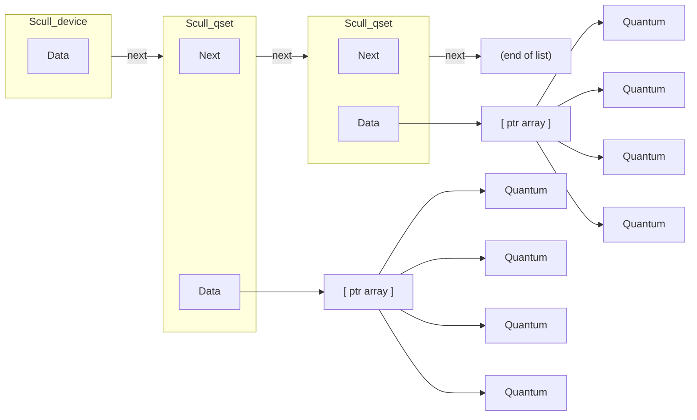
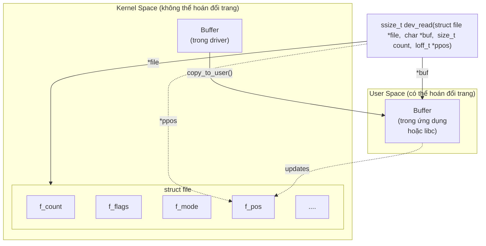

# Chương 3: Driver ký tự (Char Drivers)

Mục tiêu của chương này là viết một char device driver hoàn chỉnh. Chúng ta phát triển một trình điều khiển thiết bị ký tự (character driver) bởi vì lớp này phù hợp với hầu hết các thiết bị phần cứng đơn giản. Char driver cũng dễ hiểu hơn so với block driver hoặc network driver (những nội dung sẽ được đề cập ở các chương sau). Mục đích cuối cùng của chúng ta là viết một char driver có tính *mô-đun hóa* (*modularized*), nhưng chúng ta sẽ chưa bàn về các vấn đề mô-đun hóa trong chương này.

xuyên suốt chương này, chúng ta sẽ trình bày các đoạn mã được trích từ một trình điều khiển thiết bị thực tế: *scull* (Simple Character Utility for Loading Localities - Tiện ích ký tự đơn giản để nạp các vùng nhớ cục bộ). *scull* là một char driver hoạt động trên một vùng nhớ như thể nó là một thiết bị. Trong chương này, do đặc thù đó của *scull*, chúng ta sẽ sử dụng từ *thiết bị* (*device*) thay thế cho nhau với cụm từ "vùng nhớ được sử dụng bởi *scull*."

Ưu điểm của *scull* là nó không phụ thuộc vào phần cứng. *scull* chỉ tác động lên một số vùng nhớ được cấp phát từ kernel (nhân hệ điều hành). Bất kỳ ai cũng có thể biên dịch và chạy *scull*, và *scull* có tính di động (portable) trên các kiến trúc máy tính mà Linux chạy trên đó. Mặt khác, thiết bị này không làm bất kỳ điều gì "hữu ích" ngoài việc minh họa giao diện giữa kernel và char driver, đồng thời cho phép người dùng chạy một số bài kiểm tra.

## Thiết kế của scull

Bước đầu tiên của việc viết driver là xác định các tính năng (cơ chế - mechanism) mà driver sẽ cung cấp cho các chương trình người dùng (user programs). Vì "thiết bị" của chúng ta là một phần trong bộ nhớ của máy tính, chúng ta hoàn toàn tự do làm những gì mình muốn với nó. Nó có thể là một thiết bị truy cập tuần tự (sequential) hoặc truy cập ngẫu nhiên (random-access), một thiết bị hoặc nhiều thiết bị, v.v.

Để làm cho *scull* hữu ích như một mẫu (template) cho việc viết driver thực tế cho các thiết bị thực tế, chúng ta sẽ chỉ cho bạn cách triển khai một số sự trừu tượng hóa thiết bị (device abstractions) trên nền bộ nhớ máy tính, mỗi thiết bị mang một đặc tính (personality) khác nhau.

Mã nguồn của *scull* triển khai các thiết bị sau đây. Mỗi loại thiết bị được triển khai bởi mô-đun (module) được gọi là một *loại* (*type*).

*scull0 đến scull3*

Bốn thiết bị, mỗi thiết bị bao gồm một vùng nhớ vừa có tính toàn cục (global) vừa có tính bền vững (persistent). Toàn cục có nghĩa là nếu thiết bị được mở nhiều lần, dữ liệu chứa bên trong thiết bị đó sẽ được chia sẻ bởi tất cả các File Descriptor (mô tả tệp) đã mở nó. Bền vững có nghĩa là nếu thiết bị bị đóng và mở lại, dữ liệu sẽ không bị mất. Thiết bị này có thể rất thú vị khi làm việc cùng, bởi vì nó có thể được truy cập và kiểm tra bằng các lệnh thông thường, chẳng hạn như *cp*, *cat*, và lệnh chuyển hướng I/O của shell.

### *scullpipe0 đến scullpipe3*

Bốn thiết bị FIFO (vào trước ra trước - first-in-first-out), hoạt động giống như các pipe (đường ống). Một Process (tiến trình) đọc những gì tiến trình khác ghi. Nếu nhiều tiến trình đọc cùng một thiết bị, chúng sẽ tranh chấp dữ liệu. Các hoạt động bên trong của *scullpipe* sẽ cho thấy cách thức *read* và *write* có tính chất chặn (blocking) và không chặn (nonblocking) có thể được triển khai mà không cần phải nhờ đến các ngắt (interrupts). Mặc dù các driver thực tế đồng bộ hóa với thiết bị của chúng bằng cách sử dụng ngắt phần cứng, nhưng chủ đề về các thao tác chặn và không chặn là một chủ đề quan trọng và tách biệt khỏi việc xử lý ngắt (được trình bày trong Chương 10).

*scullsingle scullpriv sculluid scullwuid*

> [!NOTE]
> Các thiết bị này tương tự như *scull0* nhưng có một số giới hạn về thời điểm cho phép thao tác *open* (mở). Thiết bị đầu tiên (*scullsingle*) chỉ cho phép một tiến trình sử dụng driver tại một thời điểm, trong khi *scullpriv* mang tính riêng tư đối với mỗi virtual console (bảng điều khiển ảo) hoặc phiên terminal X, bởi vì các tiến trình trên mỗi console/terminal sẽ nhận được các vùng nhớ khác nhau. *sculluid* và *scullwuid* có thể được mở nhiều lần, nhưng chỉ bởi một người dùng tại một thời điểm; thiết bị trước trả về lỗi "Device Busy" (Thiết bị bận) nếu người dùng khác đang khóa thiết bị, trong khi thiết bị sau triển khai cơ chế *open* có tính chất chặn (blocking *open*). Những biến thể này của *scull* có vẻ làm lẫn lộn giữa chính sách (policy) và cơ chế (mechanism), nhưng chúng rất đáng để xem xét vì một số thiết bị thực tế đòi hỏi kiểu quản lý này.

Mỗi thiết bị *scull* minh họa các tính năng khác nhau của một driver và đặt ra các khó khăn khác nhau. Chương này bao gồm các hoạt động bên trong của *scull0* đến *scull3*; các thiết bị nâng cao hơn được trình bày trong Chương 6. *scullpipe* được mô tả trong phần "A Blocking I/O Example" (Ví dụ về I/O chặn), và các thiết bị còn lại được mô tả trong phần "Access Control on a Device File" (Kiểm soát truy cập trên tệp thiết bị).

## Major và Minor Number (Số chính và số phụ)

Các thiết bị ký tự (Char device) được truy cập thông qua các tên trong hệ thống tệp (filesystem). Những tên đó được gọi là tệp đặc biệt (special file), tệp thiết bị (device file) hoặc đơn giản là các nút (node) của cây hệ thống tệp; chúng thường nằm trong thư mục */dev*. Các tệp đặc biệt dành cho trình điều khiển thiết bị ký tự (char driver) được nhận dạng bằng ký tự "c" ở cột đầu tiên của kết quả lệnh *ls –l*. Các thiết bị khối (block device) cũng xuất hiện trong */dev*, nhưng chúng được nhận dạng bằng ký tự "b". Trọng tâm của chương này là về các thiết bị ký tự, nhưng phần lớn thông tin sau đây cũng áp dụng cho các thiết bị khối.

Nếu bạn chạy lệnh *ls –l*, bạn sẽ thấy hai con số (được ngăn cách bằng dấu phẩy) trong các mục tệp thiết bị trước ngày sửa đổi gần nhất, vị trí mà thường hiển thị độ dài của tệp. Những con số này là major number (số chính) và minor number (số phụ) của thiết bị cụ thể đó. Danh sách sau đây cho thấy một số thiết bị xuất hiện trên một hệ thống tiêu biểu. Các major number của chúng là 1, 4, 7 và 10, trong khi các minor number là 1, 3, 5, 64, 65 và 129.

| crw-rw-rw- | 1 root | root | 1,  |  | 3 Apr 11 2002 null       |  |
|------------|--------|------|-----|--|--------------------------|--|
| crw        | 1 root | root | 10, |  | 1 Apr 11 2002 psaux      |  |
| crw        | 1 root | root | 4,  |  | 1 Oct 28 03:04 tty1      |  |
| crw-rw-rw- | 1 root | tty  |     |  | 4, 64 Apr 11 2002 ttys0  |  |
| crw-rw     | 1 root | uucp |     |  | 4, 65 Apr 11 2002 ttyS1  |  |
| crww       | 1 vcsa | tty  | 7,  |  | 1 Apr 11 2002 vcs1       |  |
| crww       | 1 vcsa | tty  |     |  | 7, 129 Apr 11 2002 vcsa1 |  |
| crw-rw-rw- | 1 root | root | 1,  |  | 5 Apr 11 2002 zero       |  |

Theo truyền thống, major number xác định trình điều khiển (driver) được liên kết với thiết bị. Ví dụ: cả */dev/null* và */dev/zero* đều được quản lý bởi driver 1, trong khi các bảng điều khiển ảo (virtual console) và thiết bị đầu cuối nối tiếp (serial terminal) được quản lý bởi driver 4; tương tự, cả hai thiết bị *vcs1* và *vcsa1* đều được quản lý bởi driver 7. Các phiên bản Linux Kernel hiện đại cho phép nhiều driver chia sẻ chung major number, nhưng hầu hết các thiết bị bạn thấy vẫn được tổ chức theo nguyên tắc một-major-một-driver.

Minor number được kernel sử dụng để xác định chính xác thiết bị nào đang được nhắc tới. Tùy thuộc vào cách driver của bạn được viết (như chúng ta sẽ thấy bên dưới), bạn có thể nhận được một con trỏ trực tiếp (direct pointer) trỏ đến thiết bị của mình từ kernel, hoặc bạn có thể tự sử dụng minor number làm chỉ mục (index) trỏ vào một mảng thiết bị cục bộ (local array). Dù theo cách nào đi nữa, bản thân kernel hầu như không biết gì về minor number ngoài thực tế là chúng dùng để chỉ các thiết bị do driver của bạn triển khai.

### Biểu diễn Nội bộ của Số hiệu Thiết bị (Device Numbers)

Bên trong kernel, kiểu dữ liệu `dev_t` (được định nghĩa trong *<linux/types.h>*) được sử dụng để lưu giữ số hiệu thiết bị (device numbers)—bao gồm cả phần số chính (major number) và số phụ (minor number). Kể từ phiên bản 2.6.0 của kernel, `dev_t` là một đại lượng 32-bit với 12 bit dành cho số chính và 20 bit cho số phụ. Tất nhiên, mã nguồn của bạn không bao giờ được đưa ra bất kỳ giả định nào về tổ chức nội bộ của số hiệu thiết bị; thay vào đó, nó nên sử dụng tập hợp các macro nằm trong *<linux/kdev_t.h>*. Để lấy phần số chính hoặc số phụ của một `dev_t`, hãy sử dụng:

```
MAJOR(dev_t dev);
MINOR(dev_t dev);
```

Ngược lại, nếu bạn đã có số chính và số phụ và cần chuyển đổi chúng thành một `dev_t`, hãy sử dụng:

```
MKDEV(int major, int minor);
```

Lưu ý rằng kernel 2.6 có thể đáp ứng một số lượng lớn các thiết bị, trong khi các phiên bản kernel trước đó bị giới hạn ở 255 số chính và 255 số phụ. Người ta cho rằng

khoảng giá trị rộng hơn này sẽ đủ dùng trong một thời gian khá dài, nhưng lĩnh vực điện toán đầy rẫy những giả định sai lầm theo dạng đó. Vì vậy, bạn nên dự tính rằng định dạng của `dev_t` có thể thay đổi một lần nữa trong tương lai; tuy nhiên, nếu bạn viết các driver của mình một cách cẩn thận, những thay đổi này sẽ không gây ra vấn đề gì.

### Cấp phát và Giải phóng Số hiệu Thiết bị (Device Numbers)

Một trong những việc đầu tiên mà driver của bạn cần làm khi thiết lập một character device (thiết bị ký tự) là lấy một hoặc nhiều số hiệu thiết bị để làm việc. Hàm cần thiết cho tác vụ này là *register_chrdev_region*, được khai báo trong *<linux/fs.h>*:

```
int register_chrdev_region(dev_t first, unsigned int count,
 char *name);
```

Ở đây, `first` là số hiệu thiết bị bắt đầu của dải mà bạn muốn cấp phát. Phần số phụ (minor number) của `first` thường là 0, nhưng không bắt buộc phải như vậy. `count` là tổng số lượng các số hiệu thiết bị liên tục mà bạn đang yêu cầu. Lưu ý rằng nếu `count` lớn, dải bạn yêu cầu có thể tràn sang số chính tiếp theo; nhưng mọi thứ vẫn sẽ hoạt động bình thường miễn là dải số bạn yêu cầu vẫn còn trống. Cuối cùng, `name` là tên của thiết bị sẽ được liên kết với dải số hiệu này; nó sẽ xuất hiện trong */proc/devices* và sysfs.

Giống như hầu hết các hàm trong kernel, giá trị trả về từ *register_chrdev_region* sẽ là 0 nếu việc cấp phát được thực hiện thành công. Trong trường hợp xảy ra lỗi, một mã lỗi âm sẽ được trả về, và bạn sẽ không có quyền truy cập vào dải đã yêu cầu.

*register_chrdev_region* hoạt động tốt nếu bạn biết trước chính xác những số hiệu thiết bị nào bạn muốn. Tuy nhiên, thường thì bạn sẽ không biết thiết bị của mình sẽ sử dụng những số chính nào; có một nỗ lực không ngừng trong cộng đồng phát triển Linux kernel nhằm chuyển sang sử dụng các số hiệu thiết bị được cấp phát động (dynamically-allocated device numbers). Kernel sẽ vui vẻ cấp phát một số chính cho bạn một cách tự động (on the fly), nhưng bạn phải yêu cầu cấp phát này bằng cách sử dụng một hàm khác:

```
int alloc_chrdev_region(dev_t *dev, unsigned int firstminor,
 unsigned int count, char *name);
```

Với hàm này, `dev` là tham số chỉ dùng để trả về kết quả (output-only parameter), khi hoàn thành thành công, nó sẽ chứa số đầu tiên trong dải được cấp phát của bạn. `firstminor` phải là số phụ bắt đầu được yêu cầu để sử dụng; nó thường là 0. Các tham số `count` và `name` hoạt động giống như các tham số được truyền cho *request_chrdev_region*.

Bất kể bạn cấp phát số hiệu thiết bị của mình bằng cách nào, bạn nên giải phóng chúng khi không còn sử dụng nữa. Các số hiệu thiết bị được giải phóng bằng:

```
void unregister_chrdev_region(dev_t first, unsigned int count);
```

Nơi thông thường để gọi *unregister_chrdev_region* là trong hàm dọn dẹp (cleanup function) của module bạn.

Các hàm trên cấp phát số hiệu thiết bị để driver của bạn sử dụng, nhưng chúng không cho kernel biết bất cứ điều gì về việc bạn sẽ thực sự làm gì với những số đó. Trước khi một chương trình ở user-space (không gian người dùng) có thể truy cập vào một trong các số hiệu thiết bị đó, driver của chúng ta cần kết nối chúng với các hàm nội bộ thực hiện các thao tác của thiết bị. Chúng ta sẽ mô tả cách thức thực hiện kết nối này ngay bây giờ, nhưng trước tiên có một vài phần chuyển ý cần thiết cần giải quyết.

### Cấp phát động các số Major (Dynamic Allocation of Major Numbers)

Một số số Major (Major Device Number) được gán tĩnh cho các thiết bị phổ biến nhất. Danh sách các thiết bị đó có thể được tìm thấy trong tệp *Documentation/devices.txt* nằm trong cây mã nguồn kernel (kernel source tree). Tuy nhiên, khả năng một số tĩnh đã được gán cho trình điều khiển (driver) mới của bạn là rất nhỏ, và các số mới hiện không còn được gán theo cách này nữa. Vì vậy, với tư cách là một lập trình viên viết driver, bạn có một lựa chọn: bạn có thể đơn giản chọn một số có vẻ chưa được sử dụng, hoặc bạn có thể cấp phát các số major một cách động. Việc chọn bừa một số có thể vẫn hoạt động miễn là bạn là người duy nhất sử dụng driver của mình; một khi driver được triển khai rộng rãi hơn, một số major được chọn ngẫu nhiên sẽ dẫn đến xung đột và rắc rối.

Do đó, đối với các driver mới, chúng tôi đặc biệt khuyên bạn nên sử dụng cơ chế cấp phát động để lấy số major cho thiết bị của mình, thay vì chọn ngẫu nhiên một số trong số những số hiện đang trống. Nói cách khác, các driver của bạn gần như chắc chắn nên sử dụng *alloc\_chrdev\_region* thay vì *register\_chrdev\_region*.

Nhược điểm của việc gán động là bạn không thể tạo các nút thiết bị (device node) trước, bởi vì số major được gán cho module của bạn sẽ thay đổi. Đối với việc sử dụng driver thông thường, đây hầu như không phải là vấn đề, bởi vì một khi số đã được gán, bạn có thể đọc nó từ */proc/devices*.\*

Do đó, để nạp một driver sử dụng số major động, lệnh gọi *insmod* có thể được thay thế bằng một tập lệnh (script) đơn giản, sau khi gọi *insmod*, sẽ đọc */proc/devices* để tạo (các) tệp đặc biệt (special file).

Một tệp */proc/devices* điển hình có dạng như sau:

#### Thiết bị ký tự (Character devices):

- 1 mem
- 2 pty
- 3 ttyp
- 4 ttyS
- 6 lp
- 7 vcs
- 10 misc
- 13 input
- 14 sound

Thông tin thiết bị thậm chí còn tốt hơn thường có thể được lấy từ sysfs, thường được gắn kết (mount) tại */sys* trên các hệ thống dựa trên nền tảng 2.6. Tuy nhiên, việc làm cho *scull* xuất thông tin qua sysfs vượt ra ngoài phạm vi của chương này; chúng ta sẽ quay lại chủ đề này trong Chương 14.

```
 21 sg
180 usb
Thiết bị khối (Block devices):
 2 fd
 8 sd
 11 sr
 65 sd
 66 sd
```

Do đó, tập lệnh để nạp một module đã được gán số động có thể được viết bằng cách sử dụng một công cụ như *awk* để trích xuất thông tin từ */proc/devices* nhằm tạo các tệp trong */dev*.

Tập lệnh sau đây, *scull\_load*, là một phần của bản phân phối *scull*. Người dùng của một driver được phân phối dưới dạng module có thể gọi một tập lệnh như vậy từ tệp *rc.local* của hệ thống hoặc gọi nó thủ công bất cứ khi nào cần module đó.

```sh
## !/bin/sh
module="scull"
device="scull"
mode="664"
## gọi insmod với tất cả các tham số chúng ta nhận được
## và sử dụng tên đường dẫn, vì các phiên bản modutils mới hơn không tìm kiếm trong . theo mặc định
/sbin/insmod ./$module.ko $* || exit 1
## xóa các nút cũ/tồn đọng
rm -f /dev/${device}[0-3]
major=$(awk "\\$2==\"$module\" {print \\$1}" /proc/devices)
mknod /dev/${device}0 c $major 0
mknod /dev/${device}1 c $major 1
mknod /dev/${device}2 c $major 2
mknod /dev/${device}3 c $major 3
## gán nhóm/quyền thích hợp, và thay đổi nhóm.
## Không phải tất cả các bản phân phối đều có nhóm staff, một số có "wheel" thay thế.
group="staff"
grep -q '^staff:' /etc/group || group="wheel"
chgrp $group /dev/${device}[0-3]
chmod $mode /dev/${device}[0-3]
```

Tập lệnh này có thể được điều chỉnh cho một driver khác bằng cách định nghĩa lại các biến và chỉnh sửa các dòng lệnh *mknod*. Tập lệnh vừa hiển thị tạo ra bốn thiết bị vì bốn là mặc định trong mã nguồn của *scull*.

Vài dòng cuối cùng của tập lệnh có vẻ khó hiểu: tại sao phải thay đổi nhóm và quyền truy cập (mode) của một thiết bị? Lý do là tập lệnh này phải được chạy bởi siêu người dùng (superuser - root), vì vậy các tệp đặc biệt mới được tạo sẽ thuộc quyền sở hữu của root. Các bit quyền (permission bits) mặc định sao cho chỉ root mới có quyền ghi, trong khi bất kỳ ai cũng có quyền đọc. Thông thường, một nút thiết bị yêu cầu một chính sách truy cập khác, do đó bằng cách này hay cách khác, quyền truy cập phải được thay đổi. Mặc định trong tập lệnh của chúng tôi là cấp quyền truy cập cho một nhóm người dùng, nhưng nhu cầu của bạn có thể khác. Trong phần "Kiểm soát truy cập trên một tệp thiết bị" ("Access Control on a Device File") ở Chương 6, mã nguồn cho *sculluid* minh họa cách driver có thể thực thi hình thức ủy quyền của riêng nó đối với việc truy cập thiết bị.

Một tập lệnh *scull\_unload* cũng có sẵn để dọn dẹp thư mục */dev* và gỡ bỏ module.

Như một giải pháp thay thế cho việc sử dụng một cặp tập lệnh để nạp và gỡ, bạn có thể viết một init script, sẵn sàng để đặt vào thư mục mà bản phân phối của bạn sử dụng cho các tập lệnh này.\* Là một phần của mã nguồn *scull*, chúng tôi cung cấp một ví dụ khá hoàn chỉnh và có thể cấu hình được về init script, có tên là *scull.init*; nó chấp nhận các tham số thông thường—start, stop và restart—và thực hiện vai trò của cả *scull\_load* và *scull\_unload*.

Nếu việc liên tục tạo và hủy các nút */dev* nghe có vẻ là quá mức cần thiết (overkill), thì có một giải pháp thay thế hữu ích. Nếu bạn chỉ nạp và gỡ một driver duy nhất, bạn có thể sử dụng *rmmod* và *insmod* sau lần đầu tiên bạn tạo các tệp đặc biệt bằng tập lệnh của mình: các số động không bị ngẫu nhiên hóa,† và bạn có thể tin tưởng rằng cùng một số sẽ được chọn mỗi khi bạn không nạp bất kỳ module (động) nào khác. Tránh các tập lệnh dài dòng là rất hữu ích trong quá trình phát triển. Nhưng rõ ràng, mẹo này không thể mở rộng (scale) cho nhiều hơn một driver cùng một lúc.

Theo quan điểm của chúng tôi, cách tốt nhất để cấp phát số major (major number) là mặc định sử dụng cơ chế cấp phát động (dynamic allocation), đồng thời vẫn cho phép người dùng tùy chọn chỉ định số major tại thời điểm nạp module (load time), hoặc thậm chí tại thời điểm biên dịch (compile time). Bản cài đặt của *scull* hoạt động theo cách này; nó sử dụng một biến toàn cục `scull_major` để lưu trữ số đã chọn (ngoài ra còn có `scull_minor` cho số minor). Biến này được khởi tạo thành `SCULL_MAJOR`, được định nghĩa trong *scull.h*. Giá trị mặc định của `SCULL_MAJOR` trong mã nguồn được phân phối là 0, có nghĩa là "sử dụng cơ chế cấp phát động." Người dùng có thể chấp nhận giá trị mặc định hoặc chọn một số major cụ thể, bằng cách sửa đổi macro trước khi biên dịch hoặc chỉ định giá trị cho `scull_major` trên dòng lệnh *insmod*. Cuối cùng, bằng cách sử dụng tập lệnh *scull\_load*, người dùng có thể truyền các tham số cho *insmod* thông qua dòng lệnh của *scull\_load*.‡

Dưới đây là đoạn mã chúng tôi sử dụng trong mã nguồn của *scull* để lấy số major:

```c
if (scull_major) {
 dev = MKDEV(scull_major, scull_minor);
 result = register_chrdev_region(dev, scull_nr_devs, "scull");
} else {
 result = alloc_chrdev_region(&dev, scull_minor, scull_nr_devs,
```

- \* Tiêu chuẩn Linux Standard Base quy định rằng các tập lệnh khởi động (init script) nên được đặt tại */etc/init.d*, nhưng một số bản phân phối (distribution) vẫn đặt chúng ở các vị trí khác. Ngoài ra, nếu tập lệnh của bạn được chạy ở thời điểm khởi động (boot time), bạn cần tạo một liên kết (link) trỏ đến nó từ thư mục cấp độ chạy (run-level directory) phù hợp (ví dụ: *.../rc3.d*).
- † Mặc dù một số nhà phát triển kernel (kernel developer) đã đe dọa sẽ làm chính xác điều đó trong tương lai.
- ‡ Tập lệnh khởi động *scull.init* không chấp nhận các tùy chọn trình điều khiển (driver option) trên dòng lệnh, nhưng nó hỗ trợ một tệp cấu hình (configuration file), bởi vì nó được thiết kế để sử dụng tự động tại thời điểm khởi động và tắt máy.

```c
 "scull");
 scull_major = MAJOR(dev);
}
if (result < 0) {
 printk(KERN_WARNING "scull: can't get major %d\n", scull_major);
 return result;
}
```

Hầu như tất cả các trình điều khiển (driver) mẫu được sử dụng trong cuốn sách này đều sử dụng mã nguồn tương tự để cấp phát số major của chúng.

## Một số Cấu trúc Dữ liệu Quan trọng

Như bạn có thể tưởng tượng, việc đăng ký số thiết bị (device number registration) chỉ là nhiệm vụ đầu tiên trong số rất nhiều nhiệm vụ mà mã nguồn trình điều khiển phải thực hiện. Chúng ta sẽ sớm tìm hiểu các thành phần quan trọng khác của trình điều khiển, nhưng trước tiên cần phải có một phần chuyển ý nhỏ. Hầu hết các thao tác cơ bản của trình điều khiển đều liên quan đến ba cấu trúc dữ liệu quan trọng trong kernel, được gọi là `file_operations`, `file`, và `inode`. Việc nắm rõ các cấu trúc này ở mức cơ bản là điều kiện cần để có thể làm bất cứ điều gì thú vị, vì vậy bây giờ chúng ta sẽ cùng điểm nhanh qua từng cấu trúc trước khi đi vào chi tiết cách triển khai các thao tác cơ bản của trình điều khiển.

### Các Thao tác Tệp (File Operations)

Cho đến nay, chúng ta đã dành riêng một số mã định danh thiết bị (device numbers) cho việc sử dụng của mình, nhưng chúng ta vẫn chưa liên kết bất kỳ thao tác nào của trình điều khiển (driver) với các số đó. Cấu trúc `file_operations` là cách mà một trình điều khiển ký tự (char driver) thiết lập mối liên kết này. Cấu trúc này, được định nghĩa trong *<linux/fs.h>*, là một tập hợp các con trỏ hàm (function pointers). Mỗi tệp đang mở (được đại diện bên trong hệ thống bởi một cấu trúc `file`, mà chúng ta sẽ kiểm tra ngay sau đây) được liên kết với tập hợp hàm của riêng nó (bằng cách bao gồm một trường gọi là `f_op` trỏ đến cấu trúc `file_operations`). Các thao tác này chủ yếu chịu trách nhiệm thực thi các lời gọi hệ thống (system calls) và do đó, được đặt tên là *open*, *read*, vân vân. Chúng ta có thể coi tệp là một "đối tượng" (object) và các hàm thao tác trên nó là các "phương thức" (methods) của nó, sử dụng thuật ngữ lập trình hướng đối tượng để chỉ các hành động do một đối tượng khai báo nhằm tác động lên chính nó. Đây là dấu hiệu đầu tiên của lập trình hướng đối tượng mà chúng ta thấy trong Linux kernel, và chúng ta sẽ thấy nhiều hơn ở các chương sau.

Theo quy ước, một cấu trúc `file_operations` hoặc một con trỏ trỏ tới nó được gọi là `fops` (hoặc một biến thể nào đó). Mỗi trường trong cấu trúc phải trỏ đến hàm trong trình điều khiển thực hiện một thao tác cụ thể, hoặc được để là `NULL` đối với các thao tác không được hỗ trợ. Hành vi chính xác của kernel khi một con trỏ `NULL` được chỉ định sẽ khác nhau đối với từng hàm, như danh sách sau đây trong phần này sẽ cho thấy.

Danh sách sau đây giới thiệu tất cả các thao tác mà một ứng dụng có thể gọi trên một thiết bị. Chúng tôi đã cố gắng giữ cho danh sách ngắn gọn để nó có thể được sử dụng như một tài liệu tham khảo, chỉ tóm tắt ngắn gọn từng thao tác và hành vi mặc định của kernel khi sử dụng con trỏ `NULL`.

Khi bạn đọc qua danh sách các phương thức `file_operations`, bạn sẽ nhận thấy rằng một số tham số bao gồm chuỗi `__user`. Chú thích này là một dạng tài liệu, lưu ý rằng một con trỏ là một địa chỉ không gian người dùng (user-space address) không thể được tham chiếu trực tiếp (dereferenced). Đối với việc biên dịch bình thường, `__user` không có hiệu lực, nhưng nó có thể được sử dụng bởi phần mềm kiểm tra bên ngoài để tìm ra việc lạm dụng các địa chỉ không gian người dùng.

Phần còn lại của chương, sau khi mô tả một số cấu trúc dữ liệu quan trọng khác, giải thích vai trò của các thao tác quan trọng nhất đồng thời đưa ra các gợi ý, lưu ý (caveats) và các ví dụ mã nguồn thực tế. Chúng tôi hoãn việc thảo luận về các thao tác phức tạp hơn sang các chương sau, bởi vì chúng ta chưa sẵn sàng đi sâu vào các chủ đề như quản lý bộ nhớ (memory management), các thao tác chặn (blocking operations), và thông báo bất đồng bộ (asynchronous notification) ngay lúc này.

#### struct module \*owner

Trường `file_operations` đầu tiên không phải là một thao tác; nó là một con trỏ trỏ tới module "sở hữu" cấu trúc này. Trường này được sử dụng để ngăn chặn module bị gỡ bỏ (unloaded) trong khi các thao tác của nó đang được sử dụng. Hầu hết thời gian, nó chỉ đơn giản được khởi tạo thành `THIS_MODULE`, một macro được định nghĩa trong *<linux/module.h>*.

### loff\_t (\*llseek) (struct file \*, loff\_t, int);

Phương thức *llseek* được sử dụng để thay đổi vị trí đọc/ghi hiện tại trong một tệp (file), và vị trí mới được trả về dưới dạng một giá trị trả về (dương). Tham số loff\_t là một "offset dài" (long offset) và có độ rộng ít nhất là 64 bit ngay cả trên các nền tảng 32-bit. Các lỗi được báo hiệu bằng một giá trị trả về âm. Nếu con trỏ hàm này là NULL, các lời gọi seek sẽ sửa đổi bộ đếm vị trí trong cấu trúc file (được mô tả trong mục "Cấu trúc file" - The file Structure) theo các cách có thể không thể đoán trước được.

ssize\_t (\*read) (struct file \*, char \_\_user \*, size\_t, loff\_t \*); Được sử dụng để truy xuất dữ liệu từ thiết bị. Một con trỏ null tại vị trí này khiến System Call (lời gọi hệ thống) *read* thất bại với mã lỗi -EINVAL ("Invalid argument" - Đối số không hợp lệ). Giá trị trả về không âm thể hiện số lượng byte đã đọc thành công (giá trị trả về là kiểu "kích thước có dấu" - signed size, thường là kiểu số nguyên nguyên thủy của nền tảng đích).

ssize\_t (\*aio\_read)(struct kiocb \*, char \_\_user \*, size\_t, loff\_t); Khởi tạo một thao tác đọc bất đồng bộ (asynchronous read)—một thao tác đọc có thể chưa hoàn thành trước khi hàm trả về. Nếu phương thức này là NULL, tất cả các thao tác sẽ được xử lý (một cách đồng bộ) bởi *read* thay vào đó.

ssize\_t (\*write) (struct file \*, const char \_\_user \*, size\_t, loff\_t \*); Gửi dữ liệu đến thiết bị. Nếu là NULL, giá trị -EINVAL sẽ được trả về cho chương trình gọi System Call *write*. Giá trị trả về, nếu không âm, biểu thị số lượng byte được ghi thành công.

ssize\_t (\*aio\_write)(struct kiocb \*, const char \_\_user \*, size\_t, loff\_t \*); Khởi tạo một thao tác ghi bất đồng bộ trên thiết bị.

int (\*readdir) (struct file \*, void \*, filldir\_t);

Trường này phải là NULL đối với các tệp thiết bị (device file); nó được sử dụng để đọc các thư mục và chỉ hữu ích cho các hệ thống tệp (filesystem).

unsigned int (\*poll) (struct file \*, struct poll\_table\_struct \*);

Phương thức *poll* là backend của ba System Call: *poll, epoll,* và *select*, tất cả đều được sử dụng để truy vấn xem việc đọc hoặc ghi vào một hay nhiều File Descriptor (bộ mô tả tệp) có bị chặn (block) hay không. Phương thức *poll* nên trả về một mặt nạ bit (bit mask) cho biết liệu việc đọc hoặc ghi không chặn (nonblocking) có khả thi hay không, và có thể cung cấp cho Kernel (nhân) thông tin có thể được sử dụng để đưa tiến trình (process) gọi nó vào trạng thái ngủ (sleep) cho đến khi I/O khả dụng. Nếu một trình điều khiển (driver) để phương thức *poll* là NULL, thiết bị được giả định là có thể đọc và viết mà không bị chặn.

int (\*ioctl) (struct inode \*, struct file \*, unsigned int, unsigned long); System Call *ioctl* cung cấp một cách để đưa ra các lệnh cụ thể cho thiết bị (chẳng hạn như định dạng một track của đĩa mềm, việc này không phải là đọc cũng không phải là ghi). Thêm vào đó, một vài lệnh *ioctl* được Kernel nhận diện mà không cần tham chiếu đến bảng fops. Nếu thiết bị không cung cấp phương thức *ioctl*, System Call sẽ trả về lỗi cho bất kỳ yêu cầu nào chưa được định nghĩa trước (-ENOTTY, "No such ioctl for device").

int (\*mmap) (struct file \*, struct vm\_area\_struct \*); *mmap* được sử dụng để yêu cầu ánh xạ (mapping) bộ nhớ thiết bị vào không gian địa chỉ (address space) của một tiến trình. Nếu phương thức này là NULL, System Call *mmap* trả về -ENODEV.

int (\*open) (struct inode \*, struct file \*); Mặc dù đây luôn là thao tác đầu tiên được thực hiện trên tệp thiết bị, driver không bắt buộc phải khai báo một phương thức tương ứng. Nếu mục này là NULL, việc mở thiết bị luôn thành công, nhưng driver của bạn sẽ không nhận được thông báo.

int (\*flush) (struct file \*);

Thao tác *flush* được gọi khi một tiến trình đóng bản sao của File Descriptor trỏ đến một thiết bị; nó nên thực hiện (và chờ đợi) bất kỳ thao tác nào đang còn đọng lại trên thiết bị. Điều này không được nhầm lẫn với thao tác *fsync* do các chương trình người dùng yêu cầu. Hiện tại, *flush* được sử dụng trong rất nhiều ít driver; ví dụ, driver băng từ SCSI sử dụng nó để đảm bảo rằng tất cả dữ liệu được ghi đều đã xuống băng trước khi thiết bị bị đóng. Nếu *flush* là NULL, Kernel đơn giản là bỏ qua yêu cầu từ ứng dụng người dùng.

int (\*release) (struct inode \*, struct file \*); Thao tác này được gọi khi cấu trúc file đang bị giải phóng (release). Giống như *open*, *release* có thể là NULL.\*

int (\*fsync) (struct file \*, struct dentry \*, int); Phương thức này là backend của System Call *fsync*, thứ mà người dùng gọi để xả (flush) bất kỳ dữ liệu nào đang chờ xử lý (pending data). Nếu con trỏ này là NULL, System Call sẽ trả về -EINVAL.

\* Lưu ý rằng *release* không được gọi mỗi khi một tiến trình gọi *close*. Bất cứ khi nào cấu trúc file được chia sẻ (ví dụ: sau một lệnh *fork* hoặc *dup*), *release* sẽ không được gọi cho đến khi tất cả các bản sao đều bị đóng. Nếu bạn cần xả dữ liệu đang chờ xử lý khi bất kỳ bản sao nào bị đóng, bạn nên triển khai phương thức *flush*.

int (\*aio\_fsync)(struct kiocb \*, int);

Đây là phiên bản bất đồng bộ của phương thức *fsync*.

int (\*fasync) (int, struct file \*, int);

Thao tác này được sử dụng để thông báo cho thiết bị về sự thay đổi trong cờ FASYNC của nó. Thông báo bất đồng bộ là một chủ đề nâng cao và được mô tả trong Chương 6. Trường này có thể là NULL nếu driver không hỗ trợ thông báo bất đồng bộ.

int (\*lock) (struct file \*, int, struct file\_lock \*); Phương thức *lock* được sử dụng để triển khai khóa tệp (file locking); việc khóa là một tính năng không thể thiếu đối với các tệp thông thường nhưng hầu như không bao giờ được triển khai bởi các trình điều khiển thiết bị (device driver).

ssize\_t (\*readv) (struct file \*, const struct iovec \*, unsigned long, loff\_t \*); ssize\_t (\*writev) (struct file \*, const struct iovec \*, unsigned long, loff\_t \*); Các phương thức này triển khai các thao tác đọc và ghi phân tán/tập trung (scatter/gather read and write operations). Các ứng dụng đôi khi cần thực hiện một thao tác đọc hoặc ghi đơn lẻ liên quan đến nhiều vùng bộ nhớ (memory area); các system call này cho phép chúng làm điều đó mà không bắt buộc phải thực hiện thêm các thao tác sao chép dữ liệu. Nếu các con trỏ hàm này được để là NULL, các phương thức *read* và *write* sẽ được gọi (có thể nhiều hơn một lần) để thay thế.

ssize\_t (\*sendfile)(struct file \*, loff\_t \*, size\_t, read\_actor\_t, void \*); Phương thức này triển khai phía đọc của system call *sendfile*, vốn chuyển dữ liệu từ file descriptor này sang file descriptor khác với lượng sao chép tối thiểu. Nó được sử dụng, ví dụ, bởi một máy chủ web (web server) cần gửi nội dung của một tệp qua kết nối mạng. Các device driver thường để *sendfile* là NULL.

ssize\_t (\*sendpage) (struct file \*, struct page \*, int, size\_t, loff\_t \*, int);

*sendpage* là nửa còn lại của *sendfile*; nó được kernel gọi để gửi dữ liệu, từng trang (page) một, đến tệp tương ứng. Các device driver thường không triển khai *sendpage*.

unsigned long (\*get\_unmapped\_area)(struct file \*, unsigned long, unsigned long, unsigned long, unsigned long);

Mục đích của phương thức này là tìm một vị trí thích hợp trong không gian địa chỉ (address space) của tiến trình (process) để ánh xạ (map) một phân đoạn bộ nhớ (memory segment) vào thiết bị bên dưới. Tác vụ này thông thường được thực hiện bởi mã nguồn quản lý bộ nhớ (memory management code); phương thức này tồn tại nhằm cho phép các driver thực thi bất kỳ yêu cầu căn chỉnh (alignment) nào mà một thiết bị cụ thể có thể có. Hầu hết các driver có thể để phương thức này là NULL.

int (\*check\_flags)(int)

Phương thức này cho phép một module kiểm tra các cờ (flag) được truyền vào lệnh gọi *fcntl(F\_SETFL...)*.

int (\*dir\_notify)(struct file \*, unsigned long);

Phương thức này được kích hoạt khi một ứng dụng sử dụng *fcntl* để yêu cầu thông báo thay đổi thư mục. Nó chỉ hữu ích đối các hệ thống tệp (filesystem); các driver không cần phải triển khai *dir\_notify*.

Trình điều khiển thiết bị *scull* chỉ triển khai các phương thức thiết bị quan trọng nhất. Cấu trúc `file_operations` của nó được khởi tạo như sau:

```c
struct file_operations scull_fops = {
 .owner = THIS_MODULE,
 .llseek = scull_llseek,
 .read = scull_read,
 .write = scull_write,
 .ioctl = scull_ioctl,
 .open = scull_open,
 .release = scull_release,
};
```

Khai báo này sử dụng cú pháp khởi tạo cấu trúc gán nhãn chuẩn của C (standard C tagged structure initialization syntax). Cú pháp này được ưu tiên vì nó giúp các driver có tính tương thích di động (portable) cao hơn khi có sự thay đổi trong định nghĩa của các cấu trúc, và có thể nói là giúp mã nguồn gọn gàng và dễ đọc hơn. Việc khởi tạo gán nhãn cho phép sắp xếp lại các thành viên trong cấu trúc; trong một số trường hợp, hiệu năng đã được cải thiện đáng kể bằng cách đặt các con trỏ trỏ đến các thành viên được truy cập thường xuyên vào cùng một dòng cache phần cứng (hardware cache line).

### Cấu trúc file

`struct file`, được định nghĩa trong *<linux/fs.h>*, là cấu trúc dữ liệu quan trọng thứ hai được sử dụng trong các device driver (trình điều khiển thiết bị). Lưu ý rằng `file` không có liên quan gì đến các con trỏ `FILE` của các chương trình ở user-space (không gian người dùng). Một `FILE` được định nghĩa trong thư viện C và không bao giờ xuất hiện trong mã nguồn kernel (kernel code). Ngược lại, một `struct file` là một cấu trúc kernel không bao giờ xuất hiện trong các chương trình user.

Cấu trúc `file` đại diện cho một *tệp đang mở* (open file). (Nó không đặc thù cho các device driver; mọi tệp đang mở trong hệ thống đều có một `struct file` liên kết trong kernel-space.) Nó được tạo bởi kernel khi thực hiện thao tác *open* (mở) và được truyền tới bất kỳ hàm nào thao tác trên tệp đó, cho đến thao tác *close* (đóng) cuối cùng. Sau khi tất cả các instance (thể hiện) của tệp bị đóng, kernel sẽ giải phóng cấu trúc dữ liệu này.

Trong mã nguồn kernel, con trỏ trỏ tới `struct file` thường được gọi là `file` hoặc `filp` ("file pointer" - con trỏ tệp). Chúng ta sẽ nhất quán gọi con trỏ này là `filp` để tránh nhầm lẫn với chính cấu trúc đó. Do đó, `file` đề cập đến cấu trúc và `filp` đề cập đến con trỏ trỏ tới cấu trúc đó.

Các trường quan trọng nhất của `struct file` được hiển thị ở đây. Giống như phần trước, danh sách này có thể được bỏ qua trong lần đọc đầu tiên. Tuy nhiên, ở phần sau của chương này, khi chúng ta đối mặt với một số mã nguồn C thực tế, chúng ta sẽ thảo luận chi tiết hơn về các trường này.

#### mode\_t f\_mode;

Chế độ tệp (file mode) xác định tệp có thể đọc hay có thể ghi (hoặc cả hai), thông qua các bit `FMODE_READ` và `FMODE_WRITE`. Bạn có thể muốn kiểm tra trường này để lấy quyền đọc/ghi trong hàm *open* hoặc *ioctl* của mình, nhưng bạn không cần kiểm tra quyền đối với *read* và *write*, bởi vì kernel sẽ kiểm tra trước khi gọi phương thức của bạn. Một nỗ lực đọc hoặc ghi khi tệp chưa được mở cho loại truy cập đó sẽ bị từ chối mà driver thậm chí không hề hay biết.

### loff\_t f\_pos;

Vị trí đọc hoặc ghi hiện tại. `loff_t` là một giá trị 64-bit trên tất cả các nền tảng (`long long` theo thuật ngữ của *gcc*). Driver có thể đọc giá trị này nếu nó cần biết vị trí hiện tại trong tệp nhưng thông thường không nên thay đổi nó; *read* và *write* nên cập nhật vị trí bằng cách sử dụng con trỏ mà chúng nhận được làm đối số cuối cùng thay vì tác động trực tiếp lên `filp->f_pos`. Ngoại lệ duy nhất cho quy tắc này là trong phương thức *llseek*, với mục đích là thay đổi vị trí tệp.

### unsigned int f\_flags;

Đây là các cờ tệp (file flags), chẳng hạn như `O_RDONLY`, `O_NONBLOCK` và `O_SYNC`. Driver nên kiểm tra cờ `O_NONBLOCK` để xem thao tác không chặn (nonblocking operation) có được yêu cầu hay không (chúng ta thảo luận về I/O không chặn trong phần "Các thao tác chặn và không chặn" ở Chương 1); các cờ khác hiếm khi được sử dụng. Cụ thể, quyền đọc/ghi nên được kiểm tra bằng cách sử dụng `f_mode` thay vì `f_flags`. Tất cả các cờ đều được định nghĩa trong tệp tiêu đề *<linux/fcntl.h>*.

#### struct file\_operations \*f\_op;

Các thao tác liên kết với tệp. Kernel gán con trỏ này như một phần của việc thực thi hàm *open* và sau đó đọc nó khi cần điều phối (dispatch) bất kỳ thao tác nào. Giá trị trong `filp->f_op` không bao giờ được kernel lưu lại để tham chiếu sau này; điều này có nghĩa là bạn có thể thay đổi các thao tác tệp liên kết với tệp của mình và các phương thức mới sẽ có hiệu lực sau khi bạn trả về quyền điều khiển cho hàm gọi. Ví dụ, mã nguồn cho *open* liên kết với major number (số chính) 1 (*/dev/null*, */dev/zero*, v.v.) sẽ thay thế các thao tác trong `filp->f_op` tùy thuộc vào minor number (số phụ) đang được mở. Thực tiễn này cho phép triển khai nhiều hành vi khác nhau dưới cùng một major number mà không làm phát sinh chi phí chung (overhead) tại mỗi system call (lời gọi hệ thống). Khả năng thay thế các thao tác tệp là tương đương trong kernel của việc "ghi đè phương thức" (method overriding) trong lập trình hướng đối tượng.

#### void \*private\_data;

System call *open* đặt con trỏ này thành `NULL` trước khi gọi phương thức *open* cho driver. Bạn hoàn toàn tự do sử dụng trường này theo ý mình hoặc bỏ qua nó; bạn có thể sử dụng trường này để trỏ tới dữ liệu đã được cấp phát, nhưng sau đó bạn phải nhớ giải phóng bộ nhớ đó trong phương thức *release* trước khi cấu trúc tệp bị kernel phá hủy. `private_data` là một tài nguyên hữu ích để duy trì thông tin trạng thái (state information) xuyên suốt các system call và được sử dụng bởi hầu hết các module mẫu của chúng tôi.

#### struct dentry \*f\_dentry;

Cấu trúc mục thư mục (*dentry*) liên kết với tệp. Những người viết device driver thông thường không cần bận tâm đến các cấu trúc dentry, ngoại trừ việc truy cập cấu trúc inode dưới dạng `filp->f_dentry->d_inode`.

Cấu trúc thực tế còn có một vài trường nữa, nhưng chúng không hữu ích đối với các device driver. Chúng ta có thể bỏ qua các trường đó một cách an toàn, bởi vì driver không bao giờ tự tạo ra các cấu trúc tệp; chúng chỉ truy cập các cấu trúc đã được tạo ở nơi khác.

### Cấu trúc inode (inode Structure)

Cấu trúc *inode* được kernel sử dụng nội bộ để biểu diễn các file. Do đó, nó khác với cấu trúc file (file structure) biểu diễn một file descriptor đang mở. Có thể có rất nhiều cấu trúc file biểu diễn nhiều descriptor đang mở trên một file duy nhất, nhưng tất cả chúng đều trỏ đến một cấu trúc inode duy nhất.

Cấu trúc inode chứa rất nhiều thông tin về file. Theo quy tắc chung, chỉ có hai trường (field) của cấu trúc này là quan trọng khi viết mã nguồn driver:

```
dev_t i_rdev;
```

Đối với các inode đại diện cho file thiết bị (device file), trường này chứa số hiệu thiết bị thực tế. `struct cdev *i_cdev;`

`struct cdev` là cấu trúc nội bộ của kernel đại diện cho thiết bị ký tự (char device); trường này chứa một con trỏ trỏ đến cấu trúc đó khi inode tham chiếu đến một file thiết bị ký tự.

Kiểu dữ liệu của `i_rdev` đã thay đổi trong suốt quá trình phát triển của dòng 2.5, làm hỏng rất nhiều driver. Như một cách để khuyến khích việc lập trình có tính di động (portability) cao hơn, các nhà phát triển kernel đã bổ sung hai macro có thể được sử dụng để lấy số major và minor từ một inode:

```
unsigned int iminor(struct inode *inode);
unsigned int imajor(struct inode *inode);
```

Để tránh bị ảnh hưởng bởi những thay đổi trong tương lai, các macro này nên được sử dụng thay vì thao tác trực tiếp trên `i_rdev`.

## Đăng ký thiết bị ký tự (Char Device Registration)

Như chúng tôi đã đề cập, kernel sử dụng các cấu trúc kiểu `struct cdev` để biểu diễn các thiết bị ký tự ở bên trong kernel (internally). Trước khi kernel gọi các thao tác của thiết bị, bạn phải cấp phát và đăng ký một hoặc nhiều cấu trúc này.\* Để làm như vậy, mã nguồn của bạn phải bao gồm header *<linux/cdev.h>*, nơi cấu trúc này và các hàm hỗ trợ liên quan được định nghĩa.

Có hai cách để cấp phát và khởi tạo một trong các cấu trúc này. Nếu bạn muốn lấy một cấu trúc cdev độc lập tại thời điểm chạy (runtime), bạn có thể thực hiện với đoạn mã như sau:

```
struct cdev *my_cdev = cdev_alloc( );
my_cdev->ops = &my_fops;
```

Có một cơ chế cũ hơn giúp tránh việc sử dụng các cấu trúc cdev (chúng ta sẽ thảo luận trong phần "Cách thức cũ"). Tuy nhiên, mã nguồn mới nên sử dụng kỹ thuật mới hơn.

Tuy nhiên, rất có thể bạn sẽ muốn nhúng (embed) cấu trúc cdev vào bên trong một cấu trúc đặc thù của thiết bị do chính bạn định nghĩa; đó là những gì *scull* làm. Trong trường hợp đó, bạn nên khởi tạo cấu trúc mà bạn đã cấp phát bằng hàm:

```
void cdev_init(struct cdev *cdev, struct file_operations *fops);
```

Dù theo cách nào đi nữa, vẫn còn một trường khác của `struct cdev` mà bạn cần khởi tạo. Giống như cấu trúc `file_operations`, `struct cdev` có một trường owner cần phải được đặt thành `THIS_MODULE`.

Một khi cấu trúc cdev đã được thiết lập, bước cuối cùng là thông báo cho kernel biết về nó bằng cách gọi:

```
int cdev_add(struct cdev *dev, dev_t num, unsigned int count);
```

Ở đây, `dev` là cấu trúc cdev, `num` là số hiệu thiết bị đầu tiên mà thiết bị này phản hồi, và `count` là số lượng số hiệu thiết bị nên được liên kết với thiết bị đó. Thông thường `count` là một, nhưng có những tình huống mà việc có nhiều hơn một số hiệu thiết bị tương ứng với một thiết bị cụ thể là rất hợp lý. Lấy ví dụ, driver băng từ SCSI (SCSI tape driver), cho phép user space chọn các chế độ hoạt động (như mật độ ghi) bằng cách gán nhiều số minor cho mỗi thiết bị vật lý.

Có một vài điều quan trọng cần ghi nhớ khi sử dụng *cdev_add*. Thứ nhất, lệnh gọi này có thể thất bại. Nếu nó trả về một mã lỗi âm (negative error code), thiết bị của bạn chưa được thêm vào hệ thống. Tuy nhiên, nó hầu như luôn thành công, và điều đó dẫn đến điểm thứ hai: ngay khi *cdev_add* trả về, thiết bị của bạn đã ở trạng thái "hoạt động" (live) và các thao tác của nó có thể được gọi bởi kernel. Bạn không nên gọi *cdev_add* cho đến khi driver của bạn hoàn toàn sẵn sàng xử lý các thao tác trên thiết bị.

Để gỡ bỏ một thiết bị ký tự khỏi hệ thống, hãy gọi:

```
void cdev_del(struct cdev *dev);
```

Rõ ràng, bạn không nên truy cập cấu trúc cdev sau khi đã truyền nó cho *cdev_del*.

### Đăng ký thiết bị trong scull

Bên trong, *scull* đại diện cho mỗi thiết bị bằng một cấu trúc có kiểu `struct scull_dev`. Cấu trúc này được định nghĩa như sau:

```
struct scull_dev {
 struct scull_qset *data; /* Con trỏ tới tập quantum đầu tiên */
 int quantum; /* Kích thước quantum hiện tại */
 int qset; /* Kích thước mảng hiện tại */
 unsigned long size; /* Lượng dữ liệu được lưu trữ ở đây */
 unsigned int access_key; /* Được sử dụng bởi sculluid và scullpriv */
 struct semaphore sem; /* Semaphore loại trừ lẫn nhau (mutual exclusion semaphore) */
 struct cdev cdev; /* Cấu trúc thiết bị ký tự (Char device structure) */
};
```

Chúng ta sẽ thảo luận về các trường khác nhau trong cấu trúc này khi gặp chúng, nhưng hiện tại, chúng ta lưu ý đến `cdev`, cấu trúc `struct cdev` đóng vai trò giao tiếp thiết bị của chúng ta với kernel (nhân hệ điều hành). Cấu trúc này

phải được khởi tạo và thêm vào hệ thống như đã mô tả ở trên; đoạn mã *scull* xử lý tác vụ này là:

```
static void scull_setup_cdev(struct scull_dev *dev, int index)
{
 int err, devno = MKDEV(scull_major, scull_minor + index);
 cdev_init(&dev->cdev, &scull_fops);
 dev->cdev.owner = THIS_MODULE;
 dev->cdev.ops = &scull_fops;
 err = cdev_add (&dev->cdev, devno, 1);
 /* Xử lý lỗi một cách uyển chuyển nếu cần */
 if (err)
 printk(KERN_NOTICE "Error %d adding scull%d", err, index);
}
```

Vì cấu trúc `cdev` được nhúng bên trong `struct scull_dev`, hàm `cdev_init` phải được gọi để thực hiện việc khởi tạo cấu trúc đó.

### Cách tiếp cận cũ

Nếu bạn tìm hiểu kỹ mã nguồn của nhiều driver trong Linux kernel phiên bản 2.6, bạn có thể nhận thấy rằng khá nhiều driver thiết bị ký tự (char driver) không sử dụng giao diện `cdev` mà chúng ta vừa mô tả. Những gì bạn đang thấy là mã nguồn cũ chưa được nâng cấp lên giao diện của kernel 2.6. Vì mã nguồn đó vẫn hoạt động bình thường, việc nâng cấp này có thể sẽ không diễn ra trong một thời gian dài. Để đảm bảo tính toàn diện, chúng tôi sẽ mô tả giao diện đăng ký thiết bị ký tự cũ, nhưng mã nguồn mới không nên sử dụng nó; cơ chế này có thể sẽ bị loại bỏ trong một phiên bản kernel trong tương lai.

Cách cổ điển để đăng ký một driver thiết bị ký tự là sử dụng hàm:

```
int register_chrdev(unsigned int major, const char *name,
 struct file_operations *fops);
```

Trong đó, `major` là số chính (major number) quan tâm, `name` là tên của driver (nó xuất hiện trong `/proc/devices`), và `fops` là cấu trúc `file_operations` mặc định. Một lời gọi tới `register_chrdev` sẽ đăng ký các số phụ (minor number) từ 0 đến 255 cho số chính được chỉ định, và thiết lập một cấu trúc `cdev` mặc định cho từng số phụ đó. Các driver sử dụng giao diện này phải chuẩn bị sẵn sàng để xử lý các lời gọi `open` trên toàn bộ 256 số phụ (dù chúng có tương ứng với thiết bị thực tế hay không), và chúng không thể sử dụng số chính hoặc số phụ lớn hơn 255.

Nếu bạn sử dụng `register_chrdev`, hàm thích hợp để gỡ bỏ thiết bị của bạn khỏi hệ thống là:

```
int unregister_chrdev(unsigned int major, const char *name);
```

`major` và `name` phải giống hệt với các giá trị đã truyền cho `register_chrdev`, nếu không lời gọi sẽ thất bại.

## open và release (mở và giải phóng)

Giờ đây, sau khi đã điểm qua các trường (fields), chúng ta bắt đầu sử dụng chúng trong các hàm *scull* thực tế.

### Phương thức open (mở)

Phương thức *open* được cung cấp để driver thực hiện bất kỳ việc khởi tạo nào nhằm chuẩn bị cho các thao tác tiếp theo. Trong hầu hết các driver, *open* nên thực hiện các tác vụ sau:

- Kiểm tra các lỗi đặc thù của thiết bị (chẳng hạn như thiết bị chưa sẵn sàng - device-not-ready hoặc các vấn đề phần cứng tương tự)
- Khởi tạo thiết bị nếu đây là lần đầu tiên thiết bị được mở
- Cập nhật con trỏ `f_op` nếu cần thiết
- Cấp phát và điền dữ liệu vào bất kỳ cấu trúc dữ liệu nào sẽ được đưa vào `filp->private_data`

Tuy nhiên, việc quan trọng đầu tiên thường là xác định thiết bị nào đang được mở. Hãy nhớ rằng nguyên mẫu hàm (prototype) cho phương thức *open* là:

```c
int (*open)(struct inode *inode, struct file *filp);
```

Đối số *inode* chứa thông tin chúng ta cần dưới dạng trường `i_cdev` của nó, trong đó chứa cấu trúc `cdev` mà chúng ta đã thiết lập trước đó. Vấn đề duy nhất là thông thường chúng ta không muốn bản thân cấu trúc `cdev`, mà chúng ta muốn cấu trúc `scull_dev` chứa cấu trúc `cdev` đó. Ngôn ngữ C cho phép các lập trình viên thực hiện đủ loại thủ thuật để thực hiện việc chuyển đổi kiểu đó; tuy nhiên, việc lập trình các thủ thuật như vậy rất dễ xảy ra lỗi và dẫn đến mã nguồn khó đọc và khó hiểu đối với người khác. May mắn thay, trong trường hợp này, các lập trình viên kernel (kernel hackers) đã làm thay chúng ta phần việc phức tạp đó dưới dạng macro *container_of*, được định nghĩa trong *<linux/kernel.h>*:

```c
container_of(pointer, container_type, container_field);
```

Macro này nhận một con trỏ trỏ đến một trường có kiểu `container_field` nằm bên trong một cấu trúc có kiểu `container_type`, và trả về một con trỏ trỏ đến cấu trúc chứa nó. Trong *scull_open*, macro này được sử dụng để tìm cấu trúc thiết bị phù hợp:

```c
struct scull_dev *dev; /* thông tin thiết bị */
dev = container_of(inode->i_cdev, struct scull_dev, cdev);
filp->private_data = dev; /* dành cho các phương thức khác */
```

Một khi đã tìm thấy cấu trúc `scull_dev`, *scull* sẽ lưu trữ một con trỏ trỏ đến nó trong trường `private_data` của cấu trúc file để dễ dàng truy cập hơn trong tương lai.

Cách khác để xác định thiết bị đang được mở là nhìn vào số thứ tự phụ (minor number) được lưu trữ trong cấu trúc inode. Nếu bạn đăng ký thiết bị của mình bằng *register_chrdev*, bạn phải sử dụng kỹ thuật này. Hãy chắc chắn sử dụng *iminor* để lấy số minor từ cấu trúc inode và đảm bảo rằng nó tương ứng với thiết bị mà driver của bạn thực sự đã sẵn sàng xử lý.

Đoạn mã (hơi được đơn giản hóa) cho *scull_open* là:

```c
int scull_open(struct inode *inode, struct file *filp)
{
 struct scull_dev *dev; /* thông tin thiết bị */
 dev = container_of(inode->i_cdev, struct scull_dev, cdev);
 filp->private_data = dev; /* dành cho các phương thức khác */
 /* bây giờ cắt ngắn độ dài của thiết bị về 0 nếu việc mở là chỉ-ghi (write-only) */
 if ( (filp->f_flags & O_ACCMODE) = = O_WRONLY) {
 scull_trim(dev); /* bỏ qua lỗi */
 }
 return 0; /* thành công */
}
```

Đoạn mã trông khá sơ lược, bởi vì nó không thực hiện bất kỳ việc xử lý thiết bị cụ thể nào khi *open* được gọi. Nó không cần phải làm vậy, vì thiết bị *scull* mang tính toàn cục (global) và bền vững (persistent) theo thiết kế. Cụ thể, không có hành động nào như "khởi tạo thiết bị trong lần mở đầu tiên", bởi vì chúng ta không duy trì bộ đếm số lần mở (open count) cho các thiết bị *scull*.

Thao tác thực tế duy nhất được thực hiện trên thiết bị là cắt ngắn nó về độ dài 0 khi thiết bị được mở để ghi. Việc này được thực hiện bởi vì, theo thiết kế, việc ghi đè lên một thiết bị *scull* bằng một file ngắn hơn sẽ dẫn đến một vùng dữ liệu thiết bị ngắn hơn. Điều này tương tự như cách mở một file thông thường để ghi sẽ cắt ngắn nó về độ dài bằng không. Thao tác này không làm gì cả nếu thiết bị được mở để đọc.

Chúng ta sẽ thấy sau đây cách thức khởi tạo thực tế diễn ra như thế nào khi chúng ta xem xét mã nguồn cho các biến thể (personalities) khác của *scull*.

### Phương thức release

Vai trò của phương thức *release* là ngược lại với *open*. Đôi khi bạn sẽ thấy việc cài đặt phương thức này được gọi là *device*\_close thay vì *device*\_release. Dù theo cách nào đi nữa, phương thức thiết bị (device method) nên thực hiện các tác vụ sau:

- Giải phỏng (deallocate) bất cứ thứ gì mà *open* đã cấp phát trong `filp->private_data`
- Tắt (shut down) thiết bị ở lần đóng cuối cùng

Dạng cơ bản của *scull* không có phần cứng nào cần tắt, vì vậy mã nguồn yêu cầu là tối thiểu:

```c
int scull_release(struct inode *inode, struct file *filp)
{
 return 0;
}
```

Các biến thể khác của thiết bị được đóng bởi các hàm khác nhau vì *scull\_open* thay thế một `filp->f_op` khác cho mỗi thiết bị. Chúng ta sẽ thảo luận về những điều này khi giới thiệu từng biến thể.

Bạn có thể tự hỏi điều gì xảy ra khi một tệp thiết bị (device file) bị đóng nhiều lần hơn số lần nó được mở. Xét cho cùng, các system call (lời gọi hệ thống) *dup* và *fork* tạo ra các bản sao của các tệp đang mở mà không gọi *open*; mỗi bản sao đó sau đó sẽ bị đóng khi chương trình kết thúc. Ví dụ, hầu hết các chương trình không mở tệp (hoặc thiết bị) *stdin* của chúng, nhưng tất cả chúng đều kết thúc bằng việc đóng nó. Làm thế nào để driver biết khi nào một tệp thiết bị đang mở đã *thực sự* bị đóng?

Câu trả lời rất đơn giản: không phải mọi system call *close* đều khiến phương thức *release* được gọi. Chỉ những lời gọi thực sự giải phóng cấu trúc dữ liệu thiết bị (device data structure) mới gọi phương thức này—do đó mới có tên gọi như vậy. Kernel (nhân hệ điều hành) duy trì một bộ đếm (counter) về số lần một cấu trúc tệp (file structure) đang được sử dụng. Cả *fork* và *dup* đều không tạo ra cấu trúc tệp mới (chỉ có *open* làm điều đó); chúng chỉ tăng bộ đếm trong cấu trúc hiện có. System call *close* chỉ thực thi phương thức *release* khi bộ đếm cho cấu trúc tệp giảm xuống 0, điều này xảy ra khi cấu trúc đó bị hủy. Mối quan hệ giữa phương thức *release* và system call *close* đảm bảo rằng driver của bạn chỉ thấy một lời gọi *release* duy nhất cho mỗi lời gọi *open*.

Lưu ý rằng phương thức *flush* *được* gọi mỗi khi một ứng dụng gọi *close*. Tuy nhiên, rất ít driver cài đặt *flush*, bởi vì thông thường không có gì cần thực hiện tại thời điểm đóng trừ khi có liên quan đến *release*.

Như bạn có thể tưởng tượng, cuộc thảo luận trước vẫn áp dụng ngay cả khi ứng dụng chấm dứt mà không đóng rõ ràng các tệp đang mở của nó: kernel tự động đóng bất kỳ tệp nào tại thời điểm tiến trình (process) thoát bằng cách sử dụng nội bộ system call *close*.

## Quản lý Bộ nhớ của scull

Trước khi giới thiệu các thao tác *read* (đọc) và *write* (ghi), tốt hơn hết chúng ta nên xem xét cách thức và lý do tại sao *scull* thực hiện việc cấp phát bộ nhớ (memory allocation). "Cách thức" là cần thiết để hiểu thấu đáo mã nguồn, và "lý do" thể hiện loại lựa chọn mà một lập trình viên viết driver cần phải thực hiện, mặc dù *scull* chắc chắn không phải là một thiết bị điển hình.

Phần này chỉ đề cập đến chính sách cấp phát bộ nhớ trong *scull* và không hiển thị các kỹ năng quản lý phần cứng cần thiết để viết các driver thực tế. Các kỹ năng này được giới thiệu trong Chương 9 và 10. Do đó, bạn có thể bỏ qua phần này nếu không quan tâm đến việc tìm hiểu hoạt động bên trong của driver *scull* hướng bộ nhớ (memory-oriented).

Vùng nhớ được sử dụng bởi *scull*, còn được gọi là một *device* (thiết bị), có độ dài thay đổi. Bạn càng ghi nhiều, nó càng lớn lên; việc thu gọn (trimming) được thực hiện bằng cách ghi đè lên thiết bị bằng một tệp ngắn hơn.

Driver *scull* giới thiệu hai hàm cốt lõi được sử dụng để quản lý bộ nhớ trong Linux kernel. Các hàm này, được định nghĩa trong *<linux/slab.h>*, là:

```c
void *kmalloc(size_t size, int flags);
void kfree(void *ptr);
```

Một lời gọi đến *kmalloc* cố gắng cấp phát một vùng nhớ có kích thước `size` byte; giá trị trả về là một con trỏ (pointer) trỏ đến vùng nhớ đó hoặc `NULL` nếu việc cấp phát thất bại. Đối số `flags` được sử dụng để mô tả cách thức bộ nhớ nên được cấp phát; chúng ta sẽ xem xét chi tiết các cờ đó trong Chương 8. Hiện tại, chúng ta luôn sử dụng `GFP_KERNEL`. Bộ nhớ đã cấp phát nên được giải phóng bằng *kfree*. Bạn không bao giờ được truyền bất cứ thứ gì cho *kfree* mà không phải có được từ *kmalloc*. Tuy nhiên, việc truyền một con trỏ `NULL` cho *kfree* là hợp lệ.

*kmalloc* không phải là cách hiệu quả nhất để cấp phát các vùng nhớ lớn (xem Chương 8), vì vậy việc cài đặt được chọn cho *scull* không phải là một cách thông minh cho lắm. Mã nguồn cho một cách cài đặt thông minh sẽ khó đọc hơn, và mục đích của phần này là hiển thị *read* và *write*, chứ không phải quản lý bộ nhớ. Đó là lý do tại sao mã nguồn chỉ sử dụng *kmalloc* và *kfree* mà không cần viện đến việc cấp phát toàn bộ các trang (pages), mặc dù cách tiếp cận đó sẽ hiệu quả hơn.

Mặt khác, chúng ta không muốn giới hạn kích thước của vùng "thiết bị", vì cả lý do triết học lẫn lý do thực tế. Về mặt triết học, việc đặt ra các giới hạn tùy ý đối với các mục dữ liệu đang được quản lý luôn là một ý tồi. Về mặt thực tế, *scull* có thể được sử dụng để tạm thời ngốn hết bộ nhớ hệ thống của bạn nhằm chạy các thử nghiệm trong điều kiện thiếu bộ nhớ (low-memory conditions). Việc chạy các thử nghiệm như vậy có thể giúp bạn hiểu các hoạt động bên trong của hệ thống. Bạn có thể sử dụng lệnh `cp /dev/zero /dev/scull0` để ngốn toàn bộ RAM thực với *scull*, và bạn có thể sử dụng tiện ích *dd* để chọn lượng dữ liệu được sao chép vào thiết bị *scull*.

Trong *scull*, mỗi thiết bị là một danh sách liên kết (linked list) chứa các con trỏ, mỗi con trỏ trỏ tới một cấu trúc `scull_dev`. Theo mặc định, mỗi cấu trúc như vậy có thể tham chiếu tối đa bốn triệu byte thông qua một mảng các con trỏ trung gian. Mã nguồn được phát hành sử dụng một mảng gồm 1000 con trỏ trỏ tới các vùng nhớ 4000 byte. Chúng ta gọi mỗi vùng nhớ là một *quantum* (lượng tử) và mảng đó (hoặc độ dài của nó) là một *quantum set* (tập lượng tử). Một thiết bị *scull* và các vùng nhớ của nó được thể hiện trong Hình 3-1.



Hình 3-1. Bố cục của một thiết bị scull

Các con số được chọn sao cho việc ghi một byte duy nhất trong *scull* tiêu tốn 8.000 hoặc 12.000 byte bộ nhớ: 4.000 cho quantum và 4.000 hoặc 8.000 cho quantum set (tùy thuộc vào việc một con trỏ được biểu diễn bằng 32 bit hay 64 bit trên nền tảng đích). Ngược lại, nếu bạn ghi một lượng lớn dữ liệu, chi phí chung (overhead) của danh sách liên kết không quá lớn. Chỉ có một phần tử danh sách cho mỗi bốn megabytes dữ liệu và kích thước tối đa của thiết bị bị giới hạn bởi dung lượng bộ nhớ của máy tính.

Việc lựa chọn các giá trị phù hợp cho quantum và quantum set là vấn đề thuộc về chính sách (policy) chứ không phải cơ chế (mechanism), và kích thước tối ưu phụ thuộc vào cách thiết bị được sử dụng. Do đó, trình điều khiển (driver) *scull* không nên ép buộc sử dụng bất kỳ giá trị cụ thể nào cho kích thước của quantum và quantum set. Trong *scull*, người dùng có thể thay đổi các giá trị này theo một số cách: bằng cách thay đổi các macro `SCULL_QUANTUM` và `SCULL_QSET` trong *scull.h* tại thời điểm biên dịch (compile time), bằng cách thiết lập các giá trị số nguyên `scull_quantum` và `scull_qset` tại thời điểm nạp module (load time), hoặc bằng cách thay đổi cả giá trị hiện tại lẫn giá trị mặc định bằng cách sử dụng *ioctl* tại thời điểm chạy (runtime).

Việc sử dụng một macro và một giá trị số nguyên để cho phép cấu hình ở cả thời điểm biên dịch và thời điểm nạp gợi nhớ đến cách mà số chính (major number) được lựa chọn. Chúng ta sử dụng kỹ thuật này cho bất kỳ giá trị nào trong driver mang tính tùy ý hoặc liên quan đến chính sách.

Vấn đề duy nhất còn lại là các số mặc định được chọn như thế nào. Trong trường hợp cụ thể này, vấn đề là tìm ra sự cân bằng tốt nhất giữa sự lãng phí bộ nhớ phát sinh từ các quantum và quantum set được điền một nửa với chi phí chung của việc cấp phát (allocation), thu hồi (deallocation) và liên kết con trỏ xảy ra khi các quantum và set có kích thước nhỏ. Thêm vào đó, thiết kế bên trong của *kmalloc* nên được tính đến. (Tuy nhiên, chúng ta sẽ chưa bàn sâu về điểm này ở đây; nội dung bên trong của *kmalloc* được khám phá ở Chương 8). Việc lựa chọn các con số mặc định xuất phát từ giả định rằng một lượng lớn dữ liệu có khả năng được ghi vào *scull* trong quá trình kiểm thử, mặc dù việc sử dụng thiết bị bình thường rất có thể sẽ chỉ truyền vài kilobyte dữ liệu.

Chúng ta đã thấy cấu trúc `scull_dev` đại diện cho thiết bị của chúng ta ở bên trong. Các trường `quantum` và `qset` của cấu trúc đó lần lượt lưu giữ kích thước quantum và quantum set của thiết bị. Tuy nhiên, dữ liệu thực tế lại được theo dõi bởi một cấu trúc khác, mà chúng ta gọi là `struct scull_qset`:

```c
struct scull_qset {
 void **data;
 struct scull_qset *next;
};
```

Đoạn mã tiếp theo cho thấy trong thực tế `struct scull_dev` và `struct scull_qset` được sử dụng như thế nào để lưu trữ dữ liệu. Hàm *scull_trim* chịu trách nhiệm giải phóng toàn bộ vùng nhớ dữ liệu và được gọi bởi *scull_open* khi tệp được mở để ghi. Nó đơn giản là duyệt qua danh sách và giải phóng bất kỳ quantum và quantum set nào mà nó tìm thấy.

```c
int scull_trim(struct scull_dev *dev)
{
 struct scull_qset *next, *dptr;
 int qset = dev->qset; /* "dev" không phải là null */
 int i;

 for (dptr = dev->data; dptr; dptr = next) { /* tất cả các phần tử danh sách */
 if (dptr->data) {
 for (i = 0; i < qset; i++)
 kfree(dptr->data[i]);
 kfree(dptr->data);
 dptr->data = NULL;
 }
 next = dptr->next;
 kfree(dptr);
 }
 dev->size = 0;
 dev->quantum = scull_quantum;
 dev->qset = scull_qset;
 dev->data = NULL;
 return 0;
}
```

*scull_trim* cũng được sử dụng trong hàm dọn dẹp module (cleanup function) để trả lại bộ nhớ đã được *scull* sử dụng cho hệ thống.

## read và write

}

Các phương thức *read* và *write* đều thực hiện một tác vụ tương tự nhau, đó là sao chép dữ liệu từ và đến mã nguồn ứng dụng (application code). Do đó, các prototype của chúng khá giống nhau và rất đáng để giới thiệu đồng thời:

```
ssize_t read(struct file *filp, char __user *buff,
 size_t count, loff_t *offp);
ssize_t write(struct file *filp, const char __user *buff,
 size_t count, loff_t *offp);
```

Đối với cả hai phương thức, `filp` là con trỏ file (file pointer) và `count` là kích thước của dữ liệu yêu cầu truyền tải. Đối số `buff` trỏ đến vùng đệm người dùng (user buffer) chứa dữ liệu cần ghi hoặc vùng đệm trống nơi dữ liệu mới đọc sẽ được đặt vào. Cuối cùng, `offp` là một con trỏ trỏ đến một đối tượng "kiểu offset dài" (long offset type) biểu thị vị trí file mà tiến trình người dùng đang truy cập. Giá trị trả về là một "kiểu kích thước có dấu" (signed size type); cách sử dụng của nó sẽ được thảo luận sau.

Hãy nhắc lại rằng đối số `buff` trong các phương thức *read* và *write* là một con trỏ không gian người dùng (user-space pointer). Do đó, nó không thể bị tham chiếu trực tiếp (dereferenced) bởi mã nguồn kernel (kernel code). Có một số lý do cho hạn chế này:

- Tùy thuộc vào kiến trúc (architecture) mà driver của bạn đang chạy và cách kernel được cấu hình, con trỏ không gian người dùng có thể hoàn toàn không hợp lệ khi chạy ở chế độ kernel (kernel mode). Có thể không có ánh xạ (mapping) nào cho địa chỉ đó, hoặc nó có thể trỏ đến một số dữ liệu ngẫu nhiên khác.
- Ngay cả khi con trỏ có ý nghĩa tương tự trong không gian kernel (kernel space), bộ nhớ không gian người dùng được phân trang (paged) và bộ nhớ đang xét có thể không nằm thường trú trong RAM khi System Call được thực hiện. Việc cố gắng tham chiếu trực tiếp bộ nhớ không gian người dùng có thể tạo ra một lỗi trang (page fault), đây là điều mà mã nguồn kernel không được phép

làm. Kết quả sẽ là một lỗi "oops", dẫn đến việc chấm dứt tiến trình đã thực hiện System Call đó.

• Con trỏ đang xét được cung cấp bởi một chương trình người dùng (user program), vốn có thể chứa lỗi hoặc mang tính độc hại. Nếu driver của bạn tham chiếu mù quáng một con trỏ do người dùng cung cấp, nó sẽ tạo ra một lối mở cho phép chương trình không gian người dùng truy cập hoặc ghi đè bộ nhớ ở bất kỳ đâu trong hệ thống. Nếu bạn không muốn chịu trách nhiệm về việc làm tổn hại tính bảo mật của hệ thống người dùng, bạn tuyệt đối không bao giờ được tham chiếu trực tiếp con trỏ không gian người dùng.

Hiển nhiên, driver của bạn phải có khả năng truy cập vùng đệm không gian người dùng để hoàn thành công việc của mình. Tuy nhiên, để đảm bảo an toàn, việc truy cập này phải luôn được thực hiện bởi các hàm đặc biệt do kernel cung cấp. Chúng tôi giới thiệu một số hàm trong số đó (được định nghĩa trong *<asm/uaccess.h>*) ở đây và phần còn lại trong mục "Sử dụng đối số ioctl" ở Chương 1; chúng sử dụng một số cơ chế ma thuật đặc biệt phụ thuộc vào kiến trúc để đảm bảo rằng việc truyền dữ liệu giữa không gian kernel và không gian người dùng diễn ra theo cách an toàn và chính xác.

Mã nguồn cho *read* và *write* trong *scull* cần sao chép toàn bộ một phân đoạn dữ liệu đến hoặc đi từ không gian địa chỉ người dùng (user address space). Khả năng này được cung cấp bởi các hàm kernel sau, chúng sao chép một mảng byte tùy ý và đóng vai trò cốt lõi trong hầu hết các cài đặt *read* và *write*:

```
unsigned long copy_to_user(void __user *to,
 const void *from,
 unsigned long count);
unsigned long copy_from_user(void *to,
 const void __user *from,
 unsigned long count);
```

Mặc dù các hàm này hoạt động giống như các hàm *memcpy* thông thường, nhưng cần phải cẩn thận hơn một chút khi truy cập không gian người dùng từ mã nguồn kernel. Các trang người dùng (user pages) đang được nhắm tới có thể không hiện diện trong bộ nhớ vào thời điểm đó và hệ thống con bộ nhớ ảo (virtual memory subsystem) có thể đặt tiến trình vào trạng thái ngủ (sleep) trong khi trang đang được chuyển vào vị trí. Điều này xảy ra, ví dụ, khi trang phải được lấy từ không gian swap (swap space). Kết quả thực tế đối với lập trình viên viết driver là bất kỳ hàm nào truy cập không gian người dùng đều phải có khả năng tái nhập (reentrant), phải có khả năng thực thi đồng thời (execute concurrently) với các hàm driver khác và đặc biệt là phải ở trạng thái có thể ngủ một cách hợp pháp. Chúng tôi sẽ quay lại chủ đề này trong Chương 5.

Vai trò của hai hàm này không giới hạn ở việc sao chép dữ liệu đến và đi từ không gian người dùng: chúng cũng kiểm tra xem con trỏ không gian người dùng có hợp lệ hay không. Nếu con trỏ không hợp lệ, không có việc sao chép nào được thực hiện; mặt khác, nếu phát hiện một địa chỉ không hợp lệ trong quá trình sao chép, chỉ một phần dữ liệu được sao chép. Trong cả hai trường hợp, giá trị trả về là lượng bộ nhớ vẫn chưa được sao chép. Mã nguồn *scull* kiểm tra giá trị trả về lỗi này và trả về -EFAULT cho người dùng nếu nó khác 0.

Chủ đề truy cập không gian người dùng và con trỏ không gian người dùng không hợp lệ là một chủ đề có phần nâng cao và được thảo luận trong Chương 6. Tuy nhiên, cũng cần lưu ý rằng nếu bạn không cần

kiểm tra con trỏ không gian người dùng, bạn có thể gọi *\_\_copy\_to\_user* và *\_\_copy\_from\_user* thay thế. Điều này hữu ích, ví dụ, nếu bạn biết rằng mình đã kiểm tra đối số trước đó. Tuy nhiên, hãy cẩn thận; nếu thực tế bạn *không* kiểm tra con trỏ không gian người dùng mà bạn chuyển cho các hàm này, bạn có thể tạo ra các vụ crash kernel và/hoặc các lỗ hổng bảo mật.

Đối với các phương thức thiết bị thực tế, nhiệm vụ của phương thức *read* là sao chép dữ liệu từ thiết bị sang không gian người dùng (sử dụng *copy\_to\_user*), trong khi phương thức *write* phải sao chép dữ liệu từ không gian người dùng sang thiết bị (sử dụng *copy\_from\_user*). Mỗi System Call *read* hoặc *write* yêu cầu truyền tải một số lượng byte cụ thể, nhưng driver hoàn toàn tự do truyền tải ít dữ liệu hơn — các quy tắc chính xác có phần khác nhau đối với việc đọc và ghi và được mô tả sau trong chương này.

Bất kể lượng dữ liệu mà các phương thức (methods) truyền tải là bao nhiêu, nhìn chung chúng nên cập nhật vị trí tập tin (file position) tại `*offp` để thể hiện vị trí tập tin hiện tại sau khi hoàn tất thành công lời gọi hệ thống (system call). Sau đó, kernel sẽ truyền lan (propagate) sự thay đổi vị trí tập tin trở lại cấu trúc tập tin (file structure) khi phù hợp. Tuy nhiên, các lời gọi hệ thống *pread* và *pwrite* có ngữ nghĩa (semantics) khác; chúng hoạt động dựa trên một offset tập tin được chỉ định trước và không làm thay đổi vị trí tập tin mà các lời gọi hệ thống khác nhìn thấy. Các lời gọi này truyền vào một con trỏ tới vị trí do người dùng cung cấp và loại bỏ các thay đổi mà trình điều khiển (driver) của bạn thực hiện.

Hình 3-2 minh họa cách một cài đặt *read* thông thường sử dụng các đối số của nó.



*Hình 3-2. Các đối số của hàm read*

Cả hai phương thức *read* và *write* đều trả về một giá trị âm nếu xảy ra lỗi. Ngược lại, giá trị trả về lớn hơn hoặc bằng 0 sẽ cho chương trình gọi biết có bao nhiêu byte đã được truyền tải thành công. Nếu một số dữ liệu được truyền tải chính xác và sau đó xảy ra lỗi, giá trị trả về phải là số lượng byte đã được truyền tải thành công,

và lỗi sẽ không được báo cáo cho đến lần gọi hàm tiếp theo. Tất nhiên, việc triển khai quy ước này đòi hỏi driver của bạn phải ghi nhớ rằng lỗi đã xảy ra để nó có thể trả về trạng thái lỗi trong tương lai.

Mặc dù các hàm kernel trả về một số âm để báo hiệu lỗi và giá trị của số đó cho biết loại lỗi đã xảy ra (như đã giới thiệu ở Chương 2), các chương trình chạy trong User Space luôn nhìn thấy –1 là giá trị trả về khi có lỗi. Chúng cần truy cập biến `errno` để tìm hiểu điều gì đã xảy ra. Hành vi ở User Space được quy định bởi chuẩn POSIX, nhưng chuẩn này không đưa ra các yêu cầu về cách kernel hoạt động ở bên dưới (internally).

### Phương thức read

Giá trị trả về của *read* được hiểu bởi chương trình ứng dụng gọi nó:

- Nếu giá trị bằng với đối số `count` được truyền vào lời gọi hệ thống *read*, số lượng byte được yêu cầu đã được truyền tải. Đây là trường hợp tối ưu.
- Nếu giá trị là số dương nhưng nhỏ hơn `count`, chỉ một phần dữ liệu được truyền tải. Điều này có thể xảy ra vì nhiều lý do, tùy thuộc vào thiết bị. Thường thì chương trình ứng dụng sẽ thử đọc lại (retries). Ví dụ, nếu bạn đọc bằng hàm *fread*, hàm thư viện sẽ thực hiện lại lời gọi hệ thống cho đến khi hoàn tất việc truyền dữ liệu được yêu cầu.
- Nếu giá trị bằng 0, nghĩa là đã đến cuối tập tin - end-of-file (và không có dữ liệu nào được đọc).
- Giá trị âm có nghĩa là đã xảy ra lỗi. Giá trị này chỉ định lỗi cụ thể là gì, theo *<linux/errno.h>*. Các giá trị điển hình trả về khi có lỗi bao gồm `-EINTR` (lời gọi hệ thống bị ngắt - interrupted system call) hoặc `-EFAULT` (địa chỉ không hợp lệ - bad address).

Điều còn thiếu trong danh sách trên là trường hợp "không có dữ liệu, nhưng nó có thể đến sau". Trong trường hợp này, lời gọi hệ thống *read* nên chặn (block). Chúng ta sẽ xử lý việc nhập dữ liệu chặn (blocking input) trong Chương 6.

Mã nguồn của *scull* tận dụng các quy tắc này. Cụ thể, nó tận dụng quy tắc đọc một phần (partial-read rule). Mỗi lần gọi *scull_read* chỉ xử lý một lượng dữ liệu (quantum) đơn lẻ mà không triển khai vòng lặp để thu thập tất cả dữ liệu; điều này làm cho mã nguồn ngắn hơn và dễ đọc hơn. Nếu chương trình đọc thực sự muốn có thêm dữ liệu, nó sẽ lặp lại lời gọi. Nếu thư viện I/O chuẩn (ví dụ: *fread*) được sử dụng để đọc thiết bị, ứng dụng thậm chí sẽ không nhận ra việc chia nhỏ (quantization) của quá trình truyền dữ liệu.

Nếu vị trí đọc hiện tại lớn hơn kích thước thiết bị, phương thức *read* của *scull* sẽ trả về 0 để báo hiệu rằng không có dữ liệu nào khả dụng (nói cách khác, chúng ta đang ở cuối tập tin). Tình huống này có thể xảy ra nếu tiến trình A đang đọc thiết bị trong khi tiến trình B mở nó để ghi, do đó làm cắt ngắn (truncate) thiết bị về độ dài 0. Tiến trình A đột nhiên thấy mình vượt quá cuối tập tin và lời gọi *read* tiếp theo sẽ trả về 0.

Dưới đây là mã nguồn cho *read* (tạm thời bỏ qua các lời gọi *down_interruptible* và *up*; chúng ta sẽ tìm hiểu chúng ở chương tiếp theo):

```c
ssize_t scull_read(struct file *filp, char __user *buf, size_t count,
 loff_t *f_pos)
{
 struct scull_dev *dev = filp->private_data;
 struct scull_qset *dptr; /* mục danh sách đầu tiên */
 int quantum = dev->quantum, qset = dev->qset;
 int itemsize = quantum * qset; /* có bao nhiêu byte trong mục danh sách */
 int item, s_pos, q_pos, rest;
 ssize_t retval = 0;
 if (down_interruptible(&dev->sem))
 return -ERESTARTSYS;
 if (*f_pos >= dev->size)
 goto out;
 if (*f_pos + count > dev->size)
 count = dev->size - *f_pos;
 /* tìm mục danh sách, chỉ mục qset và offset trong quantum */
 item = (long)*f_pos / itemsize;
 rest = (long)*f_pos % itemsize;
 s_pos = rest / quantum; q_pos = rest % quantum;
 /* duyệt danh sách đến đúng vị trí (được xác định ở nơi khác) */
 dptr = scull_follow(dev, item);
 if (dptr == NULL || !dptr->data || !dptr->data[s_pos])
 goto out; /* không điền vào các khoảng trống */
 /* chỉ đọc đến cuối của quantum này */
 if (count > quantum - q_pos)
 count = quantum - q_pos;
 if (copy_to_user(buf, dptr->data[s_pos] + q_pos, count)) {
 retval = -EFAULT;
 goto out;
 }
 *f_pos += count;
 retval = count;
 out:
 up(&dev->sem);
 return retval;
}
```

### Phương thức write

*write*, giống như *read*, có thể truyền tải ít dữ liệu hơn mức được yêu cầu, tùy thuộc vào các quy tắc sau đối với giá trị trả về:

- Nếu giá trị bằng với `count`, số lượng byte được yêu cầu đã được truyền tải hoàn tất.
- Nếu giá trị là số dương nhưng nhỏ hơn `count`, chỉ một phần dữ liệu được truyền tải. Chương trình rất có thể sẽ thử lại việc ghi phần dữ liệu còn lại.
- Nếu giá trị bằng 0, không có dữ liệu nào được ghi. Kết quả này không phải là lỗi và không có lý do gì để trả về mã lỗi (error code). Một lần nữa, thư viện chuẩn (standard library) sẽ thử lại lời gọi (call) đến *write*. Chúng ta sẽ tìm hiểu ý nghĩa chính xác của trường hợp này trong Chương 6, nơi phương thức *write* có chặn (blocking *write*) được giới thiệu.
- Giá trị âm có nghĩa là đã xảy ra lỗi; tương tự như *read*, các giá trị lỗi hợp lệ là những giá trị được định nghĩa trong *<linux/errno.h>*.

Thật không may, vẫn có thể có các chương trình hoạt động không đúng chuẩn (misbehaving programs) đưa ra thông báo lỗi và hủy bỏ (abort) khi việc truyền tải một phần xảy ra. Điều này xảy ra là do một số lập trình viên đã quen với việc nhìn thấy các lời gọi *write* hoặc là thất bại hoặc là thành công hoàn toàn, đây thực chất là những gì xảy ra trong phần lớn thời gian và cũng nên được hỗ trợ bởi các thiết bị. Hạn chế này trong việc cài đặt *scull* có thể được khắc phục, nhưng chúng tôi không muốn làm phức tạp mã nguồn hơn mức cần thiết.

Mã nguồn *scull* cho phương thức *write* xử lý từng quantum một tại mỗi thời điểm, giống như phương thức *read*:

```c
ssize_t scull_write(struct file *filp, const char __user *buf, size_t count,
 loff_t *f_pos)
{
 struct scull_dev *dev = filp->private_data;
 struct scull_qset *dptr;
 int quantum = dev->quantum, qset = dev->qset;
 int itemsize = quantum * qset;
 int item, s_pos, q_pos, rest;
 ssize_t retval = -ENOMEM; /* giá trị được sử dụng trong các câu lệnh "goto out" */
 if (down_interruptible(&dev->sem))
 return -ERESTARTSYS;
 /* tìm listitem, chỉ mục qset và độ lệch (offset) trong quantum */
 item = (long)*f_pos / itemsize;
 rest = (long)*f_pos % itemsize;
 s_pos = rest / quantum; q_pos = rest % quantum;
 /* đi theo danh sách cho đến đúng vị trí */
 dptr = scull_follow(dev, item);
 if (dptr == NULL)
 goto out;
 if (!dptr->data) {
 dptr->data = kmalloc(qset * sizeof(char *), GFP_KERNEL);
 if (!dptr->data)
```

```c
 goto out;
 memset(dptr->data, 0, qset * sizeof(char *));
 }
 if (!dptr->data[s_pos]) {
 dptr->data[s_pos] = kmalloc(quantum, GFP_KERNEL);
 if (!dptr->data[s_pos])
 goto out;
 }
 /* chỉ ghi đến hết quantum này */
 if (count > quantum - q_pos)
 count = quantum - q_pos;
 if (copy_from_user(dptr->data[s_pos]+q_pos, buf, count)) {
 retval = -EFAULT;
 goto out;
 }
 *f_pos += count;
 retval = count;
 /* cập nhật kích thước */
 if (dev->size < *f_pos)
 dev->size = *f_pos;
 out:
 up(&dev->sem);
 return retval;
```

### readv và writev

}

Các hệ thống Unix từ lâu đã hỗ trợ hai System Call có tên là *readv* và *writev*. Các phiên bản "vector" này của *read* và *write* nhận một mảng các cấu trúc, trong đó mỗi cấu trúc chứa một con trỏ tới một bộ đệm (buffer) và một giá trị độ dài. Lệnh gọi *readv* khi đó sẽ đọc một lượng dữ liệu được chỉ định vào lần lượt từng bộ đệm. Ngược lại, *writev* sẽ tập hợp nội dung của từng bộ đệm lại và ghi chúng ra thành một thao tác ghi duy nhất.

Nếu driver của bạn không cung cấp các phương thức để xử lý các thao tác vector, *readv* và *writev* sẽ được thực thi thông qua nhiều lần gọi đến các phương thức *read* và *write* của bạn. Tuy nhiên, trong nhiều tình huống, hiệu suất cao hơn sẽ đạt được bằng cách triển khai trực tiếp *readv* và *writev*.

Các nguyên mẫu (prototype) cho các thao tác vector là:

```c
ssize_t (*readv) (struct file *filp, const struct iovec *iov,
 unsigned long count, loff_t *ppos);
ssize_t (*writev) (struct file *filp, const struct iovec *iov,
 unsigned long count, loff_t *ppos);
```

Ở đây, các tham số `filp` và `ppos` cũng giống như trong *read* và *write*. Cấu trúc `iovec`, được định nghĩa trong *<linux/uio.h>*, có dạng như sau:

```c
struct iovec
{
 void _ _user *iov_base;
 __kernel_size_t iov_len;
};
```

Mỗi `iovec` mô tả một khối dữ liệu cần truyền; nó bắt đầu tại `iov_base` (trong không gian người dùng - User Space) và có độ dài `iov_len` byte. Tham số `count` cho phương thức biết có bao nhiêu cấu trúc `iovec`. Các cấu trúc này được tạo bởi ứng dụng, nhưng kernel sẽ sao chép chúng vào Kernel Space trước khi gọi driver.

Việc triển khai đơn giản nhất đối the các thao tác theo vector là một vòng lặp cơ bản chuyển địa chỉ và độ dài từ mỗi `iovec` đến hàm *read* hoặc *write* của driver. Tuy nhiên, thường thì hành vi hiệu quả và chính xác đòi hỏi driver phải thực hiện điều gì đó thông minh hơn. Ví dụ, một lệnh *writev* trên thiết bị băng từ (tape drive) nên ghi nội dung của tất cả các cấu trúc `iovec` thành một bản ghi (record) duy nhất trên băng.

Mặc dù vậy, nhiều driver không thu được lợi ích gì từ việc tự triển khai các phương thức này. Do đó, *scull* bỏ qua chúng. Kernel sẽ giả lập (emulate) chúng bằng *read* và *write*, và kết quả cuối cùng vẫn giống nhau.

## Thử nghiệm với các thiết bị mới

Một khi bạn đã trang bị bốn phương thức vừa mô tả xong, driver có thể được biên dịch và kiểm tra; nó giữ lại bất kỳ dữ liệu nào bạn ghi vào cho đến khi bạn ghi đè lên nó bằng dữ liệu mới. Thiết bị hoạt động giống như một bộ đệm dữ liệu mà độ dài của nó chỉ bị giới hạn bởi lượng RAM thực tế có sẵn. Bạn có thể thử sử dụng *cp*, *dd*, và chuyển hướng đầu vào/đầu ra (input/output redirection) để kiểm tra driver.

Lệnh *free* có thể được sử dụng để xem lượng bộ nhớ trống co lại và mở rộng ra sao tùy thuộc vào lượng dữ liệu được ghi vào *scull*.

Để có thêm sự tự tin khi đọc và ghi từng lượng tử (quantum) một, bạn có thể thêm một lệnh *printk* tại một điểm thích hợp trong driver và quan sát điều gì xảy ra trong khi một ứng dụng đọc hoặc ghi các khối dữ liệu lớn. Ngoài ra, hãy sử dụng tiện ích *strace* để theo dõi các System Call được phát ra bởi một chương trình, cùng với các giá trị trả về của chúng. Việc theo dõi (trace) một lệnh *cp* hoặc *ls -l > /dev/scull0* cho thấy các hoạt động đọc và ghi được chia theo lượng tử. Các kỹ thuật theo dõi (và gỡ lỗi - debugging) được trình bày chi tiết trong Chương 4.

## Tra cứu nhanh

Chương này đã giới thiệu các ký hiệu và tệp tiêu đề (header file) sau đây. Danh sách các trường (field) trong struct `file_operations` và struct `file` không được lặp lại ở đây.

## include <linux/types.h>

dev_t
dev_t là kiểu dữ liệu được sử dụng để biểu diễn số hiệu thiết bị (device number) trong kernel.
int MAJOR(dev_t dev);
int MINOR(dev_t dev);
Các macro dùng để trích xuất số major và minor từ một số hiệu thiết bị.
dev_t MKDEV(unsigned int major, unsigned int minor);
Macro dùng để xây dựng một mục dữ liệu dev_t từ số major và minor.

## include <linux/fs.h>

Tệp tiêu đề "filesystem" là tệp bắt buộc khi viết các trình điều khiển thiết bị (device driver).
Nhiều hàm và cấu trúc dữ liệu quan trọng được khai báo ở đây.
int register_chrdev_region(dev_t first, unsigned int count, char *name)
int alloc_chrdev_region(dev_t *dev, unsigned int firstminor, unsigned int
count, char *name)
void unregister_chrdev_region(dev_t first, unsigned int count);
Các hàm cho phép một driver cấp phát và giải phóng các dải số hiệu thiết bị.
register_chrdev_region nên được sử dụng khi đã biết trước số major mong muốn;
đối với việc cấp phát động (dynamic allocation), hãy dùng alloc_chrdev_region thay thế.
int register_chrdev(unsigned int major, const char *name, struct file_operations
*fops);
Hàm đăng ký thiết bị ký tự (char device) cũ (trước phiên bản 2.6). Hàm này được mô phỏng
(emulate) trong kernel 2.6 nhưng không nên dùng cho mã nguồn mới. Nếu số major khác 0,
nó sẽ được sử dụng nguyên vẹn; ngược lại, một số động sẽ được cấp phát cho thiết bị này.
int unregister_chrdev(unsigned int major, const char *name);
Hàm hủy đăng ký đã thực hiện bằng register_chrdev. Cả số major và chuỗi tên (name)
đều phải chứa các giá trị giống như khi đã dùng để đăng ký driver.
struct file_operations;
struct file;
struct inode;
Ba cấu trúc dữ liệu quan trọng được sử dụng bởi hầu hết các device driver. Cấu trúc
file_operations chứa các phương thức của char driver; struct file đại diện cho một tệp
đang mở, và struct inode đại diện cho một tệp trên đĩa.

## include <linux/cdev.h>

struct cdev *cdev_alloc(void);
void cdev_init(struct cdev *dev, struct file_operations *fops);

```

int cdev\_add(struct cdev \*dev, dev\_t num, unsigned int count);

Các hàm quản lý cấu trúc `cdev`, đại diện cho các thiết bị ký tự (char device)

void cdev\_del(struct cdev \*dev);

bên trong kernel.

## include <linux/kernel.h>

container\_of(pointer, type, field);

Một macro tiện ích có thể được sử dụng để lấy con trỏ tới một cấu trúc từ con trỏ tới một cấu trúc thành phần khác nằm bên trong nó.

## include <asm/uaccess.h>

Tệp tiêu đề này khai báo các hàm được sử dụng bởi mã nguồn kernel để di chuyển dữ liệu đến và đi từ không gian người dùng (User Space).

unsigned long copy\_from\_user (void \*to, const void \*from, unsigned long count);

unsigned long copy\_to\_user (void \*to, const void \*from, unsigned long count); Sao chép dữ liệu giữa User Space và không gian kernel (Kernel Space).
