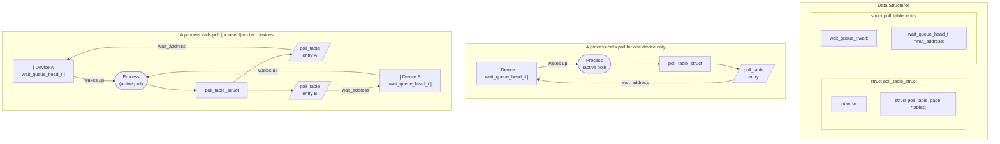

# Chương 6: Thao tác nâng cao trên Driver ký tự (Advanced Char Driver Operations)

Trong Chương 3, chúng ta đã xây dựng một device driver hoàn chỉnh mà tiến trình người dùng (user) có thể ghi vào và đọc từ đó. Nhưng một thiết bị thực tế thường cung cấp nhiều tính năng hơn là các thao tác *read* và *write* đồng bộ (synchronous). Giờ đây, khi chúng ta đã được trang bị các công cụ gỡ lỗi (debugging tools) nếu có sự cố xảy ra—và sự hiểu biết vững chắc về các vấn đề đồng thời (concurrency issues) để giúp ngăn ngừa sự cố—chúng ta có thể tự tin tiến hành tạo ra một driver nâng cao hơn.

Chương này xem xét một số khái niệm bạn cần hiểu để viết các char device driver đầy đủ tính năng. Chúng ta bắt đầu với việc triển khai system call *ioctl*, đây là một giao diện phổ biến dùng để điều khiển thiết bị (device control). Sau đó, chúng ta chuyển sang các cách khác nhau để đồng bộ hóa với không gian người dùng (User Space); đến cuối chương này, bạn sẽ nắm rõ cách đưa các tiến trình (process) vào trạng thái ngủ (sleep) và đánh thức chúng, triển khai I/O bất đồng bộ (nonblocking I/O), và thông báo cho User Space khi nào thiết bị của bạn sẵn sàng để đọc hoặc ghi. Chúng ta kết thúc bằng việc xem xét cách triển khai một số chính sách truy cập thiết bị (device access policies) khác nhau trong driver.

Các ý tưởng được thảo luận ở đây được minh họa thông qua một vài phiên bản sửa đổi của driver *scull*. Một lần nữa, mọi thứ đều được triển khai bằng các thiết bị ảo trong bộ nhớ (in-memory virtual devices), vì vậy bạn có thể tự mình thử nghiệm mã nguồn mà không cần phải có bất kỳ phần cứng cụ thể nào. Đến lúc này, có lẽ bạn đang muốn bắt tay vào làm việc với phần cứng thực tế, nhưng điều đó sẽ phải đợi cho đến Chương 9.

## ioctl

Hầu hết các driver đều cần—ngoài khả năng đọc và ghi thiết bị—khả năng thực hiện các loại điều khiển phần cứng khác nhau thông qua device driver. Hầu hết các thiết bị đều có thể thực hiện các thao tác vượt ra ngoài việc truyền dữ liệu đơn giản; User Space thường phải có khả năng yêu cầu, ví dụ, thiết bị khóa cửa của nó, đẩy phương tiện lưu trữ (media) ra, báo cáo thông tin lỗi, thay đổi tốc độ baud, hoặc tự hủy. Các thao tác này thường được hỗ trợ thông qua phương thức *ioctl*, phương thức này triển khai system call cùng tên.

Trong User Space, system call *ioctl* có nguyên mẫu (prototype) sau:

int ioctl(int fd, unsigned long cmd, ...);

Nguyên mẫu này nổi bật trong danh sách các Unix system call nhờ các dấu chấm, thường đánh dấu hàm có số lượng đối số thay đổi (variable number of arguments). Tuy nhiên, trong một hệ thống thực tế, một system call không thể thực sự có số lượng đối số thay đổi. Các system call phải có một nguyên mẫu được xác định rõ ràng, vì các chương trình người dùng chỉ có thể truy cập chúng thông qua các "cổng" (gates) phần cứng. Do đó, các dấu chấm trong nguyên mẫu không đại diện cho một số lượng đối số thay đổi mà đại diện cho một đối số tùy chọn duy nhất, theo truyền thống được xác định là char \*argp. Các dấu chấm đơn giản là có mặt để ngăn việc kiểm tra kiểu (type checking) trong quá trình biên dịch. Bản chất thực tế của đối số thứ ba phụ thuộc vào lệnh điều khiển cụ thể được phát ra (đối số thứ hai). Một số lệnh không nhận đối số nào, một số nhận một giá trị số nguyên (integer), và một số nhận một con trỏ (pointer) trỏ đến dữ liệu khác. Sử dụng con trỏ là cách để truyền dữ liệu tùy ý đến lệnh gọi *ioctl*; thiết bị sau đó có thể trao đổi bất kỳ lượng dữ liệu nào với User Space.

Bản chất phi cấu trúc của lệnh gọi *ioctl* đã khiến nó dần mất đi sự ưu ái trong mắt các nhà phát triển nhân (kernel developers). Mỗi lệnh *ioctl* về cơ bản là một system call riêng biệt, thường không có tài liệu hướng dẫn, và không có cách nào để kiểm toán (audit) các lệnh gọi này theo bất kỳ cách thức toàn diện nào. Cũng rất khó để làm cho các đối số *ioctl* phi cấu trúc hoạt động giống hệt nhau trên tất cả các hệ thống; ví dụ, hãy xem xét các hệ thống 64-bit với một tiến trình User Space chạy ở chế độ 32-bit. Kết quả là, có áp lực mạnh mẽ trong việc triển khai các thao tác điều khiển hỗn hợp bằng bất kỳ phương tiện nào khác. Các lựa chọn thay thế có thể bao gồm việc nhúng các lệnh vào luồng dữ liệu (data stream) (chúng ta sẽ thảo luận về phương pháp này sau trong chương này) hoặc sử dụng các hệ thống tệp ảo (virtual filesystem), như sysfs hoặc hệ thống tệp dành riêng cho driver (driver-specific filesystem). (Chúng ta sẽ xem xét sysfs trong Chương 14.) Tuy nhiên, thực tế là *ioctl* thường là lựa chọn dễ dàng và trực quan nhất cho các thao tác thiết bị thực sự.

Phương thức driver *ioctl* có một nguyên mẫu hơi khác so với phiên bản ở User Space:

```c
int (*ioctl) (struct inode *inode, struct file *filp,
 unsigned int cmd, unsigned long arg);
```

Các con trỏ inode và filp là các giá trị tương ứng với file descriptor fd được truyền bởi ứng dụng và là các tham số giống nhau được truyền cho phương thức *open*. Đối số cmd được truyền từ người dùng mà không thay đổi, và đối số arg tùy chọn được truyền dưới dạng unsigned long, bất kể nó được người dùng cung cấp dưới dạng số nguyên hay con trỏ. Nếu chương trình gọi không truyền đối số thứ ba, giá trị arg nhận được bởi thao tác driver là không xác định (undefined). Do việc kiểm tra kiểu bị vô hiệu hóa đối với đối số bổ sung này, trình biên dịch không thể cảnh báo bạn nếu một đối số không hợp lệ được truyền cho *ioctl*, và bất kỳ lỗi liên quan nào cũng sẽ khó phát hiện.

Như bạn có thể tưởng tượng, hầu hết các việc triển khai *ioctl* bao gồm một câu lệnh switch lớn để chọn hành vi chính xác theo đối số cmd. Các lệnh khác nhau có các giá trị số khác nhau, thường được đặt tên tượng trưng để đơn giản hóa việc lập trình. Tên tượng trưng được gán bằng một định nghĩa bộ tiền xử lý (preprocessor definition). Các driver tùy chỉnh thường khai báo các ký hiệu như vậy trong các tệp tiêu đề (header file) của chúng; *scull.h* khai báo chúng cho *scull*. Người dùng

các chương trình tất nhiên cũng phải bao gồm tệp tiêu đề (header file) đó để có quyền truy cập vào các ký hiệu (symbol) đó.

### Lựa chọn các lệnh ioctl

Trước khi viết mã nguồn cho *ioctl*, bạn cần chọn các số tương ứng với các lệnh. Bản năng đầu tiên của nhiều lập trình viên là chọn một tập hợp các số nhỏ bắt đầu từ 0 hoặc 1 và tăng dần từ đó. Tuy nhiên, có những lý do chính đáng để không làm theo cách đó. Các số hiệu lệnh *ioctl* phải là duy nhất trên toàn hệ thống nhằm ngăn ngừa các lỗi do việc gửi đúng lệnh nhưng nhầm thiết bị. Sự nhầm lẫn như vậy rất dễ xảy ra, và một chương trình có thể sẽ cố gắng thay đổi tốc độ baud (baud rate) của một luồng đầu vào không phải cổng nối tiếp (non-serial-port input stream), chẳng hạn như một FIFO hoặc một thiết bị âm thanh. Nếu mỗi số *ioctl* là duy nhất, ứng dụng sẽ nhận được lỗi `EINVAL` thay vì thực thi thành công một hành động ngoài ý muốn.

Để giúp các lập trình viên tạo ra các mã lệnh *ioctl* là duy nhất, các mã này đã được chia thành nhiều trường bit (bitfield). Các phiên bản Linux đầu tiên sử dụng các số 16-bit: tám bit cao là số "magic" (magic number) được liên kết với thiết bị, và tám bit thấp là một số tuần tự, duy nhất trong phạm vi thiết bị đó. Điều này xảy ra vì Linus khi đó "không biết gì" (chính là từ do ông tự miêu tả); một sự phân chia các trường bit tốt hơn chỉ ra đời sau đó không lâu. Thật không may, khá nhiều trình điều khiển (driver) vẫn sử dụng quy ước cũ này. Chúng buộc phải làm vậy: việc thay đổi các mã lệnh sẽ làm hỏng vô số chương trình dạng nhị phân (binary program), và đó không phải là điều mà các nhà phát triển nhân (kernel developer) sẵn sàng làm.

Để chọn các số *ioctl* cho driver của bạn theo quy ước của Linux Kernel, trước tiên bạn nên kiểm tra *include/asm/ioctl.h* và *Documentation/ioctl-number.txt*. Tệp tiêu đề này định nghĩa các trường bit mà bạn sẽ sử dụng: kiểu (type - số magic), số thứ tự (ordinal number), hướng truyền dữ liệu (direction of transfer) và kích thước đối số (size of argument). Tệp *ioctl-number.txt* liệt kê các số magic được sử dụng xuyên suốt kernel,\* vì vậy bạn sẽ có thể chọn số magic của riêng mình và tránh bị trùng lặp. Tệp văn bản này cũng liệt kê các lý do tại sao quy ước này nên được tuân thủ.

Cách thức được phê duyệt để định nghĩa các số lệnh *ioctl* sử dụng bốn trường bit, mang các ý nghĩa sau. Các ký hiệu mới được giới thiệu trong danh sách này được định nghĩa trong *<linux/ioctl.h>*.

type

Số magic. Chỉ cần chọn một số (sau khi tham khảo *ioctl-number.txt*) và sử dụng nó xuyên suốt driver. Trường này có độ dài tám bit (`_IOC_TYPEBITS`).

number

Số thứ tự (tuần tự). Trường này có độ dài tám bit (`_IOC_NRBITS`).

Tuy nhiên, việc duy trì tệp này gần đây có phần bị xao nhãng.

direction

Hướng truyền dữ liệu, nếu lệnh cụ thể có liên quan đến việc truyền dữ liệu. Các giá trị có thể là `_IOC_NONE` (không truyền dữ liệu), `_IOC_READ`, `_IOC_WRITE`, và `_IOC_READ|_IOC_WRITE` (dữ liệu được truyền theo cả hai hướng). Việc truyền dữ liệu được nhìn nhận từ góc độ của ứng dụng; `_IOC_READ` có nghĩa là đọc *từ* thiết bị, do đó driver phải ghi vào không gian người dùng (user space). Lưu ý rằng trường này là một mặt nạ bit (bit mask), vì vậy `_IOC_READ` và `_IOC_WRITE` có thể được trích xuất bằng thao tác AND logic.

size

Kích thước dữ liệu người dùng liên quan. Độ dài của trường này phụ thuộc vào kiến trúc (architecture-dependent), nhưng thường là 13 hoặc 14 bit. Bạn có thể tìm giá trị của nó cho kiến trúc cụ thể của mình trong macro `_IOC_SIZEBITS`. Việc sử dụng trường kích thước này là không bắt buộc—kernel không kiểm tra nó—nhưng đó là một ý tưởng hay. Việc sử dụng đúng trường này có thể giúp phát hiện các lỗi lập trình trong không gian người dùng (user-space programming error) và cho phép bạn triển khai tính năng tương thích ngược (backward compatibility) nếu sau này bạn cần thay đổi kích thước của mục dữ liệu liên quan. Tuy nhiên, nếu bạn cần các cấu trúc dữ liệu lớn hơn, bạn có thể bỏ qua trường kích thước này. Chúng ta sẽ thấy trường này được sử dụng như thế nào ngay sau đây.

Tệp tiêu đề *<asm/ioctl.h>*, được bao hàm (include) bởi *<linux/ioctl.h>*, định nghĩa các macro giúp thiết lập các số lệnh như sau: `_IO(type,nr)` (cho lệnh không có đối số), `_IOR(type,nr,datatype)` (để đọc dữ liệu từ driver), `_IOW(type,nr,datatype)` (để ghi dữ liệu), và `_IOWR(type,nr,datatype)` (cho việc truyền dữ liệu hai chiều). Các trường type và number được truyền vào như các đối số, và trường size được suy ra bằng cách áp dụng toán tử *sizeof* cho đối số datatype.

Tệp tiêu đề cũng định nghĩa các macro có thể được sử dụng trong driver của bạn để giải mã các con số này: `_IOC_DIR(nr)`, `_IOC_TYPE(nr)`, `_IOC_NR(nr)`, và `_IOC_SIZE(nr)`. Chúng ta sẽ không đi sâu hơn vào các macro này vì tệp tiêu đề đã rất rõ ràng, và mã nguồn mẫu sẽ được trình bày ở phần sau của mục này.

Dưới đây là cách một số lệnh *ioctl* được định nghĩa trong *scull*. Cụ thể, các lệnh này thiết lập và lấy các tham số có thể cấu hình của driver.

```c
/* Use 'k' as magic number */
## define SCULL_IOC_MAGIC 'k'
/* Please use a different 8-bit number in your code */
## define SCULL_IOCRESET _IO(SCULL_IOC_MAGIC, 0)
/*
 * S means "Set" through a ptr,
 * T means "Tell" directly with the argument value
 * G means "Get": reply by setting through a pointer
 * Q means "Query": response is on the return value
 * X means "eXchange": switch G and S atomically
 * H means "sHift": switch T and Q atomically
 */
## define SCULL_IOCSQUANTUM _IOW(SCULL_IOC_MAGIC, 1, int)
## define SCULL_IOCSQSET _IOW(SCULL_IOC_MAGIC, 2, int)
```

```c
## define SCULL_IOCTQUANTUM _IO(SCULL_IOC_MAGIC, 3)
## define SCULL_IOCTQSET _IO(SCULL_IOC_MAGIC, 4)
## define SCULL_IOCGQUANTUM _IOR(SCULL_IOC_MAGIC, 5, int)
## define SCULL_IOCGQSET _IOR(SCULL_IOC_MAGIC, 6, int)
## define SCULL_IOCQQUANTUM _IO(SCULL_IOC_MAGIC, 7)
## define SCULL_IOCQQSET _IO(SCULL_IOC_MAGIC, 8)
## define SCULL_IOCXQUANTUM _IOWR(SCULL_IOC_MAGIC, 9, int)
## define SCULL_IOCXQSET _IOWR(SCULL_IOC_MAGIC,10, int)
## define SCULL_IOCHQUANTUM _IO(SCULL_IOC_MAGIC, 11)
## define SCULL_IOCHQSET _IO(SCULL_IOC_MAGIC, 12)
## define SCULL_IOC_MAXNR 14
```

Tệp mã nguồn thực tế định nghĩa một số lệnh bổ sung chưa được hiển thị ở đây.

Chúng tôi chọn cách cài đặt cả hai phương pháp truyền tham số kiểu số nguyên (integer): thông qua con trỏ (pointer) và bằng giá trị tường minh (explicit value) (mặc dù theo quy ước đã thiết lập, *ioctl* nên trao đổi các giá trị thông qua con trỏ). Tương tự, cả hai cách đều được sử dụng để trả về một số nguyên: bằng con trỏ hoặc bằng cách thiết lập giá trị trả về. Cách này hoạt động miễn là giá trị trả về là một số nguyên dương; như bạn đã biết đến thời điểm này, khi trả về từ bất kỳ System Call nào, một giá trị dương sẽ được giữ nguyên (như chúng ta đã thấy đối với *read* và *write*), trong khi một giá trị âm được coi là lỗi và được sử dụng để thiết lập `errno` trong User Space.\*

Các thao tác "trao đổi" (exchange) và "chuyển dịch" (shift) không thực sự hữu ích đối với *scull*. Chúng tôi đã cài đặt thao tác "trao đổi" để minh họa cách driver có thể kết hợp các thao tác riêng biệt thành một thao tác nguyên tử (atomic) duy nhất, và thao tác "chuyển dịch" để ghép đôi với "tell" và "query". Có những thời điểm mà các thao tác kiểm tra và thiết lập nguyên tử (test-and-set) như thế này là cần thiết, đặc biệt là khi các ứng dụng cần thiết lập hoặc giải phóng khóa (lock).

Số thứ tự tường minh của lệnh không mang một ý nghĩa cụ thể nào. Nó chỉ được sử dụng để phân biệt các lệnh với nhau. Trên thực tế, bạn thậm chí có thể sử dụng cùng một số thứ tự cho cả lệnh đọc (read command) và lệnh ghi (write command), vì giá trị *ioctl* thực tế là khác nhau ở các bit "hướng" (direction), nhưng không có lý do gì mà bạn lại muốn làm như vậy. Chúng tôi chọn không sử dụng số thứ tự của lệnh ở bất kỳ đâu ngoài phần khai báo, vì vậy chúng tôi đã không gán một giá trị biểu trưng (symbolic value) cho nó. Đó là lý do tại sao các con số tường minh xuất hiện trong định nghĩa được đưa ra trước đó. Ví dụ cho thấy một cách để sử dụng các số hiệu lệnh, nhưng bạn hoàn toàn có thể làm khác đi.

Ngoại trừ một số lượng nhỏ các lệnh được định nghĩa sẵn (sẽ được thảo luận ngay sau đây), giá trị của tham số `cmd` trong *ioctl* hiện không được Kernel sử dụng và rất khó có khả năng nó sẽ được sử dụng trong tương lai. Do đó, nếu cảm thấy lười biếng, bạn có thể tránh các khai báo phức tạp được hiển thị trước đó và khai báo tường minh một tập hợp các số vô hướng (scalar number). Mặt khác, nếu làm như vậy, bạn sẽ không tận dụng được lợi ích từ việc sử dụng các trường bit (bitfield), và bạn sẽ gặp khó khăn nếu có ý định nộp mã nguồn của mình để

\* Thực tế, tất cả các bản cài đặt *libc* hiện đang được sử dụng (bao gồm cả uClibc) chỉ coi các giá trị trong dải từ –4095 đến –1 là mã lỗi. Thật không may, việc có thể trả về các số âm lớn nhưng lại không thể trả về các số âm nhỏ thì không hữu ích cho lắm.

đưa vào Mainline Kernel. Tệp tiêu đề *<linux/kd.h>* là một ví dụ về cách tiếp cận lỗi thời này, sử dụng các giá trị vô hướng 16-bit để định nghĩa các lệnh *ioctl*. Tệp mã nguồn đó dựa trên các số vô hướng vì nó tuân theo các quy ước tại thời điểm đó chứ không phải vì sự lười biếng. Việc thay đổi nó bây giờ sẽ gây ra sự không tương thích không cần thiết.

```

### Giá trị trả về (The Return Value)

Việc cài đặt *ioctl* thường là một câu lệnh `switch` dựa trên số hiệu lệnh (command number). Nhưng lựa chọn mặc định (default) nên là gì khi số hiệu lệnh không khớp với một thao tác hợp lệ? Câu hỏi này vẫn còn gây tranh cãi. Một số hàm kernel trả về `-EINVAL` ("Invalid argument" - Đối số không hợp lệ), điều này có vẻ hợp lý vì đối số lệnh thực sự không phải là một đối số hợp lệ. Tuy nhiên, tiêu chuẩn POSIX lại quy định rằng nếu một lệnh *ioctl* không phù hợp được ban hành, thì `-ENOTTY` nên được trả về. Mã lỗi này được thư viện C (C library) hiểu là "inappropriate ioctl for device" (ioctl không thích hợp cho thiết bị), đây thường chính xác là những gì lập trình viên cần nghe. Mặc dù vậy, việc trả về `-EINVAL` để phản hồi lại một lệnh *ioctl* không hợp lệ vẫn khá phổ biến.

### Các lệnh được định nghĩa trước (The Predefined Commands)

Mặc dù System Call *ioctl* thường được sử dụng nhiều nhất để tác động lên các thiết bị (device), một số lệnh vẫn được kernel nhận diện. Lưu ý rằng các lệnh này, khi được áp dụng cho thiết bị của bạn, sẽ được giải mã *trước* khi các thao tác tập tin (file operations) của riêng bạn được gọi. Do đó, nếu bạn chọn cùng một số hiệu cho một trong các lệnh *ioctl* của mình, bạn sẽ không bao giờ nhận được bất kỳ yêu cầu nào cho lệnh đó, và ứng dụng sẽ nhận được kết quả bất ngờ do sự xung đột giữa các số hiệu *ioctl*.

Các lệnh được định nghĩa trước được chia thành ba nhóm:

- Những lệnh có thể được ban hành trên bất kỳ tập tin nào (tập tin thông thường, thiết bị, FIFO, hoặc socket)
- Những lệnh chỉ được ban hành trên các tập tin thông thường (regular files)
- Những lệnh đặc thù cho loại hệ thống tập tin (filesystem type)

Các lệnh trong nhóm cuối cùng được thực thi bởi phần cài đặt của hệ thống tập tin lưu trữ (đó là cách lệnh *chattr* hoạt động). Các nhà phát triển trình điều khiển thiết bị (device driver writers) chỉ quan tâm đến nhóm lệnh đầu tiên, có số ma thuật (magic number) là "T." Việc tìm hiểu hoạt động của các nhóm khác được để lại cho độc giả như một bài tập; *ext2\_ioctl* là một hàm rất thú vị (và dễ hiểu hơn người ta tưởng), bởi vì nó cài đặt cờ chỉ-đọc-thêm (append-only flag) và cờ bất biến (immutable flag).

Các lệnh *ioctl* sau đây được định nghĩa trước cho bất kỳ tập tin nào, kể cả các tập tin thiết bị đặc biệt (device-special files):

#### FIOCLEX

Thiết lập cờ đóng-khi-thực-thi (close-on-exec flag - File IOctl CLose on EXec). Việc thiết lập cờ này khiến cho File Descriptor bị đóng khi tiến trình gọi (calling process) thực thi một chương trình mới.

#### FIONCLEX

Xóa cờ đóng-khi-thực-thi (File IOctl Not CLos on EXec). Lệnh này khôi phục hành vi tập tin thông thường, hoàn tác những gì lệnh FIOCLEX ở trên đã làm.

#### FIOASYNC

Thiết lập hoặc thiết lập lại thông báo bất đồng bộ (asynchronous notification) cho tập tin (như đã thảo luận trong phần "Thông báo bất đồng bộ" - "Asynchronous Notification," ở phần sau của chương này). Lưu ý rằng các phiên bản kernel cho đến Linux 2.2.4 đã sử dụng nhầm lệnh này để chỉnh sửa cờ `O_SYNC`. Vì cả hai hành động đều có thể được thực hiện thông qua *fcntl*, nên không ai thực sự sử dụng lệnh FIOASYNC, lệnh này chỉ được đề cập ở đây để cho đầy đủ tính tài liệu.

#### FIOQSIZE

Lệnh này trả về kích thước của một tập tin hoặc thư mục; tuy nhiên, khi áp dụng cho một tập tin thiết bị, nó sẽ trả về mã lỗi `ENOTTY`.

#### FIONBIO

"File IOctl Non-Blocking I/O" (được mô tả trong phần "Thao tác chặn và phi chặn" - "Blocking and Nonblocking Operations"). Lệnh gọi này sửa đổi cờ `O_NONBLOCK` trong `filp->f_flags`. Đối số thứ ba của system call được sử dụng để chỉ định xem cờ được thiết lập hay bị xóa. (Chúng ta sẽ xem xét vai trò của cờ này ở phần sau của chương này). Lưu ý rằng cách thông thường để thay đổi cờ này là sử dụng system call *fcntl*, với lệnh `F_SETFL`.

Mục cuối cùng trong danh sách đã giới thiệu một system call mới, *fcntl*, trông rất giống *ioctl*. Trên thực tế, lời gọi *fcntl* rất giống với *ioctl* ở điểm nó nhận một đối số lệnh và một đối số bổ sung (tùy chọn). Nó được giữ tách biệt với *ioctl* chủ yếu vì lý do lịch sử: khi các nhà phát triển Unix đối mặt với bài toán điều khiển các thao tác I/O, họ quyết định rằng tập tin và thiết bị là khác nhau. Vào thời điểm đó, các thiết bị duy nhất có phần cài đặt *ioctl* là các tty, điều này giải thích tại sao `-ENOTTY` là phản hồi chuẩn cho một lệnh *ioctl* không chính xác. Mọi thứ đã thay đổi, nhưng *fcntl* vẫn là một system call độc lập.

## Sử dụng Đối số của ioctl

Một điểm nữa chúng ta cần đề cập trước khi xem xét mã nguồn *ioctl* của trình điều khiển (driver) *scull* là cách sử dụng đối số bổ sung. Nếu đó là một số nguyên (integer), thì rất đơn giản: nó có thể được sử dụng trực tiếp. Tuy nhiên, nếu nó là một con trỏ (pointer), một số lưu ý cần phải được tuân thủ.

Khi một con trỏ được sử dụng để tham chiếu đến vùng nhớ người dùng (user space), chúng ta phải đảm bảo rằng địa chỉ người dùng đó là hợp lệ. Việc cố gắng truy cập một con trỏ do người dùng cung cấp mà chưa được xác thực có thể dẫn đến hành vi không chính xác, lỗi kernel (kernel oops), hỏng hệ thống (system corruption), hoặc các vấn đề bảo mật. Trách nhiệm của driver là thực hiện các kiểm tra thích hợp trên mọi địa chỉ user-space mà nó sử dụng và trả về một mã lỗi nếu địa chỉ đó không hợp lệ.

Trong Chương 3, chúng ta đã xem xét các hàm *copy\_from\_user* và *copy\_to\_user*, có thể được sử dụng để di chuyển dữ liệu một cách an toàn đến và đi từ user space. Các hàm đó cũng có thể được sử dụng trong các phương thức (methods) *ioctl*, nhưng các lời gọi *ioctl* thường liên quan đến các mục dữ liệu nhỏ có thể được xử lý hiệu quả hơn thông qua các cách khác. Để bắt đầu, việc xác thực địa chỉ (mà không truyền dữ liệu) được thực hiện bởi hàm *access\_ok*, được khai báo trong *<asm/uaccess.h>*:

```

int access_ok(int type, const void *addr, unsigned long size);

```

Đối số đầu tiên phải là `VERIFY_READ` hoặc `VERIFY_WRITE`, tùy thuộc vào việc hành động cần thực hiện là đọc vùng nhớ user-space hay ghi vào đó. Đối số `addr` chứa một địa chỉ user-space, và `size` là số lượng byte. Nếu *ioctl*, ví dụ, cần đọc một giá trị số nguyên từ user space, `size` sẽ là `sizeof(int)`. Nếu bạn cần vừa đọc vừa ghi tại địa chỉ đã cho, hãy sử dụng `VERIFY_WRITE`, vì nó là tập siêu tập (superset) của `VERIFY_READ`.

Không giống như hầu hết các hàm kernel, *access\_ok* trả về một giá trị kiểu boolean: 1 cho thành công (truy cập hợp lệ) và 0 cho thất bại (truy cập không hợp lệ). Nếu nó trả về giá trị sai (false), driver thường nên trả về `-EFAULT` cho tiến trình gọi.

Có một vài điều thú vị cần lưu ý về *access\_ok*. Đầu tiên, nó không thực hiện toàn bộ công việc xác thực quyền truy cập bộ nhớ; nó chỉ kiểm tra xem tham chiếu bộ nhớ có nằm trong một vùng nhớ mà tiến trình có thể hợp lý truy cập hay không. Cụ thể, *access\_ok* đảm bảo rằng địa chỉ không trỏ đến bộ nhớ vùng nhân (kernel-space memory). Thứ hai, hầu hết mã nguồn driver không thực sự cần gọi *access\_ok*. Cácroutines truy cập bộ nhớ được mô tả sau đây sẽ lo việc đó thay cho bạn. Mặc dù vậy, chúng tôi vẫn minh họa cách sử dụng nó để bạn có thể thấy cách thức hoạt động.

Mã nguồn của *scull* tận dụng các trường bit (bitfields) trong số hiệu *ioctl* để kiểm tra các đối số trước câu lệnh switch:

```

int err = 0, tmp;
int retval = 0;
/*

- trích xuất các trường bit kiểu (type) và số hiệu (number), và không giải mã
- các lệnh sai: trả về ENOTTY (ioctl không phù hợp) trước khi gọi access_ok( )
*/
if (_IOC_TYPE(cmd) != SCULL_IOC_MAGIC) return -ENOTTY;
if (_IOC_NR(cmd) > SCULL_IOC_MAXNR) return -ENOTTY;
/*

- hướng (direction) là một mặt nạ bit (bitmask), và VERIFY_WRITE bắt các thao tác truyền R/W.
- `Type` hướng về phía người dùng, trong khi

```

```

- access_ok hướng về phía kernel, vì vậy khái niệm "đọc" (read) và
- "ghi" (write) bị đảo ngược
*/
if (_IOC_DIR(cmd) & _IOC_READ)
err = !access_ok(VERIFY_WRITE, (void __user *)arg, _IOC_SIZE(cmd));
else if (_IOC_DIR(cmd) & _IOC_WRITE)
err = !access_ok(VERIFY_READ, (void __user *)arg, _IOC_SIZE(cmd));
if (err) return -EFAULT;

```

Sau khi gọi *access\_ok*, driver có thể thực hiện quá trình truyền dữ liệu thực tế một cách an toàn. Ngoài các hàm *copy\_from\_user* và *copy\_to\_user*, lập trình viên có thể tận dụng một tập hợp các hàm được tối ưu hóa cho các kích thước dữ liệu được sử dụng nhiều nhất (một, hai, bốn và tám byte). Các hàm này được mô tả trong danh sách sau và được định nghĩa trong *<asm/uaccess.h>*:

```

put_user(datum, ptr)
__put_user(datum, ptr)

```

Các macro này ghi dữ liệu (`datum`) vào user space; chúng tương đối nhanh và nên được gọi thay thế cho *copy\_to\_user* bất cứ khi nào các giá trị đơn lẻ được truyền đi. Các macro này được viết để cho phép truyền bất kỳ loại con trỏ nào tới *put\_user*, miễn đó là một địa chỉ user-space. Kích thước truyền dữ liệu phụ thuộc vào kiểu của đối số `ptr` và được xác định tại thời điểm biên dịch (compile time) bằng cách sử dụng các hàm dựng sẵn của trình biên dịch `sizeof` và `typeof`. Kết quả là, nếu `ptr` là một con trỏ kiểu `char`, một byte được truyền đi, và cứ thế đối với hai, bốn, và có thể là tám byte.

*put\_user* kiểm tra để đảm bảo rằng tiến trình có khả năng ghi vào địa chỉ bộ nhớ đã cho. Nó trả về 0 khi thành công, và `-EFAULT` khi có lỗi. *\_\_put\_user* thực hiện ít kiểm tra hơn (nó không gọi *access\_ok*), nhưng vẫn có thể thất bại nếu vùng nhớ được trỏ tới không được phép ghi bởi người dùng. Do đó, *\_\_put\_user* chỉ nên được sử dụng nếu vùng nhớ đã được xác thực trước đó bằng *access\_ok*.

Như một quy tắc chung, bạn gọi *\_\_put\_user* để tiết kiệm một vài chu kỳ máy (cycles) khi bạn đang thực thi một phương thức *read*, hoặc khi bạn sao chép một vài mục dữ liệu và do đó, chỉ gọi *access\_ok* đúng một lần trước lần truyền dữ liệu đầu tiên, như được minh họa ở trên đối với *ioctl*.

```

get_user(local, ptr)
__get_user(local, ptr)

```

Các macro này được sử dụng để truy xuất một phần dữ liệu đơn lẻ từ không gian người dùng (User Space). Chúng hoạt động giống như *put\_user* và *\_\_put\_user*, nhưng truyền dữ liệu theo hướng ngược lại. Giá trị được truy xuất sẽ được lưu trữ trong biến cục bộ `local`; giá trị trả về cho biết thao tác có thành công hay không. Một lần nữa, *\_\_get\_user* chỉ nên được sử dụng nếu địa chỉ đã được xác thực trước đó bằng *access\_ok*.

Nếu một nỗ lực được thực hiện nhằm sử dụng một trong các hàm được liệt kê để truyền một giá trị không khớp với bất kỳ kích thước cụ thể nào, kết quả thường là một thông báo lạ từ trình biên dịch (compiler), chẳng hạn như "conversion to non-scalar type requested" (yêu cầu chuyển đổi sang kiểu không phải kiểu vô hướng). Trong những trường hợp như vậy, phải sử dụng *copy\_to\_user* hoặc *copy\_from\_user*.

### Khả năng và Các thao tác bị giới hạn (Capabilities and Restricted Operations)
Việc truy cập vào một thiết bị được kiểm soát bởi các quyền trên (các) tệp thiết bị (device file), và trình điều khiển (driver) thông thường không tham gia vào việc kiểm tra quyền. Tuy nhiên, có những tình huống mà bất kỳ người dùng nào cũng được cấp quyền đọc/ghi trên thiết bị, nhưng một số thao tác điều khiển vẫn phải bị từ chối. Ví dụ: không phải mọi người dùng của ổ băng từ (tape drive) đều có thể đặt kích thước khối mặc định của nó, và một người dùng đã được cấp quyền đọc/ghi đối với thiết bị đĩa (disk device) có lẽ vẫn phải bị từ chối quyền định dạng (format) nó. Trong những trường hợp như vậy, trình điều khiển phải thực hiện các kiểm tra bổ sung để đảm bảo rằng người dùng có đủ khả năng thực hiện thao tác được yêu cầu.

Các hệ thống Unix theo truyền thống đã giới hạn các thao tác đặc quyền (privileged operations) đối với tài khoản siêu người dùng (superuser). Điều này có nghĩa là đặc quyền mang tính chất "tất cả hoặc không có gì" (all-or-nothing)—siêu người dùng có thể làm bất cứ điều gì, nhưng tất cả những người dùng khác đều bị hạn chế tối đa. Linux Kernel cung cấp một hệ thống linh hoạt hơn gọi là *capabilities* (khả năng/quyền năng). Một hệ thống dựa trên capability sẽ loại bỏ chế độ tất cả hoặc không có gì và chia nhỏ các thao tác đặc quyền thành các nhóm con riêng biệt. Bằng cách này, một người dùng (hoặc chương trình) cụ thể có thể được trao quyền thực hiện một thao tác đặc quyền cụ thể mà không bị trao khả năng thực hiện các thao tác khác không liên quan. Kernel sử dụng capabilities độc quyền cho việc quản lý quyền (permissions management) và xuất ra hai System Call là *capget* và *capset*, cho phép quản lý chúng từ User Space.

Toàn bộ tập hợp capabilities có trong *<linux/capability.h>*. Đây là những capability duy nhất được hệ thống biết đến; các tác giả viết driver hoặc quản trị viên hệ thống không thể tự định nghĩa các capability mới mà không sửa đổi mã nguồn kernel. Một tập hợp con của các capability có thể hữu ích cho các nhà phát triển viết device driver bao gồm:

#### CAP\_DAC\_OVERRIDE

Khả năng ghi đè các giới hạn truy cập (kiểm soát truy cập dữ liệu, hay DAC) trên các tệp và thư mục.

#### CAP\_NET\_ADMIN

Khả năng thực hiện các tác vụ quản trị mạng, bao gồm cả những tác vụ ảnh hưởng đến các giao diện mạng (network interface).

#### CAP\_SYS\_MODULE

Khả năng nạp (load) hoặc gỡ bỏ (remove) các module kernel.

#### CAP\_SYS\_RAWIO

Khả năng thực hiện các thao tác I/O "thô" (raw). Các ví dụ bao gồm việc truy cập cổng thiết bị hoặc giao tiếp trực tiếp với các thiết bị USB.

#### CAP\_SYS_ADMIN

Một capability tổng hợp (catch-all) cung cấp quyền truy cập vào nhiều thao tác quản trị hệ thống.

#### CAP\_SYS\_TTY\_CONFIG

Khả năng thực hiện các tác vụ cấu hình tty.

Trước khi thực hiện một thao tác đặc quyền, device driver phải kiểm tra xem tiến trình gọi (calling process) có capability thích hợp hay không; việc không làm như vậy có thể dẫn đến việc các tiến trình người dùng thực hiện các thao tác trái phép, gây hậu quả xấu cho tính ổn định hoặc bảo mật của hệ thống. Các kiểm tra capability được thực hiện bằng hàm *capable* (được định nghĩa trong *<linux/sched.h>*):

```

int capable(int capability);

```

Trong driver mẫu *scull*, bất kỳ người dùng nào cũng được phép truy vấn kích thước lượng tử (quantum) và tập lượng tử (quantum set). Tuy nhiên, chỉ những người dùng có đặc quyền mới có thể thay đổi các giá trị đó, vì các giá trị không phù hợp có thể ảnh hưởng nghiêm trọng đến hiệu năng hệ thống. Khi cần thiết, việc triển khai *ioctl* trong *scull* sẽ kiểm tra mức đặc quyền của người dùng như sau:

```

if (! capable (CAP_SYS_ADMIN))
return -EPERM;

```

Khi không có capability nào cụ thể hơn cho tác vụ này, CAP\_SYS\_ADMIN đã được chọn cho bài kiểm tra này.
```

### Triển khai các câu lệnh ioctl (The Implementation of the ioctl Commands)

Việc triển khai *ioctl* trong *scull* chỉ thực hiện việc truyền các tham số có thể cấu hình của thiết bị và tỏ ra đơn giản như sau:

```
switch(cmd) {
 case SCULL_IOCRESET:
 scull_quantum = SCULL_QUANTUM;
 scull_qset = SCULL_QSET;
 break;
 case SCULL_IOCSQUANTUM: /* Set: arg points to the value */
 if (! capable (CAP_SYS_ADMIN))
 return -EPERM;
 retval = __get_user(scull_quantum, (int __user *)arg);
 break;
 case SCULL_IOCTQUANTUM: /* Tell: arg is the value */
 if (! capable (CAP_SYS_ADMIN))
 return -EPERM;
 scull_quantum = arg;
 break;
 case SCULL_IOCGQUANTUM: /* Get: arg is pointer to result */
 retval = __put_user(scull_quantum, (int __user *)arg);
 break;
 case SCULL_IOCQQUANTUM: /* Query: return it (it's positive) */
 return scull_quantum;
 case SCULL_IOCXQUANTUM: /* eXchange: use arg as pointer */
 if (! capable (CAP_SYS_ADMIN))
```

```
 return -EPERM;
 tmp = scull_quantum;
 retval = __get_user(scull_quantum, (int __user *)arg);
 if (retval = = 0)
 retval = __put_user(tmp, (int __user *)arg);
 break;
 case SCULL_IOCHQUANTUM: /* sHift: like Tell + Query */
 if (! capable (CAP_SYS_ADMIN))
 return -EPERM;
 tmp = scull_quantum;
 scull_quantum = arg;
 return tmp;
 default: /* redundant, as cmd was checked against MAXNR */
 return -ENOTTY;
}
return retval;
```

*scull* cũng bao gồm sáu mục (entries) tác động lên scull\_qset. Các mục này giống hệt với các mục dành cho scull\_quantum và không đáng để in ra đây.

Sáu cách truyền và nhận đối số trông giống như sau từ góc nhìn của phía gọi (tức là từ không gian người dùng - user space):

```
int quantum;
ioctl(fd,SCULL_IOCSQUANTUM, &quantum); /* Set by pointer */
ioctl(fd,SCULL_IOCTQUANTUM, quantum); /* Set by value */
ioctl(fd,SCULL_IOCGQUANTUM, &quantum); /* Get by pointer */
quantum = ioctl(fd,SCULL_IOCQQUANTUM); /* Get by return value */
ioctl(fd,SCULL_IOCXQUANTUM, &quantum); /* Exchange by pointer */
quantum = ioctl(fd,SCULL_IOCHQUANTUM, quantum); /* Exchange by value */
```

Tất nhiên, một driver thông thường sẽ không triển khai một sự pha trộn các chế độ gọi như vậy. Chúng tôi làm điều này ở đây chỉ để minh họa các cách khác nhau mà mọi thứ có thể được thực hiện. Tuy nhiên, thông thường, việc trao đổi dữ liệu sẽ được thực hiện một cách nhất quán, hoặc thông qua con trỏ hoặc theo giá trị, và nên tránh việc trộn lẫn hai kỹ thuật này.

### Điều khiển thiết bị mà không cần ioctl (Device Control Without ioctl)

Đôi khi, việc điều khiển thiết bị sẽ đạt hiệu quả tốt hơn bằng cách ghi các chuỗi điều khiển trực tiếp vào thiết bị đó. Ví dụ, kỹ thuật này được sử dụng trong driver console, nơi các chuỗi thoát (escape sequences) được sử dụng để di chuyển con trỏ, thay đổi màu sắc mặc định, hoặc thực hiện các tác vụ cấu hình khác. Lợi ích của việc triển khai điều khiển thiết bị theo cách này là người dùng có thể điều khiển thiết bị chỉ bằng cách ghi dữ liệu, mà không cần phải sử dụng (hoặc đôi khi viết) các chương trình được xây dựng chuyên để cấu hình thiết bị. Khi các thiết bị có thể được điều khiển theo cách này, chương trình phát lệnh thường thậm chí không cần phải chạy trên cùng một hệ thống với thiết bị mà nó đang điều khiển.

Ví dụ, chương trình *setterm* tác động lên cấu hình của console (hoặc một terminal khác) bằng cách in ra các chuỗi thoát. Chương trình điều khiển có thể nằm trên một máy tính khác với thiết bị được điều khiển, bởi vì một thao tác chuyển hướng đơn giản của luồng dữ liệu là có thể hoàn thành công việc cấu hình. Đây là điều xảy ra mỗi khi bạn chạy một phiên tty từ xa: các chuỗi thoát được in từ xa nhưng lại ảnh hưởng đến tty cục bộ; tuy nhiên, kỹ thuật này không chỉ giới hạn ở các tty.

Nhược điểm của việc điều khiển bằng cách in ấn là nó áp đặt các ràng buộc chính sách (policy constraints) lên thiết bị; ví dụ, nó chỉ khả thi nếu bạn chắc chắn rằng chuỗi điều khiển không thể xuất hiện trong dữ liệu được ghi vào thiết bị trong quá trình hoạt động bình thường. Điều này chỉ đúng một phần đối với các tty. Mặc dù màn hình văn bản chỉ dùng để hiển thị các ký tự ASCII, nhưng đôi khi các ký tự điều khiển có thể lọt vào dữ liệu đang được ghi và do đó có thể ảnh hưởng đến thiết lập của console. Điều này có thể xảy ra, ví dụ, khi bạn dùng lệnh *cat* một tệp nhị phân lên màn hình; sự hỗn độn kết quả có thể chứa bất cứ thứ gì, và bạn thường phải nhận lấy phông chữ (font) sai lệch trên console của mình.

Việc điều khiển thông qua hàm ghi (write) *chắc chắn* là hướng đi phù hợp cho các thiết bị không truyền dữ liệu mà chỉ phản hồi các lệnh, chẳng hạn như các thiết bị robot.

Ví dụ, một driver được viết vì mục đích giải trí bởi một trong những tác giả của bạn có nhiệm vụ di chuyển một camera trên hai trục. Trong driver này, "thiết bị" đơn giản là một cặp động cơ bước (stepper motors) cũ, vốn không thực sự hỗ trợ việc đọc hoặc ghi dữ liệu theo nghĩa thông thường. Khái niệm "gửi một luồng dữ liệu" đến một động cơ bước là có rất ít hoặc hoàn toàn không có ý nghĩa. Trong trường hợp này, driver diễn giải những gì đang được ghi thành các lệnh ASCII và chuyển đổi các yêu cầu thành các chuỗi xung điều khiển các động cơ bước. Ý tưởng này phần nào tương tự như các lệnh AT mà bạn gửi tới modem để thiết lập giao tiếp, sự khác biệt chính là cổng nối tiếp (serial port) dùng để giao tiếp với modem cũng phải truyền tải dữ liệu thực. Ưu điểm của việc điều khiển thiết bị trực tiếp là bạn có thể sử dụng lệnh *cat* để di chuyển camera mà không cần phải viết và biên dịch mã nguồn đặc thù để thực hiện các lời gọi *ioctl*.

Khi viết các driver hướng lệnh (command-oriented drivers), không có lý do gì để phải triển khai phương thức *ioctl*. Một lệnh bổ sung trong bộ thông dịch (interpreter) sẽ dễ triển khai và sử dụng hơn.

Tuy nhiên, đôi khi bạn có thể chọn làm theo hướng ngược lại: thay vì biến phương thức *write* thành một bộ thông dịch và tránh dùng *ioctl*, bạn có thể chọn bỏ hẳn *write* và chỉ sử dụng các lệnh *ioctl*, đồng thời đi kèm với driver là một công cụ dòng lệnh (command-line tool) cụ thể để gửi các lệnh đó đến driver. Cách tiếp cận này chuyển độ phức tạp từ vùng nhân (kernel space) sang vùng người dùng (user space) — nơi việc xử lý có thể dễ dàng hơn — và giúp giữ cho driver nhỏ gọn, đồng thời ngăn chặn việc sử dụng các lệnh đơn giản như *cat* hay *echo*.

## Nhập/Xuất đồng bộ (Blocking I/O)

Trở lại Chương 3, chúng ta đã xem xét cách triển khai các phương thức *read* và *write* của driver. Tuy nhiên, tại thời điểm đó, chúng ta đã bỏ qua một vấn đề quan trọng: driver phản ứng thế nào nếu nó không thể ngay lập tức đáp ứng yêu cầu? Một lời gọi *read* có thể xảy ra khi

không có dữ liệu nào sẵn sàng, nhưng dữ liệu được mong đợi sẽ đến trong tương lai. Hoặc một tiến trình (process) có thể cố gắng thực hiện *write*, nhưng thiết bị của bạn chưa sẵn sàng chấp nhận dữ liệu vì bộ đệm đầu ra (output buffer) đã đầy. Tiến trình gọi thông thường không quan tâm đến các vấn đề như vậy; lập trình viên đơn giản là mong đợi gọi *read* hoặc *write* và lời gọi sẽ trả về sau khi công việc cần thiết đã hoàn thành. Vì vậy, trong những trường hợp như thế, driver của bạn nên (theo mặc định) *chặn* (*block*) tiến trình đó, đưa nó vào trạng thái ngủ (sleep) cho đến khi yêu cầu có thể tiếp tục.

Phần này cho thấy cách đưa một tiến trình vào trạng thái ngủ và đánh thức nó dậy sau đó. Tuy nhiên, như thường lệ, trước tiên chúng ta phải giải thích một số khái niệm.

### Giới thiệu về Trạng thái Ngủ (Sleeping)

"Ngủ" có ý nghĩa gì đối với một tiến trình? Khi một tiến trình được đưa vào trạng thái ngủ, nó được đánh dấu ở một trạng thái đặc biệt và bị loại bỏ khỏi hàng đợi chạy (run queue) của bộ lập lịch (scheduler). Cho đến khi có điều gì đó thay đổi trạng thái đó, tiến trình sẽ không được lên lịch trên bất kỳ CPU nào và do đó, sẽ không chạy. Một tiến trình đang ngủ đã được đẩy sang một góc của hệ thống, chờ đợi một sự kiện trong tương lai xảy ra.

Việc khiến một tiến trình ngủ là một việc dễ dàng đối với một driver thiết bị Linux (Linux device driver). Tuy nhiên, có một vài quy tắc bạn phải ghi nhớ để có thể lập trình các trạng thái ngủ một cách an toàn.

Quy tắc đầu tiên là: không bao giờ ngủ khi bạn đang chạy trong một ngữ cảnh nguyên tử (atomic context). Chúng ta đã được giới thiệu về thao tác nguyên tử (atomic operation) ở Chương 5; ngữ cảnh nguyên tử đơn giản là một trạng thái mà trong đó nhiều bước phải được thực hiện mà không có bất kỳ hình thức truy cập đồng thời (concurrent access) nào. Điều đó có nghĩa là, đối với việc ngủ, driver của bạn không thể ngủ trong khi đang giữ một khóa quay (spinlock), khóa tuần tự (seqlock), hoặc khóa RCU. Bạn cũng không thể ngủ nếu bạn đã vô hiệu hóa các ngắt (interrupts). Nó *hợp lệ* (is legal) nếu ngủ trong khi đang giữ một semaphore, nhưng bạn nên xem xét rất kỹ bất kỳ mã nguồn nào làm như vậy. Nếu mã nguồn ngủ trong khi đang giữ một semaphore, bất kỳ luồng (thread) nào khác đang chờ semaphore đó cũng sẽ ngủ. Do đó, bất kỳ trạng thái ngủ nào xảy ra trong khi giữ semaphore phải ngắn gọn, và bạn phải chắc chắn rằng, bằng cách giữ semaphore đó, bạn không đang chặn tiến trình sẽ là bên đánh thức bạn cuối cùng.

Một điều nữa cần nhớ khi ngủ là khi bạn thức dậy, bạn không bao giờ biết tiến trình của mình đã rời khỏi CPU bao lâu hoặc có những gì đã thay đổi trong thời gian đó. Bạn cũng thường không biết liệu một tiến trình khác có đang ngủ vì cùng một sự kiện hay không; tiến trình đó có thể thức dậy trước bạn và giành lấy bất kỳ tài nguyên nào bạn đang chờ đợi. Kết quả cuối cùng là bạn không thể đưa ra bất kỳ giả định nào về trạng thái của hệ thống sau khi thức dậy, và bạn phải kiểm tra để đảm bảo rằng điều kiện bạn đang chờ đợi thực sự đúng.

Một điểm quan trọng khác, tất nhiên, là tiến trình của bạn không thể ngủ trừ khi được đảm bảo rằng có ai đó, ở đâu đó, sẽ đánh thức nó dậy. Đoạn mã thực hiện việc đánh thức cũng phải có khả năng tìm thấy tiến trình của bạn để thực hiện nhiệm vụ của nó. Việc đảm bảo rằng một sự kiện đánh thức xảy ra là vấn đề suy luận kỹ mã nguồn của bạn và biết rõ, đối với mỗi

trạng thái ngủ, chính xác chuỗi sự kiện nào sẽ kết thúc trạng thái ngủ đó. Thay vào đó, việc làm cho tiến trình đang ngủ của bạn có thể được tìm thấy được thực hiện thông qua một cấu trúc dữ liệu gọi là *hàng đợi chờ* (*wait queue*). Hàng đợi chờ đúng như tên gọi của nó: một danh sách các tiến trình, tất cả đều đang chờ một sự kiện cụ thể.

Trong Linux, một hàng đợi chờ được quản lý thông qua "đầu hàng đợi chờ" (wait queue head), một cấu trúc kiểu `wait_queue_head_t`, được định nghĩa trong *<linux/wait.h>*. Một đầu hàng đợi chờ có thể được định nghĩa và khởi tạo tĩnh bằng:

```
DECLARE_WAIT_QUEUE_HEAD(name);
hoặc khởi tạo động như sau:
    wait_queue_head_t my_queue;
    init_waitqueue_head(&my_queue);
```

Chúng ta sẽ quay lại cấu trúc của các hàng đợi chờ ngay sau đây, nhưng hiện tại chúng ta đã biết đủ để có cái nhìn đầu tiên về việc ngủ và thức dậy.

### Giấc ngủ đơn giản (Simple Sleeping)

Khi một tiến trình (process) đi vào trạng thái ngủ (sleep), nó làm như vậy với kỳ vọng rằng một điều kiện (condition) nào đó sẽ trở thành đúng trong tương lai. Như chúng ta đã lưu ý trước đây, bất kỳ tiến trình nào đi vào trạng thái ngủ đều phải kiểm tra để chắc chắn rằng điều kiện mà nó đang chờ đợi thực sự đúng khi nó thức dậy trở lại. Cách đơn giản nhất để ngủ trong Linux kernel là một macro có tên là *wait\_event* (với một số biến thể); nó kết hợp việc xử lý các chi tiết của trạng thái ngủ với việc kiểm tra điều kiện mà tiến trình đang chờ đợi. Các dạng của *wait\_event* là:

```
wait_event(queue, condition)
wait_event_interruptible(queue, condition)
wait_event_timeout(queue, condition, timeout)
wait_event_interruptible_timeout(queue, condition, timeout)
```

Trong tất cả các dạng trên, `queue` là phần đầu hàng đợi chờ (wait queue head) được sử dụng. Lưu ý rằng nó được truyền "theo giá trị" (by value). `condition` là một biểu thức boolean tùy ý được đánh giá bởi macro trước và sau khi ngủ; cho đến khi `condition` có giá trị đúng (true), tiến trình tiếp tục ngủ. Lưu ý rằng `condition` có thể được đánh giá một số lần tùy ý, vì vậy nó không nên có bất kỳ hiệu ứng phụ (side effect) nào.

Nếu bạn sử dụng *wait\_event*, tiến trình của bạn sẽ được đưa vào trạng thái ngủ không thể ngắt (uninterruptible sleep), như chúng ta đã đề cập trước đó, thường không phải là điều bạn muốn. Giải pháp thay thế được ưu tiên là *wait\_event\_interruptible*, có thể bị ngắt bởi các tín hiệu (signal). Phiên bản này trả về một giá trị số nguyên mà bạn nên kiểm tra; một giá trị khác không có nghĩa là giấc ngủ của bạn đã bị ngắt bởi một loại tín hiệu nào đó, và trình điều khiển (driver) của bạn có lẽ nên trả về `-ERESTARTSYS`. Các phiên bản cuối cùng (*wait\_event\_timeout* và *wait\_event\_interruptible\_timeout*) chờ đợi trong một khoảng thời gian giới hạn; sau khi khoảng thời gian đó (được thể hiện bằng các jiffy, mà chúng ta sẽ thảo luận trong Chương 7) hết hạn, các macro sẽ trả về với giá trị 0 bất kể `condition` được đánh giá như thế nào.

Một nửa bức tranh còn lại, tất nhiên, là đánh thức (wake up). Một luồng thực thi (thread of execution) khác (có thể là một tiến trình khác, hoặc một trình xử lý ngắt - interrupt handler) phải thực hiện việc đánh thức cho bạn, vì tiến trình của bạn, tất nhiên, đang ngủ. Hàm cơ bản đánh thức các tiến trình đang ngủ được gọi là *wake\_up*. Nó có sẵn ở vài dạng (nhưng bây giờ chúng ta chỉ xem xét hai dạng trong số đó):

```
void wake_up(wait_queue_head_t *queue);
void wake_up_interruptible(wait_queue_head_t *queue);
```

*wake\_up* đánh thức tất cả các tiến trình đang đợi trên hàng đợi được chỉ định (mặc dù tình hình phức tạp hơn một chút so với thế, như chúng ta sẽ thấy sau). Dạng còn lại (*wake\_up\_interruptible*) giới hạn bản thân nó đối với các tiến trình đang thực hiện trạng thái ngủ có thể ngắt (interruptible sleep). Nhìn chung, hai dạng này không thể phân biệt được (nếu bạn đang sử dụng giấc ngủ có thể ngắt); trong thực tế, quy ước là sử dụng *wake\_up* nếu bạn đang dùng *wait\_event* và *wake\_up\_interruptible* nếu bạn dùng *wait\_event\_interruptible*.

Bây giờ chúng ta đã đủ kiến thức để xem xét một ví dụ đơn giản về việc ngủ và thức dậy. Trong mã nguồn mẫu, bạn có thể tìm thấy một mô-đun (module) gọi là *sleepy*. Nó triển khai một thiết bị có hành vi đơn giản: bất kỳ tiến trình nào cố gắng đọc từ thiết bị đều bị đưa vào trạng thái ngủ. Bất cứ khi nào một tiến trình ghi vào thiết bị, tất cả các tiến trình đang ngủ đều được đánh thức. Hành vi này được triển khai bằng các phương thức *read* và *write* sau đây:

```
static DECLARE_WAIT_QUEUE_HEAD(wq);
static int flag = 0;
ssize_t sleepy_read (struct file *filp, char __user *buf, size_t count, loff_t *pos)
{
 printk(KERN_DEBUG "process %i (%s) going to sleep\n",
 current->pid, current->comm);
 wait_event_interruptible(wq, flag != 0);
 flag = 0;
 printk(KERN_DEBUG "awoken %i (%s)\n", current->pid, current->comm);
 return 0; /* EOF */
}
ssize_t sleepy_write (struct file *filp, const char __user *buf, size_t count,
 loff_t *pos)
{
 printk(KERN_DEBUG "process %i (%s) awakening the readers...\n",
 current->pid, current->comm);
 flag = 1;
 wake_up_interruptible(&wq);
 return count; /* succeed, to avoid retrial */
}
```

Lưu ý việc sử dụng biến `flag` trong ví dụ này. Vì *wait\_event\_interruptible* kiểm tra một điều kiện phải trở thành đúng, chúng ta sử dụng `flag` để tạo ra điều kiện đó.

Thật thú vị khi xem xét điều gì xảy ra nếu *hai* tiến trình đang chờ khi *sleepy\_write* được gọi. Vì *sleepy\_read* đặt lại `flag` về 0 ngay khi nó thức dậy, bạn có thể nghĩ rằng tiến trình thứ hai thức dậy sẽ ngay lập tức quay trở lại trạng thái ngủ. Trên hệ thống đơn vi xử lý (single-processor system), đó hầu như luôn là những gì xảy ra. Nhưng điều quan trọng là phải hiểu tại sao bạn không thể dựa vào hành vi đó. Lệnh gọi *wake\_up\_interruptible* *sẽ* khiến cả hai tiến trình đang ngủ thức dậy. Hoàn toàn có khả năng cả hai sẽ nhận thấy rằng `flag` khác không trước khi một trong hai có cơ hội đặt lại nó. Đối với mô-đun tầm thường này, tình trạng cạnh tranh (race condition) này không quan trọng. Trong một trình điều khiển thực tế, loại cạnh tranh này có thể tạo ra các lỗi hiếm gặp và khó chẩn đoán. Nếu hoạt động chính xác yêu cầu đúng một tiến trình nhìn thấy giá trị khác không, thì điều đó phải được kiểm tra theo cách thức nguyên tử (atomic manner). Chúng ta sẽ thấy cách một trình điều khiển thực tế xử lý các tình huống như vậy trong phần tới. Nhưng trước tiên chúng ta phải bao trùm một chủ đề khác.

### Các Thao tác Chặn và Không chặn (Blocking and Nonblocking Operations)

Một điểm cuối cùng chúng ta cần đề cập trước khi xem xét việc cài đặt các phương thức *read* và *write* đầy đủ tính năng là quyết định thời điểm đưa một tiến trình (process) vào trạng thái ngủ (sleep). Có những thời điểm việc cài đặt các ngữ nghĩa (semantics) chuẩn của Unix đòi hỏi một thao tác không được phép chặn (block), ngay cả khi thao tác đó không thể được thực hiện hoàn toàn.

Cũng có những thời điểm tiến trình gọi (calling process) thông báo cho bạn rằng nó *không* muốn bị chặn, bất kể dữ liệu I/O của nó có tiến triển được chút nào hay không. Thao tác I/O không chặn (nonblocking I/O) một cách tường minh được biểu thị bằng cờ O\_NONBLOCK trong `filp->f\_flags`. Cờ này được định nghĩa trong *<linux/fcntl.h>*, tệp được tự động bao hàm (include) bởi *<linux/fs.h>*. Cờ này lấy tên từ "open-nonblock", bởi vì nó có thể được chỉ định tại thời điểm mở tệp (và ban đầu chỉ có thể được chỉ định ở đó). Nếu bạn duyệt qua mã nguồn (source code), bạn sẽ thấy một số tham chiếu đến cờ O\_NDELAY; đây là một tên gọi thay thế cho O\_NONBLOCK, được chấp nhận để tương thích với mã nguồn của System V. Cờ này mặc định bị xóa (cleared), bởi vì hành vi thông thường của một tiến trình đang chờ dữ liệu chỉ đơn giản là đi ngủ. Trong trường hợp thao tác chặn (blocking operation), vốn là hành vi mặc định, các hành vi sau đây nên được cài đặt để tuân thủ các ngữ nghĩa chuẩn:

- Nếu một tiến trình gọi *read* nhưng chưa có dữ liệu (hoặc chưa có đủ), tiến trình đó bắt buộc phải bị chặn. Tiến trình sẽ được đánh thức ngay khi có dữ liệu đến, và dữ liệu đó được trả về cho tiến trình gọi, ngay cả khi số lượng dữ liệu ít hơn lượng được yêu cầu trong tham số `count` của phương thức.
- Nếu một tiến trình gọi *write* và không còn không gian trống trong vùng đệm (buffer), tiến trình đó phải bị chặn, và nó phải nằm trên một hàng đợi chờ (wait queue) khác với hàng đợi được sử dụng cho việc đọc. Khi một số dữ liệu đã được ghi vào thiết bị phần cứng và không gian trở nên trống trong vùng đệm đầu ra (output buffer), tiến trình sẽ được đánh thức và lời gọi *write* thành công, mặc dù dữ liệu có thể chỉ được ghi một phần nếu trong vùng đệm không đủ chỗ cho số byte `count` được yêu cầu.

Cả hai phát biểu này đều giả định rằng có cả vùng đệm đầu vào (input buffer) và vùng đệm đầu ra; trên thực tế, hầu như mọi trình điều khiển thiết bị (device driver) đều có chúng. Vùng đệm đầu vào là bắt buộc để tránh mất dữ liệu đến khi không có ai đang đọc. Ngược lại, dữ liệu không thể bị mất khi thực hiện *write*, bởi vì nếu system call không chấp nhận các byte dữ liệu, chúng vẫn nằm trong vùng đệm không gian người dùng (user-space buffer). Mặc dù vậy, vùng đệm đầu ra hầu như luôn hữu ích để ép hiệu năng từ phần cứng lên mức cao hơn.

Việc đạt được hiệu năng cao hơn khi cài đặt vùng đệm đầu ra trong trình điều khiển xuất phát từ việc giảm số lượng các lần chuyển đổi ngữ cảnh (context switch) và các lần chuyển đổi giữa không gian người dùng và không gian nhân (user-level/kernel-level transitions). Nếu không có vùng đệm đầu ra (giả sử là một thiết bị chậm), chỉ có một hoặc một vài ký tự được chấp nhận bởi mỗi system call, và trong khi một tiến trình ngủ trong *write*, một tiến trình khác chạy (đó là một lần chuyển đổi ngữ cảnh). Khi tiến trình đầu tiên được đánh thức, nó tiếp tục chạy (một lần chuyển đổi ngữ cảnh nữa), *write* trả về (chuyển đổi từ nhân sang người dùng), và tiến trình lặp lại lời gọi hệ thống để ghi thêm dữ liệu (chuyển đổi từ người dùng sang nhân); lời gọi bị chặn và vòng lặp tiếp tục. Việc bổ sung vùng đệm đầu ra cho phép trình điều khiển chấp nhận các khối dữ liệu lớn hơn với mỗi lời gọi *write*, kèm theo sự gia tăng tương ứng về hiệu năng. Nếu vùng đệm đó đủ lớn, lời gọi *write* sẽ thành công ngay từ lần thử đầu tiên — dữ liệu được đệm sẽ được đẩy ra thiết bị sau đó — mà không cần quyền điều khiển phải quay lại không gian người dùng (user space) cho lần gọi *write* thứ hai hoặc thứ ba. Việc lựa chọn kích thước phù hợp cho vùng đệm đầu ra rõ ràng là phụ thuộc vào từng thiết bị (device-specific).

Chúng ta không sử dụng vùng đệm đầu vào trong *scull*, bởi vì dữ liệu đã sẵn sàng khi *read* được phát đi. Tương tự, không có vùng đệm đầu ra nào được sử dụng, bởi vì dữ liệu đơn giản là được sao chép đến vùng nhớ liên kết với thiết bị. Về bản chất, bản thân thiết bị *chính là* một vùng đệm, vì vậy việc cài đặt các vùng đệm bổ sung sẽ là dư thừa. Chúng ta sẽ thấy việc sử dụng các vùng đệm trong Chương 10.

Hành vi của *read* và *write* sẽ khác đi nếu O\_NONBLOCK được chỉ định. Trong trường hợp này, các lời gọi sẽ trả về ngay lập tức với giá trị `-EAGAIN` ("thử lại lần nữa" - try it again) nếu một tiến trình gọi *read* khi không có dữ liệu hoặc nếu nó gọi *write* khi không còn chỗ trống trong vùng đệm.

Như bạn có thể đoán trước, các thao tác không chặn sẽ trả về ngay lập tức, cho phép ứng dụng thực hiện thăm dò (poll) dữ liệu. Các ứng dụng phải cẩn thận khi sử dụng các hàm *stdio* trong lúc xử lý các tệp không chặn, bởi vì chúng có thể dễ dàng nhầm lẫn giá trị trả về của thao tác không chặn với tín hiệu kết thúc tệp (EOF). Chúng luôn phải kiểm tra biến `errno`.

Đương nhiên, O\_NONBLOCK cũng mang ý nghĩa trong phương thức *open*. Điều này xảy ra khi lời gọi có thể thực sự bị chặn trong một thời gian dài; ví dụ, khi mở (để đọc) một FIFO mà chưa có tiến trình ghi nào, hoặc khi truy cập một tệp đĩa có khóa đang chờ xử lý (pending lock). Thông thường, việc mở một thiết bị hoặc là thành công hoặc là thất bại, mà không cần phải chờ đợi các sự kiện bên ngoài. Tuy nhiên, đôi khi việc mở thiết bị đòi hỏi quá trình khởi tạo lâu dài, và bạn có thể chọn hỗ trợ O\_NONBLOCK trong phương thức *open* của mình bằng cách trả về ngay lập tức với mã `-EAGAIN` nếu cờ này được thiết lập, sau khi đã bắt đầu quá trình khởi tạo thiết bị. Trình điều khiển cũng có thể cài đặt một thao tác *open* có chặn để hỗ trợ các chính sách truy cập theo cách tương tự như khóa tệp (file lock). Chúng ta sẽ thấy một cách cài đặt như vậy trong phần "Mở có chặn như một giải pháp thay thế cho EBUSY" (Blocking open as an Alternative to EBUSY) sau trong chương này.

Một số driver cũng có thể triển khai các ngữ nghĩa đặc biệt cho `O_NONBLOCK`; ví dụ, thao tác mở (open) một thiết bị băng từ (tape device) thường sẽ chặn (block) cho đến khi băng từ được lắp vào. Nếu thiết bị băng từ được mở với cờ `O_NONBLOCK`, thao tác mở sẽ thành công ngay lập tức bất kể có sự hiện diện của phương tiện lưu trữ hay không.

Chỉ có các thao tác tập tin (file operations) *read*, *write* và *open* là bị ảnh hưởng bởi cờ không chặn (nonblocking flag).

### Ví dụ về I/O Chặn (Blocking I/O)

Cuối cùng, chúng ta đi đến một ví dụ về phương thức driver thực tế triển khai I/O chặn. Ví dụ này được lấy từ driver *scullpipe*; đây là một dạng đặc biệt của *scull* triển khai một thiết bị dạng đường ống (pipe-like device).

Bên trong một driver, một tiến trình (process) bị chặn trong lệnh gọi *read* sẽ được đánh thức khi dữ liệu đến; thông thường phần cứng phát ra một ngắt (interrupt) để báo hiệu sự kiện đó, và driver sẽ đánh thức các tiến trình đang chờ như một phần của việc xử lý ngắt. Driver *scullpipe* hoạt động khác đi, để nó có thể chạy mà không cần bất kỳ phần cứng cụ thể nào hoặc một trình xử lý ngắt (interrupt handler). Chúng ta chọn sử dụng một tiến trình khác để tạo ra dữ liệu và đánh thức tiến trình đọc; tương tự, các tiến trình đọc được sử dụng để đánh thức các tiến trình ghi đang chờ không gian bộ đệm (buffer space) trở nên sẵn sàng.

Device driver sử dụng một cấu trúc thiết bị chứa hai hàng đợi chờ (wait queues) và một vùng đệm (buffer). Kích thước của bộ đệm có thể cấu hình được theo các cách thông thường (tại thời điểm biên dịch - compile time, thời điểm nạp - load time, hoặc thời điểm chạy - runtime).

```c
struct scull_pipe {
 wait_queue_head_t inq, outq; /* read and write queues */
 char *buffer, *end; /* begin of buf, end of buf */
 int buffersize; /* used in pointer arithmetic */
 char *rp, *wp; /* where to read, where to write */
 int nreaders, nwriters; /* number of openings for r/w */
 struct fasync_struct *async_queue; /* asynchronous readers */
 struct semaphore sem; /* mutual exclusion semaphore */
 struct cdev cdev; /* Char device structure */
};
```

Việc triển khai hàm *read* quản lý cả đầu vào chặn và không chặn và trông giống như sau:

```c
static ssize_t scull_p_read (struct file *filp, char __user *buf, size_t count,
 loff_t *f_pos)
{
 struct scull_pipe *dev = filp->private_data;
 if (down_interruptible(&dev->sem))
 return -ERESTARTSYS;
 while (dev->rp == dev->wp) { /* nothing to read */
 up(&dev->sem); /* release the lock */
 if (filp->f_flags & O_NONBLOCK)
 return -EAGAIN;
 PDEBUG("\"%s\" reading: going to sleep\n", current->comm);
 if (wait_event_interruptible(dev->inq, (dev->rp != dev->wp)))
 return -ERESTARTSYS; /* signal: tell the fs layer to handle it */
 /* otherwise loop, but first reacquire the lock */
 if (down_interruptible(&dev->sem))
 return -ERESTARTSYS;
 }
 /* ok, data is there, return something */
```

}

```c
 if (dev->wp > dev->rp)
 count = min(count, (size_t)(dev->wp - dev->rp));
 else /* the write pointer has wrapped, return data up to dev->end */
 count = min(count, (size_t)(dev->end - dev->rp));
 if (copy_to_user(buf, dev->rp, count)) {
 up (&dev->sem);
 return -EFAULT;
 }
 dev->rp += count;
 if (dev->rp == dev->end)
 dev->rp = dev->buffer; /* wrapped */
 up (&dev->sem);
 /* finally, awake any writers and return */
 wake_up_interruptible(&dev->outq);
 PDEBUG("\"%s\" did read %li bytes\n",current->comm, (long)count);
 return count;
```

Như bạn có thể thấy, chúng ta đã giữ lại một số câu lệnh PDEBUG trong mã nguồn. Khi bạn biên dịch driver, bạn có thể bật tính năng nhắn tin (messaging) để dễ dàng theo dõi sự tương tác của các tiến trình khác nhau.

Chúng ta hãy xem xét kỹ cách *scull_p_read* xử lý việc chờ dữ liệu. Vòng lặp while kiểm tra bộ đệm với semaphore của thiết bị được giữ (held). Nếu có dữ liệu ở đó, chúng ta biết rằng mình có thể trả về cho người dùng ngay lập tức mà không cần ngủ (sleep), vì vậy toàn bộ phần thân của vòng lặp sẽ bị bỏ qua. Thay vào đó, nếu bộ đệm trống, chúng ta buộc phải đi ngủ. Tuy nhiên, trước khi có thể làm điều đó, chúng ta phải nhả semaphore của thiết bị; nếu chúng ta đi ngủ mà vẫn giữ nó, sẽ không có tiến trình ghi nào có cơ hội đánh thức chúng ta dậy. Ngay sau khi semaphore được nhả ra, chúng ta thực hiện một kiểm tra nhanh xem người dùng có yêu cầu I/O không chặn hay không, và trả về nếu đúng như vậy. Ngược lại, đã đến lúc gọi *wait_event_interruptible*.

Một khi chúng ta vượt qua lệnh gọi đó, có thứ gì đó đã đánh thức chúng ta dậy, nhưng chúng ta không biết là gì. Một khả năng là tiến trình đã nhận được một tín hiệu (signal). Câu lệnh if chứa lệnh gọi *wait_event_interruptible* sẽ kiểm tra trường hợp này. Câu lệnh này đảm bảo phản ứng đúng đắn và mong đợi đối với các tín hiệu, vốn có thể là nguyên nhân đánh thức tiến trình (vì chúng ta đang ở trạng thái ngủ ngắt được - interruptible sleep). Nếu một tín hiệu đã đến và nó không bị chặn bởi tiến trình, hành vi thích hợp là để các tầng phía trên của kernel xử lý sự kiện. Để đạt được mục đích này, driver trả về giá trị `-ERESTARTSYS` cho hàm gọi; giá trị này được sử dụng nội bộ bởi tầng hệ thống tập tin ảo (Virtual Filesystem - VFS), tầng này sẽ khởi động lại system call hoặc trả về `-EINTR` cho không gian người dùng (User Space). Chúng ta sử dụng cùng một loại kiểm tra để xử lý tín hiệu cho mọi việc triển khai *read* và *write*.

Tuy nhiên, ngay cả khi không có tín hiệu nào, chúng ta vẫn chưa thể chắc chắn rằng có dữ liệu ở đó để lấy. Một tiến trình (process) khác cũng có thể đang chờ dữ liệu, và họ có thể chiến thắng trong tranh chấp (race) để lấy dữ liệu trước. Vì vậy, chúng ta phải lấy semaphore của thiết bị (device semaphore) một lần nữa; chỉ khi đó chúng ta mới có thể kiểm tra lại bộ đệm đọc (read buffer) (trong vòng lặp while) và thực sự biết rằng chúng ta có thể trả dữ liệu trong bộ đệm về cho người dùng (user). Kết quả cuối cùng của toàn bộ đoạn mã này là khi chúng ta thoát khỏi vòng lặp while, chúng ta biết rằng semaphore đang được giữ và bộ đệm chứa dữ liệu mà chúng ta có thể sử dụng.

Chỉ để tính toàn vẹn, chúng ta hãy lưu ý rằng *scull_p_read* có thể ngủ (sleep) ở một điểm khác sau khi chúng ta lấy semaphore của thiết bị: lời gọi tới *copy_to_user*. Nếu *scull* ngủ trong khi sao chép dữ liệu giữa không gian nhân (kernel space) và không gian người dùng (user space), nó sẽ ngủ trong khi vẫn giữ semaphore của thiết bị. Việc giữ semaphore trong trường hợp này là hợp lý vì nó không gây ra khóa chết hệ thống (deadlock) (chúng ta biết rằng kernel sẽ thực hiện việc sao chép vào không gian người dùng và đánh thức chúng ta dậy mà không cố gắng khóa cùng một semaphore trong tiến trình đó), và vì điều quan trọng là mảng bộ nhớ thiết bị không được thay đổi trong khi trình điều khiển (driver) ngủ.

### Ngủ nâng cao (Advanced Sleeping)

Nhiều trình điều khiển có thể đáp ứng các yêu cầu ngủ của chúng với các hàm mà chúng ta đã đề cập cho đến nay. Tuy nhiên, có những tình huống đòi hỏi sự hiểu biết sâu sắc hơn về cách cơ chế hàng đợi chờ (wait queue) của Linux hoạt động. Các yêu cầu phức tạp về khóa (locking) hoặc hiệu năng có thể buộc trình điều khiển phải sử dụng các hàm cấp thấp hơn (lower-level functions) để thực hiện việc ngủ. Trong phần này, chúng ta sẽ xem xét cấp thấp để hiểu rõ những gì thực sự diễn ra khi một tiến trình ngủ.

#### Cách một tiến trình ngủ (How a process sleeps)

Nếu bạn nhìn vào bên trong *<linux/wait.h>*, bạn sẽ thấy cấu trúc dữ liệu đằng sau kiểu *wait_queue_head_t* khá đơn giản; nó bao gồm một spinlock và một danh sách liên kết (linked list). Những gì được đưa vào danh sách đó là một mục hàng đợi chờ (wait queue entry), được khai báo với kiểu *wait_queue_t*. Cấu trúc này chứa thông tin về tiến trình đang ngủ và cách thức chính xác mà nó muốn được đánh thức.

Bước đầu tiên trong việc đưa một tiến trình đi ngủ thường là cấp phát và khởi tạo cấu trúc *wait_queue_t*, tiếp theo là thêm nó vào hàng đợi chờ phù hợp. Khi mọi thứ đã sẵn sàng, bất kỳ ai chịu trách nhiệm thực hiện việc đánh thức sẽ có thể tìm thấy các tiến trình phù hợp.

Bước tiếp theo là thiết lập trạng thái của tiến trình để đánh dấu nó là đang ngủ. Có một số trạng thái tác vụ (task states) được định nghĩa trong *<linux/sched.h>*. *TASK_RUNNING* có nghĩa là tiến trình có khả năng chạy, mặc dù nó không nhất thiết phải đang thực thi trong bộ xử lý (processor) vào bất kỳ thời điểm cụ thể nào. Có hai trạng thái biểu thị rằng một tiến trình đang ngủ: *TASK_INTERRUPTIBLE* và *TASK_UNINTERRUPTIBLE*; dĩ nhiên, chúng tương ứng với hai loại ngủ. Các trạng thái khác thường không phải là mối quan tâm của những người viết trình điều khiển.

Trong kernel 2.6, mã trình điều khiển thông thường không cần phải thao tác trực tiếp với trạng thái tiến trình. Tuy nhiên, nếu bạn cần làm như vậy, lời gọi cần sử dụng là:

```c
void set_current_state(int new_state);
```

Trong mã nguồn cũ hơn, bạn thường thấy một cái gì đó tương tự như thế này thay thế:

```c
current->state = TASK_INTERRUPTIBLE;
```

Nhưng việc thay đổi trực tiếp biến *current* theo cách đó không được khuyến khích; mã nguồn như vậy rất dễ bị lỗi khi các cấu trúc dữ liệu thay đổi. Tuy nhiên, đoạn mã trên cho thấy rằng việc thay đổi trạng thái hiện tại của một tiến trình tự bản thân nó chưa đưa tiến trình đó vào trạng thái ngủ. Bằng cách thay đổi trạng thái hiện tại, bạn đã thay đổi cách bộ lập lịch (scheduler) đối xử với một tiến trình, nhưng bạn vẫn chưa nhường bộ xử lý (yield the processor).

Từ bỏ bộ xử lý là bước cuối cùng, nhưng có một việc phải làm trước tiên: trước tiên bạn phải kiểm tra điều kiện mà bạn đang chờ ngủ. Việc không thực hiện kiểm tra này sẽ tạo ra tình trạng tranh chấp (race condition); điều gì xảy ra nếu điều kiện trở thành đúng trong khi bạn đang tham gia vào quá trình trên, và một luồng (thread) khác vừa cố gắng đánh thức bạn dậy? Bạn có thể bỏ lỡ hoàn toàn việc đánh thức và ngủ lâu hơn dự định. Do đó, sâu bên trong mã nguồn thực hiện ngủ, bạn thường thấy một cái gì đó như:

```c
if (!condition)
 schedule( );
```

Bằng cách kiểm tra điều kiện của mình *sau* khi thiết lập trạng thái tiến trình, chúng ta được bảo vệ trước mọi chuỗi sự kiện có thể xảy ra. Nếu điều kiện chúng ta đang chờ đã xuất hiện trước khi thiết lập trạng thái tiến trình, chúng ta sẽ nhận ra trong lần kiểm tra này và thực tế không đi ngủ. Nếu việc đánh thức xảy ra sau đó, tiến trình sẽ được làm cho có thể chạy được (runnable) cho dù chúng ta thực sự đã đi ngủ hay chưa.

Lời gọi đến *schedule* dĩ nhiên là cách để gọi bộ lập lịch và nhường CPU. Bất cứ khi nào bạn gọi hàm này, bạn đang ra lệnh cho kernel xem xét tiến trình nào nên chạy và chuyển quyền điều khiển sang tiến trình đó nếu cần thiết. Vì vậy, bạn không bao giờ biết trước mất bao lâu để *schedule* trả về cho mã nguồn của bạn.

Sau phép kiểm tra *if* và lời gọi (và sự trả về từ) *schedule* có thể có, có một số việc dọn dẹp cần phải được thực hiện. Vì mã nguồn không còn ý định ngủ nữa, nó phải đảm bảo rằng trạng thái tác vụ được thiết lập lại thành *TASK_RUNNING*. Nếu mã nguồn vừa trở về từ *schedule*, bước này là không cần thiết; hàm đó không trả về cho đến khi tiến trình ở trạng thái có thể chạy (*runnable state*). Nhưng nếu lời gọi tới *schedule* bị bỏ qua vì không còn cần thiết phải ngủ nữa, trạng thái tiến trình sẽ không chính xác. Cũng cần phải loại bỏ tiến trình khỏi hàng đợi chờ, nếu không nó có thể bị đánh thức nhiều hơn một lần.

#### Tác vụ ngủ thủ công (Manual sleeps)

Trong các phiên bản trước của Linux kernel, các tác vụ ngủ (sleep) không tầm thường yêu cầu lập trình viên phải tự xử lý tất cả các bước nêu trên một cách thủ công. Đó là một quá trình tẻ nhạt, bao gồm một lượng lớn mã nguồn nền (boilerplate code) dễ xảy ra lỗi. Các lập trình viên vẫn có thể viết mã cho một tác vụ ngủ thủ công theo cách đó nếu muốn; *<linux/sched.h>* chứa tất cả các định nghĩa cần thiết, và mã nguồn kernel có rất nhiều ví dụ. Tuy nhiên, có một cách dễ dàng hơn.

Bước đầu tiên là tạo và khởi tạo một mục hàng đợi chờ (wait queue entry). Việc đó thường được thực hiện bằng macro sau:

DEFINE\_WAIT(my\_wait);

trong đó `name` là tên của biến mục hàng đợi chờ. Bạn cũng có thể thực hiện việc này trong hai bước:

```
wait_queue_t my_wait;
init_wait(&my_wait);
```

Nhưng thường thì việc đặt một dòng `DEFINE_WAIT` ở đầu vòng lặp thực hiện tác vụ ngủ của bạn sẽ dễ dàng hơn.

Bước tiếp theo là thêm mục hàng đợi chờ của bạn vào hàng đợi (queue) và thiết lập trạng thái tiến trình (process state). Cả hai tác vụ đó đều được xử lý bởi hàm sau:

```
void prepare_to_wait(wait_queue_head_t *queue,
 wait_queue_t *wait,
 int state);
```

Ở đây, `queue` và `wait` lần lượt là phần đầu hàng đợi chờ (wait queue head) và mục tiến trình (process entry). `state` là trạng thái mới cho tiến trình (process); nó phải là `TASK_INTERRUPTIBLE` (đối với trạng thái ngủ có thể ngắt (interruptible sleep), đây thường là điều bạn muốn) hoặc `TASK_UNINTERRUPTIBLE` (đối với trạng thái ngủ không thể ngắt (uninterruptible sleep)).

Sau khi gọi *prepare\_to\_wait*, tiến trình (process) có thể gọi *schedule*—sau khi nó đã kiểm tra để chắc chắn rằng mình vẫn cần phải chờ. Ngay khi *schedule* trả về, đây là lúc để dọn dẹp (cleanup). Tác vụ đó cũng được xử lý bởi một hàm đặc biệt:

```
void finish_wait(wait_queue_head_t *queue, wait_queue_t *wait);
```

Sau đó, mã nguồn của bạn có thể kiểm tra trạng thái của nó và xem liệu nó có cần phải chờ lại hay không.

Chúng ta đã trễ hẹn khá lâu cho một ví dụ. Trước đây chúng ta đã xem xét phương thức *read* cho *scullpipe*, phương thức này sử dụng *wait\_event*. Thay vào đó, phương thức *write* trong cùng trình điều khiển (driver) thực hiện việc chờ đợi của nó bằng *prepare\_to\_wait* và *finish\_wait*. Thông thường, bạn sẽ không trộn lẫn các phương thức trong một trình điều khiển (driver) duy nhất theo cách này, nhưng chúng tôi đã làm như vậy để có thể hiển thị cả hai cách xử lý tác vụ ngủ.

Đầu tiên, để tính toàn vẹn, hãy xem xét chính phương thức *write*:

```
/* Còn lại bao nhiêu không gian trống? */
static int spacefree(struct scull_pipe *dev)
{
 if (dev->rp = = dev->wp)
 return dev->buffersize - 1;
 return ((dev->rp + dev->buffersize - dev->wp) % dev->buffersize) - 1;
}
static ssize_t scull_p_write(struct file *filp, const char __user *buf, size_t count,
 loff_t *f_pos)
{
 struct scull_pipe *dev = filp->private_data;
 int result;
 if (down_interruptible(&dev->sem))
 return -ERESTARTSYS;
```

```
 /* Đảm bảo có không gian để ghi */
 result = scull_getwritespace(dev, filp);
 if (result)
 return result; /* scull_getwritespace đã gọi up(&dev->sem) */
 /* được rồi, đã có không gian, chấp nhận một số dữ liệu */
 count = min(count, (size_t)spacefree(dev));
 if (dev->wp >= dev->rp)
 count = min(count, (size_t)(dev->end - dev->wp)); /* đến cuối bộ đệm */
 else /* con trỏ ghi đã bị vòng lại, lấp đầy đến rp-1 */
 count = min(count, (size_t)(dev->rp - dev->wp - 1));
 PDEBUG("Sắp chấp nhận %li byte đến %p từ %p\n", (long)count, dev->wp, buf);
 if (copy_from_user(dev->wp, buf, count)) {
 up (&dev->sem);
 return -EFAULT;
 }
 dev->wp += count;
 if (dev->wp = = dev->end)
 dev->wp = dev->buffer; /* đã vòng */
 up(&dev->sem);
 /* cuối cùng, đánh thức bất kỳ trình đọc nào */
 wake_up_interruptible(&dev->inq); /* bị chặn trong read( ) và select( ) */
 /* và báo hiệu cho các trình đọc bất đồng bộ, được giải thích muộn hơn ở chương 5 */
 if (dev->async_queue)
 kill_fasync(&dev->async_queue, SIGIO, POLL_IN);
 PDEBUG("\"%s\" đã ghi %li byte\n",current->comm, (long)count);
 return count;
```

Mã nguồn này trông tương tự như phương thức *read*, ngoại trừ việc chúng ta đã đẩy mã nguồn thực hiện tác vụ ngủ vào một hàm riêng biệt gọi là *scull\_getwritespace*. Nhiệm vụ của nó là đảm bảo rằng có không gian trống trong bộ đệm (buffer) cho dữ liệu mới, chuyển sang trạng thái ngủ nếu cần thiết cho đến khi không gian đó khả dụng. Khi đã có không gian, *scull\_p\_write* có thể đơn giản sao chép dữ liệu của người dùng vào đó, điều chỉnh các con trỏ và đánh thức bất kỳ tiến trình (process) nào có thể đang chờ đọc dữ liệu.

Mã nguồn xử lý tác vụ ngủ thực tế là:

```
/* Chờ không gian để ghi; hàm gọi phải giữ semaphore của thiết bị. Khi
 * có lỗi, semaphore sẽ được giải phóng trước khi trả về. */
static int scull_getwritespace(struct scull_pipe *dev, struct file *filp)
{
 while (spacefree(dev) = = 0) { /* đầy */
 DEFINE_WAIT(wait);
 up(&dev->sem);
 if (filp->f_flags & O_NONBLOCK)
 return -EAGAIN;
```

}

```
 PDEBUG("\"%s\" đang ghi: chuyển sang trạng thái ngủ\n",current->comm);
 prepare_to_wait(&dev->outq, &wait, TASK_INTERRUPTIBLE);
 if (spacefree(dev) = = 0)
 schedule( );
 finish_wait(&dev->outq, &wait);
 if (signal_pending(current))
 return -ERESTARTSYS; /* tín hiệu: bảo tầng fs xử lý nó */
 if (down_interruptible(&dev->sem))
 return -ERESTARTSYS;
 }
 return 0;
}
```

Hãy lưu ý một lần nữa vòng lặp `while` bao quanh. Nếu có sẵn dung lượng (space) mà không cần phải ngủ (sleep), hàm này sẽ trả về ngay lập tức. Ngược lại, nó phải nhả semaphore của thiết bị và chuyển sang trạng thái chờ. Đoạn mã sử dụng `DEFINE_WAIT` để thiết lập một mục nhập hàng đợi chờ (wait queue entry) và `prepare_to_wait` để chuẩn bị cho quá trình ngủ thực tế. Tiếp theo là bước kiểm tra bắt buộc đối với bộ đệm (buffer); chúng ta phải xử lý trường hợp dung lượng trong bộ đệm trở nên trống sau khi chúng ta đã bước vào vòng lặp `while` (và đã nhả semaphore) nhưng trước khi chúng ta đưa tiến trình (process) vào hàng đợi chờ. Nếu không có bước kiểm tra đó, trong trường hợp các tiến trình đọc (reader processes) có thể làm trống hoàn toàn bộ đệm trong khoảng thời gian đó, chúng ta có thể bỏ lỡ tín hiệu đánh thức duy nhất mà lẽ ra sẽ nhận được và sẽ ngủ vĩnh viễn. Sau khi đã chắc chắn rằng chúng ta phải ngủ, chúng ta có thể gọi `schedule`.

Sẽ rất hữu ích nếu xem xét lại trường hợp này: điều gì xảy ra nếu việc đánh thức (wakeup) diễn ra giữa bước kiểm tra trong câu lệnh if và lời gọi hàm `schedule`? Trong trường hợp đó, mọi thứ vẫn ổn. Tín hiệu đánh thức đặt lại trạng thái tiến trình thành `TASK_RUNNING` và `schedule` trả về — mặc dù không nhất thiết phải ngay lập tức. Miễn là phép kiểm tra diễn ra sau khi tiến trình đã tự đưa mình vào hàng đợi chờ và thay đổi trạng thái của nó, mọi thứ sẽ hoạt động bình thường.

Để kết thúc, chúng ta gọi `finish_wait`. Lời gọi hàm `signal_pending` cho biết liệu chúng ta có bị đánh thức bởi một tín hiệu (signal) hay không; nếu có, chúng ta cần quay lại phía người dùng (user) và để họ thử lại sau. Ngược lại, chúng ta giành lại semaphore và kiểm tra lại dung lượng trống như bình thường.

#### Chờ độc quyền (Exclusive waits)

Chúng ta đã thấy rằng khi một tiến trình gọi `wake_up` trên một hàng đợi chờ, tất cả các tiến trình đang đợi trên hàng đợi đó đều được chuyển sang trạng thái có thể chạy được (runnable). Trong nhiều trường hợp, đó là hành vi chính xác. Tuy nhiên, trong các trường hợp khác, chúng ta có thể biết trước rằng chỉ có một trong số các tiến trình được đánh thức mới thành công trong việc lấy được tài nguyên mong muốn, và phần còn lại sẽ đơn giản phải quay lại trạng thái ngủ. Tuy nhiên, mỗi tiến trình trong số đó lại phải chiếm lấy bộ xử lý (processor), tranh giành tài nguyên (và bất kỳ khóa quản lý nào), rồi sau đó mới chủ động quay lại trạng thái ngủ. Nếu số lượng tiến trình trong hàng đợi chờ lớn, hiện tượng "bầy đàn náo động" ("thundering herd" behavior) này có thể làm giảm nghiêm trọng hiệu năng của hệ thống.

Để giải quyết các vấn đề bầy đàn náo động trong thế giới thực, các nhà phát triển Linux Kernel đã bổ sung tùy chọn "chờ độc quyền" ("exclusive wait") vào nhân hệ điều hành. Một lượt chờ độc quyền hoạt động rất giống với một trạng thái ngủ thông thường, với hai điểm khác biệt quan trọng:

- Khi một mục nhập hàng đợi chờ được thiết lập cờ `WQ_FLAG_EXCLUSIVE`, nó sẽ được thêm vào cuối hàng đợi chờ. Ngược lại, các mục không có cờ này sẽ được thêm vào đầu hàng đợi.
- Khi `wake_up` được gọi trên một hàng đợi chờ, nó sẽ dừng lại sau khi đánh thức tiến trình đầu tiên có mang cờ `WQ_FLAG_EXCLUSIVE`.

Kết quả cuối cùng là các tiến trình thực hiện chờ độc quyền sẽ được đánh thức từng tiến trình một, theo một thứ tự ngăn nắp và không tạo ra hiện tượng bầy đàn náo động. Tuy nhiên, nhân hệ điều hành vẫn đánh thức tất cả các tiến trình chờ không độc quyền trong mọi lần gọi.

Việc áp dụng chờ độc quyền bên trong một trình điều khiển thiết bị (driver) rất đáng được cân nhắc nếu thỏa mãn hai điều kiện: bạn dự kiến có sự tranh chấp đáng kể đối với một tài nguyên, và việc đánh thức một tiến trình đơn lẻ là đủ để tiêu thụ hoàn toàn tài nguyên đó khi nó trở nên sẵn sàng. Chờ độc quyền hoạt động rất hiệu quả đối với máy chủ web Apache chẳng hạn; khi có một kết nối mới đến, chính xác một trong số (thường là rất nhiều) tiến trình Apache trên hệ thống nên thức dậy để xử lý kết nối đó. Tuy nhiên, chúng ta đã không sử dụng chờ độc quyền trong trình điều khiển `scullpipe`; rất hiếm khi thấy các tiến trình đọc tranh giành dữ liệu (hoặc tiến trình ghi tranh giành dung lượng bộ đệm), và chúng ta không thể biết chắc rằng một tiến trình đọc, một khi được đánh thức, sẽ tiêu thụ toàn bộ dữ liệu có sẵn.

Việc đưa một tiến trình vào trạng thái chờ có thể ngắt (interruptible wait) rất đơn giản bằng cách gọi `prepare_to_wait_exclusive`:

```c
void prepare_to_wait_exclusive(wait_queue_head_t *queue,
 wait_queue_t *wait,
 int state);
```

Lời gọi này, khi được sử dụng thay thế cho `prepare_to_wait`, sẽ thiết lập cờ "độc quyền" ("exclusive") trong mục nhập hàng đợi chờ và thêm tiến trình vào cuối hàng đợi chờ. Lưu ý rằng không có cách nào để thực hiện chờ độc quyền với `wake_event` và các biến thể của nó.

#### Chi tiết về quá trình đánh thức

Góc nhìn mà chúng ta vừa trình bày về quá trình đánh thức thì đơn giản hơn thực tế diễn ra bên trong nhân hệ điều hành. Hành vi thực tế xảy ra khi một tiến trình được đánh thức được kiểm soát bởi một hàm nằm trong mục nhập hàng đợi chờ. Hàm đánh thức mặc định\* thiết lập tiến trình về trạng thái có thể chạy được (runnable state) và, nếu có thể, thực hiện chuyển đổi ngữ cảnh (context switch) sang tiến trình đó nếu nó có độ ưu tiên cao hơn. Các trình điều khiển thiết bị không bao giờ cần phải cung cấp một hàm đánh thức khác; nếu trình điều khiển của bạn là ngoại lệ, hãy tham khảo *<linux/wait.h>* để biết thông tin về cách thực hiện.

Nó có cái tên rất tưởng tượng là *default_wake_function*.

Chúng ta vẫn chưa thấy hết tất cả các biến thể của `wake_up`. Hầu hết các lập trình viên viết driver không bao giờ cần đến các hàm còn lại, nhưng để tính toàn vẹn, đây là toàn bộ tập hợp:

```c
wake_up(wait_queue_head_t *queue);
wake_up_interruptible(wait_queue_head_t *queue);
```

*wake\_up* đánh thức mọi tiến trình (process) có mặt trên hàng đợi (queue) không ở trạng thái chờ độc quyền (exclusive wait), và chính xác một tiến trình chờ độc quyền (exclusive waiter) nếu có tồn tại. *wake\_up\_interruptible* cũng thực hiện thao tác tương tự, ngoại trừ việc nó bỏ qua các tiến trình đang ở trạng thái ngủ không thể ngắt (uninterruptible sleep). Các hàm này có thể, trước khi trả về, khiến một hoặc nhiều tiến trình được đánh thức được lên lịch (schedule) (mặc dù điều này không xảy ra nếu chúng được gọi từ một ngữ cảnh nguyên tử - atomic context).

```
wake_up_nr(wait_queue_head_t *queue, int nr);
wake_up_interruptible_nr(wait_queue_head_t *queue, int nr);
```

Các hàm này hoạt động tương tự như *wake\_up*, ngoại trừ việc chúng có thể đánh thức tối đa số lượng tiến trình chờ độc quyền là `nr`, thay vì chỉ một. Lưu ý rằng việc truyền giá trị 0 được hiểu là yêu cầu đánh thức *tất cả* các tiến trình chờ độc quyền, chứ không phải là không đánh thức tiến trình nào.

```
wake_up_all(wait_queue_head_t *queue);
wake_up_interruptible_all(wait_queue_head_t *queue);
```

Dạng này của *wake\_up* đánh thức tất cả các tiến trình bất kể chúng có đang thực hiện thao tác chờ độc quyền hay không (mặc dù dạng có thể ngắt - interruptible form vẫn bỏ qua các tiến trình đang thực hiện chờ không thể ngắt).

```
wake_up_interruptible_sync(wait_queue_head_t *queue);
```

Thông thường, một tiến trình được đánh thức có thể chiếm quyền (preempt) tiến trình hiện tại và được đưa vào bộ xử lý (processor) trước khi *wake\_up* trả về. Nói cách khác, một lời gọi đến *wake\_up* có thể không mang tính nguyên tử (atomic). Nếu tiến trình gọi *wake\_up* đang chạy trong một ngữ cảnh nguyên tử (atomic context) (ví dụ: nó đang giữ một spinlock, hoặc là một trình xử lý ngắt - interrupt handler), việc lên lịch lại này sẽ không xảy ra. Thông thường, cơ chế bảo vệ đó là thỏa đáng. Tuy nhiên, nếu bạn cần yêu cầu một cách rõ ràng là không bị chuyển đổi ngữ cảnh (schedule out) khỏi bộ xử lý tại thời điểm này, bạn có thể sử dụng biến thể "sync" của *wake\_up\_interruptible*. Hàm này thường được sử dụng nhất khi người gọi dù sao cũng chuẩn bị lên lịch lại, và việc hoàn thành nốt khối lượng công việc nhỏ còn lại trước sẽ hiệu quả hơn.

Nếu tất cả các điều trên chưa hoàn toàn rõ ràng ngay trong lần đọc đầu tiên, đừng lo lắng. Rất ít trình điều khiển (driver) cần phải gọi bất kỳ hàm nào ngoại trừ *wake\_up\_interruptible*.

#### Lịch sử cổ đại: sleep\_on

Nếu bạn dành thời gian tìm hiểu mã nguồn Linux Kernel, rất có thể bạn sẽ gặp hai hàm mà chúng ta chưa đề cập đến cho đến thời điểm này:

```
void sleep_on(wait_queue_head_t *queue);
void interruptible_sleep_on(wait_queue_head_t *queue);
```

Đúng như bạn có thể dự đoán, các hàm này đặt tiến trình hiện tại vào trạng thái ngủ một cách vô điều kiện trên hàng đợi được chỉ định. Tuy nhiên, các hàm này đã bị phản đối mạnh mẽ (strongly deprecated), và bạn tuyệt đối không nên sử dụng chúng. Vấn đề sẽ trở nên rõ ràng nếu bạn ngẫm nghĩ về điều đó: *sleep\_on* không cung cấp cách nào để bảo vệ chống lại các tình trạng tranh chấp (race condition). Luôn luôn tồn tại một khoảng thời gian (window) giữa thời điểm mã nguồn của bạn quyết định rằng nó phải ngủ và thời điểm *sleep\_on* thực sự thực hiện giấc ngủ đó. Một tín hiệu đánh thức (wakeup) đến trong khoảng thời gian đó sẽ bị bỏ lỡ. Vì lý do này, mã nguồn gọi *sleep\_on* không bao giờ hoàn toàn an toàn.

Các kế hoạch hiện tại dự kiến sẽ loại bỏ *sleep\_on* cùng các biến thể của nó (có một vài dạng có thời gian chờ - time-out mà chúng ta chưa đề cập) khỏi nhân hệ điều hành trong tương lai không xa.

### Kiểm tra Driver Scullpipe

Chúng ta đã thấy cách driver *scullpipe* triển khai I/O đồng bộ/chặn (blocking I/O). Nếu bạn muốn thử nghiệm, mã nguồn của driver này nằm cùng với các ví dụ khác trong cuốn sách. Hoạt động của blocking I/O có thể được quan sát bằng cách mở hai cửa sổ dòng lệnh (window). Cửa sổ đầu tiên có thể chạy một lệnh như `cat /dev/scullpipe`. Sau đó, nếu bạn sao chép (copy) một tệp vào `/dev/scullpipe` ở cửa sổ thứ hai, bạn sẽ thấy nội dung của tệp đó xuất hiện ở cửa sổ đầu tiên.

Việc kiểm thử hoạt động phi đồng bộ/không chặn (nonblocking activity) phức tạp hơn, bởi vì các chương trình thông thường có sẵn trong shell không thực hiện các thao tác nonblocking. Thư mục mã nguồn *misc-progs* chứa một chương trình đơn giản sau, gọi là *nbtest*, dùng để kiểm tra các thao tác nonblocking. Tất cả những gì nó làm là sao chép đầu vào (input) sang đầu ra (output) của nó, sử dụng nonblocking I/O và tạo độ trễ (delay) giữa các lần thử lại (retry). Thời gian trễ được truyền vào qua dòng lệnh (command line) và mặc định là một giây.

```c
int main(int argc, char **argv)
{
 int delay = 1, n, m = 0;
 if (argc > 1)
 delay=atoi(argv[1]);
 fcntl(0, F_SETFL, fcntl(0,F_GETFL) | O_NONBLOCK); /* stdin */
 fcntl(1, F_SETFL, fcntl(1,F_GETFL) | O_NONBLOCK); /* stdout */
 while (1) {
 n = read(0, buffer, 4096);
 if (n >= 0)
 m = write(1, buffer, n);
 if ((n < 0 || m < 0) && (errno != EAGAIN))
 break;
 sleep(delay);
 }
 perror(n < 0 ? "stdin" : "stdout");
 exit(1);
}
```

Nếu bạn chạy chương trình này dưới một tiện ích theo dõi tiến trình (process tracing utility) như *strace*, bạn có thể thấy sự thành công hoặc thất bại của từng thao tác, tùy thuộc vào việc dữ liệu có sẵn hay không khi thao tác đó được thực hiện.

## poll và select

Các ứng dụng sử dụng nonblocking I/O thường cũng sử dụng các System Call *poll*, *select* và *epoll*. *poll*, *select* và *epoll* có chức năng cơ bản giống nhau: mỗi System Call cho phép một tiến trình (process) xác định xem nó có thể đọc từ hoặc ghi vào một hay nhiều tệp đang mở (open file) mà không bị block hay không. Các lời gọi này cũng có thể block một tiến trình cho đến khi bất kỳ tệp nào trong một tập hợp File Descriptor (mô tả tệp) cho trước sẵn sàng cho việc đọc hoặc ghi. Do đó, chúng thường được sử dụng trong các ứng dụng phải xử lý nhiều luồng đầu vào hoặc đầu ra (input/output stream) mà không bị kẹt ở bất kỳ luồng nào trong số đó. Chức năng tương tự này được cung cấp bởi nhiều hàm vì chúng được triển khai trong Unix gần như cùng một thời điểm bởi hai nhóm khác nhau: *select* được giới thiệu trong BSD Unix, trong khi *poll* là giải pháp của System V. Lời gọi *epoll*\* được bổ sung trong phiên bản 2.5.45 như một phương pháp giúp hàm poll có khả năng mở rộng (scale) lên tới hàng nghìn File Descriptor.

Hỗ trợ cho bất kỳ lời gọi nào trong số này đòi hỏi sự hỗ trợ từ phía device driver. Sự hỗ trợ này (cho cả ba lời gọi) được cung cấp thông qua phương thức *poll* của driver. Phương thức này có nguyên mẫu (prototype) như sau:

```c
unsigned int (*poll) (struct file *filp, poll_table *wait);
```

Phương thức của driver được gọi bất cứ khi nào chương trình ở User Space thực hiện System Call *poll*, *select* hoặc *epoll* liên quan đến một File Descriptor được liên kết với driver. Phương thức thiết bị này chịu trách nhiệm cho hai bước sau:

- 1. Gọi *poll_wait* trên một hoặc nhiều hàng đợi chờ (wait queue) có thể biểu thị sự thay đổi trong trạng thái poll. Nếu hiện tại không có File Descriptor nào sẵn sàng cho I/O, kernel sẽ làm cho tiến trình phải chờ trên các wait queue cho tất cả các File Descriptor được truyền vào System Call.
- 2. Trả về một bit mask (mặt nạ bit) mô tả các thao tác (nếu có) có thể được thực hiện ngay lập tức mà không bị block.

Cả hai thao tác này thường khá đơn giản và có xu hướng rất giống nhau giữa các driver khác nhau. Tuy nhiên, chúng phụ thuộc vào thông tin mà chỉ có driver mới có thể cung cấp và do đó, phải được triển khai riêng biệt bởi từng driver.

Cấu trúc `poll_table`, đối số thứ hai của phương thức *poll*, được sử dụng bên trong kernel để triển khai các lời gọi *poll*, *select* và *epoll*; nó được khai báo trong thư viện *<linux/poll.h>*, tập tin này phải được bao gồm (include) bởi mã nguồn của driver. Các lập trình viên viết driver không cần phải biết bất kỳ chi tiết nội bộ nào của nó và phải sử dụng nó như một đối tượng ẩn (opaque object); nó được truyền tới phương thức của driver để driver có thể nạp (load) vào đó mọi wait queue có thể đánh thức tiến trình và thay đổi trạng thái của thao tác *poll*. Driver thêm một wait queue vào cấu trúc `poll_table` bằng cách gọi hàm *poll_wait*:

```c
 void poll_wait (struct file *, wait_queue_head_t *, poll_table *);
```

Thực tế, *epoll* là một tập hợp gồm ba lời gọi mà khi kết hợp lại có thể đạt được chức năng poll. Tuy nhiên, đối với mục đích của chúng ta, chúng ta có thể coi nó như một System Call duy nhất.

Nhiệm vụ thứ hai được thực hiện bởi phương thức *poll* là trả về bit mask mô tả những thao tác nào có thể được hoàn tất ngay lập tức; điều này cũng rất đơn giản. Ví dụ, nếu thiết bị có sẵn dữ liệu, một thao tác *read* sẽ hoàn tất mà không cần ngủ (sleep); phương thức *poll* nên chỉ ra trạng thái này. Một số cờ (flag được định nghĩa thông qua *<linux/poll.h>*) được sử dụng để chỉ ra các thao tác có thể:

#### POLLIN

Bit này phải được thiết lập nếu thiết bị có thể được đọc mà không bị block.

#### POLLRDNORM

Bit này phải được thiết lập nếu dữ liệu "thường" (normal) có sẵn để đọc. Một thiết bị có thể đọc (readable device) trả về `(POLLIN | POLLRDNORM)`.

#### POLLRDBAND

Bit này chỉ ra rằng dữ liệu ngoài băng tần (out-of-band data) có sẵn để đọc từ thiết bị. Nó hiện chỉ được sử dụng ở một nơi trong Linux Kernel (mã nguồn DECnet) và không áp dụng chung cho các device driver.

#### POLLPRI

Dữ liệu ưu tiên cao (ngoài băng tần) có thể được đọc mà không bị chặn (blocking). Bit này khiến *select* báo cáo rằng một điều kiện ngoại lệ (exception condition) đã xảy ra trên tệp (file), bởi vì *select* báo cáo dữ liệu ngoài băng tần như một điều kiện ngoại lệ.

#### POLLHUP

Khi một tiến trình (process) đọc thiết bị này nhìn thấy kết thúc tệp (end-of-file), driver phải thiết lập `POLLHUP` (treo máy/ngắt kết nối - hang-up). Một tiến trình gọi *select* được thông báo rằng thiết bị có thể đọc được, theo đúng chức năng của *select*.

#### POLLERR

Một điều kiện lỗi đã xảy ra trên thiết bị. Khi *poll* được gọi, thiết bị được báo cáo là vừa có thể đọc vừa có thể ghi, vì cả *read* và *write* đều trả về mã lỗi mà không bị chặn.

#### POLLOUT

Bit này được thiết lập trong giá trị trả về nếu thiết bị có thể được ghi vào mà không bị chặn.

#### POLLWRNORM

Bit này có ý nghĩa tương giống như `POLLOUT` và đôi khi nó thực sự là cùng một số. Một thiết bị có thể ghi (writable device) trả về `(POLLOUT | POLLWRNORM)`.

#### POLLWRBAND

Giống như `POLLRDBAND`, bit này có nghĩa là dữ liệu có độ ưu tiên khác không có thể được ghi vào thiết bị. Chỉ có phần cài đặt datagram của *poll* mới sử dụng bit này, vì một datagram có thể truyền dữ liệu ngoài băng tần.

Cần nhắc lại rằng `POLLRDBAND` và `POLLWRBAND` chỉ có ý nghĩa đối với các File Descriptor liên kết với socket: các device driver thông thường sẽ không sử dụng các cờ (flag) này.

Mô tả về *poll* chiếm rất nhiều không gian đối với một thứ tương đối đơn giản để sử dụng trong thực tế. Hãy xem xét việc cài đặt *scullpipe* cho phương thức *poll*:

```c
static unsigned int scull_p_poll(struct file *filp, poll_table *wait)
{
 struct scull_pipe *dev = filp->private_data;
 unsigned int mask = 0;
 /*
 * Bộ đệm có dạng vòng (circular); nó được coi là đầy
 * nếu "wp" nằm ngay sau "rp" và trống nếu
 * cả hai bằng nhau.
 */
 down(&dev->sem);
 poll_wait(filp, &dev->inq, wait);
 poll_wait(filp, &dev->outq, wait);
 if (dev->rp != dev->wp)
 mask |= POLLIN | POLLRDNORM; /* có thể đọc */
 if (spacefree(dev))
 mask |= POLLOUT | POLLWRNORM; /* có thể ghi */
 up(&dev->sem);
 return mask;
}
```

Mã nguồn này đơn giản là thêm hai hàng đợi chờ (wait queue) của *scullpipe* vào `poll_table`, sau đó thiết lập các bit mặt nạ (mask bit) phù hợp tùy thuộc vào việc dữ liệu có thể được đọc hay ghi hay không.

Đoạn mã *poll* như được hiển thị đang thiếu hỗ trợ kết thúc tệp, bởi vì *scullpipe* không hỗ trợ điều kiện kết thúc tệp. Đối với hầu hết các thiết bị thực tế, phương thức *poll* nên trả về `POLLHUP` nếu không còn dữ liệu nào (hoặc sẽ không có dữ liệu nào) nữa. Nếu trình gọi sử dụng System Call *select*, tệp sẽ được báo cáo là có thể đọc. Bất kể *poll* hay *select* được sử dụng, ứng dụng biết rằng nó có thể gọi *read* mà không phải đợi mãi mãi, và phương thức *read* sẽ trả về 0 để báo hiệu kết thúc tệp.

Ví dụ, với các FIFO thực tế, trình đọc sẽ thấy kết thúc tệp khi tất cả các trình ghi đóng tệp lại, trong khi ở *scullpipe*, trình đọc không bao giờ nhìn thấy kết thúc tệp. Hành vi này khác nhau vì FIFO nhằm mục đích làm kênh giao tiếp giữa hai tiến trình, trong khi *scullpipe* giống như một thùng rác nơi mọi người có thể đưa dữ liệu vào miễn là có ít nhất một trình đọc. Hơn nữa, việc cài đặt lại những gì đã có sẵn trong kernel là điều vô nghĩa, vì vậy chúng tôi chọn cài đặt một hành vi khác trong ví dụ của mình.

Việc cài đặt kết thúc tệp theo cách giống như các FIFO làm đồng nghĩa với việc kiểm tra `dev->nwriters`, ở cả *read* và *poll*, và báo cáo kết thúc tệp (như vừa mô tả) nếu không có tiến trình nào mở thiết bị để ghi. Tuy nhiên, thật không may, với cách cài đặt này, nếu một trình đọc mở thiết bị *scullpipe* trước trình ghi, nó sẽ thấy kết thúc tệp mà không có cơ hội chờ dữ liệu. Cách tốt nhất để khắc phục vấn đề này là thực hiện chặn (blocking) bên trong *open* giống như các FIFO thực tế vẫn làm; nhiệm vụ này được để lại như một bài tập cho người đọc.

### Tương tác với read và write

Mục đích của các lời gọi (call) *poll* và *select* là xác định trước xem một thao tác I/O có bị chặn (block) hay không. Về mặt đó, chúng bổ trợ cho *read* và *write*. Quan trọng hơn, *poll* và *select* rất hữu ích vì chúng cho phép ứng dụng chờ đồng thời nhiều luồng dữ liệu (data stream), mặc dù chúng ta không khai thác tính năng này trong các ví dụ về *scull*.

Việc triển khai chính xác cả ba lời gọi này là điều cần thiết để giúp các ứng dụng hoạt động chính xác: mặc dù các quy tắc sau đây ít nhiều đã được đề cập, chúng ta sẽ tóm tắt lại chúng ở đây.

#### Đọc dữ liệu từ thiết bị

- Nếu có dữ liệu trong bộ đệm đầu vào (input buffer), lời gọi *read* phải trả về ngay lập tức mà không có độ trễ đáng chú ý nào, ngay cả khi lượng dữ liệu ít hơn mức ứng dụng yêu cầu và trình điều khiển (driver) chắc chắn rằng phần dữ liệu còn lại sẽ sớm đến. Bạn luôn có thể trả về ít dữ liệu hơn mức được yêu cầu nếu điều này thuận tiện vì bất kỳ lý do gì (chúng ta đã làm điều đó trong *scull*), miễn là bạn trả về ít nhất một byte. Trong trường hợp này, *poll* phải trả về POLLIN|POLLRDNORM.
- Nếu không có dữ liệu trong bộ đệm đầu vào, theo mặc định, *read* phải chặn (block) cho đến khi có ít nhất một byte ở đó. Ngược lại, nếu cờ O_NONBLOCK được thiết lập, *read* sẽ trả về ngay lập tức với giá trị trả về là -EAGAIN (mặc dù một số phiên bản cũ của System V trả về 0 trong trường hợp này). Trong các trường hợp này, *poll* phải báo cáo rằng thiết bị chưa sẵn sàng để đọc cho đến khi ít nhất một byte đến. Ngay khi có một số dữ liệu trong bộ đệm, chúng ta quay lại trường hợp trước đó.
- Nếu chúng ta đang ở cuối tệp (end-of-file), *read* phải trả về ngay lập tức với giá trị trả về là 0, không phụ thuộc vào O_NONBLOCK. *poll* nên báo cáo POLLHUP trong trường hợp này.

#### Ghi dữ liệu vào thiết bị

- Nếu có không gian trong bộ đệm đầu ra (output buffer), *write* phải trả về mà không có độ trễ. Nó có thể chấp nhận ít dữ liệu hơn mức lời gọi yêu cầu, nhưng nó phải chấp nhận ít nhất một byte. Trong trường hợp này, *poll* báo cáo rằng thiết bị có thể ghi được bằng cách trả về POLLOUT|POLLWRNORM.
- Nếu bộ đệm đầu ra đầy, theo mặc định, *write* sẽ chặn cho đến khi một phần không gian được giải phóng. Nếu O_NONBLOCK được thiết lập, *write* sẽ trả về ngay lập tức với giá trị trả về là -EAGAIN (các hệ thống Unix System V cũ hơn trả về 0). Trong những trường hợp này, *poll* phải báo cáo rằng tệp không thể ghi được. Ngược lại, nếu thiết bị không thể chấp nhận thêm dữ liệu nào nữa, *write* sẽ trả về -ENOSPC ("No space left on device" - Không còn không gian trống trên thiết bị), không phụ thuộc vào thiết lập của O_NONBLOCK.
- Không bao giờ để lời gọi *write* chờ truyền dữ liệu trước khi trả về, ngay cả khi O_NONBLOCK bị xóa (không thiết lập). Điều này là do nhiều ứng dụng sử dụng *select* để tìm xem liệu một thao tác *write* có bị chặn hay không. Nếu thiết bị được báo cáo là có thể ghi, lời gọi không được phép chặn. Nếu chương trình sử dụng thiết bị muốn đảm bảo rằng dữ liệu mà nó đưa vào hàng đợi (enqueue) trong bộ đệm đầu ra thực sự được truyền đi, trình điều khiển phải cung cấp một phương thức *fsync*. Ví dụ, một thiết bị tháo lắp được (removable device) nên có một điểm vào (entry point) *fsync*.

Mặc dù đây là một tập hợp các quy tắc chung tốt, người ta cũng phải thừa nhận rằng mỗi thiết bị là duy nhất và đôi khi các quy tắc phải được uyển chuyển đôi chút. Ví dụ, các thiết bị định hướng bản ghi (record-oriented devices, chẳng hạn như ổ băng từ) không thể thực hiện các thao tác ghi một phần (partial write).

#### Xả (Flush) dữ liệu đầu ra đang chờ xử lý

Chúng ta đã thấy phương thức *write* tự nó không thể đáp ứng tất cả các nhu cầu xuất dữ liệu. Hàm *fsync*, được gọi bởi System Call cùng tên, sẽ lấp đầy khoảng trống đó. Nguyên mẫu (prototype) của phương thức này là:

int (*fsync) (struct file *file, struct dentry *dentry, int datasync);

Nếu bất kỳ ứng dụng nào cần được đảm bảo rằng dữ liệu đã được gửi đến thiết bị, phương thức *fsync* phải được triển khai bất kể O_NONBLOCK có được thiết lập hay không. Một lời gọi đến *fsync* chỉ nên trả về khi thiết bị đã được xả hoàn toàn (tức là bộ đệm đầu ra trống), ngay cả khi việc đó mất một khoảng thời gian. Tham số datasync được sử dụng để phân biệt giữa các System Call *fsync* và *fdatasync*; do đó, nó chỉ quan trọng đối với mã nguồn hệ thống tệp (filesystem code) và có thể được bỏ qua bởi các trình điều khiển.

Phương thức *fsync* không có tính năng gì bất thường. Lời gọi này không mang tính thời gian tới hạn (time critical), vì vậy mọi trình điều khiển thiết bị có thể triển khai nó theo sở thích của tác giả. Hầu hết thời gian, các trình điều khiển ký tự (char driver) chỉ có con trỏ NULL trong cấu trúc fops của chúng. Mặt khác, các trình điều khiển khối (block device) luôn triển khai phương thức này bằng hàm *block_fsync* đa năng, hàm này sẽ tiến hành xả tất cả các block của thiết bị, và chờ cho I/O hoàn tất.

## Cấu trúc dữ liệu bên dưới

Việc hiện thực hóa các System Call (lời gọi hệ thống) *poll* và *select* thực chất khá đơn giản đối với những ai quan tâm đến cách chúng hoạt động; *epoll* phức tạp hơn một chút nhưng được xây dựng trên cùng một cơ chế. Bất cứ khi nào ứng dụng người dùng (user application) gọi *poll*, *select*, hoặc *epoll_ctl*\*,\* kernel (nhân hệ điều hành) sẽ gọi phương thức *poll* của tất cả các file (tệp) được tham chiếu bởi system call đó, truyền cùng một cấu trúc `poll_table` tới từng phương thức. Cấu trúc `poll_table` thực chất chỉ là một lớp bọc (wrapper) xung quanh một hàm có nhiệm vụ xây dựng cấu trúc dữ liệu thực tế. Cấu trúc đó, đối với *poll* và *select*, là một danh sách liên kết (linked list) các trang bộ nhớ (memory page) chứa các cấu trúc `poll_table_entry`. Mỗi `poll_table_entry` lưu giữ các con trỏ `struct file` và `wait_queue_head_t` được truyền vào *poll_wait*, cùng với một mục hàng đợi chờ (wait queue entry) liên quan. Lời gọi *poll_wait* đôi khi cũng đồng thời thêm tiến trình (process) vào hàng đợi chờ được chỉ định. Toàn bộ cấu trúc này phải được duy trì bởi kernel để tiến trình có thể được gỡ khỏi tất cả các hàng đợi đó trước khi *poll* hoặc *select* trả về kết quả.

Nếu không có trình điều khiển (driver) nào đang được poll chỉ ra rằng I/O có thể diễn ra mà không bị chặn (blocking), lời gọi *poll* đơn giản là sẽ chuyển sang trạng thái ngủ (sleep) cho đến khi một trong số các hàng đợi chờ (có thể rất nhiều) đánh thức nó dậy.

Đây là hàm thiết lập cấu trúc dữ liệu nội bộ cho các lời gọi đến *epoll_wait* trong tương lai.

Điểm thú vị trong việc hiện thực hóa phương thức *poll* là phương thức *poll* của driver có thể được gọi với một con trỏ NULL làm tham số `poll_table`. Tình huống này có thể xảy ra vì một vài lý do. Nếu ứng dụng gọi *poll* cung cấp giá trị timeout bằng 0 (chỉ ra rằng không nên thực hiện việc chờ đợi), thì không có lý do gì để tích lũy các hàng đợi chờ, và kernel đơn giản là không làm việc đó. Con trỏ `poll_table` cũng được đặt thành NULL ngay sau khi bất kỳ driver nào đang được *poll* cho biết rằng I/O khả dụng. Vì kernel biết tại thời điểm đó rằng sẽ không có việc chờ đợi nào xảy ra, nên nó không xây dựng danh sách các hàng đợi chờ.

Khi lời gọi *poll* hoàn tất, cấu trúc `poll_table` sẽ được giải phóng (deallocated), và tất cả các mục hàng đợi chờ trước đó được thêm vào bảng poll (nếu có) sẽ bị xóa khỏi bảng cũng như khỏi các hàng đợi chờ của chúng.

Chúng tôi đã cố gắng minh họa các cấu trúc dữ liệu liên quan đến quá trình polling trong Hình 6-1; hình vẽ này là một sự thể hiện đơn giản hóa của các cấu trúc dữ liệu thực tế, vì nó bỏ qua bản chất đa trang (multipage) của một bảng poll và bỏ qua con trỏ file vốn là một phần của mỗi `poll_table_entry`. Bạn đọc quan tâm đến việc hiện thực hóa thực tế được khuyến khích xem xét trong *<linux/poll.h>* và *fs/select.c*.



*Hình 6-1. Các cấu trúc dữ liệu đằng sau poll*

Tại thời điểm này, chúng ta có thể hiểu được động lực đằng sau system call *epoll* mới. Trong một trường hợp điển hình, một lời gọi *poll* hoặc *select* chỉ liên quan đến một vài file descriptor (mô tả tệp), vì vậy chi phí để thiết lập cấu trúc dữ liệu là nhỏ. Tuy nhiên, có những ứng dụng làm việc với hàng ngàn file descriptor. Khi đó, việc thiết lập và hủy bỏ cấu trúc dữ liệu này giữa mỗi thao tác I/O trở nên tốn kém một cách quá mức. Nhóm system call *epoll* cho phép loại ứng dụng này thiết lập cấu trúc dữ liệu nội bộ của kernel đúng một lần và sử dụng lại nó nhiều lần.

## Thông báo bất đồng bộ (Asynchronous Notification)

Mặc dù sự kết hợp giữa các thao tác chặn (blocking), phi chặn (nonblocking) và phương thức *select* là đủ để truy vấn thiết bị trong phần lớn thời gian, nhưng một số tình huống không được quản lý hiệu quả bởi các kỹ thuật mà chúng ta đã thấy cho đến nay.

Hãy tưởng tượng một tiến trình thực thi một vòng lặp tính toán dài ở độ ưu tiên thấp nhưng cần xử lý dữ liệu đến càng sớm càng tốt. Nếu tiến trình này đang phản hồi các quan sát mới có sẵn từ một loại thiết bị ngoại vi thu thập dữ liệu nào đó, nó sẽ muốn biết ngay lập tức khi có dữ liệu mới. Ứng dụng này có thể được viết để gọi *poll* thường xuyên nhằm kiểm tra dữ liệu, nhưng trong nhiều tình huống, có một cách tốt hơn. Bằng cách kích hoạt thông báo bất đồng bộ (asynchronous notification), ứng dụng này có thể nhận được một tín hiệu (signal) bất cứ khi nào dữ liệu khả dụng mà không cần phải bận tâm đến việc polling.

Các chương trình người dùng (user programs) phải thực hiện hai bước để bật tính năng thông báo bất đồng bộ (asynchronous notification) từ một tệp đầu vào (input file). Đầu tiên, chúng chỉ định một tiến trình (process) làm "chủ sở hữu" (owner) của tệp. Khi một tiến trình gọi lệnh F_SETOWN thông qua system call *fcntl*, ID tiến trình của tiến trình sở hữu sẽ được lưu vào `filp->f_owner` để sử dụng sau này. Bước này là cần thiết để kernel biết chính xác đối tượng nào cần thông báo. Để thực sự bật tính năng thông báo bất đồng bộ, các chương trình người dùng phải thiết lập cờ FASYNC trong thiết bị bằng cách sử dụng lệnh F_SETFL của *fcntl*.

Sau khi hai lời gọi này được thực thi, tệp đầu vào có thể yêu cầu gửi một tín hiệu SIGIO bất cứ khi nào có dữ liệu mới đến. Tín hiệu được gửi đến tiến trình (hoặc nhóm tiến trình, nếu giá trị là số âm) được lưu trữ trong `filp->f_owner`.

Ví dụ, các dòng mã nguồn sau đây trong một chương trình người dùng sẽ bật thông báo bất đồng bộ cho tiến trình hiện tại đối với tệp đầu vào chuẩn (stdin):

```c
signal(SIGIO, &input_handler); /* mẫu giả lập; dùng sigaction( ) tốt hơn */
fcntl(STDIN_FILENO, F_SETOWN, getpid( ));
oflags = fcntl(STDIN_FILENO, F_GETFL);
fcntl(STDIN_FILENO, F_SETFL, oflags | FASYNC);
```

Chương trình có tên *asynctest* trong mã nguồn là một chương trình đơn giản đọc từ stdin như minh họa. Nó có thể được sử dụng để kiểm tra các khả năng bất đồng bộ của *scullpipe*. Chương trình này tương tự như *cat* nhưng không kết thúc khi gặp kết thúc tệp (end-of-file); nó chỉ phản hồi lại dữ liệu đầu vào chứ không phản hồi khi không có đầu vào.

Tuy nhiên, cần lưu ý rằng không phải tất cả các thiết bị đều hỗ trợ thông báo bất đồng bộ và bạn có thể chọn không cung cấp tính năng này. Các ứng dụng thường giả định rằng khả năng bất đồng bộ chỉ khả dụng cho các socket và tty.

Vẫn còn một vấn đề tồn đọng với thông báo đầu vào. Khi một tiến trình nhận được tín hiệu SIGIO, nó không biết tệp đầu vào nào có dữ liệu mới để cung cấp. Nếu có nhiều hơn một tệp được bật tính năng thông báo bất đồng bộ về dữ liệu đầu vào đang chờ xử lý cho tiến trình, ứng dụng vẫn phải dùng đến *poll* hoặc *select* để tìm xem điều gì đã xảy ra.

### Góc nhìn của Driver

Một chủ đề có liên quan mật thiết hơn đối với chúng ta là cách device driver có thể triển khai việc phát tín hiệu bất đồng bộ (asynchronous signaling). Danh sách sau đây chi tiết hóa chuỗi các thao tác từ góc nhìn của kernel:

- 1. Khi F_SETOWN được gọi, không có gì xảy ra ngoại trừ việc một giá trị được gán cho `filp->f_owner`.
- 2. Khi F_SETFL được thực thi để bật FASYNC, phương thức *fasync* của driver sẽ được gọi. Phương thức này được gọi bất cứ khi nào giá trị của FASYNC thay đổi trong `filp->f_flags` nhằm thông báo cho driver về sự thay đổi đó, để driver có thể phản hồi một cách chính xác. Cờ này được xóa theo mặc định khi tệp được mở. Chúng ta sẽ xem xét việc triển khai tiêu chuẩn của phương thức driver này ở phần sau trong chương này.
- 3. Khi dữ liệu đến, tất cả các tiến trình đã đăng ký nhận thông báo bất đồng bộ phải được gửi một tín hiệu SIGIO.

Mặc dù việc triển khai bước đầu tiên rất đơn giản—không có gì phải làm về phía driver—nhưng các bước còn lại liên quan đến việc duy trì một cấu trúc dữ liệu động (dynamic data structure) để theo dõi các trình đọc bất đồng bộ khác nhau; có thể có nhiều trình đọc. Tuy nhiên, cấu trúc dữ liệu động này không phụ thuộc vào thiết bị cụ thể nào, và kernel cung cấp một cách triển khai chung phù hợp (general-purpose implementation) để bạn không phải viết lại cùng một đoạn mã trong mọi driver.

Cách triển khai chung do Linux cung cấp dựa trên một cấu trúc dữ liệu và hai hàm (được gọi ở bước thứ hai và thứ ba đã mô tả trước đó). Tệp tiêu đề (header) khai báo các thành phần liên quan là *<linux/fs.h>* (không có gì mới mẻ ở đây) và cấu trúc dữ liệu được gọi là `struct fasync_struct`. Giống như các hàng đợi chờ (wait queues), chúng ta cần chèn một con trỏ trỏ đến cấu trúc này vào cấu trúc dữ liệu dành riêng cho thiết bị (device-specific data structure).

Hai hàm mà driver gọi tương ứng với các nguyên mẫu (prototypes) sau:

```c
int fasync_helper(int fd, struct file *filp,
 int mode, struct fasync_struct **fa);
void kill_fasync(struct fasync_struct **fa, int sig, int band);
```

`fasync_helper` được gọi để thêm hoặc xóa các mục khỏi danh sách các tiến trình quan tâm khi cờ FASYNC thay đổi đối với một tệp đang mở. Tất cả các tham số của nó ngoại trừ tham số cuối cùng đều được cung cấp cho phương thức *fasync* và có thể được truyền qua một cách trực tiếp. `kill_fasync` được sử dụng để phát tín hiệu cho các tiến trình quan tâm khi dữ liệu đến. Các tham số của nó là tín hiệu cần gửi (thường là SIGIO) và dải (band), hầu như luôn là `POLL_IN` (nhưng có thể được sử dụng để gửi dữ liệu "khẩn cấp" hoặc dữ liệu out-of-band trong mã nguồn mạng).

Dưới đây là cách *scullpipe* triển khai phương thức *fasync*:

```c
static int scull_p_fasync(int fd, struct file *filp, int mode)
{
 struct scull_pipe *dev = filp->private_data;
 return fasync_helper(fd, filp, mode, &dev->async_queue);
}
```

Rõ ràng là toàn bộ công việc đều được thực hiện bởi `fasync_helper`. Tuy nhiên, sẽ không thể thực hiện được tính năng này nếu thiếu một phương thức trong driver, bởi vì hàm hỗ trợ cần truy cập đúng con trỏ trỏ tới `struct fasync_struct *` (ở đây là `&dev->async_queue`), và chỉ có driver mới có thể cung cấp thông tin đó.

Khi dữ liệu đến, câu lệnh sau đây phải được thực thi để gửi tín hiệu (signal) cho các tiến trình đọc bất đồng bộ (asynchronous reader). Vì dữ liệu mới cho tiến trình đọc của *scullpipe* được tạo ra bởi một tiến trình thực hiện thao tác ghi (*write*), nên câu lệnh này xuất hiện trong phương thức *write* của *scullpipe*.

```
if (dev->async_queue)
 kill_fasync(&dev->async_queue, SIGIO, POLL_IN);
```

Lưu ý rằng một số thiết bị cũng triển khai cơ chế thông báo bất đồng bộ (asynchronous notification) để cho biết khi nào thiết bị có thể được ghi dữ liệu; trong trường hợp này, dĩ nhiên *kill\_fasync* phải được gọi với chế độ (mode) là POLL\_OUT.

Có vẻ như chúng ta đã hoàn tất, nhưng vẫn còn một điều thiếu sót. Chúng ta phải gọi phương thức *fasync* của mình khi file được đóng lại để loại bỏ file đó khỏi danh sách các tiến trình đọc bất đồng bộ đang hoạt động. Mặc dù lời gọi này chỉ bắt buộc nếu `filp->f_flags` được thiết lập cờ `FASYNC`, nhưng việc gọi hàm này trong mọi trường hợp cũng không gây hại gì và đó là cách triển khai thông thường. Ví dụ, các dòng sau đây là một phần trong phương thức *release* của *scullpipe*:

```
/* remove this filp from the asynchronously notified filp's */
scull_p_fasync(-1, filp, 0);
```

Cấu trúc dữ liệu (data structure) nền tảng cho cơ chế thông báo bất đồng bộ gần như giống hệt với cấu trúc `struct wait_queue`, bởi vì cả hai tình huống đều liên quan đến việc chờ đợi trên một sự kiện (event). Điểm khác biệt là `struct file` được sử dụng thay cho `struct task_struct`. `struct file` nằm trong hàng đợi (queue) sau đó được sử dụng để truy xuất `f_owner`, nhằm mục đích gửi tín hiệu cho tiến trình (process).

## Định vị vị trí trong Thiết bị (Seeking a Device)

Một trong những nội dung cuối cùng chúng ta cần đề cập trong chương này là phương thức *llseek*, rất hữu ích (đối với một số thiết bị) và dễ dàng triển khai.

POLL\_IN là một ký hiệu (symbol) được sử dụng trong mã nguồn thông báo bất đồng bộ; nó tương đương với `POLLIN|POLLRDNORM`.

### Triển khai phương thức llseek (The llseek Implementation)

Phương thức *llseek* triển khai các System Call *lseek* và *llseek*. Chúng ta đã nêu rằng nếu phương thức *llseek* bị thiếu trong các thao tác của thiết bị (device operations), thì việc triển khai mặc định trong kernel sẽ thực hiện việc định vị vị trí (seek) bằng cách sửa đổi `filp->f_pos`, vị trí đọc/ghi hiện tại trong file. Xin lưu ý rằng để System Call *lseek* hoạt động chính xác, các phương thức *read* và *write* phải phối hợp với nhau bằng cách sử dụng và cập nhật mục offset mà chúng nhận được như một tham số (argument).

Bạn có thể cần phải cung cấp phương thức *llseek* của riêng mình nếu thao tác định vị tương ứng với một thao tác vật lý trên thiết bị. Một ví dụ đơn giản có thể được nhìn thấy trong trình điều khiển (driver) *scull*:

```
loff_t scull_llseek(struct file *filp, loff_t off, int whence)
{
 struct scull_dev *dev = filp->private_data;
 loff_t newpos;
 switch(whence) {
 case 0: /* SEEK_SET */
 newpos = off;
 break;
 case 1: /* SEEK_CUR */
 newpos = filp->f_pos + off;
 break;
 case 2: /* SEEK_END */
 newpos = dev->size + off;
 break;
 default: /* can't happen */
 return -EINVAL;
 }
 if (newpos < 0) return -EINVAL;
 filp->f_pos = newpos;
 return newpos;
}
```

Thao tác duy nhất đặc thù cho thiết bị ở đây là truy xuất độ dài file từ thiết bị. Trong *scull*, các phương thức *read* và *write* phối hợp với nhau khi cần thiết, như đã được trình bày trong Chương 3.

Mặc dù cách triển khai vừa được trình bày rất hợp lý đối với *scull*, vốn xử lý một vùng dữ liệu được xác định rõ ràng, nhưng hầu hết các thiết bị lại cung cấp một luồng dữ liệu (data flow) thay vì một vùng dữ liệu (chỉ cần nghĩ về các cổng nối tiếp hoặc bàn phím), và việc định vị (seek) trên các thiết bị đó là điều không có ý nghĩa. Nếu thiết bị của bạn thuộc trường hợp này, bạn không thể đơn giản là bỏ qua việc khai báo thao tác *llseek*, bởi vì phương thức mặc định cho phép thực hiện seek. Thay vào đó, bạn nên thông báo cho kernel rằng thiết bị của bạn không hỗ trợ *llseek* bằng cách gọi hàm *nonseekable\_open* trong phương thức *open* của mình:

`int nonseekable_open(struct inode *inode; struct file *filp);`

Lời gọi này đánh dấu `filp` được chỉ định là không thể định vị (nonseekable); kernel sẽ không bao giờ cho phép một lời gọi *lseek* nào thành công trên một file như vậy. Bằng cách đánh dấu file theo cách này, bạn cũng có thể chắc chắn rằng sẽ không có bất kỳ nỗ lực nào nhằm định vị file thông qua các System Call *pread* và *pwrite*.

Để cho đầy đủ, bạn cũng nên thiết lập phương thức *llseek* trong cấu trúc `file_operations` của mình thành hàm hỗ trợ đặc biệt *no\_llseek*, được định nghĩa trong *<linux/fs.h>*.

## Kiểm soát Truy cập trên một File Thiết bị (Access Control on a Device File)

Việc cung cấp khả năng kiểm soát truy cập (access control) đôi khi đóng vai trò tối quan trọng đối với độ tin cậy của một node thiết bị (device node). Không chỉ những người dùng không có quyền không được phép sử dụng thiết bị (hạn chế này được thi hành bởi các bit quyền của hệ thống file), mà đôi khi chỉ một người dùng được ủy quyền duy nhất mới được phép mở thiết bị tại một thời điểm.

Vấn đề này tương tự như việc sử dụng các thiết bị tty. Trong trường hợp đó, tiến trình *login* sẽ thay đổi quyền sở hữu (ownership) của node thiết bị bất cứ khi nào một người dùng đăng nhập vào hệ thống, nhằm ngăn chặn những người dùng khác can thiệp hoặc nghe lén luồng dữ liệu tty. Tuy nhiên, việc sử dụng một chương trình có đặc quyền (privileged program) để thay đổi quyền sở hữu của thiết bị mỗi khi nó được mở chỉ để cấp quyền truy cập độc quyền là điều không thực tế.

Không có đoạn mã nào được trình bày cho đến nay thực hiện bất kỳ việc kiểm soát truy cập nào ngoài các bit quyền của hệ thống file (filesystem permission bits). Nếu System Call *open* chuyển tiếp yêu cầu tới trình điều khiển, *open* sẽ thành công. Bây giờ chúng ta sẽ giới thiệu một số kỹ thuật để thực hiện một số bước kiểm tra bổ sung.

Mỗi thiết bị được trình bày trong phần này có hành vi giống hệt thiết bị *scull* cơ bản (tức là nó triển khai một vùng bộ nhớ bền vững - persistent memory area), nhưng khác với *scull* ở cơ chế kiểm soát truy cập (access control), được triển khai trong các hàm thao tác *open* và *release*.

### Thiết bị Mở Đơn (Single-Open Devices)

Cách tiếp cận thô bạo (brute-force) để cung cấp khả năng kiểm soát truy cập là cho phép một thiết bị chỉ được mở bởi một tiến trình (Process) tại một thời điểm (tính đơn mở - single openness). Kỹ thuật này tốt nhất nên tránh vì nó hạn chế sự sáng tạo của người dùng. Một người dùng có thể muốn chạy các tiến trình khác nhau trên cùng một thiết bị, một tiến trình đọc thông tin trạng thái trong khi tiến trình kia ghi dữ liệu. Trong một số trường hợp, người dùng có thể hoàn thành rất nhiều việc bằng cách chạy một vài chương trình đơn giản thông qua một shell script, miễn là họ có thể truy cập thiết bị đồng thời. Nói cách khác, việc triển khai hành vi mở đơn tương đương với việc tạo ra một chính sách (policy), điều này có thể cản trở những gì người dùng của bạn muốn làm.

Việc chỉ cho phép một tiến trình mở một thiết bị mang lại những đặc tính không mong muốn, nhưng đây cũng là cơ chế kiểm soát truy cập dễ triển khai nhất đối với một trình điều khiển thiết bị (device driver), vì vậy nó được trình bày ở đây. Mã nguồn được trích từ một thiết bị có tên là *scullsingle*.

Thiết bị *scullsingle* duy trì một biến `atomic_t` có tên là `scull_s_available`; biến đó được khởi tạo với giá trị là một, cho biết rằng thiết bị thực sự khả dụng. Lệnh gọi *open* thực hiện giảm giá trị và kiểm tra `scull_s_available`, đồng thời từ chối truy cập nếu đã có tiến trình khác mở thiết bị:

```c
static atomic_t scull_s_available = ATOMIC_INIT(1);
static int scull_s_open(struct inode *inode, struct file *filp)
{
 struct scull_dev *dev = &scull_s_device; /* thông tin thiết bị */
 if (! atomic_dec_and_test (&scull_s_available)) {
 atomic_inc(&scull_s_available);
 return -EBUSY; /* đã mở */
 }
 /* sau đó, mọi thứ khác được sao chép từ thiết bị scull cơ bản */
 if ( (filp->f_flags & O_ACCMODE) == O_WRONLY)
 scull_trim(dev);
 filp->private_data = dev;
 return 0; /* thành công */
}
```

Mặt khác, lệnh gọi *release* đánh dấu thiết bị là không còn bận nữa:

```c
static int scull_s_release(struct inode *inode, struct file *filp)
{
 atomic_inc(&scull_s_available); /* giải phóng thiết bị */
 return 0;
}
```

Thông thường, chúng tôi khuyên bạn nên đặt cờ mở `scull_s_available` bên trong cấu trúc thiết bị (trong trường hợp này là `Scull_Dev`) bởi vì, về mặt khái niệm, nó thuộc về thiết bị. Tuy nhiên, trình điều khiển *scull* lại sử dụng các biến độc lập để chứa cờ này nhằm có thể sử dụng cùng một cấu trúc thiết bị và các phương thức (methods) giống như thiết bị *scull* cơ bản, qua đó giảm thiểu việc trùng lặp mã nguồn.

### Hạn chế Truy cập cho Một Người dùng tại Mỗi Thời điểm

Bước tiếp theo vượt ra ngoài thiết bị mở đơn là cho phép một người dùng đơn lẻ mở một thiết bị trong nhiều tiến trình, nhưng chỉ cho phép một người dùng có thiết bị được mở tại một thời điểm. Giải pháp này giúp việc kiểm thử thiết bị trở nên dễ dàng, vì người dùng có thể đọc và ghi từ nhiều tiến trình cùng một lúc, nhưng giả định rằng người dùng chịu một phần trách nhiệm trong việc duy trì tính toàn vẹn của dữ liệu trong quá trình truy cập nhiều lần. Điều này được thực hiện bằng cách bổ sung các bước kiểm tra trong phương thức *open*; các bước kiểm tra này được thực hiện *sau* quá trình kiểm tra quyền thông thường và chỉ có thể làm cho quyền truy cập trở nên hạn chế hơn so với quyền được quy định bởi các bit quyền của chủ sở hữu (owner) và nhóm (group). Đây là chính sách kiểm soát truy cập tương tự như chính sách được sử dụng cho các thiết bị tty, nhưng nó không phải nhờ cậy đến một chương trình có đặc quyền (privileged program) bên ngoài.

Các chính sách truy cập đó phức tạp hơn một chút để triển khai so với các chính sách mở đơn. Trong trường hợp này, cần có hai mục: một bộ đếm mở (open count) và uid của "chủ sở hữu" thiết bị. Một lần nữa, nơi tốt nhất cho các mục như vậy là bên trong cấu trúc thiết bị; ví dụ của chúng tôi sử dụng các biến toàn cục (global variables) thay thế, vì lý do đã giải thích trước đó đối với *scullsingle*. Tên của thiết bị là *sculluid*.

Lệnh gọi *open* cấp quyền truy cập trong lần mở đầu tiên nhưng ghi nhớ chủ sở hữu của thiết bị. Điều này có nghĩa là một người dùng có thể mở thiết bị nhiều lần, do đó cho phép các tiến trình phối hợp làm việc đồng thời trên thiết bị. Đồng thời, không có người dùng nào khác có thể mở nó, qua đó tránh được sự can thiệp từ bên ngoài. Vì phiên bản hàm này gần như giống hệt với phiên bản trước, nên chỉ phần liên quan mới được tái hiện ở đây:

```c
 spin_lock(&scull_u_lock);
 if (scull_u_count &&
 (scull_u_owner != current->uid) && /* cho phép người dùng */
 (scull_u_owner != current->euid) && /* cho phép bất kỳ ai đã thực hiện su */
 !capable(CAP_DAC_OVERRIDE)) { /* vẫn cho phép root */
 spin_unlock(&scull_u_lock);
 return -EBUSY; /* -EPERM sẽ làm người dùng bối rối */
 }
 if (scull_u_count == 0)
 scull_u_owner = current->uid; /* chiếm quyền sở hữu */
 scull_u_count++;
 spin_unlock(&scull_u_lock);
```

Lưu ý rằng mã nguồn của *sculluid* có hai biến (`scull_u_owner` và `scull_u_count`) dùng để kiểm soát quyền truy cập vào thiết bị và các biến này có thể bị truy cập đồng thời bởi nhiều tiến trình (Race Condition). Để làm cho các biến này an toàn, chúng tôi kiểm soát quyền truy cập vào chúng bằng một khóa spinlock (`scull_u_lock`). Nếu không có cơ chế khóa này, hai (hoặc nhiều) tiến trình có thể kiểm tra `scull_u_count` tại cùng một thời điểm, và cả hai đều có thể kết luận rằng họ có quyền chiếm quyền sở hữu thiết bị. Một spinlock được chỉ định sử dụng ở đây, bởi vì khóa này được giữ trong một khoảng thời gian rất ngắn, và trình điều khiển không làm bất cứ điều gì có thể gây ngủ (sleep) trong khi đang giữ khóa.

Chúng tôi chọn trả về mã lỗi `-EBUSY` thay vì `-EPERM`, mặc dù đoạn mã đang thực hiện kiểm tra quyền hạn (permission check), nhằm hướng dẫn người dùng bị từ chối truy cập đi đúng hướng. Phản ứng thông thường đối với thông báo "Permission denied" (Từ chối quyền) là kiểm tra chế độ (mode) và chủ sở hữu (owner) của tệp */dev*, trong khi thông báo "Device busy" (Thiết bị bận) sẽ gợi ý chính xác rằng người dùng nên tìm một tiến trình (process) đang sử dụng thiết bị đó.

Đoạn mã này cũng kiểm tra xem tiến trình đang cố gắng mở (open) có khả năng ghi đè các quyền truy cập tệp hay không; nếu có, thao tác mở sẽ được cho phép ngay cả khi tiến trình mở không phải là chủ sở hữu của thiết bị. Khả năng `CAP_DAC_OVERRIDE` hoàn toàn phù hợp với nhiệm vụ này trong trường hợp này.

Phương thức *release* có dạng như sau:

```c
static int scull_u_release(struct inode *inode, struct file *filp)
{
 spin_lock(&scull_u_lock);
 scull_u_count--; /* không có gì khác */
```

```c
 spin_unlock(&scull_u_lock);
 return 0;
}
```

Một lần nữa, chúng ta phải lấy khóa (obtain the lock) trước khi sửa đổi bộ đếm để đảm bảo rằng chúng ta không bị tranh chấp (race) với một tiến trình khác.

### Chặn thao tác mở (Blocking open) như một giải pháp thay thế cho EBUSY

Khi thiết bị không thể truy cập được, việc trả về một mã lỗi thường là cách tiếp cận hợp lý nhất, nhưng có những tình huống mà người dùng muốn chờ thiết bị hơn.

Ví dụ, nếu một kênh truyền thông dữ liệu được sử dụng cả để truyền các báo cáo theo lịch trình định kỳ (sử dụng *crontab*) lẫn cho việc sử dụng thông thường theo nhu cầu của mọi người, thì việc để tác vụ theo lịch trình bị chậm đi một chút sẽ tốt hơn nhiều so với việc thất bại chỉ vì kênh đó hiện đang bận.

Đây là một trong những lựa chọn mà lập trình viên phải đưa ra khi thiết kế một trình điều khiển thiết bị (device driver), và câu trả lời chính xác phụ thuộc vào vấn đề cụ thể cần giải quyết.

Giải pháp thay thế cho `-EBUSY`, như bạn có thể đoán được, là triển khai thao tác *open* có tính chất chặn (blocking *open*). Thiết bị *scullwuid* là một phiên bản của *sculluid* nhưng thực hiện chờ thiết bị trong lệnh *open* thay vì trả về `-EBUSY`. Nó chỉ khác với *sculluid* ở phần sau của thao tác *open*:

```c
spin_lock(&scull_w_lock);
while (! scull_w_available( )) {
 spin_unlock(&scull_w_lock);
 if (filp->f_flags & O_NONBLOCK) return -EAGAIN;
 if (wait_event_interruptible (scull_w_wait, scull_w_available( )))
 return -ERESTARTSYS; /* báo cho tầng hệ thống tệp xử lý việc này */
 spin_lock(&scull_w_lock);
}
if (scull_w_count = = 0)
 scull_w_owner = current->uid; /* chiếm quyền sở hữu */
scull_w_count++;
spin_unlock(&scull_w_lock);
```

Việc triển khai này một lần nữa dựa trên một hàng đợi chờ (wait queue). Nếu thiết bị hiện không khả dụng, tiến trình đang cố gắng mở nó sẽ được đưa vào hàng đợi chờ cho đến khi tiến trình sở hữu đóng thiết bị lại.

Do đó, phương thức *release* có nhiệm vụ đánh thức bất kỳ tiến trình nào đang chờ:

```c
static int scull_w_release(struct inode *inode, struct file *filp)
{
 int temp;
 spin_lock(&scull_w_lock);
 scull_w_count--;
 temp = scull_w_count;
 spin_unlock(&scull_w_lock);
```

```c
 if (temp = = 0)
 wake_up_interruptible_sync(&scull_w_wait); /* đánh thức các uid khác */
 return 0;
}
```

Dưới đây là một ví dụ về trường hợp việc gọi *wake_up_interruptible_sync* là hợp lý. Khi chúng ta thực hiện đánh thức, chúng ta sắp sửa quay trở lại User Space, đây là một điểm lập lịch tự nhiên cho hệ thống. Thay vì có khả năng phải lập lịch lại (reschedule) khi thực hiện đánh thức, tốt hơn hết là chỉ gọi phiên bản "sync" và hoàn thành công việc của mình.

Vấn đề với việc triển khai mở có chặn (blocking-open) là nó thực sự khó chịu đối với người dùng tương tác (interactive user), những người phải liên tục đoán xem điều gì đang xảy ra. Người dùng tương tác thường gọi các lệnh tiêu chuẩn, chẳng hạn như *cp* và *tar*, và không thể đơn giản thêm `O_NONBLOCK` vào lời gọi *open*. Một người đang sao lưu dữ liệu bằng ổ băng từ (tape drive) ở phòng bên cạnh sẽ thích nhận được một thông báo đơn giản "device or resource busy" (thiết bị hoặc tài nguyên bận) hơn là phải ngồi đoán tại sao ổ cứng lại im lìm như vậy trong khi *tar* đáng lẽ phải đang quét nó.

Loại vấn đề này (nhu cầu về các chính sách khác nhau, không tương thích cho cùng một thiết bị) thường được giải quyết tốt nhất bằng cách triển khai một nút thiết bị (device node) cho mỗi chính sách truy cập. Một ví dụ về cách làm này có thể được tìm thấy trong trình điều khiển băng từ của Linux, cung cấp nhiều tệp thiết bị cho cùng một thiết bị vật lý. Ví dụ, các tệp thiết bị khác nhau sẽ khiến ổ đĩa ghi có hoặc không có nén, hoặc tự động tua lại băng khi thiết bị được đóng lại.

### Nhân bản thiết bị (Clone) khi gọi hàm open

Một kỹ thuật khác để quản lý kiểm soát truy cập (access control) là tạo ra các bản sao riêng tư khác nhau của thiết bị, tùy thuộc vào tiến trình (process) thực hiện mở thiết bị đó.

Rõ ràng, điều này chỉ khả thi nếu thiết bị không gắn kết với một đối tượng phần cứng cụ thể; *scull* là một ví dụ về một thiết bị "phần mềm" như vậy. Phần bên trong của */dev/tty* sử dụng một kỹ thuật tương tự để cung cấp cho tiến trình của nó một "góc nhìn" khác về những gì điểm truy cập (entry point) */dev* đại diện. Khi các bản sao của thiết bị được tạo bởi trình điều khiển phần mềm (software driver), chúng ta gọi chúng là các *thiết bị ảo* (virtual devices) — giống như cách các console ảo sử dụng một thiết bị tty vật lý duy nhất.

Mặc dù loại kiểm soát truy cập này hiếm khi cần thiết, nhưng cách cài đặt của nó có thể rất hữu ích trong việc cho thấy mã nguồn kernel (kernel code) có thể thay đổi góc nhìn của ứng dụng về thế giới xung quanh (tức là máy tính) dễ dàng như thế nào.

Nút thiết bị */dev/scullpriv* thực hiện việc tạo các thiết bị ảo trong gói *scull*. Việc cài đặt *scullpriv* sử dụng số hiệu thiết bị (device number) của tty điều khiển tiến trình làm khóa (key) để truy cập thiết bị ảo. Mặc dù vậy, bạn có thể dễ dàng sửa đổi mã nguồn để sử dụng bất kỳ giá trị số nguyên (integer) nào làm khóa; mỗi lựa chọn sẽ dẫn đến một chính sách (policy) khác nhau. Ví dụ, sử dụng uid sẽ dẫn đến một thiết bị ảo khác nhau cho mỗi người dùng (user), trong khi sử dụng khóa pid sẽ tạo ra một thiết bị mới cho mỗi tiến trình đang truy cập nó.

Quyết định sử dụng thiết bị đầu cuối điều khiển (controlling terminal) nhằm mục đích cho phép dễ dàng kiểm thử (testing) thiết bị bằng cách sử dụng chuyển hướng I/O (I/O redirection): thiết bị được chia sẻ bởi tất cả các lệnh chạy trên cùng một terminal ảo và được giữ tách biệt với thiết bị được nhìn thấy bởi các lệnh chạy trên terminal khác.

Phương thức *open* trông giống như đoạn mã sau. Nó phải tìm kiếm thiết bị ảo phù hợp và có thể tạo mới nếu chưa có. Phần cuối của hàm không được hiển thị vì nó được sao chép từ thiết bị *scull* cơ bản mà chúng ta đã thấy trước đó.

```c
/* Cấu trúc dữ liệu dành riêng cho việc clone bao gồm một trường key */
struct scull_listitem {
 struct scull_dev device;
 dev_t key;
 struct list_head list;
};
/* Danh sách các thiết bị, và một spinlock để bảo vệ nó */
static LIST_HEAD(scull_c_list);
static spinlock_t scull_c_lock = SPIN_LOCK_UNLOCKED;
/* Tìm kiếm thiết bị hoặc tạo mới nếu bị thiếu */
static struct scull_dev *scull_c_lookfor_device(dev_t key)
{
 struct scull_listitem *lptr;
 list_for_each_entry(lptr, &scull_c_list, list) {
 if (lptr->key == key)
 return &(lptr->device);
 }
 /* không tìm thấy */
 lptr = kmalloc(sizeof(struct scull_listitem), GFP_KERNEL);
 if (!lptr)
 return NULL;
 /* khởi tạo thiết bị */
 memset(lptr, 0, sizeof(struct scull_listitem));
 lptr->key = key;
 scull_trim(&(lptr->device)); /* khởi tạo nó */
 init_MUTEX(&(lptr->device.sem));
 /* đặt nó vào danh sách */
 list_add(&lptr->list, &scull_c_list);
 return &(lptr->device);
}
static int scull_c_open(struct inode *inode, struct file *filp)
{
 struct scull_dev *dev;
```

```c
 dev_t key;
 if (!current->signal->tty) {
 PDEBUG("Process \"%s\" has no ctl tty\n", current->comm);
 return -EINVAL;
 }
 key = tty_devnum(current->signal->tty);
 /* tìm kiếm thiết bị scullc trong danh sách */
 spin_lock(&scull_c_lock);
 dev = scull_c_lookfor_device(key);
 spin_unlock(&scull_c_lock);
 if (!dev)
 return -ENOMEM;
 /* sau đó, mọi thứ khác được sao chép từ thiết bị scull cơ bản */
```

Phương thức *release* không làm gì đặc biệt. Thông thường nó sẽ giải phóng thiết bị ở lần đóng (close) cuối cùng, nhưng chúng tôi chọn không duy trì bộ đếm mở (open count) nhằm đơn giản hóa việc kiểm thử trình điều khiển. Nếu thiết bị được giải phóng ở lần đóng cuối cùng, bạn sẽ không thể đọc cùng một dữ liệu sau khi ghi vào thiết bị, trừ khi có một tiến trình nền (background process) giữ nó mở. Trình điều khiển mẫu áp dụng phương pháp đơn giản hơn là giữ lại dữ liệu, do đó ở lần gọi *open* tiếp theo, bạn vẫn sẽ tìm thấy dữ liệu ở đó. Các thiết bị sẽ được giải phóng khi *scull_cleanup* được gọi.

Mã nguồn này sử dụng cơ chế danh sách liên kết (linked list) tổng quát của Linux thay vì viết lại tính năng tương tự từ đầu. Danh sách trong Linux được thảo luận ở Chương 11.

Dưới đây là phần cài đặt phương thức *release* cho */dev/scullpriv*, qua đó kết thúc phần thảo luận về các phương thức thiết bị (device methods).

```c
static int scull_c_release(struct inode *inode, struct file *filp)
{
 /*
 * Không có gì để làm, bởi vì thiết bị là bền vững (persistent).
 * Một thiết bị được clone "thực sự" nên được giải phóng ở lần đóng cuối cùng
 */
 return 0;
}
```

## Tài liệu tham khảo nhanh (Quick Reference)

Chương này đã giới thiệu các ký hiệu và tệp tiêu đề (header files) sau:

## include <linux/ioctl.h>

Khai báo tất cả các macro được sử dụng để định nghĩa các lệnh *ioctl*. Hiện tại nó được bao hàm (included) bởi *<linux/fs.h>*.

```c
_IOC_NRBITS
_IOC_TYPEBITS
_IOC_SIZEBITS
_IOC_DIRBITS
```

Số lượng bit khả dụng cho các trường bit (bitfields) khác nhau của các lệnh *ioctl*. Ngoài ra còn có bốn macro chỉ định các MASK và bốn macro chỉ định các SHIFT, nhưng chúng chủ yếu dùng cho mục đích nội bộ. \_IOC\_SIZEBITS là một giá trị quan trọng cần kiểm tra, vì nó thay đổi theo các kiến trúc (architectures) phần cứng khác nhau.

```c
_IOC_NONE
_IOC_READ
_IOC_WRITE
```

Các giá trị có thể có cho trường bit "direction" (hướng). "Read" (đọc) và "write" (ghi) là các bit khác nhau và có thể được kết hợp bằng phép OR để chỉ định chế độ đọc/ghi. Các giá trị bắt đầu từ 0 (0-based).

```
_IOC(dir,type,nr,size)
_IO(type,nr)
_IOR(type,nr,size)
_IOW(type,nr,size)
_IOWR(type,nr,size)
```

Các Macro được sử dụng để tạo một lệnh *ioctl*.

```
_IOC_DIR(nr)
_IOC_TYPE(nr)
_IOC_NR(nr)
_IOC_SIZE(nr)
```

Các Macro được sử dụng để giải mã một lệnh. Cụ thể, \_IOC\_TYPE(nr) là sự kết hợp theo phép OR của \_IOC\_READ và \_IOC\_WRITE.

## include <asm/uaccess.h>

```

int access\_ok(int type, const void \*addr, unsigned long size);

Kiểm tra xem một con trỏ trỏ tới vùng nhớ người dùng (User Space) có thực sự sử dụng được hay không. *access\_ok* trả về một giá trị khác không nếu quyền truy cập được phép.

```

VERIFY_READ
VERIFY_WRITE

```

Các giá trị có thể có cho đối số type trong hàm *access\_ok*. VERIFY\_WRITE là một tập siêu (superset) của VERIFY\_READ.

## include <asm/uaccess.h>
int put_user(datum,ptr);
int get_user(local,ptr);
int __put_user(datum,ptr);
int __get_user(local,ptr);
```

Các Macro được sử dụng để lưu trữ hoặc lấy một dữ liệu (datum) tới hoặc từ vùng nhớ người dùng (User Space). Số lượng byte được truyền phụ thuộc vào kích thước sizeof(\*ptr). Các phiên bản thông thường gọi hàm

*access\_ok* trước, trong khi các phiên bản đủ điều kiện (*\_\_put\_user* và *\_\_get\_user*) giả định rằng *access\_ok* đã được gọi trước đó.

## include <linux/capability.h>

```

Định nghĩa các ký hiệu CAP\_ khác nhau mô tả các đặc quyền (capabilities) mà một tiến trình ở vùng nhớ người dùng (user-space process) có thể có.

```

int capable(int capability);

```

Trả về giá trị khác không nếu tiến trình có đặc quyền được chỉ định.

## include <linux/wait.h>
typedef struct { /* ... */ } wait_queue_head_t;
void init_waitqueue_head(wait_queue_head_t *queue);
DECLARE_WAIT_QUEUE_HEAD(queue);
```

Kiểu dữ liệu được định nghĩa cho hàng đợi chờ (wait queues) của Linux. Một `wait_queue_head_t` phải được khởi tạo một cách tường minh bằng hàm *init\_waitqueue\_head* tại thời điểm chạy (runtime) hoặc bằng *DECLARE\_WAIT\_QUEUE\_HEAD* tại thời điểm biên dịch (compile time).

```
void wait_event(wait_queue_head_t q, int condition);
int wait_event_interruptible(wait_queue_head_t q, int condition);
int wait_event_timeout(wait_queue_head_t q, int condition, int time);
int wait_event_interruptible_timeout(wait_queue_head_t q, int condition,
 int time);
```

Khiến tiến trình chuyển sang trạng thái ngủ (sleep) trên hàng đợi được chỉ định cho đến khi điều kiện (condition) được đánh giá là đúng (true).

```
void wake_up(struct wait_queue **q);
void wake_up_interruptible(struct wait_queue **q);
void wake_up_nr(struct wait_queue **q, int nr);
void wake_up_interruptible_nr(struct wait_queue **q, int nr);
void wake_up_all(struct wait_queue **q);
void wake_up_interruptible_all(struct wait_queue **q);
void wake_up_interruptible_sync(struct wait_queue **q);
```

Đánh thức các tiến trình đang ngủ trên hàng đợi q. Dạng *\_interruptible* chỉ đánh thức các tiến trình có thể ngắt (interruptible processes). Thông thường, chỉ có một tiến trình chờ độc quyền (exclusive waiter) được đánh thức, nhưng hành vi đó có thể được thay đổi với các dạng *\_nr* hoặc *\_all*. Phiên bản *\_sync* không thực hiện lập lịch lại (reschedule) CPU trước khi trả về.

## include <linux/sched.h>

set_current_state(int state);

```

Thiết lập trạng thái thực thi của tiến trình hiện tại. TASK\_RUNNING có nghĩa là tiến trình sẵn sàng chạy, trong khi các trạng thái ngủ là TASK\_INTERRUPTIBLE và TASK\_UNINTERRUPTIBLE.

```

void schedule(void);

```

Chọn một tiến trình có thể chạy từ hàng đợi chạy (run queue). Tiến trình được chọn có thể là tiến trình hiện tại (`current`) hoặc một tiến trình khác.

```

typedef struct { /* ... */ } wait_queue_t;
init_waitqueue_entry(wait_queue_t *entry, struct task_struct *task);
Kiểu wait_queue_t được sử dụng để đưa một tiến trình vào hàng đợi chờ.
void prepare_to_wait(wait_queue_head_t *queue, wait_queue_t *wait, int state);
void prepare_to_wait_exclusive(wait_queue_head_t *queue, wait_queue_t *wait,
int state);
void finish_wait(wait_queue_head_t *queue, wait_queue_t *wait);
Các hàm hỗ trợ có thể được sử dụng để viết mã cho trạng thái ngủ thủ công (manual sleep).
void sleep_on(wiat_queue_head_t *queue);
void interruptible_sleep_on(wiat_queue_head_t *queue);
Các hàm đã lỗi thời và không còn được khuyến nghị sử dụng (deprecated), chúng đưa tiến trình hiện tại vào trạng thái ngủ một cách vô điều kiện.

## include <linux/poll.h>

void poll_wait(struct file *filp, wait_queue_head_t *q, poll_table *p)
Đưa tiến trình hiện tại vào hàng đợi chờ mà không lập lịch lại ngay lập tức. Nó được thiết kế để sử dụng bởi phương thức `poll` của các trình điều khiển thiết bị (device drivers).
int fasync_helper(struct inode *inode, struct file *filp, int mode, struct
fasync_struct **fa);
Một hàm "hỗ trợ" (helper) để triển khai phương thức thiết bị `fasync`. Đối số `mode` là giá trị tương tự được truyền cho phương thức, trong khi `fa` trỏ tới một cấu trúc `fasync_struct *` đặc thù của thiết bị.
void kill_fasync(struct fasync_struct *fa, int sig, int band);
Nếu trình điều khiển hỗ trợ thông báo bất đồng bộ (asynchronous notification), hàm này có thể được sử dụng để gửi tín hiệu (signal) tới các tiến trình đã đăng ký trong `fa`.
int nonseekable_open(struct inode *inode, struct file *filp);

```

phương thức.
