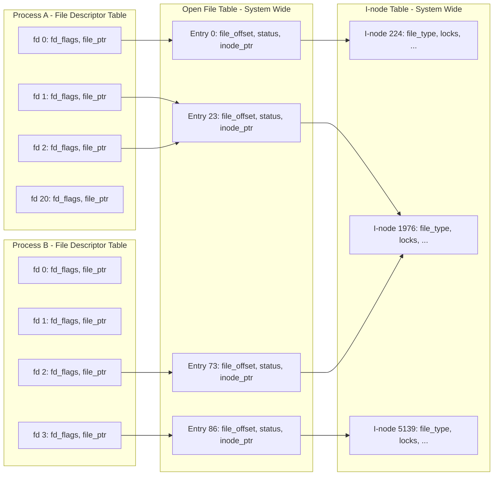

## Chapter 5
# <span id="page-68-0"></span>**NHẬP/XUẤT TỆP: CÁC CHI TIẾT NÂNG CAO**

Trong chương này, chúng ta sẽ mở rộng thảo luận về nhập/xuất tệp (file I/O) đã bắt đầu ở chương trước.

Khi tiếp tục bàn về System Call (lời gọi hệ thống) `open()`, chúng ta sẽ giải thích khái niệm tính nguyên tử (atomicity) — ý tưởng cho rằng các hành động được thực hiện bởi một system call được thi hành như một bước duy nhất không thể bị ngắt quãng. Đây là yêu cầu cần thiết cho hoạt động chính xác của nhiều system call.

Chúng ta sẽ giới thiệu một system call khác liên quan đến tệp, đó là hàm đa năng `fcnt()`, và minh họa một trong các công dụng của nó: truy xuất và thiết lập các cờ trạng thái tệp mở (open file status flags).

Tiếp theo, chúng ta sẽ xem xét các cấu trúc dữ liệu của nhân hệ điều hành (Kernel data structures) được sử dụng để biểu diễn File Descriptor (mô tả tệp) và các tệp đang mở. Việc hiểu rõ mối quan hệ giữa các cấu trúc này sẽ làm sáng tỏ một số điểm tinh tế của file I/O được bàn ở các chương sau. Dựa trên mô hình này, chúng ta sẽ giải thích cách nhân bản (duplicate) các file descriptor.

Sau đó, chúng ta sẽ xem xét một số system call cung cấp tính năng đọc và ghi mở rộng. Các system call này cho phép chúng ta thực hiện I/O tại một vị trí cụ thể trong tệp mà không làm thay đổi Offset của tệp (file offset), cũng như truyền dữ liệu từ và đến nhiều bộ đệm (buffer) trong chương trình.

Chúng ta sẽ giới thiệu sơ lược về khái niệm I/O không chặn (nonblocking I/O) và mô tả một số tiện ích mở rộng được cung cấp để hỗ trợ I/O trên các tệp có kích thước rất lớn.

Vì tệp tạm (temporary files) được sử dụng bởi nhiều chương trình hệ thống, chúng ta cũng sẽ xem xét một số hàm thư viện cho phép chúng ta tạo và sử dụng các tệp tạm với tên duy nhất được tạo ngẫu nhiên.

## <span id="page-69-2"></span>**5.1 Tính nguyên tử và Điều kiện tranh chấp**

<span id="page-69-0"></span>Tính nguyên tử (Atomicity) là một khái niệm mà chúng ta sẽ gặp lại nhiều lần khi bàn về hoạt động của các system call. Tất cả các system call đều được thực thi một cách nguyên tử. Ý của chúng ta ở đây là Kernel (nhân hệ điều hành) đảm bảo rằng tất cả các bước trong một system call được hoàn thành như một thao tác duy nhất, mà không bị ngắt quãng bởi một Process (tiến trình) hoặc Thread (luồng) khác.

Tính nguyên tử là yếu tố cốt lõi để hoàn thành thành công một số thao tác. Cụ thể, nó giúp chúng ta tránh được các điều kiện tranh chấp (Race Condition — đôi khi được gọi là hiểm họa tranh chấp). Race condition là tình huống mà kết quả tạo ra bởi hai process (hoặc thread) cùng thao tác trên các tài nguyên chia sẻ (shared resources) phụ thuộc một cách bất ngờ vào thứ tự tương đối mà các process giành được quyền truy cập vào CPU.

Trong vài trang tiếp theo, chúng ta sẽ xem xét hai tình huống liên quan đến file I/O nơi các race condition xảy ra, và chỉ ra cách các điều kiện này được loại bỏ thông qua việc sử dụng các cờ (flags) của hàm `open()` nhằm đảm bảo tính nguyên tử của các thao tác tệp liên quan.

Chúng ta sẽ quay lại chủ đề race condition khi mô tả hàm `sigsuspend()` trong Mục 22.9 và hàm `fork()` trong Mục 24.4.

## **Tạo tệp độc quyền (Creating a file exclusively)**

Trong Mục [4.3.1,](#page-53-0), chúng tôi đã lưu ý rằng việc chỉ định cờ `O_EXCL` kết hợp với `O_CREAT` khiến hàm `open()` trả về một lỗi nếu tệp đã tồn tại. Điều này cung cấp một cách thức để một tiến trình (process) đảm bảo rằng nó chính là bên tạo ra tệp. Việc kiểm tra sự tồn tại trước đó của tệp và việc tạo tệp được thực hiện một cách nguyên tử (atomically). Để hiểu tại sao điều này lại quan trọng, hãy xem xét đoạn mã nguồn được hiển thị trong [Liệt kê 5-1](#page-69-1), mà chúng ta có thể phải dùng đến nếu không có cờ `O_EXCL`. (Trong đoạn mã này, chúng tôi hiển thị ID tiến trình (Process ID) được trả về bởi System Call `getpid()`, cho phép chúng ta phân biệt đầu ra của hai lần chạy khác nhau của chương trình này).

<span id="page-69-1"></span>**Liệt kê 5-1:** Mã nguồn không chính xác để mở một tệp độc quyền

```
–––––––––––––––––––––––––––––––––––––––––––– từ tệp fileio/bad_exclusive_open.c
fd = open(argv[1], O_WRONLY); /* Mở 1: kiểm tra xem tệp có tồn tại không */
 if (fd != -1) { /* Mở thành công */
 printf("[PID %ld] Tệp \"%s\" đã tồn tại\n",
 (long) getpid(), argv[1]);
 close(fd);
 } else {
 if (errno != ENOENT) { /* Thất bại vì lý do không mong đợi */
 errExit("open");
 } else {
 /* KHOẢNG THỜI GIAN DỄ DẪN ĐẾN LỖI (WINDOW FOR FAILURE) */
 fd = open(argv[1], O_WRONLY | O_CREAT, S_IRUSR | S_IWUSR);
 if (fd == -1)
 errExit("open");
 printf("[PID %ld] Đã tạo tệp \"%s\" độc quyền\n",
 (long) getpid(), argv[1]); /* CÓ THỂ KHÔNG ĐÚNG! */
 }
 }
–––––––––––––––––––––––––––––––––––––––––––– từ tệp fileio/bad_exclusive_open.c
```

Bên cạnh việc sử dụng dài dòng hai lần gọi hàm `open()`, đoạn mã trong [Liệt kê 5-1](#page-69-1) cũng chứa một lỗi (bug). Giả sử rằng khi tiến trình của chúng ta gọi `open()` lần đầu tiên, tệp chưa tồn tại, nhưng vào thời điểm gọi `open()` lần thứ hai, một tiến trình khác đã tạo ra tệp đó. Điều này có thể xảy ra nếu bộ lập lịch của Kernel (Kernel scheduler) quyết định rằng lát cắt thời gian (time slice) của tiến trình đã hết và nhường quyền điều khiển cho một tiến trình khác, như được minh họa trong [Hình 5-1](#page-70-0), hoặc nếu hai tiến trình đang chạy đồng thời trên một hệ thống đa vi xử lý (multiprocessor system). [Hình 5-1](#page-70-0) phác họa trường hợp khi cả hai tiến trình đều đang thực thi đoạn mã được hiển thị trong [Liệt kê 5-1.](#page-69-1) Trong kịch bản này, tiến trình A sẽ kết luận sai lầm rằng nó đã tạo ra tệp, vì lệnh `open()` thứ hai vẫn thành công bất kể tệp đó có tồn tại hay không.

Mặc dù xác suất để tiến trình tin tưởng nhầm rằng nó là người tạo ra tệp là tương đối nhỏ, nhưng khả năng điều đó có thể xảy ra vẫn khiến đoạn mã này trở nên không đáng tin cậy. Việc kết quả của các thao tác này phụ thuộc vào thứ tự lập lịch của hai tiến trình đồng nghĩa đây là một tình trạng tranh chấp (Race Condition).

```txt
Tiến trình A                                  Tiến trình B
    |                                            |
    |                                            |
    v                                            |
┌─────────────────────┐                         |
│ open(..., O_WRONLY) │                         |
└─────────────────────┘                         |
    |                                            |
    | open() thất bại                            |
    |                                            |
    |  Lát cắt thời gian      ||    Lát cắt thời gian
    |  hết hạn                ||    bắt đầu      |
    |                         ||                  |
    ├─────────────────────────||──────────────────┤
    :                                            v
    :                                    ┌─────────────────────┐
    :                                    │ open(..., O_WRONLY) │
    :                                    └─────────────────────┘
    :                                            |
    :                                            | open() thất bại
    :                                            |
    :                                            v
    :                                    ┌──────────────────────┐
    :                                    │ open(..., O_WRONLY   │
    :                                    │      | O_CREAT, ...) │
    :                                    └──────────────────────┘
    :                                            |
    :                                            | open() thành công,
    :                                            | tệp được tạo
    :                                            |
    :  Lát cắt thời gian      ||    Lát cắt thời gian
    :  bắt đầu                ||    kết thúc     |
    :                         ||                  |
    ├─────────────────────────||──────────────────┤
    v                                            :
┌──────────────────────┐                        :
│ open(..., O_WRONLY   │                        :
│      | O_CREAT, ...) │                        :
└──────────────────────┘                        :
    |                                            |
    | open() thành công                          |
    v                                            |


Chú thích:
───►  Đang thực thi trên CPU
- - ►  Đang chờ CPU
```

<span id="page-70-0"></span>**Hình 5-1:** Thất bại trong việc tạo tệp độc quyền (exclusively create a file)

Để chứng minh rằng đoạn mã này thực sự có vấn đề, chúng ta có thể thay thế dòng mã được chú thích `WINDOW FOR FAILURE` trong [Liệt kê 5-1](#page-69-1) bằng một đoạn mã tạo ra khoảng trễ (delay) nhân tạo giữa bước kiểm tra sự tồn tại của tệp và bước tạo tệp:

```c
printf("[PID %ld] File \"%s\" doesn't exist yet\n", (long) getpid(), argv[1]);
if (argc > 2) { /* Khoảng trễ giữa bước kiểm tra và tạo tệp */
 sleep(5); /* Tạm dừng thực thi tiến trình trong 5 giây */
 printf("[PID %ld] Done sleeping\n", (long) getpid());
}
```

Hàm thư viện `sleep()` tạm dừng việc thực thi của một (process) trong một số giây được chỉ định. Chúng ta thảo luận về hàm này trong Mục 23.4.

Nếu chúng ta chạy đồng thời hai thể hiện (instance) của chương trình trong [Liệt kê 5-1](#page-69-1), chúng ta thấy rằng cả hai đều khẳng định chúng đã tạo tệp một cách độc quyền:

```bash
$ ./bad_exclusive_open tfile sleep &
[PID 3317] File "tfile" doesn't exist yet
[1] 3317
$ ./bad_exclusive_open tfile
[PID 3318] File "tfile" doesn't exist yet
[PID 3318] Created file "tfile" exclusively
$ [PID 3317] Done sleeping
[PID 3317] Created file "tfile" exclusively Not true
```

Ở dòng áp chót của kết quả đầu ra ở trên, chúng ta thấy dấu nhắc lệnh của shell (shell prompt) bị trộn lẫn với đầu ra từ thể hiện đầu tiên của chương trình kiểm thử.

Cả hai tiến trình đều khẳng định rằng chúng đã tạo tệp vì mã của tiến trình đầu tiên bị ngắt quãng (interrupted) giữa bước kiểm tra sự tồn tại và bước tạo tệp. Việc sử dụng một lời gọi hàm `open()` đơn lẻ với các cờ `O_CREAT` và `O_EXCL` sẽ ngăn chặn khả năng này bằng cách đảm bảo rằng các bước kiểm tra và tạo tệp được thực hiện như một thao tác nguyên tử duy nhất (tức là không thể bị ngắt quãng – atomic / uninterruptible).

### **Ghi nối tiếp dữ liệu vào một tệp (Appending data to a file)**

Ví dụ thứ hai về nhu cầu cần tính nguyên tử (atomicity) là khi chúng ta có nhiều tiến trình cùng ghi nối tiếp dữ liệu vào một tệp (ví dụ: một tệp nhật ký toàn cục - global log file). Cho mục đích này, chúng ta có thể cân nhắc sử dụng một đoạn mã như sau trong mỗi tiến trình ghi của mình:

```c
if (lseek(fd, 0, SEEK_END) == -1)
 errExit("lseek");
if (write(fd, buf, len) != len)
 fatal("Partial/failed write");
```

Tuy nhiên, đoạn mã này mắc phải lỗi tương tự như ví dụ trước. Nếu tiến trình đầu tiên thực thi mã bị ngắt giữa các lời gọi `lseek()` và `write()` bởi một tiến trình thứ hai làm điều tương tự, thì cả hai tiến trình sẽ thiết lập con trỏ tệp (file offset) của chúng về cùng một vị trí trước khi ghi. Khi tiến trình đầu tiên được lên lịch (rescheduled) chạy lại, nó sẽ ghi đè lên dữ liệu đã được ghi bởi tiến trình thứ hai. Một lần nữa, đây là một tình trạng tranh chấp (race condition) vì kết quả phụ thuộc vào thứ tự lên lịch của hai tiến trình.

Để tránh vấn đề này, thao tác dịch chuyển con trỏ đến byte tiếp theo ngay sau cuối tệp (seek) và thao tác ghi (write) phải diễn ra một cách nguyên tử (atomically). Đây chính là điều mà việc mở một tệp với cờ `O_APPEND` đảm bảo.

> Một số hệ thống tệp (ví dụ: NFS) không hỗ trợ `O_APPEND`. Trong trường hợp này, nhân hệ thống (kernel) sẽ quay trở lại trình tự các lời gọi phi nguyên tử (nonatomic) như được hiển thị ở trên, dẫn đến nguy cơ hỏng dữ liệu tệp như vừa mô tả.

# **5.2 Các Thao tác Điều khiển Tệp: fcntl()**

Lời gọi hệ thống (System Call) `fcntl()` thực hiện một loạt các thao tác điều khiển trên một (File Descriptor) đang mở.

```c
#include <fcntl.h>
int fcntl(int fd, int cmd, ...);
                             Giá trị trả về khi thành công phụ thuộc vào cmd, hoặc –1 nếu có lỗi
```

Đối số `cmd` có thể chỉ định một phạm vi rộng các thao tác. Chúng ta sẽ xem xét một số thao tác trong các phần tiếp theo và hoãn việc tìm hiểu các thao tác khác cho các chương sau.

Như được biểu thị bằng dấu chấm lửng (ellipsis), đối số thứ ba của `fcntl()` có thể có các kiểu dữ liệu khác nhau hoặc có thể được bỏ qua. Nhân hệ thống (kernel) sử dụng giá trị của đối số `cmd` để xác định kiểu dữ liệu (nếu có) cần mong đợi cho đối số này.

# <span id="page-72-1"></span>**5.3 Các Cờ Trạng thái Tệp Mở (Open File Status Flags)**

<span id="page-72-0"></span>Một công dụng của `fcntl()` là truy xuất hoặc sửa đổi chế độ truy cập (access mode) và các cờ trạng thái tệp mở của một tệp đang mở. (Đây là các giá trị được thiết lập bởi đối số `flags` được chỉ định trong lời gọi `open()`). Để truy xuất các thiết lập này, chúng ta chỉ định `cmd` là `F_GETFL`:

```c
int flags, accessMode;
flags = fcntl(fd, F_GETFL); /* Đối số thứ ba là không bắt buộc */
if (flags == -1)
 errExit("fcntl");
```

Sau đoạn mã trên, chúng ta có thể kiểm tra xem tệp có được mở để ghi đồng bộ (synchronized writes) hay không như sau:

```c
if (flags & O_SYNC)
 printf("writes are synchronized\n");
```

SUSv3 yêu cầu rằng chỉ các cờ trạng thái được chỉ định trong quá trình `open()` hoặc trong lời gọi `fcntl()` với `F_SETFL` sau đó mới được thiết lập trên một tệp mở. Tuy nhiên, Linux lệch khỏi tiêu chuẩn này ở một điểm: nếu một ứng dụng được biên dịch bằng một trong các kỹ thuật được mô tả trong [Mục 5.10](#page-83-1) để mở các tệp lớn, thì `O_LARGEFILE` sẽ luôn được thiết lập trong các cờ được truy xuất bởi `F_GETFL`.

Việc kiểm tra chế độ truy cập (access mode) của tệp phức tạp hơn một chút, vì các hằng số `O_RDONLY` (0), `O_WRONLY` (1), và `O_RDWR` (2) không tương ứng với các bit đơn lẻ trong các cờ trạng thái tệp mở. Do đó, để thực hiện việc kiểm tra này, chúng ta thực hiện phép che bit (mask) giá trị cờ với hằng số `O_ACCMODE`, sau đó kiểm tra tính bằng nhau với một trong các hằng số đó:

```c
accessMode = flags & O_ACCMODE;
if (accessMode == O_WRONLY || accessMode == O_RDWR)
 printf("file is writable\n");
```

Chúng ta có thể sử dụng câu lệnh `fcntl()` với cờ `F_SETFL` để sửa đổi một số cờ trạng thái tệp mở (open file status flags). Các cờ có thể được sửa đổi bao gồm `O_APPEND`, `O_NONBLOCK`, `O_NOATIME`, `O_ASYNC`, và `O_DIRECT`. Các cố gắng sửa đổi các cờ khác sẽ bị bỏ qua. (Một số cài đặt UNIX khác cho phép `fcntl()` sửa đổi các cờ khác, chẳng hạn như `O_SYNC`.)

Việc sử dụng `fcntl()` để sửa đổi các cờ trạng thái tệp mở đặc biệt hữu ích trong các trường hợp sau:

- Tệp không được mở bởi chương trình gọi, do đó chương trình không có quyền kiểm soát đối với các cờ được sử dụng trong lời gọi `open()` (ví dụ: tệp có thể là một trong ba File Descriptor tiêu chuẩn được mở trước khi chương trình khởi động).
- File Descriptor được lấy từ một System Call khác ngoài `open()`. Ví dụ về các System Call này là `pipe()`, tạo ra một pipe và trả về hai File Descriptor trỏ đến hai đầu của pipe, và `socket()`, tạo ra một socket và trả về một File Descriptor trỏ đến socket đó.

Để sửa đổi các cờ trạng thái tệp mở, chúng ta sử dụng `fcntl()` để lấy một bản sao của các cờ hiện tại, sau đó sửa đổi các bit mà chúng ta muốn thay đổi, và cuối cùng thực hiện một lời gọi tiếp theo tới `fcntl()` để cập nhật các cờ. Do đó, để bật cờ `O_APPEND`, chúng ta sẽ viết như sau:

```c
int flags;
flags = fcntl(fd, F_GETFL);
if (flags == -1)
 errExit("fcntl");
flags |= O_APPEND;
if (fcntl(fd, F_SETFL, flags) == -1)
 errExit("fcntl");
```

# **5.4 Mối quan hệ giữa File Descriptor và Open File**

<span id="page-73-0"></span>Cho đến nay, có vẻ như có mối quan hệ một-một giữa một File Descriptor và một tệp mở (open file). Tuy nhiên, thực tế không phải như vậy. Việc có nhiều Descriptor cùng trỏ đến một tệp mở là hoàn toàn khả thi và hữu ích. Các File Descriptor này có thể được mở trong cùng một Process hoặc trong các Process khác nhau.

Để hiểu chuyện gì đang xảy ra, chúng ta cần xem xét ba cấu trúc dữ liệu được duy trì bởi kernel (Kernel Space):

- bảng File Descriptor riêng của từng Process (per-process file descriptor table);
- bảng mô tả tệp mở toàn hệ thống (system-wide table of open file descriptions); và
- bảng i-node của hệ thống tệp (file system i-node table).

Đối với mỗi Process, kernel duy trì một bảng các File Descriptor đang mở. Mỗi mục (entry) trong bảng này ghi lại thông tin về một File Descriptor đơn lẻ, bao gồm:

- một tập hợp các cờ điều khiển hoạt động của File Descriptor (chỉ có một cờ như vậy, đó là cờ close-on-exec, mà chúng ta mô tả trong Mục 27.4); và
- một tham chiếu đến phần mô tả tệp mở (open file description).

Kernel duy trì một bảng toàn hệ thống chứa tất cả các mô tả tệp mở. (Bảng này đôi khi được gọi là bảng tệp mở - open file table, và các mục của nó đôi khi được gọi là handle tệp mở - open file handles). Một mô tả tệp mở lưu trữ tất cả thông tin liên quan đến một tệp mở, bao gồm:

- con trỏ tệp hiện tại (current file offset - được cập nhật bởi `read()` và `write()`, hoặc được sửa đổi tường minh bằng cách sử dụng `lseek()`);

- các cờ trạng thái được chỉ định khi mở tệp (tức là đối số `flags` trong hàm `open()`);
- chế độ truy cập tệp (file access mode - chỉ đọc, chỉ ghi, hoặc đọc-ghi, được chỉ định trong `open()`);
- các thiết lập liên quan đến I/O điều khiển bằng tín hiệu - signal-driven I/O (Mục 63.3); và
- một tham chiếu đến đối tượng i-node cho tệp này.

Mỗi hệ thống tệp (file system) có một bảng i-node cho tất cả các tệp nằm trong hệ thống tệp đó. Cấu trúc i-node, và nói chung là các hệ thống tệp, được thảo luận chi tiết hơn trong Chương 14. Hiện tại, chúng ta lưu ý rằng i-node cho mỗi tệp bao gồm các thông tin sau:

- loại tệp (ví dụ: tệp thông thường - regular file, socket, hoặc FIFO) và quyền truy cập (permissions);
- con trỏ đến danh sách các khóa (locks) đang giữ trên tệp này; và
- các thuộc tính khác nhau của tệp, bao gồm kích thước và dấu thời gian (timestamps) liên quan đến các loại thao tác tệp khác nhau.

Ở đây, chúng ta đang bỏ qua sự phân biệt giữa biểu diễn i-node trên đĩa (on-disk) và trong bộ nhớ (in-memory). I-node trên đĩa ghi lại các thuộc tính cố định của tệp, chẳng hạn như loại tệp, quyền truy cập và dấu thời gian. Khi một tệp được truy cập, một bản sao i-node trong bộ nhớ được tạo ra, và phiên bản i-node này ghi lại số lượng mô tả tệp mở đang tham chiếu đến i-node đó cùng với ID chính và ID phụ của thiết bị mà i-node được sao chép từ đó. I-node trong bộ nhớ cũng ghi lại các thuộc tính tạm thời (ephemeral attributes) liên quan đến tệp trong khi nó đang mở, chẳng hạn như khóa tệp (file locks).

[Hình 5-2](#page-74-0) minh họa mối quan hệ giữa các File Descriptor, mô tả tệp mở (open file descriptions) và i-node. Trong sơ đồ này, hai Process có một số File Descriptor đang mở.



<span id="page-74-0"></span>**Hình 5-2:** Mối quan hệ giữa các bộ mô tả tệp (file descriptor), mô tả tệp mở (open file description) và i-node.

Trong tiến trình (process) A, bộ mô tả 1 và 20 đều trỏ đến cùng một mô tả tệp mở (được gán nhãn 23). Tình huống này có thể phát sinh do kết quả của một lời gọi hàm `dup()`, `dup2()`, hoặc `fcntl()` (xem [Mục 5.5](#page-75-1)).

Bộ mô tả 2 của tiến trình A và bộ mô tả 2 của tiến trình B trỏ đến một mô tả tệp mở duy nhất (73). Kịch bản này có thể xảy ra sau một lời gọi `fork()` (nghĩa là tiến trình A là tiến trình cha của tiến trình B, hoặc ngược lại), hoặc nếu một tiến trình truyền một bộ mô tả đang mở sang một tiến trình khác sử dụng UNIX domain socket (Mục 61.13.3).

Cuối cùng, chúng ta thấy rằng bộ mô tả 0 của tiến trình A và bộ mô tả 3 của tiến trình B trỏ đến các mô tả tệp mở khác nhau, nhưng các mô tả này lại trỏ đến cùng một mục trong bảng i-node (1976)—nói cách khác, là trỏ đến cùng một tệp. Điều này xảy ra do mỗi tiến trình độc lập gọi `open()` cho cùng một tệp. Một tình huống tương tự có thể xảy ra nếu một tiến trình đơn lẻ mở cùng một tệp hai lần.

Chúng ta có thể rút ra một số kết luận từ phần thảo luận trên:

- Hai bộ mô tả tệp khác nhau trỏ đến cùng một mô tả tệp mở sẽ chia sẻ chung một giá trị con trỏ vị trí tệp (file offset). Do đó, nếu vị trí tệp bị thay đổi thông qua một bộ mô tả tệp (như là hệ quả của các lời gọi `read()`, `write()`, hoặc `lseek()`), sự thay đổi này sẽ có thể nhìn thấy được thông qua bộ mô tả tệp còn lại. Điều này áp dụng cho cả trường hợp hai bộ mô tả tệp thuộc về cùng một tiến trình lẫn khi chúng thuộc về các tiến trình khác nhau.
- Các quy tắc phạm vi tương tự cũng được áp dụng khi truy vấn và thay đổi các cờ trạng thái tệp mở (open file status flags) (ví dụ: `O_APPEND`, `O_NONBLOCK`, và `O_ASYNC`) bằng cách sử dụng các thao tác `fcntl()` `F_GETFL` và `F_SETFL`.
- Ngược lại, các cờ bộ mô tả tệp (file descriptor flags) (tức là cờ close-on-exec) là riêng tư đối với từng tiến trình và bộ mô tả tệp. Việc sửa đổi các cờ này không ảnh hưởng đến các bộ mô tả tệp khác trong cùng một tiến trình hoặc ở một tiến trình khác.

## <span id="page-75-1"></span>**5.5 Nhân bản các bộ mô tả tệp (Duplicating File Descriptors)**

<span id="page-75-0"></span>Sử dụng cú pháp chuyển hướng I/O của Bourne shell `2>&1` thông báo cho shell rằng chúng ta muốn chuyển hướng lỗi chuẩn (standard error - bộ mô tả tệp 2) đến cùng vị trí mà đầu ra chuẩn (standard output - bộ mô tả tệp 1) đang được gửi tới. Do đó, lệnh sau đây sẽ (vì shell đánh giá các hướng chuyển hướng I/O từ trái sang phải) gửi cả đầu ra chuẩn và lỗi chuẩn vào tệp `results.log`:

#### \$ **./myscript > results.log 2>&1**

Shell thực hiện việc chuyển hướng lỗi chuẩn bằng cách nhân bản (duplicate) bộ mô tả tệp 2 sao cho nó trỏ đến cùng một mô tả tệp mở như bộ mô tả tệp 1 (tương tự cách mà các bộ mô tả 1 và 20 của tiến trình A trỏ đến cùng một mô tả tệp mở trong [Hình 5-2](#page-74-0)). Hiệu ứng này có thể đạt được bằng cách sử dụng các system call `dup()` và `dup2()`.

Lưu ý rằng việc shell chỉ đơn giản mở tệp `results.log` hai lần là chưa đủ: một lần trên bộ mô tả 1 và một lần trên bộ mô tả 2. Một lý do là hai bộ mô tả tệp này sẽ không chia sẻ chung một con trỏ vị trí tệp (file offset pointer), và do đó có thể dẫn đến việc ghi đè lên đầu ra của nhau. Một lý do khác là tệp có thể không phải là một tệp trên đĩa. Hãy xem xét lệnh sau, lệnh này gửi lỗi chuẩn đi qua cùng một đường ống (pipe) với đầu ra chuẩn:

#### \$ **./myscript 2>&1 | less**

Lời gọi `dup()` nhận vào `oldfd`, một bộ mô tả tệp đang mở, và trả về một bộ mô tả mới trỏ đến cùng một mô tả tệp mở đó. Bộ mô tả mới được đảm bảo sẽ là bộ mô tả tệp chưa được sử dụng có giá trị nhỏ nhất.

```c
#include <unistd.h>
int dup(int oldfd);
                          Trả về bộ mô tả tệp (mới) khi thành công, hoặc –1 khi lỗi
```

Giả sử chúng ta thực hiện lời gọi sau:

```c
newfd = dup(1);
```

Giả định tình huống thông thường là shell đã mở các bộ mô tả tệp 0, 1 và 2 thay mặt cho chương trình, và không có bộ mô tả nào khác đang được sử dụng, `dup()` sẽ tạo ra bản sao của bộ mô tả 1 bằng cách sử dụng tệp 3.

Nếu chúng ta muốn bản sao là bộ mô tả 2, chúng ta có thể sử dụng kỹ thuật sau:

```c
close(2); /* Giải phóng bộ mô tả tệp 2 */
newfd = dup(1); /* Nên tái sử dụng bộ mô tả tệp 2 */
```

Mã nguồn này chỉ hoạt động nếu bộ mô tả 0 đang mở. Để làm cho đoạn mã trên đơn giản hơn, và để đảm bảo chúng ta luôn nhận được bộ mô tả tệp như mong muốn, chúng ta có thể sử dụng `dup2()`.

```c
#include <unistd.h>
int dup2(int oldfd, int newfd);
                         Trả về bộ mô tả tệp (mới) khi thành công, hoặc –1 khi lỗi
```

System call `dup2()` tạo ra một bản sao của bộ mô tả tệp được cung cấp trong `oldfd` bằng cách sử dụng số hiệu bộ mô tả được truyền vào trong `newfd`. Nếu bộ mô tả tệp được chỉ định trong `newfd` đã được mở, `dup2()` sẽ đóng nó lại trước tiên. (Bất kỳ lỗi nào xảy ra trong quá trình đóng này đều bị bỏ qua một cách âm thầm; thựciyến lập trình an toàn hơn là gọi tường minh `close()` cho `newfd` nếu nó đang mở trước khi gọi `dup2()`).

Chúng ta có thể đơn giản hóa các lời gọi `close()` và `dup()` trước đó thành như sau:

```
dup2(1, 2);
```

Một lời gọi `dup2()` thành công sẽ trả về số hiệu của bộ mô tả được nhân bản (tức là giá trị được truyền vào `newfd`).

Nếu `oldfd` không phải là một bộ mô tả tệp (file descriptor) hợp lệ, thì `dup2()` sẽ thất bại với mã lỗi `EBADF` và `newfd` không bị đóng. Nếu `oldfd` là một bộ mô tả tệp hợp lệ, và `oldfd` cùng `newfd` có giá trị giống nhau, thì `dup2()` không làm gì cả — `newfd` không bị đóng, và `dup2()` trả về `newfd` như là kết quả của hàm.

Một giao diện (interface) bổ sung cung cấp một số tính linh hoạt để nhân bản các bộ mô tả tệp là thao tác `fcntl()` `F_DUPFD`:

```
newfd = fcntl(oldfd, F_DUPFD, startfd);
```

Lời gọi này tạo ra một bản sao của `oldfd` bằng cách sử dụng bộ mô tả tệp chưa sử dụng có giá trị nhỏ nhất lớn hơn hoặc bằng `startfd`. Điều này hữu ích nếu chúng ta muốn đảm bảo rằng bộ mô tả mới (`newfd`) nằm trong một phạm vi giá trị nhất định. Các lời gọi tới `dup()` và `dup2()` luôn có thể được viết lại thành các lời gọi tới `close()` và `fcntl()`, mặc dù các lời gọi trước thì súc tích hơn. (Cũng lưu ý rằng một số mã lỗi `errno` trả về bởi `dup2()` và `fcntl()` là khác nhau, như được mô tả trong các trang hướng dẫn thủ công - manual pages.)

Từ [Hình 5-2](#page-74-0), chúng ta có thể thấy rằng các bộ mô tả tệp được nhân bản chia sẻ cùng một giá trị con trỏ tệp (file offset) và các cờ trạng thái trong cấu trúc mô tả tệp mở (open file description) chung của chúng. Tuy nhiên, bộ mô tả tệp mới có tập hợp cờ bộ mô tả tệp (file descriptor flags) của riêng nó, và cờ đóng khi thực thi (`close-on-exec` flag, `FD_CLOEXEC`) của nó luôn bị tắt. Các giao diện mà chúng ta mô tả tiếp theo cho phép điều khiển tường minh cờ đóng khi thực thi của bộ mô tả tệp mới.

System Call `dup3()` thực hiện tác vụ giống như `dup2()`, nhưng bổ sung thêm một tham số `flags`, là một mặt nạ bit (bit mask) làm thay đổi hành vi của system call.

```
#define _GNU_SOURCE
#include <unistd.h>
int dup3(int oldfd, int newfd, int flags);
                          Trả về bộ mô tả tệp (mới) khi thành công, hoặc –1 khi lỗi
```

Hiện tại, `dup3()` hỗ trợ một cờ là `O_CLOEXEC`, khiến kernel bật cờ `close-on-exec` (`FD_CLOEXEC`) cho bộ mô tả tệp mới. Cờ này hữu ích vì những lý giống như cờ `open()` `O_CLOEXEC` được mô tả trong [Mục 4.3.1.](#page-53-0)

System Call `dup3()` mới có từ Linux 2.6.27 và chỉ dành riêng cho Linux (Linux-specific).

Kể từ Linux 2.6.24, Linux cũng hỗ trợ một thao tác `fcntl()` bổ sung để nhân bản các bộ mô tả tệp: `F_DUPFD_CLOEXEC`. Cờ này thực hiện chức năng giống như `F_DUPFD`, nhưng đồng thời thiết lập cờ `close-on-exec` (`FD_CLOEXEC`) cho bộ mô tả tệp mới. Một lần nữa, thao tác này hữu ích vì những lý do tương tự như cờ `open()` `O_CLOEXEC`. `F_DUPFD_CLOEXEC` không được quy định trong SUSv3, nhưng được quy định trong SUSv4.

# **5.6 I/O Tệp tại một Offset Chỉ định: pread() và pwrite()**

Các system call `pread()` và `pwrite()` hoạt động giống như `read()` và `write()`, ngoại trừ việc I/O tệp được thực hiện tại vị trí được chỉ định bởi `offset`, thay vì tại con trỏ tệp hiện tại. Con trỏ tệp không bị thay đổi bởi các lời gọi này.

```
#include <unistd.h>
ssize_t pread(int fd, void *buf, size_t count, off_t offset);
                        Trả về số byte đã đọc, 0 khi gặp EOF, hoặc –1 khi lỗi
ssize_t pwrite(int fd, const void *buf, size_t count, off_t offset);
                                Trả về số byte đã ghi, hoặc –1 khi lỗi
```

Gọi `pread()` tương đương với việc thực hiện một cách nguyên tử (atomically) các lời gọi sau:

```
off_t orig;
orig = lseek(fd, 0, SEEK_CUR); /* Lưu con trỏ hiện tại */
lseek(fd, offset, SEEK_SET);
s = read(fd, buf, len);
lseek(fd, orig, SEEK_SET); /* Khôi phục con trỏ tệp ban đầu */
```

Đối với cả `pread()` và `pwrite()`, tệp được tham chiếu bởi `fd` phải có khả năng định vị (seekable) (tức là một bộ mô tả tệp mà trên đó cho phép gọi `lseek()`).

Các system call này đặc biệt hữu ích trong các ứng dụng đa luồng (multithreaded applications). Như chúng ta sẽ thấy ở Chương 29, tất cả các luồng (threads) trong một tiến trình (process) đều chia sẻ cùng một bảng bộ mô tả tệp (file descriptor table). Điều này có nghĩa là con trỏ tệp cho mỗi tệp mở là toàn cục đối với tất cả các luồng. Bằng cách sử dụng `pread()` hoặc `pwrite()`, nhiều luồng có thể đồng thời thực hiện I/O trên cùng một bộ mô tả tệp mà không bị ảnh hưởng bởi các thay đổi đối với con trỏ tệp do các luồng khác thực hiện. Nếu chúng ta cố gắng sử dụng `lseek()` kết hợp với `read()` (hoặc `write()`) thay thế, thì chúng ta sẽ tạo ra một tình trạng tranh chấp (race condition) tương tự như tình trạng mà chúng ta đã mô tả khi thảo luận về cờ `O_APPEND` trong [Mục 5.1](#page-69-2). (Các system call `pread()` và `pwrite()` cũng tương tự có ích trong việc tránh các race condition trong các ứng dụng mà nhiều tiến trình có các bộ mô tả tệp tham chiếu đến cùng một cấu trúc mô tả tệp mở.)

> Nếu chúng ta liên tục thực hiện các lời gọi `lseek()` theo sau bởi I/O tệp, thì các system call `pread()` và `pwrite()` cũng có thể mang lại lợi thế về hiệu năng (performance) trong một số trường hợp. Điều này là do chi phí của một system call `pread()` (hoặc `pwrite()`) đơn lẻ thấp hơn chi phí của hai system call: `lseek()` và `read()` (hoặc `write()`). Tuy nhiên, chi phí của các system call thường bị lấn át bởi thời gian thực tế để thực hiện I/O.
```

# **5.7 Scatter-Gather I/O: readv() và writev()**

Các System Call `readv()` và `writev()` thực hiện kỹ thuật I/O phân tán-tập trung (scatter-gather I/O).

```
#include <sys/uio.h>
ssize_t readv(int fd, const struct iovec *iov, int iovcnt);
                        Trả về số byte đã đọc, 0 khi gặp EOF, hoặc –1 nếu lỗi
ssize_t writev(int fd, const struct iovec *iov, int iovcnt);
                                Trả về số byte đã ghi, hoặc –1 nếu lỗi
```

Thay vì tiếp nhận một vùng đệm (buffer) dữ liệu đơn lẻ để đọc hoặc ghi, các hàm này truyền tải nhiều vùng đệm dữ liệu trong một System Call duy nhất. Tập hợp các vùng đệm cần truyền được định nghĩa bởi mảng `iov`. Biến số nguyên `iovcnt` chỉ định số lượng phần tử trong `iov`. Mỗi phần tử của `iov` là một cấu trúc có dạng như sau:

```
struct iovec {
 void *iov_base; /* Địa chỉ bắt đầu của vùng đệm */
 size_t iov_len; /* Số byte cần truyền đến/từ vùng đệm */
};
```

Tiêu chuẩn SUSv3 cho phép một cài đặt (implementation) áp đặt giới hạn lên số lượng phần tử trong `iov`. Một cài đặt có thể thông báo giới hạn của nó bằng cách định nghĩa `IOV_MAX` trong `<limits.h>` hoặc tại thời điểm chạy (run time) thông qua giá trị trả về từ hàm gọi `sysconf(_SC_IOV_MAX)`. (Chúng ta sẽ mô tả `sysconf()` trong Mục 11.2). SUSv3 yêu cầu giới hạn này phải đạt tối thiểu là 16. Trên Linux, `IOV_MAX` được định nghĩa là 1024, tương ứng với giới hạn của Kernel về kích thước của vector này (được định nghĩa bởi hằng số Kernel `UIO_MAXIOV`).

Tuy nhiên, các hàm bao (wrapper function) của glibc cho `readv()` và `writev()` âm thầm thực hiện thêm một số công việc phụ. Nếu System Call thất bại do `iovcnt` quá lớn, thì hàm bao sẽ tạm thời cấp phát một vùng đệm đơn lẻ đủ lớn để chứa tất cả các mục được mô tả bởi `iov` và thực hiện một lời gọi `read()` hoặc `write()` (xem phần thảo luận bên dưới về cách `writev()` có thể được cài đặt dựa trên `write()`).

Hình 5-3 minh họa mối quan hệ giữa các tham số `iov` và `iovcnt`, cũng như các vùng đệm mà chúng trỏ tới.

```text 
iowcnt          iov
  ┌───┐    ┌────────────────────┐              ┌──────────┐
  │ 3 │    │ iov_base           │─────────────>│  buffer0 │
  └───┘    │ iov_len = len0     │<─────len0────┤          │
       [0] └────────────────────┘              └──────────┘
           ┌────────────────────┐              ┌──────────┐
           │ iov_base           │─────────────>│  buffer1 │
           │ iov_len = len1     │<─────len1────┤          │
       [1] └────────────────────┘              └──────────┘
           ┌────────────────────┐              ┌──────────────────┐
           │ iov_base           │─────────────>│     buffer2      │
           │ iov_len = len2     │<─────len2────┤                  │
       [2] └────────────────────┘              └──────────────────┘
```

**Hình 5-3:** Ví dụ về một mảng `iovec` và các vùng đệm đi kèm

#### **Scatter input (Đầu vào phân tán)**

System Call `readv()` thực hiện đầu vào phân tán (scatter input): nó đọc một chuỗi byte liên tục từ tệp được tham chiếu bởi File Descriptor `fd` và đặt ("phân tán") các byte này vào các vùng đệm được chỉ định bởi `iov`. Mỗi vùng đệm, bắt đầu từ vùng đệm được định nghĩa bởi `iov[0]`, được lấp đầy hoàn toàn trước khi `readv()` chuyển sang vùng đệm tiếp theo.

Một đặc tính quan trọng của `readv()` là nó hoàn thành một cách nguyên tử (atomic); nghĩa là, từ góc độ của Process đang gọi, Kernel thực hiện một lần truyền dữ liệu duy nhất giữa tệp được tham chiếu bởi `fd` và bộ nhớ User Space (vùng nhớ tiến trình người dùng). Điều này có nghĩa là, ví dụ, khi đọc từ một tệp, chúng ta có thể chắc chắn rằng phạm vi các byte được đọc là liên tục, ngay cả khi một Process (hoặc Thread) khác chia sẻ cùng File Offset cố gắng thao tác trên Offset đó cùng lúc với lời gọi `readv()`.

Khi hoàn thành thành công, `readv()` trả về số byte đã đọc, hoặc 0 nếu gặp kết thúc tệp (end-of-file). Caller (bên gọi) phải kiểm tra số đếm này để xác minh xem tất cả các byte được yêu cầu đã được đọc hay chưa. Nếu dữ liệu có sẵn không đủ, thì chỉ một phần các vùng đệm có thể đã được lấp đầy, và vùng đệm cuối cùng trong số đó có thể chỉ được lấp đầy một phần.

[Listing 5-2](#page-80-0) minh họa việc sử dụng `readv()`.

Việc sử dụng tiền tố `t_` theo sau bởi tên hàm làm tên của một chương trình mẫu (ví dụ: `t_readv.c` trong Listing [5-2)](#page-80-0) là cách chúng tôi biểu thị rằng chương trình đó chủ yếu minh họa việc sử dụng một System Call hoặc thư viện hàm đơn lẻ.

```
–––––––––––––––––––––––––––––––––––––––––––––––––––––––––– fileio/t_readv.c
#include <sys/stat.h>
#include <sys/uio.h>
#include <fcntl.h>
#include "tlpi_hdr.h"
int
main(int argc, char *argv[])
{
 int fd;
 struct iovec iov[3];
 struct stat myStruct; /* Vùng đệm thứ nhất */
 int x; /* Vùng đệm thứ hai */
#define STR_SIZE 100
 char str[STR_SIZE]; /* Vùng đệm thứ ba */
 ssize_t numRead, totRequired;
 if (argc != 2 || strcmp(argv[1], "--help") == 0)
 usageErr("%s file\n", argv[0]);
 fd = open(argv[1], O_RDONLY);
 if (fd == -1)
 errExit("open");
 totRequired = 0;
 iov[0].iov_base = &myStruct;
 iov[0].iov_len = sizeof(struct stat);
 totRequired += iov[0].iov_len;
 iov[1].iov_base = &x;
 iov[1].iov_len = sizeof(x);
 totRequired += iov[1].iov_len;
 iov[2].iov_base = str;
 iov[2].iov_len = STR_SIZE;
 totRequired += iov[2].iov_len;
 numRead = readv(fd, iov, 3);
 if (numRead == -1)
 errExit("readv");
 if (numRead < totRequired)
 printf("Đọc được số byte ít hơn yêu cầu\n");
 printf("tổng số byte yêu cầu: %ld; số byte đã đọc: %ld\n",
 (long) totRequired, (long) numRead);
 exit(EXIT_SUCCESS);
}
–––––––––––––––––––––––––––––––––––––––––––––––––––––––––– fileio/t_readv.c
```

#### **Thu gom dữ liệu đầu ra (Gather Output)**

System call `writev()` thực hiện việc thu gom dữ liệu đầu ra (gather output). Hàm này nối ("thu gom") dữ liệu từ tất cả các buffer được chỉ định bởi `iov` và ghi chúng dưới dạng một chuỗi các byte liền kề vào tệp được tham chiếu bởi file descriptor `fd`. Các buffer được thu gom theo thứ tự mảng, bắt đầu từ buffer được định nghĩa bởi `iov[0]`.

Giống như `readv()`, `writev()` hoàn thành một cách nguyên tử (atomically), với toàn bộ dữ liệu được truyền trong một thao tác duy nhất từ vùng nhớ người dùng (user memory) đến tệp được tham chiếu bởi `fd`. Do đó, khi ghi vào một tệp thông thường (regular file), chúng ta có thể chắc chắn rằng tất cả dữ liệu được yêu cầu được ghi liên tiếp vào tệp, thay vì bị xen kẽ bởi các lệnh ghi từ các tiến trình (Process) hoặc luồng (Thread) khác.

Cũng giống như `write()`, hiện tượng ghi một phần (partial write) có thể xảy ra. Do đó, chúng ta phải kiểm tra giá trị trả về từ `writev()` để xem tất cả các byte được yêu cầu đã được ghi hay chưa.

Ưu điểm chính của `readv()` và `writev()` là sự tiện lợi và tốc độ. Ví dụ, chúng ta có thể thay thế lời gọi `writev()` bằng:

-  Mã nguồn cấp phát một buffer lớn duy nhất, sao chép dữ liệu cần ghi từ các vị trí khác trong không gian địa chỉ (address space) của tiến trình vào buffer đó, sau đó gọi `write()` để xuất buffer; hoặc
-  Một chuỗi các lời gọi `write()` để xuất từng buffer riêng lẻ.

Tùy chọn đầu tiên, mặc dù tương đương về mặt ngữ nghĩa với việc sử dụng `writev()`, nhưng lại mang lại sự bất tiện (và kém hiệu quả) trong việc cấp phát buffer và sao chép dữ liệu trong không gian người dùng (User Space).

Tùy chọn thứ hai không tương đương về mặt ngữ nghĩa với một lời gọi `writev()` duy nhất, vì các lời gọi `write()` không được thực hiện một cách nguyên tử (atomically). Hơn nữa, việc thực hiện một system call `writev()` duy nhất sẽ tiết kiệm chi phí hơn so với việc thực hiện nhiều lời gọi `write()` (tham khảo phần thảo luận về system call tại [Mục 3.1](#page-22-0)).

## **Thực hiện I/O phân tán-thu gom (Scatter-Gather I/O) tại một offset được chỉ định**

Linux 2.6.30 bổ sung hai system call mới kết hợp tính năng I/O phân tán-thu gom (scatter-gather I/O) với khả năng thực hiện I/O tại một offset được chỉ định: `preadv()` và `pwritev()`. Các system call này không theo chuẩn (nonstandard), nhưng cũng có sẵn trên các hệ thống BSD hiện đại.

```
#define _BSD_SOURCE
#include <sys/uio.h>
ssize_t preadv(int fd, const struct iovec *iov, int iovcnt, off_t offset);
                        Trả về số byte đã đọc, 0 khi gặp EOF, hoặc –1 khi lỗi
ssize_t pwritev(int fd, const struct iovec *iov, int iovcnt, off_t offset);
                                Trả về số byte đã ghi, hoặc –1 khi lỗi
```

Các system call `preadv()` và `pwritev()` thực hiện cùng một tác vụ như `readv()` và `writev()`, nhưng thực hiện I/O tại vị trí tệp được chỉ định bởi `offset` (giống như `pread()` và `pwrite()`).

Các system call này hữu ích cho các ứng dụng (ví dụ: ứng dụng đa luồng - multithreaded applications) muốn kết hợp lợi ích của I/O phân tán-thu gom (scatter-gather I/O) với khả năng thực hiện I/O tại một vị trí độc lập với offset tệp hiện tại (current file offset).

# **5.8 Cắt cụt tệp (Truncating a File): truncate() và ftruncate()**

Các system call `truncate()` và `ftruncate()` thiết lập kích thước của một tệp thành giá trị được chỉ định bởi `length`.

```
#include <unistd.h>
int truncate(const char *pathname, off_t length);
int ftruncate(int fd, off_t length);
                                         Cả hai trả về 0 khi thành công, hoặc –1 khi lỗi
```

Nếu tệp dài hơn `length`, dữ liệu thừa sẽ bị mất. Nếu tệp hiện tại ngắnกว่า `length`, nó sẽ được mở rộng bằng cách đệm (padding) với một chuỗi các byte null hoặc một khoảng trống (hole).

Sự khác biệt giữa hai system call nằm ở cách tệp được chỉ định. Với `truncate()`, tệp (phải có thể truy cập và ghi được) được chỉ định dưới dạng một chuỗi đường dẫn (pathname string). Nếu `pathname` là một liên kết tượng trưng (symbolic link), nó sẽ được giải tham chiếu (dereferenced). System call `ftruncate()` nhận một File Descriptor cho một tệp đã được mở để ghi. Nó không thay đổi offset tệp cho tệp đó.

Nếu đối số `length` truyền vào `ftruncate()` vượt quá kích thước tệp hiện tại, tiêu chuẩn SUSv3 cho phép hai hành vi có thể xảy ra: hoặc tệp được mở rộng (như trên Linux) hoặc system call trả về lỗi. Các hệ thống tuân thủ XSI phải áp dụng hành vi trước. SUSv3 yêu cầu `truncate()` phải luôn mở rộng tệp nếu `length` lớn hơn kích thước tệp hiện tại.

> System call `truncate()` là duy nhất khi đây là system call duy nhất có thể thay đổi nội dung của một tệp mà không cần phải lấy trước một File Descriptor cho tệp đó thông qua `open()` (hoặc bằng một cách thức nào khác).

# **5.9 I/O không chặn (Nonblocking I/O)**

<span id="page-82-0"></span>Việc chỉ định cờ `O_NONBLOCK` khi mở một tệp phục vụ hai mục đích:

-  Nếu tệp không thể được mở ngay lập tức, thì `open()` sẽ trả về một lỗi thay vì bị chặn (blocking). Một trường hợp mà `open()` có thể bị chặn là với các FIFO (Mục 44.7).
-  Sau khi mở thành công (`successful open()`), các thao tác I/O tiếp theo cũng là không chặn (nonblocking). Nếu một system call I/O không thể hoàn thành ngay lập tức, thì hoặc việc truyền dữ liệu một phần (partial data transfer) được thực hiện hoặc system call thất bại với một trong các mã lỗi `EAGAIN` hoặc `EWOULDBLOCK`. Lỗi nào được trả về phụ thuộc vào system call. Trên Linux, cũng như trên nhiều cài đặt UNIX, hai hằng số lỗi này đồng nghĩa với nhau.

Chế độ không chặn (nonblocking mode) có thể được sử dụng với các thiết bị (ví dụ: thiết bị đầu cuối - terminals và thiết bị đầu cuối giả - pseudoterminals), đường ống (pipes), FIFO và socket. (Do các bộ mô tả tệp - file descriptors đối với pipes và sockets không được lấy thông qua `open()`, chúng ta phải bật cờ này bằng thao tác `fcntl()` `F_SETFL` được mô tả trong [Mục 5.3](#page-72-1).)

`O_NONBLOCK` nhìn chung bị bỏ qua đối với các tệp thông thường (regular files), bởi vì bộ đệm ẩn kernel (kernel buffer cache) đảm bảo rằng hoạt động I/O trên các tệp thông thường không bị chặn (block), như được mô tả trong Mục 13.1. Tuy nhiên, `O_NONBLOCK` vẫn có tác dụng đối với các tệp thông thường khi áp dụng khóa tệp bắt buộc (mandatory file locking) (Mục 55.4).

Chúng ta sẽ thảo luận chi tiết hơn về I/O không chặn (nonblocking I/O) trong Mục 44.9 và Chương 63.

Về mặt lịch sử, các bản cài đặt có nguồn gốc từ System V đã cung cấp cờ `O_NDELAY`, với ngữ nghĩa tương tự như `O_NONBLOCK`. Sự khác biệt chính là một lệnh `write()` không chặn trên System V trả về 0 nếu một lệnh `write()` không thể hoàn tất hoặc nếu không có dữ liệu đầu vào nào để đáp ứng cho lệnh `read()`. Hành vi này gây ra vấn đề đối với `read()` vì nó không thể phân biệt được với điều kiện kết thúc tệp (end-of-file condition), do đó tiêu chuẩn POSIX.1 đầu tiên đã giới thiệu `O_NDELAY`. Một số bản cài đặt UNIX vẫn tiếp tục cung cấp cờ `O_NDELAY` với ngữ nghĩa cũ. Trên Linux, hằng số `O_NDELAY` được định nghĩa, nhưng nó đồng nghĩa với `O_NONBLOCK`.

## <span id="page-83-1"></span>**5.10 I/O trên các tệp lớn (Large Files)**

<span id="page-83-0"></span>Kiểu dữ liệu `off_t` được sử dụng để chứa vị trí bù tệp (file offset) thường được cài đặt dưới dạng số nguyên có dấu kiểu `long` (signed long integer). (Kiểu dữ liệu có dấu là bắt buộc vì giá trị –1 được dùng để biểu thị các điều kiện lỗi). Trên các kiến trúc 32-bit (như x86-32), điều này sẽ giới hạn kích thước của các tệp ở mức $2^{31}–1$ byte (tức là 2 GB).

Tuy nhiên, dung lượng của các ổ đĩa cứng đã vượt quá giới hạn này từ lâu, và do đó nhu cầu đặt ra là các bản cài đặt UNIX 32-bit phải xử lý được các tệp lớn hơn kích thước này. Vì đây là một vấn đề chung của nhiều hệ thống, một liên minh các nhà cung cấp UNIX đã hợp tác tại Hội nghị Tệp Lớn (Large File Summit - LFS) nhằm cải tiến thông số kỹ thuật SUSv2 với các tính năng bổ sung cần thiết để truy cập các tệp lớn. Chúng tôi phác thảo các cải tiến của LFS trong mục này. (Toàn bộ thông số kỹ thuật của LFS, được hoàn thiện vào năm 1996, có thể được tìm thấy tại http://opengroup.org/platform/lfs.html.)

Linux đã cung cấp hỗ trợ LFS trên các hệ thống 32-bit kể từ kernel 2.4 (cũng cần có glibc 2.2 trở lên). Ngoài ra, hệ thống tệp (file system) tương ứng cũng phải hỗ trợ các tệp lớn. Hầu hết các hệ thống tệp gốc của Linux đều cung cấp hỗ trợ này, nhưng một số hệ thống tệp không phải gốc thì không (các ví dụ đáng chú ý là VFAT của Microsoft và NFSv2, cả hai đều áp dụng giới hạn cứng là 2 GB, bất kể có sử dụng các tiện ích mở rộng LFS hay không).

> Do các số nguyên `long` sử dụng 64-bit trên các kiến trúc 64-bit (ví dụ: Alpha, IA-64), các kiến trúc này nhìn chung không gặp phải những hạn chế mà các cải tiến LFS được thiết kế để giải quyết. Mặc dù vậy, chi tiết cài đặt của một số hệ thống tệp gốc Linux đồng nghĩa với việc kích thước tối đa lý thuyết của một tệp có thể nhỏ hơn $2^{63}–1$, ngay cả trên các hệ thống 64-bit. Trong hầu hết các trường hợp, các giới hạn này lớn hơn nhiều so với dung lượng đĩa hiện tại, vì vậy chúng không áp dụng giới hạn thực tế nào đối với kích thước tệp.

Chúng ta có thể viết các ứng dụng yêu cầu chức năng LFS theo một trong hai cách:

- Sử dụng một API thay thế hỗ trợ các tệp lớn. API này được thiết kế bởi LFS như một "tiện ích mở rộng chuyển tiếp" (transitional extension) cho Đặc tả Single UNIX (Single UNIX Specification). Do đó, API này không bắt buộc phải có mặt trên các hệ thống tuân thủ SUSv2 hoặc SUSv3, nhưng nhiều hệ thống tuân thủ vẫn cung cấp nó. Cách tiếp cận này hiện đã lỗi thời.
- Xác định macro `_FILE_OFFSET_BITS` với giá trị 64 khi biên dịch các chương trình của chúng ta. Đây là cách tiếp cận được ưu tiên, bởi vì nó cho phép các ứng dụng tuân thủ đạt được chức năng LFS mà không cần thực hiện bất kỳ thay đổi nào đối với mã nguồn (source code).

## **API LFS chuyển tiếp (The transitional LFS API)**

Để sử dụng API LFS chuyển tiếp (transitional LFS API), chúng ta phải định nghĩa macro kiểm tra tính năng `_LARGEFILE64_SOURCE` khi biên dịch chương trình, hoặc trên dòng lệnh (command line), hoặc bên trong tệp nguồn (source file) trước khi bao gồm (include) bất kỳ tệp tiêu đề (header file) nào. API này cung cấp các hàm có khả năng xử lý kích thước tệp và offset (độ lệch) 64-bit. Các hàm này có tên giống với các hàm 32-bit tương ứng, nhưng được gộp thêm hậu tố `64` vào tên hàm. Trong số các hàm này có `fopen64()`, `open64()`, `lseek64()`, `truncate64()`, `stat64()`, `mmap64()` và `setrlimit64()`. (Chúng ta đã mô tả một số hàm 32-bit tương ứng này; các hàm khác được mô tả trong các chương sau).

Để truy cập một tệp lớn (large file), chúng ta đơn giản là sử dụng phiên bản 64-bit của hàm. Ví dụ, để mở một tệp lớn, chúng ta có thể viết như sau:

```
fd = open64(name, O_CREAT | O_RDWR, mode);
if (fd == -1)
 errExit("open");
```

Gọi `open64()` tương đương với việc chỉ định cờ `O_LARGEFILE` khi gọi `open()`. Các nỗ lực mở một tệp lớn hơn 2 GB bằng cách gọi `open()` mà không có cờ này sẽ trả về một lỗi.

Ngoài các hàm đã đề cập ở trên, API LFS chuyển tiếp bổ sung một số kiểu dữ liệu (data type) mới, bao gồm:

-  `struct stat64`: một dạng tương tự của cấu trúc `stat` (Mục 15.1) cho phép xử lý kích thước tệp lớn.
-  `off64_t`: kiểu 64-bit để biểu diễn các offset của tệp.

Kiểu dữ liệu `off64_t` được sử dụng cùng với (trong số những hàm khác) hàm `lseek64()`, như được minh họa trong Liệt kê 5-3 (Listing 5-3). Chương trình này nhận hai đối số dòng lệnh (command-line argument): tên của tệp cần mở và một giá trị số nguyên chỉ định offset của tệp. Chương trình mở tệp được chỉ định, di chuyển (seek) đến offset tệp đã cho, và sau đó ghi một chuỗi. Phiên bản shell sau đây minh họa việc sử dụng chương trình để di chuyển đến một offset rất lớn trong tệp (lớn hơn 10 GB) và sau đó ghi một số byte:

```
$ ./large_file x 10111222333
$ ls -l x Kiểm tra kích thước của tệp kết quả
-rw------- 1 mtk users 10111222337 Mar 4 13:34 x
```

**Liệt kê 5-3 (Listing 5-3):** Truy cập các tệp lớn

––––––––––––––––––––––––––––––––––––––––––––––––––––––– **fileio/large\_file.c**

```
#define _LARGEFILE64_SOURCE
#include <sys/stat.h>
#include <fcntl.h>
#include "tlpi_hdr.h"
int
main(int argc, char *argv[])
{
 int fd;
 off64_t off;
```

```
 if (argc != 3 || strcmp(argv[1], "--help") == 0)
 usageErr("%s pathname offset\n", argv[0]);
 fd = open64(argv[1], O_RDWR | O_CREAT, S_IRUSR | S_IWUSR);
 if (fd == -1)
 errExit("open64");
 off = atoll(argv[2]);
 if (lseek64(fd, off, SEEK_SET) == -1)
 errExit("lseek64");
 if (write(fd, "test", 4) == -1)
 errExit("write");
 exit(EXIT_SUCCESS);
}
––––––––––––––––––––––––––––––––––––––––––––––––––––––– fileio/large_file.c
```

#### **Macro `_FILE_OFFSET_BITS`**

Phương pháp được khuyến nghị để đạt được chức năng LFS là định nghĩa macro `_FILE_OFFSET_BITS` với giá trị `64` khi biên dịch chương trình. Một cách để làm điều này là thông qua tùy chọn dòng lệnh cho trình biên dịch C (C compiler):

```
$ cc -D_FILE_OFFSET_BITS=64 prog.c
```

Ngoài ra, chúng ta có thể định nghĩa macro này trong mã nguồn C trước khi bao gồm bất kỳ tệp tiêu đề nào:

```
#define _FILE_OFFSET_BITS 64
```

Thao tác này sẽ tự động chuyển đổi tất cả các hàm và kiểu dữ liệu 32-bit có liên quan thành các phiên bản 64-bit tương ứng của chúng. Do đó, ví dụ, các lệnh gọi đến `open()` thực chất được chuyển đổi thành các lệnh gọi đến `open64()`, và kiểu dữ liệu `off_t` được định nghĩa có độ dài 64-bit. Nói cách khác, chúng ta có thể biên dịch lại một chương trình hiện có để xử lý các tệp lớn mà không cần thực hiện bất kỳ thay đổi nào đối với mã nguồn.

Sử dụng `_FILE_OFFSET_BITS` rõ ràng là đơn giản hơn so với việc sử dụng API LFS chuyển tiếp, nhưng cách tiếp cận này phụ thuộc vào việc các ứng dụng được viết một cách sạch sẽ (ví dụ: sử dụng đúng cách `off_t` để khai báo các biến lưu trữ offset của tệp, thay vì sử dụng kiểu số nguyên C nguyên thủy).

Macro `_FILE_OFFSET_BITS` không bắt buộc theo thông số kỹ thuật LFS, thông số kỹ thuật này chỉ đề cập đến macro này như một phương pháp tùy chọn để chỉ định kích thước của kiểu dữ liệu `off_t`. Một số triển khai UNIX sử dụng một macro kiểm tra tính năng khác để đạt được chức năng này.

> Nếu chúng ta cố gắng truy cập một tệp lớn bằng cách sử dụng các hàm 32-bit (tức là từ một chương trình được biên dịch mà không đặt `_FILE_OFFSET_BITS` thành `64`), thì chúng ta có thể gặp lỗi `EOVERFLOW`. Ví dụ, lỗi này có thể xảy ra nếu chúng ta cố gắng sử dụng phiên bản 32-bit của `stat()` (Mục 15.1) để truy xuất thông tin về một tệp có kích thước vượt quá 2 GB.

## **Truyền giá trị off\_t cho printf()**

Một vấn đề mà các phần mở rộng LFS không giải quyết giúp chúng ta là cách truyền các giá trị `off_t` vào các lời gọi `printf()`. Trong [Mục 3.6.2](#page-42-0), chúng ta đã lưu ý rằng phương pháp di động (portable) để hiển thị các giá trị thuộc một trong các kiểu dữ liệu hệ thống được định nghĩa trước (ví dụ: `pid_t` hoặc `uid_t`) là ép kiểu giá trị đó sang `long` và sử dụng bộ định dạng `printf()` `%ld`. Tuy nhiên, nếu chúng ta đang sử dụng các phần mở rộng LFS, thì điều này thường là không đủ đối với kiểu dữ liệu `off_t`, bởi vì nó có thể được định nghĩa như một kiểu lớn hơn `long`, thường là `long long`. Do đó, để hiển thị một giá trị kiểu `off_t`, chúng ta ép kiểu nó sang `long long` và sử dụng bộ định dạng `printf()` `%lld`, như trong ví dụ sau:

```c
#define _FILE_OFFSET_BITS 64
off_t offset; /* Sẽ là 64 bit, kích thước của 'long long' */
/* Các mã nguồn khác gán giá trị cho 'offset' */
printf("offset=%lld\n", (long long) offset);
```

Các nhận xét tương tự cũng áp dụng cho kiểu dữ liệu `blkcnt_t` có liên quan, được sử dụng trong cấu trúc `stat` (được mô tả trong Mục 15.1).

> Nếu chúng ta truyền các đối số hàm thuộc kiểu `off_t` hoặc `stat` giữa các mô-đun được biên dịch riêng biệt, thì chúng ta cần đảm bảo rằng cả hai mô-đun đều sử dụng cùng kích thước cho các kiểu này (nghĩa là cả hai đều được biên dịch với `_FILE_OFFSET_BITS` được đặt thành 64 hoặc cả hai đều được biên dịch mà không có thiết lập này).

# **5.11 Thư mục /dev/fd**

Đối với mỗi tiến trình (process), kernel cung cấp một thư mục ảo đặc biệt là `/dev/fd`. Thư mục này chứa các tên tệp có dạng `/dev/fd/n`, trong đó `n` là một số tương ứng với một trong các file descriptor (mô tả tệp) đang mở cho tiến trình đó. Do đó, ví dụ, `/dev/fd/0` là luồng đầu vào chuẩn (standard input) cho tiến trình. (Tính năng `/dev/fd` không được quy định bởi chuẩn SUSv3, nhưng một số triển khai UNIX khác có cung cấp tính năng này).

Việc mở một trong các tệp trong thư mục `/dev/fd` tương đương với việc nhân bản file descriptor tương ứng. Do đó, các câu lệnh sau là tương đương:

```c
fd = open("/dev/fd/1", O_WRONLY);
fd = dup(1); /* Nhân bản đầu ra chuẩn (standard output) */
```

Đối số cờ (flags) của lời gọi `open()` được thông dịch, do đó chúng ta nên cẩn thận chỉ định chế độ truy cập (access mode) giống như chế độ đã được sử dụng bởi descriptor gốc. Việc chỉ định các cờ khác, chẳng hạn như `O_CREAT`, là vô nghĩa (và bị bỏ qua) trong bối cảnh này.

> `/dev/fd` thực chất là một liên kết tượng trưng (symbolic link) đến thư mục đặc trưng của Linux `/proc/self/fd`. Thư mục sau là một trường hợp đặc biệt của các thư mục đặc trưng Linux `/proc/PID/fd`, mỗi thư mục trong số đó chứa các liên kết tượng trưng tương ứng với tất cả các tệp đang được giữ mở bởi một tiến trình.

Các tệp trong thư mục `/dev/fd` hiếm khi được sử dụng bên trong các chương trình. Công dụng phổ biến nhất của chúng là trong shell. Nhiều lệnh ở mức người dùng (user-level) nhận các đối số là tên tệp, và đôi khi chúng ta muốn đưa chúng vào một đường ống (pipeline) trong đó một trong các đối số là đầu vào chuẩn hoặc đầu ra chuẩn. Vì mục đích này, một số chương trình (ví dụ: `diff`, `ed`, `tar` và `comm`) đã phát triển một thủ thuật sử dụng một đối số gồm một dấu gạch nối đơn (`-`) để có nghĩa là "sử dụng đầu vào chuẩn hoặc đầu ra chuẩn (tương ứng) cho đối số tên tệp này." Do đó, để so sánh một danh sách tệp từ `ls` với một danh sách tệp đã được tạo trước đó, chúng ta có thể viết như sau:

#### \$ **ls | diff - oldfilelist**

Phương pháp này có nhiều vấn đề khác nhau. Đầu tiên, nó đòi hỏi sự thông dịch cụ thể đối với ký tự dấu gạch nối từ phía mỗi chương trình, và nhiều chương trình không thực hiện sự thông dịch như vậy; chúng được viết để chỉ hoạt động với các đối số tên tệp, và chúng không có cách nào để chỉ định đầu vào chuẩn hoặc đầu ra chuẩn làm tệp mà chúng cần làm việc cùng. Thứ hai, một số chương trình lại hiểu dấu gạch nối đơn là một dấu phân tách đánh dấu kết thúc các tùy chọn dòng lệnh (command-line options).

Sử dụng `/dev/fd` loại bỏ những khó khăn này, cho phép chỉ định đầu vào chuẩn, đầu ra chuẩn và lỗi chuẩn làm đối số tên tệp cho bất kỳ chương trình nào yêu cầu chúng. Do đó, chúng ta có thể viết lại lệnh shell trước đó như sau:

#### \$ **ls | diff /dev/fd/0 oldfilelist**

Để thuận tiện, các tên `/dev/stdin`, `/dev/stdout`, và `/dev/stderr` được cung cấp dưới dạng các liên kết tượng trưng trỏ lần lượt đến `/dev/fd/0`, `/dev/fd/1`, và `/dev/fd/2`.

## **5.12 Tạo tệp tạm thời (Temporary Files)**

Một số chương trình cần tạo các tệp tạm thời (temporary files) chỉ được sử dụng trong khi chương trình đang chạy và các tệp này nên được xóa khi chương trình kết thúc. Ví dụ, nhiều trình biên dịch (compiler) tạo ra các tệp tạm thời trong quá trình biên dịch. Thư viện GNU C cung cấp một loạt các hàm thư viện cho mục đích này. (Sự đa dạng này, một phần, là hệ quả của việc kế thừa từ các phiên bản UNIX khác nhau). Tại đây, chúng ta mô tả hai trong số các hàm này: `mkstemp()` và `tmpfile()`.

Hàm `mkstemp()` tạo ra một tên tệp duy nhất (unique filename) dựa trên một mẫu (template) do người gọi cung cấp và mở tệp đó, trả về một File Descriptor (mô tả tệp) có thể được sử dụng với các System Call (lệnh hệ thống) I/O.

```
#include <stdlib.h>
int mkstemp(char *template);
                                Trả về File Descriptor khi thành công, hoặc –1 khi lỗi
```

Đối số `template` có dạng của một đường dẫn (pathname) trong đó 6 ký tự cuối cùng phải là `XXXXXX`. 6 ký tự này được thay thế bằng một chuỗi làm cho tên tệp trở thành duy nhất, và chuỗi đã sửa đổi này được trả về thông qua đối số `template`. Vì `template` bị sửa đổi, nó phải được khai báo dưới dạng một mảng ký tự (character array) thay vì một chuỗi hằng (string constant).

Hàm `mkstemp()` tạo tệp với quyền đọc và ghi cho chủ sở hữu tệp (file owner) (và không có quyền cho các người dùng khác), đồng thời mở tệp với cờ `O_EXCL`, đảm bảo rằng tiến trình gọi (caller) có quyền truy cập độc quyền (exclusive access) vào tệp.

Thông thường, một tệp tạm thời sẽ bị ngắt liên kết (xóa - deleted) ngay sau khi nó được mở, bằng cách sử dụng System Call `unlink()` (Mục 18.3). Do đó, chúng ta có thể sử dụng `mkstemp()` như sau:

```
int fd;
char template[] = "/tmp/somestringXXXXXX";
fd = mkstemp(template);
if (fd == -1)
 errExit("mkstemp");
printf("Generated filename was: %s\n", template);
unlink(template); /* Tên biến mất ngay lập tức, nhưng tệp
 chỉ bị xóa sau khi gọi close() */
/* Sử dụng các System Call I/O tệp - read(), write(), v.v. */
if (close(fd) == -1)
 errExit("close");
```

Các hàm `tmpnam()`, `tempnam()`, và `mktemp()` cũng có thể được sử dụng để tạo tên tệp duy nhất. Tuy nhiên, nên tránh các hàm này vì chúng có thể tạo ra các lỗ hổng bảo mật (security holes) trong ứng dụng. Hãy xem các trang hướng dẫn thủ công (manual pages) để biết thêm chi tiết về các hàm này.

Hàm `tmpfile()` tạo một tệp tạm thời có tên duy nhất được mở để đọc và ghi. (Tệp được mở với cờ `O_EXCL` để phòng ngừa khả năng rất nhỏ là một Process khác đã tạo sẵn một tệp có cùng tên).

```
#include <stdio.h>
FILE *tmpfile(void);
                                 Trả về con trỏ tệp khi thành công, hoặc NULL khi lỗi
```

Khi thành công, `tmpfile()` trả về một luồng tệp (file stream) có thể được sử dụng với các hàm thư viện stdio. Tệp tạm thời sẽ tự động bị xóa khi nó được đóng lại. Để làm điều này, `tmpfile()` thực hiện một lệnh gọi nội bộ tới `unlink()` để xóa tên tệp ngay sau khi mở tệp.

# **5.13 Tổng kết**

Trong chương này, chúng ta đã giới thiệu khái niệm tính nguyên tử (atomicity), đóng vai trò cốt lõi cho hoạt động chính xác của một số System Call. Cụ thể, cờ `O_EXCL` trong `open()` cho phép tiến trình gọi đảm bảo rằng nó là bên tạo ra tệp, và cờ `O_APPEND` trong `open()` đảm bảo rằng nhiều Process cùng ghi nối tiếp dữ liệu vào một tệp không làm ghi đè dữ liệu đầu ra của nhau.

System Call `fcntl()` thực hiện nhiều hoạt động điều khiển tệp khác nhau, bao gồm việc thay đổi cờ trạng thái tệp mở (open file status flags) và nhân bản File Descriptor. Việc nhân bản File Descriptor cũng có thể thực hiện được bằng cách sử dụng `dup()` và `dup2()`.

Chúng ta đã xem xét mối quan hệ giữa các File Descriptor, Open File Description (mô tả tệp mở), và các tệp i-node, đồng thời lưu ý rằng mỗi đối tượng trong ba đối tượng này gắn liền với các thông tin khác nhau. Các File Descriptor được nhân bản sẽ tham chiếu đến cùng một Open File Description, và do đó chia sẻ cờ trạng thái tệp mở và con trỏ tệp (file offset).

Chúng ta đã mô tả một số System Call mở rộng chức năng của các System Call `read()` và `write()` truyền thống. Các System Call `pread()` và `pwrite()` thực hiện I/O tại một vị trí tệp được chỉ định mà không làm thay đổi con trỏ tệp. Các lời gọi `readv()` và `writev()` thực hiện I/O phân tán-tập trung (scatter-gather I/O). Các lời gọi `preadv()` và `pwritev()` kết hợp tính năng I/O phân tán-tập trung với khả năng thực hiện I/O tại một vị trí tệp được chỉ định.

Các System Call `truncate()` và `ftruncate()` có thể được sử dụng để giảm kích thước của một tệp, loại bỏ cácbyte thừa, hoặc tăng kích thước, chèn thêm các khoảng trống tệp toàn số không (zero-filled file hole).

Chúng ta đã giới thiệu sơ略 về khái niệm I/O không chặn (nonblocking I/O) và sẽ quay lại chủ đề này trong các chương sau.

Đặc tả LFS định nghĩa một tập hợp các phần mở rộng cho phép các Process chạy trên hệ thống 32-bit thực hiện các thao tác trên các tệp có kích thước quá lớn không thể biểu diễn trong 32-bit.

Các tệp được đánh số trong thư mục ảo `/dev/fd` cho phép một Process truy cập vào các tệp mở của chính nó thông qua các số File Descriptor, điều này có thể đặc biệt hữu ích trong các lệnh shell.

Các hàm `mkstemp()` và `tmpfile()` cho phép một ứng dụng tạo các tệp tạm thời (temporary files).

# **5.14 Bài tập**

- **5-1.** Sửa đổi chương trình trong Danh sách 5-3 để sử dụng các system call (lời gọi hệ thống) I/O tệp tiêu chuẩn (`open()` và `lseek()`) và kiểu dữ liệu `off_t`. Biên dịch chương trình với macro `_FILE_OFFSET_BITS` được thiết lập thành 64, và kiểm thử nó để cho thấy một tệp lớn (large file) có thể được tạo thành công.
- **5-2.** Viết một chương trình mở một tệp đã tồn tại để ghi với cờ `O_APPEND`, và sau đó dịch chuyển con trỏ tệp (seek) về đầu tệp trước khi ghi một số dữ liệu. Dữ liệu xuất hiện ở đâu trong tệp? Tại sao?
- **5-3.** Bài tập này được thiết kế để minh họa lý do tại sao tính nguyên tử (atomicity) được đảm bảo bằng cách mở một tệp với cờ `O_APPEND` lại cần thiết. Viết một chương trình nhận tối đa ba tham số dòng lệnh (command-line arguments):

#### \$ **atomic_append** *tên-tệp số-byte* [*x*]

Chương trình này nên mở tên tệp được chỉ định (tạo mới nếu cần) và nối thêm số-byte (`num-bytes`) vào tệp bằng cách sử dụng `write()` để ghi từng byte một. Theo mặc định, chương trình nên mở tệp với cờ `O_APPEND`, nhưng nếu tham số dòng lệnh thứ ba (`x`) được cung cấp, thì cờ `O_APPEND` sẽ được bỏ qua, và thay vào đó chương trình sẽ thực hiện một lời gọi `lseek(fd, 0, SEEK_END)` trước mỗi lần ghi (`write()`). Chạy đồng thời hai tiến trình (instances) của chương trình này mà không có tham số `x` để ghi 1 triệu byte vào cùng một tệp:

```
$ atomic_append f1 1000000 & atomic_append f1 1000000
```

Lặp lại các bước tương tự, ghi vào một tệp khác, nhưng lần này chỉ định tham số `x`:

```
$ atomic_append f2 1000000 x & atomic_append f2 1000000 x
```

Liệt kê kích thước của các tệp `f1` và `f2` bằng cách sử dụng `ls –l` và giải thích sự khác biệt.

- **5-4.** Triển khai `dup()` và `dup2()` bằng cách sử dụng `fcntl()` và, khi cần thiết, `close()`. (Bạn có thể bỏ qua thực tế là `dup2()` và `fcntl()` trả về các giá trị `errno` khác nhau cho một số trường hợp lỗi). Đối với `dup2()`, hãy nhớ xử lý trường hợp đặc biệt khi `oldfd` bằng `newfd`. Trong trường hợp này, bạn nên kiểm tra xem `oldfd` có hợp lệ hay không, việc này có thể được thực hiện bằng cách, ví dụ, kiểm tra xem `fcntl(oldfd, F_GETFL)` có thành công hay không. Nếu `oldfd` không hợp lệ, thì hàm phải trả về `-1` với `errno` được thiết lập thành `EBADF`.
- **5-5.** Viết một chương trình để xác minh rằng các file descriptor (mô tả tệp) được nhân bản chia sẻ chung một giá trị offset của tệp và các cờ trạng thái tệp mở (open file status flags).
- **5-6.** Sau mỗi lần gọi `write()` trong đoạn mã sau, hãy giải thích nội dung của tệp đầu ra sẽ là gì, và tại sao:

```
fd1 = open(file, O_RDWR | O_CREAT | O_TRUNC, S_IRUSR | S_IWUSR);
fd2 = dup(fd1);
fd3 = open(file, O_RDWR);
write(fd1, "Hello,", 6);
write(fd2, "world", 6);
lseek(fd2, 0, SEEK_SET);
write(fd1, "HELLO,", 6);
write(fd3, "Gidday", 6);
```

**5-7.** Triển khai `readv()` và `writev()` bằng cách sử dụng `read()`, `write()`, và các hàm phù hợp từ gói `malloc` (Mục 7.1.2).
