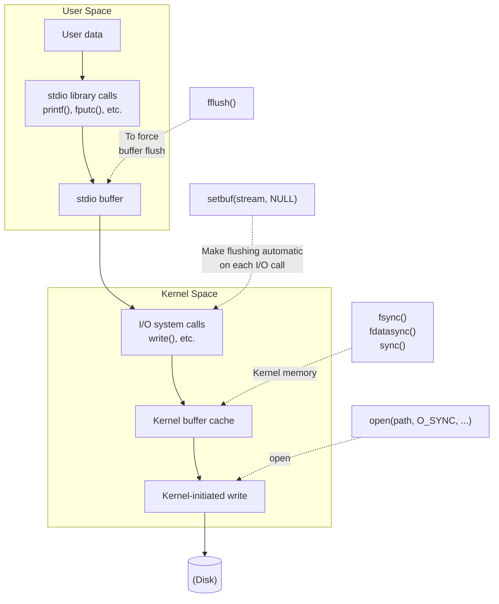

## Chương 13
# <span id="page-0-0"></span>**ĐỆM I/O TẬP TIN (FILE I/O BUFFERING)**

Vì mục đích tốc độ và hiệu suất, các System Call (lời gọi hệ thống) I/O (tức là kernel) và các hàm I/O của thư viện C chuẩn (tức là các hàm stdio) thực hiện đệm (buffer) dữ liệu khi thao tác với các tập tin đĩa. Trong chương này, chúng ta sẽ mô tả cả hai loại đệm này và xem xét cách chúng ảnh hưởng đến hiệu suất ứng dụng. Chúng ta cũng sẽ tìm hiểu các kỹ thuật khác nhau để tác động và vô hiệu hóa cả hai loại đệm này, đồng thời xem xét một kỹ thuật gọi là I/O trực tiếp (direct I/O), rất hữu ích để bỏ qua bộ đệm của kernel trong một số trường hợp nhất định.

# **13.1 Đệm I/O Tập Tin trong Kernel: Bộ Đệm Cache (Buffer Cache)**

<span id="page-0-1"></span>Khi làm việc với các tập tin đĩa, các System Call `read()` và `write()` không trực tiếp khởi tạo truy cập đĩa. Thay vào đó, chúng chỉ đơn giản sao chép dữ liệu giữa một bộ đệm trong không gian người dùng (user-space buffer) và một bộ đệm nằm trong buffer cache của kernel. Ví dụ, lời gọi sau truyền 3 byte dữ liệu từ một bộ đệm trong bộ nhớ không gian người dùng sang một bộ đệm trong không gian kernel (kernel space):

```c
write(fd, "abc", 3);
```

Tại thời điểm này, `write()` trả về. Vào một thời điểm sau đó, kernel sẽ ghi (flush) bộ đệm của nó xuống đĩa. (Do đó, chúng ta nói rằng System Call không được đồng bộ hóa với thao tác đĩa.) Nếu trong khoảng thời gian đó, một Process ( tiến trình) khác cố gắng đọc các byte dữ liệu này của tập tin, thì kernel sẽ tự động cung cấp dữ liệu từ buffer cache, thay vì đọc từ nội dung (đã cũ) trên tập tin.

Tương tự, đối với đầu vào (input), kernel đọc dữ liệu từ đĩa và lưu trữ nó vào một bộ đệm của kernel. Các lời gọi `read()` lấy dữ liệu từ bộ đệm này cho đến khi cạn kiệt, tại thời điểm đó kernel sẽ đọc đoạn tiếp theo của tập tin vào buffer cache. (Đây là một sự đơn giản hóa; đối với việc truy cập tập tin tuần tự, kernel thường thực hiện việc đọc trước (read-ahead) để cố gắng đảm bảo rằng các khối tiếp theo của tập tin được đọc vào buffer cache trước khi tiến trình đọc yêu cầu đến chúng. Chúng ta sẽ nói thêm về read-ahead ở Mục [13.5](#page-11-0).)

Mục đích của thiết kế này là giúp cho `read()` và `write()` chạy nhanh, vì chúng không cần phải chờ đợi một thao tác đĩa (chậm). Thiết kế này cũng mang lại hiệu quả cao, vì nó làm giảm số lượng lần truyền dữ liệu đĩa mà kernel phải thực hiện.

Kernel Linux không áp đặt giới hạn trên cố định đối với kích thước của buffer cache. Kernel sẽ cấp phát số lượng trang buffer cache (buffer cache page) tùy theo yêu cầu, chỉ bị giới hạn bởi lượng bộ nhớ vật lý (physical memory) khả dụng và nhu cầu sử dụng bộ nhớ vật lý cho các mục đích khác (ví dụ: chứa các trang mã lệnh (text) và dữ liệu (data) được yêu cầu bởi các tiến trình đang chạy). Nếu bộ nhớ khả dụng trở nên khan hiếm, kernel sẽ ghi (flush) một số trang buffer cache đã bị sửa đổi xuống đĩa để giải phóng các trang đó cho việc tái sử dụng.

> Nói một cách chính xác hơn, từ phiên bản kernel 2.4 trở đi, Linux không còn duy trì một buffer cache riêng biệt nữa. Thay vào đó, các bộ đệm I/O tập tin được gộp chung trong page cache (bộ đệm trang), nơi mà ví dụ, cũng chứa các trang từ các tập tin được ánh xạ bộ nhớ (memory-mapped files). Mặc dù vậy, trong phần thảo luận chính, chúng ta vẫn sử dụng thuật ngữ buffer cache, vì thuật ngữ đó phổ biến theo lịch sử trên các cài đặt UNIX.

### **Ảnh hưởng của kích thước bộ đệm đến hiệu năng system call I/O**

Kernel thực hiện cùng một số lượng thao tác truy cập đĩa (disk access), bất kể chúng ta thực hiện 1000 lần ghi với một byte duy nhất hay một lần ghi duy nhất 1000 bytes. Tuy nhiên, cách sau được ưu tiên hơn, vì nó chỉ yêu cầu một system call duy nhất, trong khi cách trước yêu cầu tới 1000 lần. Mặc dù nhanh hơn nhiều so với các thao tác trên đĩa, các system call vẫn tiêu tốn một khoảng thời gian đáng kể, vì kernel phải bẫy (trap) lệnh gọi, kiểm tra tính hợp lệ của các tham số system call, và truyền dữ liệu giữa không gian người dùng (user space) và không gian kernel (kernel space) (tham khảo Mục 3.1 để biết thêm chi tiết).

Tác động của việc thực hiện I/O tệp với các kích thước bộ đệm (buffer size) khác nhau có thể được quan sát bằng cách chạy chương trình trong Bảng 4-1 (ở trang 71) với các giá trị `BUF_SIZE` khác nhau. (Hằng số `BUF_SIZE` xác định có bao nhiêu byte được truyền bởi mỗi lần gọi `read()` và `write()`.) Bảng 13-1 cho thấy thời gian mà chương trình này yêu cầu để sao chép một tệp có dung lượng 100 triệu byte trên hệ thống tệp Linux ext2 bằng cách sử dụng các giá trị `BUF_SIZE` khác nhau. Lưu ý các điểm sau liên quan đến thông tin trong bảng này:

- Các cột Thời gian trôi qua (Elapsed) và Tổng thời gian CPU (Total CPU) có ý nghĩa hiển nhiên. Các cột CPU người dùng (User CPU) và CPU hệ thống (System CPU) cho thấy sự phân chia của Tổng thời gian CPU thành, tương ứng, thời gian dành cho việc thực thi mã nguồn ở chế độ người dùng (user mode) và thời gian dành cho việc thực thi mã nguồn kernel (tức là các system call).
- Các thử nghiệm được thể hiện trong bảng được thực hiện bằng cách sử dụng một kernel gốc 2.6.30 (vanilla kernel) trên hệ thống tệp ext2 với kích thước khối (block size) là 4096 bytes.

Khi chúng ta nói về một kernel gốc (vanilla kernel), ý chúng ta là một kernel dòng chính (mainline kernel) chưa được vá lỗi. Điều này tương phản với các kernel được cung cấp bởi hầu hết các nhà phân phối, vốn thường bao gồm các bản vá khác nhau để sửa lỗi hoặc thêm các tính năng.

Mỗi hàng hiển thị giá trị trung bình của 20 lần chạy cho kích thước bộ đệm đã cho. Trong các thử nghiệm này, cũng như trong các thử nghiệm khác được trình bày sau trong chương này, hệ thống tệp đã được gỡ gắn (unmounted) và gắn lại (remounted) giữa mỗi lần thực thi chương trình để đảm bảo rằng bộ đệm trang (page cache) cho hệ thống tệp là trống. Việc đo thời gian được thực hiện bằng cách sử dụng lệnh `time` của shell.

**Bảng 13-1:** Thời gian cần thiết để nhân bản một tệp có dung lượng 100 triệu byte

|          | Thời gian (giây) |           |          |            |  |  |
|----------|------------------|-----------|----------|------------|--|--|
| BUF_SIZE | Elapsed          | Total CPU | User CPU | System CPU |  |  |
| 1        | 107.43           | 107.32    | 8.20     | 99.12      |  |  |
| 2        | 54.16            | 53.89     | 4.13     | 49.76      |  |  |
| 4        | 31.72            | 30.96     | 2.30     | 28.66      |  |  |
| 8        | 15.59            | 14.34     | 1.08     | 13.26      |  |  |
| 16       | 7.50             | 7.14      | 0.51     | 6.63       |  |  |
| 32       | 3.76             | 3.68      | 0.26     | 3.41       |  |  |
| 64       | 2.19             | 2.04      | 0.13     | 1.91       |  |  |
| 128      | 2.16             | 1.59      | 0.11     | 1.48       |  |  |
| 256      | 2.06             | 1.75      | 0.10     | 1.65       |  |  |
| 512      | 2.06             | 1.03      | 0.05     | 0.98       |  |  |
| 1024     | 2.05             | 0.65      | 0.02     | 0.63       |  |  |
| 4096     | 2.05             | 0.38      | 0.01     | 0.38       |  |  |
| 16384    | 2.05             | 0.34      | 0.00     | 0.33       |  |  |
| 65536    | 2.06             | 0.32      | 0.00     | 0.32       |  |  |

Vì tổng lượng dữ liệu được truyền (và do đó là số lượng thao tác đĩa) là như nhau đối với các kích thước bộ đệm khác nhau, những gì Bảng 13-1 minh họa chính là chi phí chi phí chung (overhead) của việc thực hiện các lệnh gọi `read()` và `write()`. Với kích thước bộ đệm là 1 byte, 100 triệu lần gọi được thực hiện đến `read()` và `write()`. Với kích thước bộ đệm là 4096 bytes, số lần gọi của mỗi system call giảm xuống còn khoảng 24.000, và hiệu năng gần tối ưu đã đạt được. Vượt quá điểm này, không có sự cải thiện hiệu năng đáng kể nào nữa, bởi vì chi phí thực hiện các system call `read()` và `write()` trở nên không đáng kể so với thời gian cần thiết để sao chép dữ liệu giữa user space và kernel space, và để thực hiện I/O đĩa thực tế.

> Các hàng cuối cùng của Bảng 13-1 cho phép chúng ta ước tính sơ bộ về thời gian cần thiết để truyền dữ liệu giữa user space và kernel space, và cho I/O tệp. Vì số lượng system call trong các trường hợp này tương đối nhỏ, đóng góp của chúng vào thời gian trôi qua (elapsed time) và thời gian CPU là không đáng kể. Do đó, chúng ta có thể nói rằng System CPU time thực chất đang đo lường thời gian truyền dữ liệu giữa user space và kernel space. Giá trị Elapsed time cung cấp cho chúng ta một ước tính về thời gian cần thiết để truyền dữ liệu đến và đi từ đĩa. (Như chúng ta sẽ thấy ngay sau đây, đây chủ yếu là thời gian cần thiết để đọc đĩa).

Tóm lại, nếu chúng ta đang truyền một lượng lớn dữ liệu đến hoặc đi từ một tệp, thì bằng cách đệm dữ liệu thành các khối lớn, và do đó thực hiện ít system call hơn, chúng ta có thể cải thiện đáng kể hiệu năng I/O.

Dữ liệu trong Bảng 13-1 đo lường một loạt các yếu tố: thời gian thực hiện các System Call `read()` và `write()`, thời gian truyền dữ liệu giữa các vùng đệm (buffer) trong Kernel Space và User Space, và thời gian truyền dữ liệu giữa các bộ đệm kernel và đĩa cứng. Hãy cùng xem xét kỹ hơn yếu tố cuối cùng. Rõ ràng, việc chuyển nội dung của tệp đầu vào vào bộ đệm ẩn (buffer cache) là điều không thể tránh khỏi. Tuy nhiên, chúng ta đã thấy rằng `write()` trả về ngay lập tức sau khi truyền dữ liệu từ User Space sang kernel buffer cache. Vì dung lượng RAM trên hệ thống thử nghiệm (4 GB) lớn hơn nhiều so với kích thước của tệp đang được sao chép (100 MB), chúng ta có thể giả định rằng vào thời điểm chương trình hoàn tất, tệp đầu saída thực sự chưa được ghi xuống đĩa. Do đó, như một thí nghiệm tiếp theo, chúng tôi đã chạy một chương trình đơn giản ghi dữ liệu tùy ý vào một tệp bằng cách sử dụng các kích thước bộ đệm `write()` khác nhau. Kết quả được hiển thị trong Bảng 13-2.

Một lần nữa, dữ liệu hiển thị trong Bảng 13-2 được thu thập từ kernel 2.6.30, trên hệ thống tệp (file system) ext2 với kích thước khối (block size) là 4096 byte, và mỗi hàng thể hiện giá trị trung bình của 20 lần chạy. Chúng tôi không hiển thị chương trình thử nghiệm (`filebuff/write_bytes.c`), nhưng mã nguồn này có sẵn trong gói mã nguồn đi kèm của cuốn sách này.

|  | Bảng 13-2: Thời gian cần thiết để ghi một tệp có kích thước 100 triệu byte |  |  |
|--|--------------------------------------------------------------------------|--|--|
|--|--------------------------------------------------------------------------|--|--|

|          | Thời gian (giây) |             |            |              |  |  |
|----------|------------------|-------------|------------|--------------|--|--|
| BUF_SIZE | Đã trôi qua      | Tổng số CPU | CPU Người dùng | CPU Hệ thống |  |  |
| 1        | 72.13            | 72.11       | 5.00       | 67.11        |  |  |
| 2        | 36.19            | 36.17       | 2.47       | 33.70        |  |  |
| 4        | 20.01            | 19.99       | 1.26       | 18.73        |  |  |
| 8        | 9.35             | 9.32        | 0.62       | 8.70         |  |  |
| 16       | 4.70             | 4.68        | 0.31       | 4.37         |  |  |
| 32       | 2.39             | 2.39        | 0.16       | 2.23         |  |  |
| 64       | 1.24             | 1.24        | 0.07       | 1.16         |  |  |
| 128      | 0.67             | 0.67        | 0.04       | 0.63         |  |  |
| 256      | 0.38             | 0.38        | 0.02       | 0.36         |  |  |
| 512      | 0.24             | 0.24        | 0.01       | 0.23         |  |  |
| 1024     | 0.17             | 0.17        | 0.01       | 0.16         |  |  |
| 4096     | 0.11             | 0.11        | 0.00       | 0.11         |  |  |
| 16384    | 0.10             | 0.10        | 0.00       | 0.10         |  |  |
| 65536    | 0.09             | 0.09        | 0.00       | 0.09         |  |  |

Bảng 13-2 cho thấy chi phí chỉ để thực hiện các System Call `write()` và truyền dữ liệu từ User Space sang kernel buffer cache bằng cách sử dụng các kích thước bộ đệm `write()` khác nhau. Đối với các kích thước bộ đệm lớn hơn, chúng ta thấy có sự khác biệt đáng kể so với dữ liệu được hiển thị trong Bảng 13-1. Ví dụ, với kích thước bộ đệm 65.536 byte, thời gian đã trôi qua trong Bảng 13-1 là 2,06 giây, trong khi đối với Bảng 13-2 thì chỉ là 0,09 giây. Điều này là do không có hoạt động I/O đĩa thực tế nào được thực hiện trong trường hợp sau. Nói cách khác, phần lớn thời gian cần thiết cho các trường hợp bộ đệm lớn trong Bảng 13-1 là do các thao tác đọc đĩa (disk read).

Như chúng ta sẽ thấy trong Mục [13.3,](#page-6-0) khi chúng ta buộc các thao tác xuất (output) phải chặn (block) cho đến khi dữ liệu được truyền xuống đĩa, thời gian cho các lệnh gọi `write()` sẽ tăng lên đáng kể.

Cuối cùng, cần lưu ý rằng thông tin trong Bảng 13-2 (và sau này là [Bảng 13-3](#page-9-0)) chỉ đại diện cho một dạng điểm chuẩn (benchmark) (mang tính sơ khai) đối với một hệ thống tệp. Hơn nữa, kết quả có thể sẽ có một số biến động giữa các hệ thống tệp khác nhau. Các hệ thống tệp có thể được đo lường bằng nhiều tiêu chí khác nhau, chẳng hạn như hiệu năng dưới tải trọng đa người dùng (multiuser) nặng, tốc độ tạo và xóa tệp, thời gian cần thiết để tìm kiếm một tệp trong một thư mục lớn, dung lượng cần thiết để lưu trữ các tệp nhỏ, hoặc việc duy trì tính toàn vẹn của tệp trong trường hợp hệ thống bị sự cố (crash). Trong những trường hợp mà hiệu năng của I/O hoặc các hoạt động hệ thống tệp khác đóng vai trò cốt yếu, không có giải pháp nào thay thế được cho các chương trình đo điểm chuẩn chuyên biệt theo ứng dụng (application-specific benchmark) trên nền tảng đích.

# **13.2 Cơ chế đệm trong Thư viện stdio**

Việc đệm dữ liệu thành các khối lớn để giảm thiểu số lượng System Call chính xác là những gì mà các hàm I/O của thư viện C thực hiện (ví dụ: `fprintf()`, `fscanf()`, `fgets()`, `fputs()`, `fputc()`, `fgetc()`) khi thao tác trên các tệp đĩa. Do đó, việc sử dụng thư viện stdio giúp chúng ta khỏi phải tự thực hiện nhiệm vụ đệm dữ liệu cho việc ghi xuất với `write()` hoặc nhập vào thông qua `read()`.

### **Thiết lập chế độ đệm (buffering mode) của một luồng stdio**

Hàm `setvbuf()` điều khiển hình thức đệm được sử dụng bởi thư viện stdio.

```
#include <stdio.h>
int setvbuf(FILE *stream, char *buf, int mode, size_t size);
                                      Trả về 0 khi thành công, hoặc khác 0 khi có lỗi
```

Đối số `stream` xác định luồng tập tin (file stream) cần thay đổi chế độ đệm. Sau khi luồng đã được mở, lời gọi hàm `setvbuf()` phải được thực hiện trước khi gọi bất kỳ hàm stdio nào khác trên luồng đó. Lời gọi `setvbuf()` ảnh hưởng đến hành vi của tất cả các thao tác stdio tiếp theo trên luồng được chỉ định.

> Các luồng (streams) được sử dụng bởi thư viện stdio không được nhầm lẫn với cơ chế STREAMS của System V. Cơ chế System V STREAMS không được cài đặt trong nhân (kernel) Linux chính tuyến.

Các đối số `buf` và `size` xác định bộ đệm (buffer) được sử dụng cho luồng. Các đối số này có thể được chỉ định theo hai cách:

- Nếu `buf` khác `NULL`, thì nó trỏ đến một khối bộ nhớ có kích thước `size` (tính bằng byte) sẽ được sử dụng làm bộ đệm cho luồng. Vì bộ đệm được trỏ bởi `buf` sau đó được sử dụng bởi thư viện stdio, nó nên được cấp phát tĩnh (statically allocated) hoặc cấp phát động trên vùng nhớ heap (sử dụng `malloc()` hoặc tương tự). Nó không nên được cấp phát như một biến cục bộ của hàm trên vùng nhớ stack, vì sự cố sẽ xảy ra khi hàm đó trả về và khung stack (stack frame) của nó bị thu hồi.
- Nếu `buf` là `NULL`, thì thư viện stdio sẽ tự động cấp phát một bộ đệm để sử dụng với luồng (trừ khi chúng ta chọn I/O không dùng đệm như được mô tả bên dưới). SUSv3 cho phép, nhưng không bắt buộc, một bản cài đặt phải sử dụng `size` để quyết định kích thước cho bộ đệm này. Trong bản cài đặt glibc, `size` bị bỏ qua trong trường hợp này.

Đối số `mode` chỉ định loại đệm và nhận một trong các giá trị sau: `_IONBF`

Không đệm I/O (Don't buffer I/O). Mỗi lời gọi thư viện stdio dẫn đến một System Call (lời gọi hệ thống) `write()` hoặc `read()` được thực thi ngay lập tức. Các đối số `buf` và `size` bị bỏ qua, và có thể được chỉ định lần lượt là `NULL` và `0`. Đây là chế độ mặc định cho `stderr`, do đó đầu ra lỗi được đảm bảo hiển thị ngay lập tức.

`_IOLBF`

Sử dụng I/O đệm theo dòng (line-buffered I/O). Cờ này là mặc định cho các luồng tham chiếu đến thiết bị thiết bị đầu cuối (terminal). Đối với các luồng ghi (output streams), dữ liệu được đệm cho đến khi ký tự xuống dòng được ghi ra (trừ khi bộ đệm bị đầy trước). Đối với các luồng đọc (input streams), dữ liệu được đọc theo từng dòng một.

`_IOFBF`

Sử dụng I/O đệm toàn phần (fully buffered I/O). Dữ liệu được đọc hoặc ghi (thông qua các lời gọi `read()` hoặc `write()`) theo các đơn vị bằng với kích thước của bộ đệm. Chế độ này là mặc định cho các luồng tham chiếu đến tập tin đĩa (disk files).

Đoạn mã sau minh họa việc sử dụng `setvbuf()`:

```
#define BUF_SIZE 1024
static char buf[BUF_SIZE];
if (setvbuf(stdout, buf, _IOFBF, BUF_SIZE) != 0)
 errExit("setvbuf");
```

Lưu ý rằng `setvbuf()` trả về một giá trị khác 0 (không nhất thiết là –1) khi xảy ra lỗi.

Hàm `setbuf()` được xây dựng dựa trên `setvbuf()` và thực hiện một tác vụ tương tự.

```
#include <stdio.h>
void setbuf(FILE *stream, char *buf);
```

Ngoài việc không trả về giá trị kết quả, lời gọi `setbuf(fp, buf)` tương đương với:

```
setvbuf(fp, buf, (buf != NULL) ? _IOFBF: _IONBF, BUFSIZ);
```

Đối số `buf` được chỉ định hoặc là `NULL` (để không dùng đệm), hoặc là một con trỏ trỏ tới bộ đệm do người gọi cấp phát có kích thước `BUFSIZ` byte. (`BUFSIZ` được định nghĩa trong `<stdio.h>`. Trong bản cài đặt glibc, hằng số này có giá trị 8192, đây là một giá trị điển hình).

Hàm `setbuffer()` tương tự như `setbuf()`, nhưng cho phép người gọi chỉ định kích thước của `buf`.

```
#define _BSD_SOURCE
#include <stdio.h>
void setbuffer(FILE *stream, char *buf, size_t size);
```

Lời gọi `setbuffer(fp, buf, size)` tương đương với đoạn mã sau:

```
setvbuf(fp, buf, (buf != NULL) ? _IOFBF : _IONBF, size);
```

Hàm `setbuffer()` không được định nghĩa trong SUSv3, nhưng có sẵn trên hầu hết các bản cài đặt UNIX.

### **Xả bộ đệm stdio (Flushing a stdio buffer)**

Bất kể chế độ đệm (buffering mode) hiện tại là gì, tại bất kỳ thời điểm nào, chúng ta cũng có thể ép dữ liệu trong luồng xuất (output stream) của stdio được ghi ra (tức là được xả vào bộ đệm của Kernel (Kernel buffer) thông qua lệnh `write()`) bằng cách sử dụng hàm thư viện `fflush()`. Hàm này sẽ xả bộ đệm xuất cho luồng được chỉ định.

```
#include <stdio.h>
int fflush(FILE *stream);
                                               Trả về 0 khi thành công, EOF khi lỗi
```

Nếu `stream` là `NULL`, `fflush()` sẽ xả tất cả các bộ đệm stdio.

Hàm `fflush()` cũng có thể được áp dụng cho một luồng nhập (input stream). Thao tác này khiến cho bất kỳ dữ liệu nhập nào đang nằm trong bộ đệm đều bị hủy bỏ. (Bộ đệm sẽ được nạp lại vào lần tiếp theo chương trình cố gắng đọc từ luồng đó).

Bộ đệm stdio được tự động xả khi luồng tương ứng bị đóng (closed).

Trong nhiều bản cài đặt thư viện C, bao gồm cả `glibc`, nếu `stdin` và `stdout` trỏ đến một thiết bị đầu cuối (terminal), thì một lệnh `fflush(stdout)` ẩn sẽ được thực thi bất cứ khi nào dữ liệu được đọc từ `stdin`. Điều này có hiệu quả trong việc xả bất kỳ chuỗi nhắc nhở (prompt) nào được ghi vào `stdout` mà không có ký tự xuống dòng kết thúc (ví dụ: `printf("Date: ")`). Tuy nhiên, hành vi này không được quy định trong chuẩn SUSv3 hay C99 và không được cài đặt trong mọi thư viện C. Các chương trình có tính tương thích cao (portable) nên sử dụng các lời gọi `fflush(stdout)` tường minh để đảm bảo rằng các chuỗi nhắc nhở đó được hiển thị.

> Chuẩn C99 đưa ra hai yêu cầu nếu một luồng được mở cho cả hai tác vụ nhập và xuất. Thứ nhất, một thao tác xuất không được đi ngay sau một thao tác nhập nếu không có một lời gọi xen kẽ đến `fflush()` hoặc một trong các hàm định vị tệp (như `fseek()`, `fsetpos()`, hoặc `rewind()`). Thứ hai, một thao tác nhập không được đi ngay sau một thao tác xuất nếu không có một lời gọi xen kẽ đến một trong các hàm định vị tệp, trừ khi thao tác nhập gặp phải lỗi kết thúc tệp (end-of-file).

# <span id="page-6-0"></span>**13.3 Điều khiển bộ đệm Kernel của I/O tệp (Controlling Kernel Buffering of File I/O)**

<span id="page-6-1"></span>Chúng ta hoàn toàn có thể ép xả các bộ đệm của Kernel (Kernel buffer) đối với các tệp xuất. Đôi khi, điều này là bắt buộc nếu một ứng dụng (ví dụ: tiến trình ghi nhật ký cơ sở dữ liệu - database journaling process) phải đảm bảo rằng dữ liệu xuất thực sự đã được ghi xuống đĩa (hoặc ít nhất là vào bộ đệm phần cứng của đĩa - disk's hardware cache) trước khi tiếp tục.

Trước khi mô tả các System Call (System Call) được sử dụng để điều khiển bộ đệm của Kernel, việc xem xét một vài định nghĩa liên quan từ chuẩn SUSv3 sẽ rất hữu ích.

### **Tính toàn vẹn dữ liệu I/O đồng bộ và tính toàn vẹn tệp I/O đồng bộ (Synchronized I/O data integrity and synchronized I/O file integrity)**

Chuẩn SUSv3 định nghĩa thuật ngữ hoàn thành I/O đồng bộ (synchronized I/O completion) có nghĩa là "một thao tác I/O đã được truyền thành công [xuống đĩa] hoặc được chẩn đoán là không thành công."

SUSv3 định nghĩa hai loại hoàn thành I/O đồng bộ khác nhau. Sự khác biệt giữa các loại này liên quan đến siêu dữ liệu ("dữ liệu về dữ liệu" - metadata) mô tả tệp, thứ mà Kernel lưu trữ cùng với dữ liệu của tệp. Chúng ta sẽ xem xét chi tiết siêu dữ liệu tệp (file metadata) khi tìm hiểu về i-node của tệp (file i-node) tại Mục [14.4,](#page-23-0) nhưng hiện tại, chỉ cần lưu ý rằng siêu dữ liệu tệp bao gồm các thông tin như chủ sở hữu và nhóm tệp; quyền hạn tệp; kích thước tệp; số lượng liên kết cứng (hard link) trỏ đến tệp; các dấu thời gian (timestamp) chỉ thời điểm truy cập tệp lần cuối, thời điểm chỉnh sửa tệp lần cuối, và thời điểm thay đổi siêu dữ liệu lần cuối; cùng với các con trỏ khối dữ liệu tệp (file data block pointer).

Loại hoàn thành I/O đồng bộ đầu tiên được định nghĩa bởi SUSv3 là hoàn thành tính toàn vẹn dữ liệu I/O đồng bộ (synchronized I/O data integrity completion). Loại này liên quan đến việc đảm bảo rằng một bản cập nhật dữ liệu tệp truyền đi đủ thông tin để cho phép việc truy xuất dữ liệu đó sau này diễn ra thành công.

- Đối với một thao tác đọc (read operation), điều này có nghĩa là dữ liệu tệp được yêu cầu đã được truyền (từ đĩa) đến tiến trình (Process). Nếu có bất kỳ thao tác ghi (write operation) nào đang chờ xử lý (pending) ảnh hưởng đến dữ liệu được yêu cầu, chúng sẽ được truyền xuống đĩa trước khi thực hiện việc đọc.
- Đối với một thao tác ghi (write operation), điều này có nghĩa là dữ liệu được chỉ định trong yêu cầu ghi đã được truyền (xuống đĩa) và tất cả siêu dữ liệu tệp cần thiết để truy xuất dữ liệu đó cũng đã được truyền. Điểm quan trọng cần lưu ý ở đây là không phải tất cả các thuộc tính siêu dữ liệu tệp bị sửa đổi đều cần phải được truyền đi để có thể truy xuất dữ liệu tệp. Một ví dụ về thuộc tính siêu dữ liệu tệp bị sửa đổi cần phải được truyền đi là kích thước tệp (nếu thao tác ghi làm mở rộng tệp). Ngược lại, các dấu thời gian của tệp bị sửa đổi sẽ không cần phải được truyền xuống đĩa trước khi một thao tác truy xuất dữ liệu tiếp theo có thể diễn ra.

Loại hoàn thành I/O đồng bộ còn lại do SUSv3 định nghĩa là hoàn thành tính toàn vẹn tệp I/O đồng bộ (synchronized I/O file integrity completion), đây là một tập siêu (superset) của hoàn thành tính toàn vẹn dữ liệu I/O đồng bộ. Điểm khác biệt với chế độ hoàn thành I/O này là trong quá trình cập nhật tệp, tất cả các siêu dữ liệu tệp đã cập nhật đều được truyền xuống đĩa, ngay cả khi chúng không cần thiết cho hoạt động của một lần đọc dữ liệu tệp tiếp theo.

### **Các System Call để kiểm soát bộ nhớ đệm (buffering) I/O file của kernel**

System call `fsync()` làm cho dữ liệu được đưa vào bộ nhớ đệm (buffered data) và tất cả metadata liên quan đến file descriptor `fd` đang mở được ghi xuống đĩa (flush). Việc gọi `fsync()` ép buộc file chuyển sang trạng thái hoàn tất toàn vẹn file I/O đồng bộ (synchronized I/O file integrity completion state).

```
#include <unistd.h>
int fsync(int fd);
                                              Trả về 0 khi thành công, hoặc –1 khi lỗi
```

Một lời gọi `fsync()` chỉ trả về sau khi quá trình truyền dữ liệu đến thiết bị đĩa (hoặc ít nhất là bộ nhớ đệm của nó) đã hoàn tất.

System call `fdatasync()` hoạt động tương tự như `fsync()`, nhưng chỉ ép buộc file chuyển sang trạng thái hoàn tất toàn vẹn dữ liệu I/O đồng bộ (synchronized I/O data integrity completion state).

```
#include <unistd.h>
int fdatasync(int fd);
                                             Trả về 0 khi thành công, hoặc –1 khi lỗi
```

Sử dụng `fdatasync()` có khả năng làm giảm số lượng thao tác ghi đĩa từ hai thao tác theo yêu cầu của `fsync()` xuống còn một. Ví dụ, nếu dữ liệu file thay đổi nhưng kích thước file thì không, việc gọi `fdatasync()` sẽ chỉ ép buộc cập nhật dữ liệu. (Chúng ta đã lưu ý ở trên rằng các thay đổi đối với thuộc tính metadata của file, chẳng hạn như dấu thời gian sửa đổi lần cuối (last modification timestamp), không cần phải được truyền đi để hoàn tất dữ liệu I/O đồng bộ). Ngược lại, việc gọi `fsync()` cũng sẽ ép metadata phải được ghi xuống đĩa.

Việc giảm số lượng các thao tác I/O đĩa theo cách này rất hữu ích cho một số ứng dụng nhất định mà hiệu năng là tối quan trọng và việc duy trì chính xác một số metadata nhất định (chẳng hạn như dấu thời gian) không phải là thiết yếu. Điều này có thể tạo ra sự khác biệt đáng kể về hiệu năng đối với các ứng dụng thực hiện nhiều cập nhật file: vì dữ liệu file và metadata thông thường nằm ở các phần khác nhau trên đĩa, việc cập nhật cả hai sẽ đòi hỏi các thao tác dịch chuyển đầu đọc (seek operation) lặp đi lặp lại qua lại trên đĩa.

Trong Linux 2.2 trở về trước, `fdatasync()` được triển khai như một lời gọi đến `fsync()`, do đó không mang lại lợi ích về hiệu năng.

> Bắt đầu từ kernel 2.6.17, Linux cung cấp system call phi chuẩn `sync_file_range()`, cho phép kiểm soát chính xác hơn so với `fdatasync()` khi flush dữ liệu file. Người gọi có thể chỉ định vùng file cần flush, và chỉ định các cờ (flag) điều khiển việc liệu system call có bị block khi ghi đĩa hay không. Xem trang hướng dẫn (manual page) `sync_file_range(2)` để biết thêm chi tiết.

System call `sync()` khiến tất cả các bộ nhớ đệm của kernel chứa thông tin file đã được cập nhật (ví dụ: các khối dữ liệu, khối con trỏ, metadata, v.v.) được ghi xuống đĩa.

```
#include <unistd.h>
void sync(void);
```

Trong phần cài đặt của Linux, `sync()` chỉ trả về sau khi toàn bộ dữ liệu đã được truyền đến thiết bị đĩa (hoặc ít nhất là vào bộ nhớ đệm của nó). Tuy nhiên, SUSv3 cho phép một bản cài đặt `sync()` chỉ đơn giản là lên lịch truyền I/O và trả về trước khi quá trình đó hoàn tất.

> Một luồng kernel (kernel thread) chạy liên tục đảm bảo rằng các bộ nhớ đệm của kernel đã bị sửa đổi sẽ được ghi xuống đĩa nếu chúng không được đồng bộ hóa một cách tường minh trong vòng 30 giây. Điều này được thực hiện để đảm bảo rằng các bộ nhớ đệm không ở trạng thái chưa đồng bộ với file trên đĩa tương ứng (và do đó dễ bị mất mát trong trường hợp hệ thống bị crash) trong thời gian dài. Trong Linux 2.6, tác vụ này được thực hiện bởi `pdflush` kernel thread. (Trong Linux 2.4, nó được thực hiện bởi `kupdated` kernel thread).

> File `/proc/sys/vm/dirty_expire_centisecs` chỉ định độ tuổi (tính bằng phần trăm của giây) mà một bộ nhớ đệm bẩn (dirty buffer) phải đạt được trước khi nó bị flush bởi `pdflush`. Các file bổ sung trong cùng thư mục sẽ kiểm soát các khía cạnh khác trong hoạt động của `pdflush`.

### **Biến mọi thao tác ghi thành đồng bộ: O_SYNC**

Việc chỉ định cờ O_SYNC khi gọi hàm open() sẽ làm cho mọi thao tác xuất (output) tiếp theo trở nên đồng bộ (synchronous):

```c
fd = open(pathname, O_WRONLY | O_SYNC);
```

Sau lời gọi open() này, mọi hàm write() ghi vào file sẽ tự động xả (flush) dữ liệu và siêu dữ liệu (metadata) của file xuống ổ đĩa (nghĩa là các thao tác ghi được thực hiện theo tiêu chuẩn hoàn tất toàn vẹn file I/O đồng bộ - *synchronized I/O file integrity completion*).

> Các hệ thống BSD cũ sử dụng cờ O_FSYNC để cung cấp tính năng tương tự O_SYNC. Trong glibc, O_FSYNC được định nghĩa là một từ đồng nghĩa (synonym) của O_SYNC.

### **Ảnh hưởng hiệu năng của O_SYNC**

Việc sử dụng cờ O_SYNC (hoặc thực hiện thường xuyên các lời gọi fsync(), fdatasync(), hay sync()) có thể ảnh hưởng lớn đến hiệu năng (performance). [Bảng 13-3](#page-9-0) minh họa thời gian cần thiết để ghi 1 triệu byte vào một file mới được tạo (trên hệ thống file ext2) với nhiều kích thước bộ đệm (buffer size) khác nhau, có và không có sử dụng O_SYNC. Các kết quả này thu được (bằng cách sử dụng chương trình filebuff/write_bytes.c đi kèm trong mã nguồn của cuốn sách này) trên một Linux Kernel bản gốc 2.6.30 và hệ thống file ext2 với kích thước khối (block size) là 4096 byte. Mỗi hàng hiển thị giá trị trung bình của 20 lần chạy cho kích thước buffer tương ứng.

Như có thể thấy từ bảng trên, O_SYNC làm tăng thời gian đã trôi qua (elapsed time) lên cực kỳ lớn — trong trường hợp kích thước buffer là 1 byte, mức tăng lên đến hơn 1000 lần. Lưu ý thêm sự khác biệt lớn giữa thời gian đã trôi qua và thời gian CPU (CPU time) đối với các thao tác ghi sử dụng O_SYNC. Đây là hệ quả của việc tiến trình (process) bị chặn (blocked) trong lúc mỗi buffer thực sự được truyền tải xuống ổ đĩa.

Các kết quả trong [Bảng 13-3](#page-9-0) vẫn bỏ qua một yếu tố khác ảnh hưởng đến hiệu năng khi sử dụng O_SYNC. Các ổ đĩa hiện đại có bộ nhớ đệm (cache) nội bộ rất lớn, và theo mặc định, O_SYNC chỉ đơn thuần làm cho dữ liệu được chuyển vào cache đó. Nếu chúng ta vô hiệu hóa tính năng cache trên ổ đĩa (sử dụng lệnh `hdparm -W0`), thì tác động hiệu năng của O_SYNC thậm chí còn trở nên khắc nghiệt hơn nữa. Trong trường hợp 1 byte, thời gian đã trôi qua tăng từ 1030 giây lên khoảng 16.000 giây. Trong trường hợp 4096 byte, thời gian đã trôi qua tăng từ 0,34 giây lên 4 giây.

Tóm lại, nếu cần ép buộc xả bộ đệm của kernel (kernel buffer), chúng ta nên cân nhắc xem có thể thiết kế ứng dụng sử dụng kích thước buffer lớn cho hàm write() hay sử dụng hợp lý các lời gọi thỉnh thoảng đến fsync() hoặc fdatasync(), thay vì sử dụng cờ O_SYNC khi mở file.

|          |                |           | Thời gian yêu cầu (giây) |             |
|----------|----------------|-----------|-------------------------|-------------|
| BUF_SIZE | Không có O_SYNC|           |                         | Có O_SYNC   |
|          | Đã trôi qua    | Tổng CPU  | Đã trôi qua             | Tổng CPU    |
| 1        | 0.73           | 0.73      | 1030                    | 98.8        |
| 16       | 0.05           | 0.05      | 65.0                    | 0.40        |
| 256      | 0.02           | 0.02      | 4.07                    | 0.03        |

4096 0.01 0.01 0.34 0.03

<span id="page-9-0"></span>**Bảng 13-3:** Tác động của cờ O_SYNC đối với tốc độ ghi 1 triệu byte

### **Các cờ O\_DSYNC và O\_RSYNC**

SUSv3 quy định thêm hai cờ trạng thái mở tệp (open file status flags) liên quan đến I/O đồng bộ (synchronized I/O): O\_DSYNC và O\_RSYNC.

Cờ O\_DSYNC làm cho các thao tác ghi (writes) được thực hiện theo các yêu cầu hoàn tất tính toàn vẹn dữ liệu I/O đồng bộ (giống như `fdatasync()`). Điều này trái ngược với O\_SYNC, vốn làm cho các thao tác ghi được thực hiện theo các yêu cầu hoàn tất tính toàn vẹn tệp I/O đồng bộ (giống như `fsync()`).

Cờ O\_RSYNC được chỉ định kết hợp với O\_SYNC hoặc O\_DSYNC, và mở rộng các hành vi ghi của các cờ này sang các thao tác đọc (read operations). Việc chỉ định cả O\_RSYNC và O\_DSYNC khi mở một tệp có nghĩa là tất cả các thao tác đọc tiếp theo được hoàn tất theo các yêu cầu về tính toàn vẹn dữ liệu I/O đồng bộ (tức là, trước khi thực hiện thao tác đọc, tất cả các thao tác ghi tệp đang chờ xử lý đều được hoàn tất giống như khi được thực hiện với O\_DSYNC). Việc chỉ định cả O\_RSYNC và O\_SYNC khi mở một tệp có nghĩa là tất cả các thao tác đọc tiếp theo được hoàn tất theo các yêu cầu về tính toàn vẹn tệp I/O đồng bộ (tức là, trước khi thực hiện thao tác đọc, tất cả các thao tác ghi tệp đang chờ xử lý đều được hoàn tất giống như khi được thực hiện với O\_SYNC).

Trước kernel 2.6.33, các cờ O\_DSYNC và O\_RSYNC chưa được triển khai trên Linux, và các tệp header của glibc định nghĩa các hằng số này giống với O\_SYNC. (Điều này thực ra không chính xác trong trường hợp của O\_RSYNC, vì O\_SYNC không cung cấp bất kỳ chức năng nào cho các thao tác đọc).

Bắt đầu từ kernel 2.6.33, Linux đã triển khai O\_DSYNC, và việc triển khai O\_RSYNC có thể sẽ được thêm vào trong một phiên bản kernel phát hành trong tương lai.

> Trước kernel 2.6.33, Linux không triển khai đầy đủ ngữ nghĩa của O\_SYNC. Thay vào đó, O\_SYNC được triển khai dưới dạng O\_DSYNC. Để duy trì hành vi nhất quán cho các ứng dụng được xây dựng cho các kernel cũ hơn, các ứng dụng được liên kết (linked) với các phiên bản thư viện GNU C cũ hơn vẫn tiếp tục cung cấp ngữ nghĩa O\_DSYNC cho O\_SYNC, ngay cả trên Linux 2.6.33 trở lên.

# **13.4 Tóm tắt về I/O Buffering**

Hình 13-1 cung cấp một cái nhìn tổng quan về việc sử dụng bộ đệm (đối với các tệp đầu ra) bởi thư viện stdio và kernel, cùng với các cơ chế để kiểm soát từng loại bộ đệm. Di chuyển xuống phía dưới qua phần giữa của sơ đồ này, chúng ta thấy quá trình truyền dữ liệu người dùng (user data) bởi các hàm thư viện stdio vào bộ đệm stdio (stdio buffer), được duy trì trong không gian bộ nhớ người dùng (User Space). Khi bộ đệm này đầy, thư viện stdio gọi system call `write()`, truyền dữ liệu vào bộ đệm cache của kernel (kernel buffer cache - được duy trì trong bộ nhớ kernel). Cuối cùng, kernel khởiita một thao tác đĩa (disk operation) để chuyển dữ liệu lên đĩa.

Phía bên trái của Hình 13-1 hiển thị các lời gọi có thể được sử dụng bất cứ lúc nào để ép buộc xả (flush) một trong hai bộ đệm một cách rõ ràng. Phía bên phải hiển thị các lời gọi có thể được sử dụng để làm cho việc xả bộ đệm diễn ra tự động, bằng cách vô hiệu hóa bộ đệm trong thư viện stdio hoặc bằng cách làm cho các system call ghi tệp trở nên đồng bộ (synchronous), sao cho mỗi lần `write()` được xả ngay lập tức xuống đĩa.



Hình 13-1: Tóm tắt về I/O buffering

# <span id="page-11-0"></span>13.5 Khuyến nghị Kernel về các mẫu I/O (I/O Patterns)

System call *posix\_fadvise()* cho phép một process thông báo cho kernel về mẫu truy cập dữ liệu tệp dự kiến của nó.

```
#define _XOPEN_SOURCE 600
#include <fcntl.h>
\nint posix_fadvise(int fd, off_t offset, off_t len, int advice);
```

Kernel có thể (nhưng không bắt buộc phải) sử dụng thông tin do *posix\_fadvise()* cung cấp để tối ưu hóa việc sử dụng bộ đệm cache, từ đó cải thiện hiệu năng I/O cho process và cho toàn bộ hệ thống. Việc gọi *posix\_fadvise()* không có tác dụng thay đổi ngữ nghĩa của chương trình.

Đối số *fd* là một file descriptor xác định tệp mà chúng ta muốn thông báo cho kernel về các mẫu truy cập của nó. Các đối số *offset* và *len* xác định vùng của tệp mà lời khuyên (advice) đang được đưa ra: *offset* chỉ định phần bù bắt đầu (starting offset) của vùng, và *len* chỉ định kích thước của vùng tính bằng byte. Giá trị *len* bằng 0 có nghĩa là tất cả

các byte từ offset cho đến hết tệp. (Trong các phiên bản kernel trước 2.6.6, giá trị len bằng 0 được hiểu theo nghĩa đen là không có byte nào).

Đối số advice cho biết mẫu truy cập tệp mà tiến trình (process) dự kiến. Nó được chỉ định là một trong các giá trị sau:

#### POSIX\_FADV\_NORMAL

Tiến trình không có khuyến nghị đặc biệt nào về các mẫu truy cập. Đây là hành vi mặc định nếu không có khuyến nghị nào được đưa ra cho tệp. Trên Linux, thao tác này thiết lập cửa sổ đọc trước tệp (file read-ahead window) về kích thước mặc định (128 kB).

#### POSIX\_FADV\_SEQUENTIAL

Tiến trình dự kiến đọc dữ liệu tuần tự từ các offset thấp đến các offset cao hơn. Trên Linux, thao tác này thiết lập cửa sổ đọc trước tệp (file read-ahead window) lớn gấp đôi kích thước mặc định.

#### POSIX\_FADV\_RANDOM

Tiến trình dự kiến truy cập dữ liệu theo thứ tự ngẫu nhiên. Trên Linux, tùy chọn này vô hiệu hóa tính năng đọc trước tệp (read-ahead).

#### POSIX\_FADV\_WILLNEED

Tiến trình dự kiến truy cập vùng tệp được chỉ định trong tương lai gần. Kernel thực hiện việc đọc trước (read-ahead) để đưa dữ liệu tệp vào vùng nhớ đệm (buffer cache) trong dải được chỉ định bởi offset và len. Các lời gọi `read()` tiếp theo trên tệp sẽ không bị chặn (block) bởi I/O đĩa; thay vào đó, chúng chỉ đơn giản lấy dữ liệu từ buffer cache. Kernel không đưa ra đảm bảo nào về thời gian dữ liệu được lấy từ tệp sẽ duy trì lưu trú trong buffer cache. Nếu các tiến trình khác hoặc các hoạt động của kernel tạo ra nhu cầu bộ nhớ (memory) đủ lớn, thì các trang (pages) cuối cùng sẽ bị tái sử dụng. Nói cách khác, nếu áp lực bộ nhớ (memory pressure) cao, chúng ta nên đảm bảo rằng khoảng thời gian trôi qua giữa lời gọi `posix_fadvise()` và (các) lời gọi `read()` tiếp theo là ngắn. (System call `readadahead()` dành riêng cho Linux cung cấp chức năng tương đương với thao tác POSIX\_FADV\_WILLNEED).

#### POSIX\_FADV\_DONTNEED

Tiến trình dự kiến không truy cập vùng tệp được chỉ định trong tương lai gần. Điều này thông báo cho kernel rằng nó có thể giải phóng các trang bộ nhớ đệm tương ứng (nếu có). Trên Linux, thao tác này được thực hiện theo hai bước. Đầu tiên, nếu thiết bị cơ sở hiện không bị tắc nghẽn (congested) bởi một loạt các thao tác ghi được xếp hàng đợi, kernel sẽ xả (flush) bất kỳ trang nào đã bị sửa đổi trong vùng được chỉ định. Thứ hai, kernel cố gắng giải phóng bất kỳ trang bộ nhớ đệm nào cho vùng đó. Đối với các trang đã bị sửa đổi trong vùng này, bước thứ hai này sẽ chỉ thành công nếu các trang đã được ghi xuống thiết bị cơ sở ở bước đầu tiên — nghĩa là, nếu hàng đợi ghi của thiết bị không bị tắc nghẽn. Vì hiện tượng tắc nghẽn trên thiết bị không thể bị kiểm soát bởi ứng dụng, một cách thay thế để đảm bảo rằng các trang bộ nhớ đệm có thể được giải phóng là đặt trước thao tác POSIX\_FADV\_DONTNEED bằng một lời gọi `sync()` hoặc `fdatasync()` chỉ định fd.

#### POSIX\_FADV\_NOREUSE

Tiến trình dự kiến truy cập dữ liệu trong vùng tệp được chỉ định một lần, sau đó không tái sử dụng lại. Gợi ý này cho kernel biết rằng nó có thể giải phóng các trang sau khi chúng được truy cập một lần. Trên Linux, thao tác này hiện tại không có hiệu lực.

<span id="page-13-0"></span>Đặc tả của `posix_fadvise()` là mới trong SUSv3 và không phải tất cả các cài đặt UNIX đều hỗ trợ giao diện này. Linux cung cấp `posix_fadvise()` kể từ kernel 2.6.

# **13.6 Bỏ qua Buffer Cache: Direct I/O**

Bắt đầu từ kernel 2.4, Linux cho phép một ứng dụng bỏ qua bộ nhớ đệm (buffer cache) khi thực hiện I/O đĩa, từ đó truyền dữ liệu trực tiếp từ vùng nhớ người dùng (user space) sang một tệp hoặc thiết bị đĩa. Điều này đôi khi được gọi là direct I/O hoặc raw I/O.

> Các chi tiết được mô tả ở đây là đặc thù của Linux và không được chuẩn hóa bởi SUSv3. Tuy nhiên, hầu hết các cài đặt UNIX đều cung cấp một số hình thức truy cập direct I/O tới các thiết bị và tệp.

Direct I/O đôi khi bị hiểu nhầm là phương tiện để đạt được hiệu suất I/O nhanh. Tuy nhiên, đối với hầu hết các ứng dụng, việc sử dụng direct I/O có thể làm giảm đáng kể hiệu suất. Điều này là do kernel áp dụng một số tối ưu hóa để cải thiện hiệu suất I/O thực hiện thông qua buffer cache, bao gồm việc thực hiện đọc trước tuần tự (sequential read-ahead), thực hiện I/O theo các cụm khối đĩa (clusters of disk blocks), và cho phép các tiến trình truy cập cùng một tệp chia sẻ các bộ đệm trong cache. Tất cả các tối ưu hóa này đều bị mất khi chúng ta sử dụng direct I/O. Direct I/O chỉ dành cho các ứng dụng có các yêu cầu I/O chuyên biệt. Ví dụ, các hệ thống cơ sở dữ liệu thực hiện việc lưu trữ đệm và tối ưu hóa I/O của riêng chúng thì không cần kernel phải tiêu tốn thời gian CPU và bộ nhớ để thực hiện các tác vụ tương tự.

Chúng ta có thể thực hiện direct I/O trên một tệp riêng lẻ hoặc trên một thiết bị khối (block device) (ví dụ: đĩa). Để làm điều này, chúng ta chỉ định cờ `O_DIRECT` khi mở tệp hoặc thiết bị bằng `open()`.

Cờ `O_DIRECT` có hiệu lực kể từ kernel 2.4.10. Không phải tất cả các hệ thống tệp (file systems) và phiên bản kernel của Linux đều hỗ trợ việc sử dụng cờ này. Hầu hết các hệ thống tệp bản địa (native file systems) đều hỗ trợ `O_DIRECT`, nhưng nhiều hệ thống tệp phi UNIX (ví dụ: VFAT) thì không. Có thể cần phải kiểm tra hệ thống tệp liên quan (nếu hệ thống tệp không hỗ trợ `O_DIRECT`, thì `open()` sẽ thất bại với lỗi `EINVAL`) hoặc đọc mã nguồn kernel để kiểm tra tính năng hỗ trợ này.

> Nếu một tệp (file) được mở bằng cờ `O_DIRECT` bởi một tiến trình (process) và được mở theo cách thông thường (nghĩa là sử dụng bộ đệm `buffer cache`) bởi một tiến trình khác, thì sẽ không có tính đồng bộ (coherency) giữa nội dung của `buffer cache` và dữ liệu được đọc hoặc ghi thông qua thao tác I/O trực tiếp (direct I/O). Những kịch bản như vậy nên được tránh.

> Trang hướng dẫn sử dụng (manual page) `raw(8)` mô tả một kỹ thuật cũ (nay đã lỗi thời) để có quyền truy cập trực tiếp vào thiết bị đĩa (disk device).

### **Các ràng buộc căn chỉnh (Alignment) cho I/O trực tiếp**

Vì I/O trực tiếp (trên cả thiết bị đĩa và tệp) liên quan đến việc truy cập trực tiếp vào đĩa, chúng ta phải tuân thủ một số ràng buộc khi thực hiện các thao tác I/O:

- Vùng đệm dữ liệu (data buffer) được truyền đi phải được căn chỉnh trên một ranh giới bộ nhớ (memory boundary) là bội số của kích thước khối (block size).
- Vị trí bù (offset) của tệp hoặc thiết bị nơi bắt đầu truyền dữ liệu phải là bội số của kích thước khối.
- Độ dài của dữ liệu cần truyền phải là bội số của kích thước khối.

Việc không tuân thủ bất kỳ ràng buộc nào trong số này sẽ dẫn đến lỗi `EINVAL`. Trong danh sách trên, kích thước khối (block size) có nghĩa là kích thước khối vật lý của thiết bị (thường là 512 byte).

> Khi thực hiện I/O trực tiếp, Linux 2.4 có tính ràng buộc khắt khe hơn so với Linux 2.6: việc căn chỉnh, độ dài và vị trí bù phải là bội số của kích thước khối logic của hệ thống tệp (file system) bên dưới. (Kích thước khối logic điển hình của hệ thống tệp là 1024, 2048 hoặc 4096 byte).

### **Chương trình ví dụ**

Liệt kê 13-1 cung cấp một ví dụ đơn giản về việc sử dụng `O_DIRECT` khi mở một tệp để đọc. Chương trình này nhận tối đa bốn tham số dòng lệnh chỉ định lần lượt: tệp cần đọc, số byte cần đọc từ tệp, vị trí bù (offset) mà chương trình nên dịch chuyển con trỏ tệp (seek) trước khi đọc, và độ căn chỉnh của vùng đệm dữ liệu được truyền vào hàm `read()`. Hai tham số cuối là tùy chọn và có giá trị mặc định lần lượt là vị trí bù 0 và 4096 byte. Dưới đây là một số ví dụ về kết quả khi chúng ta chạy chương trình này:

```
$ ./direct_read /test/x 512 Read 512 bytes at offset 0
Read 512 bytes Succeeds
$ ./direct_read /test/x 256
ERROR [EINVAL Invalid argument] read Length is not a multiple of 512
$ ./direct_read /test/x 512 1
ERROR [EINVAL Invalid argument] read Offset is not a multiple of 512
$ ./direct_read /test/x 4096 8192 512
Read 4096 bytes Succeeds
$ ./direct_read /test/x 4096 512 256
ERROR [EINVAL Invalid argument] read Alignment is not a multiple of 512
```

Chương trình trong Liệt kê 13-1 sử dụng hàm `memalign()` để cấp phát một khối bộ nhớ được căn chỉnh theo bội số của tham số đầu tiên của nó. Chúng ta sẽ mô tả hàm `memalign()` trong Mục 7.1.4.

**Liệt kê 13-1:** Sử dụng `O_DIRECT` để bỏ qua bộ đệm (buffer cache)

```c
–––––––––––––––––––––––––––––––––––––––––––––––––––– filebuff/direct_read.c
#define _GNU_SOURCE /* Lấy định nghĩa O_DIRECT từ <fcntl.h> */
#include <fcntl.h>
#include <malloc.h>
#include "tlpi_hdr.h"
int
main(int argc, char *argv[])
{
 int fd;
 ssize_t numRead;
 size_t length, alignment;
 off_t offset;
 void *buf;
 if (argc < 3 || strcmp(argv[1], "--help") == 0)
 usageErr("%s file length [offset [alignment]]\n", argv[0]);
```

```c
 length = getLong(argv[2], GN_ANY_BASE, "length");
 offset = (argc > 3) ? getLong(argv[3], GN_ANY_BASE, "offset") : 0;
 alignment = (argc > 4) ? getLong(argv[4], GN_ANY_BASE, "alignment") : 4096;
 fd = open(argv[1], O_RDONLY | O_DIRECT);
 if (fd == -1)
 errExit("open");
 /* memalign() cấp phát một khối bộ nhớ được căn chỉnh trên một địa chỉ
 là bội số của tham số đầu tiên của nó. Biểu thức sau đây
 đảm bảo rằng 'buf' được căn chỉnh trên một bội số không phải lũy thừa của 2
 của 'alignment'. Chúng ta làm điều này để đảm bảo rằng, ví dụ, nếu chúng ta yêu cầu
 một vùng đệm căn chỉnh 256 byte, thì chúng ta không vô tình nhận được
 một vùng đệm cũng được căn chỉnh trên ranh giới 512 byte.
 Phép ép kiểu '(char *)' là cần thiết để cho phép thực hiện toán học con trỏ (phép toán
 không khả thi trên con trỏ kiểu 'void *' trả về bởi memalign()). */
 buf = (char *) memalign(alignment * 2, length + alignment) + alignment;
 if (buf == NULL)
 errExit("memalign");
 if (lseek(fd, offset, SEEK_SET) == -1)
 errExit("lseek");
 numRead = read(fd, buf, length);
 if (numRead == -1)
 errExit("read");
 printf("Read %ld bytes\n", (long) numRead);
 exit(EXIT_SUCCESS);
}
–––––––––––––––––––––––––––––––––––––––––––––––––––– filebuff/direct_read.c
```

# **13.7 Kết hợp các hàm thư viện và System Call cho I/O tệp**

Có thể kết hợp việc sử dụng các lời gọi hệ thống (`System Call`) và các hàm thư viện chuẩn C để thực hiện các thao tác I/O trên cùng một tệp. Các hàm `fileno()` và `fdopen()` hỗ trợ chúng ta trong tác vụ này.

```c
#include <stdio.h>
int fileno(FILE *stream);
                                Trả về File Descriptor khi thành công, hoặc –1 khi lỗi
FILE *fdopen(int fd, const char *mode);
                           Trả về con trỏ tệp (mới) khi thành công, hoặc NULL khi lỗi
```

Với một luồng (`stream`) đầu vào, `fileno()` trả về `file descriptor` tương ứng (nghĩa là bộ mô tả tệp mà thư viện stdio đã mở cho luồng này). `File descriptor` này sau đó có thể được sử dụng theo cách thông thường với các `System Call` I/O như `read()`, `write()`, `dup()`, và `fcntl()`.

Hàm `fdopen()` là hàm ngược lại của `fileno()`. Với một File Descriptor (mô tả tệp) cho trước, nó tạo ra một Stream (luồng) tương ứng sử dụng mô tả này cho các hoạt động I/O của nó. Đối số `mode` tương tự như đối số trong `fopen()`; ví dụ: `r` để đọc, `w` để ghi, hoặc `a` để nối (append). Nếu đối số này không khớp với chế độ truy cập của File Descriptor `fd`, thì `fdopen()` sẽ thất bại.

Hàm `fdopen()` đặc biệt hữu ích đối với các mô tả tham chiếu đến các tệp không phải là tệp thông thường (regular files). Như chúng ta sẽ thấy trong các chương sau, các System Call (lời gọi hệ thống) dùng để tạo Socket và Pipe (đường ống) luôn trả về các File Descriptor. Để sử dụng thư viện `stdio` với các loại tệp này, chúng ta phải sử dụng `fdopen()` để tạo ra một File Stream tương ứng.

Khi sử dụng các hàm thư viện `stdio` kết hợp với các System Call I/O để thực hiện I/O trên các tệp đĩa, chúng ta phải lưu ý đến các vấn đề về Buffering (lệnh đệm). Các System Call I/O truyền dữ liệu trực tiếp đến Kernel Buffer Cache (bộ nhớ đệm của kernel), trong khi thư viện `stdio` đợi cho đến khi bộ nhớ đệm ở User Space (không gian người dùng) của luồng đầy trước khi gọi `write()` để chuyển bộ nhớ đệm đó vào Kernel Buffer Cache. Hãy xem xét đoạn mã sau dùng để ghi ra chuẩn đầu ra (standard output):

```c
printf("To man the world is twofold, ");
write(STDOUT_FILENO, "in accordance with his twofold attitude.\n", 41);
```

Trong trường hợp thông thường, đầu ra của `printf()` thường sẽ xuất hiện sau đầu ra của `write()`, do đó đoạn mã này tạo ra kết quả như sau:

```c
in accordance with his twofold attitude.
To man the world is twofold,
```

Khi kết hợp lẫn lộn giữa các System Call I/O và các hàm `stdio`, việc sử dụng `fflush()` một cách hợp lý có thể là cần thiết để tránh vấn đề này. Chúng ta cũng có thể sử dụng `setvbuf()` hoặc `setbuf()` để vô hiệu hóa việc đệm (disable buffering), nhưng việc làm đó có thể ảnh hưởng đến hiệu năng I/O của ứng dụng, vì mỗi thao tác ghi khi đó sẽ dẫn đến việc thực thi một System Call `write()`.

> [!NOTE]
> SUSv3 quy định khá chi tiết các yêu cầu đối với một ứng dụng để có thể kết hợp việc sử dụng các System Call I/O và các hàm `stdio`. Hãy xem phần có tiêu đề *Interaction of File Descriptors and Standard I/O Streams* (Tương tác giữa các File Descriptor và Luồng I/O Chuẩn) trong chương *General Information* (Thông tin chung) thuộc tập *System Interfaces (XSH)* để biết thêm chi tiết.

# **13.8 Tổng kết**

Việc đệm dữ liệu đầu vào và đầu ra được thực hiện bởi Kernel, và cũng bởi thư viện `stdio`. Trong một số trường hợp, chúng ta có thể muốn ngăn chặn việc đệm, nhưng chúng ta cần nhận thức được tác động của việc này đối với hiệu năng của ứng dụng. Các System Call và hàm thư viện khác nhau có thể được sử dụng để kiểm soát việc đệm của kernel và `stdio` cũng như để thực hiện việc xả bộ nhớ đệm (buffer flush) một lần.

Một Process (tiến trình) có thể sử dụng `posix_fadvise()` để thông báo cho kernel về mô hình truy cập dữ liệu dự kiến của nó từ một tệp được chỉ định. Kernel có thể sử dụng thông tin này để tối ưu hóa việc sử dụng Buffer Cache, từ đó cải thiện hiệu năng I/O.

Cờ `O_DIRECT` của hàm `open()` đặc trưng cho Linux cho phép các ứng dụng chuyên biệt bỏ qua Buffer Cache.

Các hàm `fileno()` và `fdopen()` hỗ trợ chúng ta trong tác vụ kết hợp các System Call và các hàm thư viện chuẩn C để thực hiện I/O trên cùng một tệp. Với một Stream cho trước, `fileno()` trả về File Descriptor tương ứng; `fdopen()` thực hiện thao tác ngược lại, tạo ra một Stream mới sử dụng một File Descriptor đã mở được chỉ định.

### **Thông tin thêm**

[Bach, 1986] mô tả việc cài đặt và các ưu điểm của bộ đệm ẩn (buffer cache) trên hệ thống System V. [Goodheart & Cox, 1994] và [Vahalia, 1996] cũng mô tả lý do thiết kế (rationale) và cách cài đặt buffer cache của System V. Các thông tin liên quan khác cụ thể đối với Linux có thể được tìm thấy trong [Bovet & Cesati, 2005] và [Love, 2010].

# **13.9 Bài tập**

- **13-1.** Sử dụng lệnh tích hợp (built-in command) `time` của shell, hãy thử đo thời gian thực thi của chương trình trong Liệt kê 4-1 (`copy.c`) trên hệ thống của bạn.
  - a) Thử nghiệm với các kích thước tệp và bộ đệm (buffer) khác nhau. Bạn có thể thiết lập kích thước bộ đệm bằng cách sử dụng tùy chọn `-DBUF_SIZE=nbytes` khi biên dịch chương trình.
  - b) Sửa đổi System Call `open()` để bổ sung cờ `O_SYNC`. Sự khác biệt về tốc độ đối với các kích thước bộ đệm khác nhau là bao nhiêu?
  - c) Thử thực hiện các bài kiểm tra đo thời gian này trên nhiều loại hệ thống tệp (file system) khác nhau (ví dụ: ext3, XFS, Btrfs và JFS). Kết quả có giống nhau không? Các xu hướng có tương tự nhau khi chuyển từ kích thước bộ đệm nhỏ sang lớn không?
- **13-2.** Đo thời gian thực thi của chương trình `filebuff/write_bytes.c` (được cung cấp trong mã nguồn phân phối của cuốn sách này) đối với các kích thước bộ đệm và hệ thống tệp khác nhau.
- **13-3.** Tác động của các câu lệnh sau là gì?

```c
fflush(fp);
fsync(fileno(fp));
```

**13-4.** Giải thích lý do tại sao đầu ra của đoạn mã sau lại khác nhau tùy thuộc vào việc đầu ra chuẩn (standard output) được chuyển hướng (redirect) đến một thiết bị đầu cuối (terminal) hay đến một tệp trên đĩa.

```c
printf("If I had more time, \n");
write(STDOUT_FILENO, "I would have written you a shorter letter.\n", 43);
```

**13-5.** Lệnh `tail [ –n num ] file` in ra `num` dòng cuối cùng (mặc định là mười dòng) của tệp được chỉ định. Hãy triển khai lệnh này bằng cách sử dụng các System Call I/O (`lseek()`, `read()`, `write()`, v.v.). Hãy ghi nhớ các vấn đề về bộ đệm (buffering) đã được mô tả trong chương này để giúp cho việc cài đặt đạt hiệu suất cao.
