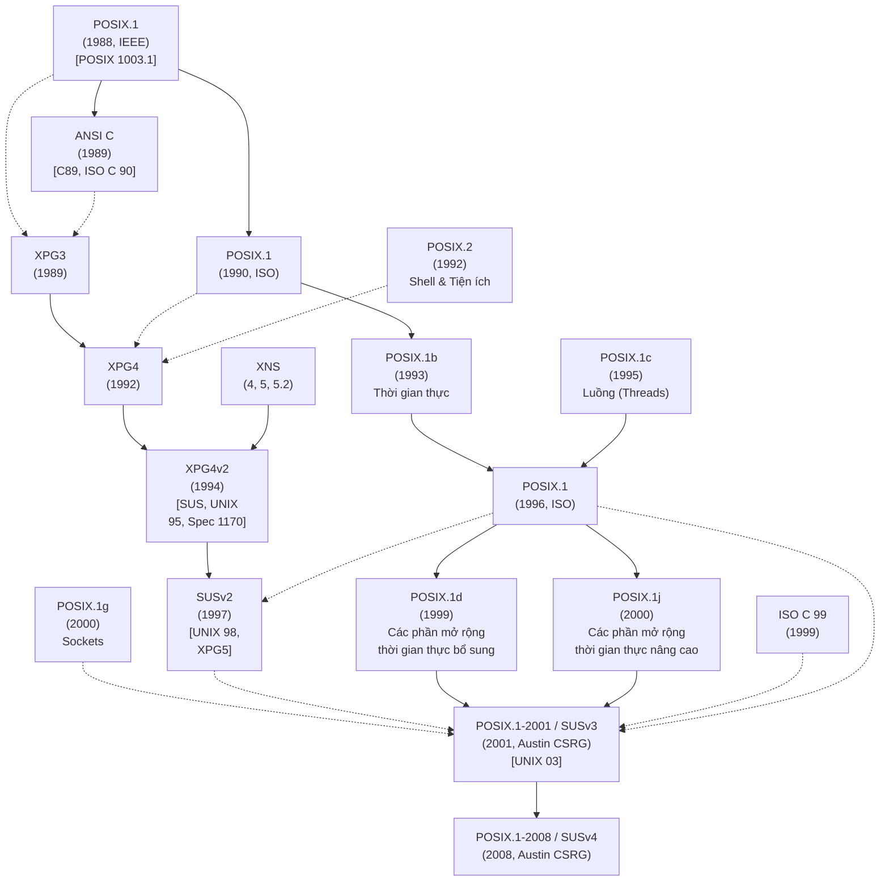

# Chương 1: Lịch sử và Tiêu chuẩn (History and Standards)

Linux là một thành viên trong dòng hệ điều hành (operating system) họ UNIX. Trong ngành khoa học máy tính, UNIX có lịch sử lâu đời. Phần đầu tiên của chương này cung cấp một bản tóm tắt ngắn gọn về lịch sử đó. Chúng ta bắt đầu với phần mô tả về nguồn gốc của hệ thống UNIX và ngôn ngữ lập trình C, sau đó xem xét hai dòng chảy chính dẫn đến hệ thống Linux như hiện nay: dự án GNU và quá trình phát triển nhân Linux (Linux kernel).

Một trong những đặc điểm nổi bật của hệ thống UNIX là việc phát triển của nó không bị kiểm soát bởi một nhà cung cấp hay tổ chức đơn lẻ nào. Thay vào đó, rất nhiều nhóm, cả thương mại lẫn phi thương mại, đã đóng góp vào sự tiến hóa của nó. Lịch sử này dẫn đến việc có nhiều tính năng đổi mới được thêm vào UNIX, nhưng cũng mang lại hệ lụy tiêu cực là các bản cài đặt UNIX phân kỳ theo thời gian, khiến cho việc viết các ứng dụng chạy được trên mọi bản cài đặt UNIX trở nên ngày càng khó khăn. Điều này thúc đẩy nhu cầu chuẩn hóa các bản cài đặt UNIX, vấn đề mà chúng ta sẽ thảo luận ở phần thứ hai của chương này.

> [!NOTE]
> Có hai định nghĩa về thuật ngữ UNIX được sử dụng phổ biến. Một trong số đó chỉ các hệ điều hành đã vượt qua các bài kiểm tra sự tương thích chính thức cho Đặc tả UNIX Đơn (Single UNIX Specification) và do đó được chính thức cấp quyền mang nhãn hiệu "UNIX" bởi The Open Group (đơn vị nắm giữ thương hiệu UNIX). Tại thời điểm viết bài này, chưa có bản cài đặt UNIX miễn phí nào (ví dụ: Linux và FreeBSD) đạt được nhãn hiệu này.

Ý nghĩa phổ biến thứ hai gắn liền với thuật ngữ UNIX chỉ các hệ thống trông và hành xử giống như các hệ thống UNIX cổ điển (tức là hệ thống UNIX gốc của Bell Laboratories và các nhánh chính sau đó của nó là System V và BSD). Theo định nghĩa này, Linux thường được coi là một hệ thống UNIX (giống như các hệ thống BSD hiện đại). Mặc dù chúng ta dành sự quan tâm sát sao đến Đặc tả UNIX Đơn (Single UNIX Specification) trong cuốn sách này, chúng ta sẽ tuân theo định nghĩa thứ hai về UNIX này, do đó chúng ta sẽ thường xuyên nói những câu như "Linux, giống như các bản cài đặt UNIX khác. . ."

## 1.1 Lịch sử tóm tắt về UNIX và C

Bản cài đặt UNIX đầu tiên được phát triển vào năm 1969 (cùng năm Linus Torvalds ra đời) bởi Ken Thompson tại Bell Laboratories, một bộ phận của tập đoàn viễn thông AT&T. Nó được viết bằng ngôn ngữ hợp ngữ (assembler) cho máy vi tính (minicomputer) Digital PDP-7. Cái tên UNIX là một từ chơi chữ bắt nguồn từ MULTICS (Multiplexed Information and Computing Service), tên của một dự án hệ điều hành trước đó mà AT&T đã hợp tác với Viện Công nghệ Massachusetts (MIT) và General Electric. (Lúc này, AT&T đã rút khỏi dự án vì thất vọng trước việc ban đầu nó không thể phát triển được một hệ thống có ích về mặt kinh tế.) Thompson đã đúc rút một số ý tưởng cho hệ thống điều hành mới của mình từ MULTICS, bao gồm hệ thống tập tin cấu trúc dạng cây (tree-structured file system), một chương trình riêng biệt để thông dịch lệnh (shell), và quan niệm về tập tin dưới dạng các luồng byte phi cấu trúc (unstructured streams of bytes).

Vào năm 1970, UNIX được viết lại bằng hợp ngữ (assembly language) cho dòng máy tính mini Digital PDP-11 vừa mới được trang bị, lúc bấy giờ là một cỗ máy mới và mạnh mẽ.

Dấu tích của di sản PDP-11 này có thể được tìm thấy ở nhiều cái tên khác nhau vẫn đang được sử dụng trên hầu hết các bản cài đặt UNIX, bao gồm cả Linux.

Một thời gian ngắn sau đó, Dennis Ritchie, một đồng nghiệp của Thompson tại Bell Laboratories đồng thời là cộng sự ban đầu trong dự án UNIX, đã thiết kế và cài đặt ngôn ngữ lập trình C. Đây là một quá trình tiến hóa; C kế thừa từ một ngôn ngữ thông dịch trước đó là B. Ngôn ngữ B ban đầu do Thompson cài đặt và đúc kết nhiều ý tưởng từ một ngôn ngữ lập trình còn cũ hơn nữa có tên là BCPL. Đến năm 1973, ngôn ngữ C đã trưởng thành đến mức nhân UNIX (UNIX kernel) có thể được viết lại hầu như hoàn toàn bằng ngôn ngữ mới này. Do đó, UNIX đã trở thành một trong những hệ điều hành đầu tiên được viết bằng ngôn ngữ bậc cao (high-level language), một thực tế giúp cho việc chuyển dịch (porting) sang các kiến trúc phần cứng khác trở nên khả thi sau này.

Sự ra đời của C giải thích lý do tại sao nó, và hậu duệ của nó là C++, lại được sử dụng rộng rãi như các ngôn ngữ lập trình hệ thống (system programming languages) ngày nay. Các ngôn ngữ được sử dụng rộng rãi trước đó được thiết kế với các mục đích khác trong đầu: FORTRAN cho các tác vụ toán học thực hiện bởi các kỹ sư và nhà khoa học; COBOL cho các hệ thống thương mại xử lý các luồng dữ liệu hướng bản ghi (record-oriented data). C đã lấp đầy một khoảng trống chưa từng có trước đó, và không giống như FORTRAN và COBOL (vốn được thiết kế bởi các ủy ban lớn), thiết kế của C xuất phát từ các ý tưởng và nhu cầu của một vài cá nhân hướng tới một mục tiêu chung: phát triển một ngôn ngữ bậc cao để cài đặt nhân UNIX (UNIX kernel) và phần mềm liên quan. Giống như bản thân hệ điều hành UNIX, C được thiết kế bởi những lập trình viên chuyên nghiệp để phục vụ chính họ. Ngôn ngữ tạo thành có kích thước nhỏ gọn, hiệu quả, mạnh mẽ, ngắn gọn, có tính mô-đun (modular), thực dụng và mạch lạc trong thiết kế.

### Các phiên bản từ Thứ nhất đến Thứ sáu của UNIX

Giữa năm 1969 và 1979, UNIX đã trải qua một số bản phát hành, được gọi là các phiên bản (edition). Về cơ bản, các bản phát hành này là các ảnh chụp nhanh (snapshot) của phiên bản phát triển đang tiến hóa tại AT&T. [Salus, 1994] ghi lại các mốc thời gian cho sáu phiên bản đầu tiên của UNIX như sau:

- Phiên bản Thứ nhất, tháng 11 năm 1971: Vào thời điểm này, UNIX chạy trên máy PDP-11 và đã có một trình biên dịch FORTRAN (FORTRAN compiler) cùng các phiên bản của nhiều chương trình hiện vẫn còn được sử dụng ngày nay, bao gồm `ar`, `cat`, `chmod`, `chown`, `cp`, `dc`, `ed`, `find`, `ln`, `ls`, `mail`, `mkdir`, `mv`, `rm`, `sh`, `su`, và `who`.
- Phiên bản Thứ hai, tháng 6 năm 1972: Vào thời điểm này, UNIX đã được cài đặt trên mười máy tính bên trong AT&T.
- Phiên bản Thứ ba, tháng 2 năm 1973: Phiên bản này bao gồm một trình biên dịch C (C compiler) và bản cài đặt đường ống (pipe) đầu tiên.
- Phiên bản Thứ tư, tháng 11 năm 1973: Đây là phiên bản đầu tiên được viết gần như hoàn toàn bằng ngôn ngữ C.
- Phiên bản Thứ năm, tháng 6 năm 1974: Vào thời điểm này, UNIX đã được cài đặt trên hơn 50 hệ thống.
- Phiên bản Thứ sáu, tháng 5 năm 1975: Đây là phiên bản đầu tiên được sử dụng rộng rãi bên ngoài AT&T.

Trong suốt giai đoạn của các bản phát hành này, việc sử dụng và danh tiếng của UNIX bắt đầu lan rộng, đầu tiên là bên trong AT&T, và sau đó là vươn ra bên ngoài. Một đóng góp quan trọng cho sự nhận thức ngày càng tăng này là việc xuất bản một bài báo về UNIX trên tạp chí được đọc rộng rãi Communications of the ACM ([Ritchie & Thompson, 1974]).

Vào thời điểm này, AT&T nắm giữ độc quyền được chính phủ phê duyệt đối với hệ thống điện thoại Hoa Kỳ. Các điều khoản trong thỏa thuận của AT&T với chính phủ Hoa Kỳ ngăn cản hãng này bán phần mềm, điều đó có nghĩa là họ không thể bán UNIX như một thương phẩm. Thay vào đó, bắt đầu từ năm 1974 với Phiên bản Thứ năm, và đặc biệt là với Phiên bản Thứ sáu, AT&T đã cấp phép (license) sử dụng UNIX cho các trường đại học với một khoản phí phân phối danh nghĩa. Các bản phân phối dành cho trường đại học bao gồm tài liệu và mã nguồn nhân (kernel source code) (vào thời điểm đó khoảng 10.000 dòng).

Việc AT&T phát hành UNIX cho các trường đại học đã đóng góp to lớn vào mức độ phổ biến và việc sử dụng hệ điều hành này, và đến năm 1977, UNIX đã chạy tại khoảng 500 cơ sở, bao gồm 125 trường đại học ở Hoa Kỳ và một số quốc gia khác. UNIX cung cấp cho các trường đại học một hệ điều hành đa người dùng tương tác (interactive multiuser operating system) có giá rẻ nhưng mạnh mẽ, vào thời điểm mà các hệ thống điều hành thương mại rất đắt đỏ. Nó cũng cung cấp cho các khoa khoa học máy tính của trường đại học mã nguồn của một hệ điều hành thực thụ, mà họ có thể chỉnh sửa và cung cấp cho sinh viên học tập và thử nghiệm. Một số sinh viên này, được trang bị kiến thức về UNIX, đã trở thành những người truyền bá UNIX (UNIX evangelist). Những người khác tiếp tục thành lập hoặc gia nhập vô số công ty khởi nghiệp chuyên bán các máy trạm máy tính (computer workstation) giá rẻ chạy hệ điều hành UNIX dễ dàng chuyển dịch (port).

### Sự ra đời của BSD và System V

Tháng 1 năm 1979 chứng kiến sự ra mắt của phiên bản Seventh Edition UNIX, mang lại độ tin cậy cao hơn cho hệ thống và cung cấp một hệ thống tập tin (file system) được cải tiến. Bản phát hành này cũng chứa một số công cụ mới, bao gồm awk, make, sed, tar, uucp, Bourne shell và một trình biên dịch FORTRAN 77. Việc phát hành Seventh Edition cũng mang ý nghĩa quan trọng vì kể từ thời điểm này, UNIX đã rẽ nhánh thành hai biến thể quan trọng: BSD và System V, mà nguồn gốc của chúng sẽ được chúng tôi mô tả ngắn gọn ngay sau đây.

Thompson đã dành năm học 1975/1976 làm giáo sư thỉnh giảng tại Đại học California tại Berkeley, trường đại học mà ông đã tốt nghiệp. Tại đây, ông đã làm việc với một số nghiên cứu sinh, bổ sung nhiều tính năng mới cho UNIX. (Một trong những sinh viên này, Bill Joy, sau đó đã đồng sáng lập Sun Microsystems, một đơn vị gia nhập sớm vào thị trường trạm làm việc UNIX). Theo thời gian, nhiều công cụ và tính năng mới đã được phát triển tại Berkeley, bao gồm C shell, trình soạn thảo vi, hệ thống tập tin được cải tiến (Berkeley Fast File System), sendmail, trình biên dịch Pascal và quản lý bộ nhớ ảo (virtual memory management) trên kiến trúc Digital VAX mới.

Dưới tên gọi Berkeley Software Distribution (BSD), phiên bản UNIX này, bao gồm cả mã nguồn (source code), đã được phân phối rộng rãi. Bản phát hành đầy đủ đầu tiên là 3BSD vào tháng 12 năm 1979.

``` (Các bản phát hành trước đó từ Berkeley—BSD và 2BSD là các bản phân phối gồm các công cụ mới được sản xuất tại Berkeley, chứ không phải là các bản phân phối UNIX hoàn chỉnh).

Năm 1983, Nhóm Nghiên cứu Hệ thống Máy tính (Computer Systems Research Group) tại Đại học California tại Berkeley đã phát hành 4.2BSD. Bản phát hành này rất quan trọng vì nó chứa một bản cài đặt TCP/IP hoàn chỉnh, bao gồm giao diện lập trình ứng dụng (API) socket và nhiều loại công cụ mạng khác nhau. 4.2BSD và phiên bản tiền nhiệm 4.1BSD đã được phân phối rộng rãi tại các trường đại học trên toàn thế giới. Chúng cũng tạo cơ sở cho SunOS (được phát hành lần đầu vào năm 1983), biến thể UNIX do Sun thương mại hóa. Các bản phát hành BSD quan trọng khác là 4.3BSD vào năm 1986 và bản phát hành cuối cùng, 4.4BSD, vào năm 1993.

> Các bản port (chuyển đổi hệ thống) đầu tiên của hệ thống UNIX sang phần cứng không phải PDP-11 diễn ra trong năm 1977 và 1978, khi Dennis Ritchie và Steve Johnson port nó sang Interdata 8/32 và Richard Miller tại Đại học Wollongong ở Úc đồng thời port nó sang Interdata 7/32. Bản port Digital VAX của Berkeley dựa trên một bản port trước đó (1978) của John Reiser và Tom London. Được gọi là 32V, bản port này về cơ bản giống với Seventh Edition dành cho PDP-11, ngoại trừ không gian địa chỉ (address space) lớn hơn và các kiểu dữ liệu rộng hơn.

Trong khi đó, luật chống độc quyền của Hoa Kỳ đã buộc AT&T phải chia tách (các thủ tục pháp lý bắt đầu vào giữa những năm 1970 và việc chia tách có hiệu lực vào năm 1982), với hệ quả là vì công ty không còn nắm giữ độc quyền đối với hệ thống điện thoại, họ được phép thương mại hóa UNIX. Điều này dẫn đến việc phát hành System III (ba) vào năm 1981. System III được sản xuất bởi Nhóm Hỗ trợ UNIX (UNIX Support Group - USG) của AT&T, nơi tuyển dụng hàng trăm nhà phát triển để cải tiến UNIX và phát triển các ứng dụng UNIX (đáng chú ý là các gói chuẩn bị tài liệu và công cụ phát triển phần mềm). Bản phát hành đầu tiên của System V (năm) tiếp theo vào năm 1983, và một loạt bản phát hành đã dẫn đến phiên bản mang tính quyết định System V Release 4 (SVR4) vào năm 1989, thời điểm mà System V đã tích hợp nhiều tính năng từ BSD, bao gồm cả các tiện ích mạng. System V được cấp phép cho nhiều nhà cung cấp thương mại khác nhau, những người đã sử dụng nó làm nền tảng cho các bản triển khai UNIX của riêng họ.

Do đó, ngoài các bản phân phối BSD khác nhau lan rộng khắp giới học thuật, đến cuối những năm 1980, UNIX đã có sẵn trong một loạt các bản triển khai thương mại trên các phần cứng khác nhau. Các bản triển khai này bao gồm SunOS của Sun và sau đó là Solaris, Ultrix và OSF/1 của Digital (ngày nay, sau một loạt các lần đổi tên và mua lại, là HP Tru64 UNIX), AIX của IBM, HP-UX của Hewlett-Packard (HP), NeXTStep của NeXT, A/UX cho Apple Macintosh, và XENIX của Microsoft và SCO dành cho kiến trúc Intel x86-32. (Trong toàn bộ cuốn sách này, bản triển khai Linux cho x86-32 được gọi là Linux/x86-32). Tình huống này hoàn toàn trái ngược với các kịch bản phần cứng/hệ điều hành độc quyền điển hình thời bấy giờ, nơi mỗi nhà cung cấp sản xuất một, hoặc nhiều nhất là một vài, kiến trúc chip máy tính độc quyền, trên đó họ bán hệ điều hành độc quyền của riêng mình. Bản chất độc quyền của hầu hết các hệ thống nhà cung cấp có nghĩa là người mua bị khóa chặt vào một nhà cung cấp. Việc chuyển sang một hệ điều hành độc quyền và nền tảng phần cứng khác có thể trở nên rất tốn kém do nhu cầu port các ứng dụng hiện có và đào tạo lại nhân viên. Yếu tố này, kết hợp với sự xuất hiện của các trạm làm việc UNIX đơn người dùng giá rẻ từ nhiều nhà cung cấp khác nhau, đã làm cho hệ thống UNIX di động ngày càng trở nên hấp dẫn từ góc độ thương mại.

## 1.2 Lịch sử ngắn gọn về Linux

Thuật ngữ Linux thường được sử dụng để chỉ toàn bộ hệ điều hành giống UNIX mà nhân (kernel) Linux là một phần trong đó. Tuy nhiên, đây có phần là một sự nhầm lẫn về tên gọi, vì nhiều thành phần quan trọng có trong một bản phân phối Linux thương mại điển hình thực chất bắt nguồn từ một dự án có trước thời điểm ra đời của Linux vài năm.

### 1.2.1 Dự án GNU

Năm 1984, Richard Stallman, một lập trình viên cực kỳ tài năng từng làm việc tại MIT, đã bắt tay vào việc tạo ra một bản cài đặt UNIX "tự do" (free). Quan điểm của Stallman mang tính đạo đức, và từ "tự do" được định nghĩa theo nghĩa pháp lý chứ không phải theo nghĩa tài chính (xem http://www.gnu.org/philosophy/free-sw.html). Tuy nhiên, sự tự do về mặt pháp lý mà Stallman mô tả lại mang theo hệ quả ngầm định rằng các phần mềm như hệ điều hành sẽ có sẵn miễn phí hoặc với chi phí rất thấp.

Stallman đã đấu tranh chống lại các hạn chế pháp lý do các nhà cung cấp máy tính áp đặt lên các hệ điều hành độc quyền (proprietary operating systems). Những hạn chế này có nghĩa là những người mua phần mềm máy tính nói chung không thể xem mã nguồn (source code) của phần mềm họ đang mua, và họ chắc chắn không thể sao chép, thay đổi hoặc phân phối lại nó. Ông chỉ ra rằng một khuôn khổ như vậy khuyến khích các lập trình viên cạnh tranh lẫn nhau và tích trữ công sức của họ thay vì hợp tác và chia sẻ nó.

Để đáp lại, Stallman đã khởi xướng dự án GNU (một từ viết tắt đệ quy cho "GNU's not UNIX") nhằm phát triển một hệ thống hoàn chỉnh, tự do, giống UNIX

```, bao gồm một kernel (nhân) và tất cả các gói phần mềm liên quan, đồng thời khuyến khích những người khác tham gia cùng ông. Năm 1985, Stallman thành lập Quỹ Phần mềm Tự do (Free Software Foundation - FSF), một tổ chức phi lợi nhuận để hỗ trợ dự án GNU cũng như sự phát triển của phần mềm tự do nói chung.

> [!NOTE]
> Khi dự án GNU được khởi xướng, BSD không được tự do theo nghĩa mà Stallman muốn nói. Việc sử dụng BSD vẫn yêu cầu giấy phép từ AT&T, và người dùng không thể tự do sửa đổi và phân phối lại mã nguồn AT&T vốn là một phần của BSD.

Một trong những kết quả quan trọng của dự án GNU là sự phát triển của Giấy phép Công cộng GNU (GNU General Public License - GPL), sự thể hiện về mặt pháp lý cho quan niệm của Stallman về phần mềm tự do. Phần lớn phần mềm trong một bản phân phối Linux (Linux distribution), bao gồm cả kernel, được cấp phép theo GPL hoặc một trong số các giấy phép tương tự. Phần mềm được cấp phép theo GPL phải được cung cấp ở dạng mã nguồn và phải được tự do phân phối lại theo các điều kiện của GPL. Các sửa đổi đối với phần mềm được cấp phép GPL được phép thực hiện tự do, nhưng bất kỳ việc phân phối nào đối với phần mềm đã sửa đổi đó cũng phải tuân theo các điều kiện của GPL. Nếu phần mềm đã sửa đổi được phân phối ở dạng thực thi (executable form), tác giả cũng phải cho phép bất kỳ người nhận nào tùy chọn nhận mã nguồn đã sửa đổi với chi phí không vượt quá chi phí phân phối. Phiên bản đầu tiên của GPL được phát hành vào năm 1989. Phiên bản hiện tại của giấy phép, phiên bản 3, được phát hành vào năm 2007. Phiên bản 2 của giấy phép, được phát hành vào năm 1991, vẫn được sử dụng rộng rãi và là giấy phép được sử dụng cho Linux kernel. (Các cuộc thảo luận về các giấy phép phần mềm tự do khác nhau có thể được tìm thấy trong [St. Laurent, 2004] và [Rosen, 2005].)

Ban đầu, dự án GNU không tạo ra một UNIX kernel hoạt động được, nhưng lại tạo ra rất nhiều chương trình khác. Vì các chương trình này được thiết kế để chạy trên một hệ điều hành giống UNIX, nên chúng có thể (và thực tế đã) được sử dụng trên các bản triển khai UNIX hiện có, và trong một số trường hợp, thậm chí còn được port (chuyển mã) sang các hệ điều hành khác.
Trong số các chương trình nổi tiếng hơn do dự án GNU tạo ra có trình soạn thảo văn bản Emacs, GCC (ban đầu là GNU C compiler, nhưng nay được đổi tên thành GNU compiler collection, bao gồm các trình biên dịch cho C, C++, và các ngôn ngữ khác), bash shell, và glibc (thư viện GNU C library).

Đến đầu những năm 1990, dự án GNU đã tạo ra một hệ thống gần như hoàn chỉnh, ngoại trừ một thành phần quan trọng: một UNIX kernel hoạt động được. Dự án GNU đã bắt đầu công việc thiết kế một kernel đầy tham vọng, được biết đến với tên gọi GNU/HURD, dựa trên microkernel Mach. Tuy nhiên, HURD còn lâu mới đạt được trạng thái có thể phát hành được. (Vào thời điểm viết bài này, công việc vẫn đang tiếp tục trên HURD, hiện chỉ chạy trên kiến trúc x86-32.)

> [!NOTE]
> Vì một phần đáng kể mã nguồn chương trình tạo nên cái thường được gọi là hệ thống Linux thực chất bắt nguồn từ dự án GNU, Stallman thích sử dụng thuật ngữ GNU/Linux để chỉ toàn bộ hệ thống. Vấn đề đặt tên (Linux thay vì GNU/Linux) là nguồn gốc của một số tranh luận trong cộng đồng phần mềm tự do. Vì cuốn sách này chủ yếu đề cập đến API của Linux kernel, chúng ta sẽ thường sử dụng thuật ngữ Linux.

Mọi thứ đã sẵn sàng. Tất cả những gì cần thiết chỉ là một kernel hoạt động được đi kèm với hệ thống UNIX vốn đã hoàn chỉnh do dự án GNU sản xuất.

### 1.2.2 Linux Kernel

Năm 1991, Linus Torvalds, một sinh viên người Phần Lan tại Đại học Helsinki, đã có cảm hứng viết một hệ điều hành cho chiếc PC Intel 80386 của mình. Trong quá trình học tập, Torvalds đã tiếp xúc với Minix, một kernel hệ điều hành nhỏ giống UNIX được phát triển vào giữa những năm 1980 bởi Andrew Tanenbaum, một giáo sư đại học ở Hà Lan. Tanenbaum đã cung cấp Minix, hoàn chỉnh với mã nguồn, như một công cụ để giảng dạy thiết kế hệ điều hành trong các khóa học đại học. Minix kernel có thể được build (xây dựng) và chạy trên hệ thống 386. Tuy nhiên, vì mục đích chính của nó là một công cụ giảng dạy, nó được thiết kế để phần lớn độc lập với kiến trúc phần cứng và không tận dụng hết các khả năng của bộ vi xử lý 386.

Do đó, Torvalds đã bắt đầu một dự án tạo ra một UNIX kernel hiệu quả, đầy đủ tính năng để chạy trên 386. Trong vài tháng, Torvalds đã phát triển một kernel cơ bản cho phép anh biên dịch và chạy các chương trình GNU khác nhau. Sau đó, vào ngày 5 tháng 10 năm 1991, Torvalds đã kêu gọi sự giúp đỡ từ các lập trình viên khác, đưa ra thông báo (được trích dẫn rất nhiều kể từ đó) về phiên bản 0.02 của kernel do anh viết trên nhóm tin Usenet `comp.os.minix`:

> [!NOTE]
> Bạn có khao khát những ngày tháng tuyệt đẹp của Minix-1.1, khi các trang nam nhi tự tay viết trình điều khiển thiết bị (device driver) của riêng họ không? Bạn đang không có dự án thú vị nào và rất muốn thử sức với một hệ điều hành mà bạn có thể cố gắng sửa đổi cho nhu cầu của mình? Bạn có cảm thấy bực bội khi mọi thứ đều hoạt động suôn sẻ trên Minix? Không còn những đêm thức trắng để làm cho một chương trình hay ho hoạt động nữa ư? Vậy thì bài viết này có thể là dành cho bạn. Như tôi đã đề cập cách đây một tháng, tôi đang làm việc trên một phiên bản miễn phí giống Minix dành cho máy tính AT-386. Cuối cùng nó đã đạt đến giai đoạn có thể sử dụng được (dù có thể không tùy thuộc vào những gì bạn muốn), và tôi sẵn sàng phát hành mã nguồn để phân phối rộng rãi hơn. Nó mới chỉ là phiên bản 0.02 . . . nhưng tôi đã chạy thành công bash, gcc, gnu-make, gnu-sed, compress, v.v. trên đó.

Theo truyền thống lâu đời là đặt tên cho các bản sao UNIX kết thúc bằng chữ cái X, kernel (cuối cùng) đã được rửa tội bằng cái tên Linux. Ban đầu, Linux được đặt dưới một giấy phép hạn chế hơn, nhưng Torvalds nhanh chóng cung cấp nó dưới giấy phép GNU GPL.

Lời kêu gọi hỗ trợ đã tỏ ra hiệu quả. Các lập trình viên khác đã tham gia cùng Torvalds trong việc phát triển Linux, bổ sung các tính năng khác nhau như hệ thống tập tin cải tiến, hỗ trợ mạng, trình điều khiển thiết bị (device driver) và hỗ trợ đa xử lý (multiprocessor support). Đến tháng 3 năm 1994, các nhà phát triển đã có thể phát hành phiên bản 1.0. Linux 1.2 xuất hiện vào tháng 3 năm 1995, Linux 2.0 vào tháng 6 năm 1996, Linux 2.2 vào tháng 1 năm 1999 và Linux 2.4 vào tháng 1 năm 2001. Công việc phát triển kernel dòng 2.5 bắt đầu vào tháng 11 năm 2001 và dẫn đến việc phát hành Linux 2.6 vào tháng 12 năm 2003.

### Bên lề: các hệ điều hành họ BSD

Cũng cần lưu ý rằng một hệ điều hành UNIX tự do khác đã có sẵn cho kiến trúc x86-32 vào đầu những năm 1990. Bill và Lynne Jolitz đã phát triển một bản port của hệ thống BSD vốn đã trưởng thành dành cho x86-32, được gọi là 386/BSD. Bản port này dựa trên bản phát hành BSD Net/2 (tháng 6 năm 1991), một phiên bản mã nguồn 4.3BSD trong đó tất cả mã nguồn độc quyền còn lại của AT&T đã được thay thế hoặc (trong trường hợp sáu tệp mã nguồn không thể viết lại một cách đơn giản) đã bị xóa bỏ. Hai vợ chồng nhà Jolitz đã port mã nguồn Net/2 sang x86-32, viết lại các tệp mã nguồn bị thiếu và thực hiện phát hành bản đầu tiên (phiên bản 0.0) của 386/BSD vào tháng 2 năm 1992.

Sau làn sóng thành công và nổi tiếng ban đầu, công việc phát triển 386/BSD đã chậm lại vì nhiều lý do. Trước số lượng các bản vá (patch) tồn đọng ngày càng lớn, hai nhóm phát triển thay thế đã sớm xuất hiện, tạo ra các bản phát hành của riêng họ dựa trên 386/BSD: NetBSD, chú trọng tính khả chuyển (portability) trên nhiều nền tảng phần cứng rộng lớn, và FreeBSD, chú trọng hiệu năng và là hệ điều hành họ BSD phổ biến nhất hiện nay.

Bản phát hành NetBSD đầu tiên là 0.8, vào tháng 4 năm 1993. Đĩa CD-ROM FreeBSD đầu tiên (phiên bản 1.0) xuất hiện vào tháng 12 năm 1993. Một hệ thống BSD khác, OpenBSD, xuất hiện vào năm 1996 (với phiên bản đầu tiên được đánh số 2.0) sau khi tách nhánh (fork) từ dự án NetBSD. OpenBSD nhấn mạnh tính bảo mật. Vào giữa năm 2003, một hệ thống BSD mới, DragonFly BSD, đã xuất hiện sau khi tách nhánh từ FreeBSD 4.x. DragonFly BSD áp dụng một cách tiếp cận khác với FreeBSD 5.x liên quan đến thiết kế cho các kiến trúc đa xử lý đối xứng (symmetric multiprocessing - SMP).

Có lẽ không một cuộc thảo luận nào về các hệ thống BSD vào đầu những năm 1990 là trọn vẹn nếu không nhắc đến các vụ kiện tụng giữa UNIX System Laboratories (USL, công ty con của AT&T được tách ra để phát triển và thương mại hóa UNIX) và Đại học Berkeley. Đầu năm 1992, công ty Berkeley Software Design, Incorporated (BSDi, ngày nay là một phần của Wind River) bắt đầu phân phối một hệ thống BSD UNIX có sự hỗ trợ thương mại, mang tên BSD/OS, dựa trên bản phát hành Net/2 và các bổ sung 386/BSD của gia đình Jolitz. BSDi phân phối các bản dịch nhị phân (binary) và mã nguồn (source code) với giá 995 đô la Mỹ, đồng thời khuyên các khách hàng tiềm năng sử dụng số điện thoại 1-800-ITS-UNIX của họ.

Vào tháng 4 năm 1992, USL đã đệ đơn kiện BSDi nhằm ngăn chặn công ty này bán một sản phẩm mà USL cho rằng vẫn còn vướng bận mã nguồn độc quyền và các bí mật thương mại của USL. USL cũng yêu cầu BSDi ngừng sử dụng số điện thoại mang tính đánh lừa đó. Vụ kiện sau đó được mở rộng để bao gồm cả khiếu nại chống lại Đại học California. Cuối cùng, tòa án bác bỏ tất cả các khiếu nại của USL ngoại trừ hai khiếu nại, và một vụ kiện ngược lại từ Đại học California chống lại USL đã diễn ra, trong đó trường đại học lập luận rằng USL đã không ghi nhận công trạng xứng đáng cho việc sử dụng mã nguồn BSD trong System V.

Trong khi các vụ kiện này đang chờ xử lý, USL đã bị thâu tóm bởi Novell, mà CEO lúc bấy giờ là cố Ray Noorda từng tuyên bố công khai rằng ông thích cạnh tranh trên thị trường hơn là tại tòa án. Thỏa thuận giàn xếp cuối cùng đã đạt được vào tháng 1 năm 1994, theo đó Đại học California buộc phải loại bỏ 3 trong tổng số 18.000 tệp trong bản phát hành Net/2, thực hiện một số thay đổi nhỏ đối với một vài tệp khác, và thêm các thông báo bản quyền của USL vào khoảng 70 tệp khác, mà trường đại học vẫn có thể tiếp tục phân phối tự do. Hệ thống đã chỉnh sửa này được phát hành dưới tên 4.4BSD-Lite vào tháng 6 năm 1994. (Bản phát hành cuối cùng từ trường đại học là 4.4BSD-Lite, Release 2 vào tháng 6 năm 1995.) Tại thời điểm này, các điều khoản của thỏa thuận pháp lý yêu cầu BSDi, FreeBSD và NetBSD phải thay thế nền tảng Net/2 của họ bằng mã nguồn 4.4BSD-Lite đã được chỉnh sửa. Như [McKusick et al., 1996] đã lưu ý, mặc dù điều này gây ra một số sự chậm trễ trong quá trình phát triển của các hệ thống phái sinh từ BSD, nhưng nó cũng mang lại tác dụng tích cực là các hệ thống này đã được đồng bộ hóa trở lại với ba năm công việc phát triển do Nhóm Nghiên cứu Hệ thống Máy tính (Computer Systems Research Group) của trường đại học thực hiện kể từ khi phát hành Net/2.

### Số phiên bản nhân Linux (Linux kernel version numbers)

Giống như hầu hết các dự án phần mềm tự do khác, Linux tuân theo mô hình phát hành sớm, phát hành thường xuyên (release-early, release-often), do đó các bản sửa đổi nhân mới xuất hiện thường xuyên (thậm chí đôi khi hàng ngày). Khi cơ sở người dùng Linux tăng lên, mô hình phát hành đã được điều chỉnh để giảm thiểu sự gián đoạn cho những người dùng hiện tại. Cụ thể, sau khi phát hành Linux 1.0, các nhà phát triển nhân đã áp dụng sơ đồ đánh số phiên bản nhân với mỗi bản phát hành có dạng x.y.z: x đại diện cho phiên bản chính (major version), y đại diện cho phiên bản phụ (minor version) trong phiên bản chính đó, và z đại diện cho bản sửa đổi của phiên bản phụ (các cải tiến nhỏ và sửa lỗi).

Theo mô hình này, luôn có hai phiên bản nhân đang được phát triển: một nhánh ổn định (stable branch) dùng cho các hệ thống sản xuất (production systems), có số phiên bản phụ chẵn; và một nhánh phát triển có tính biến động cao hơn (volatile development branch), mang số phiên bản phụ lẻ cao hơn tiếp theo. Lý thuyết — không phải lúc nào cũng được tuân thủ nghiêm ngặt trong thực tế — là tất cả các tính năng mới nên được thêm vào chuỗi nhân phát triển hiện tại, trong khi các bản sửa đổi mới trong chuỗi nhân ổn định phải được giới hạn ở các cải tiến nhỏ và sửa lỗi. Khi nhánh phát triển hiện tại được coi là phù hợp để phát hành, nó sẽ trở thành nhánh ổn định mới và được gán một số phiên bản phụ chẵn. Ví dụ, nhánh nhân phát triển 2.3.z đã dẫn đến nhánh nhân ổn định 2.4.

Sau khi phát hành nhân 2.6, mô hình phát triển đã được thay đổi. Động lực chính cho sự thay đổi này xuất phát từ các vấn đề và sự thất vọng do khoảng thời gian kéo dài giữa các lần phát hành nhân ổn định. (Gần ba năm đã trôi qua giữa việc phát hành Linux 2.4.0 và 2.6.0.) Định kỳ đã có các cuộc thảo luận về việc tinh chỉnh mô hình này, nhưng các chi tiết cốt lõi vẫn giữ nguyên như sau:

- Không còn sự tách biệt giữa nhân ổn định và nhân phát triển. Mỗi bản phát hành 2.6.z mới có thể chứa các tính năng mới, và trải qua một vòng đời bắt đầu bằng việc bổ sung các tính năng mới, sau đó các tính năng này được ổn định hóa qua một số phiên bản ứng cử viên phát hành (candidate release versions). Khi một phiên bản ứng cử viên được coi là đủ ổn định, nó sẽ được phát hành như nhân 2.6.z. Các chu kỳ phát hành thường kéo dài khoảng ba tháng.
- Thỉnh thoảng, một bản phát hành ổn định 2.6.z có thể yêu cầu các bản vá (patch) nhỏ để khắc phục lỗi hoặc các vấn đề bảo mật. Nếu các bản sửa lỗi này có mức độ ưu tiên đủ cao và các bản vá được coi là đủ đơn giản để "hiển nhiên" là chính xác, thì thay vì chờ đợi bản phát hành 2.6.z tiếp theo, chúng được áp dụng để tạo ra một bản phát hành mang số có dạng 2.6.z.r, trong đó r là một số tuần tự cho bản sửa đổi phụ của nhân 2.6.z này.
- Trách nhiệm bổ sung được chuyển sang các nhà cung cấp bản phân phối (distribution vendor) nhằm đảm bảo tính ổn định của nhân được cung cấp kèm theo bản phân phối.

Các chương sau đôi khi sẽ lưu ý về phiên bản nhân trong đó một thay đổi API cụ thể (tức là system call mới hoặc được sửa đổi) đã xảy ra. Mặc dù trước chuỗi 2.6.z, hầu hết các thay đổi về nhân đều diễn ra trong các nhánh phát triển mang số lẻ, nhưng chúng ta thường sẽ đề cập đến phiên bản nhân ổn định tiếp theo mà trong đó thay đổi xuất hiện, vì hầu hết các nhà phát triển ứng dụng thường sẽ sử dụng nhân ổn định thay vì một trong các nhân phát triển. Trong nhiều trường hợp, các trang hướng dẫn sử dụng (manual pages) ghi chú chính xác phiên bản nhân phát triển mà trong đó một tính năng cụ thể xuất hiện hoặc thay đổi.

Đối với các thay đổi xuất hiện trong chuỗi nhân 2.6.z, chúng tôi ghi chú chính xác phiên bản nhân. Khi chúng tôi nói rằng một tính năng là mới trong nhân 2.6, mà không có số hiệu phiên bản z, ý chúng tôi là một tính năng được triển khai trong chuỗi nhân phát triển 2.5 và lần đầu tiên xuất hiện trong nhân ổn định ở phiên bản 2.6.0.

> [!NOTE]
> Tại thời điểm viết bài này, nhân Linux ổn định 2.4 vẫn được hỗ trợ bởi các nhà bảo trì (maintainer), những người kết hợp các bản vá thiết yếu và sửa lỗi, đồng thời định kỳ phát hành các bản sửa đổi mới. Điều này cho phép các hệ thống đã cài đặt tiếp tục sử dụng nhân 2.4, thay vì bị buộc phải nâng cấp lên một chuỗi nhân mới (điều này có thể đòi hỏi khối lượng công việc đáng kể trong một số trường hợp).

### Các bản port sang các kiến trúc phần cứng khác (Ports to other hardware architectures)

Trong quá trình phát triển ban đầu của Linux, việc triển khai hiệu quả trên Intel 80386 là mục tiêu hàng đầu, chứ không phải tính khả chuyển (portability) sang các kiến trúc bộ xử lý khác.
Tuy nhiên, với sự phổ biến ngày càng tăng của Linux, các bản port sang các kiến trúc bộ xử lý khác bắt đầu xuất hiện, bắt đầu bằng một bản port sớm lên chip Digital Alpha. Danh sách các kiến trúc phần cứng mà Linux đã được port sang vẫn tiếp tục tăng lên và bao gồm x86-64, Motorola/IBM PowerPC và PowerPC64, Sun SPARC và SPARC64 (UltraSPARC), MIPS, ARM (Acorn), IBM zSeries (trước đây là System/390), Intel IA-64 (Itanium; xem [Mosberger & Eranian, 2002]), Hitachi SuperH, HP PA-RISC và Motorola 68000.

### Các bản phân phối Linux (Linux distributions)

Nói một cách chính xác, thuật ngữ Linux chỉ đề cập đến phần nhân (kernel) được phát triển bởi Linus Torvalds và những người khác. Tuy nhiên, thuật ngữ Linux thường được sử dụng để chỉ nhân, cộng với một loạt các phần mềm khác (công cụ và thư viện) kết hợp lại tạo thành một hệ điều hành hoàn chỉnh. Vào những ngày đầu của Linux, người dùng buộc phải tự tổng hợp tất cả các phần mềm này, tạo một file system (hệ thống tệp), và đặt cũng như cấu hình chính xác tất cả phần mềm trên file system đó. Điều này đòi hỏi lượng thời gian và chuyên môn đáng kể. Kết quả là, một thị trường đã mở ra cho các nhà phân phối Linux, những người đã tạo ra các gói (bản phân phối - distributions) để tự động hóa phần lớn quá trình cài đặt, tạo file system và cài đặt nhân cùng các phần mềm bắt buộc khác.

Các bản phân phối sớm nhất xuất hiện vào năm 1992, bao gồm MCC Interim Linux (Manchester Computing Centre, UK), TAMU (Texas A&M University), và SLS (SoftLanding Linux System). Bản phân phối thương mại tồn tại lâu đời nhất, Slackware, xuất hiện vào năm 1993. Bản phân phối phi thương mại Debian xuất hiện vào khoảng thời gian đó, và SUSE cùng Red Hat theo sau không lâu sau đó. Bản phân phối Ubuntu hiện đang rất phổ biến lần đầu tiên xuất hiện vào năm 2004. Ngày nay, nhiều công ty phân phối cũng tuyển dụng các lập trình viên, những người tích cực đóng góp cho các dự án phần mềm tự do hiện có hoặc khởi xướng các dự án mới.

## 1.3 Tiêu chuẩn hóa

Vào cuối những năm 1980, sự đa dạng của các phiên bản UNIX (UNIX implementations) cũng đi kèm với những nhược điểm của chúng. Một số phiên bản UNIX dựa trên BSD, một số khác dựa trên System V, và một số kết hợp các tính năng từ cả hai biến thể này. Hơn nữa, mỗi nhà cung cấp thương mại lại bổ sung thêm các tính năng riêng cho phiên bản của mình. Hậu quả là việc di chuyển phần mềm và nhân sự từ hệ thống UNIX này sang hệ thống UNIX khác ngày càng trở nên khó khăn hơn. Tình hình này tạo ra áp lực mạnh mẽ đối với việc tiêu chuẩn hóa ngôn ngữ lập trình C và hệ thống UNIX, để các ứng dụng có thể dễ dàng được port (chuyển đổi nền tảng) từ hệ thống này sang hệ thống khác.

Bây giờ chúng ta sẽ xem xét các tiêu chuẩn xuất hiện từ nhu cầu đó.

### 1.3.1 Ngôn ngữ lập trình C

Vào đầu những năm 1980, C đã tồn tại được mười năm và được triển khai trên rất nhiều hệ thống UNIX cũng như các hệ điều hành khác. Những khác biệt nhỏ đã nảy sinh giữa các phiên bản triển khai khác nhau, một phần vì các khía cạnh cụ thể về cách ngôn ngữ hoạt động không được trình bày chi tiết trong tiêu chuẩn thực tế (de facto standard) lúc bấy giờ cho C, đó là cuốn sách năm 1978 của Kernighan và Ritchie, *The C Programming Language*. (Cú pháp C cũ hơn được mô tả trong cuốn sách đó đôi khi được gọi là C truyền thống hoặc K&R C.) Hơn nữa, sự xuất hiện của C++ vào năm 1985 đã làm nổi bật một số cải tiến và bổ sung có thể thực hiện đối với C mà không làm hỏng các chương trình hiện có, đáng chú ý là nguyên mẫu hàm (function prototypes), phép gán cấu trúc (structure assignment), các bộ định danh kiểu (type qualifiers - `const` và `volatile`), kiểu liệt kê (enumeration types), và từ khóa `void`.

Những yếu tố này đã tạo ra động lực thúc đẩy tiêu chuẩn hóa C, đỉnh điểm là vào năm 1989 với việc phê duyệt tiêu chuẩn C của Viện Tiêu chuẩn Quốc gia Hoa Kỳ (American National Standards Institute - ANSI) (X3.159-1989), sau đó được thông qua vào năm 1990 làm tiêu chuẩn của Tổ chức Tiêu chuẩn Quốc tế (International Standards Organization - ISO) (ISO/IEC 9899:1990). Bên cạnh việc xác định cú pháp và ngữ nghĩa của C, tiêu chuẩn này còn mô tả hoạt động của thư viện chuẩn C (standard C library), bao gồm các hàm `stdio`, hàm xử lý chuỗi, hàm toán học, các tệp tiêu đề (header files) khác nhau, v.v. Phiên bản C này thường được gọi là C89 hoặc (ít phổ biến hơn) ISO C90, và được mô tả đầy đủ trong ấn bản thứ hai (1988) của cuốn *The C Programming Language* do Kernighan và Ritchie viết.

Một bản sửa đổi của tiêu chuẩn C đã được ISO thông qua vào năm 1999 (ISO/IEC 9899:1999; xem http://www.open-std.org/jtc1/sc22/wg14/www/standards). Tiêu chuẩn này thường được gọi là C99 và bao gồm một loạt thay đổi đối với ngôn ngữ cũng như thư viện chuẩn của nó. Những thay đổi này bao gồm việc bổ sung các kiểu dữ liệu `long long` và Boolean, các chú thích kiểu C++ (`//`), con trỏ hạn chế (restricted pointers), và mảng có độ dài biến đổi (variable-length arrays). (Vào thời điểm viết bài này, công việc đang được tiến hành cho một bản sửa đổi tiếp theo của tiêu chuẩn C, có tên không chính thức là C1X. Tiêu chuẩn mới dự kiến sẽ được thông qua vào năm 2011.)

Các tiêu chuẩn C độc lập với chi tiết của bất kỳ hệ điều hành nào; nghĩa là chúng không gắn liền với hệ thống UNIX. Điều này có nghĩa là các chương trình C được viết chỉ sử dụng thư viện chuẩn C sẽ có tính khả chuyển (portable) sang bất kỳ máy tính và hệ điều hành nào cung cấp một bản triển khai C (C implementation).

```

> Về mặt lịch sử, C89 thường được gọi là ANSI C, và thuật ngữ này đôi khi vẫn được sử dụng với ý nghĩa đó. Ví dụ, `gcc` sử dụng ý nghĩa đó; bộ định danh `-ansi` của nó có nghĩa là "hỗ trợ tất cả các chương trình ISO C90." Tuy nhiên, chúng tôi tránh dùng thuật ngữ này vì hiện tại nó có phần mơ hồ. Kể từ khi ủy ban ANSI thông qua bản sửa đổi C99, nói một cách chính xác, ANSI C hiện tại chính là C99.

### 1.3.2 Các tiêu chuẩn POSIX đầu tiên

Thuật ngữ POSIX (tên viết tắt của Portable Operating System Interface - Giao diện Hệ điều hành Di động) chỉ một nhóm các tiêu chuẩn được phát triển dưới sự bảo trợ của Viện Kỹ sư Điện và Điện tử (Institute of Electrical and Electronic Engineers - IEEE), cụ thể là Ủy ban Tiêu chuẩn Ứng dụng Di động của viện này (PASC, http://www.pasc.org/). Mục tiêu của các tiêu chuẩn PASC là thúc đẩy tính di động của ứng dụng (application portability) ở cấp độ mã nguồn (source code level).

> Tên POSIX do Richard Stallman đề xuất. Chữ X cuối cùng xuất hiện vì tên của hầu hết các biến thể UNIX đều kết thúc bằng chữ X. Tiêu chuẩn lưu ý rằng tên này nên được phát âm là "pahz-icks", giống như từ "positive."

Đáng chú ý nhất trong số các tiêu chuẩn POSIX cho mục đích của chúng ta là tiêu chuẩn POSIX đầu tiên, được gọi là POSIX.1 (hoặc đầy đủ hơn là POSIX 1003.1), và tiêu chuẩn POSIX.2 tiếp theo.

### POSIX.1 và POSIX.2

POSIX.1 trở thành tiêu chuẩn IEEE vào năm 1988 và, với các sửa đổi nhỏ, đã được thông qua làm tiêu chuẩn ISO vào năm 1990 (ISO/IEC 9945-1:1990). (Các tiêu chuẩn POSIX ban đầu không có sẵn trực tuyến, nhưng có thể mua từ IEEE tại http://www.ieee.org/.)

POSIX.1 ban đầu dựa trên một tiêu chuẩn không chính thức trước đó (1984) được tạo ra bởi một hiệp hội các nhà cung cấp UNIX có tên là `/usr/group`.

POSIX.1 tài liệu hóa một API cho một tập hợp các dịch vụ nên được cung cấp cho một chương trình bởi một hệ điều hành tuân thủ (conforming operating system). Một hệ điều hành làm được điều này có thể được chứng nhận là tuân thủ POSIX.1 (POSIX.1 conformant).

POSIX.1 dựa trên System Call của hệ thống UNIX và API hàm thư viện C, nhưng nó không yêu cầu bất kỳ cài đặt cụ thể nào phải được liên kết với giao diện này. Điều này có nghĩa là giao diện có thể được triển khai bởi bất kỳ hệ điều hành nào, chứ không nhất thiết phải là hệ điều hành UNIX. Trên thực tế, một số nhà cung cấp đã thêm các API vào hệ điều hành độc quyền của họ để làm cho chúng tuân thủ POSIX.1, đồng thời giữ nguyên hệ điều hành bên dưới mà không thay đổi gì nhiều.

Một số phần mở rộng cho tiêu chuẩn POSIX.1 ban đầu cũng rất quan trọng. IEEE POSIX 1003.1b (POSIX.1b, trước đây gọi là POSIX.4 hoặc POSIX 1003.4), được phê duyệt vào năm 1993, chứa một loạt các phần mở rộng thời gian thực (realtime extensions) đối với tiêu chuẩn POSIX cơ sở. IEEE POSIX 1003.1c (POSIX.1c), được phê duyệt vào năm 1995, là định nghĩa về luồng POSIX (POSIX threads). Năm 1996, một phiên bản sửa đổi của tiêu chuẩn POSIX.1 (ISO/IEC 9945-1:1996) được ra mắt, giữ nguyên phần văn bản cốt lõi nhưng tích hợp các phần mở rộng thời gian thực và luồng. IEEE POSIX 1003.1g (POSIX.1g) xác định các API mạng, bao gồm Socket. IEEE POSIX 1003.1d (POSIX.1d), được phê duyệt vào năm 1999, và POSIX.1j, được phê duyệt vào năm 2000, xác định các phần mở rộng thời gian thực bổ sung cho tiêu chuẩn cơ sở POSIX.

> Các phần mở rộng thời gian thực POSIX.1b bao gồm đồng bộ hóa tệp (file synchronization); I/O bất đồng bộ (asynchronous I/O); lập lịch tiến trình (process scheduling); đồng hồ và bộ hẹn giờ độ chính xác cao; và giao tiếp giữa các tiến trình (Interprocess Communication - IPC) sử dụng semaphore, bộ nhớ chia sẻ (shared memory), và hàng đợi thông điệp (message queues). Tiền tố POSIX thường được áp dụng cho ba phương pháp giao tiếp giữa các tiến trình này để phân biệt chúng với các semaphore, bộ nhớ chia sẻ và hàng đợi thông điệp tương tự nhưng cũ hơn của System V.

Một tiêu chuẩn liên quan, POSIX.2 (1992, ISO/IEC 9945-2:1993), đã chuẩn hóa shell và các tiện ích UNIX khác nhau, bao gồm cả giao diện dòng lệnh của trình biên dịch C.

### FIPS 151-1 và FIPS 151-2

FIPS là chữ viết tắt của Federal Information Processing Standard (Tiêu chuẩn Xử lý Thông tin Liên bang), tên của một tập hợp các tiêu chuẩn do chính phủ Hoa Kỳ quy định để mua sắm hệ thống máy tính. Năm 1989, FIPS 151-1 được công bố. Tiêu chuẩn này dựa trên tiêu chuẩn IEEE POSIX.1 năm 1988 và bản thảo tiêu chuẩn ANSI C. Sự khác biệt chính giữa FIPS 151-1 và POSIX.1 (1988) là tiêu chuẩn FIPS yêu cầu một số tính năng mà POSIX.1 coi là tùy chọn. Vì chính phủ Hoa Kỳ là một khách hàng lớn mua sắm hệ thống máy tính, nên hầu hết các nhà cung cấp máy tính đều đảm bảo rằng hệ thống UNIX của họ tuân thủ phiên bản FIPS 151-1 của POSIX.1.

FIPS 151-2 phù hợp với phiên bản ISO năm 1990 của POSIX.1, nhưng mặt khác không có gì thay đổi. Tiêu chuẩn FIPS 151-2 nay đã lỗi thời và bị thu hồi vào tháng 2 năm 2000.

### 1.3.3 X/Open Company và The Open Group

X/Open Company là một tập đoàn được thành lập bởi một nhóm quốc tế các nhà cung cấp máy tính nhằm tiếp nhận và phỏng theo các tiêu chuẩn hiện có để tạo ra một tập hợp toàn diện, nhất quán các tiêu chuẩn hệ thống mở. Công ty này đã cho ra mắt X/Open Portability Guide, một chuỗi các hướng dẫn tính di động dựa trên các tiêu chuẩn POSIX. Bản phát hành quan trọng đầu tiên của hướng dẫn này là Issue 3 (XPG3) vào năm 1989, tiếp theo là XPG4 vào năm 1992. XPG4 được sửa đổi vào năm 1994, dẫn đến XPG4 phiên bản 2, một tiêu chuẩn cũng tích hợp các phần quan trọng của Định nghĩa Giao diện System V bản Issue 3 của AT&T, được mô tả trong [Mục 1.3.7](#page-16-0). Bản sửa đổi này cũng được gọi là Spec 1170, với con số 1170 ám chỉ số lượng giao diện—giao diện hàm, tệp tiêu đề và lệnh được xác định bởi tiêu chuẩn.

Khi Novell, công ty đã mua lại mảng kinh doanh hệ thống UNIX từ AT&T vào đầu năm 1993, sau đó thoái vốn khỏi mảng này, họ đã chuyển nhượng quyền đối với nhãn hiệu UNIX cho X/Open. (Kế hoạch thực hiện việc chuyển nhượng này đã được công bố vào năm 1993, nhưng các yêu cầu pháp lý đã trì hoãn việc chuyển nhượng cho đến đầu năm 1994). XPG4 phiên bản 2 sau đó được đóng gói lại thành Single UNIX Specification (SUS, đôi khi gọi là SUSv1), và cũng được biết đến với tên gọi UNIX 95. Việc đóng gói lại này bao gồm XPG4 phiên bản 2, thông số kỹ thuật X/Open Curses Issue 4 phiên bản 2, và thông số kỹ thuật X/Open Networking Services (XNS) Issue 4. Phiên bản 2 của Single UNIX Specification (SUSv2, http://www.unix.org/version2/online.html) xuất hiện vào năm 1997, và các bản triển khai UNIX được chứng nhận theo thông số kỹ thuật này có thể tự gọi mình là UNIX 98. (Tiêu chuẩn này đôi khi cũng được gọi là XPG5).

Vào năm 1996, X/Open sáp nhập với Open Software Foundation (OSF) để thành lập The Open Group. Hầu như mọi công ty hoặc tổ chức liên quan đến hệ thống UNIX giờ đây đều là thành viên của The Open Group, đơn vị tiếp tục phát triển các tiêu chuẩn API.

> OSF là một trong hai tập đoàn của các nhà cung cấp được thành lập trong cuộc chiến UNIX vào cuối những năm 1980. Trong số các thành viên khác, OSF bao gồm Digital, IBM, HP, Apollo, Bull, Nixdorf và Siemens. OSF được thành lập chủ yếu để đáp lại mối đe dọa được tạo ra bởi liên minh kinh doanh giữa AT&T (những người tạo ra UNIX) và Sun (tác nhân mạnh mẽ nhất trên thị trường máy trạm UNIX). Do đó, AT&T, Sun và các công ty khác đã thành lập tập đoàn đối thủ UNIX International.

### 1.3.4 SUSv3 và POSIX.1-2001

Bắt đầu từ năm 1999, IEEE, The Open Group, và Ủy ban Kỹ thuật Chung ISO/IEC Số 1 đã hợp tác trong Nhóm Sửa đổi Tiêu chuẩn Chung Austin (Austin Common Standards Revision Group - CSRG, http://www.opengroup.org/austin/) với mục đích sửa đổi và hợp nhất các tiêu chuẩn POSIX và Single UNIX Specification. (Nhóm Austin được đặt tên như vậy vì cuộc họp khai mạc của họ diễn ra tại Austin, Texas vào tháng 9 năm 1998). Việc này đã dẫn đến việc thông qua POSIX 1003.1-2001, đôi khi chỉ được gọi là POSIX.1-2001, vào tháng 12 năm 2001 (sau đó được phê duyệt làm tiêu chuẩn ISO, ISO/IEC 9945:2002).

POSIX 1003.1-2001 thay thế cho SUSv2, POSIX.1, POSIX.2 và một loạt các tiêu chuẩn POSIX trước đó. Tiêu chuẩn này còn được gọi là Single UNIX Specification Phiên bản 3, và trong phần còn lại của cuốn sách này, chúng ta sẽ thường gọi nó là SUSv3.

Các thông số kỹ thuật cơ sở của SUSv3 bao gồm khoảng 3700 trang, được chia thành bốn phần sau:

- Định nghĩa Cơ sở (Base Definitions - XBD): Phần này chứa các định nghĩa, thuật ngữ, khái niệm và thông số kỹ thuật về nội dung của các tệp tiêu đề (header file). Tổng cộng có 84 thông số kỹ thuật tệp tiêu đề được cung cấp.
- Giao diện Hệ thống (System Interfaces - XSH): Phần này bắt đầu với nhiều thông tin nền tảng hữu ích. Phần lớn nội dung là đặc tả của các hàm khác nhau (được thực thi dưới dạng System Call hoặc thư viện hàm trên các bản triển khai UNIX cụ thể). Tổng cộng có 1123 giao diện hệ thống được bao gồm trong phần này.
- Shell và Tiện ích (Shell and Utilities - XCU): Phần này quy định hoạt động của shell và các lệnh UNIX khác nhau. Tổng cộng có 160 tiện ích được đặc tả trong phần này.
- Lý giải (Rationale - XRAT): Phần này bao gồm văn bản mang tính thông tin và các phần giải thích liên quan đến các phần trước đó.

Ngoài ra, SUSv3 bao gồm đặc tả X/Open CURSES Issue 4 Version 2 (XCURSES), quy định 372 hàm và 3 tệp tiêu đề cho API xử lý màn hình curses.

Tổng cộng, có 1742 giao diện được đặc tả trong SUSv3. Ngược lại, POSIX.1-1990 (với FIPS 151-2) đặc tả 199 giao diện, và POSIX.2-1992 đặc tả 130 tiện ích.

SUSv3 có sẵn trực tuyến tại http://www.unix.org/version3/online.html. Các bản triển khai UNIX được chứng nhận theo SUSv3 có thể tự gọi mình là UNIX 03.

Đã có nhiều bản sửa lỗi nhỏ và cải tiến khác nhau cho các vấn đề được phát hiện kể từ khi thông qua văn bản SUSv3 gốc. Những điều này đã dẫn đến sự xuất hiện của Technical Corrigendum Số 1 (Bản đính chính kỹ thuật số 1), với các cải tiến được tích hợp vào bản sửa đổi năm 2003 của SUSv3, và Technical Corrigendum Số 2, với các cải tiến được tích hợp vào bản sửa đổi năm 2004.

### Sự tuân thủ POSIX, sự tuân thủ XSI và phần mở rộng XSI

Về mặt lịch sử, các tiêu chuẩn SUS (và XPG) tuân theo các tiêu chuẩn POSIX tương ứng và được cấu trúc như một tập siêu hàm (superset) về mặt chức năng của POSIX. Bên cạnh việc đặc tả các giao diện bổ sung, các tiêu chuẩn SUS còn bắt buộc nhiều giao diện và hành vi vốn được coi là tùy chọn trong POSIX.

Sự phân biệt này tồn tại một cách tinh tế hơn một chút trong POSIX 1003.1-2001, vốn vừa là tiêu chuẩn của IEEE vừa là Tiêu chuẩn Kỹ thuật của The Open Group (tức là, như đã lưu ý, nó là sự hợp nhất của các tiêu chuẩn POSIX và SUS trước đó). Tài liệu này xác định hai cấp độ tuân thủ:

- Tuân thủ POSIX (POSIX conformance): Xác định một tập hợp cơ sở các giao diện mà một bản triển khai tuân thủ phải cung cấp. Nó cho phép bản triển khai cung cấp các giao diện tùy chọn khác.
- Tuân thủ Giao diện Hệ thống X/Open (X/Open System Interface - XSI conformance): Để tuân thủ XSI, một bản triển khai phải đáp ứng tất cả các yêu cầu về tuân thủ POSIX và đồng thời phải cung cấp một số giao diện và hành vi vốn chỉ được yêu cầu tùy chọn đối với việc tuân thủ POSIX. Một bản triển khai phải đạt đến cấp độ tuân thủ này để nhận được thương hiệu UNIX 03 từ The Open Group.

Các giao diện và hành vi bổ sung được yêu cầu để tuân thủ XSI được gọi chung là phần mở rộng XSI (XSI extension). Chúng bao gồm hỗ trợ cho các tính năng như thread, `mmap()` và `munmap()`, dlopen API, giới hạn tài nguyên (resource limit), thiết bị đầu cuối giả (pseudoterminal), System V IPC, syslog API, `poll()`, và quản lý đăng nhập (login accounting).

Trong các chương sau, khi chúng ta nói về sự tuân thủ SUSv3, ý của chúng ta là sự tuân thủ XSI.

> Do POSIX và SUSv3 hiện là một phần của cùng một tài liệu, các giao diện bổ sung và việc lựa chọn các tùy chọn bắt buộc được yêu cầu cho SUSv3 được thể hiện thông qua việc sử dụng phần tô bóng và dấu đánh dấu lề trong văn bản tài liệu.

### Không được đặc tả và được đặc tả lỏng lẻo

Đôi khi, chúng ta đề cập đến một giao diện là "không được đặc tả" (unspecified) hoặc "được đặc tả lỏng lẻo" (weakly specified) trong SUSv3.

Ý của chúng tôi về một giao diện không được đặc tả là giao diện hoàn toàn không được định nghĩa trong tiêu chuẩn chính thức, mặc dù trong một vài trường hợp có các ghi chú nền tảng hoặc văn bản lý giải đề cập đến giao diện đó.

Việc nói rằng một giao diện được đặc tả lỏng lẻo là cách nói ngắn gọn để chỉ ra rằng, mặc dù giao diện được đưa ra trong tiêu chuẩn, nhưng các chi tiết quan trọng lại bị bỏ ngỏ không được đặc tả (thường là vì các thành viên ủy ban không thể đạt được sự đồng thuận do sự khác biệt giữa các bản triển khai hiện có).

Khi sử dụng các giao diện không được đặc tả hoặc được đặc tả lỏng lẻo, chúng ta có rất ít sự đảm bảo khi port ứng dụng sang các bản triển khai UNIX khác. Tuy nhiên, trong một vài trường hợp, một giao diện như vậy lại khá đồng nhất giữa các bản triển khai, và khi điều này xảy ra, chúng ta thường lưu ý nó như vậy.

### Tính năng KẾ THỪA (LEGACY features)

Đôi khi, chúng ta lưu ý rằng SUSv3 đánh dấu một tính năng được đặc tả là LEGACY (Tính năng kế thừa). Thuật ngữ này biểu thị một tính năng được giữ lại để tương thích với các ứng dụng cũ, nhưng do những hạn chế của nó nên việc sử dụng nó cần tránh trong các ứng dụng mới. Trong nhiều trường hợp, có một API khác tồn tại cung cấp chức năng tương đương.

### 1.3.5 SUSv4 và POSIX.1-2008

Vào năm 2008, nhóm Austin (Austin group) đã hoàn thành bản hiệu chỉnh cho tiêu chuẩn kết hợp giữa POSIX.1 và Single UNIX Specification. Tương tự như phiên bản tiêu chuẩn trước đó, nó bao gồm một đặc tả cơ sở (base specification) kết hợp với một phần mở rộng XSI (XSI extension). Chúng ta sẽ gọi bản hiệu chỉnh này là SUSv4.

Các thay đổi trong SUSv4 ít diện rộng hơn so với những thay đổi đã diễn ra ở SUSv3. Những thay đổi quan trọng nhất bao gồm:

SUSv4 bổ sung các đặc tả mới cho một loạt các hàm. Trong số các hàm mới được đặc tả mà chúng tôi đề cập trong cuốn sách này bao gồm `dirfd()`, `fdopendir()`, `fexecve()`, `futimens()`, `mkdtemp()`, `psignal()`, `strsignal()`, và `utimensat()`. Một loạt các hàm mới liên quan đến tập tin khác (ví dụ: `openat()`, được mô tả trong Mục 18.11) tương tự như các hàm hiện có (ví dụ: `open()`), nhưng khác ở chỗ chúng giải thích các đường dẫn tương đối (relative pathnames) dựa trên thư mục được tham chiếu bởi một File Descriptor (mô tả tập tin) đang mở, thay vì tương đối so với thư mục làm việc hiện tại (current working directory) của Tiến trình (Process).

- Một số hàm vốn được đặc tả dưới dạng tùy chọn (options) trong SUSv3 đã trở thành một phần bắt buộc của tiêu chuẩn cơ sở trong SUSv4. Ví dụ, một số hàm thuộc phần mở rộng XSI trong SUSv3 đã trở thành một phần của tiêu chuẩn cơ sở trong SUSv4. Trong số các hàm trở thành bắt buộc trong SUSv4 có các hàm thuộc API `dlopen` (Mục 42.1), API Tín hiệu thời gian thực (realtime signals API - Mục 22.8), API Semaphore của POSIX (Chương 53), và API Bộ đếm thời gian POSIX (POSIX timers API - Mục 23.6).
- Một số hàm trong SUSv3 được đánh dấu là lỗi thời (obsolete) trong SUSv4. Chúng bao gồm `asctime()`, `ctime()`, `ftw()`, `gettimeofday()`, `getitimer()`, `setitimer()`, và `siginterrupt()`.
- Đặc tả của một số hàm vốn đã bị đánh dấu là lỗi thời trong SUSv3 đã bị loại bỏ hoàn toàn trong SUSv4. Các hàm này bao gồm `gethostbyname()`, `gethostbyaddr()`, và `vfork()`.
- Nhiều chi tiết trong các đặc tả hiện có của SUSv3 đã được thay đổi trong SUSv4. Ví dụ, nhiều hàm đã được thêm vào danh sách các hàm bắt buộc phải an toàn với tín hiệu bất đồng bộ (async-signal-safe) (Bảng 21-1 ở trang 426).

Trong phần còn lại của cuốn sách này, chúng tôi sẽ lưu ý các thay đổi trong SUSv4 khi chúng liên quan đến chủ đề đang được thảo luận.

### 1.3.6 Tiến trình lịch sử các tiêu chuẩn UNIX

Hình [1-1](#page-16-1) tóm tắt mối quan hệ giữa các tiêu chuẩn khác nhau được mô tả trong các mục trước và sắp xếp các tiêu chuẩn này theo thứ tự thời gian. Trong sơ đồ này, các đường nét liền thể hiện sự kế thừa trực tiếp giữa các tiêu chuẩn, còn các mũi tên nét đứt thể hiện các trường hợp một tiêu chuẩn ảnh hưởng đến tiêu chuẩn khác, được tích hợp như một phần của tiêu chuẩn khác, hoặc đơn giản là nhường quyền đặc tả cho một tiêu chuẩn khác.

Tình hình liên quan đến các tiêu chuẩn mạng khá phức tạp. Các nỗ lực tiêu chuẩn hóa trong lĩnh vực này bắt đầu vào cuối những năm 1980 với sự thành lập của ủy ban POSIX 1003.12 nhằm tiêu chuẩn hóa Sockets API, API X/Open Transport Interface (XTI) (một API lập trình mạng thay thế dựa trên Transport Layer Interface của System V), và nhiều API liên quan khác. Quá trình phôi thai của tiêu chuẩn này diễn ra trong nhiều năm, trong thời gian đó POSIX 1003.12 đã được đổi tên thành POSIX 1003.1g. Nó đã được phê chuẩn vào năm 2000.

Song song với sự phát triển của POSIX 1003.1g, X/Open cũng đang phát triển Đặc tả Mạng X/Open (X/Open Networking Specification - XNS). Phiên bản đầu tiên của đặc tả này, XNS Issue 4, là một phần của phiên bản Single UNIX Specification đầu tiên. Nó được kế thừa bởi XNS Issue 5, vốn tạo thành một phần của SUSv2. XNS Issue 5 về cơ bản giống với bản thảo hiện hành lúc bấy giờ (6.6) của POSIX.1g. Tiếp theo đó là XNS Issue 5.2, khác với XNS Issue 5 và tiêu chuẩn POSIX.1g đã được phê chuẩn ở chỗ nó đánh dấu API XTI là lỗi thời và bổ sung sự hỗ trợ cho Internet Protocol phiên bản 6 (IPv6) (vốn đang được thiết kế vào giữa những năm 1990). XNS Issue 5.2 đã tạo cơ sở cho nội dung phần mạng được đưa vào SUSv3, và do đó hiện tại đã bị thay thế. Vì các lý do tương tự, POSIX.1g đã bị rút lại dưới dạng một tiêu chuẩn ngay sau khi nó được phê chuẩn.



**Hình 1-1:** Mối quan hệ giữa các tiêu chuẩn UNIX và C khác nhau

### 1.3.7 Tiêu chuẩn Triển khai (Implementation Standards)

Ngoài các tiêu chuẩn do các nhóm độc lập hoặc đa bên xây dựng, đôi khi người ta còn tham chiếu đến hai tiêu chuẩn triển khai được xác định bởi bản phát hành BSD cuối cùng (4.4BSD) và System V Release 4 (SVR4) của AT&T. Tiêu chuẩn triển khai sau được chính thức hóa thông qua việc AT&T công bố Tài liệu Định nghĩa Giao diện System V (System V Interface Definition - SVID). Vào năm 1989, AT&T đã xuất bản Phiên bản 3 (Issue 3) của SVID, trong đó xác định giao diện mà một hệ thống triển khai UNIX phải cung cấp để có thể tự nhận là System V Release 4. (SVID có sẵn trực tuyến tại http://www.sco.com/developers/devspecs/).

> [!NOTE]
> Do hành vi của một số system call và hàm thư viện có sự khác biệt giữa SVR4 và BSD, nhiều bản triển khai UNIX cung cấp các thư viện tương thích (compatibility libraries) và các tiện ích biên dịch có điều kiện (conditional-compilation facilities) nhằm mô phỏng hành vi của nhánh UNIX không được dùng làm nền tảng cho bản triển khai cụ thể đó (xem Mục 3.6.1). Điều này giúp giảm bớt gánh nặng khi port ứng dụng (porting an application) từ một bản triển khai UNIX khác sang.

### 1.3.8 Linux, Các tiêu chuẩn và Linux Standard Base

Như một mục tiêu chung, quá trình phát triển Linux (tức là Kernel, glibc và các công cụ) hướng đến việc tuân thủ các tiêu chuẩn UNIX khác nhau, đặc biệt là POSIX và Single UNIX Specification. Tuy nhiên, tại thời điểm viết bài này, không có bản phân phối Linux (Linux distribution) nào được The Open Group đóng dấu thương hiệu là "UNIX". Vấn đề nằm ở thời gian và chi phí. Mỗi bản phân phối của nhà cung cấp sẽ phải trải qua quá trình kiểm tra sự tuân thủ (conformance testing) để có được thương hiệu này, và họ sẽ phải lặp lại quá trình kiểm thử đó với mỗi bản phát hành phân phối mới. Mặc dù vậy, chính sự gần như tuân thủ (de facto near-conformance) đối với các tiêu chuẩn khác nhau đã giúp Linux đạt được thành công lớn như vậy trên thị trường UNIX.

Với hầu hết các hệ thống triển khai UNIX thương mại, cùng một công ty vừa phát triển vừa phân phối hệ điều hành đó. Với Linux, mọi thứ lại khác ở chỗ việc triển khai tách biệt với việc phân phối, và nhiều tổ chức — cả thương mại lẫn phi thương mại — cùng tham gia xử lý việc phân phối Linux.

Linus Torvalds không đóng góp hay chứng nhận cho một bản phân phối Linux cụ thể nào. Tuy nhiên, xét về các cá nhân thực hiện việc phát triển Linux, tình hình lại phức tạp hơn. Nhiều lập trình viên làm việc trên Linux Kernel và các dự án phần mềm tự do (free software) khác được tuyển dụng bởi các công ty phân phối Linux khác nhau hoặc làm việc cho các tập đoàn (như IBM và HP) có sự quan tâm mạnh mẽ đến Linux. Mặc dù các công ty này có thể gây ảnh hưởng đến định hướng phát triển của Linux thông qua việc phân bổ giờ làm việc của lập trình viên cho một số dự án nhất định, nhưng không có công ty nào kiểm soát hoàn toàn Linux theo đúng nghĩa đen. Và tất nhiên, nhiều cộng tác viên khác đóng góp cho Linux Kernel và các dự án GNU đều làm việc trên tinh thần tình nguyện.

> [!NOTE]
> Tại thời điểm viết bài này, Torvalds đang làm việc với tư cách là nghiên cứu viên (fellow) tại Linux Foundation (http://www.linux-foundation.org/; trước đây là Open Source Development Laboratory - OSDL), một tập đoàn phi lợi nhuận bao gồm các tổ chức thương mại và phi thương mại được thành lập với sứ mệnh thúc đẩy sự phát triển của Linux.

Vì có nhiều nhà phân phối Linux khác nhau và các nhà phát triển Kernel không kiểm soát nội dung của các bản phân phối, nên không có hệ điều hành Linux thương mại "tiêu chuẩn" nào theo đúng nghĩa đen. Các gói Kernel của mỗi nhà phân phối Linux thường dựa trên một bản chụp (snapshot) của nhánh phát triển chính (mainline) (tức là Kernel của Torvalds) tại một thời điểm cụ thể, kèm theo một số bản vá (patches) được áp dụng.

Các bản vá này thường cung cấp các tính năng, tùy theo mức độ ít nhiều, được coi là có giá trị thương mại mong muốn, và do đó tạo ra khả năng cạnh tranh khác biệt trên thị trường. Trong một số trường hợp, các bản vá này sau đó được chấp nhận vào nhánh Kernel chính (mainline kernel). Trên thực tế, một số tính năng mới của Kernel ban đầu được phát triển bởi một công ty phân phối, xuất hiện trong bản phân phối của họ trước khi cuối cùng được tích hợp vào nhánh chính. Ví dụ, phiên bản 3 của hệ thống tập tin nhật ký (journaling file system) Reiserfs đã có mặt trong một số bản phân phối Linux từ lâu trước khi nó được chấp nhận vào nhánh chính Kernel 2.4.

Hệ quả từ các điểm trên là có sự khác biệt (hầu hết là nhỏ) giữa các hệ thống được cung cấp bởi các công ty phân phối Linux khác nhau. Ở một quy mô nhỏ hơn nhiều, điều này gợi nhớ đến sự phân rã trong việc triển khai từng xảy ra vào những năm đầu của UNIX. Linux Standard Base (LSB) là nỗ lực nhằm đảm bảo tính tương thích giữa các bản phân phối Linux khác nhau. Để làm được điều này, LSB (http://www.linux-foundation.org/en/LSB) phát triển và thúc đẩy một tập hợp các tiêu chuẩn cho hệ thống Linux với mục tiêu đảm bảo rằng các ứng dụng nhị phân (binary applications) (tức là các chương trình đã được biên dịch) có thể chạy trên bất kỳ hệ thống nào tuân thủ LSB.

> [!NOTE]
> Khả năng di động nhị phân (binary portability) được thúc đẩy bởi LSB trái ngược với khả năng di động mã nguồn (source code portability) do POSIX thúc đẩy. Khả năng di động mã nguồn có nghĩa là chúng ta có thể viết một chương trình C sau đó biên dịch và chạy thành công trên bất kỳ hệ thống tuân thủ POSIX nào. Tính tương thích nhị phân (binary compatibility) đòi hỏi khắt khe hơn nhiều và thường không khả thi trên các nền tảng phần cứng khác nhau. Nó cho phép chúng ta biên dịch một chương trình một lần cho một nền tảng phần cứng nhất định, và sau đó chạy chương trình đã biên dịch đó trên bất kỳ bản triển khai tuân thủ nào chạy trên nền tảng phần cứng đó. Khả năng di động nhị phân là một yêu cầu thiết yếu đối với tính khả thi thương mại của các ứng dụng từ nhà cung cấp phần mềm độc lập (independent software vendor - ISV) được xây dựng cho Linux.

## 1.4 Tóm tắt

Hệ thống UNIX lần đầu tiên được triển khai vào năm 1969 trên máy tính mini (minicomputer) Digital PDP-7 bởi Ken Thompson tại Bell Laboratories (thuộc AT&T). Hệ điều hành này đúc kết nhiều ý tưởng, cũng như cái tên chơi chữ của nó, từ hệ thống MULTICS trước đó. Đến năm 1973, UNIX đã được chuyển sang máy tính mini PDP-11 và được viết lại bằng ngôn ngữ C — một ngôn ngữ lập trình được thiết kế và triển khai tại Bell Laboratories bởi Dennis Ritchie. Bị ràng buộc về mặt pháp lý không được phép bán UNIX, thay vào đó AT&T đã phân phối toàn bộ hệ thống cho các trường đại học với một khoản phí danh nghĩa. Việc phân phối này bao gồm cả mã nguồn (source code), và trở nên rất phổ biến trong môi trường đại học vì nó cung cấp một hệ điều hành giá rẻ, có mã nguồn mà các nhà nghiên cứu khoa học máy tính và sinh viên có thể nghiên cứu và sửa đổi.

Đại học California tại Berkeley đóng vai trò then chốt trong quá trình phát triển hệ thống UNIX. Tại đây, Ken Thompson cùng một số nghiên cứu sinh đã mở rộng hệ điều hành này. Đến năm 1979, trường Đại học đã tự sản xuất bản phân phối UNIX của riêng mình, mang tên BSD. Bản phân phối này trở nên phổ biến rộng rãi trong giới học thuật và tạo nền tảng cho một số hệ thống triển khai thương mại.

Trong khi đó, việc phá vỡ thế độc quyền của AT&T đã cho phép công ty này bán hệ thống UNIX. Điều này dẫn đến sự ra đời của một biến thể UNIX lớn khác là System V, cũng là nền tảng cho một số hệ thống triển khai thương mại.

Hai luồng tư tưởng khác nhau đã dẫn đến sự phát triển của (GNU/) Linux. Một trong số đó là dự án GNU, do Richard Stallman sáng lập. Vào cuối những năm 1980, dự án GNU đã tạo ra một bản triển khai UNIX gần như hoàn chỉnh và có thể phân phối tự do. Phần còn thiếu duy nhất là một Kernel đang hoạt động. Vào năm 1991, lấy cảm hứng từ Minix Kernel do Andrew Tanenbaum viết, Linus Torvalds đã tạo ra một UNIX Kernel hoạt động được trên kiến trúc Intel x86-32. Torvalds mời các lập trình viên khác cùng tham gia cải tiến Kernel. Nhiều lập trình viên đã hưởng ứng, và theo thời gian, Linux đã được mở rộng và đưa lên (port) nhiều kiến trúc phần cứng khác nhau.

Các vấn đề về tính di động phát sinh từ sự biến đổi trong các bản triển khai UNIX và C tồn tại vào cuối những năm 1980 đã tạo ra áp lực mạnh mẽ đòi hỏi phải chuẩn hóa. Ngôn ngữ C được chuẩn hóa vào năm 1989 (C89) và một tiêu chuẩn sửa đổi đã được ban hành vào năm 1999 (C99). Nỗ lực đầu tiên nhằm chuẩn hóa giao diện hệ điều hành đã tạo ra POSIX.1, được phê chuẩn làm tiêu chuẩn IEEE vào năm 1988 và tiêu chuẩn ISO vào năm 1990. Trong suốt những năm 1990, các tiêu chuẩn tiếp theo được soạn thảo, bao gồm nhiều phiên bản khác nhau của Single UNIX Specification. Vào năm 2001, tiêu chuẩn kết hợp POSIX 1003.1-2001 và SUSv3 đã được phê chuẩn. Tiêu chuẩn này củng cố và mở rộng các tiêu chuẩn POSIX trước đó cũng như các phiên bản trước của Single UNIX Specification. Vào năm 2008, một bản sửa đổi có phạm vi hẹp hơn của tiêu chuẩn đã hoàn thành, cho ra đời tiêu chuẩn kết hợp POSIX 1003.1-2008 và SUSv4.

Không giống như hầu hết các hệ thống triển khai UNIX thương mại, Linux tách biệt việc triển khai khỏi việc phân phối. Do đó, không có một bản phân phối Linux "chính thức" duy nhất nào. Gói sản phẩm của mỗi nhà phân phối Linux bao gồm một bản chụp (snapshot) của Kernel ổn định hiện tại, kèm theo các bản vá khác nhau được áp dụng. LSB phát triển và thúc đẩy một tập hợp các tiêu chuẩn cho hệ thống Linux với mục đích đảm bảo tính tương thích ứng dụng nhị phân giữa các bản phân phối Linux, nhờ đó các ứng dụng đã biên dịch có thể chạy trên bất kỳ hệ thống tuân thủ LSB nào chạy trên cùng phần cứng.

### Thông tin thêm

Thông tin thêm về lịch sử và các tiêu chuẩn của UNIX có thể được tìm thấy trong [Ritchie, 1984], [McKusick et al., 1996], [McKusick & Neville-Neil, 2005], [Libes & Ressler, 1989], [Garfinkel et al., 2003], [Stevens & Rago, 2005], [Stevens, 1999], [Quartermann & Wilhelm, 1993], [Goodheart & Cox, 1994], và [McKusick, 1999].

[Salus, 1994] là một tài liệu lịch sử chi tiết về UNIX, từ đó phần lớn thông tin ở phần đầu của chương này được rút ra. [Salus, 2008] cung cấp một lịch sử ngắn gọn về Linux và các dự án phần mềm tự do (free software) khác. Nhiều chi tiết về lịch sử của UNIX cũng có thể được tìm thấy trong cuốn sách trực tuyến *History of UNIX*, do Ronda Hauben viết. Cuốn sách này có sẵn tại http://www.dei.isep.ipp.pt/~acc/docs/unix.html. Một dòng thời gian (timeline) cực kỳ chi tiết thể hiện các bản phát hành của các cài đặt (implementation) UNIX khác nhau có thể được tìm thấy tại http://www.levenez.com/unix/.

[Josey, 2004] cung cấp một cái nhìn tổng quan về lịch sử của hệ thống UNIX và quá trình phát triển của SUSv3, hướng dẫn cách sử dụng đặc tả kỹ thuật (specification), các bảng tóm tắt về các giao diện (interface) trong SUSv3, và các hướng dẫn di chuyển (migration guide) cho việc chuyển đổi từ SUSv2 sang SUSv3 và từ C89 sang C99.

Bên cạnh việc cung cấp phần mềm và tài liệu, trang web của dự án GNU (http://www.gnu.org/) còn chứa nhiều bài viết mang tính triết lý về chủ đề phần mềm tự do (free software). [Williams, 2002] là một cuốn tiểu sử về Richard Stallman.

Torvalds tự thuật lại quá trình phát triển Linux của chính mình trong [Torvalds & Diamond, 2001].
