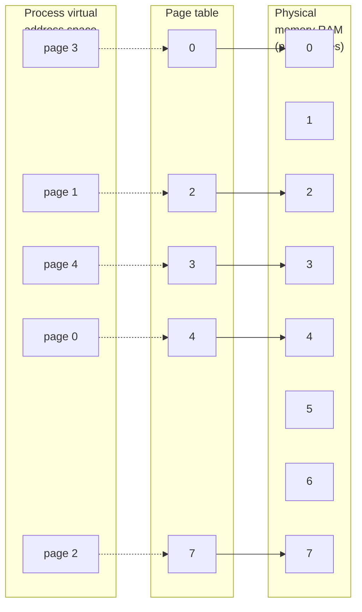

# Chương 6: TIẾN TRÌNH (PROCESSES)

Trong chương này, chúng ta sẽ tìm hiểu về cấu trúc của một tiến trình (process), đặc biệt chú ý đến bố cục (layout) và nội dung của bộ nhớ ảo (virtual memory) của tiến trình đó. Chúng ta cũng sẽ xem xét một số thuộc tính của tiến trình. Ở các chương sau, chúng ta sẽ đi sâu hơn vào các thuộc tính khác của tiến trình (ví dụ: thông tin xác thực tiến trình - process credentials trong Chương 9, và mức ưu tiên cũng như lập lịch tiến trình - process priorities and scheduling trong Chương 35). Từ Chương 24 đến Chương 27, chúng ta sẽ tìm hiểu cách các tiến trình được tạo ra, cách chúng kết thúc, và cách chúng thực thi các chương trình mới.

## 6.1 Tiến trình và Chương trình (Processes and Programs)

Một tiến trình là một thể hiện (instance) của một chương trình đang chạy. Trong phần này, chúng ta sẽ làm rõ định nghĩa này và phân biệt rạch ròi giữa một chương trình (program) và một tiến trình (process).

Một chương trình là một tệp chứa một loạt thông tin mô tả cách xây dựng một tiến trình tại thời điểm chạy (run time). Thông tin này bao gồm:

- Nhận diện định dạng nhị phân (Binary format identification): Mỗi tệp chương trình bao gồm các siêu thông tin (metainformation) mô tả định dạng của tệp thực thi. Điều này cho phép kernel giải thích phần thông tin còn lại trong tệp. Về mặt lịch sử, hai định dạng được sử dụng rộng rãi cho các tệp thực thi trên UNIX là định dạng a.out ("assembler output") ban đầu và định dạng COFF (Common Object File Format) tiên tiến hơn sau đó. Ngày nay, hầu hết các hệ thống UNIX (bao gồm Linux) đều sử dụng định dạng ELF (Executable and Linking Format), mang lại nhiều ưu điểm so với các định dạng cũ.

- Các lệnh mã máy (Machine-language instructions): Các lệnh này mã hóa thuật toán của chương trình.
- Địa chỉ điểm vào của chương trình (Program entry-point address): Xác định vị trí của câu lệnh mà tại đó việc thực thi chương trình bắt đầu.
- Dữ liệu (Data): Tệp chương trình chứa các giá trị dùng để khởi tạo biến và các hằng số tường minh (literal constants) được sử dụng bởi chương trình (ví dụ: các chuỗi ký tự - strings).
- Bảng ký hiệu và định vị lại (Symbol and relocation tables): Mô tả vị trí và tên của các hàm (functions) và biến (variables) trong chương trình. Các bảng này được sử dụng cho nhiều mục đích khác nhau, bao gồm gỡ lỗi (debugging) và phân giải ký hiệu tại thời điểm chạy (liên kết động - dynamic linking).
- Thông tin thư viện dùng chung và liên kết động (Shared-library and dynamic-linking information): Tệp chương trình bao gồm các trường liệt kê các thư viện dùng chung (shared libraries) mà chương trình cần sử dụng khi chạy và đường dẫn (pathname) của trình liên kết động (dynamic linker) được dùng để tải các thư viện này.
- Các thông tin khác: Tệp chương trình chứa nhiều thông tin khác mô tả cách xây dựng một tiến trình.

Một chương trình có thể được dùng để xây dựng nhiều tiến trình, hoặc nói cách khác, nhiều tiến trình có thể đang chạy cùng một chương trình.

Chúng ta có thể định nghĩa lại tiến trình được nêu ở đầu phần này như sau: một tiến trình là một thực thể trừu tượng, được định nghĩa bởi kernel, mà các tài nguyên hệ thống được phân bổ cho nó để thực thi một chương trình.

Từ góc nhìn của kernel, một tiến trình bao gồm bộ nhớ không gian người dùng (user-space memory) chứa mã chương trình và các biến do mã đó sử dụng, cùng với một loạt cấu trúc dữ liệu kernel (kernel data structures) duy trì thông tin về trạng thái của tiến trình. Thông tin được ghi lại trong các cấu trúc dữ liệu của kernel bao gồm các số định danh (IDs) khác nhau liên kết với tiến trình, các bảng bộ nhớ ảo (virtual memory tables), bảng bộ mô tả tệp đang mở (open file descriptors), thông tin liên quan đến việc gửi và xử lý tín hiệu (signal delivery and handling), mức sử dụng và giới hạn tài nguyên của tiến trình, thư mục làm việc hiện tại (current working directory), và vô số thông tin khác.

## 6.2 ID Tiến trình và ID Tiến trình Cha (Process ID and Parent Process ID)

Mỗi tiến trình có một ID tiến trình (Process ID - PID), là một số nguyên dương xác định duy nhất tiến trình đó trên hệ thống. Các ID tiến trình được sử dụng và trả về bởi nhiều System Call khác nhau. Ví dụ, System Call `kill()` (Phần 20.5) cho phép tiến trình gọi gửi một tín hiệu đến một tiến trình có PID cụ thể. PID cũng rất hữu ích nếu chúng ta cần tạo ra một định danh duy nhất cho một tiến trình. Một ví dụ phổ biến là việc sử dụng PID làm một phần của tên tệp duy nhất cho tiến trình (process-unique filename).

System Call `getpid()` trả về ID tiến trình của tiến trình gọi.

```c
## include <unistd.h>
pid_t getpid(void);
                                  Luôn trả về thành công PID của tiến trình gọi
```

Kiểu dữ liệu `pid_t` được sử dụng cho giá trị trả về của `getpid()` là một kiểu số nguyên do SUSv3 quy định nhằm mục đích lưu trữ các ID tiến trình.

Ngoại trừ một số tiến trình hệ thống như `init` (PID 1), không có mối quan hệ cố định nào giữa một chương trình và PID của tiến trình được tạo ra để chạy chương trình đó.

Kernel Linux giới hạn ID tiến trình nhỏ hơn hoặc bằng 32.767. Khi một tiến trình mới được tạo, nó được gán PID khả dụng tiếp theo theo thứ tự tuần tự. Mỗi khi đạt đến giới hạn 32.767, kernel sẽ thiết lập lại bộ đếm PID của nó để các PID được gán bắt đầu lại từ các giá trị số nguyên nhỏ.

> Khi đạt đến 32.767, bộ đếm PID được đặt lại thành 300 thay vì 1. Điều này được thực hiện vì nhiều PID số nhỏ đang được sử dụng vĩnh viễn bởi các tiến trình hệ thống và tiến trình nền (daemons), do đó sẽ lãng phí thời gian nếu cứ phải tìm kiếm một PID chưa sử dụng trong khoảng này.

> Trong Linux 2.4 và các phiên bản trước đó, giới hạn Process ID (PID) là 32.767 được định nghĩa bởi hằng số kernel `PID_MAX`. Sang Linux 2.6, mọi thứ đã thay đổi. Mặc dù giới hạn trên mặc định cho Process ID vẫn là 32.767, giới hạn này có thể điều chỉnh thông qua giá trị trong tệp chuyên biệt của Linux `/proc/sys/kernel/pid_max` (lớn hơn Process ID tối đa một đơn vị). Trên các nền tảng 32-bit, giá trị tối đa cho tệp này là 32.768, nhưng trên các nền tảng 64-bit, nó có thể được điều chỉnh lên bất kỳ giá trị nào đạt tới $2^{22}$ (khoảng 4 triệu), giúp đáp ứng số lượng lớn các process (tiến trình).

Mỗi process đều có một parent (process cha) — chính là process đã tạo ra nó. Một process có thể tìm ra Process ID của process cha bằng cách sử dụng system call `getppid()`.

```c
## include <unistd.h>
pid_t getppid(void);
                        Luôn trả về thành công Process ID của process cha của tiến trình gọi
```

Thực tế, thuộc tính parent process ID của mỗi process thể hiện mối quan hệ dạng cây của tất cả các process trên hệ thống. Process cha của mỗi process lại có process cha của riêng nó, cứ tiếp tục như vậy cho đến tận process 1, init, là tổ tiên của tất cả các process. ("Cây phả hệ" này có thể được xem bằng lệnh `pstree(1)`).

Nếu một child process (process con) trở thành orphaned (mồ côi) do process "sinh ra" nó chấm dứt hoạt động, thì process con đó sẽ được nhận nuôi bởi process init, và các lời gọi tiếp theo tới `getppid()` trong process con sẽ trả về 1 (xem Mục 26.2).

Process cha của bất kỳ process nào cũng có thể được tìm thấy bằng cách xem trường `Ppid` được cung cấp trong tệp đặc thù của Linux `/proc/PID/status`.

## 6.3 Bố cục bộ nhớ của một Process

Bộ nhớ được cấp phát cho mỗi process bao gồm một số thành phần, thường được gọi là các segment (phân đoạn). Các segment này bao gồm:

- Text segment chứa các mã lệnh máy của chương trình do process chạy. Text segment được đặt ở chế độ read-only (chỉ đọc) để process không vô tình sửa đổi các câu lệnh của chính nó thông qua giá trị con trỏ lỗi. Vì nhiều process có thể đang chạy cùng một chương trình, text segment được thiết kế để có thể chia sẻ (sharable) sao cho một bản sao duy nhất của mã chương trình có thể được ánh xạ (mapped) vào virtual address space (không gian địa chỉ ảo) của tất cả các process.

- Initialized data segment chứa các biến global (toàn cục) và static (tĩnh) được khởi tạo một cách tường minh. Giá trị của các biến này được đọc từ tệp thực thi khi chương trình được tải vào bộ nhớ.
- Uninitialized data segment chứa các biến global và static không được khởi tạo tường minh. Trước khi khởi động chương trình, hệ thống sẽ khởi tạo toàn bộ bộ nhớ trong segment này về 0. Vì lý do lịch sử, segment này thường được gọi là bss segment, một cái tên bắt nguồn từ một ghi nhớ mã hợp ngữ cũ cho "block started by symbol." Lý do chính để đặt các biến global và static đã được khởi tạo vào một segment riêng biệt với các biến chưa được khởi tạo là khi một chương trình được lưu trên đĩa, không cần thiết phải cấp phát không gian cho dữ liệu chưa được khởi tạo. Thay vào đó, tệp thực thi chỉ cần ghi lại vị trí và kích thước cần thiết cho uninitialized data segment, và không gian này sẽ được cấp phát bởi trình nạp chương trình (program loader) tại run time (thời điểm chạy).
- Stack là một segment tăng và giảm động chứa các stack frame (khung ngăn xếp). Một stack frame được cấp phát cho mỗi hàm hiện đang được gọi. Một frame lưu trữ các biến cục bộ của hàm (còn gọi là các biến automatic), các tham số (arguments), và giá trị trả về. Các stack frame được thảo luận chi tiết hơn trong [Mục 6.5](#page-8-0).
- Heap là vùng từ đó bộ nhớ (cho các biến) có thể được cấp phát động tại run time. Đầu trên của heap được gọi là program break.

Các nhãn ít được sử dụng hơn nhưng mang tính mô tả cao hơn cho initialized data segment và uninitialized data segment lần lượt là user-initialized data segment và zero-initialized data segment.

Lệnh `size(1)` hiển thị kích thước của các segment text, initialized data, và uninitialized data (bss) của một tệp nhị phân thực thi.

> Thuật ngữ segment được sử dụng trong văn bản chính không được nhầm lẫn với hardware segmentation (phân đoạn phần cứng) được sử dụng trên một số kiến trúc phần cứng như x86-32. Thay vào đó, các segment là các phân chia logic của virtual memory (bộ nhớ ảo) của một process trên hệ thống UNIX. Đôi khi, thuật ngữ section được sử dụng thay cho segment, vì section nhất quán hơn với thuật ngữ được sử dụng trong đặc tả ELF hiện đã trở nên phổ biến đối với các định dạng tệp thực thi.

> Ở nhiều nơi trong cuốn sách này, chúng tôi lưu ý rằng một thư viện hàm (library function) trả về một con trỏ trỏ đến vùng nhớ được cấp phát tĩnh. Ý của chúng tôi ở đây là bộ nhớ được cấp phát trong initialized data segment hoặc uninitialized data segment. (Trong một số trường hợp, thư viện hàm có thể thực hiện một lần cấp phát động duy nhất trên heap; tuy nhiên, chi tiết cài đặt này không liên quan đến ý nghĩa ngữ nghĩa mà chúng tôi mô tả ở đây). Điều quan trọng cần lưu ý là các trường hợp thư viện hàm trả về thông tin thông qua bộ nhớ được cấp phát tĩnh, vì vùng nhớ đó tồn tại độc lập với lời gọi hàm, và bộ nhớ đó có thể bị ghi đè bởi các lời gọi tiếp theo tới cùng một hàm (hoặc trong một số trường hợp, bởi các lời gọi tiếp theo tới các hàm có liên quan). Tác động của việc sử dụng bộ nhớ được cấp phát tĩnh là làm cho một hàm trở thành nonreentrant (không thể tái nhập). Chúng tôi sẽ nói nhiều hơn về tính tái nhập (reentrancy) trong Mục 21.1.2 và 31.1.

Listing 6-1 hiển thị các loại biến C khác nhau cùng với các chú thích chỉ ra phân đoạn (segment) mà mỗi biến được đặt trong đó. Các chú thích này giả định một trình biên dịch không tối ưu hóa và một giao diện nhị phân ứng dụng (application binary interface - ABI) trong đó tất cả các đối số được truyền qua ngăn xếp (stack). Trên thực tế, một trình biên dịch tối ưu hóa có thể cấp phát các biến được sử dụng thường xuyên vào trong các thanh ghi (register), hoặc tối ưu hóa hoàn toàn một biến khỏi bộ nhớ. Hơn nữa, một số ABI yêu cầu các đối số của hàm và kết quả của hàm được truyền thông qua các thanh ghi thay vì qua ngăn xếp. Dù vậy, ví dụ này vẫn hữu ích trong việc minh họa sự tương ứng giữa các biến C và các phân đoạn của một tiến trình (process).

**Listing 6-1:** Vị trí của các biến chương trình trong các phân đoạn bộ nhớ tiến trình

––––––––––––––––––––––––––––––––––––––––––––––––––––––– **proc/mem\_segments.c** #include <stdio.h> #include <stdlib.h> char globBuf[65536]; /\* Phân đoạn dữ liệu chưa khởi tạo (Uninitialized data segment) \*/ int primes[] = { 2, 3, 5, 7 }; /\* Phân đoạn dữ liệu đã khởi tạo (Initialized data segment) \*/ static int square(int x) /\* Được cấp phát trong khung stack cho square() \*/ { int result; /\* Được cấp phát trong khung stack cho square() \*/ result = x \* x; return result; /\* Giá trị trả về được truyền qua thanh ghi \*/ } static void doCalc(int val) /\* Được cấp phát trong khung stack cho doCalc() \*/ { printf("The square of %d is %d\n", val, square(val)); if (val < 1000) { int t; /\* Được cấp phát trong khung stack cho doCalc() \*/ t = val \* val \* val; printf("The cube of %d is %d\n", val, t); } } int main(int argc, char \*argv[]) /\* Được cấp phát trong khung stack cho main() \*/ { static int key = 9973; /\* Phân đoạn dữ liệu đã khởi tạo (Initialized data segment) \*/ static char mbuf[10240000]; /\* Phân đoạn dữ liệu chưa khởi tạo (Uninitialized data segment) \*/ char \*p; /\* Được cấp phát trong khung stack cho main() \*/ p = malloc(1024); /\* Trỏ đến vùng nhớ trong phân đoạn heap (heap segment) \*/ doCalc(key); exit(EXIT\_SUCCESS); }

––––––––––––––––––––––––––––––––––––––––––––––––––––––– **proc/mem\_segments.c**

Giao diện nhị phân ứng dụng (Application Binary Interface - ABI) là một tập hợp các quy tắc chỉ định cách một tệp thực thi nhị phân trao đổi thông tin với một dịch vụ nào đó (ví dụ: kernel hoặc thư viện) tại thời điểm chạy (run time). Trong số các chức năng khác, ABI chỉ định những thanh ghi và vị trí ngăn xếp nào được sử dụng để trao đổi thông tin này, và ý nghĩa nào được gắn liền với các giá trị được trao đổi. Một khi được biên dịch cho một ABI cụ thể, một tệp thực thi nhị phân sẽ có thể chạy trên bất kỳ hệ thống nào cung cấp cùng ABI đó. Điều này tương phản với một API được chuẩn hóa (như SUSv3), vốn chỉ đảm bảo tính di động (portability) cho các ứng dụng được biên dịch từ mã nguồn.

Mặc dù không được quy định trong SUSv3, môi trường chương trình C trên hầu hết các cài đặt UNIX (bao gồm cả Linux) cung cấp ba ký hiệu toàn cục (global symbol): etext, edata và end. Các ký hiệu này có thể được sử dụng từ bên trong một chương trình để lấy các địa chỉ tương ứng của byte nằm ngay sau: phần kết thúc của văn bản chương trình (program text), phần kết thúc của phân đoạn dữ liệu đã khởi tạo, và phần kết thúc của phân đoạn dữ liệu chưa khởi tạo. Để sử dụng các ký hiệu này, chúng ta phải khai báo chúng một cách tường minh như sau:

```
extern char etext, edata, end;
 /* Ví dụ: &etext trả về địa chỉ của phần kết thúc
 văn bản chương trình / bắt đầu dữ liệu đã khởi tạo */
```

[Hình 6-1](#page-6-0) hiển thị sự sắp xếp của các phân đoạn bộ nhớ khác nhau trên kiến trúc x86-32. Vùng trống được dán nhãn argv, environ ở phía trên cùng của sơ đồ này chứa các đối số dòng lệnh của chương trình (có sẵn trong C thông qua đối số argv của hàm main()) và danh sách môi trường của tiến trình (process environment list) (mà chúng ta sẽ thảo luận ngay sau đây). Các địa chỉ thập lục phân (hexadecimal address) được hiển thị trong sơ đồ có thể thay đổi tùy thuộc vào cấu hình kernel và các tùy chọn liên kết chương trình (program linking option). Các vùng bị mờ đi đại diện cho các dải địa chỉ không hợp lệ trong không gian địa chỉ ảo (virtual address space) của tiến trình; cụ thể là các vùng mà bảng trang (page table) chưa được tạo (xem phần thảo luận tiếp theo về quản lý bộ nhớ ảo).

Chúng ta sẽ quay lại chủ đề bố cục bộ nhớ tiến trình (process memory layout) chi tiết hơn một chút ở Mục 48.5, nơi chúng ta xem xét vị trí đặt bộ nhớ chia sẻ (shared memory) và các thư viện chia sẻ (shared library) trong bộ nhớ ảo của tiến trình.

## 6.4 Quản lý Bộ nhớ Ảo (Virtual Memory Management)

Phần thảo luận trước về bố cục bộ nhớ của một tiến trình (process) đã lướt qua một thực tế rằng chúng ta đang đề cập đến bố cục trong bộ nhớ ảo (virtual memory). Vì việc hiểu rõ về bộ nhớ ảo rất hữu ích sau này khi chúng ta xem xét các chủ đề như System Call `fork()`, bộ nhớ chia sẻ (shared memory), và các tệp được ánh xạ (mapped files), bây giờ chúng ta sẽ xem xét một số chi tiết về vấn đề này.

Giống như hầu hết các kernel hiện đại, Linux áp dụng một kỹ thuật được gọi là quản lý bộ nhớ ảo (virtual memory management). Mục đích của kỹ thuật này là sử dụng hiệu quả cả CPU và RAM (bộ nhớ vật lý - physical memory) bằng cách khai thác một đặc tính tiêu biểu của hầu hết các chương trình: tính cục bộ tham chiếu (locality of reference). Hầu hết các chương trình thể hiện hai loại tính cục bộ:

- Tính cục bộ không gian (Spatial locality) là xu hướng một chương trình tham chiếu đến các địa chỉ bộ nhớ nằm gần các địa chỉ vừa mới được truy cập gần đây (do quá trình xử lý tuần tự các lệnh, và đôi khi là xử lý tuần tự các cấu trúc dữ liệu).
- Tính cục bộ thời gian (Temporal locality) là xu hướng một chương trình truy cập vào các địa chỉ bộ nhớ giống nhau trong tương lai gần mà nó đã truy cập trong quá khứ gần (do các vòng lặp).

```text
Virtual memory address
    (hexadecimal)
                        ┌─────────────────────────────────┐
                        │          Kernel                 │  /proc/kallsyms
                        │  (mapped into process           │  provides addresses of
                        │   virtual memory, but not       │◄─kernel symbols in this
                        │   accessible to program)        │  region (/proc/ksyms in
    0xC0000000          ├─────────────────────────────────┤  kernel 2.4 and earlier)
                        │       argc, environ             │
                        ├─────────────────────────────────┤
                        │          Stack                  │
                        │     (grows downwards)           │
    Top of      ───────>├ ─ ─ ─ ─ ─ ─ ─ ─ ─ ─ ─ ─ ─ ─ ─ --┤
    stack               │             │                   │
                        │             ▼                   │
                        │                                 │
                        │    (unallocated memory)         │
                        │                                 │
                        │             ▲                   │
                        │             │                   │
    Program     ───────>├ ─ ─ ─ ─ ─ ─ ─ ─ ─ ─ ─ ─ ─ ─ ─ --┤
    break               │          Heap                   │
        ▲               │     (grows upwards)             │
        │               ├─────────────────────────────────┤◄─── &end
        │               │  Uninitialized data (bss)       │
        │               ├─────────────────────────────────┤◄─── &edata
Increasing virtual      │     Initialized data            │
addresses               ├─────────────────────────────────┤◄─── &etext
        │               │    Text (program code)          │
        │               │                                 │
                        ├─────────────────────────────────┤
    0x08048000          │                                 │
                        │                                 │
    0x00000000          └─────────────────────────────────┘
```

**Hình 6-1:** Bố cục bộ nhớ tiêu biểu của một tiến trình trên Linux/x86-32

Hệ quả của tính cục bộ tham chiếu là chúng ta có thể thực thi một chương trình trong khi chỉ duy trì một phần không gian địa chỉ của nó trong RAM.

Một sơ đồ bộ nhớ ảo chia bộ nhớ được sử dụng bởi mỗi chương trình thành các đơn vị nhỏ, có kích thước cố định gọi là các trang (pages). Tương ứng, RAM được chia thành một chuỗi các khung trang (page frames) có cùng kích thước. Tại bất kỳ thời điểm nào, chỉ một số trang của chương trình cần phải thường trú trong các khung trang bộ nhớ vật lý; các trang này tạo thành cái gọi là tập thường trú (resident set). Các bản sao của các trang không được sử dụng của chương trình được duy trì trong vùng swap (swap area) — một vùng không gian đĩa được dành riêng để bổ sung cho RAM của máy tính — và chỉ được tải vào bộ nhớ vật lý khi cần thiết. Khi một tiến trình tham chiếu đến một trang hiện không thường trú trong bộ nhớ vật lý, một lỗi trang (page fault) sẽ xảy ra, tại thời điểm đó kernel tạm dừng việc thực thi tiến trình trong khi trang đó được tải từ đĩa vào bộ nhớ.

> Trên kiến trúc x86-32, các trang có kích thước 4096 byte. Một số bản cài đặt Linux khác sử dụng kích thước trang lớn hơn. Ví dụ, kiến trúc Alpha sử dụng kích thước trang 8192 byte, và IA-64 có kích thước trang thay đổi, với mặc định thông thường là 16.384 byte. Một chương trình có thể xác định kích thước trang bộ nhớ ảo của hệ thống bằng cách sử dụng lệnh gọi `sysconf(_SC_PAGESIZE)`, như được mô tả trong Mục 11.2.



**Hình 6-2:** Tổng quan về bộ nhớ ảo (virtual memory)

Để hỗ trợ tổ chức này, kernel duy trì một bảng trang (page table) cho mỗi tiến trình (process) (Hình [6-2](#page-7-0)). Bảng trang (page table) mô tả vị trí của từng trang (page) trong không gian địa chỉ ảo (virtual address space) của tiến trình (tập hợp tất cả các trang bộ nhớ ảo mà tiến trình có thể truy cập). Mỗi mục (entry) trong bảng trang (page table) hoặc chỉ ra vị trí của một trang ảo trong RAM, hoặc chỉ ra rằng nó hiện đang nằm trên đĩa (disk).

Không phải mọi dải địa chỉ trong không gian địa chỉ ảo của tiến trình đều cần các mục bảng trang (page-table entries). Thông thường, các dải lớn trong không gian địa chỉ ảo tiềm năng là không được sử dụng, do đó không cần thiết phải duy trì các mục bảng trang (page-table entry) tương ứng. Nếu một tiến trình cố gắng truy cập một địa chỉ mà không có mục bảng trang (page-table entry) tương ứng, nó sẽ nhận được một tín hiệu (signal) `SIGSEGV`.

Dải địa chỉ ảo hợp lệ của một tiến trình có thể thay đổi trong suốt vòng đời của nó, khi kernel cấp phát và thu hồi các trang (và các mục bảng trang) cho tiến trình. Điều này có thể xảy ra trong các trường hợp sau:

- khi stack phát triển hướng xuống dưới vượt quá các giới hạn đã đạt được trước đó;
- khi bộ nhớ được cấp phát hoặc thu hồi trên heap, bằng cách nâng giới hạn chương trình (program break) sử dụng `brk()`, `sbrk()`, hoặc các hàm thuộc họ `malloc` (Chương 7);
- khi các vùng bộ nhớ chia sẻ System V (System V shared memory regions) được gắn kết (attach) sử dụng `shmat()` và gỡ gắn kết (detach) sử dụng `shmdt()` (Chương 48); và
- khi các ánh xạ bộ nhớ (memory mappings) được tạo bằng `mmap()` và hủy ánh xạ bằng `munmap()` (Chương 49).

Việc cài đặt bộ nhớ ảo (virtual memory) đòi hỏi phần cứng hỗ trợ dưới dạng một đơn vị quản lý bộ nhớ phân trang (paged memory management unit - PMMU). PMMU dịch từng tham chiếu địa chỉ bộ nhớ ảo thành địa chỉ bộ nhớ vật lý (physical memory address) tương ứng và thông báo cho kernel về một lỗi trang (page fault) khi một địa chỉ bộ nhớ ảo cụ thể tương ứng với một trang không thường trú trong RAM.

Quản lý bộ nhớ ảo tách biệt không gian địa chỉ ảo của một tiến trình khỏi không gian địa chỉ vật lý của RAM. Điều này mang lại nhiều ưu điểm:

- Các tiến trình được cô lập với nhau và với kernel, sao cho tiến trình này không thể đọc hoặc sửa đổi bộ nhớ của tiến trình khác hoặc của kernel. Điều này được thực hiện bằng cách để các mục bảng trang (page-table entries) cho mỗi tiến trình trỏ đến các tập hợp trang vật lý riêng biệt trong RAM (hoặc trong vùng swap).
- Khi phù hợp, hai hoặc nhiều tiến trình có thể chia sẻ bộ nhớ. Kernel làm cho điều này khả thi bằng cách để các mục bảng trang (page-table entries) ở các tiến trình khác nhau tham chiếu đến cùng một trang RAM. Việc chia sẻ bộ nhớ diễn ra trong hai hoàn cảnh phổ biến:
  - Nhiều tiến trình thực thi cùng một chương trình có thể chia sẻ một bản sao duy nhất (chỉ đọc - read-only) của mã chương trình (program code). Loại chia sẻ này được thực hiện một cách ngầm định khi nhiều chương trình thực thi cùng một tệp chương trình (hoặc tải cùng một thư viện chia sẻ - shared library).
  - Các tiến trình có thể sử dụng các system call `shmget()` và `mmap()` để yêu cầu một cách rõ ràng việc chia sẻ các vùng bộ nhớ với các tiến trình khác. Điều này được thực hiện nhằm mục đích giao tiếp giữa các tiến trình (interprocess communication).
- Việc cài đặt các cơ chế bảo vệ bộ nhớ (memory protection schemes) được hỗ trợ thuận lợi; nghĩa là, các mục bảng trang (page-table entries) có thể được đánh dấu để chỉ ra rằng nội dung của trang tương ứng là có thể đọc, ghi, thực thi, hoặc một sự kết hợp nào đó của các quyền bảo vệ này. Khi nhiều tiến trình chia sẻ các trang RAM, có thể chỉ định rằng mỗi tiến trình có các quyền bảo vệ khác nhau trên bộ nhớ; ví dụ, một tiến trình có thể có quyền truy cập chỉ đọc đối với một trang, trong khi tiến trình khác có quyền đọc-ghi.
- Lập trình viên, và các công cụ như trình biên dịch (compiler) và trình liên kết (linker), không cần phải bận tâm đến bố cục vật lý của chương trình trong RAM.
- Bởi vì chỉ một phần của chương trình cần phải nằm trong bộ nhớ, chương trình tải và chạy nhanh hơn. Hơn nữa, lượng bộ nhớ chiếm dụng (memory footprint) (tức là kích thước ảo) của một tiến trình có thể vượt quá dung lượng của RAM.

Một ưu điểm cuối cùng của quản lý bộ nhớ ảo là vì mỗi tiến trình sử dụng ít RAM hơn, nên có nhiều tiến trình hơn có thể được giữ đồng thời trong RAM. Điều này thường dẫn đến việc tận dụng CPU tốt hơn, vì nó làm tăng khả năng tại bất kỳ thời điểm nào, có ít nhất một tiến trình mà CPU có thể thực thi.

## 6.5 Stack và Các Khung Stack (Stack Frames)

Stack phát triển và thu hẹp tuyến tính khi các hàm được gọi và trả về. Đối với Linux trên kiến trúc x86-32 (và trên hầu hết các bản cài đặt Linux và UNIX khác), stack nằm ở đầu trên của bộ nhớ và phát triển hướng xuống dưới (về phía heap). Một thanh ghi chuyên dụng, con trỏ stack (stack pointer), theo dõi đỉnh hiện tại của stack. Mỗi khi một hàm được gọi, một khung (frame) bổ sung được cấp phát trên stack và khung này bị xóa khi hàm trả về.

> Mặc dù stack phát triển hướng xuống dưới, chúng ta vẫn gọi đầu phát triển của stack là đỉnh (top), bởi vì theo các thuật ngữ trừu tượng, đó là bản chất của nó. Hướng thực tế của sự phát triển stack là một chi tiết cài đặt (phần cứng). Một bản cài đặt Linux, HP PA-RISC, thực sự sử dụng stack phát triển hướng lên trên.

Theo thuật ngữ bộ nhớ ảo (virtual memory), kích thước của đoạn stack (stack segment) tăng lên khi các stack frame được cấp phát, nhưng trên hầu hết các cài đặt (implementation), nó sẽ không giảm kích thước sau khi các frame này được giải phóng (vùng nhớ được tái sử dụng đơn giản khi các stack frame mới được cấp phát). Khi chúng ta nói về việc stack segment tăng và giảm, chúng ta đang xem xét vấn đề từ góc độ logic của việc các frame được thêm vào và gỡ bỏ khỏi stack.

Đôi khi, thuật ngữ user stack được sử dụng để phân biệt stack mà chúng ta mô tả ở đây với kernel stack. Kernel stack là một vùng nhớ nằm trong bộ nhớ nhân (kernel memory) được duy trì cho mỗi tiến trình (per-process), được sử dụng làm stack để thực thi các hàm được gọi nội bộ trong quá trình thực thi một System Call. (Nhân hệ điều hành không thể sử dụng user stack cho mục đích này vì nó nằm trong bộ nhớ người dùng không được bảo vệ - unprotected user memory).

Mỗi stack frame (của người dùng) chứa các thông tin sau:

- Đối số hàm (Function arguments) và biến cục bộ (local variables): Trong C, các biến này được gọi là biến tự động (automatic variables), vì chúng được tạo tự động khi một hàm được gọi. Các biến này cũng tự động biến mất khi hàm trả về (vì stack frame biến mất), và điều này tạo nên sự khác biệt ngữ nghĩa chính giữa biến tự động và biến tĩnh (cũng như biến toàn cục): biến tĩnh và biến toàn cục có sự tồn tại vĩnh viễn độc lập với việc thực thi các hàm.
- Thông tin liên kết lời gọi (Call linkage information): Mỗi hàm sử dụng các thanh ghi CPU nhất định, chẳng hạn như bộ đếm chương trình (program counter), trỏ tới lệnh ngôn ngữ máy tiếp theo sẽ được thực thi. Mỗi khi một hàm gọi hàm khác, một bản sao của các thanh ghi này được lưu trong stack frame của hàm được gọi để khi hàm trả về, các giá trị thanh ghi thích hợp có thể được khôi phục cho hàm gọi.

Vì các hàm có thể gọi lẫn nhau, có thể có nhiều frame trên stack. (Nếu một hàm tự gọi chính nó một cách đệ quy - recursively, sẽ có nhiều frame trên stack cho hàm đó). Tham khảo Liệt kê (Listing) 6-1, trong quá trình thực thi hàm `square()`, stack sẽ chứa các frame như được minh họa trong [Hình 6-3.](#page-9-0)

```text
    ┌ ─ ─ ─ ─ ─ ─ ─ ─ ─ ─ ─ ─ ─ ┐
    │ Frames for C run-time     │
    │   startup functions       │
    ├───────────────────────────┤
    │   Frame for main()        │
    ├───────────────────────────┤
    │   Frame for doCalc()      │
    ├───────────────────────────┤
    │   Frame for square()      │◄── stack pointer
    └───────────────────────────┘
                │
                │  Direction of
                │  stack growth
                ▼
```

**Hình 6-3:** Ví dụ về stack của tiến trình

## 6.6 Đối số dòng lệnh (Command-Line Arguments - argc, argv)

Mọi chương trình C đều phải có một hàm tên là `main()`, đây là điểm bắt đầu thực thi của chương trình. Khi chương trình được thực thi, các đối số dòng lệnh (command-line arguments) (các từ riêng biệt được phân tích cú pháp bởi shell) sẽ được cung cấp thông qua hai đối số truyền vào hàm `main()`. Đối số đầu tiên, `int argc`, cho biết có bao nhiêu đối số dòng lệnh. Đối số thứ hai, `char *argv[]`, là một mảng các con trỏ trỏ đến các đối số dòng lệnh, mỗi đối số là một chuỗi ký tự kết thúc bằng null (null-terminated character string). Chuỗi đầu tiên trong số này, nằm ở `argv[0]`, (theo quy ước) chính là tên của bản thân chương trình. Danh sách các con trỏ trong `argv` được kết thúc bằng một con trỏ `NULL` (tức là `argv[argc]` là `NULL`).

Việc `argv[0]` chứa tên được sử dụng để gọi chương trình có thể được tận dụng để thực hiện một mẹo hữu ích. Chúng ta có thể tạo nhiều liên kết (link) tới (tức là, nhiều tên cho) cùng một chương trình, và sau đó cho chương trình kiểm tra `argv[0]` và thực hiện các hành động khác nhau tùy thuộc vào tên được dùng để gọi nó. Một ví dụ về kỹ thuật này được cung cấp bởi các lệnh `gzip(1)`, `gunzip(1)`, và `zcat(1)`, tất cả đều là các liên kết trỏ đến cùng một tệp thực thi. (Nếu sử dụng kỹ thuật này, chúng ta phải cẩn thận xử lý trường hợp người dùng có thể gọi chương trình thông qua một liên kết có tên khác với bất kỳ tên nào mà chúng ta dự tính).

[Hình 6-4](#page-10-0) hiển thị một ví dụ về các cấu trúc dữ liệu liên quan đến `argc` và `argv` khi thực thi chương trình trong [Liệt kê 6-2](#page-10-1). Trong sơ đồ này, chúng ta biểu diễn các byte null kết thúc ở cuối mỗi chuỗi bằng ký hiệu C `\0`.

```text
argc  ┌───┐
      │ 3 │
      └───┘

argv  ┌───┐
      │   │─────> 0  ┌───┬───┬───┬───┬───┬─────┬──────┐
      └───┘          │   │──>│ n │ e │ c │ h │ o │ \0 │
                     └───┴───┴───┴───┴───┴───┴────────┘
                  1  ┌───┬───┬───┬───┬───┬───────┬────┐
                     │   │──>│ h │ e │ l │ l │ o │ \0 │
                     └───┴───┴───┴───┴───┴───┴────────┘
                  2  ┌───┬───┬───┬───┬───┬────┬───────┐
                     │   │──>│ w │ o │ r │ l │ d │ \0 │
                     └───┴───┴───┴───┴───┴───┴────────┘
                  3  ┌──────┐
                     │ NULL │
                     └──────┘
```

**Hình 6-4:** Các giá trị của argc và argv cho lệnh necho hello world

Chương trình trong [Liệt kê 6-2](#page-10-1) in lặp lại (echo) các đối số dòng lệnh của nó, mỗi đối số trên một dòng đầu ra, được đứng trước bởi một chuỗi hiển thị phần tử nào của `argv` đang được hiển thị.

**Liệt kê 6-2:** In lặp lại các đối số dòng lệnh (Echoing command-line arguments)

```
––––––––––––––––––––––––––––––––––––––––––––––––––––––––––––– proc/necho.c
## include "tlpi_hdr.h"
int
main(int argc, char *argv[])
{
 int j;
 for (j = 0; j < argc; j++)
 printf("argv[%d] = %s\n", j, argv[j]);
 exit(EXIT_SUCCESS);
}
––––––––––––––––––––––––––––––––––––––––––––––––––––––––––––– proc/necho.c
```

Vì danh sách `argv` được kết thúc bằng một giá trị `NULL`, chúng ta cũng có thể viết phần thân của chương trình trong [Liệt kê 6-2](#page-10-1) theo cách thay thế dưới đây, để chỉ xuất các đối số dòng lệnh với mỗi đối số trên một dòng:

```
char **p;
for (p = argv; *p != NULL; p++)
 puts(*p);
```

Một hạn chế của cơ chế `argc`/`argv` là các biến này chỉ khả dụng dưới dạng các đối số truyền vào hàm `main()`. Để có thể tính di động (portable) khi cung cấp các đối số dòng lệnh trong các hàm khác, chúng ta bắt buộc phải truyền `argv` như một đối số cho các hàm đó hoặc thiết lập một biến toàn cục (global variable) trỏ đến `argv`.

Có một vài phương pháp không có tính di động (nonportable) để truy cập một phần hoặc toàn bộ thông tin này từ bất kỳ đâu trong chương trình:

- Các đối số dòng lệnh của bất kỳ tiến trình (Process) nào có thể được đọc thông qua tệp đặc thù của Linux `/proc/PID/cmdline`, với mỗi đối số được kết thúc bằng một byte null. (Một chương trình có thể truy cập các đối số dòng lệnh của chính nó thông qua `/proc/self/cmdline`).
- Thư viện GNU C cung cấp hai biến toàn cục có thể được sử dụng ở bất kỳ đâu trong chương trình nhằm lấy ra tên được dùng để gọi chương trình đó (tức là đối số dòng lệnh đầu tiên). Biến đầu tiên, `program_invocation_name`, cung cấp đường dẫn đầy đủ (pathname) được sử dụng để gọi chương trình. Biến thứ hai, `program_invocation_short_name`, cung cấp một phiên bản tên này đã được lược bỏ phần tiền tố thư mục (tức là thành phần tên cơ sở - basename của đường dẫn). Khai báo cho hai biến này có thể được lấy từ `<errno.h>` bằng cách định nghĩa macro `_GNU_SOURCE`.

Như được hiển thị trong [Hình 6-1](#page-6-0), các mảng `argv` và `environ`, cũng như các chuỗi mà chúng ban đầu trỏ tới, nằm trong một vùng nhớ liên giáp (contiguous memory area) duy nhất nằm ngay phía trên stack của tiến trình (process stack). (Chúng ta sẽ mô tả `environ`, nơi lưu trữ danh sách môi trường của chương trình, ở phần tiếp theo). Có một giới hạn trên về tổng số byte có thể được lưu trữ trong vùng này. SUSv3 quy định việc sử dụng hằng số `ARG_MAX` (được định nghĩa trong `<limits.h>`) hoặc lệnh gọi `sysconf(_SC_ARG_MAX)` để xác định giới hạn này. (Chúng ta sẽ mô tả `sysconf()` trong Mục 11.2). SUSv3 yêu cầu `ARG_MAX` phải có ít nhất `_POSIX_ARG_MAX` (4096) byte. Hầu hết các bản cài đặt UNIX cho phép giới hạn cao hơn đáng kể so với mức này. SUSv3 không quy định việc một hệ thống có tính các byte chi phí quản lý (overhead bytes) (cho các byte null kết thúc, byte căn chỉnh - alignment bytes, và các mảng con trỏ `argv` và `environ`) vào giới hạn `ARG_MAX` hay không.

> Trên Linux, `ARG_MAX` trước đây được cố định ở mức 32 trang (tức là 131.072 byte trên Linux/x86-32) và đã bao gồm dung lượng dành cho các byte chi phí quản lý (overhead bytes). Bắt đầu từ kernel phiên bản 2.6.23, giới hạn về tổng dung lượng được sử dụng cho `argv` và `environ` có thể được kiểm soát thông qua giới hạn tài nguyên `RLIMIT_STACK`, và một giới hạn lớn hơn nhiều được cho phép đối với `argv` và `environ`. Giới hạn này được tính bằng một phần tư giới hạn tài nguyên soft `RLIMIT_STACK` có hiệu lực vào thời điểm gọi hàm `execve()`. Để biết thêm chi tiết, hãy xem trang hướng dẫn (man page) `execve(2)`.

Nhiều chương trình (bao gồm một số ví dụ trong cuốn sách này) phân tích cú pháp các tùy chọn dòng lệnh (command-line options) (tức là các tham số bắt đầu bằng dấu gạch ngang) bằng cách sử dụng hàm thư viện `getopt()`. Chúng tôi mô tả `getopt()` trong Phụ lục B.

## 6.7 Danh sách môi trường (Environment List)

Mỗi tiến trình (Process) có một mảng các chuỗi đi kèm gọi là danh sách môi trường (environment list), hoặc đơn giản là môi trường (environment). Mỗi chuỗi trong số này là một định nghĩa có dạng `name=value`. Do đó, môi trường đại diện cho một tập hợp các cặp tên-giá trị (name-value pairs) có thể được sử dụng để lưu trữ thông tin tùy ý. Các tên trong danh sách được gọi là biến môi trường (environment variables).

Khi một tiến trình mới được tạo, nó kế thừa một bản sao môi trường của tiến trình cha (parent process). Đây là một hình thức giao tiếp liên tiến trình (Interprocess Communication - IPC) thô sơ nhưng được sử dụng thường xuyên—môi trường cung cấp một cách để truyền thông tin từ tiến trình cha sang (các) tiến trình con của nó. Vì tiến trình con nhận được một bản sao môi trường của tiến trình cha tại thời điểm nó được tạo, việc truyền thông tin này là một chiều (one-way) và chỉ một lần (once-only). Sau khi tiến trình con được tạo, bất kỳ tiến trình nào cũng có thể thay đổi môi trường của chính nó và những thay đổi này không được nhìn thấy bởi tiến trình kia.

Một ứng dụng phổ biến của biến môi trường là trong shell. Bằng cách đặt các giá trị trong môi trường của chính nó, shell có thể đảm bảo rằng các giá trị này được truyền cho các tiến trình mà nó tạo ra để thực thi các lệnh của người dùng. Ví dụ, biến môi trường `SHELL` được đặt thành đường dẫn (pathname) của chính chương trình shell đó. Nhiều chương trình diễn giải biến này là tên của shell nên được thực thi nếu chương trình cần thực thi một shell.

Một số hàm thư viện cho phép hành vi của chúng bị sửa đổi bằng cách thiết lập các biến môi trường. Điều này cho phép người dùng kiểm soát hành vi của một ứng dụng sử dụng hàm mà không cần thay đổi mã nguồn của ứng dụng hoặc liên kết lại (relink) nó với thư viện tương ứng. Một ví dụ về kỹ thuật này được cung cấp bởi hàm `getopt()` (Phụ lục B), có hành vi có thể được sửa đổi bằng cách thiết lập biến môi trường `POSIXLY_CORRECT`.

Trong hầu hết các shell, một giá trị có thể được thêm vào môi trường bằng lệnh `export`:

\$ **SHELL=/bin/bash** Tạo một biến shell

\$ **export SHELL** Đưa biến vào môi trường của tiến trình shell

Trong bash và Korn shell, lệnh này có thể được viết tắt thành:

### \$ **export SHELL=/bin/bash**

Trong C shell, lệnh `setenv` được sử dụng thay thế:

### % **setenv SHELL /bin/bash**

Các lệnh trên thêm vĩnh viễn một giá trị vào môi trường của shell và môi trường này sau đó được kế thừa bởi tất cả các tiến trình con do shell tạo ra. Tại bất kỳ thời điểm nào, một biến môi trường có thể bị xóa bằng lệnh `unset` (`unsetenv` trong C shell).

Trong Bourne shell và các biến thể của nó (ví dụ: bash và Korn shell), cú pháp sau có thể được sử dụng để thêm các giá trị vào môi trường được sử dụng để thực thi một chương trình duy nhất mà không ảnh hưởng đến shell cha (và các lệnh tiếp theo):

### \$ *NAME=value program*

Thao tác này thêm một định nghĩa vào môi trường chỉ của tiến trình con thực thi chương trình được chỉ định. Nếu muốn, nhiều phép gán (được phân tách bằng khoảng trắng) có thể đứng trước tên chương trình.

Lệnh `env` chạy một chương trình sử dụng một bản sao đã sửa đổi của danh sách môi trường của shell. Danh sách môi trường có thể được sửa đổi để cả thêm và xóa các định nghĩa khỏi danh sách được sao chép từ shell. Xem trang hướng dẫn `env(1)` để biết thêm chi tiết.

Lệnh `printenv` hiển thị danh sách môi trường hiện tại. Dưới đây là một ví dụ về đầu ra của lệnh này:

```
$ printenv
LOGNAME=mtk
SHELL=/bin/bash
HOME=/home/mtk
PATH=/usr/local/bin:/usr/bin:/bin:.
TERM=xterm
```

Chúng tôi mô tả mục đích của hầu hết các biến môi trường trên tại các thời điểm thích hợp trong các chương sau (xem thêm trang hướng dẫn `environ(7)`).

Từ kết quả đầu ra trên, chúng ta có thể thấy rằng danh sách môi trường không được sắp xếp; thứ tự các chuỗi trong danh sách đơn giản là sự sắp xếp thuận tiện nhất cho việc cài đặt (implementation). Nhìn chung, đây không phải là vấn đề, vì thông thường chúng ta muốn truy cập các biến riêng lẻ trong môi trường hơn là một chuỗi có thứ tự nào đó của chúng.

Danh sách môi trường của bất kỳ tiến trình nào có thể được kiểm tra thông qua tệp đặc thù của Linux `/proc/PID/environ`, với mỗi cặp `NAME=value` được kết thúc bằng một byte null.

## Truy cập môi trường từ một chương trình

Bên trong một chương trình C, danh sách môi trường (environment list) có thể được truy cập thông qua biến toàn cục `char **environ`. (Mã nguồn khởi động thời gian chạy C - C run-time startup code - định nghĩa biến này và gán vị trí của danh sách môi trường cho nó). Giống như `argv`, `environ` trỏ đến một danh sách kết thúc bằng `NULL` (NULL-terminated list) gồm các con trỏ trỏ tới các chuỗi kết thúc bằng ký tự null (null-terminated strings). [Hình 6-5](#page-13-0) minh họa các cấu trúc dữ liệu của danh sách môi trường như chúng xuất hiện đối với môi trường hiển thị bởi lệnh `printenv` ở trên.

```text
environ
┌───┐
│   │───> ┌───┬───> LOGNAME=mtk\0
└───┘     │   │
          │   ├───> SHELL=/bin/bash\0
          │   │
          │   ├───> HOME=/home/mtk\0
          │   │
          │   ├───> PATH=/usr/local/bin:/usr/bin:/bin:..\0
          │   │
          │   └───> TERM=xterm\0
          │
          └──────┐
                 │
              ┌──────┐
              │ NULL │
              └──────┘
```

**Hình 6-5:** Ví dụ về các cấu trúc dữ liệu của danh sách môi trường tiến trình (process environment list)

Chương trình trong [Liệt kê 6-3](#page-14-0) truy cập `environ` nhằm liệt kê tất cả các giá trị trong môi trường tiến trình (process environment). Chương trình này cho ra kết quả đầu ra tương tự như lệnh `printenv`. Vòng lặp trong chương trình này dựa vào việc sử dụng các con trỏ để duyệt qua `environ`. Mặc dù chúng ta có thể coi `environ` như một mảng (giống như cách chúng ta dùng `argv` trong [Liệt kê 6-2](#page-10-1)), cách làm này ít tự nhiên hơn, bởi vì các mục trong danh sách môi trường không theo một thứ tự cụ thể nào và không có biến nào (tương ứng với `argc`) chỉ định kích thước của danh sách môi trường. (Vì những lý do tương tự, chúng ta không đánh số các phần tử của mảng `environ` trong [Hình 6-5.](#page-13-0))

**Liệt kê 6-3:** Hiển thị môi trường tiến trình

```
–––––––––––––––––––––––––––––––––––––––––––––––––––––––– proc/display_env.c
## include "tlpi_hdr.h"
extern char **environ;
int
main(int argc, char *argv[])
{
 char **ep;
 for (ep = environ; *ep != NULL; ep++)
 puts(*ep);
 exit(EXIT_SUCCESS);
}
–––––––––––––––––––––––––––––––––––––––––––––––––––––––– proc/display_env.c
```

Một phương pháp thay thế để truy cập danh sách môi trường là khai báo tham số thứ ba cho hàm `main()`:

```
int main(int argc, char *argv[], char *envp[])
```

Tham số này sau đó có thể được xử lý theo cách tương tự như `environ`, với điểm khác biệt là phạm vi (scope) của nó là cục bộ (local) đối với `main()`. Mặc dù tính năng này được triển khai rộng rãi trên các hệ thống UNIX, việc sử dụng nó nên được tránh vì ngoài giới hạn về phạm vi, nó không được quy định trong chuẩn SUSv3.

Hàm `getenv()` trích xuất các giá trị riêng lẻ từ môi trường tiến trình.

```c
## include <stdlib.h>
char *getenv(const char *name);
                     Trả về con trỏ tới chuỗi (value), hoặc NULL nếu không có biến như vậy
```

Với tên của một biến môi trường (environment variable), `getenv()` trả về một con trỏ tới chuỗi giá trị tương ứng. Do đó, trong trường hợp ví dụ về môi trường của chúng ta được hiển thị trước đó, `/bin/bash` sẽ được trả về nếu `SHELL` được chỉ định làm tham số `name`. Nếu không tồn tại biến môi trường nào có tên được chỉ định, thì `getenv()` sẽ trả về `NULL`.

Lưu ý các cân nhắc về tính khảο chuyển (portability) khi sử dụng `getenv()`:

SUSv3 quy định rằng một ứng dụng không nên sửa đổi chuỗi do `getenv()` trả về. Lý do là vì (trong hầu hết các bản triển khai) chuỗi này thực chất là một phần của môi trường (tức là phần giá trị của chuỗi `name=value`). Nếu chúng ta cần thay đổi giá trị của một biến môi trường, thì chúng ta có thể sử dụng các hàm `setenv()` hoặc `putenv()` (được mô tả bên dưới).

SUSv3 cho phép một bản triển khai `getenv()` trả về kết quả của nó bằng cách sử dụng một bộ đệm được cấp phát tĩnh (statically allocated buffer) mà có thể bị ghi đè bởi các lời gọi tiếp theo tới `getenv()`, `setenv()`, `putenv()`, hoặc `unsetenv()`. Mặc dù bản triển khai `getenv()` của glibc không sử dụng bộ đệm tĩnh theo cách này, một chương trình có tính khả chuyển cần bảo tồn chuỗi được trả về bởi một lời gọi `getenv()` nên sao chép nó đến một vị trí khác trước khi thực hiện một lời gọi tiếp theo tới một trong các hàm này.

### Thay đổi môi trường (Modifying the environment)

Đôi khi, việc một tiến trình (process) tự thay đổi môi trường (environment) của chính nó là rất hữu ích. Một lý do là để thực hiện một thay đổi có hiệu lực đối với tất cả các tiến trình con (child process) được tạo ra sau đó bởi tiến trình đó. Một khả năng khác là chúng ta muốn thiết lập một biến hiển thị cho một chương trình mới sẽ được tải vào bộ nhớ của tiến trình này ("được thực thi" - *execed*). Theo nghĩa này, môi trường không chỉ là một hình thức giao tiếp giữa các tiến trình (interprocess communication), mà còn là một phương pháp giao tiếp giữa các chương trình (interprogram communication). (Điểm này sẽ trở nên rõ ràng hơn ở Chương 27, nơi chúng tôi giải thích cách các hàm `exec()` cho phép một chương trình tự thay thế bằng một chương trình mới trong cùng một tiến trình).

Hàm `putenv()` thêm một biến mới vào môi trường của tiến trình gọi hoặc sửa đổi giá trị của một biến hiện có.

```c
## include <stdlib.h>
int putenv(char *string);
                                       Trả về 0 khi thành công, hoặc khác 0 nếu lỗi
```

Tham số `string` là một con trỏ trỏ đến một chuỗi có định dạng `name=value`. Sau lệnh gọi `putenv()`, chuỗi này trở thành một phần của môi trường. Nói cách khác, thay vì sao chép chuỗi được trỏ bởi `string`, một trong các phần tử của `environ` sẽ được thiết lập để trỏ đến cùng một vị trí với `string`. Do đó, nếu sau đó chúng ta sửa đổi các byte được trỏ bởi `string`, thay đổi đó sẽ ảnh hưởng đến môi trường của tiến trình. Vì lý do này, `string` không được là một biến tự động (automatic variable) (tức là một mảng ký tự được cấp phát trên stack), vì vùng nhớ này có thể bị ghi đè sau khi hàm chứa biến đó trả về (returns).

Lưu ý rằng `putenv()` trả về một giá trị khác 0 khi xảy ra lỗi, thay vì trả về –1.

Việc cài đặt `putenv()` trong `glibc` cung cấp một phần mở rộng phi tiêu chuẩn (nonstandard extension). Nếu `string` không chứa dấu bằng (`=`), thì biến môi trường được xác định bởi `string` sẽ bị xóa khỏi danh sách môi trường.

Hàm `setenv()` là một lựa chọn thay thế cho `putenv()` để thêm một biến vào môi trường.

```c
## include <stdlib.h>
int setenv(const char *name, const char *value, int overwrite);
                                            Trả về 0 khi thành công, hoặc –1 nếu lỗi
```

Hàm `setenv()` tạo ra một biến môi trường mới bằng cách cấp phát một bộ nhớ đệm (memory buffer) cho một chuỗi có định dạng `name=value`, và sao chép các chuỗi được trỏ bởi `name` và `value` vào bộ nhớ đệm đó. Lưu ý rằng chúng ta không cần phải (thực tế là tuyệt đối không được) cung cấp dấu bằng ở cuối của `name` hoặc ở đầu của `value`, bởi vì `setenv()` sẽ tự động thêm ký tự này khi nó thêm định nghĩa mới vào môi trường.

Hàm `setenv()` không thay đổi môi trường nếu biến được xác định bởi `name` đã tồn tại và `overwrite` có giá trị bằng 0. Nếu `overwrite` khác 0, môi trường sẽ luôn được thay đổi.

Việc `setenv()` sao chép các tham số của nó đồng nghĩa với việc, không giống như `putenv()`, chúng ta có thể sửa đổi nội dung của các chuỗi được trỏ bởi `name` và `value` sau đó mà không ảnh hưởng đến môi trường. Điều này cũng có nghĩa là việc sử dụng các biến tự động làm tham số cho `setenv()` sẽ không gây ra bất kỳ vấn đề nào.

Hàm `unsetenv()` xóa biến được xác định bởi `name` khỏi môi trường.

```c
## include <stdlib.h>
int unsetenv(const char *name);
                                             Trả về 0 khi thành công, hoặc –1 nếu lỗi
```

Giống như `setenv()`, `name` không được chứa dấu bằng.

Cả `setenv()` và `unsetenv()` đều có nguồn gốc từ BSD và ít phổ biến hơn `putenv()`. Mặc dù không được định nghĩa trong tiêu chuẩn POSIX.1 gốc hoặc trong SUSv2, chúng đã được bao gồm trong SUSv3.

> Trong các phiên bản `glibc` trước 2.2.2, `unsetenv()` được định mẫu (prototyped) trả về kiểu `void`. Đây là cách mà `unsetenv()` được định mẫu trong bản cài đặt BSD gốc, và một số bản cài đặt UNIX vẫn tuân theo nguyên mẫu BSD này.

Thỉnh thoảng, việc xóa toàn bộ môi trường và sau đó xây dựng lại nó với các giá trị được chọn là rất hữu ích. Ví dụ, chúng ta có thể làm điều này để thực thi các chương trình `set-user-ID` một cách an toàn (Mục 38.8). Chúng ta có thể xóa môi trường bằng cách gán `NULL` cho `environ`:

```
environ = NULL;
```

Đây chính xác là bước được thực hiện bởi hàm thư viện `clearenv()`.

```c
## define _BSD_SOURCE /* Hoặc: #define _SVID_SOURCE */
## include <stdlib.h>
int clearenv(void);
                                  Trả về 0 khi thành công, hoặc khác 0 nếu lỗi
```

Trong một số trường hợp, việc sử dụng `setenv()` và `clearenv()` có thể dẫn đến rò rỉ bộ nhớ (memory leak) trong chương trình. Chúng ta đã lưu ý ở trên rằng `setenv()` cấp phát một bộ nhớ đệm và sau đó biến nó thành một phần của môi trường. Khi chúng ta gọi `clearenv()`, hàm này không giải phóng bộ nhớ đệm đó (nó không thể làm vậy vì nó không biết sự tồn tại của bộ nhớ đệm đó). Một chương trình liên tục sử dụng hai hàm này sẽ liên tục bị rò rỉ bộ nhớ. Trên thực tế, điều này ít khi trở thành vấn đề, bởi vì một chương trình thông thường chỉ gọi `clearenv()` một lần khi khởi động, nhằm mục đích xóa tất cả các mục nhập (entry) khỏi môi trường mà nó kế thừa từ tiến trình tiền nhiệm (tức là chương trình đã gọi `exec()` để khởi chạy chương trình này).

> Nhiều cài đặt UNIX cung cấp hàm `clearenv()`, nhưng nó không được quy định trong SUSv3. SUSv3 quy định rằng nếu một ứng dụng sửa đổi trực tiếp biến `environ`, như cách mà `clearenv()` thực hiện, thì hành vi của `setenv()`, `unsetenv()` và `getenv()` sẽ không được xác định (undefined). (Lý do đằng sau việc này là việc ngăn cản một ứng dụng tuân thủ tiêu chuẩn sửa đổi trực tiếp môi trường sẽ giúp cho quá trình cài đặt có quyền kiểm soát hoàn toàn đối với các cấu trúc dữ liệu mà nó sử dụng để thực thi các biến môi trường - environment variables). Cách duy nhất mà SUSv3 cho phép một ứng dụng xóa môi trường của nó là lấy danh sách tất cả các biến môi trường (bằng cách lấy các tên từ `environ`), sau đó sử dụng `unsetenv()` để loại bỏ từng tên này.

### Chương trình ví dụ

[Liệt kê 6-4](#page-18-0) minh họa việc sử dụng tất cả các hàm đã được thảo luận trong phần này. Sau khi xóa môi trường trước tiên, chương trình này thêm bất kỳ định nghĩa môi trường nào được cung cấp dưới dạng các đối số dòng lệnh (command-line arguments). Sau đó, nó: thêm định nghĩa cho một biến có tên là `GREET`, nếu biến này chưa tồn tại trong môi trường; loại bỏ mọi định nghĩa cho biến có tên là `BYE`; và cuối cùng, in ra danh sách môi trường hiện tại. Dưới đây là một ví dụ về kết quả đầu ra được tạo ra khi chương trình chạy:

```
$ ./modify_env "GREET=Guten Tag" SHELL=/bin/bash BYE=Ciao
GREET=Guten Tag
SHELL=/bin/bash
$ ./modify_env SHELL=/bin/sh BYE=byebye
SHELL=/bin/sh
GREET=Hello world
```

Nếu chúng ta gán `NULL` cho `environ` (như được thực hiện bởi lệnh gọi `clearenv()` trong [Liệt kê 6-4](#page-18-0)), thì chúng ta có thể mong đợi rằng một vòng lặp có dạng sau (được sử dụng trong chương trình) sẽ thất bại, vì `*environ` không hợp lệ (invalid):

```
for (ep = environ; *ep != NULL; ep++)
 puts(*ep);
```

Tuy nhiên, nếu `setenv()` và `putenv()` phát hiện thấy `environ` có giá trị `NULL`, chúng sẽ tạo một danh sách môi trường mới và thiết lập `environ` trỏ tới danh sách đó, dẫn đến kết quả là vòng lặp trên hoạt động chính xác.

```
––––––––––––––––––––––––––––––––––––––––––––––––––––––––– proc/modify_env.c
## define _GNU_SOURCE /* Để nhận các khai báo khác nhau từ <stdlib.h> */
## include <stdlib.h>
## include "tlpi_hdr.h"
extern char **environ;
int
main(int argc, char *argv[])
{
 int j;
 char **ep;
 clearenv(); /* Xóa toàn bộ môi trường */
 for (j = 1; j < argc; j++)
 if (putenv(argv[j]) != 0)
 errExit("putenv: %s", argv[j]);
 if (setenv("GREET", "Hello world", 0) == -1)
 errExit("setenv");
 unsetenv("BYE");
 for (ep = environ; *ep != NULL; ep++)
 puts(*ep);
 exit(EXIT_SUCCESS);
}
––––––––––––––––––––––––––––––––––––––––––––––––––––––––– proc/modify_env.c
```

## 6.8 Thực hiện Nonlocal Goto: setjmp() và longjmp()

Các hàm thư viện `setjmp()` và `longjmp()` được sử dụng để thực hiện một lệnh nhảy phi cục bộ (nonlocal goto). Thuật ngữ phi cục bộ (nonlocal) đề cập đến thực tế là đích đến của lệnh `goto` là một vị trí nào đó nằm bên ngoài hàm đang thực thi.

Giống như nhiều ngôn ngữ lập trình, C bao gồm câu lệnh `goto`, vốn rất dễ bị lạm dụng triệt để khiến cho các chương trình trở nên khó đọc và khó bảo trì, nhưng thỉnh thoảng nó lại hữu ích trong việc làm cho chương trình trở nên đơn giản hơn, nhanh hơn, hoặc cả hai.

Một hạn chế của lệnh `goto` trong C là không thể nhảy ra khỏi hàm hiện tại sang một hàm khác. Tuy nhiên, tính năng này thỉnh thoảng lại rất hữu ích. Hãy xem xét kịch bản phổ biến sau đây trong việc xử lý lỗi (error handling): trong một lời gọi hàm lồng nhau sâu (deeply nested function call), chúng ta gặp phải một lỗi mà lẽ ra phải được xử lý bằng cách hủy bỏ tác vụ hiện tại, trả về qua nhiều lời gọi hàm, và sau đó tiếp tục thực thi ở một hàm cấp cao hơn nhiều (có thể là `main()`). Để làm điều này, chúng ta có thể yêu cầu mỗi hàm trả về một giá trị trạng thái (status value) mà giá trị này được kiểm tra và xử lý thích hợp bởi hàm gọi nó (caller). Điều này hoàn toàn hợp lệ, và trong nhiều trường hợp, là phương pháp mong muốn để xử lý loại kịch bản này. Tuy nhiên, trong một số trường hợp, việc viết mã sẽ đơn giản hơn nếu chúng ta có thể nhảy từ giữa lời gọi hàm lồng nhau quay trở lại một trong các hàm đã gọi nó (hàm gọi trực tiếp, hoặc hàm gọi của hàm gọi, v.v.). Đây chính là tính năng mà `setjmp()` và `longjmp()` cung cấp.

> Hạn chế rằng `goto` không thể được sử dụng để nhảy giữa các hàm trong C tồn tại là vì tất cả các hàm C đều nằm ở cùng một mức phạm vi (scope level) (tức là không có việc lồng nhau giữa các khai báo hàm trong C chuẩn, mặc dù `gcc` có cho phép điều này như một phần mở rộng - extension). Do đó, với hai hàm X và Y, trình biên dịch (compiler) không có cách nào biết được liệu một khung ngăn xếp (stack frame) cho hàm X có thể nằm trên stack tại thời điểm hàm Y được gọi hay không, và do đó liệu lệnh `goto` từ hàm Y sang hàm X có khả thi hay không. Trong các ngôn ngữ như Pascal, nơi các khai báo hàm có thể được lồng nhau, và lệnh `goto` từ một hàm lồng nhau đến hàm bao quanh nó được cho phép, phạm vi tĩnh (static scope) của một hàm cho phép trình biên dịch xác định một số thông tin về phạm vi động (dynamic scope) của hàm đó. Do đó, nếu hàm Y nằm lồng nhau về mặt từ vựng (lexically nested) trong hàm X, thì trình biên dịch biết rằng khung ngăn xếp cho X chắc chắn đã phải nằm trên stack tại thời điểm Y được gọi, và có thể sinh mã (generate code) cho lệnh `goto` từ hàm Y đến một vị trí nào đó bên trong hàm X.

```c
## include <setjmp.h>
int setjmp(jmp_buf env);
                         Trả về 0 trong lần gọi đầu tiên, khác 0 khi trả về thông qua longjmp()
void longjmp(jmp_buf env, int val);
```

Việc gọi `setjmp()` thiết lập một đích đến cho một bước nhảy (jump) được thực hiện sau đó bởi `longjmp()`. Đích đến này chính là vị trí trong chương trình nơi hàm `setjmp()` được gọi. Từ góc độ lập trình, sau lệnh `longjmp()`, mọi thứ trông giống hệt như thể chúng ta vừa mới trở về từ lời gọi `setjmp()` một lần nữa. Cách chúng ta phân biệt lần "trở về" thứ hai với lần trở về ban đầu là dựa vào giá trị số nguyên (integer value) do `setjmp()` trả về. Lời gọi `setjmp()` ban đầu trả về `0`, trong khi lần trở về "giả lập" sau đó cung cấp bất kỳ giá trị nào được chỉ định trong tham số `val` của lời gọi `longjmp()`. Bằng cách sử dụng các giá trị khác nhau cho tham số `val`, chúng ta có thể phân biệt các bước nhảy tới cùng một đích đến từ các điểm khác nhau trong chương trình.

Nếu không được kiểm tra, việc chỉ định tham số `val` trong `longjmp()` là `0` sẽ khiến lần trở về giả lập từ `setjmp()` trông giống như thể đó là lần trở về ban đầu. Vì lý do này, nếu `val` được chỉ định là `0`, hàm `longjmp()` trên thực tế sẽ sử dụng giá trị `1`.

Tham số `env` được sử dụng bởi cả hai hàm đóng vai trò là chất keo kết nối giúp thực hiện được bước nhảy. Lời gọi `setjmp()` lưu trữ nhiều thông tin khác nhau về môi trường tiến trình (process environment) hiện tại vào `env`. Điều này cho phép lời gọi `longjmp()` — bắt buộc phải chỉ định cùng một biến `env` — thực hiện được cú nhảy giả lập. Vì các lời gọi `setjmp()` và `longjmp()` nằm ở các hàm khác nhau (nếu không, chúng ta có thể sử dụng một lệnh `goto` đơn giản), biến `env` được khai báo ở phạm vi toàn cục (global) hoặc, ít phổ biến hơn, được truyền như một tham số hàm.

Cùng với các thông tin khác, `env` lưu trữ một bản sao của thanh ghi bộ đếm chương trình (program counter register — trỏ đến lệnh mã máy đang được thực thi) và thanh ghi con trỏ ngăn xếp (stack pointer register — đánh dấu đỉnh của ngăn xếp (stack)) tại thời điểm gọi `setjmp()`. Thông tin này cho phép lời gọi `longjmp()` tiếp theo hoàn thành hai bước quan trọng:

- Gỡ bỏ các khung ngăn xếp (stack frames) cho tất cả các hàm nằm trung gian trên ngăn xếp giữa hàm gọi `longjmp()` và hàm trước đó đã gọi `setjmp()`. Thủ tục này đôi khi được gọi là "tháo cuộn ngăn xếp" (unwinding the stack), và được thực hiện bằng cách thiết lập lại thanh ghi con trỏ ngăn xếp về giá trị đã được lưu trong tham số `env`.
- Thiết lập lại thanh ghi bộ đếm chương trình để chương trình tiếp tục thực thi từ vị trí của lời gọi `setjmp()` ban đầu. Một lần nữa, điều này được thực hiện bằng cách sử dụng giá trị đã lưu trong `env`.

### Chương trình ví dụ

[Liệt kê 6-5](#page-21-0) minh họa việc sử dụng `setjmp()` và `longjmp()`. Chương trình này thiết lập một đích nhảy với lời gọi `setjmp()` ban đầu. Cấu trúc `switch` theo sau (dựa trên giá trị trả về bởi `setjmp()`) là phương thức để phát hiện xem chúng ta vừa hoàn tất lần trở về ban đầu từ `setjmp()` hay chúng ta vừa quay lại sau một lệnh `longjmp()`. Trong trường hợp trả về `0` — nghĩa là chúng ta vừa thực hiện `setjmp()` ban đầu — chúng ta gọi `f1()`, hàm này sẽ ngay lập tức gọi `longjmp()` hoặc tiếp tục gọi `f2()`, tùy thuộc vào giá trị của `argc` (tức là số lượng tham số dòng lệnh). Nếu hàm `f2()` được gọi tới, nó sẽ thực hiện một lệnh `longjmp()` ngay lập tức. Lệnh `longjmp()` từ bất kỳ hàm nào trong hai hàm này sẽ đưa chúng ta quay lại vị trí của lời gọi `setjmp()`. Chúng ta sử dụng các tham số `val` khác nhau trong hai lời gọi `longjmp()`, để câu lệnh `switch` trong `main()` có thể xác định được hàm nào đã kích hoạt bước nhảy và in ra một thông báo phù hợp.

Khi chúng ta chạy chương trình trong [Liệt kê 6-5](#page-21-0) mà không có bất kỳ tham số dòng lệnh nào, đây là kết quả hiển thị:

```
$ ./longjmp
Calling f1() after initial setjmp()
We jumped back from f1()
```

Việc chỉ định một tham số dòng lệnh sẽ làm cho bước nhảy xuất phát từ `f2()`:

```
$ ./longjmp x
Calling f1() after initial setjmp()
We jumped back from f2()
```

```c
–––––––––––––––––––––––––––––––––––––––––––––––––––––––––––– proc/longjmp.c
## include <setjmp.h>
## include "tlpi_hdr.h"
static jmp_buf env;
static void
f2(void)
{
 longjmp(env, 2);
}
static void
f1(int argc)
{
 if (argc == 1)
 longjmp(env, 1);
 f2();
}
int
main(int argc, char *argv[])
{
 switch (setjmp(env)) {
 case 0: /* Đây là lần trả về sau setjmp() ban đầu */
 printf("Calling f1() after initial setjmp()\n");
 f1(argc); /* Không bao giờ trở về... */
 break; /* ... nhưng đây là phong cách lập trình tốt */
 case 1:
 printf("We jumped back from f1()\n");
 break;
 case 2:
 printf("We jumped back from f2()\n");
 break;
 }
 exit(EXIT_SUCCESS);
}
––––––––––––––––––––––––––––––––––––––––––––––––––––––––––– proc/longjmp.c
```

## Các giới hạn khi sử dụng setjmp()

SUSv3 và C99 quy định rằng một lời gọi đến hàm `setjmp()` chỉ được xuất hiện trong các ngữ cảnh sau:

- là toàn bộ biểu thức điều kiện của một câu lệnh rẽ nhánh hoặc vòng lặp (`if`, `switch`, `while`, v.v.);
- là toán hạng của toán tử phủ định `!`, trong đó biểu thức kết quả chính là toàn bộ biểu thức điều kiện của một câu lệnh rẽ nhánh hoặc vòng lặp;

- là một phần của phép toán so sánh (`==`, `!=`, `<`, v.v.), trong đó toán hạng còn lại là một biểu thức hằng số nguyên (integer constant expression) và biểu thức kết quả là toàn bộ biểu thức điều kiện của một câu lệnh rẽ nhánh hoặc vòng lặp; hoặc
- là một lời gọi hàm độc lập không được lồng bên trong một biểu thức lớn hơn nào khác.

Lưu ý rằng câu lệnh gán trong C không nằm trong danh sách trên. Một câu lệnh có dạng sau là không tuân thủ tiêu chuẩn:

```
s = setjmp(env); /* SAI! */
```

Các giới hạn này được quy định bởi vì một bản cài đặt `setjmp()` dưới dạng hàm thông thường không thể được đảm bảo có đủ thông tin để lưu lại giá trị của tất cả các thanh ghi (register) và các vị trí lưu trữ tạm thời trên stack (stack location) được sử dụng trong một biểu thức bao quanh, sao cho chúng có thể được khôi phục lại một cách chính xác sau lệnh `longjmp()`. Do đó, `setjmp()` chỉ được phép gọi bên trong các biểu thức đủ đơn giản để không cần đến vùng nhớ tạm thời.

## Lạm dụng longjmp()

Nếu bộ đệm `env` được khai báo là biến toàn cục (global) đối với tất cả các hàm (đây là cách dùng điển hình), thì chúng ta có thể thực hiện chuỗi các bước sau:

- 1. Gọi một hàm `x()` sử dụng `setjmp()` để thiết lập một điểm nhảy (jump target) trong biến toàn cục `env`.
- 2. Trở về (return) từ hàm `x()`.
- 3. Gọi một hàm `y()` thực hiện `longjmp()` sử dụng `env`.

Đây là một lỗi nghiêm trọng. Chúng ta không thể thực hiện `longjmp()` nhảy vào một hàm đã trả về trước đó. Xét về những gì `longjmp()` cố gắng thực hiện đối với stack — nó cố gắng xả (unwind) stack trở về một khung stack frame không còn tồn tại — sẽ khiến chúng ta nhận ra rằng thảm họa sẽ xảy ra. Nếu may mắn, chương trình của chúng ta sẽ đơn giản là bị crash (lỗi phân đoạn/treo). Tuy nhiên, tùy thuộc vào trạng thái của stack, các hậu quả khác có thể xảy ra bao gồm vòng lặp gọi-trả về vô hạn (infinite call-return loops) và chương trình hoạt động cứ như thể nó thực sự vừa trả về từ một hàm không còn đang thực thi. (Trong một chương trình đa luồng - multithreaded program, một sự lạm dụng tương tự là gọi `longjmp()` ở một luồng khác với luồng đã gọi `setjmp()`.)

> SUSv3 nêu rõ rằng nếu `longjmp()` được gọi từ bên trong một trình xử lý tín hiệu lồng nhau (nested signal handler, tức là một trình xử lý được gọi khi trình xử lý của một tín hiệu khác đang thực thi), thì hành vi của chương trình là không xác định (undefined).

### Các vấn đề với trình biên dịch tối ưu hóa (Optimizing Compilers)

Các trình biên dịch tối ưu hóa có thể sắp xếp lại thứ tự các câu lệnh trong chương trình và lưu trữ một số biến nhất định trong các thanh ghi CPU (CPU register) thay vì trên RAM. Các tối ưu hóa như vậy thường dựa vào luồng điều khiển khi chạy (run-time flow of control) phản ánh cấu trúc từ vựng (lexical structure) của chương trình. Vì các thao tác nhảy được thực hiện thông qua `setjmp()` và `longjmp()` được thiết lập và thực thi tại thời điểm chạy (run time) và không được phản ánh trong cấu trúc từ vựng của chương trình, nên bộ tối ưu hóa của trình biên dịch không thể tính đến chúng khi thực hiện nhiệm vụ của mình. Hơn nữa, ngữ nghĩa của một số bản cài đặt ABI yêu cầu `longjmp()` phải khôi phục các bản sao của thanh ghi CPU đã được lưu bởi lời gọi `setjmp()` trước đó. Điều này có nghĩa là các biến được tối ưu hóa có thể kết thúc với các giá trị không chính xác là hậu quả của thao tác `longjmp()`. Chúng ta có thể thấy một ví dụ về điều này bằng cách kiểm tra hành vi của chương trình trong [Danh sách 6-6](#page-23-0).

**Danh sách 6-6:** Minh họa sự tương tác giữa tối ưu hóa của trình biên dịch và `longjmp()`

```
–––––––––––––––––––––––––––––––––––––––––––––––––––––––– proc/setjmp_vars.c
## include <stdio.h>
## include <stdlib.h>
## include <setjmp.h>
static jmp_buf env;
static void
doJump(int nvar, int rvar, int vvar)
{
 printf("Inside doJump(): nvar=%d rvar=%d vvar=%d\n", nvar, rvar, vvar);
 longjmp(env, 1);
}
int
main(int argc, char *argv[])
{
 int nvar;
 register int rvar; /* Được cấp phát trong thanh ghi nếu có thể */
 volatile int vvar; /* Xem phần nội dung */
 nvar = 111;
 rvar = 222;
 vvar = 333;
 if (setjmp(env) == 0) { /* Mã thực thi sau setjmp() */
 nvar = 777;
 rvar = 888;
 vvar = 999;
 doJump(nvar, rvar, vvar);
 } else { /* Mã thực thi sau longjmp() */
 printf("After longjmp(): nvar=%d rvar=%d vvar=%d\n", nvar, rvar, vvar);
 }
 exit(EXIT_SUCCESS);
}
–––––––––––––––––––––––––––––––––––––––––––––––––––––––– proc/setjmp_vars.c
```

Khi chúng ta biên dịch chương trình trong [Danh sách 6-6](#page-23-0) một cách thông thường, chúng ta thấy đầu ra như mong đợi:

```
$ cc -o setjmp_vars setjmp_vars.c
$ ./setjmp_vars
Inside doJump(): nvar=777 rvar=888 vvar=999
After longjmp(): nvar=777 rvar=888 vvar=999
```

Tuy nhiên, khi chúng ta biên dịch với cờ tối ưu hóa, chúng ta nhận được các kết quả bất ngờ sau:

```
$ cc -O -o setjmp_vars setjmp_vars.c
$ ./setjmp_vars
Inside doJump(): nvar=777 rvar=888 vvar=999
After longjmp(): nvar=111 rvar=222 vvar=999
```

Ở đây, chúng ta thấy rằng sau hàm `longjmp()`, các biến `nvar` và `rvar` đã được khôi phục về giá trị của chúng tại thời điểm gọi hàm `setjmp()`. Điều này xảy ra do việc tổ chức lại mã nguồn (code reorganization) do bộ tối ưu hóa (optimizer) thực hiện đã bị nhầm lẫn là hậu quả của hàm `longjmp()`. Bất kỳ biến cục bộ (local variable) nào là ứng cử viên cho việc tối ưu hóa đều có thể gặp phải vấn đề kiểu này; điều này thường có nghĩa là các biến con trỏ (pointer variable) và các biến thuộc bất kỳ kiểu dữ liệu đơn giản nào như `char`, `int`, `float` và `long`.

Chúng ta có thể ngăn chặn việc tổ chức lại mã nguồn như vậy bằng cách khai báo các biến là `volatile`, điều này ra lệnh cho bộ tối ưu hóa không được tối ưu hóa chúng. Trong đầu ra của chương trình trước đó, chúng ta thấy rằng biến `vvar`, được khai báo là `volatile`, đã được xử lý chính xác, ngay cả khi chúng ta biên dịch với tùy chọn tối ưu hóa.

Vì các trình biên dịch (compiler) khác nhau thực hiện các kiểu tối ưu hóa khác nhau, các chương trình có tính khả chuyển (portable) nên sử dụng từ khóa `volatile` cho tất cả các biến cục bộ thuộc các kiểu đã đề cập ở trên trong hàm gọi `setjmp()`.

Nếu chúng ta chỉ định tùy chọn `-Wextra` (cảnh báo bổ sung) cho trình biên dịch GNU C, nó sẽ tạo ra cảnh báo hữu ích sau cho chương trình `setjmp_vars.c`:

```text
$ cc -Wall -Wextra -O -o setjmp_vars setjmp_vars.c
setjmp_vars.c: In function `main':
setjmp_vars.c:17: warning: variable `nvar' might be clobbered by `longjmp' or 
`vfork'
setjmp_vars.c:18: warning: variable `rvar' might be clobbered by `longjmp' or 
`vfork'
```

Việc quan sát đầu ra hợp ngữ (assembler output) được tạo ra khi biên dịch chương trình `setjmp_vars.c` cả khi có và không có tối ưu hóa mang lại nhiều bài học bổ ích. Lệnh `cc –S` tạo ra một tệp có phần mở rộng `.s` chứa mã hợp ngữ được tạo ra cho một chương trình.

### Tránh sử dụng setjmp() và longjmp() khi có thể

Nếu các câu lệnh `goto` có khả năng làm cho chương trình trở nên khó đọc, thì các lệnh `goto` phi cục bộ (nonlocal goto) có thể làm cho mọi thứ tồi tệ hơn gấp nhiều lần, vì chúng có thể chuyển quyền điều khiển giữa bất kỳ hai hàm nào trong một chương trình. Vì lý do này, `setjmp()` và `longjmp()` chỉ nên được sử dụng một cách tiết kiệm. Thường thì việc bỏ thêm công sức trong khâu thiết kế và lập trình để tạo ra một chương trình tránh sử dụng chúng là hoàn toàn xứng đáng, bởi vì chương trình sẽ dễ đọc hơn và có khả năng tính di động cao hơn. Mặc dù vậy, chúng ta sẽ quay lại xem xét các biến thể của các hàm này (`sigsetjmp()` và `siglongjmp()`, được mô tả trong Mục 21.2.1) khi chúng ta thảo luận về tín hiệu (signal), vì chúng thỉnh thoảng hữu ích khi viết các trình xử lý tín hiệu (signal handler).

## 6.9 Tóm tắt

Mỗi tiến trình (process) có một định danh tiến trình (process ID) duy nhất và duy trì một bản ghi về định danh tiến trình của tiến trình cha (parent's process ID). Bộ nhớ ảo (virtual memory) của một tiến trình được chia một cách logic thành một số phân đoạn (segment): phân đoạn mã lệnh (`text`), dữ liệu (đã khởi tạo và chưa khởi tạo - `initialized and uninitialized data`), ngăn xếp (`stack`), và heap (`heap`).

Ngăn xếp bao gồm một chuỗi các khung ngăn xếp (stack frame), với một khung mới được thêm vào khi một hàm được gọi và bị loại bỏ khi hàm đó trả về. Mỗi khung chứa các biến cục bộ, các tham số của hàm và thông tin liên kết lệnh gọi (call linkage information) cho một lần gọi hàm đơn lẻ.

Các tham số dòng lệnh (command-line arguments) được cung cấp khi một chương trình được gọi sẽ được cung cấp thông qua các tham số `argc` và `argv` cho hàm `main()`. Theo quy ước, `argv[0]` chứa tên được sử dụng để gọi chương trình.

Mỗi tiến trình nhận được một bản sao của danh sách môi trường (environment list) của tiến trình cha, bao gồm một tập hợp các cặp tên-giá trị (name-value pairs). Biến toàn cục `environ` và các hàm thư viện khác nhau cho phép một tiến trình truy cập và sửa đổi các biến trong danh sách môi trường của nó.

Các hàm `setjmp()` và `longjmp()` cung cấp một cách để thực hiện lệnh `goto` phi cục bộ từ hàm này sang hàm khác (tháo cuộn ngăn xếp - `unwinding the stack`). Để tránh các vấn đề với việc tối ưu hóa của trình biên dịch, chúng ta có thể cần khai báo các biến với từ khóa bổ nghĩa (modifier) `volatile` khi sử dụng các hàm này. Các lệnh `goto` phi cục bộ có thể làm cho chương trình khó đọc và khó bảo trì, và nên được tránh bất cứ khi nào có thể.

## Thông tin thêm

[Tanenbaum, 2007] và [Vahalia, 1996] mô tả chi tiết về quản lý bộ nhớ ảo (virtual memory management). Các thuật toán và mã nguồn quản lý bộ nhớ của Linux kernel được mô tả chi tiết trong [Gorman, 2004].

## 6.10 Bài tập

- **6-1.** Biên dịch chương trình trong Liệt kê 6-1 (mem_segments.c), và liệt kê kích thước của nó bằng lệnh `ls -l`. Mặc dù chương trình chứa một mảng (`mbuf`) có kích thước khoảng 10 MB, tệp thực thi (executable file) lại nhỏ hơn nhiều. Tại sao lại như vậy?
- **6-2.** Viết một chương trình để quan sát điều gì xảy ra nếu chúng ta cố gắng thực hiện `longjmp()` vào một hàm đã trả về (returned).
- **6-3.** Triển khai `setenv()` và `unsetenv()` bằng cách sử dụng `getenv()`, `putenv()`, và ở những nơi cần thiết, sử dụng mã nguồn sửa đổi trực tiếp biến `environ`. Phiên bản `unsetenv()` của bạn nên kiểm tra xem có nhiều định nghĩa của một biến môi trường (environment variable) hay không, và xóa tất cả chúng (đó là cách mà phiên bản `unsetenv()` của glibc thực hiện).
