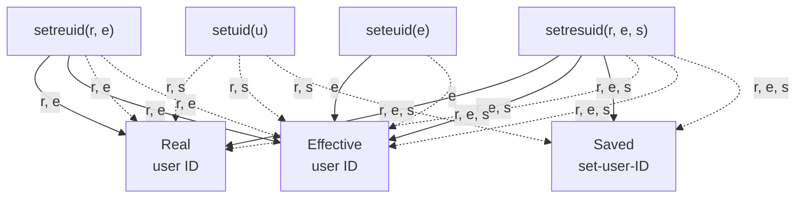

## Chapter 9

## THÔNG TIN ĐỊNH DANH TIẾN TRÌNH (PROCESS CREDENTIALS)

Mỗi tiến trình (process) có một tập hợp các định danh người dùng (UID) và định danh nhóm (GID) dạng số đi kèm. Các định danh này được gọi là thông tin định danh tiến trình (process credentials).

--- Các định danh này bao gồm:

- UID và GID thực (real user ID and group ID);
- UID và GID hiệu dụng (effective user ID and group ID);
- UID và GID thiết lập đã lưu (saved set-user-ID and saved set-group-ID);
- UID và GID hệ thống tập tin (file-system user ID and group ID) (đặc thù của Linux); và
- Các GID bổ sung (supplementary group IDs).

Trong chương này, chúng ta sẽ tìm hiểu chi tiết về mục đích của các định danh tiến trình này, đồng thời mô tả các lời gọi hệ thống (system call) và hàm thư viện có thể được sử dụng để truy xuất và thay đổi chúng. Chúng ta cũng thảo luận về khái niệm tiến trình đặc quyền (privileged process) và tiến trình phi đặc quyền (unprivileged process), cũng như việc sử dụng các cơ chế set-user-ID và set-group-ID, cho phép tạo ra các chương trình chạy với quyền hạn của một người dùng hoặc nhóm được chỉ định.

## 9.1 UID thực và GID thực (Real User ID and Real Group ID)

UID thực và GID thực xác định người dùng và nhóm mà tiến trình trực thuộc. Là một phần của quá trình đăng nhập (login process), shell đăng nhập lấy UID và GID thực của nó từ trường thứ ba và thứ tư trong bản ghi mật khẩu của người dùng có trong tệp `/etc/passwd` (Mục [8.1](#page-0-1)). Khi một tiến trình mới được tạo (ví dụ: khi shell thực thi một chương trình), nó sẽ thừa hưởng các định danh này từ tiến trình cha của mình.

## 9.2 UID hiệu dụng và GID hiệu dụng (Effective User ID and Effective Group ID)

Trên hầu hết các hệ thống cài đặt UNIX (Linux có đôi chút khác biệt, được giải thích ở Mục [9.5\)](#page-18-0), UID hiệu dụng và GID hiệu dụng, kết hợp với các GID bổ sung, được sử dụng để xác định các quyền được cấp cho một tiến trình khi nó cố gắng thực hiện các thao tác khác nhau (tức là các system call). Ví dụ, các định danh này quyết định quyền được cấp cho một tiến trình khi nó truy cập các tài nguyên như tệp tin và các đối tượng giao tiếp liên tiến trình System V IPC (System V interprocess communication), vốn cũng có các UID và GID đi kèm để xác định chủ sở hữu của chúng. Như chúng ta sẽ thấy ở Mục 20.5, UID hiệu dụng cũng được kernel sử dụng để xác định xem một tiến trình có thể gửi tín hiệu (signal) tới tiến trình khác hay không.

Một tiến trình có UID hiệu dụng bằng 0 (UID của `root`) sở hữu toàn bộ quyền hạn của siêu người dùng (superuser). Một tiến trình như vậy được gọi là tiến trình đặc quyền (privileged process). Một số system call nhất định chỉ có thể được thực thi bởi các tiến trình đặc quyền.

> Trong Chương 39, chúng tôi mô tả việc cài đặt các khả năng (capabilities) trong Linux, một cơ chế phân tách các quyền hạn được cấp cho siêu người dùng thành nhiều thành phần riêng biệt có thể được bật và tắt một cách độc lập.

Thông thường, UID và GID hiệu dụng có giá trị giống với các ID thực tương ứng, nhưng có hai cách khiến các ID hiệu dụng này có thể nhận các giá trị khác nhau. Một cách là thông qua việc sử dụng các system call mà chúng ta sẽ thảo luận ở Mục [9.7](#page-19-0). Cách thứ hai là thông qua việc thực thi các chương trình set-user-ID và set-group-ID.

## 9.3 Chương trình Set-User-ID và Set-Group-ID

Một chương trình set-user-ID cho phép một tiến trình (process) có được các đặc quyền (privileges) mà thông thường nó không có, bằng cách thiết lập ID người dùng hiệu dụng (effective user ID) của tiến trình bằng với ID người dùng (chủ sở hữu) của tệp thực thi. Chương trình set-group-ID thực hiện nhiệm vụ tương tự đối với ID nhóm hiệu dụng (effective group ID) của tiến trình. (Các thuật ngữ chương trình set-user-ID và chương trình set-group-ID đôi khi được viết tắt là chương trình set-UID và chương trình set-GID).

Giống như bất kỳ tệp nào khác, một tệp chương trình thực thi có một ID người dùng và ID nhóm đi kèm, xác định quyền sở hữu của tệp đó. Ngoài ra, một tệp thực thi có hai bit quyền đặc biệt: các bit set-user-ID và set-group-ID. (Trên thực tế, mọi tệp đều có hai bit quyền này, nhưng việc sử dụng chúng với các tệp thực thi mới là điều chúng ta quan tâm ở đây). Các bit quyền này được thiết lập bằng cách sử dụng lệnh `chmod`. Người dùng không có đặc quyền (unprivileged user) có thể đặt các bit này cho các tệp do họ sở hữu. Người dùng có đặc quyền (`CAP_FOWNER`) có thể đặt các bit này cho bất kỳ tệp nào. Dưới đây là một ví dụ:

```bash
$ su
Password:
## ls -l prog
-rwxr-xr-x 1 root root 302585 Jun 26 15:05 prog
## chmod u+s prog Turn on set-user-ID permission bit
## chmod g+s prog Turn on set-group-ID permission bit
```

Như được minh họa trong ví dụ này, một chương trình có thể được bật cả hai bit này, mặc dù điều này ít khi xảy ra. Khi sử dụng `ls -l` để liệt kê quyền của một chương trình đã được bật bit set-user-ID hoặc set-group-ID, ký tự `x` thông thường dùng để biểu thị quyền thực thi (execute permission) sẽ được thay thế bằng ký tự `s`:

```bash
## ls -l prog
-rwsr-sr-x 1 root root 302585 Jun 26 15:05 prog
```

---

Khi một chương trình set-user-ID được chạy (tức là được tải vào bộ nhớ của tiến trình thông qua hàm `exec()`), kernel sẽ đặt effective user ID của tiến trình trùng với ID người dùng của tệp thực thi. Việc chạy một chương trình set-group-ID cũng mang lại hiệu quả tương tự đối với effective group ID của tiến trình. Việc thay đổi effective user ID hoặc group ID theo cách này sẽ cấp cho tiến trình (nói cách khác là người dùng đang thực thi chương trình) các quyền hạn mà thông thường họ không có. Ví dụ, nếu một tệp thực thi thuộc sở hữu của `root` (superuser) và được bật bit quyền set-user-ID, thì tiến trình sẽ có được các đặc quyền của siêu người dùng (superuser privileges) khi chương trình đó được chạy.

Các chương trình set-user-ID và set-group-ID cũng có thể được thiết kế để thay đổi các ID hiệu dụng của tiến trình thành một giá trị khác ngoài `root`. Ví dụ, để cung cấp quyền truy cập vào một tệp được bảo vệ (hoặc tài nguyên hệ thống khác), có thể chỉ cần tạo một ID người dùng (nhóm) chuyên biệt có các đặc quyền cần thiết để truy cập tệp đó, và tạo một chương trình set-user-ID (set-group-ID) có chức năng thay đổi effective user ID (group ID) của tiến trình thành ID đó. Điều này cho phép chương trình truy cập tệp mà không cấp cho nó toàn bộ các đặc quyền của superuser.

Đôi khi, chúng ta sẽ sử dụng thuật ngữ set-user-ID-root để phân biệt một chương trình set-user-ID thuộc sở hữu của `root` với chương trình thuộc sở hữu của một người dùng khác, vốn chỉ cấp cho tiến trình các đặc quyền được gán cho người dùng đó.

> Giờ đây, chúng ta bắt đầu sử dụng thuật ngữ đặc quyền (privileged) theo hai nghĩa khác nhau. Một nghĩa là theo định nghĩa trước đó: một tiến trình có effective user ID bằng 0, sở hữu toàn bộ các đặc quyền được cấp cho `root`. Tuy nhiên, khi chúng ta bàn về một chương trình set-user-ID thuộc sở hữu của một người dùng không phải `root`, đôi khi chúng ta sẽ đề cập đến việc tiến trình có được các đặc quyền gán cho ID người dùng của chương trình set-user-ID đó. Ý nghĩa nào của thuật ngữ privileged được dùng trong từng trường hợp sẽ được làm rõ dựa vào ngữ cảnh.

> Vì những lý do mà chúng ta sẽ giải thích trong Mục 38.3, các bit quyền set-user-ID và set-group-ID sẽ không có bất kỳ tác dụng nào đối với các tập lệnh shell (shell scripts) trên Linux.

Các ví dụ về chương trình set-user-ID thường được sử dụng trên Linux bao gồm: `passwd(1)`, dùng để thay đổi mật khẩu của người dùng; `mount(8)` và `umount(8)`, dùng để gắn kết (mount) và gỡ gắn kết (unmount) hệ thống tệp (file systems); và `su(1)`, cho phép người dùng chạy một shell dưới một ID người dùng khác. Một ví dụ về chương trình set-group-ID là `wall(1)`, dùng để ghi thông báo tới tất cả các terminal thuộc nhóm `tty` (thông thường, mọi terminal đều thuộc nhóm này).

Trong [Mục 8.5](#page-9-1), chúng ta đã lưu ý rằng chương trình trong Liệt kê [8-2](#page-11-0) cần phải được chạy từ một tài khoản đăng nhập `root` để nó có thể truy cập tệp `/etc/shadow`. Chúng ta có thể làm cho chương trình này có thể chạy được bởi bất kỳ người dùng nào bằng cách biến nó thành một chương trình set-user-ID-root, như sau:

```bash
$ su
Password:
## chown root check_password Make this program owned by root
## chmod u+s check_password With the set-user-ID bit enabled
## ls -l check_password
-rwsr-xr-x 1 root users 18150 Oct 28 10:49 check_password
## exit
$ whoami This is an unprivileged login
mtk
$ ./check_password But we can now access the shadow
Username: avr password file using this program
Password:
Successfully authenticated: UID=1001
```

---

Kỹ thuật set-user-ID/set-group-ID là một công cụ hữu ích và mạnh mẽ, nhưng cũng có thể dẫn đến các lỗ hổng bảo mật (security breaches) trong các ứng dụng được thiết kế kém. Trong Chương 38, chúng tôi liệt kê một tập hợp các phương pháp hay nhất (good practices) cần tuân thủ khi viết các chương trình set-user-ID và set-group-ID.

## 9.4 Saved Set-User-ID và Saved Set-Group-ID

Saved set-user-ID và saved set-group-ID được thiết kế để sử dụng với các chương trình set-user-ID và set-group-ID. Khi một chương trình được thực thi, các bước sau đây (cùng với nhiều bước khác) sẽ diễn ra:

- 1. Nếu bit quyền set-user-ID (set-group-ID) được bật trên tệp thực thi, thì effective user (group) ID của process sẽ được đặt giống với chủ sở hữu (owner) của tệp thực thi đó. Nếu bit set-user-ID (set-group-ID) không được thiết lập, sẽ không có thay đổi nào được thực hiện đối với effective user (group) ID của process.
- 2. Các giá trị của saved set-user-ID và saved set-group-ID được sao chép từ các effective ID tương ứng. Việc sao chép này diễn ra bất kể bit set-user-ID hoặc set-group-ID có được thiết lập trên tệp đang được thực thi hay không.

Là một ví dụ về hiệu ứng của các bước trên, giả sử một process có real user ID, effective user ID và saved set-user-ID đều là 1000 thực hiện gọi hàm `exec` một chương trình set-user-ID thuộc sở hữu của root (user ID 0). Sau khi thực hiện `exec`, các user ID của process sẽ thay đổi như sau:

```
real=1000 effective=0 saved=0
```

Các system call khác nhau cho phép một chương trình set-user-ID chuyển đổi effective user ID của nó giữa giá trị real user ID và saved set-user-ID. Các system call tương tự cho phép chương trình set-group-ID sửa đổi effective group ID của nó. Bằng cách này, chương trình có thể tạm thời từ bỏ và lấy lại bất kỳ đặc quyền (privileges) nào liên quan đến user (group) ID của tệp được `exec`. (Nói cách khác, chương trình có thể chuyển đổi giữa các trạng thái có khả năng có đặc quyền và thực tế đang hoạt động với đặc quyền). Như chúng ta sẽ trình bày chi tiết trong Mục 38.2, việc lập trình an toàn (secure programming practice) đối với các chương trình set-user-ID và set-group-ID là hoạt động dưới ID không có đặc quyền (tức là real ID) bất cứ khi nào chương trình không thực sự cần thực hiện bất kỳ thao tác nào liên quan đến ID có đặc quyền (tức là saved set ID).

> Saved set-user-ID và saved set-group-ID đôi khi được gọi đồng nghĩa là saved user ID và saved group ID.

Saved set ID là một phát minh của System V được POSIX tiếp nhận. Chúng không được cung cấp trên các phiên bản BSD trước 4.4. Tiêu chuẩn POSIX.1 ban đầu coi việc hỗ trợ các ID này là tùy chọn, nhưng các tiêu chuẩn sau đó (bắt đầu từ FIPS 151-1 vào năm 1988) đã bắt buộc phải hỗ trợ.

## 9.5 File-System User ID và File-System Group ID

Trên Linux, file-system user ID và group ID, chứ không phải effective user ID và group ID, mới là các ID được sử dụng (kết hợp với supplementary group IDs) để xác định quyền hạn khi thực hiện các thao tác trên hệ thống tệp (file-system operations) như mở tệp, thay đổi quyền sở hữu tệp và sửa đổi quyền của tệp. (Các effective ID vẫn được sử dụng, giống như trên các hệ thống UNIX khác, cho các mục đích khác đã được mô tả trước đó).

Thông thường, file-system user ID và group ID có giá trị giống với các effective ID tương ứng (và do đó thường giống với các real ID tương ứng). Hơn nữa, bất cứ khi nào effective user ID hoặc group ID thay đổi, dù là bằng một system call hay bằng việc thực thi một chương trình set-user-ID hoặc set-group-ID, file-system ID tương ứng cũng được thay đổi thành cùng giá trị đó. Vì các file-system ID tuân theo các effective ID theo cách này, điều này có nghĩa là Linux hoạt động hiệu quả giống hệt như bất kỳ bản cài đặt UNIX nào khác khi các đặc quyền và quyền hạn được kiểm tra. File-system ID chỉ khác với các effective ID tương ứng, và do đó Linux khác với các hệ thống UNIX khác, khi chúng ta sử dụng hai system call đặc trưng của Linux là `setfsuid()` và `setfsgid()` để làm cho chúng khác biệt một cách rõ ràng.

Tại sao Linux lại cung cấp các file-system ID và trong những trường hợp nào chúng ta muốn effective ID và file-system ID khác nhau? Lý do chủ yếu mang tính lịch sử. Các file-system ID lần đầu tiên xuất hiện trong Linux 1.2. Trong phiên bản kernel đó, một process có thể gửi một signal tới process khác nếu effective user ID của bên gửi khớp với real hoặc effective user ID của process mục tiêu. Điều này ảnh hưởng đến một số chương trình nhất định như chương trình máy chủ Linux NFS (Network File System), vốn cần có khả năng truy cập các tệp như thể nó có effective ID của process client tương ứng. Tuy nhiên, nếu máy chủ NFS thay đổi effective user ID của nó, nó sẽ dễ bị tổn thương trước các signal từ các user process không có đặc quyền. Để ngăn chặn khả năng này, file-system user ID và group ID riêng biệt đã được tạo ra. Bằng cách giữ nguyên effective ID nhưng thay đổi file-system ID của mình, máy chủ NFS có thể đóng giả làm một user khác nhằm mục đích truy cập tệp mà không bị rủi ro trước các signal từ các user process.

Từ kernel 2.0 trở đi, Linux đã áp dụng các quy tắc do SUSv3 bắt buộc liên quan đến quyền gửi signal, và các quy tắc này không liên quan đến effective user ID của process mục tiêu (tham khảo Mục 20.5). Do đó, tính năng file-system ID không còn hoàn toàn cần thiết nữa (ngày nay một process có thể đạt được kết quả mong muốn bằng cách sử dụng một cách khôn ngoan các system call được mô tả sau trong chương này để thay đổi giá trị của effective user ID thành và từ giá trị không có đặc quyền, tùy theo yêu cầu), nhưng nó vẫn được giữ lại để tương thích với phần mềm hiện có.

Vì các ID hệ thống tệp (file-system ID) có phần hơi đặc biệt và chúng thường có giá trị giống với các ID hiệu dụng (effective ID) tương ứng, nên trong phần còn lại của cuốn sách này, chúng ta nhìn chung sẽ mô tả các bước kiểm tra quyền truy cập tệp khác nhau, cũng như việc thiết lập quyền sở hữu cho các tệp mới, thông qua các ID hiệu dụng của một tiến trình (process). Mặc dù các ID hệ thống tệp của tiến trình thực sự được sử dụng cho các mục đích này trên Linux, nhưng trên thực tế, sự hiện diện của chúng hiếm khi tạo ra sự khác biệt hiệu dụng nào.

## 9.6 ID Nhóm Phụ (Supplementary Group IDs)

ID nhóm phụ (supplementary group ID) là một tập hợp các nhóm bổ sung mà một tiến trình thuộc về. Một tiến trình mới sẽ kế thừa các ID này từ tiến trình cha của nó. Một shell đăng nhập (login shell) lấy các ID nhóm phụ của nó từ tệp nhóm của hệ thống. Như đã lưu ý ở trên, các ID này được sử dụng kết hợp với các ID hiệu dụng và ID hệ thống tệp để xác định quyền truy cập vào các tệp, các đối tượng IPC System V (System V IPC objects) và các tài nguyên hệ thống khác.

## 9.7 Truy Vấn và Sửa Đổi Thông Tin Xác Thực Tiến Trình (Process Credentials)

Linux cung cấp một loạt các System Call và hàm thư viện để truy vấn và thay đổi các ID người dùng (user ID) và ID nhóm (group ID) khác nhau mà chúng ta đã mô tả trong chương này. Chỉ một số API trong số này được quy định trong SUSv3. Trong số các API còn lại, một số được hỗ trợ rộng rãi trên các bản cài đặt UNIX khác và một số ít là đặc thù của Linux (Linux-specific). Chúng tôi sẽ lưu ý các vấn đề về khả năng tương thích (portability) khi mô tả từng giao diện. Gần cuối chương này, Bảng 9-1 sẽ tóm tắt hoạt động của tất cả các giao diện được sử dụng để thay đổi thông tin xác thực của tiến trình.

Như một giải pháp thay thế cho việc sử dụng các System Call được mô tả trong các trang tiếp theo, thông tin xác thực của bất kỳ tiến trình nào cũng có thể được tìm thấy bằng cách kiểm tra các dòng `Uid`, `GiD` và `Groups` có trong tệp đặc thù của Linux `/proc/PID/status`. Các dòng `Uid` và `Gid` liệt kê các định danh theo thứ tự: thực (real), hiệu dụng (effective), đã lưu (saved set) và hệ thống tệp (file system).

Trong các phần tiếp theo, chúng ta sử dụng định nghĩa truyền thống về một tiến trình có đặc quyền (privileged process) là tiến trình có ID người dùng hiệu dụng bằng 0. Tuy nhiên, Linux chia khái niệm đặc quyền siêu người dùng (superuser privileges) thành các khả năng (capability) riêng biệt, như được mô tả trong Chương 39. Có hai khả năng liên quan đến tất cả các System Call được sử dụng để thay đổi ID người dùng và ID nhóm của tiến trình:

- Khả năng `CAP_SETUID` cho phép một tiến trình thực hiện các thay đổi tùy ý đối với các ID người dùng của nó.
- Khả năng `CAP_SETGID` cho phép một tiến trình thực hiện các thay đổi tùy ý đối với các ID nhóm của nó.

### 9.7.1 Truy Vấn và Sửa Đổi ID Thực, Hiệu Dụng và Đã Lưu

Trong các đoạn tiếp theo, chúng tôi mô tả các System Call dùng để truy vấn và sửa đổi các ID thực (real ID), hiệu dụng (effective ID) và đã lưu (saved set ID). Có một số System Call thực hiện các tác vụ này và trong một số trường hợp, chức năng của chúng chồng chéo lên nhau, phản ánh thực tế là các System Call này bắt nguồn từ các bản cài đặt UNIX khác nhau.

### Truy vấn ID thực và hiệu dụng

Các System Call `getuid()` và `getgid()` lần lượt trả về ID người dùng thực và ID nhóm thực của tiến trình gọi. Các System Call `geteuid()` và `getegid()` thực hiện các tác vụ tương ứng đối với các ID hiệu dụng. Các System Call này luôn thực hiện thành công.

```c
## include <unistd.h>
uid_t getuid(void);
                                           /* Trả về real user ID của tiến trình gọi */
uid_t geteuid(void);
                                      /* Trả về effective user ID của tiến trình gọi */
gid_t getgid(void);
                                         /* Trả về real group ID của tiến trình gọi */
gid_t getegid(void);
                                     /* Trả về effective group ID của tiến trình gọi */
```

### Sửa đổi ID hiệu dụng

Lời gọi hệ thống `setuid()` thay đổi effective user ID — và có thể cả real user ID lẫn saved set-user-ID — của tiến trình gọi thành giá trị được chỉ định bởi tham số `uid`. Lời gọi hệ thống `setgid()` thực hiện tác vụ tương tự đối với các group ID tương ứng.

```c
## include <unistd.h>
int setuid(uid_t uid);
int setgid(gid_t gid);
                                         /* Cả hai đều trả về 0 khi thành công, hoặc -1 khi lỗi */
```

---

Các quy tắc về việc những thay đổi nào mà một tiến trình có thể thực hiện đối với thông tin xác thực của nó bằng cách sử dụng `setuid()` và `setgid()` phụ thuộc vào việc tiến trình đó có đặc quyền hay không (tức là có ID người dùng hiệu dụng bằng 0 hay không). Các quy tắc sau đây áp dụng cho `setuid()`:

- 1. Khi một tiến trình không có đặc quyền (unprivileged process) gọi `setuid()`, chỉ có ID người dùng hiệu dụng của tiến trình đó bị thay đổi. Hơn nữa, nó chỉ có thể được thay đổi thành giá trị giống với ID người dùng thực hoặc ID người dùng đã lưu. (Các cố gắng vi phạm ràng buộc này sẽ trả về lỗi `EPERM`). Điều này có nghĩa là đối với người dùng không có đặc quyền, lệnh gọi này chỉ hữu ích khi thực thi một chương trình set-user-ID, bởi vì đối với việc thực thi các chương trình thông thường, ID người dùng thực, ID người dùng hiệu dụng và ID người dùng đã lưu của tiến trình đều có cùng một giá trị. Trên một số bản cài đặt có nguồn gốc từ BSD, các lệnh gọi `setuid()` hoặc `setgid()` bởi một tiến trình không có đặc quyền có ngữ nghĩa khác với các bản cài đặt UNIX khác: các lệnh gọi này thay đổi các ID thực, hiệu dụng và đã lưu (thành giá trị của ID thực hoặc hiệu dụng hiện tại).

- 2. Khi một tiến trình có đặc quyền (privileged process) thực thi hàm `setuid()` với một tham số khác 0, thì Real User ID, Effective User ID và Saved Set-User-ID đều được đặt thành giá trị được chỉ định trong tham số `uid`. Đây là một chiều đi (one-way trip), theo nghĩa là một khi tiến trình có đặc quyền đã thay đổi các định danh của nó theo cách này, nó sẽ mất tất cả các đặc quyền (privileges) và do đó không thể tiếp tục sử dụng `setuid()` để đặt lại các định danh về 0. Nếu không muốn điều này xảy ra, thì nên sử dụng `seteuid()` hoặc `setreuid()`—mà chúng ta sẽ mô tả ngay sau đây—thay vì `setuid()`.

Các quy tắc chi phối các thay đổi có thể được thực hiện đối với Group ID bằng cách sử dụng `setgid()` cũng tương tự, nhưng thay `setgid()` cho `setuid()` và group cho user. Với những thay đổi này, quy tắc 1 được áp dụng chính xác như đã nêu. Ở quy tắc 2, vì việc thay đổi Group ID không làm cho tiến trình mất đi các đặc quyền (vốn được xác định bởi Effective User ID), nên các chương trình có đặc quyền có thể sử dụng `setgid()` để tự do thay đổi Group ID thành bất kỳ giá trị mong muốn nào.

Lời gọi hàm sau đây là phương pháp được ưu tiên cho chương trình set-user-ID-root có Effective User ID hiện tại là 0 để từ bỏ vĩnh viễn tất cả các đặc quyền (bằng cách đặt cả Effective User ID và Saved Set-User-ID thành cùng một giá trị với Real User ID):

```c
if (setuid(getuid()) == -1)
 errExit("setuid");
```

Một chương trình set-user-ID thuộc sở hữu của một người dùng không phải là root có thể sử dụng `setuid()` để chuyển đổi Effective User ID giữa các giá trị của Real User ID và Saved Set-User-ID vì các lý do bảo mật được mô tả trong Mục [9.4](#page-17-0). Tuy nhiên, `seteuid()` được ưu tiên hơn cho mục đích này, vì nó có cùng hiệu ứng, bất kể chương trình set-user-ID có thuộc sở hữu của root hay không.

Một tiến trình có thể sử dụng `seteuid()` để thay đổi Effective User ID của nó (thành giá trị được chỉ định bởi `euid`), và `setegid()` để thay đổi Effective Group ID của nó (thành giá trị được chỉ định bởi `egid`).

```c
## include <unistd.h>
int seteuid(uid_t euid);
int setegid(gid_t egid);
                                         /* Cả hai đều trả về 0 khi thành công, hoặc -1 khi lỗi */
```

---

Các quy tắc sau đây chi phối các thay đổi mà một tiến trình có thể thực hiện đối với các Effective ID của nó bằng cách sử dụng `seteuid()` và `setegid()`:

- 1. Một tiến trình không có đặc quyền (unprivileged process) chỉ có thể thay đổi một Effective ID thành cùng giá trị với Real ID hoặc Saved Set ID tương ứng. (Nói cách khác, đối với một tiến trình không có đặc quyền, `seteuid()` và `setegid()` có hiệu ứng lần lượt giống như `setuid()` và `setgid()`, ngoại trừ các vấn đề về tính khả portable của BSD đã lưu ý trước đó.)
- 2. Một tiến trình có đặc quyền có thể thay đổi một Effective ID thành bất kỳ giá trị nào. Nếu một tiến trình có đặc quyền sử dụng `seteuid()` để thay đổi Effective User ID của nó thành một giá trị khác 0, thì nó sẽ không còn là tiến trình có đặc quyền nữa (nhưng có thể lấy lại đặc quyền thông qua quy tắc trước đó).

Sử dụng `seteuid()` là phương pháp được ưu tiên cho các chương trình set-user-ID và set-group-ID để tạm thời từ bỏ và sau đó lấy lại các đặc quyền. Dưới đây là một ví dụ:

```c
euid = geteuid(); /* Lưu Effective User ID ban đầu (giống
 như Saved Set-User-ID) */
if (seteuid(getuid()) == -1) /* Từ bỏ đặc quyền */
 errExit("seteuid");
if (seteuid(euid) == -1) /* Lấy lại đặc quyền */
 errExit("seteuid");
```

Ban đầu được bắt nguồn từ BSD, `seteuid()` và `setegid()` giờ đây được quy định trong SUSv3 và xuất hiện trên hầu hết các cài đặt UNIX.

Trong các phiên bản cũ hơn của thư viện GNU C (glibc 2.0 trở về trước), `seteuid(euid)` được hiện thực dưới dạng `setreuid(–1, euid)`. Trong các phiên bản glibc hiện đại, `seteuid(euid)` được hiện thực dưới dạng `setresuid(–1, euid, –1)`. (Chúng ta sẽ mô tả `setreuid()`, `setresuid()` và các hàm tương đương cho group của chúng ngay sau đây). Cả hai cách hiện thực đều cho phép chúng ta chỉ định `euid` có cùng giá trị với Effective User ID hiện tại (tức là không thay đổi). Tuy nhiên, SUSv3 không quy định hành vi này cho `seteuid()`, và nó không khả thi trên một số cài đặt UNIX khác. Nhìn chung, sự biến đổi tiềm ẩn này giữa các cài đặt không rõ ràng, vì trong các trường hợp bình thường, Effective User ID có cùng giá trị với Real User ID hoặc Saved Set-User-ID. (Cách duy nhất để chúng ta làm cho Effective User ID khác với cả Real User ID và Saved Set-User-ID trên Linux là thông qua việc sử dụng system call phi chuẩn `setresuid()`.)

Trong tất cả các phiên bản của glibc (bao gồm cả các phiên bản hiện đại), `setegid(egid)` được hiện thực dưới dạng `setregid(–1, egid)`. Giống như `seteuid()`, điều này có nghĩa là chúng ta có thể chỉ định `egid` có cùng giá trị với Effective Group ID hiện tại, mặc dù hành vi này không được quy định trong SUSv3. Điều đó cũng có nghĩa là `setegid()` sẽ làm thay đổi Saved Set-Group-ID nếu Effective Group ID được đặt thành một giá trị khác với Real Group ID hiện tại. (Một nhận xét tương tự áp dụng cho cách hiện thực cũ hơn của `seteuid()` bằng cách sử dụng `setreuid()`.) Một lần nữa, hành vi này không được quy định trong SUSv3.

### Sửa đổi Real và Effective ID

System call `setreuid()` cho phép tiến trình gọi (calling process) độc lập thay đổi các giá trị Real và Effective User ID của nó. System call `setregid()` thực hiện tác vụ tương tự đối với Real và Effective Group ID.

```c
## include <unistd.h>
int setreuid(uid_t ruid, uid_t euid);
int setregid(gid_t rgid, gid_t egid);
                                         /* Cả hai đều trả về 0 khi thành công, hoặc -1 khi lỗi */
```

---

Tham số đầu tiên của mỗi System Call này là Real ID (ID thực) mới. Tham số thứ hai là Effective ID (ID hiệu dụng) mới. Nếu chúng ta chỉ muốn thay đổi một trong các định danh, chúng ta có thể chỉ định giá trị `-1` cho tham số còn lại.

Ban đầu bắt nguồn từ BSD, `setreuid()` và `setregid()` hiện được quy định trong SUSv3 và có sẵn trên hầu hết các hệ thống UNIX.

Giống như các System Call khác được mô tả trong phần này, có các quy tắc chi phối các thay đổi mà chúng ta có thể thực hiện bằng cách sử dụng `setreuid()` và `setregid()`. Chúng ta mô tả các quy tắc này từ góc độ của `setreuid()`, với ngầm hiểu rằng `setregid()` cũng tương tự, ngoại trừ các điểm được lưu ý:

1. Một Process ( tiến trình) không có đặc quyền (unprivileged process) chỉ có thể đặt lại Real User ID thành giá trị hiện tại của Real User ID (tức là không thay đổi) hoặc Effective User ID. Effective User ID chỉ có thể được đặt thành giá trị hiện tại của Real User ID, Effective User ID (tức là không thay đổi), hoặc Saved Set-User-ID (ID thiết lập người dùng đã lưu).

SUSv3 nêu rõ rằng việc một Process không có đặc quyền có thể sử dụng `setreuid()` để thay đổi giá trị của Real User ID thành giá trị hiện tại của Real User ID, Effective User ID hoặc Saved Set-User-ID hay không là không được xác định rõ (unspecified), và các chi tiết chính xác về những thay đổi nào có thể được thực hiện đối với Real User ID sẽ khác nhau tùy theo từng cài đặt (implementation).

SUSv3 mô tả hành vi hơi khác đối với `setregid()`: một Process không có đặc quyền có thể đặt Real Group ID thành giá trị hiện tại của Saved Set-Group-ID hoặc đặt Effective Group ID thành giá trị hiện tại của Real Group ID hoặc Saved Set-Group-ID. Một lần nữa, các chi tiết chính xác về những thay đổi có thể được thực hiện sẽ khác nhau giữa các cài đặt.

- 2. Một tiến trình có đặc quyền (privileged process) có thể thực hiện bất kỳ thay đổi nào đối với các ID.
- 3. Đối với cả tiến trình có đặc quyền và không có đặc quyền, saved set-user-ID cũng được đặt thành cùng giá trị với effective user ID (mới) nếu một trong các điều kiện sau là đúng:

---

  - a) `ruid` không phải là `-1` (tức là Real User ID đang được thiết lập, ngay cả khi đặt thành giá trị mà nó đã có sẵn), hoặc
  - b) Effective User ID đang được thiết lập thành một giá trị khác với giá trị của Real User ID trước thời điểm gọi hàm.

Ngược lại, nếu một Process chỉ sử dụng `setreuid()` để thay đổi Effective User ID thành cùng giá trị với Real User ID hiện tại, thì Saved Set-User-ID sẽ không thay đổi, và một lần gọi `setreuid()` (hoặc `seteuid()`) sau đó có thể khôi phục Effective User ID về giá trị Saved Set-User-ID. (SUSv3 không quy định ảnh hưởng của `setreuid()` và `setregid()` đối với các Saved Set ID, nhưng SUSv4 quy định rõ hành vi được mô tả ở đây).

Quy tắc thứ ba cung cấp một cách thức để một chương trình set-user-ID có thể từ bỏ vĩnh viễn đặc quyền của nó, bằng cách sử dụng một lệnh gọi như sau:

```c
setreuid(getuid(), getuid());
```

Một Process set-user-ID-root muốn thay đổi cả thông tin định danh (credential) người dùng và nhóm của nó thành các giá trị tùy ý trước tiên nên gọi `setregid()` và sau đó gọi `setreuid()`. Nếu các lệnh gọi được thực hiện theo thứ tự ngược lại, lệnh gọi `setregid()` sẽ thất bại, bởi vì chương trình sẽ không còn đặc quyền sau lệnh gọi `setreuid()`. Các nhận xét tương tự cũng áp dụng nếu chúng ta đang sử dụng `setresuid()` và `setresgid()` (được mô tả bên dưới) cho mục đích này.

> Các phiên bản BSD cho đến và bao gồm cả 4.3BSD không có Saved Set-User-ID và Saved Set-Group-ID (hiện nay được bắt buộc bởi SUSv3). Thay vào đó, trên BSD, `setreuid()` và `setregid()` cho phép một Process từ bỏ và lấy lại đặc quyền bằng cách hoán đổi qua lại các giá trị của Real ID và Effective ID. Điều này có tác dụng phụ không mong muốn là làm thay đổi Real User ID chỉ để thay đổi Effective User ID.

### Truy xuất Real, Effective và Saved Set ID

Trên hầu hết các cài đặt UNIX, một Process không thể trực tiếp truy xuất (hoặc cập nhật) Saved Set-User-ID và Saved Set-Group-ID của chính nó. Tuy nhiên, Linux cung cấp hai System Call (phi tiêu chuẩn) cho phép chúng ta làm điều đó: `getresuid()` và `getresgid()`.

```c
## define _GNU_SOURCE
## include <unistd.h>
int getresuid(uid_t *ruid, uid_t *euid, uid_t *suid);
int getresgid(gid_t *rgid, gid_t *egid, gid_t *sgid);
                                         /* Cả hai đều trả về 0 khi thành công, hoặc -1 khi lỗi */
```

---

System Call `getresuid()` trả về các giá trị hiện tại của Real User ID, Effective User ID và Saved Set-User-ID của Process gọi hàm vào các vị trí được trỏ tới bởi ba tham số của nó. System Call `getresgid()` cũng thực hiện thao tác tương tự đối với các Group ID tương ứng.

### Sửa đổi Real, Effective và Saved Set ID

System Call `setresuid()` cho phép Process gọi hàm thay đổi độc lập giá trị của cả ba User ID của nó. Các giá trị mới cho từng User ID được chỉ định bởi ba tham số của System Call. System Call `setresgid()` thực hiện tác vụ tương tự đối với các Group ID.

```c
## define _GNU_SOURCE
## include <unistd.h>
int setresuid(uid_t ruid, uid_t euid, uid_t suid);
int setresgid(gid_t rgid, gid_t egid, gid_t sgid);
                                         /* Cả hai đều trả về 0 khi thành công, hoặc -1 khi lỗi */
```

Nếu không muốn thay đổi toàn bộ các định danh, việc chỉ định giá trị `-1` cho một tham số sẽ giữ nguyên định danh tương ứng. Ví dụ, lời gọi sau tương đương với `seteuid(x)`:

```c
setresuid(-1, x, -1);
```

Các quy tắc chi phối các thay đổi có thể thực hiện bởi `setresuid()` (`setresgid()` tương tự) như sau:

- 1. Một tiến trình không có đặc quyền (unprivileged process) có thể đặt bất kỳ ID nào trong số real user ID, effective user ID và saved set-user-ID thành bất kỳ giá trị nào hiện đang có trong real user ID, effective user ID hoặc saved set-user-ID của nó.

---

- 2. Một tiến trình có đặc quyền (privileged process) có thể thực hiện các thay đổi tùy ý đối với real user ID, effective user ID, và saved set-user-ID của nó.
- 3. Bất kể lời gọi có thực hiện bất kỳ thay đổi nào đối với các ID khác hay không, ID người dùng hệ thống tệp (file-system user ID) luôn được thiết lập bằng với giá trị của effective user ID (có thể đã được thay đổi mới).

Các lời gọi đến `setresuid()` và `setresgid()` mang tính chất "được ăn cả ngã về không" (all-or-nothing effect). Hoặc là tất cả các định danh được yêu cầu đều được thay đổi thành công, hoặc không có định danh nào được thay đổi. (Nhận xét tương tự cũng áp dụng cho các System Call khác được mô tả trong chương này, những system call làm thay đổi nhiều định danh).

Mặc dù `setresuid()` và `setresgid()` cung cấp API trực quan nhất để thay đổi định danh xác thực của tiến trình (process credentials), chúng ta không thể sử dụng chúng một cách có tính di động (portably) trong các ứng dụng; chúng không được quy định trong SUSv3 và chỉ có sẵn trên một số ít các triển khai UNIX khác.

### 9.7.2 Truy xuất và Sửa đổi ID Hệ thống tệp (File-System IDs)

Tất cả các System Call được mô tả trước đó có tác dụng thay đổi ID nhóm hoặc ID người dùng hiệu dụng của tiến trình (process's effective user or group ID) thì đồng thời cũng luôn thay đổi file-system ID tương ứng. Để thay đổi file-system ID một cách độc lập với effective ID, chúng ta phải sử dụng hai System Call đặc thù của Linux: `setfsuid()` và `setfsgid()`.

```c
## include <sys/fsuid.h>
int setfsuid(uid_t fsuid);
                                  /* Luôn trả về file-system user ID trước đó */
int setfsgid(gid_t fsgid);
                                /* Luôn trả về file-system group ID trước đó */
```

---

System Call `setfsuid()` thay đổi file-system user ID của một tiến trình thành giá trị được chỉ định bởi `fsuid`. System Call `setfsgid()` thay đổi file-system group ID thành giá trị được chỉ định bởi `fsgid`.

Một lần nữa, có các quy tắc về loại thay đổi có thể được thực hiện. Các quy tắc cho `setfsgid()` tương tự như quy tắc cho `setfsuid()`, cụ thể như sau:

- 1. Một tiến trình không có đặc quyền (unprivileged process) có thể thiết lập file-system user ID thành giá trị hiện tại của real user ID, effective user ID, file-system user ID (tức là không thay đổi), hoặc saved set-user-ID.
- 2. Một tiến trình có đặc quyền (privileged process) có thể thiết lập file-system user ID thành bất kỳ giá trị nào.

Việc triển khai các lời gọi này có phần chưa được chỉn chu. Đầu tiên, không có các System Call tương ứng nào để truy xuất giá trị hiện tại của file-system ID. Thêm vào đó, các System Call này không thực hiện việc kiểm tra lỗi; nếu một tiến trình không có đặc quyền cố gắng thiết lập file-system ID của nó thành một giá trị không hợp lệ, nỗ lực đó sẽ âm thầm bị bỏ qua. Giá trị trả về từ mỗi System Call này là giá trị trước đó của file-system ID tương ứng, bất kể lời gọi thành công hay thất bại. Do đó, chúng ta có một cách để tìm ra các giá trị hiện tại của file-system ID, nhưng chỉ có thể thực hiện đồng thời khi chúng ta cố gắng (dù thành công hay thất bại) thay đổi chúng.

Việc sử dụng các System Call `setfsuid()` và `setfsgid()` trên Linux hiện không còn cần thiết và nên tránh trong các ứng dụng được thiết kế để có thể chuyển cảng (port) sang các hệ thống UNIX khác.

### 9.7.3 Truy xuất và Sửa đổi ID Nhóm Bổ sung (Supplementary Group IDs)

System Call `getgroups()` trả về tập hợp các nhóm mà tiến trình gọi (calling process) hiện là thành viên, được lưu trong mảng do `grouplist` trỏ tới.

```c
## include <unistd.h>
int getgroups(int gidsetsize, gid_t grouplist[]);
     /* Trả về số lượng group ID được ghi vào grouplist khi thành công, hoặc -1 khi lỗi */
```

---

Trên Linux, cũng như trên hầu hết các hệ thống UNIX, `getgroups()` đơn giản là trả về các supplementary group ID của tiến trình gọi. Tuy nhiên, SUSv3 cũng cho phép một bản triển khai bao gồm cả effective group ID của tiến trình gọi trong mảng `grouplist` được trả về.

Chương trình gọi phải cấp phát mảng `grouplist` và chỉ định độ dài của nó trong tham số `gidsetsize`. Khi hoàn tất thành công, `getgroups()` trả về số lượng group ID được đặt vào `grouplist`.

Nếu số lượng nhóm mà một tiến trình là thành viên vượt quá `gidsetsize`, `getgroups()` sẽ trả về một lỗi (EINVAL). Để tránh khả năng này, chúng ta có thể định kích thước mảng `grouplist` lớn hơn một đơn vị (để cho phép tính đến khả năng bao gồm effective group ID một cách tương thích di động) so với hằng số `NGROUPS_MAX` (được định nghĩa trong `<limits.h>`), hằng số này xác định số lượng nhóm bổ sung tối đa mà một tiến trình có thể là thành viên. Do đó, chúng ta có thể khai báo `grouplist` như sau:

```

gid_t grouplist[NGROUPS_MAX + 1];

```

Trong các Linux Kernel trước phiên bản 2.6.4, `NGROUPS_MAX` có giá trị là 32. Từ kernel 2.6.4 trở đi, `NGROUPS_MAX` có giá trị là 65.536.

Một ứng dụng cũng có thể xác định giới hạn `NGROUPS_MAX` tại thời điểm chạy (run time) theo các cách sau:

- Gọi `sysconf(_SC_NGROUPS_MAX)`. (Chúng tôi giải thích việc sử dụng `sysconf()` trong Mục [11.2](#page-62-0).)
- Đọc giới hạn từ tệp chỉ đọc, đặc trưng cho Linux `/proc/sys/kernel/ngroups_max`. Tệp này được cung cấp kể từ kernel phiên bản 2.6.4.

Ngoài ra, một ứng dụng có thể gọi hàm `getgroups()` với tham số `gidsetsize` được đặt là 0. Trong trường hợp này, `grouplist` không bị sửa đổi, nhưng giá trị trả về của lời gọi hàm sẽ cho biết số lượng nhóm mà tiến trình (process) là thành viên.

Giá trị thu được bằng bất kỳ kỹ thuật thời gian chạy nào trong số này sau đó có thể được sử dụng để cấp phát động (dynamically allocate) một mảng `grouplist` cho các lần gọi `getgroups()` trong tương lai.

Một tiến trình có đặc quyền (privileged process) có thể sử dụng `setgroups()` và `initgroups()` để thay đổi tập hợp ID nhóm bổ sung (supplementary group ID) của nó.

```c
## define _BSD_SOURCE
## include <grp.h>
int setgroups(size_t gidsetsize, const gid_t *grouplist);
int initgroups(const char *user, gid_t group);
                                         /* Cả hai đều trả về 0 khi thành công, hoặc -1 khi lỗi */
```

---

System Call `setgroups()` thay thế các ID nhóm bổ sung của tiến trình gọi bằng tập hợp được cung cấp trong mảng `grouplist`. Tham số `gidsetsize` chỉ định số lượng ID nhóm có trong tham số mảng `grouplist`.

Hàm `initgroups()` khởi tạo các ID nhóm bổ sung của tiến trình gọi bằng cách quét tệp `/etc/group` và xây dựng một danh sách tất cả các nhóm mà người dùng được chỉ định (`user`) là thành viên. Ngoài ra, ID nhóm được chỉ định trong tham số `group` cũng được thêm vào tập hợp ID nhóm bổ sung của tiến trình.

Những người dùng chính của `initgroups()` là các chương trình tạo phiên đăng nhập (login session)—ví dụ như `login(1)`, chương trình thiết lập các thuộc tính tiến trình khác nhau trước khi thực thi shell đăng nhập của người dùng. Các chương trình như vậy thường lấy giá trị được sử dụng cho tham số `group` bằng cách đọc trường ID nhóm từ bản ghi của người dùng trong tệp mật khẩu (password file). Điều này hơi gây nhầm lẫn, vì ID nhóm từ tệp mật khẩu không thực sự là một nhóm bổ sung; thay vào đó, nó xác định ID người dùng thực (real user ID), ID người dùng hiệu dụng (effective user ID), và ID tập-người-dùng-được-lưu-trữ (saved set-user-ID) ban đầu của login shell. Tuy nhiên, đây là cách mà `initgroups()` thường được sử dụng.

Mặc dù không nằm trong tiêu chuẩn SUSv3, `setgroups()` và `initgroups()` vẫn có sẵn trên tất cả các hệ thống UNIX.

### 9.7.4 Tóm tắt các Lời gọi dùng để Thay đổi Thông tin Xác thực Tiến trình

Bảng 9-1 tóm tắt tác động của các system call và hàm thư viện khác nhau được sử dụng để thay đổi thông tin xác thực tiến trình (process credential).

Hình 9-1 cung cấp cái nhìn tổng quan trực quan về cùng thông tin được đưa ra trong Bảng 9-1. Biểu đồ này thể hiện các khía cạnh từ góc độ của các lời gọi thay đổi ID người dùng, nhưng các quy tắc đối với việc thay đổi ID nhóm cũng tương tự.



**Hình 9-1:** Ảnh hưởng của các hàm thay đổi thông tin xác thực đối với ID người dùng của tiến trình

**Bảng 9-1:** Tóm tắt các giao diện được sử dụng để thay đổi thông tin xác thực tiến trình

| Giao diện                                | Mục đích và tác động trong:                                                                                                                                              | Khả năng tương thích (Portability)                                                  |                                                                          |
|------------------------------------------|-------------------------------------------------------------------------------------------------------------------------------------------------------------------------|-------------------------------------------------------------------------------------|--------------------------------------------------------------------------|
|                                          | tiến trình không có đặc quyền (unprivileged process)                                                                                                                    | tiến trình có đặc quyền (privileged process)                                        |                                                                          |
| setuid(u)<br>setgid(g)                   | Thay đổi effective ID thành<br>cùng giá trị với real ID<br>hoặc saved set ID hiện tại                                                                                    | Thay đổi real, effective,<br>và saved set ID thành<br>bất kỳ giá trị đơn lẻ nào     | Được quy định trong SUSv3;<br>các nhánh BSD có<br>ngữ nghĩa khác biệt     |
| seteuid(e)<br>setegid(e)                 | Thay đổi effective ID thành<br>cùng giá trị với real ID<br>hoặc saved set ID hiện tại                                                                                    | Thay đổi effective ID<br>thành bất kỳ giá trị nào                                    | Được quy định trong SUSv3                                                 |
| setreuid(r, e)<br>setregid(r, e)         | Thay đổi (độc lập) real ID<br>thành real hoặc effective ID hiện tại,<br>và effective ID thành real, effective,<br>hoặc saved set ID hiện tại                            | Thay đổi (độc lập)<br>real và effective ID<br>thành bất kỳ giá trị nào               | Được quy định trong SUSv3,<br>nhưng hoạt động khác nhau<br>tùy cài đặt    |
| setresuid(r, e, s)<br>setresgid(r, e, s) | Thay đổi (độc lập) real, effective,<br>và saved set ID thành cùng giá trị<br>với real, effective, hoặc saved<br>set ID hiện tại                                          | Thay đổi (độc lập) real,<br>effective, và saved set ID<br>thành bất kỳ giá trị nào   | Không có trong SUSv3 và<br>chỉ hỗ trợ trên một số ít<br>hệ UNIX khác      |
| setfsuid(u)<br>setfsgid(u)               | Thay đổi file-system ID thành<br>cùng giá trị với real, effective,<br>file-system, hoặc saved set ID hiện tại                                                           | Thay đổi file-system ID<br>thành bất kỳ giá trị nào                                  | Đặc thù Linux (Linux-specific)                                            |
| setgroups(n, l)                          | Không thể gọi từ một<br>tiến trình phi đặc quyền                                                                                                                         | Thiết lập supplementary<br>group IDs thành bất kỳ<br>giá trị nào                     | Không có trong SUSv3, nhưng<br>có mặt trên mọi bản cài đặt UNIX           |

Lưu ý các thông tin bổ sung sau đây cho Bảng 9-1:

- Cài đặt trong glibc của `seteuid()` (dưới dạng `setresuid(-1, e, -1)`) và `setegid()` (dưới dạng `setregid(-1, e)`) cũng cho phép gán effective ID bằng chính giá trị nó đang giữ, nhưng điều này không được quy định trong SUSv3. Cài đặt `setegid()` cũng thay đổi saved set-group-ID nếu effective group ID được gán thành một giá trị khác với real group ID hiện tại. (SUSv3 không quy định `setegid()` có quyền sửa đổi saved set-group-ID).
- Đối với các lời gọi `setreuid()` và `setregid()` từ cả tiến trình đặc quyền và phi đặc quyền, nếu `r` khác `-1`, hoặc `e` được chỉ định khác giá trị real ID trước lời gọi, thì saved set-user-ID hoặc saved set-group-ID cũng sẽ được gán bằng chính giá trị effective ID (mới). (SUSv3 không quy định `setreuid()` và `setregid()` thay đổi các saved set ID, nhưng SUSv4 đã chuẩn hóa hành vi này).

---

- Bất cứ khi nào ID người dùng (nhóm) hiệu dụng bị thay đổi, ID người dùng (nhóm) hệ thống tệp đặc trưng cho Linux cũng được thay đổi thành cùng giá trị đó.
- Các lời gọi `setresuid()` luôn sửa đổi ID người dùng hệ thống tệp có cùng giá trị với ID người dùng hiệu dụng, bất kể ID người dùng hiệu dụng có bị thay đổi bởi lời gọi đó hay không. Các lời gọi `setresgid()` có tác động tương tự đối với ID nhóm hệ thống tệp.

### 9.7.5 Ví dụ: Hiển thị Thông tin Xác thực Tiến trình

Chương trình trong Liệt kê [9-1](#page-29-0) sử dụng các system call và hàm thư viện được mô tả ở các trang trước để truy xuất tất cả ID người dùng và ID nhóm của tiến trình, sau đó hiển thị chúng.

**Liệt kê 9-1:** Hiển thị tất cả ID người dùng và ID nhóm của tiến trình

––––––––––––––––––––––––––––––––––––––––––––––––––––––––– **proccred/idshow.c** #define \_GNU\_SOURCE #include <unistd.h> #include <sys/fsuid.h> #include <limits.h> #include "ugid\_functions.h" /\* userNameFromId() & groupNameFromId() \*/ #include "tlpi\_hdr.h" #define SG\_SIZE (NGROUPS\_MAX + 1) int main(int argc, char \*argv[]) { uid\_t ruid, euid, suid, fsuid; gid\_t rgid, egid, sgid, fsgid; gid\_t suppGroups[SG\_SIZE]; int numGroups, j; char \*p; if (getresuid(&ruid, &euid, &suid) == -1) errExit("getresuid"); if (getresgid(&rgid, &egid, &sgid) == -1) errExit("getresgid"); /\* Các nỗ lực thay đổi ID hệ thống tệp luôn bị bỏ qua đối với tiến trình không có đặc quyền, nhưng dù vậy, các lời gọi sau vẫn trả về ID hệ thống tệp hiện tại \*/ fsuid = setfsuid(0); fsgid = setfsgid(0); printf("UID: "); p = userNameFromId(ruid); printf("real=%s (%ld); ", (p == NULL) ? "???" : p, (long) ruid); p = userNameFromId(euid); printf("eff=%s (%ld); ", (p == NULL) ? "???" : p, (long) euid); p = userNameFromId(suid); printf("saved=%s (%ld); ", (p == NULL) ? "???" : p, (long) suid); p = userNameFromId(fsuid); printf("fs=%s (%ld); ", (p == NULL) ? "???" : p, (long) fsuid); printf("\n"); printf("GID: "); p = groupNameFromId(rgid);

printf("real=%s (%ld); ", (p == NULL) ? "???" : p, (long) rgid);

```

p = groupNameFromId(egid);
printf("eff=%s (%ld); ", (p == NULL) ? "???" : p, (long) egid);
p = groupNameFromId(sgid);
printf("saved=%s (%ld); ", (p == NULL) ? "???" : p, (long) sgid);
p = groupNameFromId(fsgid);
printf("fs=%s (%ld); ", (p == NULL) ? "???" : p, (long) fsgid);
printf("\n");
numGroups = getgroups(SG_SIZE, suppGroups);
if (numGroups == -1)
errExit("getgroups");
printf("Supplementary groups (%d): ", numGroups);
for (j = 0; j < numGroups; j++) {
p = groupNameFromId(suppGroups[j]);
printf("%s (%ld) ", (p == NULL) ? "???" : p, (long) suppGroups[j]);
}
printf("\n");
exit(EXIT_SUCCESS);
}
––––––––––––––––––––––––––––––––––––––––––––––––––––––––– proccred/idshow.c

```

## 9.8 Tổng kết

Mỗi Process có một tập hợp các ID người dùng và ID nhóm (User ID và Group ID) đi kèm (được gọi là thông tin định danh - credentials). Real ID xác định quyền sở hữu của Process. Trên hầu hết các hệ thống cài đặt UNIX, Effective ID được sử dụng để xác định quyền của Process khi truy cập các tài nguyên như tệp tin (file). Tuy nhiên, trên Linux, File-system ID được sử dụng để xác định quyền truy cập tệp tin, trong khi Effective ID được dùng cho các kiểm tra quyền khác. (Do File-system ID thông thường có giá trị giống với Effective ID tương ứng, Linux hoạt động giống như các hệ thống UNIX khác khi kiểm tra quyền truy cập tệp). Supplementary group ID (ID nhóm bổ sung) của một Process là một tập hợp các nhóm khác mà Process đó được coi là thành viên nhằm mục đích kiểm tra quyền. Các System Call và hàm thư viện khác nhau cho phép một Process truy xuất và thay đổi User ID và Group ID của nó.

Khi một chương trình set-user-ID chạy, Effective User ID của Process được đặt thành User ID của chủ sở hữu tệp tin. Cơ chế này cho phép một người dùng giả định danh tính, và do đó có các đặc quyền (privileges), của một người dùng khác trong khi chạy một chương trình cụ thể. Tương tự, các chương trình set-group-ID thay đổi Effective Group ID của Process đang chạy chương trình đó. Saved set-user-ID và saved set-group-ID cho phép các chương trình set-user-ID và set-group-ID tạm thời từ bỏ và sau đó khôi phục lại các đặc quyền.

User ID 0 là một ID đặc biệt. Thông thường, một tài khoản người dùng duy nhất có tên là root sở hữu User ID này. Các Process có Effective User ID là 0 sẽ có đặc quyền (privileged) — nghĩa là chúng được miễn nhiều quyền kiểm tra thông thường vốn được thực hiện khi một Process gọi các System Call khác nhau (chẳng hạn như các hàm dùng để thay đổi tùy ý các User ID và Group ID của Process).

## 9.9 Bài tập

- **9-1.** Giả sử trong mỗi trường hợp sau đây, tập hợp User ID ban đầu của Process là real=1000, effective=0, saved=0, file-system=0. Trạng thái của các User ID sẽ như thế nào sau các lời gọi sau?
  - a) setuid(2000);
  - b) setreuid(–1, 2000);
  - c) seteuid(2000);
  - d) setfsuid(2000);
  - e) setresuid(–1, 2000, 3000);
- **9-2.** Một Process có các User ID sau đây có phải là Process có đặc quyền (privileged) không? Hãy giải thích câu trả lời của bạn.

real=0 effective=1000 saved=1000 file-system=1000

- **9-3.** Hãy cài đặt hàm `initgroups()` bằng cách sử dụng `setgroups()` và các hàm thư viện để truy xuất thông tin từ tệp mật khẩu (password file) và tệp nhóm (group file) (Mục [8.4\)](#page-4-0). Hãy nhớ rằng một Process phải có đặc quyền (privileged) mới có thể gọi hàm `setgroups()`.
- **9-4.** Nếu một Process có tất cả các User ID đều mang giá trị X thực thi một chương trình set-user-ID có User ID là Y (khác không), thì thông tin định danh (credentials) của Process sẽ được thiết lập như sau:

real=X effective=Y saved=Y

(Chúng ta bỏ qua File-system User ID vì nó bám theo Effective User ID). Hãy chỉ ra các lời gọi hàm `setuid()`, `seteuid()`, `setreuid()`, và `setresuid()` tương ứng được sử dụng để thực hiện các thao tác sau:

- a) Tạm dừng và khôi phục danh tính set-user-ID (tức là chuyển đổi Effective User ID thành giá trị của Real User ID và sau đó chuyển ngược lại về Saved Set-User-ID).
- b) Từ bỏ vĩnh viễn danh tính set-user-ID (tức là đảm bảo rằng Effective User ID và Saved Set-User-ID được đặt thành giá trị của Real User ID).

(Bài tập này cũng yêu cầu sử dụng `getuid()` và `geteuid()` để truy xuất Real User ID và Effective User ID của Process). Lưu ý rằng đối với một số System Call được liệt kê ở trên, một số thao tác trong số này không thể thực hiện được.

**9-5.** Lặp lại bài tập trước đối với một Process thực thi chương trình set-user-ID-root, có tập hợp thông tin định danh ban đầu của Process như sau:

real=X effective=0 saved=0
