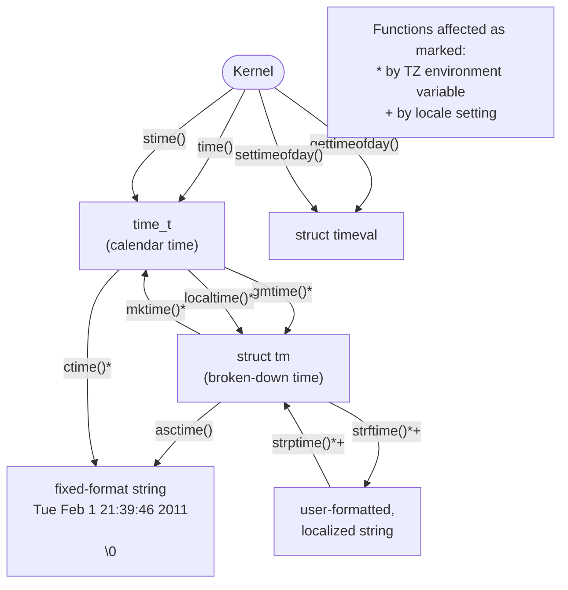

# Chương 10: THỜI GIAN

Bên trong một chương trình, chúng ta thường quan tâm đến hai loại thời gian:

- Thời gian thực (Real time): Đây là khoảng thời gian được đo lường từ một điểm chuẩn nào đó (thời gian lịch - calendar time) hoặc từ một điểm cố định (thường là thời điểm bắt đầu) trong vòng đời của một Process (thời gian trôi qua hay thời gian đồng hồ treo tường - elapsed/wall-clock time). Việc lấy thời gian lịch rất hữu ích cho các chương trình, ví dụ như để gắn nhãn thời gian (timestamp) cho các bản ghi cơ sở dữ liệu hoặc tập tin. Việc đo thời gian trôi qua rất hữu ích cho các chương trình thực hiện các tác vụ định kỳ hoặc thực hiện các phép đo lường thường xuyên từ một thiết bị đầu vào ngoại vi.
- Thời gian tiến trình (Process time): Đây là lượng CPU time (thời gian CPU) được sử dụng bởi một Process. Việc đo lường thời gian tiến trình rất hữu ích trong việc kiểm tra hoặc tối ưu hóa hiệu năng của một chương trình hoặc thuật toán.

Hầu hết các kiến trúc máy tính đều có một đồng hồ phần cứng tích hợp sẵn (built-in hardware clock) cho phép kernel đo lường thời gian thực và thời gian tiến trình. Trong chương này, chúng ta sẽ xem xét các system call (lời gọi hệ thống) để xử lý cả hai loại thời gian này, cũng như các hàm thư viện để chuyển đổi giữa biểu diễn thời gian dễ đọc đối với con người và biểu diễn thời gian nội bộ. Do các biểu diễn thời gian dễ đọc phụ thuộc vào vị trí địa lý cũng như các quy ước ngôn ngữ và văn hóa, thảo luận về các biểu diễn này sẽ dẫn chúng ta đến việc tìm hiểu về múi giờ (timezones) và miền địa phương (locales).

## 10.1 Thời Gian Lịch (Calendar Time)

Bất kể vị trí địa lý, các hệ thống UNIX biểu diễn thời gian bên trong dưới dạng số giây tính từ Thời điểm gốc (Epoch); nghĩa là tính từ nửa đêm của buổi sáng ngày 1 tháng 1 năm 1970 theo giờ Phối hợp Quốc tế (UTC - Coordinated Universal Time, trước đây gọi là giờ trung bình Greenwich, hay GMT). Đây xấp xỉ là thời điểm hệ thống UNIX ra đời. Thời gian lịch được lưu trữ trong các biến kiểu `time_t`, một kiểu số nguyên (integer type) được quy định bởi SUSv3.

> Trên các hệ thống Linux 32-bit, `time_t` là một số nguyên có dấu (signed integer), có thể biểu diễn các khoảng thời gian từ ngày 13 tháng 12 năm 1901 20:45:52 đến ngày 19 tháng 1 năm 2038 03:14:07. (SUSv3 không quy định rõ ý nghĩa của các giá trị `time_t` âm). Do đó, nhiều hệ thống UNIX 32-bit hiện tại phải đối mặt với vấn đề lý thuyết về Năm 2038 (Year 2038 problem), mà chúng có thể gặp phải trước năm 2038 nếu thực hiện các phép tính dựa trên các mốc thời gian trong tương lai. Vấn đề này sẽ được giảm thiểu đáng kể bởi thực tế là đến năm 2038, có lẽ tất cả các hệ thống UNIX đều đã chuyển đổi hoàn toàn sang kiến trúc 64-bit trở lên. Tuy nhiên, các hệ thống nhúng (embedded systems) 32-bit vốn thường có vòng đời dài hơn nhiều so với phần cứng máy tính để bàn (desktop hardware), vẫn có thể gặp phải vấn đề này. Hơn nữa, vấn đề này vẫn sẽ tồn tại đối với bất kỳ dữ liệu và ứng dụng kế thừa (legacy) nào duy trì thời gian ở định dạng `time_t` 32-bit.

System call `gettimeofday()` trả về thời gian lịch trong bộ đệm được trỏ tới bởi `tv`.

```c
## include <sys/time.h>
int gettimeofday(struct timeval *tv, struct timezone *tz);
                                             Trả về 0 khi thành công, hoặc –1 khi lỗi
```

Tham số `tv` là một con trỏ trỏ đến một cấu trúc có dạng sau:

```c
struct timeval {
 time_t tv_sec; /* Số giây kể từ 00:00:00, 1 tháng 1, 1970 UTC */
 suseconds_t tv_usec; /* Số micro giây bổ sung (long int) */
};
```

Mặc dù trường `tv_usec` cung cấp độ chính xác đến mức micro giây, độ chính xác của giá trị mà nó trả về được quyết định bởi phần cài đặt phụ thuộc vào kiến trúc phần cứng. (Chữ `u` trong `tv_usec` bắt nguồn từ sự tương đồng với chữ cái Hy Lạp μ ("mu") được sử dụng trong hệ đo lường mét để chỉ một phần triệu). Trên các hệ thống x86-32 hiện đại (nghĩa là các hệ thống Pentium có thanh ghi Timestamp Counter được tăng lên một lần ở mỗi chu kỳ xung nhịp CPU), `gettimeofday()` thực sự cung cấp độ chính xác đến mức micro giây.

Tham số `tz` trong hàm `gettimeofday()` là một di tích lịch sử (historical artifact). Trong các phiên bản UNIX cũ, nó được dùng để truy vấn thông tin múi giờ cho hệ thống. Tham số này hiện đã lỗi thời (obsolete) và luôn nên được chỉ định là `NULL`.

Nếu tham số `tz` được cung cấp, nó sẽ trả về một cấu trúc múi giờ mà các trường của nó chứa bất kỳ giá trị nào đã được chỉ định trong tham số `tz` (đã lỗi thời) trong một lần gọi `settimeofday()` trước đó. Cấu trúc này chứa hai trường: `tz_minuteswest` và `tz_dsttime`. Trường `tz_minuteswest` cho biết số phút cần cộng thêm vào thời gian ở múi giờ này để khớp với giờ UTC, với giá trị âm cho biết khoảng điều chỉnh phút về phía đông của giờ UTC (ví dụ, đối với giờ Trung Âu - Central European Time, đi trước giờ UTC một tiếng, trường này sẽ chứa giá trị –60). Trường `tz_dsttime` chứa một hằng số được thiết kế để đại diện cho chế độ giờ mùa hè (DST - daylight saving time) đang có hiệu lực trong múi giờ này. Chính vì chế độ DST không thể được biểu diễn bằng một thuật toán đơn giản nên tham số `tz` đã trở nên lỗi thời. (Trường này chưa từng được hỗ trợ trên Linux). Xem trang tài liệu hướng dẫn (man page) `gettimeofday(2)` để biết thêm chi tiết.

System call `time()` trả về số giây tính từ Thời điểm gốc (Epoch) (tức là cùng giá trị mà `gettimeofday()` trả về trong trường `tv_sec` của tham số `tv`).

```c
## include <time.h>
time_t time(time_t *timep);
             Trả về số giây kể từ Thời điểm gốc, hoặc (time_t) –1 khi lỗi
```

Nếu đối số `timep` không phải là `NULL`, số giây kể từ thời điểm gốc (Epoch) cũng được lưu vào vùng nhớ mà `timep` trỏ tới.

Vì hàm `time()` trả về cùng một giá trị theo hai cách, và lỗi duy nhất có thể xảy ra khi sử dụng `time()` là truyền một địa chỉ không hợp lệ vào đối số `timep` (`EFAULT`), chúng ta thường đơn giản sử dụng lời gọi sau (không cần kiểm tra lỗi):

```
t = time(NULL);
```

Nguyên nhân sự tồn tại của hai System Call (`time()` và `gettimeofday()`) có cùng một mục đích cơ bản là do lịch sử. Các phiên bản UNIX đầu tiên đã cung cấp `time()`. 4.3BSD bổ sung System Call `gettimeofday()` có độ chính xác cao hơn. Sự tồn tại của `time()` dưới dạng một System Call hiện nay đã trở nên dư thừa; nó có thể được hiện thực hóa như một thư viện hàm (library function) gọi tới `gettimeofday()`.

## 10.2 Các hàm chuyển đổi thời gian

Hình [10-1](#page-35-0) minh họa các hàm được sử dụng để chuyển đổi giữa các giá trị `time_t` và các định dạng thời gian khác, bao gồm cả dạng biểu diễn có thể in được. Các hàm này giúp chúng ta tránh được sự phức tạp do múi giờ (timezone), chế độ giờ mùa hè (DST - Daylight Saving Time), và các vấn đề bản địa hóa (localization) gây ra trong các phép chuyển đổi đó. (Chúng tôi mô tả về múi giờ trong Mục [10.3](#page-44-0) và locale trong Mục [10.4](#page-47-0).)



**Hình 10-1:** Các hàm để truy xuất và làm việc với thời gian lịch (calendar time)

### 10.2.1 Chuyển đổi `time_t` sang dạng có thể in

Hàm `ctime()` cung cấp một phương pháp đơn giản để chuyển đổi giá trị `time_t` thành dạng có thể in được.

```c
## include <time.h>
char *ctime(const time_t *timep);
                         Trả về con trỏ tới chuỗi được cấp phát tĩnh, kết thúc
                                   bởi ký tự xuống dòng và \0 khi thành công, hoặc NULL khi lỗi
```

Nhận một con trỏ trỏ tới giá trị `time_t` trong `timep`, `ctime()` trả về một chuỗi 26 byte chứa ngày và giờ theo định dạng chuẩn, như được minh họa bởi ví dụ sau:

```
Wed Jun 8 14:22:34 2011
```

Chuỗi bao gồm một ký tự xuống dòng kết thúc và một byte null kết thúc. Hàm `ctime()` tự động tính toán các thiết lập múi giờ cục bộ và DST khi thực hiện chuyển đổi. (Chúng tôi giải thích cách các thiết lập này được xác định trong Mục [10.3](#page-44-0).) Chuỗi được trả về được cấp phát tĩnh; các lời gọi `ctime()` tiếp theo sẽ ghi đè lên nó.

SUSv3 nêu rõ rằng các lời gọi tới bất kỳ hàm nào trong số `ctime()`, `gmtime()`, `localtime()`, hoặc `asctime()` có thể ghi đè lên cấu trúc được cấp phát tĩnh được trả về bởi bất kỳ hàm nào khác. Nói cách khác, các hàm này có thể chia sẻ chung các bản sao của mảng ký tự và cấu trúc `tm` được trả về, và điều này được thực hiện ở một số phiên bản của glibc. Nếu chúng ta cần duy trì thông tin được trả về qua nhiều lời gọi đến các hàm này, chúng ta phải lưu lại các bản sao cục bộ.

Một phiên bản tái nhập (reentrant) của `ctime()` được cung cấp dưới dạng `ctime_r()`. (Chúng tôi giải thích tính tái nhập trong Mục 21.1.2.) Hàm này cho phép người gọi chỉ định một đối số bổ sung là con trỏ trỏ tới một bộ đệm (do người gọi cung cấp) được dùng để trả về chuỗi thời gian. Các phiên bản tái nhập khác của các hàm được đề cập trong chương này hoạt động tương tự.

### 10.2.2 Chuyển đổi giữa `time_t` và thời gian đã phân tách (Broken-Down Time)

Các hàm `gmtime()` và `localtime()` chuyển đổi giá trị `time_t` thành cái gọi là thời gian đã phân tách (broken-down time). Thời gian đã phân tách được đặt trong một cấu trúc được cấp phát tĩnh mà địa chỉ của nó được trả về dưới dạng kết quả của hàm.

```c
## include <time.h>
struct tm *gmtime(const time_t *timep);
struct tm *localtime(const time_t *timep);
                      Cả hai đều trả về con trỏ tới cấu trúc thời gian đã phân tách 
                                       được cấp phát tĩnh khi thành công, hoặc NULL khi lỗi
```

Hàm `gmtime()` chuyển đổi thời gian lịch (calendar time) thành thời gian đã phân tách tương ứng với giờ UTC. (Các chữ cái `gm` bắt nguồn từ Giờ trung bình Greenwich - Greenwich Mean Time). Ngược lại, `localtime()` tính đến các thiết lập múi giờ và DST để trả về thời gian đã phân tách tương ứng với giờ địa phương của hệ thống.

> Các phiên bản tái nhập của các hàm này được cung cấp dưới dạng `gmtime_r()` và `localtime_r()`.

Cấu trúc `tm` được trả về bởi các hàm này chứa các trường ngày và giờ được chia thành các phần riêng lẻ. Cấu trúc này có dạng sau:

```c
struct tm {
 int tm_sec; /* Seconds (0-60) */
 int tm_min; /* Minutes (0-59) */
 int tm_hour; /* Hours (0-23) */
 int tm_mday; /* Day of the month (1-31) */
 int tm_mon; /* Month (0-11) */
 int tm_year; /* Year since 1900 */
 int tm_wday; /* Day of the week (Sunday = 0)*/
 int tm_yday; /* Day in the year (0-365; 1 Jan = 0)*/
 int tm_isdst; /* Daylight saving time flag
 > 0: DST is in effect;
 = 0: DST is not effect;
 < 0: DST information not available */
};
```

Trường `tm_sec` có thể lên đến 60 (thay vì 59) để tính đến các giây nhuận (leap second) đôi khi được áp dụng nhằm điều chỉnh lịch của con người cho khớp với năm chính xác về mặt thiên văn học (còn gọi là năm chí tuyến - tropical year).

Nếu macro kiểm tra tính năng `_BSD_SOURCE` được định nghĩa, thì định nghĩa của glibc cho cấu trúc `tm` cũng bao gồm hai trường bổ sung chứa thêm thông tin về thời gian được biểu diễn. Trường đầu tiên trong số này, `long int tm_gmtoff`, chứa số giây mà thời gian được biểu diễn nằm về phía đông của UTC (`Coordinated Universal Time`). Trường thứ hai, `const char *tm_zone`, là tên viết tắt của múi giờ (timezone) (ví dụ: CEST cho Giờ mùa hè Trung Âu - Central European Summer Time). SUSv3 không quy định bất kỳ trường nào trong hai trường này và chúng chỉ xuất hiện trên một số ít các bản cài đặt UNIX khác (chủ yếu là các hệ thống dẫn xuất từ BSD).

Hàm `mktime()` dịch một cấu trúc thời gian chi tiết (broken-down time), được biểu diễn dưới dạng thời gian cục bộ (local time), thành một giá trị `time_t`, được trả về như kết quả của hàm. Bên gọi cung cấp thời gian chi tiết trong một cấu trúc `tm` được trỏ tới bởi `timeptr`. Trong quá trình dịch này, các trường `tm_wday` và `tm_yday` của cấu trúc `tm` đầu vào sẽ bị bỏ qua.

```c
## include <time.h>
time_t mktime(struct tm *timeptr);
                      Trả về số giây kể từ Thời điểm gốc (Epoch) tương ứng với timeptr
                                               nếu thành công, hoặc (time_t) –1 nếu có lỗi
```

Hàm `mktime()` có thể sửa đổi cấu trúc được trỏ tới bởi `timeptr`. Tối thiểu, hàm này đảm bảo rằng các trường `tm_wday` và `tm_yday` được thiết lập thành các giá trị tương ứng phù hợp với giá trị của các trường đầu vào khác.

Ngoài ra, `mktime()` không yêu cầu các trường khác của cấu trúc `tm` phải bị giới hạn trong các khoảng đã mô tả trước đó. Đối với mỗi trường có giá trị nằm ngoài khoảng cho phép, `mktime()` sẽ điều chỉnh giá trị của trường đó để nó nằm trong khoảng cho phép và thực hiện các điều chỉnh thích hợp cho các trường khác. Tất cả các điều chỉnh này được thực hiện trước khi `mktime()` cập nhật các trường `tm_wday`, `tm_yday` và tính toán giá trị `time_t` được trả về.

Ví dụ, nếu trường `tm_sec` đầu vào là 123, thì khi trả về, giá trị của trường này sẽ là 3, và giá trị của trường `tm_min` sẽ được cộng thêm 2 vào bất kỳ giá trị nào mà nó có trước đó. (Và nếu phép cộng đó làm cho `tm_min` bị tràn - overflow, thì giá trị `tm_min` sẽ được điều chỉnh và trường `tm_hour` sẽ được tăng lên, cứ như vậy). Những điều chỉnh này thậm chí áp dụng cho cả các giá trị trường âm. Ví dụ, việc chỉ định –1 cho `tm_sec` có nghĩa là giây thứ 59 của phút trước đó. Tính năng này rất hữu ích vì nó cho phép chúng ta thực hiện các phép toán số học về ngày và giờ trên một giá trị thời gian chi tiết.

Cài đặt múi giờ (timezone) được sử dụng bởi `mktime()` khi thực hiện việc chuyển đổi. Ngoài ra, cài đặt thời gian tiết kiệm ánh sáng ban ngày (Daylight Saving Time - DST) có thể được sử dụng hoặc không, tùy thuộc vào giá trị của trường `tm_isdst` đầu vào:

- Nếu `tm_isdst` bằng 0, coi thời gian này là giờ chuẩn (standard time) (tức là bỏ qua DST, ngay cả khi nó có hiệu lực vào thời điểm này trong năm).
- Nếu `tm_isdst` lớn hơn 0, coi thời gian này là DST (tức là xử lý như thể DST đang có hiệu lực, ngay cả khi thông thường nó không phải như vậy vào thời điểm này trong năm).
- Nếu `tm_isdst` nhỏ hơn 0, cố gắng xác định xem DST có đang có hiệu lực vào thời điểm này trong năm hay không. Đây thường là cài đặt mà chúng ta mong muốn.

Khi hoàn tất (và bất kể cài đặt ban đầu của `tm_isdst` là gì), `mktime()` sẽ đặt trường `tm_isdst` thành một giá trị dương nếu DST có hiệu lực vào ngày đã cho, hoặc thành 0 nếu DST không có hiệu lực.

### 10.2.3 Chuyển đổi giữa Thời gian Chi tiết (Broken-Down Time) và Định dạng Hiển thị

Trong phần này, chúng ta sẽ mô tả các hàm dùng để chuyển đổi thời gian chi tiết (broken-down time) sang dạng hiển thị (printable form) và ngược lại.

### Chuyển đổi từ thời gian chi tiết sang dạng hiển thị

Nhận một con trỏ trỏ đến cấu trúc thời gian chi tiết trong đối số `tm`, `asctime()` trả về một con trỏ trỏ đến một chuỗi được cấp phát tĩnh chứa thời gian theo cùng định dạng với `ctime()`.

```c
## include <time.h>
char *asctime(const struct tm *timeptr);
                      Trả về con trỏ tới chuỗi được cấp phát tĩnh kết thúc bằng
                                      ký tự newline và \0 khi thành công, hoặc NULL khi lỗi
```

Ngược lại với `ctime()`, các thiết lập múi giờ cục bộ (local timezone) không ảnh hưởng gì đến `asctime()`, vì hàm này thực hiện chuyển đổi thời gian chi tiết vốn thường đã được bản địa hóa thông qua `localtime()` hoặc ở định dạng UTC do `gmtime()` trả về.

Cũng giống như `ctime()`, chúng ta không thể kiểm soát được định dạng của chuỗi do `asctime()` tạo ra.

Một phiên bản tái nhập (reentrant version) của `asctime()` được cung cấp dưới tên `asctime_r()`.

Liệt kê [10-1](#page-38-0) minh họa cách sử dụng của `asctime()`, cũng như tất cả các hàm chuyển đổi thời gian đã được mô tả từ đầu chương này đến nay. Chương trình này truy xuất thời gian lịch (calendar time) hiện tại, sau đó sử dụng các hàm chuyển đổi thời gian khác nhau và hiển thị kết quả của chúng. Dưới đây là ví dụ về những gì chúng ta thấy khi chạy chương trình này tại Munich, Đức (vào mùa đông) đang sử dụng Giờ Trung Âu (Central European Time), đi trước UTC một tiếng:

```
$ date
Tue Dec 28 16:01:51 CET 2010
$ ./calendar_time
Seconds since the Epoch (1 Jan 1970): 1293548517 (about 40.991 years)
 gettimeofday() returned 1293548517 secs, 715616 microsecs
Broken down by gmtime():
 year=110 mon=11 mday=28 hour=15 min=1 sec=57 wday=2 yday=361 isdst=0
Broken down by localtime():
 year=110 mon=11 mday=28 hour=16 min=1 sec=57 wday=2 yday=361 isdst=0
asctime() formats the gmtime() value as: Tue Dec 28 15:01:57 2010
ctime() formats the time() value as: Tue Dec 28 16:01:57 2010
mktime() of gmtime() value: 1293544917 secs
mktime() of localtime() value: 1293548517 secs 3600 secs ahead of UTC
```

**Liệt kê 10-1:** Truy xuất và chuyển đổi thời gian lịch (calendar time)

```
–––––––––––––––––––––––––––––––––––––––––––––––––––––– time/calendar_time.c
## include <locale.h>
## include <time.h>
## include <sys/time.h>
## include "tlpi_hdr.h"
```

```
## define SECONDS_IN_TROPICAL_YEAR (365.24219 * 24 * 60 * 60)
int
main(int argc, char *argv[])
{
 time_t t;
 struct tm *gmp, *locp;
 struct tm gm, loc;
 struct timeval tv;
 t = time(NULL);
 printf("Seconds since the Epoch (1 Jan 1970): %ld", (long) t);
 printf(" (about %6.3f years)\n", t / SECONDS_IN_TROPICAL_YEAR);
 if (gettimeofday(&tv, NULL) == -1)
 errExit("gettimeofday");
 printf(" gettimeofday() returned %ld secs, %ld microsecs\n",
 (long) tv.tv_sec, (long) tv.tv_usec);
 gmp = gmtime(&t);
 if (gmp == NULL)
 errExit("gmtime");
 gm = *gmp; /* Lưu bản sao cục bộ, vì *gmp có thể bị sửa đổi
 bởi asctime() hoặc gmtime() */
 printf("Broken down by gmtime():\n");
 printf(" year=%d mon=%d mday=%d hour=%d min=%d sec=%d ", gm.tm_year,
 gm.tm_mon, gm.tm_mday, gm.tm_hour, gm.tm_min, gm.tm_sec);
 printf("wday=%d yday=%d isdst=%d\n", gm.tm_wday, gm.tm_yday, gm.tm_isdst);
 locp = localtime(&t);
 if (locp == NULL)
 errExit("localtime");
 loc = *locp; /* Lưu bản sao cục bộ */
 printf("Broken down by localtime():\n");
 printf(" year=%d mon=%d mday=%d hour=%d min=%d sec=%d ",
 loc.tm_year, loc.tm_mon, loc.tm_mday,
 loc.tm_hour, loc.tm_min, loc.tm_sec);
 printf("wday=%d yday=%d isdst=%d\n\n",
 loc.tm_wday, loc.tm_yday, loc.tm_isdst);
 printf("asctime() formats the gmtime() value as: %s", asctime(&gm));
 printf("ctime() formats the time() value as: %s", ctime(&t));
 printf("mktime() of gmtime() value: %ld secs\n", (long) mktime(&gm));
 printf("mktime() of localtime() value: %ld secs\n", (long) mktime(&loc));
 exit(EXIT_SUCCESS);
}
–––––––––––––––––––––––––––––––––––––––––––––––––––––– time/calendar_time.c
```

Hàm `strftime()` cung cấp cho chúng ta khả năng kiểm soát chính xác hơn khi chuyển đổi thời gian chi tiết sang dạng hiển thị. Nhận một con trỏ thời gian chi tiết do `timeptr` trỏ tới, `strftime()` đặt một chuỗi ngày-kèm-giờ tương ứng, kết thúc bằng ký tự null vào vùng đệm (buffer) do `outstr` trỏ tới.

```c
## include <time.h>
size_t strftime(char *outstr, size_t maxsize, const char *format,
 const struct tm *timeptr);
                           Trả về số byte được đặt vào outstr (không bao gồm
                               ký tự null kết thúc) khi thành công, hoặc 0 khi lỗi
```

Chuỗi được trả về trong `outstr` được định dạng theo đặc tả trong `format`. Đối số `maxsize` chỉ định dung lượng tối đa khả dụng trong `outstr`. Không giống như `ctime()` và `asctime()`, `strftime()` không bao gồm ký tự newline ở cuối chuỗi (trừ khi nó được bao gồm trong `format`).

Khi thành công, `strftime()` trả về số byte được đặt trong `outstr`, không bao gồm byte null kết thúc chuỗi. Nếu tổng độ dài của chuỗi kết quả, tính cả byte null kết thúc, vượt quá `maxsize` byte, thì `strftime()` trả về 0 để báo hiệu lỗi và nội dung của `outstr` sẽ không được xác định (indeterminate).

Đối số `format` cho hàm `strftime()` là một chuỗi tương tự như chuỗi được truyền cho `printf()`. Các chuỗi bắt đầu bằng ký tự phần trăm (%) là các thông số chuyển đổi (conversion specifications), được thay thế bằng các thành phần khác nhau của ngày và giờ tuỳ theo ký tự đặc tả đi sau ký tự phần trăm. Một tập hợp phong phú các ký tự đặc tả chuyển đổi được cung cấp, trong đó một tập con được liệt kê trong Bảng 10-1. (Để có danh sách đầy đủ, hãy xem trang tài liệu hướng dẫn `strftime(3)` man page). Trừ khi có ghi chú khác, tất cả các ký tự đặc tả chuyển đổi này đều được chuẩn hóa trong SUSv3.

Cả hai ký tự đặc tả `%U` và `%W` đều tạo ra số tuần trong năm. Các số tuần của `%U` được tính sao cho tuần đầu tiên chứa Chủ Nhật được đánh số là 1, và phần tuần lẻ trước đó được đánh số là 0. Nếu Chủ Nhật rơi vào ngày đầu tiên của năm, thì sẽ không có tuần 0 và ngày cuối cùng của năm sẽ nằm trong tuần 53. Các số tuần của `%W` hoạt động theo cách tương tự, nhưng tính theo Thứ Hai thay vì Chủ Nhật.

Thông thường, chúng ta muốn hiển thị thời gian hiện tại trong các chương trình minh họa khác nhau trong cuốn sách này. Vì mục đích này, chúng tôi cung cấp hàm `currTime()`, trả về một chuỗi chứa thời gian hiện tại được định dạng bởi `strftime()` khi được truyền đối số `format`.

```c
## include "curr_time.h"
char *currTime(const char *format);
                    Trả về con trỏ tới chuỗi được cấp phát tĩnh, hoặc NULL khi có lỗi
```

Việc cài đặt hàm `currTime()` được thể hiện trong Liệt kê [10-2.](#page-41-0)

**Bảng 10-1:** Các ký tự đặc tả chuyển đổi được chọn lọc cho `strftime()`

| Ký tự đặc tả | Mô tả                                     | Ví dụ                   |
|--------------|-------------------------------------------|-------------------------|
| %%           | Ký tự %                                   | %                       |
| %a           | Tên viết tắt của ngày trong tuần          | Tue                     |
| %A           | Tên đầy đủ của ngày trong tuần            | Tuesday                 |
| %b, %h       | Tên viết tắt của tháng                    | Feb                     |
| %B           | Tên đầy đủ của tháng                      | February                |
| %c           | Ngày và giờ                               | Tue Feb 1 21:39:46 2011 |
| %d           | Ngày trong tháng (2 chữ số, 01 đến 31)    | 01                      |
| %D           | Ngày kiểu Mỹ (giống như %m/%d/%y)         | 02/01/11                |
| %e           | Ngày trong tháng (2 ký tự)                | 1                       |
| %F           | Ngày theo chuẩn ISO (giống như %Y-%m-%d)  | 2011-02-01              |
| %H           | Giờ (đồng hồ 24 giờ, 2 chữ số)            | 21                      |
| %I           | Giờ (đồng hồ 12 giờ, 2 chữ số)            | 09                      |
| %j           | Ngày trong năm (3 chữ số, 001 đến 366)<br>032 |                     |
| %m           | Tháng dạng thập phân (2 chữ số, 01 đến 12)<br>02 |                  |
| %M           | Phút (2 chữ số)<br>39                     |                         |
| %p           | AM/PM<br>PM                               |                         |
| %P           | am/pm (phần mở rộng của GNU)<br>pm        |                         |
| %R           | Thời gian 24 giờ (giống như %H:%M)<br>21:39 |                       |
| %S           | Giây (00 đến 60)<br>46                    |                         |
| %T           | Thời gian (giống như %H:%M:%S)            | 21:39:46                |
| %u           | Số thứ tự ngày trong tuần (1 đến 7, Thứ Hai = 1) | 2                 |
| %U           | Số tuần tính từ Chủ Nhật (00 đến 53)<br>05 |                        |
| %w           | Số thứ tự ngày trong tuần (0 đến 6, Chủ Nhật = 0)<br>2 |            |
| %W           | Số tuần tính từ Thứ Hai (00 đến 53)<br>05 |                         |
| %x           | Ngày (theo vùng - localized)<br>02/01/11 |                         |
| %X           | Thời gian (theo vùng - localized)         | 21:39:46                |
| %y           | Năm 2 chữ số<br>11                        |                         |
| %Y           | Năm 4 chữ số                              | 2011                    |
| %Z           | Tên múi giờ                               | CET                     |

**Liệt kê 10-2:** Một hàm trả về chuỗi chứa thời gian hiện tại

```
–––––––––––––––––––––––––––––––––––––––––––––––––––––––––– time/curr_time.c
## include <time.h>
## include "curr_time.h" /* Khai báo hàm được định nghĩa ở đây */
## define BUF_SIZE 1000
/* Trả về một chuỗi chứa thời gian hiện tại được định dạng theo
 thông số kỹ thuật trong 'format' (xem strftime(3) để biết các ký tự đặc tả).
 Nếu 'format' là NULL, chúng ta sử dụng "%c" làm ký tự đặc tả (cung cấp
 ngày và giờ giống như ctime(3), nhưng không có ký tự xuống dòng ở cuối).
```

Trả về NULL khi có lỗi. \*/

```
char *
currTime(const char *format)
{
 static char buf[BUF_SIZE]; /* Không khả reentrant */
 time_t t;
 size_t s;
 struct tm *tm;
 t = time(NULL);
 tm = localtime(&t);
 if (tm == NULL)
 return NULL;
 s = strftime(buf, BUF_SIZE, (format != NULL) ? format : "%c", tm);
 return (s == 0) ? NULL : buf;
}
–––––––––––––––––––––––––––––––––––––––––––––––––––––––––– time/curr_time.c
```

### Chuyển đổi từ dạng chuỗi in được sang cấu trúc thời gian chi tiết (broken-down time)

Hàm `strptime()` là hàm ngược lại của `strftime()`. Nó chuyển đổi một chuỗi ngày-và-giờ thành một cấu trúc thời gian chi tiết (`struct tm` - broken-down time).

```c
## define _XOPEN_SOURCE
## include <time.h>
char *strptime(const char *str, const char *format, struct tm *timeptr);
                               Trả về con trỏ tới ký tự chưa xử lý tiếp theo trong 
                                              str khi thành công, hoặc NULL khi lỗi
```

Hàm `strptime()` sử dụng đặc tả được cung cấp trong `format` để phân tích chuỗi ngày-và-giờ được truyền vào qua `str`, và đặt kết quả thời gian chi tiết đã chuyển đổi vào cấu trúc do `timeptr` trỏ tới.

Khi thành công, `strptime()` trả về một con trỏ trỏ tới ký tự chưa xử lý tiếp theo trong `str`. (Điều này rất hữu ích nếu chuỗi chứa thêm thông tin cần được xử lý bởi chương trình gọi). Nếu toàn bộ chuỗi định dạng không thể được khớp (match), `strptime()` sẽ trả về `NULL` để chỉ ra lỗi.

Đặc tả định dạng truyền cho `strptime()` tương tự như đặc tả truyền cho `scanf(3)`. Nó bao gồm các loại ký tự sau:

- các đặc tả chuyển đổi bắt đầu bằng ký tự phần trăm (`%`);
- các ký tự khoảng trắng (white-space characters), khớp với không hoặc nhiều khoảng trắng trong chuỗi đầu vào; và
- các ký tự không phải khoảng trắng (non-white-space characters, ngoại trừ `%`), phải khớp chính xác với các ký tự tương ứng trong chuỗi đầu vào.

Các đặc tả chuyển đổi tương tự như các đặc tả được cung cấp cho `strftime()` (Bảng 10-1). Sự khác biệt lớn nhất là các bộ đặc tả mang tính tổng quát hơn. Ví dụ, cả `%a` và `%A` đều có thể chấp nhận tên ngày trong tuần ở dạng đầy đủ hoặc viết tắt, và `%d` hoặc `%e` có thể được sử dụng để đọc ngày trong tháng có hoặc không có số 0 đứng trước đối với các ngày có một chữ số. Ngoài ra, việc phân biệt chữ hoa/chữ thường bị bỏ qua; ví dụ: `May` và `MAY` là các tên tháng tương đương. Chuỗi `%%` được sử dụng để khớp với một ký tự phần trăm trong chuỗi đầu vào. Trang hướng dẫn thủ công (man page) `strptime(3)` cung cấp thêm chi tiết.

Việc triển khai `strptime()` trong glibc không sửa đổi các trường của cấu trúc `tm` không được khởi tạo bởi các đặc tả trong `format`. Điều này có nghĩa là chúng ta có thể sử dụng một chuỗi các lời gọi `strptime()` để xây dựng một cấu trúc `tm` duy nhất từ thông tin trong nhiều chuỗi, chẳng hạn như chuỗi ngày và chuỗi giờ. Mặc dù SUSv3 cho phép hành vi này nhưng nó không bắt buộc, do đó chúng ta không thể dựa vào điều này trên các bản triển khai UNIX khác. Trong một ứng dụng khả chuyển (portable application), chúng ta phải đảm bảo rằng `str` và `format` chứa đầu vào sẽ thiết lập tất cả các trường của cấu trúc `tm` kết quả, hoặc đảm bảo rằng cấu trúc `tm` được khởi tạo phù hợp trước khi gọi `strptime()`. Trong hầu hết các trường hợp, việc đặt toàn bộ cấu trúc về 0 bằng `memset()` là đủ, nhưng cần lưu ý rằng giá trị `0` trong trường `tm_mday` tương ứng với ngày cuối cùng của tháng trước trong glibc và nhiều bản triển khai hàm chuyển đổi thời gian khác. Cuối cùng, cần lưu ý rằng `strptime()` không bao giờ thiết lập giá trị cho trường `tm_isdst` của cấu trúc `tm`.

> Thư viện GNU C cũng cung cấp hai hàm khác phục vụ mục đích tương tự như `strptime()`: `getdate()` (được quy định trong SUSv3 và hỗ trợ rộng rãi) và biến thể tái nhập (reentrant) của nó là `getdate_r()` (không được quy định trong SUSv3 và chỉ có trên một số ít bản triển khai UNIX khác). Chúng ta không mô tả các hàm này ở đây, vì chúng sử dụng một tệp bên ngoài (được xác định bằng biến môi trường `DATEMSK`) để chỉ định định dạng dùng cho việc quét ngày, điều này khiến chúng hơi bất tiện khi sử dụng và cũng tạo ra các lỗ hổng bảo mật trong các chương trình set-user-ID.

Đoạn mã [10-3](#page-44-1) minh họa việc sử dụng `strptime()` và `strftime()`. Chương trình này nhận một tham số dòng lệnh chứa ngày và giờ, chuyển đổi nó thành thời gian chi tiết bằng cách sử dụng `strptime()`, sau đó hiển thị kết quả của việc thực hiện phép chuyển đổi ngược lại bằng `strftime()`. Chương trình nhận tối đa ba tham số, trong đó hai tham số đầu tiên là bắt buộc. Tham số đầu tiên là chuỗi chứa ngày và giờ. Tham số thứ hai là đặc tả định dạng sẽ được `strptime()` sử dụng để phân tích tham số đầu tiên. Tham số thứ ba tùy chọn là chuỗi định dạng sẽ được `strftime()` sử dụng cho phép chuyển đổi ngược lại. Nếu bỏ qua tham số này, một chuỗi định dạng mặc định sẽ được sử dụng. (Chúng ta mô tả hàm `setlocale()` được sử dụng trong chương trình này tại Mục [10.4.](#page-47-0)) Nhật ký phiên dòng lệnh sau đây cho thấy một số ví dụ về việc sử dụng chương trình này:

```
$ ./strtime "9:39:46pm 1 Feb 2011" "%I:%M:%S%p %d %b %Y"
calendar time (seconds since Epoch): 1296592786
strftime() yields: 21:39:46 Tuesday, 01 February 2011 CET
```

Cách sử dụng sau đây tương tự, nhưng lần này chúng ta chỉ định rõ ràng một định dạng cho hàm `strftime()`:

```
$ ./strtime "9:39:46pm 1 Feb 2011" "%I:%M:%S%p %d %b %Y" "%F %T"
calendar time (seconds since Epoch): 1296592786
strftime() yields: 2011-02-01 21:39:46
```

```
–––––––––––––––––––––––––––––––––––––––––––––––––––––––––––– time/strtime.c
## define _XOPEN_SOURCE
## include <time.h>
## include <locale.h>
## include "tlpi_hdr.h"
## define SBUF_SIZE 1000
int
main(int argc, char *argv[])
{
 struct tm tm;
 char sbuf[SBUF_SIZE];
 char *ofmt;
 if (argc < 3 || strcmp(argv[1], "--help") == 0)
 usageErr("%s input-date-time in-format [out-format]\n", argv[0]);
 if (setlocale(LC_ALL, "") == NULL)
 errExit("setlocale"); /* Use locale settings in conversions */
 memset(&tm, 0, sizeof(struct tm)); /* Initialize 'tm' */
 if (strptime(argv[1], argv[2], &tm) == NULL)
 fatal("strptime");
 tm.tm_isdst = -1; /* Not set by strptime(); tells mktime()
 to determine if DST is in effect */
 printf("calendar time (seconds since Epoch): %ld\n", (long) mktime(&tm));
 ofmt = (argc > 3) ? argv[3] : "%H:%M:%S %A, %d %B %Y %Z";
 if (strftime(sbuf, SBUF_SIZE, ofmt, &tm) == 0)
 fatal("strftime returned 0");
 printf("strftime() yields: %s\n", sbuf);
 exit(EXIT_SUCCESS);
}
–––––––––––––––––––––––––––––––––––––––––––––––––––––––––––– time/strtime.c
```

## 10.3 Múi giờ (Timezone)

Các quốc gia khác nhau (và đôi khi thậm chí là các vùng khác nhau trong cùng một quốc gia) hoạt động theo các múi giờ (Timezone) và chế độ giờ mùa hè (DST - Daylight Saving Time) khác nhau. Các chương trình thực hiện nhập và xuất thời gian phải tính đến múi giờ và chế độ DST của hệ thống mà chúng đang chạy. May mắn thay, tất cả các chi tiết này đều được xử lý bởi thư viện C (C library).

### Định nghĩa múi giờ

Thông tin về múi giờ thường có dung lượng lớn và hay thay đổi. Do đó, thay vì mã hóa trực tiếp thông tin này vào các chương trình hoặc thư viện, hệ thống duy trì thông tin này trong các tệp có định dạng chuẩn.

Các tệp này nằm trong thư mục `/usr/share/zoneinfo`. Mỗi tệp trong thư mục này chứa thông tin về chế độ múi giờ ở một quốc gia hoặc khu vực cụ thể. Các tệp này được đặt tên theo múi giờ mà chúng mô tả, vì vậy chúng ta có thể tìm thấy các tệp có tên như `EST` (Giờ chuẩn miền Đông nước Mỹ - US Eastern Standard Time), `CET` (Giờ Trung Âu - Central European Time), `UTC`, `Turkey` và `Iran`. Ngoài ra, các thư mục con có thể được sử dụng để phân nhóm phân cấp các múi giờ có liên quan. Dưới một thư mục như `Pacific`, chúng ta có thể tìm thấy các tệp `Auckland`, `Port_Moresby` và `Galapagos`. Khi chúng ta chỉ định một múi giờ để chương trình sử dụng, thực chất là chúng ta đang chỉ định một đường dẫn tương đối (relative pathname) đến một trong các tệp múi giờ trong thư mục này.

Thời gian cục bộ (local time) cho hệ thống được xác định bằng tệp múi giờ `/etc/localtime`, tệp này thường được liên kết (link) tới một trong các tệp trong `/usr/share/zoneinfo`.

> Định dạng của các tệp múi giờ được tài liệu hóa trong trang hướng dẫn (manual page) `tzfile(5)`. Các tệp múi giờ được xây dựng bằng cách sử dụng `zic(8)`, trình biên dịch thông tin múi giờ (zone information compiler). Lệnh `zdump(8)` có thể được sử dụng để hiển thị thời gian hiện tại theo múi giờ trong một tệp múi giờ được chỉ định.

### Chỉ định múi giờ cho một chương trình

Để chỉ định một múi giờ khi chạy một chương trình, chúng ta thiết lập biến môi trường `TZ` (TZ environment variable) thành một chuỗi bao gồm dấu hai chấm (`:`) theo sau là một trong các tên múi giờ được định nghĩa trong `/usr/share/zoneinfo`. Việc thiết lập múi giờ sẽ tự động ảnh hưởng đến các hàm `ctime()`, `localtime()`, `mktime()` và `strftime()`.

Để lấy thiết lập múi giờ hiện tại, mỗi hàm này sử dụng `tzset(3)`, hàm này khởi tạo ba biến toàn cục (global variables):

```
char *tzname[2]; /* Name of timezone and alternate (DST) timezone */
int daylight; /* Nonzero if there is an alternate (DST) timezone */
long timezone; /* Seconds difference between UTC and local
 standard time */
```

Hàm `tzset()` trước tiên kiểm tra biến môi trường `TZ`. Nếu biến này chưa được thiết lập, múi giờ sẽ được khởi tạo theo giá trị mặc định được định nghĩa trong tệp múi giờ `/etc/localtime`. Nếu biến môi trường `TZ` được định nghĩa với một giá trị không khớp với tệp múi giờ nào, hoặc là một chuỗi rỗng, thì `UTC` sẽ được sử dụng. Biến môi trường `TZDIR` (một phần mở rộng GNU phi tiêu chuẩn - nonstandard GNU-extension) có thể được thiết lập thành tên của một thư mục nơi thông tin múi giờ nên được tìm kiếm thay vì thư mục mặc định `/usr/share/zoneinfo`.

Chúng ta có thể thấy hiệu ứng của biến `TZ` bằng cách chạy chương trình trong Liệt kê [10-4.](#page-46-0) Trong lần chạy đầu tiên, chúng ta thấy đầu ra tương ứng với múi giờ mặc định của hệ thống (Giờ Trung Âu, CET). Trong lần chạy thứ hai, chúng ta chỉ định múi giờ cho New Zealand, nơi vào thời điểm này trong năm đang áp dụng giờ mùa hè (DST), đi trước CET 12 tiếng.

```
$ ./show_time
ctime() of time() value is: Tue Feb 1 10:25:56 2011
asctime() of local time is: Tue Feb 1 10:25:56 2011
strftime() of local time is: Tuesday, 01 Feb 2011, 10:25:56 CET
$ TZ=":Pacific/Auckland" ./show_time
ctime() of time() value is: Tue Feb 1 22:26:19 2011
asctime() of local time is: Tue Feb 1 22:26:19 2011
strftime() of local time is: Tuesday, 01 February 2011, 22:26:19 NZDT
```

```c
––––––––––––––––––––––––––––––––––––––––––––––––––––––––– time/show_time.c
## include <time.h>
## include <locale.h>
## include "tlpi_hdr.h"
## define BUF_SIZE 200
int
main(int argc, char *argv[])
{
 time_t t;
 struct tm *loc;
 char buf[BUF_SIZE];
 if (setlocale(LC_ALL, "") == NULL)
 errExit("setlocale"); /* Sử dụng cài đặt locale trong các phép chuyển đổi */
 t = time(NULL);
 printf("ctime() of time() value is: %s", ctime(&t));
 loc = localtime(&t);
 if (loc == NULL)
 errExit("localtime");
 printf("asctime() of local time is: %s", asctime(loc));
 if (strftime(buf, BUF_SIZE, "%A, %d %B %Y, %H:%M:%S %Z", loc) == 0)
 fatal("strftime returned 0");
 printf("strftime() of local time is: %s\n", buf);
 exit(EXIT_SUCCESS);
}
––––––––––––––––––––––––––––––––––––––––––––––––––––––––– time/show_time.c
```

SUSv3 định nghĩa hai cách tổng quát để thiết lập biến môi trường `TZ`. Như vừa mô tả, `TZ` có thể được thiết lập thành một chuỗi ký tự bao gồm một dấu hai chấm cộng với một chuỗi xác định múi giờ (timezone) theo một cách thức phụ thuộc vào cài đặt (implementation-specific), thường là đường dẫn (pathname) đến một tệp mô tả múi giờ. (Linux và một số cài đặt UNIX khác cho phép bỏ qua dấu hai chấm khi sử dụng dạng này, nhưng SUSv3 không quy định điều này; để đảm bảo tính khả chuyển (portability), chúng ta nên luôn bao gồm dấu hai chấm.)

Phương pháp thiết lập `TZ` còn lại được quy định đầy đủ trong SUSv3. Trong phương pháp này, chúng ta gán một chuỗi có dạng sau cho `TZ`:

```
std offset [ dst [ offset ][ , start-date [ /time ] , end-date [ /time ]]]
```

Các khoảng trắng được đưa vào dòng trên để dễ đọc, nhưng không được xuất hiện bất kỳ khoảng trắng nào trong giá trị `TZ`. Các dấu ngoặc vuông (`[]`) được dùng để chỉ ra các thành phần tùy chọn.

Các thành phần `std` và `dst` là các chuỗi xác định múi giờ chuẩn (standard timezone) và múi giờ tiết kiệm ánh sáng ban ngày (DST - Daylight Saving Time); ví dụ, `CET` và `CEST` cho Giờ Trung Âu (Central European Time) và Giờ Mùa Hè Trung Âu (Central European Summer Time). Thành phần `offset` trong mỗi trường hợp chỉ định mức điều chỉnh dương hoặc âm được cộng vào thời gian nội bộ (local time) để chuyển đổi nó thành giờ UTC. Bốn thành phần cuối cùng cung cấp một quy tắc mô tả thời điểm diễn ra sự chuyển đổi từ giờ chuẩn sang DST.

Các ngày có thể được chỉ định dưới nhiều hình thức khác nhau, một trong số đó là `Mm.n.d`. Ký hiệu này có nghĩa là ngày `d` ($0 = Chủ Nhật, 6 = Thứ Bảy$) của tuần `n` (1 đến 5, trong đó 5 luôn có nghĩa là ngày `d` cuối cùng) của tháng `m` (1 đến 12). Nếu thời gian bị bỏ qua, nó mặc định là `02:00:00` (2 giờ sáng) trong mỗi trường hợp.

Dưới đây là cách chúng ta có thể định nghĩa `TZ` cho Trung Âu, nơi giờ chuẩn đi trước UTC một giờ, và DST—kéo dài từ Chủ Nhật cuối cùng của tháng 3 đến Chủ Nhật cuối cùng của tháng 10—đi trước UTC 2 giờ:

```
TZ="CET-1:00:00CEST-2:00:00,M3.5.0,M10.5.0
```

Chúng ta đã bỏ qua việc chỉ định thời gian chuyển đổi DST, vì nó diễn ra ở mốc mặc định là `02:00:00`. Tất nhiên, dạng thức trên ít dễ đọc hơn so với dạng tương đương gần đúng đặc thù của Linux:

`TZ=":Europe/Berlin"`

## 10.4 Locale (Miền địa phương)

Có hàng nghìn ngôn ngữ được sử dụng trên khắp thế giới, trong đó có một tỷ lệ đáng kể thường xuyên được dùng trên hệ thống máy tính. Hơn nữa, các quốc gia khác nhau sử dụng các quy ước khác nhau để hiển thị thông tin như số, số tiền, ngày và giờ. Ví dụ, ở hầu hết các nước Châu Âu, dấu phẩy thay vì dấu chấm thập phân được sử dụng để phân tách phần nguyên và phần phân số của số thực, và hầu hết các quốc gia sử dụng định dạng viết ngày tháng khác với định dạng MM/DD/YY được dùng tại Hoa Kỳ. Tiêu chuẩn SUSv3 định nghĩa locale là "tập con trong môi trường của người dùng phụ thuộc vào ngôn ngữ và các quy ước văn hóa."

Về lý tưởng, tất cả các chương trình được thiết kế để chạy ở nhiều vùng địa lý (location) nên xử lý locale để hiển thị và nhập thông tin theo ngôn ngữ và định dạng ưu thích của người dùng. Điều này tạo nên chủ đề phức tạp về quốc tế hóa (internationalization). Trong thế giới lý tưởng, chúng ta sẽ viết một chương trình một lần, và sau đó, bất cứ nơi nào nó được chạy, nó sẽ tự động thực hiện các thao tác chính xác khi thực hiện nhập/xuất (I/O); nghĩa là, nó sẽ thực hiện tác vụ bản địa hóa (localization). Việc quốc tế hóa các chương trình là một công việc tương đối tốn thời gian, mặc dù có nhiều công cụ khác nhau sẵn có để giảm bớt gánh nặng này. Các thư viện chương trình như glibc cũng cung cấp các tiện ích hỗ trợ quốc tế hóa.

> Thuật ngữ quốc tế hóa (internationalization) thường được viết tắt là I18N, do chữ I cộng với 18 chữ cái cộng với chữ N. Ngoài việc viết nhanh hơn, thuật ngữ này còn có ưu điểm là tránh được sự khác biệt về chính tả của bản thân thuật ngữ đó trong tiếng Anh Anh và tiếng Anh Mỹ.

### Định nghĩa Locale

Giống như thông tin múi giờ (timezone), thông tin locale có xu hướng vừa cồng kềnh vừa dễ thay đổi (volatile). Vì lý do này, thay vì yêu cầu mỗi chương trình và thư viện phải lưu trữ thông tin locale, hệ thống duy trì thông tin này trong các tệp có định dạng chuẩn.

Thông tin locale được duy trì trong một cấu trúc cây thư mục (directory hierarchy) nằm dưới `/usr/share/locale` (hoặc `/usr/lib/locale` ở một số bản phân phối - distribution). Mỗi thư mục con dưới thư mục này chứa thông tin về một locale cụ thể. Các thư mục này được đặt tên theo quy ước sau:

### language[\_territory[.codeset]][@modifier]

Trong đó, `language` (ngôn ngữ) là mã ngôn ngữ ISO gồm hai chữ cái, và `territory` (vùng lãnh thổ) là mã quốc gia ISO gồm hai chữ cái. `codeset` biểu thị một tập hợp mã hóa ký tự (character-encoding set). `modifier` (bộ điều chỉnh) cung cấp một cách để phân biệt nhiều thư mục locale có cùng ngôn ngữ, lãnh thổ và bộ mã ký tự. Ví dụ về một tên thư mục locale đầy đủ là `de_DE.utf-8@euro`, là locale cho: ngôn ngữ tiếng Đức, nước Đức, mã hóa ký tự UTF-8, sử dụng đồng euro làm đơn vị tiền tệ.

Như được biểu thị bằng các dấu ngoặc vuông trong định dạng đặt tên thư mục, các phần khác nhau trong tên của thư mục locale có thể được lược bỏ. Thông thường, tên chỉ bao gồm một ngôn ngữ và một vùng lãnh thổ. Do đó, thư mục `en_US` là thư mục locale cho Hoa Kỳ (nói tiếng Anh), và `fr_CH` là thư mục locale cho vùng nói tiếng Pháp của Thụy Sĩ.

> `CH` là viết tắt của *Confoederatio Helvetica*, tên tiếng Latinh (và do đó mang tính trung lập về ngôn ngữ tại địa phương) của Thụy Sĩ. Với bốn ngôn ngữ quốc gia chính thức, Thụy Sĩ là một ví dụ tương đương với locale của một quốc gia có nhiều múi giờ.

Khi chúng ta chỉ định một locale sẽ được sử dụng trong một chương trình, thực chất là chúng ta đang chỉ định tên của một trong các thư mục con nằm dưới `/usr/share/locale`. Nếu locale được chỉ định cho chương trình không khớp chính xác với tên thư mục locale nào, thì thư viện C (C library) sẽ tìm kiếm sự trùng khớp bằng cách loại bỏ các thành phần từ locale được chỉ định theo thứ tự sau:

- 1. codeset (bộ mã ký tự)
- 2. normalized codeset (bộ mã ký tự đã chuẩn hóa)
- 3. territory (vùng lãnh thổ)
- 4. modifier (bộ điều chỉnh)

Bộ mã ký tự đã chuẩn hóa (normalized codeset) là phiên bản tên bộ mã ký tự trong đó tất cả các ký tự không phải chữ và số (non-alphanumeric) bị loại bỏ, tất cả các chữ cái được chuyển đổi thành chữ thường (lowercase), và chuỗi kết quả được thêm tiền tố là các ký tự `iso`. Mục đích của việc chuẩn hóa là để xử lý các biến thể về chữ hoa/chữ thường và dấu câu (ví dụ: dấu gạch nối thừa) của tên bộ mã ký tự.

Là một ví dụ về quá trình loại bỏ thành phần này, nếu locale cho một chương trình được chỉ định là `fr_CH.utf-8`, nhưng không có thư mục locale nào mang tên đó tồn tại, thì thư mục locale `fr_CH` sẽ được khớp nếu nó tồn tại. Nếu thư mục `fr_CH` không tồn tại, thì thư mục locale `fr` sẽ được sử dụng. Trong trường hợp hy hữu là thư mục `fr` cũng không tồn tại, thì hàm `setlocale()`, sẽ được mô tả ngay sau đây, sẽ báo lỗi.

> Tệp `/usr/share/locale/locale.alias` định nghĩa các cách thay thế để chỉ định locale cho một chương trình. Xem trang hướng dẫn (manual page) `locale.aliases(5)` để biết thêm chi tiết.

Dưới mỗi thư mục con locale là một tập hợp các tệp chuẩn quy định các quy ước cho locale đó, như được hiển thị trong Bảng [10-2](#page-49-0). Lưu ý các điểm sau đây liên quan đến thông tin trong bảng này:

- Tệp `LC_COLLATE` định nghĩa một tập hợp các quy tắc mô tả cách các ký tự trong một tập ký tự được sắp xếp thứ tự (tức là thứ tự "thành bảng chữ cái" cho tập ký tự đó). Các quy tắc này quyết định hoạt động của các hàm `strcoll(3)` và `strxfrm(3)`. Ngay cả các ngôn ngữ sử dụng bảng chữ cái gốc Latinh cũng không tuân theo các quy tắc sắp xếp giống nhau. Ví dụ, một số ngôn ngữ châu Âu có các chữ cái bổ sung mà trong một số trường hợp được sắp xếp sau chữ cái Z. Các trường hợp đặc biệt khác bao gồm chuỗi hai ký tự `ll` trong tiếng Tây Ban Nha, được sắp xếp như một chữ cái đơn sau `l`, và các ký tự có dấu phân huyết (umlaut) trong tiếng Đức như `ä`, tương ứng với `ae` và được sắp xếp giống như hai chữ cái đó.
- Thư mục `LC_MESSAGES` là một bước tiến hướng tới việc quốc tế hóa (internationalization) các thông báo được hiển thị bởi một chương trình. Việc quốc tế hóa các thông báo chương trình rộng rãi hơn có thể được thực hiện thông qua việc sử dụng các danh mục thông báo (message catalogs - xem các trang hướng dẫn `catopen(3)` và `catgets(3)`) hoặc GNU gettext API (có sẵn tại http://www.gnu.org/).

Phiên bản 2.2.2 của glibc đã giới thiệu một số danh mục locale mới, không theo chuẩn. `LC_ADDRESS` định nghĩa các quy tắc để biểu diễn địa chỉ bưu chính đặc thù theo locale. `LC_IDENTIFICATION` chỉ định thông tin nhận dạng locale. `LC_MEASUREMENT` định nghĩa hệ thống đo lường cho locale (ví dụ: hệ mét so với hệ đo lường Anh). `LC_NAME` định nghĩa các quy tắc đặc thù theo locale để biểu diễn tên và chức danh của một cá nhân. `LC_PAPER` định nghĩa kích thước giấy tiêu chuẩn cho locale (ví dụ: khổ giấy US letter so với định dạng A4 được sử dụng ở hầu hết các quốc gia khác). `LC_TELEPHONE` định nghĩa các quy tắc để biểu diễn số điện thoại trong nước và quốc tế đặc thù theo locale, cũng như mã quốc gia quốc tế và mã gọi ra quốc tế.

**Bảng 10-2:** Nội dung của các thư mục con đặc thù theo locale

| Tên tệp     | Mục đích                                                                                                                   |
|-------------|----------------------------------------------------------------------------------------------------------------------------|
| LC_CTYPE    | Một tệp chứa các phân loại ký tự (xem `isalpha(3)`) và các quy tắc chuyển đổi<br>chữ hoa/chữ thường                         |
| LC_COLLATE  | Một tệp chứa các quy tắc sắp xếp (collation) cho một tập ký tự                                                             |
| LC_MONETARY | Một tệp chứa các quy tắc định dạng cho các giá trị tiền tệ (xem `localeconv(3)` và<br><locale.h>)</locale.h>                 |
| LC_NUMERIC  | Một tệp chứa các quy tắc định dạng cho các số không phải giá trị tiền tệ<br>(xem `localeconv(3)` và `<locale.h>`)           |
| LC_TIME     | Một tệp chứa các quy tắc định dạng cho ngày và tháng                                                                       |
| LC_MESSAGES | Một thư mục chứa các tệp chỉ định định dạng và giá trị được sử dụng cho<br>các phản hồi khẳng định và phủ định (có/không) |

Các locale thực tế được định nghĩa trên một hệ thống có thể thay đổi. SUSv3 không đưa ra bất kỳ yêu cầu nào về điều này, ngoại trừ việc một locale chuẩn có tên là `POSIX` (và từ đồng nghĩa là `C`, một tên tồn tại vì lý do lịch sử) phải được định nghĩa. Locale này phản ánh hành vi lịch sử của các hệ thống UNIX. Do đó, nó dựa trên tập ký tự ASCII, sử dụng tiếng Anh cho tên các ngày và tháng, và cho các phản hồi có/không. Các thành phần tiền tệ và số của locale này là chưa được định nghĩa.

> Lệnh `locale` hiển thị thông tin về môi trường locale hiện tại (trong shell). Lệnh `locale –a` liệt kê toàn bộ tập hợp các locale được định nghĩa trên hệ thống.

### Chỉ định locale cho một chương trình

Hàm `setlocale()` được sử dụng để vừa thiết lập vừa truy vấn locale hiện tại của một chương trình.

```c
## include <locale.h>
char *setlocale(int category, const char *locale);
              Trả về con trỏ tới một chuỗi (thường được cấp phát tĩnh) xác định
                            locale mới hoặc hiện tại khi thành công, hoặc NULL khi lỗi
```

Tham số `category` chọn phần nào của locale cần thiết lập hoặc truy vấn, và được chỉ định là một trong tập hợp các hằng số có tên giống với các danh mục locale được liệt kê trong Bảng [10-2](#page-49-0). Do đó, ví dụ, có thể thiết lập locale cho việc hiển thị thời gian là Đức, trong khi thiết lập locale cho việc hiển thị tiền tệ là đô la Mỹ. Ngoài ra, và phổ biến hơn, chúng ta có thể sử dụng giá trị `LC_ALL` để chỉ định rằng chúng ta muốn thiết lập tất cả các khía cạnh của locale.

Có hai phương pháp khác nhau để thiết lập locale bằng cách sử dụng `setlocale()`. Tham số `locale` có thể là một chuỗi chỉ định một trong các locale được định nghĩa trên hệ thống (tức là tên của một trong các thư mục con dưới `/usr/lib/locale`), chẳng hạn như `de_DE` hoặc `en_US`. Hoặc cách khác, `locale` có thể được chỉ định là một chuỗi rỗng, có nghĩa là các thiết lập locale phải được lấy từ các biến môi trường (environment variables):

```c
setlocale(LC_ALL, "");
```

Chúng ta bắt buộc phải gọi hàm này để chương trình có thể nhận biết được các biến môi trường cấu hình ngôn ngữ/vùng (locale environment variables). Nếu bỏ qua lệnh gọi này, các biến môi trường này sẽ không có tác dụng đối với chương trình.

Khi chạy một chương trình có thực hiện lệnh gọi `setlocale(LC_ALL, "")`, chúng ta có thể kiểm soát các khía cạnh khác nhau của locale bằng cách sử dụng tập hợp các biến môi trường mà tên của chúng lại tương ứng với các danh mục được liệt kê trong Bảng [10-2](#page-49-0): `LC_CTYPE`, `LC_COLLATE`, `LC_MONETARY`, `LC_NUMERIC`, `LC_TIME`, và `LC_MESSAGES`. Ngoài ra, chúng ta có thể sử dụng biến môi trường `LC_ALL` hoặc `LANG` để chỉ định thiết lập cho toàn bộ locale. Nếu có nhiều hơn một biến được liệt kê ở trên được thiết lập, thì `LC_ALL` sẽ có độ ưu tiên cao hơn tất cả các biến môi trường `LC_*` khác và `LANG` có độ ưu tiên thấp nhất. Do đó, chúng ta có thể sử dụng `LANG` để thiết lập một locale mặc định cho tất cả các danh mục, sau đó sử dụng các biến `LC_*` riêng lẻ để thiết lập các khía cạnh cụ thể của locale khác với mức mặc định này.

Là kết quả trả về, `setlocale()` trả về một con trỏ trỏ đến một chuỗi (thường được cấp phát tĩnh) xác định thiết lập locale cho danh mục này. Nếu chúng ta chỉ quan tâm đến việc tìm hiểu thiết lập locale hiện tại mà không muốn thay đổi nó, chúng ta có thể truyền tham số locale là `NULL`.

Các thiết lập locale kiểm soát hoạt động của một loạt các tiện ích GNU/Linux, cũng như nhiều hàm trong glibc. Trong số đó có các hàm `strftime()` và `strptime()` (Mục [10.2.3](#page-38-1)), như được minh họa qua kết quả từ `strftime()` khi chúng ta chạy chương trình trong Liệt kê [10-4](#page-46-0) dưới một số locale khác nhau:

```
$ LANG=de_DE ./show_time German locale
ctime() of time() value is: Tue Feb 1 12:23:39 2011
asctime() of local time is: Tue Feb 1 12:23:39 2011
strftime() of local time is: Dienstag, 01 Februar 2011, 12:23:39 CET
```

Lần chạy tiếp theo minh họa rằng `LC_TIME` có độ ưu tiên cao hơn `LANG`:

```
$ LANG=de_DE LC_TIME=it_IT ./show_time German and Italian locales
ctime() of time() value is: Tue Feb 1 12:24:03 2011
asctime() of local time is: Tue Feb 1 12:24:03 2011
strftime() of local time is: martedì, 01 febbraio 2011, 12:24:03 CET
```

Và lần chạy này minh họa rằng `LC_ALL` có độ ưu tiên cao hơn `LC_TIME`:

```
$ LC_ALL=fr_FR LC_TIME=en_US ./show_time French and US locales
ctime() of time() value is: Tue Feb 1 12:25:38 2011
asctime() of local time is: Tue Feb 1 12:25:38 2011
strftime() of local time is: mardi, 01 février 2011, 12:25:38 CET
```

## 10.5 Cập nhật Đồng hồ Hệ thống

Bây giờ chúng ta sẽ xem xét hai giao diện dùng để cập nhật đồng hồ hệ thống (system clock): `settimeofday()` và `adjtime()`. Các giao diện này hiếm khi được sử dụng bởi các chương trình ứng dụng (vì thời gian hệ thống thường được duy trì bởi các tiến trình nền (daemon) như Network Time Protocol daemon), và chúng yêu cầu tiến trình gọi phải có đặc quyền (quyền `CAP_SYS_TIME`).

System Call `settimeofday()` thực hiện chức năng ngược lại với `gettimeofday()` (đã được mô tả ở Mục [10.1](#page-33-0)): nó thiết lập thời gian lịch (calendar time) của hệ thống thành số giây và micro giây được chỉ định trong cấu trúc `timeval` mà con trỏ `tv` trỏ tới.

```c
## define _BSD_SOURCE
## include <sys/time.h>
int settimeofday(const struct timeval *tv, const struct timezone *tz);
                                             Trả về 0 khi thành công, hoặc –1 khi lỗi
```

Giống như `gettimeofday()`, việc sử dụng tham số `tz` đã lỗi thời và tham số này phải luôn được chỉ định là `NULL`.

Độ chính xác đến mức micro giây của trường `tv.tv_usec` không đồng nghĩa với việc chúng ta có được độ chính xác tuyệt đối ở mức micro giây khi điều khiển đồng hồ hệ thống, bởi vì độ phân giải (granularity) của đồng hồ có thể lớn hơn một micro giây.

Mặc dù `settimeofday()` không được quy định trong SUSv3, nhưng nó được hỗ trợ rộng rãi trên các hệ điều hành dựa trên UNIX khác.

> Linux cũng cung cấp System Call `stime()` để thiết lập đồng hồ hệ thống. Sự khác biệt giữa `settimeofday()` và `stime()` là hàm sau chỉ cho phép biểu diễn thời gian lịch mới với độ chính xác là 1 giây. Giống như `time()` và `gettimeofday()`, lý do sự tồn tại của cả hai hàm `stime()` và `settimeofday()` mang tính lịch sử: hàm `settimeofday()` ra sau, có độ chính xác cao hơn và được bổ sung bởi 4.3BSD.

Những thay đổi đột ngột về thời gian hệ thống kiểu như do các lời gọi `settimeofday()` gây ra có thể có tác động tiêu cực đến các ứng dụng (ví dụ: `make(1)`, hệ thống cơ sở dữ liệu sử dụng dấu thời gian (timestamp), hoặc các tệp nhật ký (log file) có gắn dấu thời gian) phụ thuộc vào một đồng hồ hệ thống tăng đơn điệu (monotonically increasing clock). Vì lý do này, khi thực hiện các thay đổi nhỏ về thời gian (cỡ vài giây), thường ưu tiên sử dụng hàm thư viện `adjtime()`, hàm này khiến đồng hồ hệ thống dần dần điều chỉnh đến giá trị mong muốn.

```c
## define _BSD_SOURCE
## include <sys/time.h>
int adjtime(struct timeval *delta, struct timeval *olddelta);
                                             Trả về 0 khi thành công, hoặc –1 khi lỗi
```

Tham số `delta` trỏ đến một cấu trúc `timeval` chỉ định số giây và micro giây dùng để thay đổi thời gian. Nếu giá trị này dương, một khoảng thời gian nhỏ bổ sung sẽ được cộng vào đồng hồ hệ thống trong mỗi giây, cho đến khi đủ lượng thời gian mong muốn. Nếu giá trị `delta` âm, đồng hồ sẽ được làm chậm lại theo cách tương tự.

> Tốc độ điều chỉnh đồng hồ trên Linux/x86-32 là 1 giây trên 2000 giây (hoặc 43,2 giây mỗi ngày).

```

Có thể một quá trình điều chỉnh đồng hồ chưa hoàn tất đang diễn ra tại thời điểm gọi hàm `adjtime()`. Trong trường hợp này, khoảng thời gian còn lại chưa được điều chỉnh sẽ được trả về trong cấu trúc `timeval` được trỏ tới bởi `olddelta`. Nếu chúng ta không quan tâm đến giá trị này, chúng ta có thể chỉ định `olddelta` là `NULL`. Ngược lại, nếu chúng ta chỉ quan tâm đến việc biết khoảng thời gian hiệu chỉnh hiện tại đang còn tồn đọng cần thực hiện và không muốn thay đổi giá trị đó, chúng ta có thể chỉ định tham số `delta` là `NULL`.

Mặc dù không được quy định trong tiêu chuẩn SUSv3, `adjtime()` vẫn có sẵn trên hầu hết các bản cài đặt UNIX.

> Trên Linux, `adjtime()` được hiện thực dựa trên một system call (System Call) tổng quát hơn (và phức tạp hơn) đặc trưng cho Linux là `adjtimex()`. System call này được sử dụng bởi tiến trình nền (daemon) Network Time Protocol (NTP). Để biết thêm thông tin, hãy tham khảo mã nguồn Linux, trang hướng dẫn (manual page) `adjtimex(2)` trên Linux, và đặc tả NTP ([Mills, 1992]).

## 10.6 Đồng hồ phần mềm (Software Clock - Jiffies)

Độ chính xác của các system call liên quan đến thời gian khác nhau được mô tả trong cuốn sách này bị giới hạn bởi độ phân giải của đồng hồ phần mềm hệ thống (system software clock), vốn đo thời gian bằng các đơn vị gọi là jiffy. Kích thước của một jiffy được định nghĩa bởi hằng số `HZ` trong mã nguồn kernel (Kernel Source Code). Đây là đơn vị mà kernel phân bổ CPU cho các tiến trình theo thuật toán lập lịch chia sẻ thời gian xoay vòng (round-robin time-sharing scheduling algorithm) (Mục 35.1).

Trên Linux/x86-32 trong các phiên bản kernel từ 2.4 trở xuống, tốc độ của đồng hồ phần mềm là 100 hertz; nghĩa là một jiffy bằng 10 mili-giây.

Do tốc độ CPU đã tăng lên đáng kể kể từ khi Linux lần đầu tiên được hiện thực, trong kernel 2.6.0, tốc độ của đồng hồ phần mềm đã được nâng lên 1000 hertz trên Linux/x86-32. Ưu điểm của tốc độ đồng hồ phần mềm cao hơn là các bộ định thời (timer) có thể hoạt động với độ chính xác lớn hơn và các phép đo thời gian có thể được thực hiện với độ tỉ mỉ cao hơn. Tuy nhiên, việc thiết lập tốc độ đồng hồ lên các giá trị cao một cách tùy ý là không nên, bởi vì mỗi ngắt đồng hồ (clock interrupt) tiêu tốn một lượng nhỏ thời gian CPU, và đó là thời gian mà CPU không thể dùng để thực thi các tiến trình (process).

Các cuộc tranh luận giữa các nhà phát triển kernel (kernel developer) cuối cùng đã dẫn đến việc tốc độ đồng hồ phần mềm trở thành một tùy chọn cấu hình của kernel (dưới mục Processor type and features, Timer frequency). Kể từ kernel 2.6.13, tốc độ đồng hồ có thể được đặt thành 100, 250 (mặc định), hoặc 1000 hertz, tương ứng với các giá trị jiffy lần lượt là 10, 4, và 1 mili-giây. Kể từ kernel 2.6.20, có thêm một tần số nữa khả dụng: 300 hertz, một con số chia hết đều cho hai tốc độ khung hình video phổ biến: 25 khung hình mỗi giây (PAL) và 30 khung hình mỗi giây (NTSC).

## 10.7 Thời gian tiến trình (Process Time)

Thời gian tiến trình (Process Time) là lượng thời gian CPU mà một tiến trình sử dụng kể từ khi nó được tạo ra. Để ghi nhận, kernel chia thời gian CPU thành hai thành phần sau:

-  Thời gian CPU người dùng (User CPU time) là lượng thời gian dành để thực thi trong chế độ người dùng (user mode). Đôi khi được gọi là thời gian ảo (virtual time), đây là khoảng thời gian mà chương trình có vẻ như có quyền truy cập vào CPU.
-  Thời gian CPU hệ thống (System CPU time) là lượng thời gian dành để thực thi trong chế độ kernel (kernel mode). Đây là thời gian kernel dành ra để thực thi các System Call hoặc thực hiện các tác vụ khác thay mặt cho chương trình (ví dụ: xử lý lỗi trang nhớ - page fault).

Đôi khi, chúng ta gọi thời gian tiến trình là tổng thời gian CPU mà tiến trình đó tiêu thụ. Khi chạy một chương trình từ shell, chúng ta có thể sử dụng lệnh `time(1)` để lấy cả hai giá trị thời gian tiến trình, cũng như thời gian thực (real time) cần thiết để chạy chương trình đó:

```

$ time ./myprog
real 0m4.84s
user 0m1.030s
sys 0m3.43s

```

System call `times()` truy xuất thông tin thời gian tiến trình, trả về thông tin đó trong cấu trúc được trỏ tới bởi `buf`.

```c

## include <sys/times.h>

clock_t times(struct tms *buf);
Thành công trả về số xung nhịp clock tick (sysconf(_SC_CLK_TCK)) kể từ
một thời điểm "tùy ý" trong quá khứ, lỗi trả về (clock_t) –1

```

Cấu trúc `tms` được trỏ tới bởi `buf` có định dạng sau:

```c

struct tms {
clock_t tms_utime;  /* Thời gian CPU người dùng do tiến trình gọi sử dụng */
clock_t tms_stime;  /* Thời gian CPU hệ thống do tiến trình gọi sử dụng */
clock_t tms_cutime; /* Thời gian CPU người dùng của tất cả tiến trình con (đã được đợi) */
clock_t tms_cstime; /* Thời gian CPU hệ thống của tất cả tiến trình con (đã được đợi) */
};

```

Hai trường đầu tiên của cấu trúc `tms` trả về các thành phần người dùng và hệ thống của thời gian CPU mà tiến trình gọi (calling process) đã sử dụng cho đến thời điểm hiện tại. Hai trường cuối trả về thông tin về thời gian CPU được sử dụng bởi tất cả các tiến trình con đã chấm dứt (terminated) và có tiến trình cha (tức là tiến trình gọi `times()`) đã thực hiện System Call `wait()`.

Kiểu dữ liệu `clock_t` dùng cho bốn trường của cấu trúc `tms` là một kiểu số nguyên đo thời gian theo các đơn vị gọi là xung nhịp (clock tick). Chúng ta có thể gọi `sysconf(_SC_CLK_TCK)` để lấy số lượng clock tick trên mỗi giây, sau đó chia giá trị `clock_t` cho số này để chuyển đổi sang đơn vị giây. (Chúng tôi mô tả `sysconf()` trong Mục [11.2.](#page-62-0))

> Trên hầu hết các kiến trúc phần cứng Linux, `sysconf(_SC_CLK_TCK)` trả về số 100. Giá trị này tương ứng với hằng số kernel `USER_HZ`. Tuy nhiên, `USER_HZ` có thể được định nghĩa với một giá trị khác 100 trên một số ít kiến trúc, chẳng hạn như Alpha và IA-64.

Khi thành công, `times()` trả về thời gian đã trôi qua (thời gian thực - real time) tính bằng clock tick kể từ một thời điểm tùy ý nào đó trong quá khứ. SUSv3 cố ý không quy định thời điểm này là gì, mà chỉ nêu rằng nó sẽ không đổi trong vòng đời của tiến trình gọi. Do đó, cách sử dụng duy nhất có thể di chuyển (portable) của giá trị trả về này là đo thời gian trôi qua trong quá trình thực thi tiến trình bằng cách tính hiệu số giữa các giá trị trả về từ các cặp lời gọi `times()`. Tuy nhiên, ngay cả đối với mục đích này, giá trị trả về của `times()` vẫn không đáng tin cậy, vì nó có thể vượt quá giới hạn (overflow) dải giá trị của `clock_t`, tại thời điểm đó giá trị sẽ quay vòng (cycle) bắt đầu lại từ 0 (tức là một lời gọi `times()` sau đó có thể trả về một số nhỏ hơn lời gọi `times()` trước đó). Cách đáng tin cậy để đo khoảng thời gian trôi qua là sử dụng `gettimeofday()` (được mô tả trong Mục [10.1\)](#page-33-0).

Trên Linux, chúng ta có thể chỉ định `buf` là `NULL`; trong trường hợp này, `times()` đơn giản là trả về kết quả của hàm. Tuy nhiên, điều này không mang tính khả chuyển (portable). Việc sử dụng `NULL` cho `buf` không được quy định trong SUSv3 và nhiều bản triển khai UNIX khác yêu cầu một giá trị khác `NULL` cho tham số này.

Hàm `clock()` cung cấp một giao diện đơn giản hơn để truy xuất thời gian tiến trình. Nó trả về một giá trị duy nhất đo tổng thời gian CPU (tức là tổng thời gian người dùng cộng với hệ thống) do tiến trình gọi sử dụng.

```c

## include <time.h>

clock_t clock(void);
Trả về tổng thời gian CPU do tiến trình gọi sử dụng tính theo
CLOCKS_PER_SEC, hoặc (clock_t) –1 khi lỗi

```

Giá trị do `clock()` trả về được đo bằng đơn vị `CLOCKS_PER_SEC`, do đó chúng ta phải chia cho giá trị này để tính ra số giây thời gian CPU mà tiến trình đã sử dụng. `CLOCKS_PER_SEC` được POSIX.1 cố định ở mức 1 triệu, bất kể độ phân giải của đồng hồ phần mềm bên dưới (Mục [10.6](#page-52-0)). Mặc dù vậy, độ chính xác của `clock()` vẫn bị giới hạn bởi độ phân giải của đồng hồ phần mềm (software clock).

Mặc dù kiểu trả về `clock_t` của `clock()` là cùng một kiểu dữ liệu được sử dụng trong lời gọi `times()`, các đơn vị đo lường được sử dụng bởi hai giao diện này là khác nhau. Đây là kết quả của việc định nghĩa xung đột lịch sử về `clock_t` trong tiêu chuẩn POSIX.1 và tiêu chuẩn ngôn ngữ lập trình C.

Mặc dù `CLOCKS_PER_SEC` được cố định ở mức 1 triệu, SUSv3 lưu ý rằng hằng số này có thể là một biến số nguyên trên các hệ thống không tuân thủ XSI, do đó chúng ta không thể coi nó một cách khả chuyển như một hằng số thời gian biên dịch (tức là chúng ta không thể sử dụng nó trong các biểu thức bộ tiền xử lý `#ifdef`). Vì nó có thể được định nghĩa là một số nguyên dài (tức là `1000000L`), chúng ta luôn ép kiểu (cast) hằng số này sang kiểu `long` để có thể in nó một cách khả chuyển bằng `printf()` (xem Mục 3.6.2).

SUSv3 quy định rằng `clock()` nên trả về "thời gian bộ xử lý (processor time) được sử dụng bởi tiến trình (process)." Quy định này có thể chịu các cách hiểu khác nhau. Trên một số triển khai UNIX, thời gian do `clock()` trả về bao gồm cả thời gian CPU được sử dụng bởi tất cả các tiến trình con mà tiến trình cha đợi (wait for). Trên Linux, thì không như vậy.

### Chương trình ví dụ

Chương trình trong Liệt kê [10-5](#page-55-0) minh họa cách sử dụng các hàm được mô tả trong phần này. Hàm `displayProcessTimes()` in ra thông báo được cung cấp bởi hàm gọi (caller), sau đó sử dụng `clock()` và `times()` để truy xuất và hiển thị thời gian của tiến trình (process times). Chương trình chính thực hiện một lời gọi ban đầu tới `displayProcessTimes()`, và sau đó chạy một vòng lặp tiêu thụ một phần thời gian CPU bằng cách liên tục gọi `getppid()`, trước khi gọi lại `displayProcessTimes()` một lần nữa để xem có bao nhiêu thời gian CPU đã bị tiêu thụ bên trong vòng lặp. Khi chúng ta sử dụng chương trình này để gọi `getppid()` 10 triệu lần, kết quả thu được như sau:

```

$ ./process_time 10000000
CLOCKS_PER_SEC=1000000 sysconf(_SC_CLK_TCK)=100
At program start:
clock() returns: 0 clocks-per-sec (0.00 secs)
times() yields: user CPU=0.00; system CPU: 0.00
After getppid() loop:
clock() returns: 2960000 clocks-per-sec (2.96 secs)
times() yields: user CPU=1.09; system CPU: 1.87

```

**Liệt kê 10-5:** Truy xuất thời gian CPU của tiến trình (process CPU times)

––––––––––––––––––––––––––––––––––––––––––––––––––––––– **time/process\_time.c**

```

## include <sys/times.h>

## include <time.h>

## include "tlpi_hdr.h"

static void /* Display 'msg' and process times */
displayProcessTimes(const char *msg)
{
struct tms t;
clock_t clockTime;
static long clockTicks = 0;
if (msg != NULL)
printf("%s", msg);

```

```

if (clockTicks == 0) { /* Fetch clock ticks on first call */
clockTicks = sysconf(_SC_CLK_TCK);
if (clockTicks == -1)
errExit("sysconf");
}
clockTime = clock();
if (clockTime == -1)
errExit("clock");
printf(" clock() returns: %ld clocks-per-sec (%.2f secs)\n",
(long) clockTime, (double) clockTime / CLOCKS_PER_SEC);
if (times(&t) == -1)
errExit("times");
printf(" times() yields: user CPU=%.2f; system CPU: %.2f\n",
(double) t.tms_utime / clockTicks,
(double) t.tms_stime / clockTicks);
}
int
main(int argc, char *argv[])
{
int numCalls, j;
printf("CLOCKS_PER_SEC=%ld sysconf(_SC_CLK_TCK)=%ld\n\n",
(long) CLOCKS_PER_SEC, sysconf(_SC_CLK_TCK));
displayProcessTimes("At program start:\n");
numCalls = (argc > 1) ? getInt(argv[1], GN_GT_0, "num-calls") : 100000000;
for (j = 0; j < numCalls; j++)
(void) getppid();
displayProcessTimes("After getppid() loop:\n");
exit(EXIT_SUCCESS);
}
––––––––––––––––––––––––––––––––––––––––––––––––––––––– time/process_time.c

```

## 10.8 Tổng kết

Thời gian thực (real time) tương ứng với định nghĩa thông thường về thời gian. Khi thời gian thực được đo lường từ một mốc chuẩn nào đó, chúng ta gọi nó là thời gian lịch (calendar time), trái ngược với thời gian trôi qua (elapsed time), được đo từ một điểm (thường là lúc bắt đầu) trong vòng đời của một tiến trình (process).

Thời gian tiến trình (process time) là lượng thời gian CPU được sử dụng bởi một tiến trình, và được chia thành các thành phần user (người dùng) và system (hệ thống).

Nhiều system call (giao tiếp hệ thống) khác nhau cho phép chúng ta lấy và thiết lập giá trị đồng hồ hệ thống (tức là thời gian lịch, được đo bằng số giây kể từ thời điểm Epoch), và một loạt các hàm thư viện cho phép chuyển đổi giữa thời gian lịch và các định dạng thời gian khác, bao gồm thời gian phân rã (broken-down time) và chuỗi ký tự dễ đọc đối với con người. Việc mô tả các phép chuyển đổi như vậy đã dẫn chúng ta đến thảo luận về các vùng địa phương (locales) và quốc tế hóa (internationalization).

Việc sử dụng và hiển thị thời gian và ngày tháng là một phần quan trọng của nhiều ứng dụng, và chúng ta sẽ sử dụng thường xuyên các hàm được mô tả trong chương này ở các phần sau của cuốn sách. Chúng ta cũng sẽ thảo luận chi tiết hơn một chút về việc đo lường thời gian trong Chương 23.

### Thông tin thêm

Chi tiết về cách Linux kernel đo lường thời gian có thể được tìm thấy trong [Love, 2010].

Một cuộc thảo luận mở rộng về múi giờ (timezones) và quốc tế hóa có thể được tìm thấy trong tài liệu hướng dẫn của thư viện GNU C (trực tuyến tại http://www.gnu.org/). Các tài liệu SUSv3 cũng đề cập chi tiết về các vùng địa phương (locales).

## 10.9 Bài tập

**10-1.** Giả sử một hệ thống có giá trị trả về bởi lời gọi `sysconf(_SC_CLK_TCK)` là 100. Giả sử rằng giá trị `clock_t` trả về bởi `times()` là một số nguyên không dấu 32-bit (unsigned 32-bit integer), sẽ mất bao lâu trước khi giá trị này bị tràn (cycles) để bắt đầu lại từ 0? Hãy thực hiện phép tính tương tự đối với giá trị `CLOCKS_PER_SEC` được trả về bởi `clock()`.
