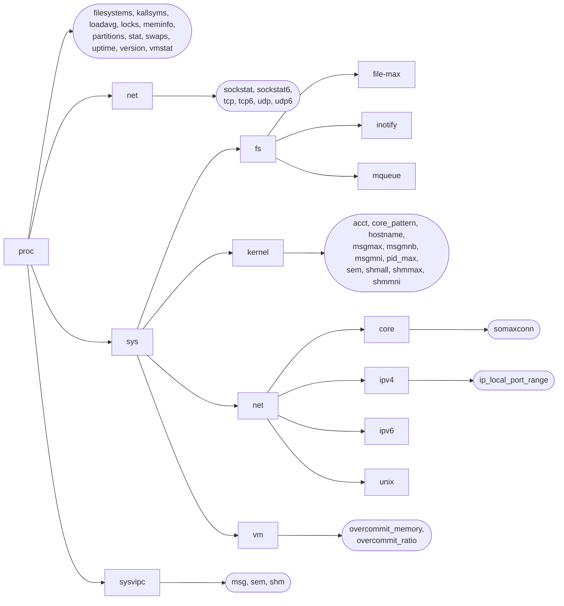

# Chương 12: THÔNG TIN HỆ THỐNG VÀ TIẾN TRÌNH

Trong chương này, chúng ta sẽ tìm hiểu các phương pháp để truy xuất nhiều loại thông tin khác nhau về hệ thống và tiến trình (process). Trọng tâm chính của chương là thảo luận về hệ thống tập tin /proc. Chúng ta cũng sẽ mô tả System Call `uname()`, được sử dụng để lấy các định danh khác nhau của hệ thống.

## 12.1 Hệ thống tập tin /proc

Trong các hệ thống UNIX cũ, thường không có cách nào dễ dàng để phân tích nội tại (introspective) hoặc thay đổi các thuộc tính của kernel nhằm trả lời những câu hỏi như sau:

- Có bao nhiêu tiến trình đang chạy trên hệ thống và ai là chủ sở hữu của chúng?
- Tiến trình đang mở những tập tin nào?
- Những tập tin nào hiện đang bị khóa (locked) và tiến trình nào đang nắm giữ các khóa đó?
- Những socket nào đang được sử dụng trên hệ thống?

Một số hệ thống UNIX cũ đã giải quyết vấn đề này bằng cách cho phép các chương trình có đặc quyền (privileged program) đào sâu vào các cấu trúc dữ liệu trong bộ nhớ của kernel (kernel memory). Tuy nhiên, phương pháp này gặp phải nhiều vấn đề. Cụ thể, nó đòi hỏi kiến thức chuyên môn về các cấu trúc dữ liệu của kernel, và các cấu trúc này có thể thay đổi từ phiên bản kernel này sang phiên bản kernel tiếp theo, buộc các chương trình phụ thuộc vào chúng phải được viết lại.

Để cung cấp quyền truy cập dễ dàng hơn vào thông tin của kernel, nhiều hệ thống UNIX hiện đại cung cấp một hệ thống tập tin ảo (virtual file system) /proc. Hệ thống tập tin này nằm dưới thư mục `/proc` và chứa nhiều tập tin khác nhau thể hiện thông tin của kernel, cho phép các tiến trình đọc thông tin đó một cách thuận tiện, và trong một số trường hợp có thể thay đổi thông tin đó, bằng cách sử dụng các System Call I/O tập tin thông thường. Hệ thống tập tin /proc được gọi là ảo vì các tập tin và thư mục con mà nó chứa không nằm trên đĩa (disk). Thay vào đó, kernel tạo ra chúng "khi có yêu cầu" (on the fly) khi các tiến trình truy cập đến chúng.

Trong phần này, chúng ta sẽ trình bày tổng quan về hệ thống tập tin /proc. Trong các chương sau, chúng ta sẽ mô tả chi tiết các tập tin /proc cụ thể khi chúng liên quan đến các chủ đề của từng chương. Mặc dù nhiều hệ thống UNIX cung cấp hệ thống tập tin /proc, chuẩn SUSv3 không quy định hệ thống tập tin này; các chi tiết được mô tả trong cuốn sách này là đặc trưng cho Linux (Linux-specific).

### 12.1.1 Lấy thông tin về một tiến trình: /proc/PID

Đối với mỗi tiến trình trên hệ thống, kernel cung cấp một thư mục tương ứng có tên là `/proc/PID`, trong đó `PID` là ID của tiến trình (Process ID). Bên trong thư mục này là các tập tin và thư mục con khác nhau chứa thông tin về tiến trình đó. Ví dụ, chúng ta có thể lấy thông tin về tiến trình `init`, tiến trình luôn có Process ID là 1, bằng cách xem các tập tin nằm dưới thư mục `/proc/1`.

Trong số các tập tin nằm trong mỗi thư mục `/proc/PID` có một tập tin tên là `status`, cung cấp một loạt thông tin về tiến trình đó:

| Tên lệnh do tiến trình này thực thi<br>Name:<br>init<br>Trạng thái của tiến trình này<br>State: S (sleeping)<br>ID nhóm luồng (Thread Group ID - PID truyền thống, getpid())<br>Tgid:<br>1<br>Thực tế là ID luồng (Thread ID, gettid())<br>Pid:<br>1<br>ID tiến trình cha (Parent Process ID)<br>PPid:<br>0<br>PID của tiến trình đang gỡ lỗi/theo dõi (0 nếu không bị theo dõi)<br>TracerPid:<br>0<br>UID thực, hiệu dụng, đã lưu, và FS UID<br>Uid:<br>0<br>0<br>0<br>0<br>GID thực, hiệu dụng, đã lưu, và FS GID<br>Gid:<br>0<br>0<br>0<br>0<br>Số lượng khe cắm File Descriptor hiện được cấp phát<br>FDSize: 256<br>ID nhóm bổ sung (Supplementary Group IDs)<br>Groups:<br>Kích thước bộ nhớ ảo đỉnh điểm<br>VmPeak:<br>852 kB<br>Kích thước bộ nhớ ảo hiện tại<br>VmSize:<br>724 kB<br>Bộ nhớ bị khóa (Locked memory)<br>VmLck:<br>0 kB<br>Kích thước tập hợp thường trú đỉnh điểm (Peak resident set size)<br>VmHWM:<br>288 kB<br>Kích thước tập hợp thường trú hiện tại<br>VmRSS:<br>288 kB<br>Kích thước phân đoạn dữ liệu<br>VmData:<br>148 kB<br>Kích thước Stack<br>VmStk:<br>88 kB<br>Kích thước đoạn Text (mã thực thi)<br>VmExe:<br>484 kB<br>Kích thước mã thư viện chia sẻ<br>VmLib:<br>0 kB<br>Kích thước bảng trang (từ phiên bản 2.6.10)<br>VmPTE:<br>12 kB<br>Số lượng luồng trong nhóm luồng của tiến trình này<br>Threads:<br>1<br>Tín hiệu hiện tại/tối đa trong hàng đợi (từ phiên bản 2.6.12)<br>SigQ:<br>0/3067<br>Các tín hiệu đang chờ xử lý cho luồng<br>SigPnd: 0000000000000000<br>Các tín hiệu đang chờ xử lý cho tiến trình (từ phiên bản 2.6)<br>ShdPnd: 0000000000000000<br>Các tín hiệu bị chặn (Blocked signals)<br>SigBlk: 0000000000000000<br>Các tín hiệu bị bỏ qua (Ignored signals)<br>SigIgn: fffffffe5770d8fc<br>Các tín hiệu đã bắt (Caught signals)<br>SigCgt: 00000000280b2603<br>Khả năng có thể kế thừa (Inheritable capabilities)<br>CapInh: 0000000000000000<br>CapPrm: 00000000ffffffff | \$ cat /proc/1/status |  |  |  |                        |
|-----------------------------------------------------------------------------------------------------------------------------------------------------------------------------------------------------------------------------------------------------------------------------------------------------------------------------------------------------------------------------------------------------------------------------------------------------------------------------------------------------------------------------------------------------------------------------------------------------------------------------------------------------------------------------------------------------------------------------------------------------------------------------------------------------------------------------------------------------------------------------------------------------------------------------------------------------------------------------------------------------------------------------------------------------------------------------------------------------------------------------------------------------------------------------------------------------------------------------------------------------------------------------------------------------------------------------------------------------------------------------------------------------------------------------------------------------------------------------------------------------------------------------------------------------|-----------------------|--|--|--|------------------------|

| | | | | |
| - | - | - | - | - |
| | | | | |
| | | | | |
| | | | | |

| | | | | |
| - | - | - | - | - |
| | | | | |
| | | | | |
| | | | | |

| | | | | |
| - | - | - | - | - |
| | | | | |
| | | | | |
| | | | | |

| | | | | |
| - | - | - | - | - |
| | | | | |
| | | | | |
| | | | | |

| | | | | |
| - | - | - | - | - |
| | | | | |
| | | | | |
| | | | | |

| | | | | |
| - | - | - | - | - |
| | | | | |
| | | | | |
| | | | | |

| | | | | | |
| - | - | - | - | - | - |
| | | | | | |
| | | | | | |
| | | | | | |

|                                                                                                                                                                                                                                                                                                                                                                                                                                                                                                                                                                                                                                                                                                                                                                                                                                                                                                                                                                                                                                                                                                                                                                                                                                                                                                                                                                                                                                                                                                                                                     |                       |  |  |  | Các capability (Capability) được phép |

CapEff: 00000000fffffeff Các capability có hiệu lực (Effective capabilities) CapBnd: 00000000ffffffff Tập giới hạn capability (Capability bounding set) (từ phiên bản 2.6.26) Cpus\_allowed: 1 Các CPU được phép, dạng mặt nạ (mask) (từ phiên bản 2.6.24) Cpus\_allowed\_list: 0 Giống như trên, định dạng danh sách (từ phiên bản 2.6.26) Mems\_allowed: 1 Các nút bộ nhớ (Memory node) được phép, dạng mặt nạ (từ phiên bản 2.6.24) Mems\_allowed\_list: 0 Giống như trên, định dạng danh sách (từ phiên bản 2.6.26) voluntary\_ctxt\_switches: 6998 Số lần chuyển ngữ cảnh tự nguyện (Voluntary context switches) (từ phiên bản 2.6.23) nonvoluntary\_ctxt\_switches: 107 Số lần chuyển ngữ cảnh không tự nguyện (Involuntary context switches) (từ phiên bản 2.6.23) Stack usage: 8 kB Mức sử dụng stack cao nhất (Stack usage high-water mark) (từ phiên bản 2.6.32)

Kết quả đầu ra trên được lấy từ Linux Kernel 2.6.32. Như đã chỉ ra bởi các chú thích "since" đi kèm với kết quả xuất của tệp, định dạng của tệp này đã tiến hóa theo thời gian, với các trường mới được bổ sung (và trong một vài trường hợp bị loại bỏ) ở các phiên bản kernel khác nhau. (Ngoài các thay đổi của Linux 2.6 được lưu ý ở trên, Linux 2.4 đã bổ sung các trường `Tgid`, `TracerPid`, `FDSize`, và `Threads`.)

Việc nội dung của tệp này thay đổi theo thời gian đặt ra một điểm chung về việc sử dụng các tệp trong `/proc`: khi các tệp này bao gồm nhiều mục (entry), chúng ta nên phân tích cú pháp (parse) một cách cẩn trọng và phòng ngừa — trong trường hợp này, hãy tìm kiếm sự trùng khớp trên một dòng chứa một chuỗi cụ thể (ví dụ: `PPid:`), thay vì xử lý tệp theo số hiệu dòng (logic).

[Bảng 12-1](#page-72-0) liệt kê một số tệp khác được tìm thấy trong mỗi thư mục `/proc/PID`.

**Bảng 12-1:** Các tệp được chọn trong mỗi thư mục `/proc/PID`

| Tệp | Mô tả (thuộc tính tiến trình - process attribute) |
|---------|-----------------------------------------------------------------------------|
| cmdline | Các tham số dòng lệnh được phân tách bằng ký tự `\0` |
| cwd | Liên kết tượng trưng (symbolic link) trỏ đến thư mục làm việc hiện tại (current working directory) |
| environ | Danh sách biến môi trường theo cặp `NAME=value`, phân tách bằng `\0` |
| exe | Liên kết tượng trưng trỏ đến tệp đang được thực thi |
| fd | Thư mục chứa các liên kết tượng trưng trỏ đến các tệp được mở bởi tiến trình này |
| maps | Các vùng ánh xạ bộ nhớ (Memory mappings) |
| mem | Bộ nhớ ảo của tiến trình (phải gọi `lseek()` đến một offset hợp lệ trước khi thực hiện I/O) |
| mounts | Các điểm gắn kết (Mount points) cho tiến trình này |
| root | Liên kết tượng trưng trỏ đến thư mục gốc (root directory) |
| status | Các thông tin khác nhau (ví dụ: ID tiến trình, thông tin định danh - credentials, mức sử dụng bộ nhớ, tín hiệu - signal) |
| task | Chứa một thư mục con cho mỗi luồng (thread) trong tiến trình (Linux 2.6) |

### Thư mục /proc/PID/fd

Thư mục `/proc/PID/fd` chứa một liên kết tượng trưng cho mỗi mô tả tệp (File Descriptor - fd) mà tiến trình đang mở. Mỗi liên kết tượng trưng này có tên trùng với số hiệu mô tả (descriptor number); ví dụ, `/proc/1968/1` là một liên kết tượng trưng trỏ đến đầu ra tiêu chuẩn (standard output) của tiến trình 1968. Tham khảo Mục 5.11 để biết thêm thông tin chi tiết.

Để thuận tiện, bất kỳ tiến trình nào cũng có thể truy cập vào thư mục `/proc/PID` của chính nó bằng cách sử dụng liên kết tượng trưng `/proc/self`.

### Luồng (Threads): thư mục /proc/PID/task

Linux 2.4 đã bổ sung khái niệm nhóm luồng (thread group) để hỗ trợ đầy đủ mô hình luồng POSIX. Vì một số thuộc tính là riêng biệt đối với các luồng trong một nhóm luồng, Linux 2.4 đã bổ sung một thư mục con `task` bên dưới thư mục `/proc/PID`. Đối với mỗi luồng trong tiến trình này, kernel cung cấp một thư mục con có tên là `/proc/PID/task/TID`, trong đó `TID` là ID của luồng đó (Thread ID). (Đây chính là con số sẽ được trả về bởi lời gọi hàm `gettid()` trong luồng đó).

Dưới mỗi thư mục con `/proc/PID/task/TID` là một tập hợp các tệp và thư mục hoàn toàn giống với những gì được tìm thấy bên dưới `/proc/PID`. Vì các luồng (Thread) chia sẻ nhiều thuộc tính, phần lớn thông tin trong các tệp này là giống nhau đối với mỗi luồng trong tiến trình (Process). Tuy nhiên, trong những trường hợp hợp lý, các tệp này hiển thị thông tin riêng biệt cho từng luồng. Ví dụ, trong các tệp `/proc/PID/task/TID/status` của một nhóm luồng (Thread Group), `State`, `Pid`, `SigPnd`, `SigBlk`, `CapInh`, `CapPrm`, `CapEff`, và `CapBnd` là một số trường có thể khác nhau đối với từng luồng.

### 12.1.2 Thông tin hệ thống bên dưới /proc

Nhiều tệp và thư mục con bên dưới `/proc` cung cấp quyền truy cập vào thông tin toàn hệ thống (system-wide information). Một số trong số này được thể hiện trong [Hình 12-1](#page-74-0).

Nhiều tệp được hiển thị trong [Hình 12-1](#page-74-0) được mô tả ở các phần khác trong cuốn sách này. [Bảng 12-2](#page-73-0) tóm tắt mục đích chung của các thư mục con `/proc` được hiển thị trong [Hình 12-1](#page-74-0).

| Thư mục          | Thông tin được cung cấp bởi các tệp trong thư mục này |
|------------------|-----------------------------------------------------|
| /proc            | Thông tin hệ thống khác nhau                        |
| /proc/net        | Thông tin trạng thái về mạng và socket (`socket`)   |
| /proc/sys/fs     | Các thiết lập liên quan đến hệ thống tệp            |
| /proc/sys/kernel | Các thiết lập chung khác nhau của kernel            |
| /proc/sys/net    | Các thiết lập về mạng và socket                     |
| /proc/sys/vm     | Các thiết lập quản lý bộ nhớ (memory-management)    |
| /proc/sysvipc    | Thông tin về các đối tượng System V IPC             |

**Bảng 12-2:** Mục đích của một số thư mục con `/proc` được lựa chọn

### 12.1.3 Truy cập các tệp /proc

Các tệp bên dưới `/proc` thường được truy cập bằng cách sử dụng các script shell (hầu hết các tệp `/proc` chứa nhiều giá trị có thể dễ dàng phân tích cú pháp bằng ngôn ngữ kịch bản như Python hoặc Perl). Ví dụ, chúng ta có thể sửa đổi và xem nội dung của một tệp `/proc` bằng các lệnh shell như sau:

```
## echo 100000 > /proc/sys/kernel/pid_max
## cat /proc/sys/kernel/pid_max
100000
```

Các tệp `/proc` cũng có thể được truy cập từ một chương trình bằng cách sử dụng các System Call I/O tệp thông thường. Một số hạn chế được áp dụng khi truy cập các tệp này:

- Một số tệp `/proc` là chỉ đọc (read-only); nghĩa là, chúng chỉ tồn tại để hiển thị thông tin kernel và không thể được sử dụng để sửa đổi thông tin đó. Điều này áp dụng cho hầu hết các tệp bên dưới thư mục `/proc/PID`.
- Một số tệp `/proc` chỉ có thể được đọc bởi chủ sở hữu tệp (hoặc bởi một tiến trình có đặc quyền - privileged process). Ví dụ, tất cả các tệp bên dưới `/proc/PID` đều thuộc sở hữu của người dùng sở hữu tiến trình tương ứng, và trên một số tệp này (ví dụ: `/proc/PID/environ`), quyền đọc chỉ được cấp cho chủ sở hữu tệp.

Ngoài các tệp trong thư mục con `/proc/PID`, hầu hết các tệp bên dưới `/proc` đều thuộc sở hữu của root, và các tệp có thể sửa đổi chỉ có thể được chỉnh sửa bởi root.



**Hình 12-1:** Các tệp và thư mục con được chọn bên dưới `/proc`

### Truy cập các tệp trong /proc/PID

Các thư mục `/proc/PID` có tính tạm thời (volatile). Mỗi thư mục trong số này được hình thành khi một tiến trình (process) với ID tương ứng được tạo ra và biến mất khi tiến trình đó kết thúc. Điều này có nghĩa là nếu chúng ta xác định rằng một thư mục `/proc/PID` cụ thể nào đó tồn tại, chúng ta cần phải xử lý một cách sạch sẽ trường hợp tiến trình đó đã kết thúc và thư mục `/proc/PID` tương ứng đã bị xóa vào thời điểm chúng ta cố gắng mở một tệp bên trong thư mục đó.

### Chương trình ví dụ

[Listing 12-1](#page-75-0) minh họa cách đọc và sửa đổi một tệp `/proc`. Chương trình này đọc và hiển thị nội dung của `/proc/sys/kernel/pid_max`. Nếu một tham số dòng lệnh (command-line argument) được cung cấp, chương trình sẽ cập nhật tệp bằng giá trị đó. Tệp này (mới có từ Linux 2.6) quy định giới hạn trên cho các ID tiến trình (process ID) (Mục 6.2). Dưới đây là một ví dụ về cách sử dụng chương trình này:

```
$ su                            # Yêu cầu quyền đặc quyền để cập nhật file pid_max
Password:
## ./procfs_pidmax 10000
Old value: 32768
/proc/sys/kernel/pid_max now contains 10000
```

**Listing 12-1:** Truy cập `/proc/sys/kernel/pid_max`

```c
/* sysinfo/procfs_pidmax.c */
## include <fcntl.h>
## include "tlpi_hdr.h"

## define MAX_LINE 100

int
main(int argc, char *argv[])
{
    int fd;
    char line[MAX_LINE];
    ssize_t n;

    fd = open("/proc/sys/kernel/pid_max", (argc > 1) ? O_RDWR : O_RDONLY);
    if (fd == -1)
        errExit("open");

    n = read(fd, line, MAX_LINE);
    if (n == -1)
        errExit("read");

    if (argc > 1)
        printf("Old value: ");
    printf("%.*s", (int) n, line);

    if (argc > 1) {
        if (write(fd, argv[1], strlen(argv[1])) != strlen(argv[1]))
            fatal("write() failed");
        system("echo /proc/sys/kernel/pid_max now contains "
               "`cat /proc/sys/kernel/pid_max`");
    }

    exit(EXIT_SUCCESS);
}
```

## 12.2 Định danh Hệ thống: uname()

System call `uname()` trả về một loạt thông tin định danh về hệ thống máy chủ (host system) nơi ứng dụng đang chạy, được lưu trong cấu trúc (structure) trỏ bởi `utsbuf`.

```
## include <sys/utsname.h>
int uname(struct utsname *utsbuf);
                                             Trả về 0 khi thành công, hoặc –1 khi lỗi
```

Tham số `utsbuf` là một con trỏ (pointer) trỏ đến cấu trúc `utsname`, được định nghĩa như sau:

```c
## define _UTSNAME_LENGTH 65
struct utsname {
    char sysname[_UTSNAME_LENGTH];    /* Tên của bản cài đặt OS */
    char nodename[_UTSNAME_LENGTH];   /* Tên node trên mạng */
    char release[_UTSNAME_LENGTH];    /* Mức phát hành (release) OS */
    char version[_UTSNAME_LENGTH];    /* Phiên bản (version) kernel */
    char machine[_UTSNAME_LENGTH];    /* Kiến trúc phần cứng */
## ifdef _GNU_SOURCE                    /* Trường mở rộng dành riêng cho Linux */
    char domainname[_UTSNAME_LENGTH]; /* Tên miền NIS của host */
## endif
};
```

SUSv3 quy định `uname()`, nhưng để trống độ dài của các trường khác nhau trong cấu trúc `utsname`, chỉ yêu cầu các chuỗi phải được kết thúc bằng một byte null (null byte). Trên Linux, mỗi trường này dài 65 byte, bao gồm cả không gian cho byte null kết thúc. Trên một số triển khai UNIX khác, các trường này ngắn hơn; trên các hệ thống khác (ví dụ: Solaris), chúng có thể lên tới 257 byte.

Các trường `sysname`, `release`, `version`, và `machine` của cấu trúc `utsname` được thiết lập tự động bởi kernel.

> Trên Linux, ba tệp trong thư mục `/proc/sys/kernel` cung cấp quyền truy cập vào cùng thông tin được trả về trong các trường `sysname`, `release`, và `version` của cấu trúc `utsname`. Các tệp chỉ đọc này lần lượt là `ostype`, `osrelease`, và `version`. Một tệp khác, `/proc/version`, bao gồm cùng thông tin như trong các tệp này, đồng thời bao gồm cả thông tin về bước biên dịch kernel (tức là tên của người dùng đã thực hiện biên dịch, tên của máy chủ nơi quá trình biên dịch được thực hiện, và phiên bản `gcc` được sử dụng).

Trường `nodename` trả về giá trị đã được thiết lập bằng system call `sethostname()` (xem trang tài liệu hướng dẫn - manual page để biết chi tiết về system call này). Thường thì tên này giống như tiền tố tên máy chủ (hostname prefix) từ tên miền DNS của hệ thống.

Trường `domainname` trả về giá trị đã được thiết lập bằng system call `setdomainname()` (xem trang tài liệu hướng dẫn để biết chi tiết về system call này). Đây là tên miền Dịch vụ Thông tin Mạng - Network Information Services (NIS) của máy chủ (không giống với tên miền DNS của máy chủ).

System call `gethostname()`, là hàm ngược lại của `sethostname()`, dùng để truy xuất tên máy chủ hệ thống (system hostname). Tên máy chủ hệ thống cũng có thể được xem và thiết lập bằng lệnh `hostname(1)` và tệp chuyên biệt trên Linux `/proc/hostname`.

System call `getdomainname()`, là hàm ngược lại của `setdomainname()`, dùng để truy xuất tên miền NIS. Tên miền NIS cũng có thể được xem và thiết lập bằng lệnh `domainname(1)` và tệp chuyên biệt trên Linux `/proc/domainname`.

Các System Call (Lời gọi hệ thống) `sethostname()` và `setdomainname()` rất ít khi được sử dụng trong các chương trình ứng dụng. Thông thường, tên hostname và tên miền NIS được thiết lập vào thời điểm khởi động hệ thống bởi các startup script.

Chương trình trong Liệt kê 12-2 hiển thị thông tin trả về bởi `uname()`. Dưới đây là một ví dụ về đầu ra chúng ta có thể thấy khi chạy chương trình này:

```
$ ./t_uname
   Node name: tekapo
   System name: Linux
   Release: 2.6.30-default
   Version: #3 SMP Fri Jul 17 10:25:00 CEST 2009
   Machine: i686
   Domain name:
Liệt kê 12-2: Sử dụng uname()
–––––––––––––––––––––––––––––––––––––––––––––––––––––––– sysinfo/t_uname.c
## define _GNU_SOURCE
## include <sys/utsname.h>
## include "tlpi_hdr.h"
int
main(int argc, char *argv[])
{
 struct utsname uts;
 if (uname(&uts) == -1)
 errExit("uname");
 printf("Node name: %s\n", uts.nodename);
 printf("System name: %s\n", uts.sysname);
 printf("Release: %s\n", uts.release);
 printf("Version: %s\n", uts.version);
 printf("Machine: %s\n", uts.machine);
## ifdef _GNU_SOURCE
 printf("Domain name: %s\n", uts.domainname);
## endif
 exit(EXIT_SUCCESS);
}
–––––––––––––––––––––––––––––––––––––––––––––––––––––––– sysinfo/t_uname.c
```

## 12.3 Tổng kết

Hệ thống tập tin (file system) `/proc` cung cấp một loạt thông tin kernel (Kernel space) cho các chương trình ứng dụng (User space). Mỗi thư mục con `/proc/PID` chứa các tập tin và thư mục con cung cấp thông tin về tiến trình (Process) có ID khớp với `PID`. Các tập tin và thư mục khác nhau bên dưới `/proc` cung cấp thông tin toàn hệ thống (system-wide) mà các chương trình có thể đọc và trong một số trường hợp, có thể sửa đổi.

Lời gọi hệ thống `uname()` cho phép chúng ta khám phá thông tin cài đặt UNIX và loại máy (Machine type) mà ứng dụng đang chạy trên đó.

### Thông tin thêm

Thông tin thêm về hệ thống tập tin `/proc` có thể được tìm thấy trong trang sổ tay (manual page) `proc(5)`, trong tập tin mã nguồn kernel `Documentation/filesystems/proc.txt`, và trong các tập tin khác nhau tại thư mục `Documentation/sysctl`.

## 12.4 Bài tập

- **12-1.** Viết một chương trình liệt kê ID tiến trình (Process ID) và tên lệnh (Command name) cho tất cả các tiến trình đang được chạy bởi người dùng có tên được truyền vào qua đối dòng lệnh (command-line argument) của chương trình. (Bạn có thể thấy hàm `userIdFromName()` từ [Liệt kê 8-1](#page-6-1), ở trang [159,](#page-6-1) là hữu ích.) Điều này có thể được thực hiện bằng cách kiểm tra các dòng `Name:` và `Uid:` của tất cả các tập tin `/proc/PID/status` trên hệ thống. Việc duyệt qua tất cả các thư mục `/proc/PID` trên hệ thống yêu cầu sử dụng hàm `readdir(3)`, được mô tả trong Mục 18.8. Hãy đảm bảo chương trình của bạn xử lý chính xác khả năng một thư mục `/proc/PID` biến mất giữa thời điểm chương trình xác định rằng thư mục đó tồn tại và thời điểm nó cố gắng mở tập tin `/proc/PID/status` tương ứng.
- **12-2.** Viết một chương trình vẽ một cây (tree) hiển thị mối quan hệ cha-con phân cấp của tất cả các tiến trình trên hệ thống, đi ngược lại tận gốc `init`. Đối với mỗi tiến trình, chương trình phải hiển thị ID tiến trình và lệnh đang được thực thi. Đầu ra của chương trình phải tương tự như đầu ra được tạo bởi lệnh `pstree(1)`, mặc dù không cần phải quá tinh vi. Tiến trình cha của mỗi tiến trình trên hệ thống có thể được tìm thấy bằng cách kiểm tra dòng `PPid:` của tất cả các tập tin `/proc/PID/status` trên hệ thống. Hãy cẩn thận xử lý trường hợp tiến trình cha của một tiến trình (và do đó là thư mục `/proc/PID` của nó) biến mất trong quá trình quét tất cả các thư mục `/proc/PID`.
- **12-3.** Viết một chương trình liệt kê tất cả các tiến trình đang mở một đường dẫn tập tin (file pathname) cụ thể. Điều này có thể đạt được bằng cách kiểm tra nội dung của tất cả các liên kết tượng trưng (symbolic link) `/proc/PID/fd/\*`. Việc này sẽ yêu cầu các vòng lồng nhau sử dụng `readdir(3)` để quét tất cả các thư mục `/proc/PID`, và sau đó quét nội dung của tất cả các mục nhập `/proc/PID/fd` bên trong mỗi thư mục `/proc/PID`. Để đọc nội dung của một liên kết tượng trưng `/proc/PID/fd/n`, cần phải sử dụng hàm `readlink()`, được mô tả trong Mục 18.5.
