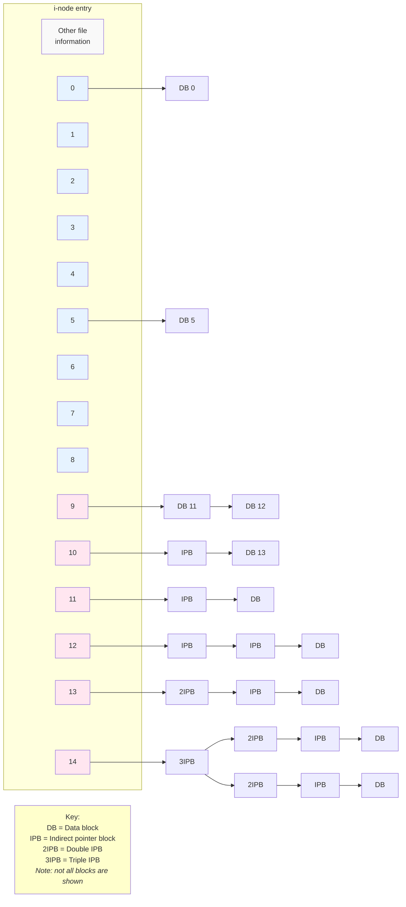
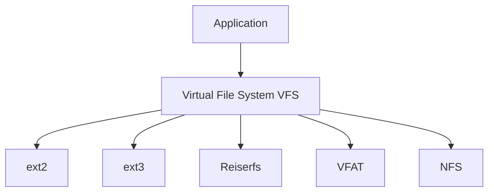
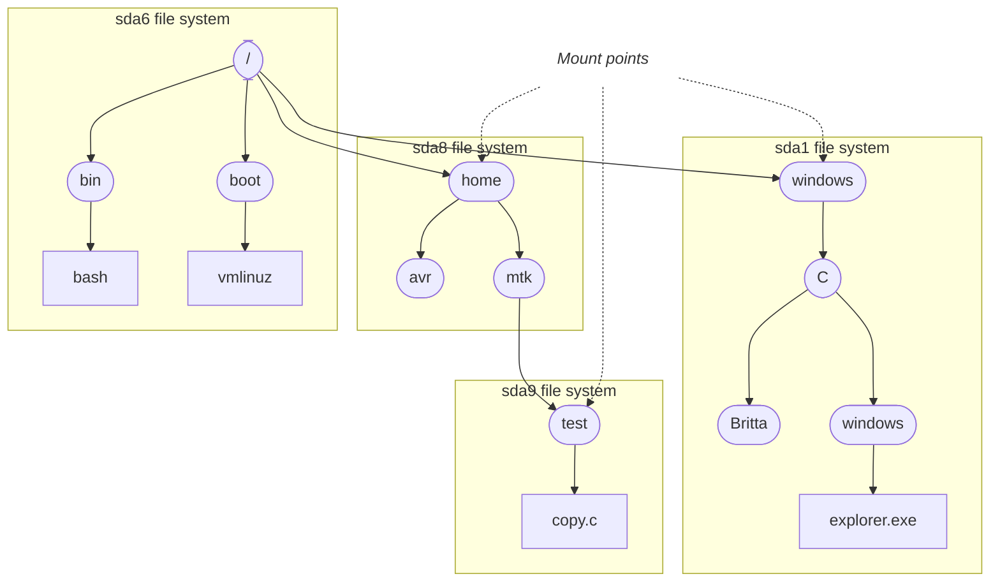

# Chương 14: Hệ thống tập tin (File Systems)

Trong các Chương 4, 5 và [13](#page-0-0), chúng ta đã tìm hiểu về hoạt động I/O của tập tin (file I/O), với trọng tâm đặc biệt là các tập tin thông thường (tức là tập tin trên đĩa). Trong chương này và các chương tiếp theo, chúng ta sẽ đi sâu vào chi tiết một loạt các chủ đề liên quan đến tập tin:

- Chương này xem xét các hệ thống tập tin (file systems).
- Chương [15](#page-46-0) mô tả các thuộc tính khác nhau được liên kết với một tập tin, bao gồm dấu thời gian (timestamps), quyền sở hữu (ownership) và quyền hạn (permissions).
- Các Chương 16 và 17 xem xét hai tính năng mới của Linux 2.6: thuộc tính mở rộng (extended attributes) và danh sách điều khiển truy cập (access control lists - ACLs). Thuộc tính mở rộng là một phương pháp liên kết siêu dữ liệu (metadata) tùy ý với một tập tin. ACL là phần mở rộng của mô hình quyền tập tin UNIX truyền thống.
- Chương 18 xem xét các thư mục (directories) và liên kết (links).

Phần lớn nội dung của chương này liên quan đến hệ thống tập tin, vốn là các tập hợp có tổ chức của các tập tin và thư mục. Chúng ta sẽ giải thích hàng loạt khái niệm về hệ thống tập tin, đôi khi sử dụng hệ thống tập tin ext2 truyền thống của Linux làm ví dụ cụ thể. Chúng ta cũng mô tả ngắn gọn một số hệ thống tập tin có cơ chế ghi nhật ký (journaling file systems) hiện có trên Linux.

Chúng ta kết thúc chương bằng phần thảo luận về các system call (system calls) được sử dụng để gắn kết (mount) và gỡ gắn kết (unmount) một hệ thống tập tin, cùng với các hàm thư viện (library functions) dùng để lấy thông tin về các hệ thống tập tin đã được mount.

## 14.1 Các Tập Tin Đặc Biệt Của Thiết Bị (Thiết Bị)

Chương này đề cập thường xuyên đến các thiết bị đĩa (disk devices), vì vậy chúng ta bắt đầu với một tổng quan ngắn gọn về khái niệm tập tin thiết bị (device file).

Một tập tin đặc biệt của thiết bị (device special file) tương ứng với một thiết bị trên hệ thống. Bên trong kernel (Kernel Space), mỗi loại thiết bị có một device driver (device driver) tương ứng, xử lý tất cả các yêu cầu I/O cho thiết bị đó. Device driver là một đơn vị mã nguồn kernel thực hiện một tập hợp các thao tác (thông thường) tương ứng với các hành động đầu vào và đầu ra trên một phần cứng đi kèm. API do các device driver cung cấp là cố định và bao gồm các thao tác tương ứng với các system call open(), close(), read(), write(), mmap(), và ioctl(). Việc mỗi device driver cung cấp một giao diện nhất quán, che giấu sự khác biệt trong hoạt động của từng thiết bị riêng lẻ, cho phép tính phổ quát của I/O (Mục 4.2).

Một số thiết bị là thiết bị vật lý thực tế, chẳng hạn như chuột, đĩa và ổ băng từ. Các thiết bị khác là thiết bị ảo (virtual), nghĩa là không có phần cứng tương ứng; thay vào đó, kernel cung cấp (thông qua device driver) một thiết bị trừu tượng với một API giống như thiết bị thật.

Các thiết bị có thể được chia thành hai loại:

- Thiết bị ký tự (Character devices) xử lý dữ liệu theo từng ký tự (character-by-character). Thiết bị đầu cuối (terminals) và bàn phím là những ví dụ về thiết bị ký tự.
- Thiết bị khối (Block devices) xử lý dữ liệu theo từng khối (block at a time). Kích thước của một khối phụ thuộc vào loại thiết bị, nhưng thường là một bội số của 512 byte. Ví dụ về thiết bị khối bao gồm đĩa và ổ băng từ.

Các tập tin thiết bị xuất hiện trong hệ thống tập tin giống như các tập tin khác, thường nằm dưới thư mục /dev. Người dùng siêu quyền hạn (superuser) có thể tạo một tập tin thiết bị bằng cách sử dụng lệnh `mknod`, và tác vụ tương tự có thể được thực hiện trong một chương trình có đặc quyền (`CAP_MKNOD`) bằng cách sử dụng system call `mknod()`.

> [!NOTE]
> Chúng ta không mô tả chi tiết system call `mknod()` ("make file-system i-node") vì cách sử dụng của nó rất đơn giản, và mục đích duy nhất mà nó cần đến ngày nay là để tạo các tập tin thiết bị, vốn không phải là một yêu cầu ứng dụng phổ biến. Chúng ta cũng có thể sử dụng `mknod()` để tạo các FIFO (Mục 44.7), nhưng hàm `mkfifo()` được ưu tiên hơn cho tác vụ này. Về mặt lịch sử, một số bản cài đặt UNIX cũng sử dụng `mknod()` để tạo các thư mục, nhưng cách sử dụng này nay đã được thay thế bằng system call `mkdir()`. Tuy nhiên, một số bản cài đặt UNIX — nhưng không phải Linux — vẫn duy trì khả năng này trong `mknod()` để tương thích ngược. Xem trang hướng dẫn thủ công (manual page) `mknod(2)` để biết thêm chi tiết.

Trong các phiên bản Linux trước đây, /dev chứa các mục (entries) cho tất cả các thiết bị có thể có trên hệ thống, ngay cả khi các thiết bị đó không thực sự được kết nối với hệ thống. Điều này có nghĩa là /dev có thể chứa theo đúng nghĩa đen hàng nghìn mục không sử dụng, làm chậm tác vụ của các chương trình cần quét nội dung của thư mục đó, và làm cho việc sử dụng nội dung của thư mục như một phương tiện để khám phá những thiết bị nào thực sự có mặt trên hệ thống trở nên bất khả thi. Trong Linux 2.6, những vấn đề này được giải quyết bởi chương trình `udev`. Chương trình `udev` dựa vào hệ thống tập tin `sysfs`, xuất thông tin về các thiết bị và các đối tượng kernel khác vào user space (User Space) thông qua một hệ thống tập tin giả (pseudo-file system) được mount dưới /sys.

[Kroah-Hartman, 2003] cung cấp một cái nhìn tổng quan về `udev` và phác thảo các lý do tại sao nó được coi là vượt trội hơn `devfs`, giải pháp của Linux 2.4 cho cùng các vấn đề trên. Thông tin về hệ thống tập tin `sysfs` có thể được tìm thấy trong tập tin mã nguồn kernel Linux 2.6 `Documentation/filesystems/sysfs.txt` và trong [Mochel, 2005].

### Device IDs

Mỗi tệp thiết bị (device file) có một số định danh chính (major ID number) và một số định danh phụ (minor ID number). Số major xác định lớp chung của thiết bị và được kernel sử dụng để tra cứu trình điều khiển (driver) phù hợp cho loại thiết bị này. Số minor định danh duy nhất một thiết bị cụ thể trong một lớp thiết bị chung.

Các số major và minor của một tệp thiết bị được hiển thị bằng lệnh `ls –l`.

Các số major và minor của một thiết bị được ghi lại trong i-node của tệp thiết bị đó. (Chúng ta sẽ mô tả i-node trong Mục [14.4](#page-23-1).) Mỗi device driver đăng ký mối liên kết của nó với một số major device ID cụ thể, và mối liên kết này cung cấp kết nối giữa tệp đặc biệt của thiết bị (device special file) và device driver. Tên của tệp thiết bị không có ý nghĩa gì khi kernel tìm kiếm device driver.

Trên Linux 2.4 và các phiên bản trước đó, tổng số lượng thiết bị trên hệ thống bị giới hạn bởi thực tế là các số major và minor ID của thiết bị đều được biểu diễn chỉ bằng 8 bit. Việc các major device ID được cố định và phân bổ tập trung (bởi Cơ quan Tên và Số được gán của Linux - Linux Assigned Names and Numbers Authority; xem http://www.lanana.org/) càng làm trầm trọng thêm giới hạn này. Linux 2.6 làm giảm bớt giới hạn này bằng cách sử dụng nhiều bit hơn để lưu trữ các số major và minor ID của thiết bị (lần lượt là 12 và 20 bit).

## 14.2 Đĩa và Phân vùng (Disks and Partitions)

Các tệp thông thường (regular files) và thư mục thường nằm trên các thiết bị đĩa cứng (hard disk devices). (Các tệp và thư mục cũng có thể tồn tại trên các thiết bị khác, chẳng hạn như ổ đĩa CD-ROM, thẻ nhớ flash và đĩa ảo, nhưng trong phần thảo luận hiện tại, chúng ta chủ yếu quan tâm đến các thiết bị đĩa cứng.) Trong các phần sau đây, chúng ta sẽ xem xét cách các đĩa được tổ chức và chia thành các phân vùng (partitions).

### Ổ đĩa (Disk drives)

Ổ đĩa cứng (hard disk drive) là một thiết bị cơ học bao gồm một hoặc nhiều phiến đĩa (platters) quay với tốc độ cao (cỡ hàng nghìn vòng/phút). Thông tin được mã hóa từ tính trên bề mặt đĩa được truy xuất hoặc chỉnh sửa bởi các đầu đọc/ghi (read/write heads) di chuyển theo bán kính dọc theo đĩa. Về mặt vật lý, thông tin trên bề mặt đĩa nằm trên một tập hợp các vòng tròn đồng tâm gọi là các rãnh (tracks). Bản thân các rãnh được chia thành một số cung từ (sectors), mỗi cung từ bao gồm một chuỗi các khối vật lý (physical blocks). Các khối vật lý thường có kích thước 512 byte (hoặc một bội số nào đó của kích thước này) và đại diện cho đơn vị thông tin nhỏ nhất mà ổ đĩa có thể đọc hoặc ghi.

Mặc dù các đĩa hiện đại hoạt động nhanh, việc đọc và ghi thông tin trên đĩa vẫn tốn một khoảng thời gian đáng kể. Đầu đĩa trước tiên phải di chuyển đến rãnh thích hợp (thời gian tìm kiếm - seek time), sau đó ổ đĩa phải đợi cho đến khi cung từ thích hợp quay đến dưới đầu đọc (độ trễ quay - rotational latency), và cuối cùng các khối được yêu cầu phải được truyền tải (thời gian truyền - transfer time). Tổng thời gian cần thiết để thực hiện một thao tác như vậy thường nằm trong khoảng mili-giây. Ngược lại, các CPU hiện đại có khả năng thực hiện hàng triệu lệnh trong khoảng thời gian này.

### Phân vùng đĩa (Disk partitions)

Mỗi đĩa được chia thành một hoặc nhiều phân vùng (không chồng chéo lên nhau). Mỗi phân vùng được kernel xem như một thiết bị (device) riêng biệt nằm bên trong thư mục `/dev`.

> [!NOTE]
> Quản trị viên hệ thống (system administrator) xác định số lượng, loại và kích thước các phân vùng trên một đĩa bằng cách sử dụng lệnh `fdisk`. Lệnh `fdisk -l` liệt kê tất cả các phân vùng trên một đĩa. Tệp `/proc/partitions` đặc trưng của Linux liệt kê số hiệu thiết bị chính và phụ (major and minor device numbers), kích thước và tên của từng phân vùng đĩa trên hệ thống.

Một phân vùng đĩa có thể chứa bất kỳ loại thông tin nào, nhưng thường chứa một trong các thành phần sau:

- một hệ thống tệp (file system) chứa các tệp thông thường (regular files) và thư mục, như được mô tả trong Mục [14.3](#page-21-0);
- một vùng dữ liệu được truy cập như một thiết bị chế độ thô (raw-mode device), như được mô tả trong Mục [13.6](#page-13-0) (một số hệ quản trị cơ sở dữ liệu sử dụng kỹ thuật này); hoặc
- một vùng hoán đổi (swap area) được kernel sử dụng cho việc quản lý bộ nhớ (memory management).

Một vùng hoán đổi được tạo bằng cách sử dụng lệnh `mkswap(8)`. Một tiến trình (process) có quyền đặc quyền (`CAP_SYS_ADMIN`) có thể sử dụng System Call `swapon()` để thông báo cho kernel biết rằng một phân vùng đĩa sẽ được sử dụng làm vùng hoán đổi. System Call `swapoff()` thực hiện chức năng ngược lại, yêu cầu kernel ngừng sử dụng phân vùng đĩa làm vùng hoán đổi.
Các System Call này không được chuẩn hóa trong SUSv3, nhưng chúng tồn tại trên nhiều bản cài đặt UNIX khác nhau. Hãy tham khảo các trang manual `swapon(2)` và `swapon(8)` để biết thêm thông tin.

> [!NOTE]
> Tệp `/proc/swaps` đặc trưng của Linux có thể được sử dụng để hiển thị thông tin về các vùng hoán đổi hiện đang được bật trên hệ thống. Thông tin này bao gồm kích thước của từng vùng hoán đổi và dung lượng của vùng đó đang được sử dụng.

## 14.3 Hệ thống tệp (File Systems)

Hệ thống tệp (file system) là một tập hợp có tổ chức gồm các tệp thông thường và thư mục. Hệ thống tệp được tạo bằng cách sử dụng lệnh `mkfs`.

Một trong những điểm mạnh của Linux là nó hỗ trợ rất nhiều loại hệ thống tệp khác nhau, bao gồm:

- hệ thống tệp `ext2` truyền thống;
- các hệ thống tệp UNIX nguyên bản khác nhau như hệ thống tệp Minix, System V và BSD;
- các hệ thống tệp FAT, FAT32 và NTFS của Microsoft;
- hệ thống tệp CD-ROM ISO 9660;
- HFS của Apple Macintosh;
- hàng loạt hệ thống tệp mạng (network file systems), bao gồm NFS được sử dụng rộng rãi của Sun (thông tin về việc cài đặt NFS trên Linux có tại http://nfs.sourceforge.net/), SMB của IBM và Microsoft, NCP của Novell, và hệ thống tệp Coda được phát triển tại Đại học Carnegie Mellon; và
- hàng loạt hệ thống tệp nhật ký (journaling file systems), bao gồm `ext3`, `ext4`, `Reiserfs`, `JFS`, `XFS` và `Btrfs`.

Các loại hệ thống tệp hiện được kernel nhận biết có thể được xem trong tệp `/proc/filesystems` đặc trưng của Linux.

> [!NOTE]
> Linux 2.6.14 đã bổ sung cơ chế Hệ thống tệp trong Không gian người dùng (Filesystem in Userspace - FUSE). Cơ chế này thêm các điểm móc (hooks) vào kernel cho phép một hệ thống tệp được triển khai hoàn toàn thông qua một chương trình ở user space, mà không cần phải vá (patch) hay biên dịch lại kernel. Để biết thêm chi tiết, hãy xem tại http://fuse.sourceforge.net/.

### Hệ thống tập tin ext2

Trong nhiều năm, hệ thống tập tin (file system) được sử dụng rộng rãi nhất trên Linux là ext2 (The Second Extended File System - Hệ thống tập tin mở rộng thứ hai), đây là phiên bản kế nhiệm của hệ thống tập tin Linux gốc là ext. Gần đây, việc sử dụng ext2 đã suy giảm để nhường chỗ cho các hệ thống tập tin nhật ký (journaling file system) khác nhau. Đôi khi, việc mô tả các khái niệm hệ thống tập tin chung dưới dạng một triển khai hệ thống tập tin cụ thể là rất hữu ích, và vì mục đích này, chúng ta sẽ sử dụng ext2 làm ví dụ tại nhiều điểm khác nhau trong phần sau của chương này.

> [!NOTE]
> Hệ thống tập tin ext2 được viết bởi Remy Card. Mã nguồn của ext2 rất nhỏ gọn (khoảng 5000 dòng mã C) và tạo thành mô hình cho một số triển khai hệ thống tập tin khác. Trang chủ của ext2 là http://e2fsprogs.sourceforge.net/ext2.html. Trang web này bao gồm một tài liệu tổng quan tốt mô tả việc triển khai ext2. Cuốn sách trực tuyến The Linux Kernel của David Rusling, có sẵn tại http://www.tldp.org/, cũng mô tả về ext2.

### Cấu trúc hệ thống tập tin

Đơn vị cơ bản để cấp phát không gian trong một hệ thống tập tin là một khối logic (logical block), đây là một bội số của các khối vật lý (physical block) liên tục trên thiết bị đĩa mà hệ thống tập tin được lưu trữ trên đó. Ví dụ: kích thước khối logic trên ext2 là 1024, 2048 hoặc 4096 byte. (Kích thước khối logic được chỉ định làm đối số của lệnh `mkfs(8)` được sử dụng để xây dựng hệ thống tập tin).

> [!NOTE]
> Một chương trình có đặc quyền (privileged) (`CAP_SYS_RAWIO`) có thể sử dụng thao tác `ioctl()` `FIBMAP` để xác định vị trí vật lý của một khối được chỉ định trong tệp. Đối số thứ ba của lời gọi hàm là một số nguyên kiểu giá trị-kết quả (value-result). Trước khi gọi hàm, đối số này phải được đặt thành số hiệu khối logic (khối logic đầu tiên mang số 0); sau khi gọi hàm, nó được đặt thành số hiệu của khối vật lý bắt đầu nơi khối logic đó được lưu trữ.

[Hình 14-1](#page-22-0) minh họa mối quan hệ giữa các phân vùng đĩa (disk partition) và hệ thống tập tin, đồng thời hiển thị các thành phần của một hệ thống tập tin (tổng quát).

```text
┌──────────┬──────────┬──────────┐
Disk   │partition │partition │partition │
       └────┬─────┴─────┬────┴─────┬────┘
            │           │          │
            └─ ─ ─ ─ ─ ─┼─ ─ ─ ─ ─ ┘
                        │
       ┌────────┬───────┴──┬────────┬────────────────────────┐
File   │  boot  │  super-  │ i-node │     data blocks        │
system │  block │  block   │ table  │                        │
       └────────┴──────────┴────────┴────────────────────────┘
```

**Hình 14-1:** Bố cục của các phân vùng đĩa và một hệ thống tập tin

Một hệ thống tập tin bao gồm các thành phần sau:

- Khối khởi động (Boot block): Đây luôn là khối đầu tiên trong hệ thống tập tin. Khối khởi động không được sử dụng bởi hệ thống tập tin; thay vào đó, nó chứa thông tin được sử dụng để khởi động hệ điều hành (operating system). Mặc dù hệ điều hành chỉ cần một khối khởi động, tất cả các hệ thống tập tin đều có khối khởi động (hầu hết trong số đó không được sử dụng).
- Siêu khối (Superblock): Đây là một khối duy nhất, nằm ngay sau khối khởi động, chứa thông tin tham số về hệ thống tập tin, bao gồm:
  - kích thước của bảng i-node (i-node table);
  - kích thước của các khối logic trong hệ thống tập tin này; và
  - kích thước của hệ thống tập tin tính theo khối logic.

Các hệ thống tập tin khác nhau nằm trên cùng một thiết bị vật lý có thể có các loại và kích thước khác nhau, cũng như có các thiết lập tham số khác nhau (ví dụ: kích thước khối). Đây là một trong những lý do để chia một đĩa thành nhiều phân vùng.

- Bảng i-node (I-node table): Mỗi tệp hoặc thư mục trong hệ thống tập tin có một mục nhập (entry) duy nhất trong bảng i-node. Mục nhập này ghi lại các thông tin khác nhau về tệp. I-node được thảo luận chi tiết hơn ở phần tiếp theo. Bảng i-node đôi khi còn được gọi là danh sách i (i-list).
- Khối dữ liệu (Data blocks): Phần lớn không gian trong hệ thống tập tin được sử dụng cho các khối dữ liệu cấu thành nên các tệp và thư mục nằm trong hệ thống tập tin đó.

Trong trường hợp cụ thể của hệ thống tập tin ext2, bức tranh toàn cảnh có phần phức tạp hơn so với mô tả trong văn bản chính. Sau khối khởi động ban đầu, hệ thống tập tin được chia thành một tập hợp các nhóm khối (block group) có kích thước bằng nhau. Mỗi nhóm khối chứa một bản sao của siêu khối, thông tin tham số về nhóm khối đó, tiếp theo là bảng i-node và các khối dữ liệu dành cho nhóm khối này. Bằng cách cố gắng lưu trữ tất cả các khối của một tệp trong cùng một nhóm khối, hệ thống tập tin ext2 nhằm mục đích giảm thời gian tìm kiếm (seek time) khi truy cập tuần tự vào một tệp. Để biết thêm thông tin, hãy tham khảo tệp mã nguồn Linux `Documentation/filesystems/ext2.txt`, mã nguồn của chương trình `dumpe2fs` đi kèm như một phần của gói `e2fsprogs`, và [Bovet & Cesati, 2005].

## 14.4 Các I-node

Bảng i-node của một hệ thống tập tin chứa một i-node (viết tắt của index node - nút chỉ mục) cho mỗi tệp nằm trong hệ thống tập tin đó. I-node được nhận dạng bằng số dựa trên vị trí tuần tự của chúng trong bảng i-node. Số i-node (hoặc đơn giản là i-number) của một tệp là trường đầu tiên được hiển thị bởi lệnh `ls –li`. Thông tin được duy trì trong một i-node bao gồm những mục sau:

- Loại tệp (ví dụ: tệp thông thường, thư mục, liên kết mềm - symbolic link, thiết bị ký tự - character device).
- Chủ sở hữu (còn được gọi là định danh người dùng hay UID) của tệp.
- Nhóm (còn được gọi là định danh nhóm hay GID) của tệp.
- Quyền truy cập (access permissions) cho ba loại người dùng: chủ sở hữu (đôi khi được gọi là user), nhóm (group), và người dùng khác (other - phần còn lại của thế giới). Mục [15.4](#page-61-0) cung cấp thêm chi tiết.

- Ba mốc thời gian (timestamp): thời điểm truy cập tệp lần cuối (được hiển thị bởi `ls –lu`), thời điểm chỉnh sửa tệp lần cuối (thời gian mặc định được hiển thị bởi `ls –l`), và thời điểm thay đổi trạng thái lần cuối (lần thay đổi cuối cùng đối với thông tin i-node, được hiển thị bởi `ls –lc`). Giống như trên các hệ thống thực thi UNIX khác, điều đáng chú ý là hầu hết các hệ thống tệp Linux không ghi lại thời gian tạo của một tệp.
- Số lượng liên kết cứng (hard links) trỏ đến tệp.
- Kích thước của tệp tính bằng byte.
- Số lượng block thực tế được cấp phát cho tệp, được đo lường bằng đơn vị block 512-byte. Có thể không có sự tương ứng đơn giản giữa con số này và kích thước của tệp tính bằng byte, vì một tệp có thể chứa các khoảng trống (hole) (Mục 4.7), và do đó yêu cầu ít block được cấp phát hơn so với dự kiến theo kích thước danh nghĩa của nó tính bằng byte.
- Các con trỏ trỏ đến các data block của tệp.

### I-node và con trỏ data block trong ext2

Giống như hầu hết các hệ thống tệp UNIX, hệ thống tệp ext2 không lưu trữ các data block của một tệp một cách liên tục (contiguously) hay thậm chí theo thứ tự tuần tự (mặc dù nó có cố gắng lưu trữ chúng ở vị trí gần nhau). Để định vị các data block của tệp, kernel duy trì một tập hợp các con trỏ trong i-node. Hệ thống được sử dụng để thực hiện việc này trên hệ thống tệp ext2 được minh họa trong Hình 14-2.

> [!NOTE]
> Việc loại bỏ yêu cầu phải lưu trữ các block của một tệp một cách liên tục cho phép hệ thống tệp sử dụng không gian một cách hiệu quả. Cụ thể, nó làm giảm tình trạng phân mảnh (fragmentation) của không gian đĩa trống—sự lãng phí do sự tồn tại của nhiều phần không gian trống không liên tục, tất cả đều quá nhỏ để sử dụng. Nói cách khác, chúng ta có thể coi lợi ích của việc sử dụng hiệu quả không gian đĩa trống được đánh đổi bằng việc phân mảnh các tệp nằm trong không gian đĩa đã được lấp đầy.

Dưới ext2, mỗi i-node chứa 15 con trỏ. 12 con trỏ đầu tiên (được đánh số từ 0 đến 11 trong Hình 14-2) trỏ đến vị trí trong hệ thống tệp của 12 block đầu tiên của tệp. Con trỏ tiếp theo là một con trỏ trỏ đến một block chứa các con trỏ (block của con trỏ), cung cấp vị trí của data block thứ 13 và các data block tiếp theo của tệp. Số lượng con trỏ trong block này phụ thuộc vào kích thước block của hệ thống tệp. Mỗi con trỏ yêu cầu 4 byte, do đó có thể có từ 256 con trỏ (đối với kích thước block 1024-byte) đến 1024 con trỏ (đối với kích thước block 4096-byte). Điều này cho phép hỗ trợ các tệp có kích thước khá lớn. Đối với các tệp thậm chí còn lớn hơn nữa, con trỏ thứ 14 (được đánh số 13 trong sơ đồ) là một con trỏ gián tiếp kép (double indirect pointer) — nó trỏ đến các block chứa con trỏ, mà các block này lại trỏ đến các block chứa con trỏ tiếp theo, rồi các block đó mới trỏ đến các data block của tệp. Và nếu phát sinh nhu cầu sử dụng một tệp thực sự khổng lồ, sẽ có thêm một mức độ gián tiếp nữa: con trỏ cuối cùng trong i-node là một con trỏ gián tiếp ba (triple-indirect pointer).

Hệ thống thoạt nhìn có vẻ phức tạp này được thiết kế để đáp ứng một số yêu cầu. Trước tiên, nó cho phép cấu trúc i-node có kích thước cố định, đồng thời vẫn cho phép các tệp có kích thước tùy ý. Thêm vào đó, nó cho phép hệ thống tệp lưu trữ các block của một tệp không liên tục, đồng thời cho phép dữ liệu được truy cập ngẫu nhiên thông qua hàm `lseek()`; kernel chỉ cần tính toán xem phải đi theo con trỏ nào. Cuối cùng, đối với các tệp nhỏ (chiếm đại đa số các tệp trên hầu hết các hệ thống), cơ chế này cho phép các data block của tệp được truy cập nhanh chóng thông qua các con trỏ trực tiếp (direct pointers) của i-node.



**Hình 14-2:** Cấu trúc của các khối tệp (file blocks) đối với một tệp trong hệ thống tệp (file system) *ext2*

Như một ví dụ, tác giả đã đo đạc trên một hệ thống chứa hơn 150.000 tệp một chút. Có hơn 30% số tệp có kích thước nhỏ hơn 1000 byte và 80% chiếm từ 10.000 byte trở xuống. Giả sử kích thước khối (block size) là 1024 byte, tất cả các tệp ở nhóm sau có thể được tham chiếu chỉ bằng 12 con trỏ trực tiếp (direct pointers), vốn có thể trỏ tới các khối chứa tổng cộng 12.288 byte. Khi sử dụng kích thước khối 4096 byte, giới hạn này tăng lên 49.152 byte (95% số tệp trên hệ thống nằm dưới giới hạn đó).

Thiết kế này cũng cho phép kích thước tệp cực kỳ lớn; với kích thước khối là 4096 byte, kích thước tệp lớn nhất về mặt lý thuyết lớn hơn một chút so với 1024\*1024\*4096, tức là khoảng 4 terabyte (4096 GB). (Chúng ta nói *lớn hơn một chút* là do các khối được trỏ tới bởi các con trỏ trực tiếp, gián tiếp và gián tiếp kép [direct, indirect, and double indirect pointers]. Những khối này không đáng kể so với phạm vi mà con trỏ gián tiếp ba [triple indirect pointer] có thể trỏ tới.)

Một lợi ích khác mang lại từ thiết kế này là các tệp có thể có các lỗ hổng (holes), như được mô tả trong Mục 4.7. Thay vì cấp phát các khối byte null cho các lỗ hổng trong tệp, hệ thống tệp (file system) có thể chỉ đánh dấu (với giá trị 0) các con trỏ thích hợp trong i-node và trong các khối con trỏ gián tiếp để chỉ ra rằng chúng không trỏ đến các khối đĩa thực tế.

## 14.5 Hệ thống Tệp Ảo (Virtual File System - VFS)

Mỗi hệ thống tệp khả dụng trên Linux đều khác nhau về chi tiết triển khai. Những điểm khác biệt này bao gồm, ví dụ, cách thức các khối của tệp được cấp phát và cách thức các thư mục được tổ chức. Nếu mọi chương trình làm việc với tệp đều cần phải hiểu rõ các chi tiết cụ thể của từng hệ thống tệp, thì nhiệm vụ viết các chương trình hoạt động với tất cả các hệ thống tệp khác nhau sẽ gần như là bất khả thi. Hệ thống tệp ảo (Virtual File System - VFS, đôi khi cũng được gọi là virtual file switch) là một tính năng của kernel giải quyết vấn đề này bằng cách tạo ra một lớp trừu tượng hóa (abstraction layer) cho các thao tác hệ thống tệp (xem Hình 14-3). Các ý tưởng đằng sau VFS rất đơn giản:

- VFS định nghĩa một giao diện chung (generic interface) cho các thao tác hệ thống tệp. Tất cả các chương trình làm việc với tệp đều chỉ định các thao tác của chúng thông qua giao diện chung này.
- Mỗi hệ thống tệp cung cấp một bản triển khai (implementation) cho giao diện VFS.

Theo mô hình này, các chương trình chỉ cần hiểu giao diện VFS và có thể bỏ qua các chi tiết triển khai của từng hệ thống tệp riêng lẻ.

Giao diện VFS bao gồm các thao tác tương ứng với tất cả các System Call thông thường để làm việc với hệ thống tệp và thư mục, chẳng hạn như open(), read(), write(), lseek(), close(), truncate(), stat(), mount(), umount(), mmap(), mkdir(), link(), unlink(), symlink(), và rename().

Lớp trừu tượng hóa VFS được mô phỏng chặt chẽ theo mô hình hệ thống tệp UNIX truyền thống. Dĩ nhiên, một số hệ thống tệp—đặc biệt là các hệ thống tệp không phải của UNIX—không hỗ trợ tất cả các thao tác VFS (ví dụ, VFAT của Microsoft không hỗ trợ khái niệm liên kết tượng trưng [symbolic links], được tạo bằng symlink()). Trong những trường hợp như vậy, hệ thống tệp bên dưới sẽ trả về một mã lỗi (error code) cho lớp VFS để cho biết sự thiếu hỗ trợ này, và VFS đổi lại sẽ chuyển mã lỗi này về cho ứng dụng (application).



**Hình 14-3:** Hệ thống tệp ảo

## 14.6 Hệ thống Tệp Nhật ký (Journaling File Systems)

Hệ thống tệp ext2 là một ví dụ điển hình về hệ thống tệp UNIX truyền thống, và gặp phải một hạn chế kinh điển của các hệ thống tệp như vậy: sau khi hệ thống bị treo (crash), việc kiểm tra tính nhất quán của hệ thống tệp (file-system consistency check - `fsck`) phải được thực hiện khi khởi động lại nhằm đảm bảo tính toàn vẹn của hệ thống tệp. Điều này là cần thiết bởi vì, tại thời điểm hệ thống bị treo, việc cập nhật tệp có thể mới chỉ hoàn thành một phần, và siêu dữ liệu hệ thống tệp (file-system metadata) (các mục thư mục, thông tin i-node, và các con trỏ khối dữ liệu tệp) có thể đang ở trạng thái không nhất quán (inconsistent state), do đó hệ thống tệp có thể bị tổn hại nặng hơn nếu những sự không nhất quán này không được sửa chữa. Quá trình kiểm tra tính nhất quán của hệ thống tệp đảm bảo tính nhất quán của siêu dữ liệu hệ thống tệp. Khi có thể, các hoạt động sửa chữa sẽ được thực hiện; nếu không, thông tin không thể khôi phục được (có thể bao gồm cả dữ liệu tệp) sẽ bị hủy bỏ.

Vấn đề là quá trình kiểm tra tính nhất quán đòi hỏi phải kiểm tra toàn bộ hệ thống tệp. Trên một hệ thống tệp nhỏ, việc này có thể mất từ vài giây đến vài phút. Trên một hệ thống tệp lớn, quá trình này có thể đòi hỏi vài giờ, đây là một vấn đề nghiêm trọng đối với các hệ thống phải duy trì tính sẵn sàng cao (high availability) (ví dụ: máy chủ mạng).

Các hệ thống tệp nhật ký (Journaling file systems) loại bỏ sự cần thiết phải thực hiện các kiểm tra tính nhất quán hệ thống tệp kéo dài sau khi hệ thống bị treo. Hệ thống tệp nhật ký ghi nhật ký (logs/journals) tất cả các cập nhật siêu dữ liệu vào một tệp nhật ký chuyên biệt trên đĩa (on-disk journal file) trước khi chúng thực sự được thực thi. Các cập nhật được ghi nhật ký theo các nhóm cập nhật siêu dữ liệu có liên quan (các giao dịch - transactions). Trong trường hợp hệ thống bị treo ở giữa một giao dịch, khi khởi động lại hệ thống, nhật ký có thể được sử dụng để nhanh chóng thực hiện lại (redo) bất kỳ cập nhật nào chưa hoàn thành và đưa hệ thống tệp trở lại trạng thái nhất quán. (Mượn thuật ngữ từ cơ sở dữ liệu, chúng ta có thể nói rằng hệ thống tệp nhật ký đảm bảo rằng các giao dịch siêu dữ liệu tệp luôn được cam kết [committed] như một thể thống nhất hoàn chỉnh.) Ngay cả những hệ thống tệp nhật ký rất lớn cũng thường có thể sẵn sàng hoạt động trong vòng vài giây sau khi hệ thống bị treo, điều này khiến chúng trở nên rất hấp dẫn đối với các hệ thống có yêu cầu tính sẵn sàng cao.

Nhược điểm đáng chú ý nhất của hệ thống tập tin nhật ký (journaling file system) là nó làm tăng thời gian cập nhật tệp, mặc dù thiết kế tốt có thể giúp giảm thiểu mức chi phí phát sinh (overhead) này.

> [!NOTE]
> Một số hệ thống tập tin nhật ký chỉ đảm bảo tính nhất quán của siêu dữ liệu tệp (file metadata). Do chúng không ghi nhật ký dữ liệu tệp (file data), dữ liệu vẫn có thể bị mất trong trường hợp xảy ra sự cố sập hệ thống (crash). Các hệ thống tập tin ext3, ext4 và Reiserfs cung cấp các tùy chọn để ghi nhật ký các cập nhật dữ liệu, nhưng tùy thuộc vào khối lượng công việc (workload), điều này có thể dẫn đến hiệu năng I/O của tệp thấp hơn.

Các hệ thống tập tin nhật ký có sẵn cho Linux bao gồm:

- Reiserfs là hệ thống tập tin nhật ký đầu tiên được tích hợp vào nhân (kernel) (trong phiên bản 2.4.1). Reiserfs cung cấp một tính năng gọi là gói đuôi (tail packing hoặc tail merging): các tệp nhỏ (và phân mảnh cuối cùng của các tệp lớn hơn) được đóng gói vào cùng các khối đĩa (disk block) với siêu dữ liệu tệp. Vì nhiều hệ thống có (và một số ứng dụng tạo ra) số lượng lớn các tệp nhỏ, điều này có thể tiết kiệm một lượng đáng kể dung lượng đĩa.
- Hệ thống tập tin ext3 là kết quả của một dự án nhằm bổ sung tính năng nhật ký (journaling) vào ext2 với mức độ ảnh hưởng tối thiểu. Đường dẫn di chuyển từ ext2 sang ext3 rất dễ dàng (không cần sao lưu và khôi phục), và việc di chuyển theo chiều ngược lại cũng có thể thực hiện được. Hệ thống tập tin ext3 đã được tích hợp vào nhân trong phiên bản 2.4.15.

- JFS được phát triển tại IBM. Nó được tích hợp vào nhân phiên bản 2.4.20.
- XFS (http://oss.sgi.com/projects/xfs/) ban đầu được phát triển bởi Silicon Graphics (SGI) vào đầu những năm 1990 cho Irix, bản triển khai UNIX độc quyền của họ. Vào năm 2001, XFS đã được chuyển cảng (port) sang Linux và được phát hành như một dự án phần mềm tự do. XFS được tích hợp vào nhân phiên bản 2.4.24.

Hỗ trợ cho các hệ thống tập tin khác nhau được kích hoạt bằng cách sử dụng các tùy chọn của nhân được thiết lập trong menu *File systems* khi cấu hình nhân.

Tại thời điểm viết bài này, công việc đang được tiến hành trên hai hệ thống tập tin khác cung cấp tính năng nhật ký và một loạt các tính năng nâng cao khác:

- Hệ thống tập tin ext4 (http://ext4.wiki.kernel.org/) là phiên bản kế nhiệm của ext3. Các phần đầu tiên của việc triển khai đã được thêm vào nhân 2.6.19, và nhiều tính năng khác nhau đã được bổ sung trong các phiên bản nhân sau đó. Trong số các tính năng đã lên kế hoạch (hoặc đã được triển khai) cho ext4 có extents (đặt trước các khối lưu trữ liên tục) và các tính năng cấp phát khác nhằm giảm phân mảnh tệp, chống phân mảnh hệ thống tập tin trực tuyến (online), kiểm tra hệ thống tập tin nhanh hơn, và hỗ trợ dấu thời gian (timestamp) độ chính xác nano giây.
- Btrfs (B-tree FS, thường được phát âm là "butter FS"; http://btrfs.wiki.kernel.org/) là một hệ thống tập tin mới được thiết kế từ con số không để cung cấp một loạt các tính năng hiện đại, bao gồm extents, các bản chụp có thể ghi (writable snapshot - cung cấp chức năng tương đương với việc ghi nhật ký siêu dữ liệu và dữ liệu), tổng kiểm tra (checksum) trên dữ liệu và siêu dữ liệu, kiểm tra hệ thống tập tin trực tuyến, chống phân mảnh hệ thống tập tin trực tuyến, đóng gói các tệp nhỏ tiết kiệm không gian, và các thư mục được đánh chỉ mục tiết kiệm không gian. Nó đã được tích hợp vào nhân ở phiên bản 2.6.29.

## 14.7 Cấu trúc phân cấp thư mục đơn và các Điểm gắn kết (Mount Points)

Trên Linux, cũng như trên các hệ thống UNIX khác, tất cả các tệp từ mọi hệ thống tập tin đều nằm dưới một cây thư mục duy nhất. Ở gốc của cây này là thư mục gốc (root directory), `/` (dấu gạch chéo). Các hệ thống tập tin khác được gắn kết (mount) dưới thư mục gốc và xuất hiện như các cây con trong tổng thể phân cấp. Siêu người dùng (superuser) sử dụng một lệnh có dạng sau để gắn kết một hệ thống tập tin:

### \$ **mount** *thiết_bị thư_mục*

Lệnh này gắn hệ thống tập tin trên thiết bị được chỉ định vào hệ thống phân cấp thư mục tại thư mục được chỉ định—điểm gắn kết (mount point) của hệ thống tập tin. Có thể thay đổi vị trí mà hệ thống tập tin được gắn kết—hệ thống tập tin được gỡ kết nối (unmount) bằng lệnh `umount`, sau đó được gắn kết lại một lần nữa tại một điểm khác.

> [!NOTE]
> Kể từ Linux 2.4.19 và các phiên bản sau, mọi thứ trở nên phức tạp hơn. Kernel hiện hỗ trợ không gian tên gắn kết theo từng tiến trình (per-process mount namespace).

Điều này có nghĩa là mỗi tiến trình có khả năng có tập hợp các điểm gắn kết hệ thống tập tin của riêng mình, và do đó có thể nhìn thấy một cấu trúc phân cấp thư mục đơn khác với các tiến trình khác. Chúng tôi sẽ giải thích điểm này kỹ hơn khi mô tả cờ `CLONE_NEWNS` trong Mục 28.2.1.

Để liệt kê các hệ thống tập tin hiện đang được gắn kết, chúng ta có thể sử dụng lệnh *mount* mà không có đối số nào, như trong ví dụ sau (với đầu ra đã được rút gọn phần nào):

### \$ mount /dev/sda6 on / type ext4 (rw) proc on /proc type proc (rw) sysfs on /sys type sysfs (rw) devpts on /dev/pts type devpts (rw,mode=0620,gid=5) /dev/sda8 on /home type ext3 (rw,acl,user xattr) /dev/sda1 on /windows/C type vfat (rw,noexec,nosuid,nodev) /dev/sda9 on /home/mtk/test type reiserfs (rw)

Hình 14-4 hiển thị cấu trúc thư mục và tập tin một phần cho hệ thống mà trên đó lệnh mount ở trên đã được thực thi. Sơ đồ này cho thấy các điểm gắn kết (mount point) ánh xạ vào hệ thống phân cấp thư mục như thế nào.



Hình 14-4: Ví dụ về phân cấp thư mục hiển thị các điểm gắn kết (mount point) của hệ thống tập tin

## 14.8 **Gắn kết và Gỡ gắn kết Hệ thống Tập tin (Mounting and Unmounting File Systems)**

Các System Call `mount()` và `umount()` cho phép một tiến trình có đặc quyền (`CAP_SYS_ADMIN`) gắn kết (mount) và gỡ gắn kết (unmount) các hệ thống tập tin (file system). Hầu hết các bản cài đặt UNIX đều cung cấp các phiên bản của các System Call này. Tuy nhiên, chúng không được tiêu chuẩn hóa bởi SUSv3 và hoạt động của chúng thay đổi tùy theo các bản cài đặt UNIX cũng như các hệ thống tập tin khác nhau.

Trước khi tìm hiểu về các System Call này, việc biết về ba tập tin chứa thông tin về các hệ thống tập tin hiện đang được gắn kết hoặc có thể gắn kết là rất hữu ích:

- Danh sách các hệ thống tập tin hiện đang được gắn kết có thể được đọc từ tập tin ảo cụ thể của Linux `/proc/mounts`. `/proc/mounts` là một giao diện trỏ tới các cấu trúc dữ liệu của kernel (Kernel Space), do đó nó luôn chứa thông tin chính xác về các hệ thống tập tin đã được gắn kết.

> [!NOTE]
> Với sự xuất hiện của tính năng không gian tên gắn kết trên mỗi tiến trình (per-process mount namespace) được đề cập trước đó, mỗi tiến trình hiện có một tập tin `/proc/PID/mounts` liệt kê các điểm gắn kết tạo nên không gian tên gắn kết của nó và `/proc/mounts` chỉ là một liên kết tượng trưng (symbolic link) trỏ đến `/proc/self/mounts`.

- Các lệnh `mount(8)` và `umount(8)` tự động duy trì tập tin `/etc/mtab`, tập tin này chứa thông tin tương tự như trong `/proc/mounts`, nhưng chi tiết hơn một chút. Cụ thể, `/etc/mtab` bao gồm các tùy chọn dành riêng cho hệ thống tập tin được truyền cho `mount(8)`, những tùy chọn này không được hiển thị trong `/proc/mounts`. Tuy nhiên, vì các System Call `mount()` và `umount()` không cập nhật `/etc/mtab`, tập tin này có thể không chính xác nếu một ứng dụng nào đó thực hiện gắn kết hoặc gỡ gắn kết thiết bị nhưng không cập nhật nó.
- Tập tin `/etc/fstab`, do quản trị viên hệ thống (system administrator) quản lý thủ công, chứa mô tả về tất cả các hệ thống tập tin có sẵn trên hệ thống và được sử dụng bởi các lệnh `mount(8)`, `umount(8)` và `fsck(8)`.

Các tập tin `/proc/mounts`, `/etc/mtab` và `/etc/fstab` có chung một định dạng, được mô tả trong trang hướng dẫn (man page) `fstab(5)`. Dưới đây là ví dụ về một dòng từ tập tin `/proc/mounts`:

/dev/sda9 /boot ext3 rw 0 0

Dòng này chứa sáu trường (field):

- 1. Tên của thiết bị được gắn kết.
- 2. Điểm gắn kết (mount point) cho thiết bị.
- 3. Loại hệ thống tập tin (file-system type).
- 4. Các cờ gắn kết (mount flag). Trong ví dụ trên, `rw` cho biết hệ thống tập tin được gắn kết ở chế độ đọc-ghi (read-write).
- 5. Một số được sử dụng để điều khiển hoạt động sao lưu hệ thống tập tin bởi `dump(8)`. Trường này và trường tiếp theo chỉ được sử dụng trong tập tin `/etc/fstab`; đối với `/proc/mounts` và `/etc/mtab`, các trường này luôn có giá trị là 0.
- 6. Một số được sử dụng để điều khiển thứ tự mà `fsck(8)` kiểm tra các hệ thống tập tin tại thời điểm khởi động hệ thống.

Các trang hướng dẫn `getfsent(3)` và `getmntent(3)` tài liệu hóa các hàm có thể được sử dụng để đọc các bản ghi từ các tập tin này.

### 14.8.1 Gắn kết một Hệ thống Tập tin: mount()

System Call `mount()` gắn kết hệ thống tập tin có trên thiết bị được chỉ định bởi `source` vào dưới thư mục (điểm gắn kết) được chỉ định bởi `target`.

```c

## include <sys/mount.h>

int mount(const char *source, const char *target, const char *fstype,
unsigned long mountflags, const void *data);
/* Trả về 0 khi thành công, hoặc –1 khi lỗi */

```

```

Tên `source` và `target` được sử dụng cho hai tham số đầu tiên vì `mount()` có thể thực hiện các tác vụ khác ngoài việc gắn kết một hệ thống tập tin đĩa dưới một thư mục.

Tham số `fstype` là một chuỗi định danh loại hệ thống tệp (file system) có trên thiết bị, chẳng hạn như `ext4` hoặc `btrfs`.

Tham số `mountflags` là một mặt nạ bit (bit mask) được tạo ra bằng cách kết hợp OR (phép toán `|`) với không hoặc nhiều cờ được hiển thị trong Bảng 14-1, các cờ này sẽ được mô tả chi tiết hơn bên dưới.

Tham số cuối cùng của `mount()`, `data`, là một con trỏ trỏ đến một vùng đệm (buffer) chứa thông tin mà cách diễn giải của nó phụ thuộc vào hệ thống tệp. Đối với hầu hết các loại hệ thống tệp, tham số này là một chuỗi bao gồm các thiết lập tùy chọn được phân tách bằng dấu phẩy. Danh sách đầy đủ các tùy chọn này có thể được tìm thấy trong trang hướng dẫn sử dụng `mount(8)` (hoặc trong tài liệu của hệ thống tệp liên quan, nếu nó không được mô tả trong `mount(8)`).

**Bảng 14-1:** Các giá trị `mountflags` cho hàm `mount()`

| Cờ (Flag)      | Mục đích                                                                  |
|----------------|---------------------------------------------------------------------------|
| MS_BIND        | Tạo một bind mount (kể từ Linux 2.4)                                      |
| MS_DIRSYNC     | Làm cho các bản cập nhật thư mục ở chế độ đồng bộ (synchronous) (kể từ Linux 2.6) |
| MS_MANDLOCK    | Cho phép khóa bắt buộc (mandatory locking) đối với các tệp                  |
| MS_MOVE        | Di chuyển điểm mount (mount point) đến vị trí mới một cách nguyên tử (atomically) |
| MS_NOATIME     | Không cập nhật thời gian truy cập lần cuối (last access time) đối với các tệp |
| MS_NODEV       | Không cho phép truy cập vào các thiết bị (devices)                         |
| MS_NODIRATIME  | Không cập nhật thời gian truy cập lần cuối đối với các thư mục            |
| MS_NOEXEC      | Không cho phép thực thi các chương trình                                  |
| MS_NOSUID      | Vô hiệu hóa các chương trình set-user-ID và set-group-ID                  |
| MS_RDONLY      | Mount ở chế độ chỉ đọc (read-only); không thể tạo hoặc chỉnh sửa tệp      |
| MS_REC         | Mount đệ quy (recursive mount) (kể từ Linux 2.6.20)                      |
| MS_RELATIME    | Chỉ cập nhật thời gian truy cập lần cuối nếu nó cũ hơn thời gian sửa đổi lần cuối hoặc thời gian thay đổi trạng thái lần cuối (kể từ Linux 2.4.11) |
| MS_REMOUNT     | Mount lại với các `mountflags` và `data` mới                             |
| MS_STRICTATIME | Luôn luôn cập nhật thời gian truy cập lần cuối (kể từ Linux 2.6.30)       |
| MS_SYNCHRONOUS | Làm cho tất cả các bản cập nhật tệp và thư mục ở chế độ đồng bộ           |

Tham số `mountflags` là một mặt nạ bit gồm các cờ làm thay đổi hoạt động của `mount()`. Có thể chỉ định không hoặc nhiều cờ sau đây trong `mountflags`:

### MS\_BIND (từ Linux 2.4)

Tạo một liên kết gắn kết (bind mount). Chúng tôi mô tả tính năng này trong Mục [14.9.4.](#page-39-0) Nếu cờ này được chỉ định, thì các đối số `fstype`, `mountflags` và `data` sẽ bị bỏ qua.

### MS\_DIRSYNC (từ Linux 2.6)

Làm cho các cập nhật thư mục mang tính đồng bộ (synchronous). Điều này tương tự như hiệu ứng của cờ `open()` `O_SYNC` (Mục [13.3](#page-6-1)), nhưng chỉ áp dụng cho các cập nhật thư mục. Cờ `MS_SYNCHRONOUS` được mô tả bên dưới cung cấp một tập siêu tập (superset) các chức năng của `MS_DIRSYNC`, đảm bảo rằng cả cập nhật tệp và thư mục đều được thực hiện đồng bộ. Cờ `MS_DIRSYNC` cho phép một ứng dụng đảm bảo rằng các cập nhật thư mục (ví dụ: `open(pathname, O_CREAT)`, `rename()`, `link()`, `unlink()`, `symlink()`, và `mkdir()`) được đồng bộ hóa mà không phải chịu chi phí tốn kém khi đồng bộ hóa tất cả các cập nhật tệp. Cờ `FS_DIRSYNC_FL` (Mục [15.5](#page-71-0)) phục vụ một mục đích tương tự như `MS_DIRSYNC`, với điểm khác biệt là `FS_DIRSYNC_FL` có thể được áp dụng cho từng thư mục riêng lẻ. Thêm vào đó, trên Linux, việc gọi `fsync()` trên một File Descriptor (mô tả tệp) trỏ tới một thư mục cung cấp một phương pháp đồng bộ hóa các cập nhật thư mục trên cơ sở từng thư mục. (Hành vi `fsync()` đặc trưng cho Linux này không được quy định trong SUSv3.)

### MS\_MANDLOCK

Cho phép khóa bản ghi bắt buộc (mandatory record locking) trên các tệp trong hệ thống tệp này. Chúng tôi mô tả việc khóa bản ghi trong Chương 55.

### MS\_MOVE

Di chuyển một cách nguyên tử (atomically) điểm gắn kết (mount point) hiện có được chỉ định bởi `source` đến vị trí mới được chỉ định bởi `target`. Điều này tương ứng với tùy chọn `--move` của `mount(8)`. Thao tác này tương đương với việc hủy gắn kết (unmounting) cây con (subtree) và sau đó gắn kết lại (remounting) ở một vị trí khác, ngoại trừ việc không có khoảng thời gian nào mà cây con bị hủy gắn kết. Đối số `source` phải là một chuỗi được chỉ định làm `target` trong một lệnh gọi `mount()` trước đó. Khi cờ này được chỉ định, các đối số `fstype`, `mountflags` và `data` sẽ bị bỏ qua.

### MS\_NOATIME

Không cập nhật thời gian truy cập lần cuối (last access time) cho các tệp trong hệ thống tệp này. Mục đích của cờ này, cũng như cờ `MS_NODIRATIME` được mô tả bên dưới, là loại bỏ các thao tác truy cập đĩa bổ sung cần thiết để cập nhật i-node của tệp mỗi khi tệp được truy cập. Trong một số ứng dụng, việc duy trì dấu thời gian (timestamp) này không quá quan trọng, và việc tránh làm như vậy có thể cải thiện hiệu năng một cách đáng kể. Cờ `MS_NOATIME` phục vụ một mục đích tương tự như cờ `FS_NOATIME_FL` (Mục [15.5](#page-71-0)), với điểm khác biệt là `FS_NOATIME_FL` có thể được áp dụng cho từng tệp đơn lẻ. Linux cũng cung cấp chức năng tương tự thông qua cờ `open()` `O_NOATIME`, cho phép chọn hành vi này cho các tệp được mở riêng lẻ (Mục 4.3.1).

### MS\_NODEV

Không cho phép truy cập vào các thiết bị khối (block device) và thiết bị ký tự (character device) trên hệ thống tệp này. Đây là một tính năng bảo mật được thiết kế nhằm ngăn chặn người dùng thực hiện các hành động như chèn một đĩa di động chứa các tệp đặc biệt của thiết bị (device special files), vốn có thể cho phép quyền truy cập tùy ý vào hệ thống.

### MS\_NODIRATIME

Không cập nhật thời gian truy cập lần cuối cho các thư mục trong hệ thống tệp này. (Cờ này cung cấp một tập con chức năng của `MS_NOATIME`, vốn ngăn chặn việc cập nhật thời gian truy cập lần cuối cho tất cả các loại tệp).

### MS\_NOEXEC

Không cho phép các chương trình (hoặc tập lệnh) được thực thi từ hệ thống tệp này. Điều này hữu ích nếu hệ thống tệp chứa các tệp thực thi không phải của Linux.

### MS\_NOSUID

Vô hiệu hóa các chương trình set-user-ID và set-group-ID trên hệ thống tệp này. Đây là một tính năng bảo mật nhằm ngăn chặn người dùng chạy các chương trình set-user-ID và set-group-ID từ các thiết bị di động.

### MS\_RDONLY

Gắn kết hệ thống tệp ở chế độ chỉ đọc (read-only), do đó không thể tạo tệp mới và không thể sửa đổi bất kỳ tệp hiện có nào.

### MS\_REC (kể từ Linux 2.4.11)

Cờ (flag) này được sử dụng kết hợp với các cờ khác (ví dụ: MS\_BIND) để áp dụng đệ quy thao tác mount cho tất cả các điểm mount (mount) trong một cây con (subtree).

### MS\_RELATIME (kể từ Linux 2.6.20)

Cập nhật dấu thời gian truy cập lần cuối (last access timestamp) đối với các tệp trên hệ thống tệp (file system) này chỉ khi thiết lập hiện tại của dấu thời gian này nhỏ hơn hoặc bằng dấu thời gian sửa đổi lần cuối (last modification) hoặc thay đổi trạng thái lần cuối (last status change). Điều này mang lại một số lợi ích về hiệu năng (performance) của MS\_NOATIME, nhưng hữu ích cho các chương trình cần biết liệu một tệp đã được đọc kể từ lần cập nhật cuối cùng của nó hay chưa. Kể từ Linux 2.6.30, hành vi được cung cấp bởi MS\_RELATIME là hành vi mặc định (trừ khi cờ MS\_NOATIME được chỉ định) và cờ MS\_STRICTATIME là bắt buộc để có được hành vi cổ điển. Ngoài ra, kể từ Linux 2.6.30, dấu thời gian truy cập lần cuối luôn được cập nhật nếu giá trị hiện tại của nó cách đây hơn 24 giờ, ngay cả khi giá trị hiện tại mới hơn dấu thời gian sửa đổi lần cuối và thay đổi trạng thái lần cuối. (Điều này hữu ích cho một số chương trình hệ thống giám sát các thư mục để xem các tệp có gần đây được truy cập hay không.)

### MS\_REMOUNT

Thay đổi các cờ mount (`mountflags`) và dữ liệu cho một hệ thống tệp đã được mount (ví dụ: để chuyển đổi một hệ thống tệp chỉ đọc thành có thể ghi). Khi sử dụng cờ này, các đối số nguồn (`source`) và đích (`target`) phải giống với lệnh gọi `mount()` ban đầu, và đối số `fstype` bị bỏ qua. Cờ này giúp tránh việc phải unmount và mount lại đĩa, điều mà có thể không khả thi trong một số trường hợp. Ví dụ, chúng ta không thể unmount một hệ thống tệp nếu có bất kỳ tiến trình (`process`) nào đang mở tệp trên đó, hoặc có thư mục làm việc hiện tại (`current working directory`) nằm bên trong hệ thống tệp đó (điều này sẽ luôn đúng đối với hệ thống tệp gốc - root file system). Một ví dụ khác mà chúng ta cần sử dụng MS\_REMOUNT là với các hệ thống tệp tmpfs (dựa trên bộ nhớ - memory-based) (Mục [14.10\)](#page-41-0), vốn không thể unmount mà không làm mất nội dung của chúng. Không phải tất cả các cờ mount đều có thể sửa đổi; hãy xem trang hướng dẫn sử dụng (manual page) `mount(2)` để biết chi tiết.

### MS\_STRICTATIME (kể từ Linux 2.6.30)

Luôn cập nhật dấu thời gian truy cập lần cuối khi các tệp trên hệ thống tệp này được truy cập. Đây là hành vi mặc định trước Linux 2.6.30. Nếu MS\_STRICTATIME được chỉ định, thì MS\_NOATIME và MS\_RELATIME sẽ bị bỏ qua nếu chúng cũng được chỉ định trong `mountflags`.

### MS\_SYNCHRONOUS

Làm cho mọi cập nhật tệp và thư mục trên hệ thống tệp này diễn ra đồng bộ (synchronous). (Trong trường hợp các tệp, điều này giống như thể các tệp luôn được mở với cờ `open()` `O_SYNC`.)

Bắt đầu từ kernel 2.6.15, Linux cung cấp bốn cờ mount mới để hỗ trợ khái niệm cây con được chia sẻ (shared subtrees). Các cờ mới là MS\_PRIVATE, MS\_SHARED, MS\_SLAVE và MS\_UNBINDABLE. (Các cờ này có thể được sử dụng kết hợp với MS\_REC để truyền lan các hiệu ứng của chúng đến tất cả các điểm submount nằm dưới một cây con mount.) Các cây con được chia sẻ được thiết kế để sử dụng với một số tính năng hệ thống tệp nâng cao, chẳng hạn như không gian tên mount theo từng tiến trình (per-process mount namespaces - xem mô tả về `CLONE_NEWNS` trong Mục 28.2.1), và cơ chế Filesystem in Userspace (FUSE). Cơ chế cây con được chia sẻ cho phép các điểm mount hệ thống tệp được truyền lan giữa các không gian tên mount (mount namespaces) theo một cách có kiểm soát. Chi tiết về cây con được chia sẻ có thể được tìm thấy trong tệp mã nguồn kernel `Documentation/filesystems/sharedsubtree.txt` và [Viro & Pai, 2006].

### Chương trình ví dụ

Chương trình trong Liệt kê 14-1 cung cấp một giao diện cấp dòng lệnh (command-level interface) đối với system call `mount(2)`. Về mặt thực tế, nó là một phiên bản thô sơ của lệnh `mount(8)`. Nhật ký phiên shell sau đây minh họa cách sử dụng chương trình này. Chúng ta bắt đầu bằng cách tạo một thư mục để dùng làm điểm gắn kết (mount point) và mount một file system (hệ thống tệp):

```bash

$ su # Cần có đặc quyền để mount một file system
Password:

## mkdir /testfs

## ./t_mount -t ext2 -o bsdgroups /dev/sda12 /testfs

## cat /proc/mounts | grep sda12 # Xác minh thiết lập

/dev/sda12 /testfs ext3 rw 0 0 # Không hiển thị bsdgroups

## grep sda12 /etc/mtab

```

Chúng ta nhận thấy rằng lệnh `grep` trước đó không tạo ra đầu ra (output) nào vì chương trình của chúng ta không cập nhật tệp `/etc/mtab`. Chúng ta tiếp tục remount hệ thống tệp ở chế độ chỉ đọc (read-only):

```bash

## ./t_mount -f Rr /dev/sda12 /testfs

## cat /proc/mounts | grep sda12 # Xác minh thay đổi

/dev/sda12 /testfs ext3 ro 0 0

```

Chuỗi `ro` trong dòng được hiển thị từ `/proc/mounts` chỉ ra rằng đây là một điểm mount chỉ đọc (read-only mount).

Cuối cùng, chúng ta di chuyển điểm mount (mount point) đến một vị trí mới trong hệ thống phân cấp thư mục (directory hierarchy):

```bash

## mkdir /demo

## ./t_mount -f m /testfs /demo

## cat /proc/mounts | grep sda12 # Xác minh thay đổi

/dev/sda12 /demo ext3 ro 0

```

Liệt kê 14-1: Sử dụng mount()
––––––––––––––––––––––––––––––––––––––––––––––––––––––––– filesys/t_mount.c

```c

## include <sys/mount.h>

## include "tlpi_hdr.h"

static void
usageError(const char *progName, const char *msg)
{
if (msg != NULL)
fprintf(stderr, "%s", msg);
fprintf(stderr, "Usage: %s [options] source target\n\n", progName);
fprintf(stderr, "Available options:\n");

## define fpe(str) fprintf(stderr, "    " str) /* Ngắn gọn hơn! */

fpe("-t fstype        [e.g., 'ext2' or 'reiserfs']\n");
fpe("-o data          [file system-dependent options,\n");
fpe("                  e.g., 'bsdgroups' for ext2]\n");
fpe("-f mountflags    can include any of:\n");

## define fpe2(str) fprintf(stderr, "        " str)

fpe2("b - MS_BIND        create a bind mount\n");
fpe2("d - MS_DIRSYNC     synchronous directory updates\n");
fpe2("l - MS_MANDLOCK    permit mandatory locking\n");
fpe2("m - MS_MOVE        atomically move subtree\n");
fpe2("A - MS_NOATIME     don't update atime (last access time)\n");
fpe2("V - MS_NODEV       don't permit device access\n");
fpe2("D - MS_NODIRATIME  don't update atime on directories\n");
fpe2("E - MS_NOEXEC      don't allow executables\n");
fpe2("S - MS_NOSUID      disable set-user/group-ID programs\n");
fpe2("r - MS_RDONLY      read-only mount\n");
fpe2("c - MS_REC         recursive mount\n");
fpe2("R - MS_REMOUNT     remount\n");
fpe2("s - MS_SYNCHRONOUS make writes synchronous\n");
exit(EXIT_FAILURE);
}

int
main(int argc, char *argv[])
{
unsigned long flags;
char *data, *fstype;
int j, opt;

flags = 0;
data = NULL;
fstype = NULL;

while ((opt = getopt(argc, argv, "o:t:f:")) != -1) {
switch (opt) {
case 'o':
data = optarg;
break;
case 't':
fstype = optarg;
break;
case 'f':
for (j = 0; j < strlen(optarg); j++) {
switch (optarg[j]) {
case 'b': flags |= MS_BIND; break;
case 'd': flags |= MS_DIRSYNC; break;
case 'l': flags |= MS_MANDLOCK; break;
case 'm': flags |= MS_MOVE; break;
case 'A': flags |= MS_NOATIME; break;
case 'V': flags |= MS_NODEV; break;
case 'D': flags |= MS_NODIRATIME; break;
case 'E': flags |= MS_NOEXEC; break;
case 'S': flags |= MS_NOSUID; break;
case 'r': flags |= MS_RDONLY; break;
case 'c': flags |= MS_REC; break;
case 'R': flags |= MS_REMOUNT; break;
case 's': flags |= MS_SYNCHRONOUS; break;
default:  usageError(argv[0], NULL);
}
}
break;
default:
usageError(argv[0], NULL);
}
}

if (argc != optind + 2)
usageError(argv[0], "Sai số lượng đối số (Wrong number of arguments)\n");

if (mount(argv[optind], argv[optind + 1], fstype, flags, data) == -1)
errExit("mount");

exit(EXIT_SUCCESS);
}

```

––––––––––––––––––––––––––––––––––––––––––––––––––––––––– filesys/t_mount.c

```

### 14.8.2 Gỡ gắn kết Hệ thống Tập tin (Unmounting a File System): umount() và umount2()

System call `umount()` dùng để gỡ gắn kết (unmount) một hệ thống tập tin đã được gắn kết.

```c

## include <sys/mount.h>

int umount(const char *target);
/* Trả về 0 khi thành công, hoặc –1 khi lỗi */

```

```

Đối số `target` chỉ định điểm gắn kết (mount point) của hệ thống tập tin cần gỡ gắn kết.

Trên Linux 2.2 trở về trước, hệ thống tập tin có thể được xác định bằng hai cách: thông qua điểm gắn kết hoặc tên của thiết bị chứa hệ thống tập tin đó. Kể từ kernel 2.4, Linux không cho phép cách thứ hai nữa, vì hiện tại một hệ thống tập tin duy nhất có thể được gắn kết tại nhiều vị trí khác nhau, do đó việc chỉ định hệ thống tập tin cho `target` sẽ gây ra sự mơ hồ. Chúng tôi sẽ giải thích chi tiết hơn điểm này ở Mục [14.9.1.](#page-38-0)

Không thể gỡ gắn kết một hệ thống tập tin đang bận (busy); nghĩa là, nếu có các tập tin đang mở trên hệ thống tập tin đó, hoặc thư mục làm việc hiện tại (current working directory) của một Process nào đó nằm đâu đó trong hệ thống tập tin đó. Gọi `umount()` trên một hệ thống tập tin đang bận sẽ trả về lỗi `EBUSY`.

System call `umount2()` là một phiên bản mở rộng của `umount()`. Nó cho phép kiểm soát chi tiết hơn đối với thao tác gỡ gắn kết thông qua đối số `flags`.

```c

## include <sys/mount.h>

int umount2(const char *target, int flags);
/* Trả về 0 khi thành công, hoặc –1 khi lỗi */

```

```

Đối số mặt nạ bit (bit-mask) `flags` này bao gồm từ không đến nhiều giá trị sau được kết hợp với nhau bằng phép toán OR:

```

MNT_DETACH (từ Linux 2.4.11)

```

Thực hiện gỡ gắn kết lười (lazy unmount). Điểm gắn kết được đánh dấu để không Process nào có thể tạo các truy cập mới vào nó, nhưng các Process đang sử dụng nó vẫn có thể tiếp tục làm như vậy. Hệ thống tập tin thực sự được gỡ gắn kết khi tất cả các Process ngừng sử dụng điểm gắn kết đó.

### MNT\_EXPIRE (từ Linux 2.6.8)

Đánh dấu điểm gắn kết là hết hạn (expired). Nếu một lời gọi `umount2()` ban đầu được thực hiện với việc chỉ định cờ này và điểm gắn kết không bận, thì lời gọi sẽ thất bại với lỗi `EAGAIN`, nhưng điểm gắn kết được đánh dấu là hết hạn. (Nếu điểm gắn kết đang bận, thì lời gọi sẽ thất bại với lỗi `EBUSY`, và điểm gắn kết không được đánh dấu hết hạn). Điểm gắn kết vẫn ở trạng thái hết hạn chừng nào không có Process nào sau đó sử dụng nó. Lời gọi `umount2()` thứ hai chỉ định `MNT_EXPIRE` sẽ gỡ gắn kết một điểm gắn kết đã hết hạn. Điều này cung cấp một cơ chế để gỡ gắn kết một hệ thống tập tin không được sử dụng trong một khoảng thời gian. Cờ này không thể được chỉ định cùng với `MNT_DETACH` hoặc `MNT_FORCE`.

### MNT\_FORCE

Buộc gỡ gắn kết (force unmount) ngay cả khi thiết bị đang bận (chỉ áp dụng cho các điểm gắn kết NFS). Việc sử dụng tùy chọn này có thể gây mất dữ liệu.

### UMOUNT\_NOFOLLOW (từ Linux 2.6.34)

Không giải tham chiếu (dereference) `target` nếu nó là một liên kết tượng trưng (symbolic link). Cờ này được thiết kế để sử dụng trong một số chương trình set-user-ID-root cho phép người dùng không có đặc quyền (unprivileged users) thực hiện các thao tác gỡ gắn kết, nhằm tránh các vấn đề bảo mật có thể xảy ra nếu `target` là một liên kết tượng trưng bị thay đổi để trỏ đến một vị trí khác.

## 14.9 Các Tính năng Gắn kết Nâng cao (Advanced Mount Features)

Bây giờ chúng ta sẽ xem xét một số tính năng nâng cao hơn có thể được áp dụng khi gắn kết các hệ thống tập tin. Chúng tôi minh họa việc sử dụng hầu hết các tính năng này bằng lệnh `mount(8)`. Các hiệu ứng tương tự cũng có thể được thực hiện từ một chương trình thông qua các lời gọi tới `mount(2)`.

### 14.9.1 Mount (Gắn kết) một Hệ thống Tập tin tại Nhiều Điểm Mount

Trong các phiên bản kernel trước 2.4, một hệ thống tập tin (file system) chỉ có thể được mount tại một điểm mount (mount point) duy nhất. Kể từ kernel 2.4 trở đi, một hệ thống tập tin có thể được mount tại nhiều vị trí trong hệ thống tập tin. Bởi vì mỗi điểm mount đều hiển thị cùng một cây thư mục con (subtree), các thay đổi được thực hiện thông qua một điểm mount sẽ có thể nhìn thấy được thông qua (các) điểm mount còn lại, như được minh họa trong phiên bản dòng lệnh (shell session) sau:

```

$ su Privilege is required to use mount(8)
Password:

## mkdir /testfs Create two directories for mount points

## mkdir /demo

## mount /dev/sda12 /testfs Mount file system at one mount point

## mount /dev/sda12 /demo Mount file system at second mount point

## mount | grep sda12 Verify the setup

/dev/sda12 on /testfs type ext3 (rw)
/dev/sda12 on /demo type ext3 (rw)

## touch /testfs/myfile Make a change via first mount point

## ls /demo View files at second mount point

lost+found myfile

```

Đầu ra của lệnh `ls` cho thấy rằng thay đổi được thực hiện thông qua điểm mount thứ nhất (`/testfs`) có thể nhìn thấy được thông qua điểm mount thứ hai (`/demo`).

Chúng tôi trình bày một ví dụ về lý do tại sao việc mount một hệ thống tập tin tại nhiều điểm lại hữu ích khi chúng ta thảo luận về các mount liên kết (bind mount) ở Mục [14.9.4](#page-39-0).

> [!NOTE]
> Chính vì một thiết bị (device) có thể được mount tại nhiều điểm mà system call `umount()` không thể nhận tên thiết bị làm đối số của nó trong Linux 2.4 trở về sau.

### 14.9.2 Xếp chồng Nhiều Mount trên Cùng một Điểm Mount

Trong các phiên bản kernel trước 2.4, một điểm mount chỉ có thể được sử dụng một lần. Kể từ kernel 2.4, Linux cho phép nhiều mount được xếp chồng (stack) lên nhau tại một điểm mount duy nhất. Mỗi mount mới sẽ ẩn đi cây thư mục con trước đó vốn hiển thị tại điểm mount đó. Khi mount ở trên cùng của ngăn xếp (stack) được unmount, mount bị ẩn trước đó sẽ hiển thị trở lại, như được minh họa trong phiên bản dòng lệnh sau:

```
$ su Privilege is required to use mount(8)
Password:
## mount /dev/sda12 /testfs Create first mount on /testfs
## touch /testfs/myfile Make a file in this subtree
## mount /dev/sda13 /testfs Stack a second mount on /testfs
## mount | grep testfs Verify the setup
/dev/sda12 on /testfs type ext3 (rw)
/dev/sda13 on /testfs type reiserfs (rw)
```

## touch /testfs/newfile Create a file in this subtree

## ls /testfs View files in this subtree

newfile

## umount /testfs Pop a mount from the stack

## mount | grep testfs

/dev/sda12 on /testfs type ext3 (rw) Now only one mount on /testfs

## ls /testfs Previous mount is now visible

lost+found myfile

```

Một công dụng của việc xếp chồng mount (mount stacking) là để xếp chồng một mount mới lên một điểm mount hiện có đang bận (busy). Các tiến trình (process) đang giữ các bộ mô tả tập tin (file descriptor) mở, đang bị giam giữ trong môi trường `chroot()` (`chroot()`-jailed), hoặc có thư mục làm việc hiện tại (current working directory) nằm trong điểm mount cũ sẽ tiếp tục hoạt động dưới mount đó, nhưng các tiến trình thực hiện các truy cập mới vào điểm mount sẽ sử dụng mount mới. Kết hợp với việc unmount kiểu `MNT_DETACH`, điều này có thể giúp di chuyển mượt mà khỏi một hệ thống tập tin mà không cần phải đưa hệ thống về chế độ đơn người dùng (single-user mode). Chúng ta sẽ thấy một ví dụ khác về sự hữu ích của việc xếp chồng mount khi thảo luận về hệ thống tập tin `tmpfs` ở Mục [14.10](#page-41-0).

### 14.9.3 Các Cờ Mount (Mount Flag) là Tùy chọn Riêng cho từng Mount

Trong các phiên bản kernel trước 2.4, có mối tương quan một-một giữa các hệ thống tập tin và các điểm mount. Do điều này không còn đúng trong Linux 2.4 trở về sau, một số giá trị `mountflags` được mô tả ở Mục [14.8.1](#page-31-0) có thể được thiết lập tính trên cơ sở từng mount (per-mount basis). Các cờ này bao gồm `MS_NOATIME` (từ Linux 2.6.16), `MS_NODEV`, `MS_NODIRATIME` (từ Linux 2.6.16), `MS_NOEXEC`, `MS_NOSUID`, `MS_RDONLY` (từ Linux 2.6.26), và `MS_RELATIME`. Phiên bản dòng lệnh sau minh họa hiệu ứng này đối với cờ `MS_NOEXEC`:

```

$ su
Password:

## mount /dev/sda12 /testfs

## mount -o noexec /dev/sda12 /demo

## cat /proc/mounts | grep sda12

/dev/sda12 /testfs ext3 rw 0 0
/dev/sda12 /demo ext3 rw,noexec 0 0

## cp /bin/echo /testfs

## /testfs/echo "Art is something which is well done"

Art is something which is well done

## /demo/echo "Art is something which is well done"

bash: /demo/echo: Permission denied

```

### 14.9.4 Bind Mount (Gắn kết liên kết)

Bắt đầu từ phiên bản kernel 2.4, Linux cho phép tạo các bind mount. Một bind mount (được tạo bằng cách sử dụng cờ `MS_BIND` trong hàm `mount()`) cho phép một thư mục hoặc một tệp được gắn kết (mount) tại một vị trí khác trong phân cấp hệ thống tệp (file-system hierarchy). Kết quả là thư mục hoặc tệp đó sẽ hiển thị ở cả hai vị trí. Một bind mount có điểm tương tự như liên kết cứng (hard link), nhưng khác biệt ở hai điểm sau:

- Một bind mount có thể vượt qua các điểm gắn kết hệ thống tệp (file-system mount points) (và thậm chí cả các vùng `chroot` jail).
- Có thể tạo bind mount cho một thư mục.

Chúng ta có thể tạo một bind mount từ shell bằng cách sử dụng tùy chọn `--bind` của lệnh `mount(8)`, như minh họa trong các ví dụ sau.

Trong ví dụ đầu tiên, chúng ta thực hiện bind mount một thư mục tại một vị trí khác và cho thấy các tệp được tạo ở một thư mục có thể nhìn thấy ở vị trí kia:

```

$ su Cần có quyền root để sử dụng lệnh mount(8)
Password:

## pwd

/testfs

## mkdir d1 Tạo thư mục sẽ được bind tại vị trí khác

## touch d1/x Tạo tệp trong thư mục

## mkdir d2 Tạo điểm mount (mount point) mà d1 sẽ được bind vào

## mount --bind d1 d2 Tạo bind mount: d1 hiển thị thông qua d2

## ls d2 Kiểm tra xem chúng ta có thể thấy nội dung của d1 thông qua d2 không

x

## touch d2/y Tạo tệp thứ hai trong thư mục d2

## ls d1 Kiểm tra xem thay đổi này có hiển thị thông qua d1 không

x y

```

Trong ví dụ thứ hai, chúng ta thực hiện bind mount một tệp tại một vị trí khác và chứng minh rằng các thay đổi đối với tệp thông qua một mount có thể nhìn thấy thông qua mount kia:

## cat > f1 Tạo tệp để bind tới vị trí khác
Chance is always powerful. Let your hook be always cast.
Type Control-D
## touch f2 Đây là điểm mount mới
## mount --bind f1 f2 Bind f1 thành f2
## mount | egrep '(d1|f1)' Xem các điểm mount trông như thế nào
/testfs/d1 on /testfs/d2 type none (rw,bind)
/testfs/f1 on /testfs/f2 type none (rw,bind)
## cat >> f2 Thay đổi f2
In the pool where you least expect it, will be a fish.
## cat f1 Thay đổi có thể nhìn thấy thông qua tệp gốc f1
Chance is always powerful. Let your hook be always cast.
In the pool where you least expect it, will be a fish.
## rm f2 Không thể làm điều này vì nó là một điểm mount
rm: cannot unlink `f2': Device or resource busy
## umount f2 Thực hiện unmount
## rm f2 Bây giờ chúng ta có thể xóa f2
```

Một ví dụ về thời điểm chúng ta có thể sử dụng bind mount là trong việc tạo một môi trường `chroot` jail (Mục 18.12). Thay vì nhân bản các thư mục tiêu chuẩn khác nhau (chẳng hạn như `/lib`) trong jail, chúng ta có thể đơn giản tạo các bind mount cho các thư mục này (có thể được mount ở chế độ chỉ đọc - read-only) bên trong jail.

### 14.9.5 Recursive Bind Mount (Bind Mount đệ quy)

Theo mặc định, nếu chúng ta tạo một bind mount cho một thư mục bằng cách sử dụng `MS_BIND`, thì chỉ có thư mục đó được mount tại vị trí mới; nếu có bất kỳ submount (gắn kết con) nào bên dưới thư mục nguồn, chúng sẽ không được nhân bản bên dưới đích mount (mount target). Linux 2.4.11 đã bổ sung cờ `MS_REC`, có thể kết hợp phép toán OR với `MS_BIND` như một phần của đối số flags cho hàm `mount()` để các submount được nhân bản bên dưới đích mount. Điều này được gọi là một recursive bind mount (bind mount đệ quy). Lệnh `mount(8)` cung cấp tùy chọn `--rbind` để đạt được hiệu quả tương tự từ shell, như được minh họa trong phiên làm việc shell sau đây.

Chúng ta bắt đầu bằng cách tạo một cây thư mục (`src1`) được mount bên dưới `top`. Cây này bao gồm một submount (`src2`) tại `top/sub`.

```
$ su
Password:
## mkdir top Đây là điểm mount cấp cao nhất của chúng ta
## mkdir src1 Chúng ta sẽ mount thư mục này bên dưới top
## touch src1/aaa
## mount --bind src1 top Tạo một bind mount thông thường
## mkdir top/sub Tạo thư mục cho một submount bên dưới top
## mkdir src2 Chúng ta sẽ mount thư mục này bên dưới top/sub
## touch src2/bbb
## mount --bind src2 top/sub Tạo một bind mount thông thường
## find top Kiểm tra nội dung bên dưới cây mount top
top
top/aaa
top/sub Đây là submount
top/sub/bbb
```

Bây giờ chúng ta tạo một bind mount khác (`dir1`) sử dụng `top` làm nguồn. Vì mount mới này không mang tính đệ quy (nonrecursive), submount không được nhân bản.

## mkdir dir1

## mount --bind top dir1 Ở đây chúng ta sử dụng bind mount thông thường

## find dir1

dir1
dir1/aaa
dir1/sub

```

Sự vắng mặt của `dir1/sub/bbb` trong đầu ra của lệnh `find` cho thấy submount `top/sub` đã không được nhân bản.

Bây giờ chúng ta tạo một recursive bind mount (`dir2`) sử dụng `top` làm nguồn.

## mkdir dir2
## mount --rbind top dir2
## find dir2
dir2
dir2/aaa
dir2/sub
dir2/sub/bbb
```

Sự hiện diện của `dir2/sub/bbb` trong đầu ra của lệnh `find` cho thấy submount `top/sub` đã được nhân bản.

## 14.10 Hệ thống tệp bộ nhớ ảo: tmpfs

Tất cả các hệ thống tệp mà chúng ta đã mô tả cho đến nay trong chương này đều nằm trên đĩa cứng. Tuy nhiên, Linux cũng hỗ trợ khái niệm về các hệ thống tệp ảo nằm trong bộ nhớ (memory). Đối với các ứng dụng, chúng trông giống như bất kỳ hệ thống tệp nào khác — các thao tác tương tự (`open()`, `read()`, `write()`, `link()`, `mkdir()`, v.v.) có thể được áp dụng cho các tệp và thư mục trong các hệ thống tệp đó. Tuy nhiên, có một sự khác biệt quan trọng: các thao tác trên tệp nhanh hơn rất nhiều, vì không có quyền truy cập đĩa cứng nào liên quan.

Nhiều hệ thống tập tin dựa trên bộ nhớ (memory-based file systems) khác nhau đã được phát triển cho Linux. Tiên tiến nhất trong số này cho đến nay là hệ thống tập tin tmpfs, xuất hiện lần đầu tiên trong Linux 2.4. Hệ thống tập tin tmpfs khác với các hệ thống tập tin dựa trên bộ nhớ khác ở chỗ nó là một hệ thống tập tin bộ nhớ ảo (virtual memory file system). Điều này có nghĩa là tmpfs không chỉ sử dụng RAM mà còn sử dụng cả không gian swap (swap space) nếu RAM cạn kiệt. (Mặc dù hệ thống tập tin tmpfs được mô tả ở đây là đặc thù của Linux, hầu hết các hệ thống cài đặt UNIX đều cung cấp một số dạng hệ thống tập tin dựa trên bộ nhớ.)

> [!NOTE]
> Hệ thống tập tin tmpfs là một thành phần nhân Linux (Linux kernel) tùy chọn được cấu hình thông qua tùy chọn `CONFIG_TMPFS`.

Để tạo một hệ thống tập tin tmpfs, chúng ta sử dụng một lệnh có dạng sau:

## mount -t tmpfs source target

```

Phần `source` có thể là bất kỳ tên nào; ý nghĩa duy nhất của nó là xuất hiện trong `/proc/mounts` và được hiển thị bởi các lệnh `mount` và `df`. Như thường lệ, `target` là điểm gắn kết (mount point) cho hệ thống tập tin. Lưu ý rằng không cần thiết phải sử dụng `mkfs` để tạo hệ thống tập tin trước, bởi vì nhân hệ thống (kernel) sẽ tự động xây dựng một hệ thống tập tin như một phần của System Call `mount()`.

Là một ví dụ về việc sử dụng tmpfs, chúng ta có thể áp dụng việc chồng gắn kết (mount stacking) — nhờ đó chúng ta không cần bận tâm liệu `/tmp` đã được sử dụng hay chưa — và tạo một hệ thống tập tin tmpfs được gắn kết trên `/tmp` như sau:

## mount -t tmpfs newtmp /tmp
## cat /proc/mounts | grep tmp
newtmp /tmp tmpfs rw 0 0
```

Một lệnh như trên (hoặc một dòng cấu hình tương đương trong `/etc/fstab`) đôi khi được sử dụng để cải thiện hiệu năng của các ứng dụng (ví dụ: trình biên dịch) vốn sử dụng rất nhiều thư mục `/tmp` để tạo các tập tin tạm thời.

Theo mặc định, một hệ thống tập tin tmpfs được phép phát triển đến một nửa kích thước của RAM, nhưng tùy chọn gắn kết `size=nbytes` có thể được sử dụng để thiết lập một giới hạn trần khác cho kích thước hệ thống tập tin, khi tạo hệ thống tập tin hoặc trong một lần remount sau đó. (Một hệ thống tập tin tmpfs chỉ tiêu thụ lượng bộ nhớ và không gian swap đúng bằng mức cần thiết cho các tập tin mà nó đang lưu giữ.)

Nếu chúng ta ngắt kết nối (unmount) một hệ thống tập tin tmpfs, hoặc hệ thống bị treo/sập (crash), thì toàn bộ dữ liệu trong hệ thống tập tin đó sẽ bị mất; do đó có tên là tmpfs.

Ngoài việc được sử dụng bởi các ứng dụng người dùng (user applications), các hệ thống tập tin tmpfs còn phục vụ hai mục đích đặc biệt:

- Một hệ thống tập tin tmpfs ẩn, được gắn kết nội bộ bởi nhân (kernel), được sử dụng để triển khai bộ nhớ chia sẻ System V (System V shared memory) (Chương 48) và các ánh xạ bộ nhớ ẩn danh được chia sẻ (shared anonymous memory mappings) (Chương 49).
- Một hệ thống tập tin tmpfs được gắn kết tại `/dev/shm` được sử dụng cho việc cài đặt POSIX shared memory và POSIX semaphores của glibc.

## 14.11 Lấy thông tin về một hệ thống tập tin: statvfs()

Các hàm thư viện `statvfs()` và `fstatvfs()` lấy thông tin về một hệ thống tập tin đã được gắn kết (mounted file system).

## include <sys/statvfs.h>

int statvfs(const char *pathname, struct statvfs *statvfsbuf);
int fstatvfs(int fd, struct statvfs *statvfsbuf);
Cả hai trả về 0 khi thành công, hoặc –1 khi lỗi

```

Sự khác biệt duy nhất giữa hai hàm này nằm ở cách hệ thống tập tin được định danh. Đối với `statvfs()`, chúng ta sử dụng `pathname` để chỉ định tên của bất kỳ tập tin nào trong hệ thống tập tin. Đối với `fstatvfs()`, chúng ta chỉ định một File Descriptor đang mở, `fd`, trỏ tới bất kỳ tập tin nào trong hệ thống tập tin đó. Cả hai hàm đều trả về một cấu trúc `statvfs` chứa thông tin về hệ thống tập tin trong vùng đệm (buffer) được trỏ tới bởi `statvfsbuf`. Cấu trúc này có dạng như sau:

```

struct statvfs {
unsigned long f_bsize; /* Kích thước khối của hệ thống tập tin (tính bằng byte) */
unsigned long f_frsize; /* Kích thước khối cơ sở của hệ thống tập tin
(tính bằng byte) */
fsblkcnt_t f_blocks; /* Tổng số khối trong hệ thống tập tin
(tính theo đơn vị 'f_frsize') */
fsblkcnt_t f_bfree; /* Tổng số khối trống */
fsblkcnt_t f_bavail; /* Số khối trống khả dụng cho
tiến trình phi đặc quyền (unprivileged process) */
fsfilcnt_t f_files; /* Tổng số i-node */
fsfilcnt_t f_ffree; /* Tổng số i-node trống */
fsfilcnt_t f_favail; /* Số i-node khả dụng cho tiến trình phi đặc quyền
(được đặt bằng 'f_ffree' trên Linux) */
unsigned long f_fsid; /* ID hệ thống tập tin */
unsigned long f_flag; /* Các cờ gắn kết (Mount flags) */
unsigned long f_namemax; /* Chiều dài tối đa của tên tập tin trên
hệ thống tập tin này */
};

```

Mục đích của hầu hết các trường trong cấu trúc `statvfs` đã được làm rõ trong các chú thích ở trên. Chúng ta lưu ý thêm một số điểm liên quan đến một số trường:

- Các kiểu dữ liệu `fsblkcnt_t` và `fsfilcnt_t` là các kiểu số nguyên được quy định bởi SUSv3.
- Đối với hầu hết các hệ thống tập tin Linux, các giá trị của `f_bsize` và `f_frsize` là giống nhau. Tuy nhiên, một số hệ thống tập tin hỗ trợ khái niệm phân đoạn khối (block fragments), có thể được sử dụng để phân bổ một đơn vị lưu trữ nhỏ hơn ở cuối tập tin nếu không cần dùng đến một khối đầy đủ. Điều này giúp tránh lãng phí dung lượng vốn có thể xảy ra nếu phân bổ một khối hoàn chỉnh. Trên các hệ thống tập tin đó, `f_frsize` là kích thước của một phân đoạn, và `f_bsize` là kích thước của toàn bộ khối. (Khái niệm phân đoạn trong hệ thống tập tin UNIX lần đầu tiên xuất hiện vào đầu những năm 1980 với hệ thống tập tin nhanh 4.2BSD - 4.2BSD Fast File System, được mô tả trong [McKusick và cộng sự, 1984].)

- Nhiều hệ thống tập tin (file system) nguyên bản của UNIX và Linux hỗ trợ khái niệm dự trữ một phần các khối (block) của hệ thống tập tin dành riêng cho siêu người dùng (superuser), do đó nếu hệ thống tập tin bị đầy, siêu người dùng vẫn có thể đăng nhập vào hệ thống và thực hiện một số công việc để giải quyết vấn đề. Nếu có các khối được dự trữ trong hệ thống tập tin, thì sự khác biệt về giá trị giữa các trường `f_bfree` và `f_bavail` trong cấu trúc `statvfs` cho biết có bao nhiêu khối được dự trữ.
- Trường `f_flag` là một mặt nạ bit (bit mask) của các cờ (flag) được sử dụng để gắn kết (mount) hệ thống tập tin; nghĩa là, nó chứa thông tin tương tự như đối số `mountflags` được truyền cho System Call `mount(2)`. Tuy nhiên, các hằng số được sử dụng cho các bit trong trường này có tên bắt đầu bằng `ST_` thay vì `MS_` được dùng cho `mountflags`. SUSv3 chỉ yêu cầu các hằng số `ST_RDONLY` và `ST_NOSUID`, nhưng bản cài đặt glibc hỗ trợ toàn bộ dải hằng số có tên tương ứng với các hằng số `MS_*` được mô tả cho đối số `mountflags` của hàm `mount()`.
- Trường `f_fsid` được sử dụng trên một số cài đặt UNIX để trả về một định danh duy nhất (unique identifier) cho hệ thống tập tin — ví dụ, một giá trị dựa trên định danh của thiết bị mà hệ thống tập tin đó cư trú. Đối với hầu hết các hệ thống tập tin Linux, trường này chứa giá trị 0.

SUSv3 quy định cả hai hàm `statvfs()` và `fstatvfs()`. Trên Linux (giống như trên một số cài đặt UNIX khác), các hàm này được xây dựng lớp phủ lên trên các System Call khá tương đồng là `statfs()` và `fstatfs()`. (Một số cài đặt UNIX cung cấp System Call `statfs()`, nhưng không cung cấp `statvfs()`). Các khác biệt chính (ngoại trừ một số trường có tên khác nhau) như sau:

- Các hàm `statvfs()` và `fstatvfs()` trả về trường `f_flag`, cung cấp thông tin về các cờ gắn kết hệ thống tập tin (file-system mount flag). (Bản cài đặt glibc lấy thông tin này bằng cách quét tệp `/proc/mounts` hoặc `/etc/mtab`).
- Các System Call `statfs()` và `fstatfs()` trả về trường `f_type`, cung cấp loại của hệ thống tập tin (ví dụ, giá trị `0xef53` chỉ ra rằng đây là một hệ thống tập tin ext2).

Thư mục con `filesys` trong gói mã nguồn phân phối của cuốn sách này chứa hai tệp, `t_statvfs.c` và `t_statfs.c`, minh họa việc sử dụng `statvfs()` và `statfs()`.

## 14.12 Tóm tắt

Các thiết bị được biểu diễn bằng các mục nhập (entry) trong thư mục `/dev`. Mỗi thiết bị có một trình điều khiển thiết bị (device driver) tương ứng, thực thi một tập hợp các thao tác chuẩn, bao gồm các thao tác tương ứng với các System Call `open()`, `read()`, `write()`, và `close()`. Một thiết bị có thể là thiết bị thực (real), nghĩa là có một thiết bị phần cứng tương ứng, hoặc thiết bị ảo (virtual), nghĩa là không có thiết bị phần cứng nào tồn tại, nhưng kernel vẫn cung cấp một device driver thực thi một API giống như một thiết bị thực.

Một ổ đĩa cứng được chia thành một hoặc nhiều phân vùng (partition), mỗi phân vùng có thể chứa một hệ thống tập tin. Hệ thống tập tin là một tập hợp có tổ chức gồm các tệp thông thường (regular file) và thư mục (directory).

Linux thực thi một loạt các hệ thống tập tin, bao gồm hệ thống tập tin ext2 truyền thống. Hệ thống tập tin ext2 có cấu trúc tương tự về mặt khái niệm với các hệ thống tập tin UNIX thời kỳ đầu, bao gồm một khối khởi động (boot block), một siêu khối (superblock), một bảng i-node (i-node table), và một vùng dữ liệu chứa các khối dữ liệu của tệp (file data block). Mỗi tệp có một mục nhập trong bảng i-node của hệ thống tập tin. Mục nhập này chứa nhiều thông tin khác nhau về tệp, bao gồm loại, kích thước, số lượng liên kết (link count), quyền sở hữu, quyền truy cập, dấu thời gian (timestamp) và các con trỏ trỏ đến các khối dữ liệu của tệp.

Linux cung cấp một loạt các hệ thống tập tin có nhật ký (journaling file system), bao gồm Reiserfs, ext3, ext4, XFS, JFS và Btrfs. Hệ thống tập tin có nhật ký ghi lại các bản cập nhật siêu dữ liệu (metadata) (và tùy chọn trên một số hệ thống tập tin là cả các bản cập nhật dữ liệu) vào một tệp nhật ký (log file) trước khi các cập nhật tệp thực sự được thực hiện. Điều này có nghĩa là trong trường hợp hệ thống bị treo (crash), tệp nhật ký có thể được phát lại (replay) để nhanh chóng khôi phục hệ thống tập tin về trạng thái nhất quán (consistent state). Lợi ích chính của các hệ thống tập tin có nhật ký là chúng tránh được quá trình kiểm tra tính nhất quán của hệ thống tập tin vốn tốn nhiều thời gian, điều mà các hệ thống tập tin UNIX thông thường phải thực hiện sau khi hệ thống bị treo.

Tất cả các hệ thống tập tin trên một hệ thống Linux được gắn kết dưới một cây thư mục duy nhất, với thư mục `/` làm gốc. Vị trí mà tại đó một hệ thống tập tin được gắn kết trong cây thư mục được gọi là điểm gắn kết (mount point).

Một tiến trình có đặc quyền (privileged process) có thể gắn kết và gỡ gắn kết một hệ thống tập tin bằng cách sử dụng các System Call `mount()` và `umount()`. Thông tin về một hệ thống tập tin đã được gắn kết có thể được truy xuất bằng cách sử dụng `statvfs()`.

### Thông tin thêm

Để biết thông tin chi tiết về các thiết bị (device) và trình điều khiển thiết bị (device driver), hãy xem [Bovet & Cesati, 2005] và đặc biệt là [Corbet et al., 2005]. Một số thông tin hữu ích về các thiết bị có thể được tìm thấy trong tệp mã nguồn nhân (kernel source file) `Documentation/devices.txt`.

Một số cuốn sách cung cấp thêm thông tin về các hệ thống tệp (file system). [Tanenbaum, 2007] là một tài liệu giới thiệu chung về cấu trúc và việc cài đặt hệ thống tệp. [Bach, 1986] cung cấp phần giới thiệu về việc cài đặt hệ thống tệp UNIX, hướng chủ yếu đến System V. [Vahalia, 1996] và [Goodheart & Cox, 1994] cũng mô tả việc cài đặt hệ thống tệp của System V. [Love, 2010] và [Bovet & Cesati, 2005] mô tả việc cài đặt VFS (Virtual File System) của Linux.

Tài liệu về các hệ thống tệp khác nhau có thể được tìm thấy trong thư mục con mã nguồn nhân `Documentation/filesystems`. Có thể tìm thấy các trang web riêng lẻ mô tả hầu hết các bản cài đặt hệ thống tệp có sẵn trên Linux.

## 14.13 Bài tập

**14-1.** Viết một chương trình đo thời gian cần thiết để tạo và sau đó xóa một số lượng lớn các tệp 1 byte từ một thư mục đơn. Chương trình nên tạo các tệp có tên dạng `xNNNNNN`, trong đó `NNNNNN` được thay thế bằng một số ngẫu nhiên gồm sáu chữ số. Các tệp phải được tạo theo thứ tự ngẫu nhiên khi tên của chúng được tạo ra, và sau đó bị xóa theo thứ tự tăng dần về mặt số học (tức là thứ tự khác với thứ tự chúng được tạo ra). Số lượng tệp (NF) và thư mục nơi chúng được tạo phải có thể chỉ định được trên dòng lệnh (command line). Đo thời gian cần thiết cho các giá trị NF khác nhau (ví dụ: trong phạm vi từ 1.000 đến 20.000) và cho các hệ thống tệp khác nhau (ví dụ: `ext2`, `ext3` và `XFS`). Bạn quan sát thấy những mẫu (pattern) nào trên mỗi hệ thống tệp khi NF tăng lên? Các hệ thống tệp khác nhau so sánh như thế nào? Kết quả có thay đổi nếu các tệp được tạo theo thứ tự số học tăng dần (`x000000`, `x000001`, `x000002`, v.v.) và sau đó bị xóa theo chính thứ tự đó không? Nếu có, bạn nghĩ lý do có thể là gì? Một lần nữa, kết quả có thay đổi theo các loại hệ thống tệp khác nhau không?
