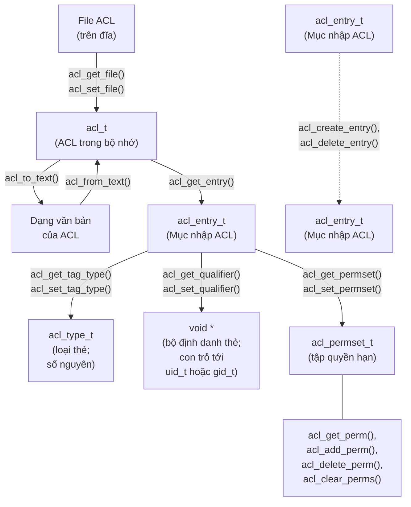

## Chapter 17

## DANH SÁCH KIỂM SOÁT TRUY CẬP (ACCESS CONTROL LISTS)

Mục 15.4 đã mô tả sơ đồ phân quyền tệp UNIX (và Linux) truyền thống. Đối với nhiều ứng dụng, sơ đồ này là đủ. Tuy nhiên, một số ứng dụng cần kiểm soát chi tiết hơn đối với các quyền được cấp cho các người dùng (User) và nhóm (Group) cụ thể. Để đáp ứng nhu cầu này, nhiều hệ thống UNIX đã triển khai một phần mở rộng cho mô hình phân quyền tệp UNIX truyền thống được gọi là danh sách kiểm soát truy cập (Access Control Lists - ACL). ACL cho phép chỉ định quyền tệp cho từng người dùng hoặc nhóm riêng lẻ, cho một số lượng tùy ý người dùng và nhóm. Linux cung cấp ACL từ phiên bản kernel 2.6 trở đi.

> Hỗ trợ ACL là tùy chọn đối với từng hệ thống tệp (File System) và được điều khiển bởi các tùy chọn cấu hình kernel trong menu File systems. Hỗ trợ ACL cho Reiserfs đã có từ kernel 2.6.7.

> Để có thể tạo ACL trên hệ thống tệp ext2, ext3, ext4 hoặc Reiserfs, hệ thống tệp phải được mount với tùy chọn `mount –o acl`.

ACL chưa bao giờ được chuẩn hóa chính thức cho các hệ thống UNIX. Một nỗ lực đã được thực hiện dưới hình thức các bản thảo tiêu chuẩn POSIX.1e và POSIX.2c, nhằm mục đích chỉ định lần lượt giao diện lập trình ứng dụng (Application Programming Interface - API) và các lệnh shell cho ACL (cũng như các tính năng khác, chẳng hạn như capabilities). Cuối cùng, nỗ lực chuẩn hóa này đã thất bại và các bản thảo tiêu chuẩn này đã bị rút lại. Tuy nhiên, nhiều bản cài đặt UNIX (bao gồm cả Linux) dựa trên việc triển khai ACL của chúng vào các bản thảo tiêu chuẩn này (thường là phiên bản cuối cùng, Dự thảo 17 - Draft 17). Mặc dù vậy, vì có nhiều biến thể khác nhau giữa các cách triển khai ACL (một phần bắt nguồn từ sự thiếu hoàn chỉnh của các bản thảo tiêu chuẩn), việc viết các chương trình có tính di động (portable) sử dụng ACL gặp phải một số khó khăn.

Chương này cung cấp mô tả về ACL và một hướng dẫn ngắn gọn về cách sử dụng chúng. Chương này cũng mô tả một số hàm thư viện (library function) được sử dụng để thao tác và truy xuất ACL. Chúng ta sẽ không đi vào chi tiết tất cả các hàm này vì có quá nhiều hàm. (Để biết chi tiết, hãy xem các trang hướng dẫn thủ công - manual pages).

## 17.1 Tổng quan (Overview)

Một ACL là một chuỗi các mục nhập ACL (ACL entry), trong đó mỗi mục định nghĩa quyền tệp cho một người dùng riêng lẻ hoặc một nhóm người dùng (xem Hình 17-1).

```text
┌──────────────┬───────────────┬─────────────┐
│   Tag type   │ Tag qualifier │ Permissions │
├──────────────┼───────────────┼─────────────┤
│ ACL_USER_OBJ │       -       │     rwx     │ ◄── Tương ứng với quyền owner (người dùng)
│ ACL_USER     │     1007      │     r--     │     truyền thống
│ ACL_USER     │     1010      │     rwx     │
├──────────────┼───────────────┼─────────────┤
│ACL_GROUP_OBJ │       -       │     rwx     │ ◄── Tương ứng với quyền group (nhóm)
│ ACL_GROUP    │      102      │     r--     │     truyền thống
│ ACL_GROUP    │      103      │     -w-     │
│ ACL_GROUP    │      109      │     --x     │
├──────────────┼───────────────┼─────────────┤
│   ACL_MASK   │       -       │     rw-     │
├──────────────┼───────────────┼─────────────┤
│  ACL_OTHER   │       -       │     r--     │ ◄── Tương ứng với quyền other (khác)
└──────────────┴───────────────┴─────────────┘     truyền thống

 ↑ Các mục nhập lớp nhóm (Group class entries): ACL_USER, ACL_GROUP_OBJ, ACL_GROUP
```

**Hình 17-1:** Danh sách kiểm soát truy cập (Access Control List)

### Các mục ACL (ACL entries)

Mỗi mục ACL (ACL entry) bao gồm các phần sau:

- một loại thẻ (tag type), chỉ ra rằng mục này áp dụng cho một user, một group, hay một danh mục user nào khác;
- một bộ định danh thẻ tùy chọn (optional tag qualifier), dùng để xác định một user hoặc group cụ thể (nghĩa là một user ID hoặc một group ID); và
- một tập quyền (permission set), chỉ định các quyền (đọc, ghi, và thực thi) được cấp bởi mục đó.

Loại thẻ (tag type) có một trong các giá trị sau:

### ACL\_USER\_OBJ

Mục này chỉ định các quyền được cấp cho chủ sở hữu tệp (file owner). Mỗi ACL chứa đúng một mục ACL\_USER\_OBJ. Mục này tương ứng với các quyền của chủ sở hữu tệp truyền thống (user).

### ACL\_USER

Mục này chỉ định các quyền được cấp cho user được xác định bởi bộ định danh thẻ (tag qualifier). Một ACL có thể chứa không hoặc nhiều mục ACL\_USER, nhưng tối đa chỉ có một mục ACL\_USER được định nghĩa cho một user cụ thể.

### ACL\_GROUP\_OBJ

Mục này chỉ định các quyền được cấp cho nhóm tệp (file group). Mỗi ACL chứa đúng một mục ACL\_GROUP\_OBJ. Mục này tương ứng với các quyền của nhóm tệp truyền thống, trừ khi ACL đó cũng chứa một mục ACL\_MASK.

### ACL\_GROUP

Mục này chỉ định các quyền được cấp cho nhóm được xác định bởi bộ định danh thẻ (tag qualifier). Một ACL có thể chứa không hoặc nhiều mục ACL\_GROUP, nhưng tối đa chỉ có một mục ACL\_GROUP được định nghĩa cho một nhóm cụ thể.

### ACL\_MASK

Mục này chỉ định quyền tối đa có thể được cấp bởi các mục ACL\_USER, ACL\_GROUP\_OBJ, và ACL\_GROUP. Một ACL chứa tối đa một mục ACL\_MASK. Nếu ACL chứa các mục ACL\_USER hoặc ACL\_GROUP, thì mục ACL\_MASK là bắt buộc. Chúng ta sẽ bàn kỹ hơn về loại thẻ này ngay sau đây.

### ACL\_OTHER

Mục này chỉ định các quyền được cấp cho các user không khớp với bất kỳ mục ACL nào khác. Mỗi ACL chứa đúng một mục ACL\_OTHER. Mục này tương ứng với các quyền khác (others) truyền thống của tệp.

Bộ định danh thẻ (tag qualifier) chỉ được sử dụng cho các mục ACL\_USER và ACL\_GROUP. Nó chỉ định một user ID hoặc một group ID.

## ACL tối thiểu và ACL mở rộng (Minimal and extended ACLs)

ACL tối thiểu (minimal ACL) là ACL có ngữ nghĩa tương đương với tập quyền tệp truyền thống. Nó chứa chính xác ba mục: mỗi mục thuộc một trong các loại ACL\_USER\_OBJ, ACL\_GROUP\_OBJ, và ACL\_OTHER. ACL mở rộng (extended ACL) là ACL bổ sung thêm các mục ACL\_USER, ACL\_GROUP, và ACL\_MASK.

Một lý do để phân biệt giữa ACL tối thiểu và ACL mở rộng là nhóm thứ hai cung cấp một phần mở rộng ngữ nghĩa cho mô hình quyền truyền thống. Một lý do khác liên quan đến việc hiện thực hóa ACL trong Linux. ACL được hiện thực hóa dưới dạng các thuộc tính mở rộng của hệ thống (system extended attributes) (Chương [16\)](#page-0-0). Thuộc tính mở rộng được sử dụng để duy trì ACL truy cập tệp (file access ACL) có tên là `system.posix_acl_access`. Thuộc tính mở rộng này chỉ bắt buộc nếu tệp có ACL mở rộng. Thông tin quyền đối với một ACL tối thiểu có thể được (và thực tế là) lưu trữ trong các bit quyền tệp truyền thống.

## 17.2 Thuật toán kiểm tra quyền ACL (ACL Permission-Checking Algorithm)

Việc kiểm tra quyền trên một tệp có gắn ACL được thực hiện trong các trường hợp giống như mô hình quyền tệp truyền thống (Mục 15.4.3). Các bước kiểm tra được thực hiện theo thứ tự sau, cho đến khi khớp với một trong các tiêu chí:

1. Nếu tiến trình (process) có đặc quyền (privileged), mọi quyền truy cập đều được cấp. Có một ngoại lệ cho tuyên bố này, tương tự như mô hình quyền truyền thống được mô tả trong Mục 15.4.3. Khi thực thi một tệp, một tiến trình có đặc quyền chỉ được cấp quyền thực thi nếu quyền đó được cấp thông qua ít nhất một trong các mục ACL trên tệp.

- 2. Nếu effective user ID của tiến trình khớp với chủ sở hữu (user ID) của tệp, thì tiến trình được cấp các quyền được chỉ định trong mục ACL\_USER\_OBJ. (Để chính xác hoàn toàn, trên Linux, các ID hệ thống tệp của tiến trình, chứ không phải các effective ID của nó, mới được sử dụng cho các bước kiểm tra được mô tả trong phần này, như đã mô tả trong Mục 9.5.)
- 3. Nếu effective user ID của tiến trình khớp với bộ định danh thẻ trong một trong các mục ACL\_USER, thì tiến trình được cấp các quyền được chỉ định trong mục đó, bị giới hạn (masking - phép toán AND) với giá trị của mục ACL\_MASK.
- 4. Nếu một trong các group ID của tiến trình (nghĩa là effective group ID hoặc bất kỳ supplementary group ID nào) khớp với nhóm tệp (tương ứng với mục ACL\_GROUP\_OBJ) hoặc bộ định danh thẻ của bất kỳ mục ACL\_GROUP nào, thì quyền truy cập được xác định bằng cách kiểm tra từng mục sau, cho đến khi tìm thấy điểm khớp:
  - a) Nếu một trong các group ID của tiến trình khớp với nhóm tệp, và mục ACL\_GROUP\_OBJ cấp các quyền được yêu cầu, thì mục này quyết định quyền truy cập được cấp cho tệp. Quyền truy cập được cấp sẽ bị giới hạn bằng cách che (AND) với giá trị có trong mục ACL\_MASK, nếu có.
  - b) Nếu một trong các group ID của tiến trình khớp với bộ định danh thẻ trong một mục ACL\_GROUP của tệp, và mục đó cấp các quyền được yêu cầu, thì mục này quyết định các quyền được cấp. Quyền truy cập được cấp sẽ bị giới hạn bằng cách che (AND) với giá trị trong mục ACL\_MASK.

- c) Ngược lại, quyền truy cập sẽ bị từ chối.
- 5. Ngược lại, tiến trình (process) được cấp các quyền được chỉ định trong mục nhập `ACL_OTHER`.

Chúng ta có thể làm rõ các quy tắc liên quan đến ID nhóm (group ID) bằng một số ví dụ. Giả sử chúng ta có một tệp có ID nhóm là 100 và tệp đó được bảo vệ bởi ACL hiển thị trong Hình 17-1. Nếu một tiến trình có ID nhóm là 100 thực hiện lời gọi `access(file, R_OK)`, thì lời gọi đó sẽ thành công (tức là trả về 0). (Chúng ta mô tả `access()` trong Mục 15.4.4.) Mặt khác, mặc dù mục nhập `ACL_GROUP_OBJ` cấp tất cả các quyền, nhưng lời gọi `access(file, R_OK | W_OK | X_OK)` sẽ thất bại (tức là trả về –1, với `errno` được đặt thành `EACCES`) vì các quyền của `ACL_GROUP_OBJ` bị che (làm phép AND) với mục nhập `ACL_MASK`, và mục nhập này từ chối quyền thực thi (execute permission).

Như một ví dụ khác sử dụng Hình 17-1, giả sử chúng ta có một tiến trình có ID nhóm là 102 và cũng chứa ID nhóm 103 trong các ID nhóm bổ sung (supplementary group IDs) của nó. Đối với tiến trình này, các lời gọi `access(file, R_OK)` và `access(file, W_OK)` đều sẽ thành công, vì chúng sẽ khớp với các mục nhập `ACL_GROUP` lần lượt cho các ID nhóm 102 và 103. Mặt khác, lời gọi `access(file, R_OK | W_OK)` sẽ thất bại vì không có mục nhập `ACL_GROUP` nào khớp cấp cả quyền đọc và quyền ghi.

## 17.3 Định dạng văn bản Dài và Ngắn cho ACL (Long and Short Text Forms for ACLs)

Khi thao tác với các ACL bằng cách sử dụng các lệnh `setfacl` và `getfacl` (được mô tả ngay sau đây) hoặc một số hàm thư viện ACL nhất định, chúng ta chỉ định các biểu diễn văn bản của các mục nhập ACL. Hai định dạng được cho phép đối với các biểu diễn văn bản này:

- Các ACL dạng văn bản dài (Long text form) chứa một mục nhập ACL trên mỗi dòng, và có thể bao gồm các chú thích (comments), bắt đầu bằng ký tự `#` và kéo dài đến cuối dòng. Lệnh `getfacl` hiển thị các ACL ở dạng văn bản dài. Tùy chọn `setfacl –M acl-file`, nhận thông số kỹ thuật ACL từ một tệp, kỳ vọng thông số kỹ thuật phải ở dạng văn bản dài.
- Các ACL dạng văn bản ngắn (Short text form) bao gồm một chuỗi các mục nhập ACL được phân tách bằng dấu phẩy.

Ở cả hai định dạng, mỗi mục nhập ACL bao gồm ba phần được phân tách bằng dấu hai chấm:

```
tag-type:[tag-qualifier]: permissions
```

`tag-type` là một trong các giá trị được hiển thị trong cột đầu tiên của [Bảng 17-1.](#page-12-0) `tag-type` có thể tùy chọn được theo sau bởi một `tag-qualifier`, xác định một người dùng (user) hoặc nhóm (group), bằng tên hoặc định danh số (numeric identifier). `tag-qualifier` chỉ có mặt đối với các mục nhập `ACL_USER` và `ACL_GROUP`.

Dưới đây là tất cả các ACL dạng văn bản ngắn tương ứng với mặt nạ quyền truyền thống là 0650:

```
u::rw-,g::r-x,o::---
u::rw,g::rx,o::-
user::rw,group::rx,other::-
```

ACL dạng văn bản ngắn sau đây bao gồm hai người dùng được đặt tên, một nhóm được đặt tên và một mục nhập mặt nạ (mask entry):

```
u::rw,u:paulh:rw,u:annabel:rw,g::r,g:teach:rw,m::rwx,o::-
```

**Bảng 17-1:** Giải thích các dạng văn bản của mục nhập ACL

| Dạng văn bản Tag<br>(Tag text forms) | Có trình định danh Tag?<br>(Tag qualifier present?) | Loại tag tương ứng<br>(Corresponding tag type) | Mục nhập cho<br>(Entry for) |
|-------------------|---------------------------|---------------------------|----------------------|
| u, user           | Không (N)                 | ACL_USER_OBJ              | Chủ sở hữu tệp (user)|
| u, user           | Có (Y)                    | ACL_USER                  | Người dùng được chỉ định |
| g, group          | Không (N)                 | ACL_GROUP_OBJ             | Nhóm tệp             |
| g, group          | Có (Y)                    | ACL_GROUP                 | Nhóm được chỉ định   |
| m, mask           | Không (N)                 | ACL_MASK                  | Mặt nạ cho lớp nhóm (group class) |
| o, other          | Không (N)                 | ACL_OTHER                 | Người dùng khác      |

## 17.4 Mục nhập `ACL_MASK` và Lớp Nhóm ACL (The ACL_MASK Entry and the ACL Group Class)

Nếu một ACL chứa các mục nhập `ACL_USER` hoặc `ACL_GROUP`, thì nó phải chứa một mục nhập `ACL_MASK`. Nếu ACL không chứa bất kỳ mục nhập `ACL_USER` hoặc `ACL_GROUP` nào, thì mục nhập `ACL_MASK` là tùy chọn.

Mục nhập `ACL_MASK` đóng vai trò là giới hạn trên (upper limit) cho các quyền được cấp bởi các mục nhập ACL trong cái gọi là lớp nhóm (group class). Lớp nhóm là tập hợp tất cả các mục nhập `ACL_USER`, `ACL_GROUP`, và `ACL_GROUP_OBJ` trong ACL.

Mục đích của mục nhập `ACL_MASK` là cung cấp hành vi nhất quán khi chạy các ứng dụng không nhận diện ACL (ACL-unaware applications). Như một ví dụ về lý do tại sao mục nhập mặt nạ là cần thiết, giả sử rằng ACL trên một tệp bao gồm các mục nhập sau:

```
user::rwx # ACL_USER_OBJ
user:paulh:r-x # ACL_USER
group::r-x # ACL_GROUP_OBJ
group:teach:--x # ACL_GROUP
other::--x # ACL_OTHER
```

Bây giờ, giả sử rằng một chương trình thực thi lời gọi `chmod()` sau trên tệp này:

```
chmod(pathname, 0700); /* Đặt quyền thành rwx------ */
```

Trong một ứng dụng không nhận diện ACL, điều này có nghĩa là "Từ chối quyền truy cập đối với tất cả mọi người trừ chủ sở hữu tệp." Các ngữ nghĩa này nên được giữ nguyên ngay cả khi có sự hiện diện của ACL. Khi không có mục nhập `ACL_MASK`, hành vi này có thể được triển khai theo nhiều cách khác nhau, nhưng mỗi cách tiếp cận đều gặp phải các vấn đề:

- Việc chỉ đơn giản sửa đổi các mục `ACL_GROUP_OBJ` và `ACL_USER_OBJ` thành quyền `---` là chưa đủ, vì người dùng `paulh` và nhóm `teach` vẫn sẽ còn một số quyền hạn nhất định trên tệp.
- Một khả năng khác là áp dụng các thiết lập quyền nhóm và quyền khác mới (tức là vô hiệu hóa toàn bộ quyền) cho tất cả các mục `ACL_USER`, `ACL_GROUP`, `ACL_GROUP_OBJ` và `ACL_OTHER` trong ACL:

```
user::rwx # ACL_USER_OBJ
user:paulh:--- # ACL_USER
group::--- # ACL_GROUP_OBJ
group:teach:--- # ACL_GROUP
other::--- # ACL_OTHER
```

Vấn đề với cách tiếp cận này là ứng dụng không hỗ trợ ACL (ACL-unaware application) sẽ vô tình phá hủy ngữ nghĩa phân quyền tệp được thiết lập bởi các ứng dụng hỗ trợ ACL (ACL-aware applications), vì lệnh gọi sau đây (ví dụ) sẽ không khôi phục các mục `ACL_USER` và `ACL_GROUP` của ACL về trạng thái trước đó của chúng:

```
chmod(pathname, 751);
```

Để tránh những vấn đề này, chúng ta có thể cân nhắc biến mục `ACL_GROUP_OBJ` thành tập giới hạn (limiting set) cho tất cả các mục `ACL_USER` và `ACL_GROUP`. Tuy nhiên, điều này có nghĩa là các quyền của `ACL_GROUP_OBJ` sẽ luôn cần phải được thiết lập thành hợp của tất cả các quyền được phép trong tất cả các mục `ACL_USER` và `ACL_GROUP`. Điều này sẽ mâu thuẫn với việc sử dụng mục `ACL_GROUP_OBJ` để xác định các quyền cấp cho nhóm tệp (file group).

Mục `ACL_MASK` được tạo ra để giải quyết những vấn đề này. Nó cung cấp một cơ chế cho phép thực thi các ý nghĩa truyền thống của các thao tác `chmod()`, mà không làm phá hủy ngữ nghĩa phân quyền tệp được thiết lập bởi các ứng dụng hỗ trợ ACL. Khi một ACL có mục `ACL_MASK`:

- tất cả các thay đổi đối với quyền nhóm truyền thống thông qua `chmod()` sẽ thay đổi thiết lập của mục `ACL_MASK` (thay vì mục `ACL_GROUP_OBJ`); và
- lệnh gọi `stat()` sẽ trả về các quyền của `ACL_MASK` (thay vì các quyền của `ACL_GROUP_OBJ`) trong các bit quyền nhóm của trường `st_mode` (Hình 15-1, trang 281).

Mặc dù mục `ACL_MASK` cung cấp một cách thức để bảo toàn thông tin ACL khi đối mặt với các ứng dụng không hỗ trợ ACL, điều ngược lại không được đảm bảo. Sự hiện diện của ACL sẽ làm mất hiệu lực tác động của các thao tác truyền thống đối với quyền nhóm tệp. Ví dụ, giả sử chúng ta đã thiết lập ACL sau trên một tệp:

```
user::rw-,group::---,mask::---,other::r--
```

Nếu sau đó chúng ta thực thi lệnh `chmod g+rw` trên tệp này, ACL sẽ trở thành:

```
user::rw-,group::---,mask::rw-,other::r--
```

Trong trường hợp này, nhóm (group) vẫn không có quyền truy cập vào tệp. Một giải pháp tạm thời cho vấn đề này là sửa đổi mục ACL cho nhóm để cấp tất cả các quyền. Do đó, nhóm sẽ luôn nhận được bất kỳ quyền nào được cấp cho mục `ACL_MASK`.

## 17.5 Các lệnh getfacl và setfacl

Từ shell, chúng ta có thể sử dụng lệnh `getfacl` để xem ACL trên một tệp.

```
$ umask 022 Thiết lập umask của shell về trạng thái đã biết
$ touch tfile Tạo một tệp mới
$ getfacl tfile
## file: tfile
## owner: mtk
## group: users
user::rw-
group::r--
other::r--
```

Từ kết quả đầu ra của lệnh `getfacl`, chúng ta thấy rằng tệp mới được tạo với một ACL tối thiểu (minimal ACL). Khi hiển thị dạng văn bản của ACL này, `getfacl` đặt trước các mục ACL bằng ba dòng hiển thị tên và quyền sở hữu của tệp. Chúng ta có thể ngăn chặn việc hiển thị các dòng này bằng cách chỉ định tùy chọn `--omit-header`.

Tiếp theo, chúng ta minh họa rằng các thay đổi đối với quyền của tệp bằng cách sử dụng lệnh `chmod` truyền thống vẫn được phản ánh vào ACL.

```
$ chmod u=rwx,g=rx,o=x tfile
$ getfacl --omit-header tfile
user::rwx
group::r-x
other::--x
```

Lệnh `setfacl` sửa đổi một ACL của tệp. Ở đây, chúng ta sử dụng lệnh `setfacl -m` để thêm một mục `ACL_USER` và một mục `ACL_GROUP` vào ACL:

```
$ setfacl -m u:paulh:rx,g:teach:x tfile
$ getfacl --omit-header tfile
user::rwx
user:paulh:r-x ACL_USER entry
group::r-x
group:teach:--x ACL_GROUP entry
mask::r-x ACL_MASK entry
other::--x
```

Tùy chọn `setfacl -m` sửa đổi các mục ACL hiện có, hoặc thêm các mục mới nếu các mục tương ứng với loại thẻ (tag type) và bộ định danh thẻ (tag qualifier) đã cho chưa tồn tại. Chúng ta cũng có thể sử dụng tùy chọn `-R` để áp dụng đệ quy (recursively) ACL được chỉ định cho tất cả các tệp trong một cây thư mục (directory tree).

Từ kết quả đầu ra của lệnh `getfacl`, chúng ta có thể thấy rằng `setfacl` đã tự động tạo một mục `ACL_MASK` cho ACL này.

Việc bổ sung các mục `ACL_USER` và `ACL_GROUP` chuyển đổi ACL này thành một ACL mở rộng (extended ACL), và `ls -l` chỉ ra thực tế này bằng cách thêm dấu cộng (+) vào sau mặt nạ quyền tệp truyền thống:

```
$ ls -l tfile
-rwxr-x--x+ 1 mtk users 0 Dec 3 15:42 tfile
```

Chúng ta tiếp tục sử dụng `setfacl` để vô hiệu hóa tất cả các quyền ngoại trừ quyền thực thi (execute) trên mục `ACL_MASK`, sau đó xem lại ACL một lần nữa bằng `getfacl`:

```
$ setfacl -m m::x tfile
$ getfacl --omit-header tfile
user::rwx
user:paulh:r-x #effective:--x
group::r-x #effective:--x
group:teach:--x
mask::--x
other::--x
```

Các chú thích `#effective:` mà `getfacl` in ra sau các mục dành cho người dùng `paulh` và nhóm tệp (`group::`) thông báo cho chúng ta rằng sau khi lọc qua mặt nạ (AND logic) với mục `ACL_MASK`, các quyền được cấp bởi mỗi mục này trên thực tế sẽ nhỏ hơn các quyền được chỉ định trong mục đó.

Sau đó, chúng ta sử dụng lệnh `ls –l` để xem lại các bit quyền (permission bits) truyền thống của tệp. Chúng ta thấy rằng các bit quyền của lớp nhóm (group class) được hiển thị phản ánh các quyền trong mục nhập `ACL_MASK` (--x), thay vì các quyền trong mục nhập `ACL_GROUP` (r-x):

```
$ ls -l tfile
-rwx--x--x+ 1 mtk users 0 Dec 3 15:42 tfile
```

Lệnh `setfacl –x` có thể được sử dụng để xóa các mục nhập khỏi một ACL (Access Control List). Ở đây, chúng ta xóa các mục nhập cho người dùng `paulh` và nhóm `teach` (không có quyền nào được chỉ định khi xóa các mục nhập):

```
$ setfacl -x u:paulh,g:teach tfile
$ getfacl --omit-header tfile
user::rwx
group::r-x
mask::r-x
other::--x
```

Lưu ý rằng trong quá trình thao tác trên, `setfacl` đã tự động điều chỉnh mục nhập mask sao cho nó là tập hợp hợp (union) của tất cả các mục nhập thuộc lớp nhóm (group class). (Chỉ có một mục nhập như vậy: `ACL_GROUP_OBJ`.) Nếu chúng ta muốn ngăn chặn việc tự động điều chỉnh này, thì chúng ta phải chỉ định tùy chọn `-n` cho `setfacl`.

Cuối cùng, chúng ta lưu ý rằng tùy chọn `setfacl –b` có thể được sử dụng để xóa tất cả các mục nhập mở rộng (extended entries) khỏi một ACL, chỉ để lại các mục nhập tối thiểu (tức là user, group và other).

## 17.6 ACL Mặc Định và Việc Tạo Tệp (Default ACLs and File Creation)

Trong phần thảo luận về ACL cho đến nay, chúng ta đã mô tả các ACL truy cập (access ACLs). Đúng như tên gọi của nó, một access ACL được sử dụng để xác định các quyền mà một tiến trình (process) có khi truy cập tệp được liên kết với ACL đó. Chúng ta có thể tạo ra loại ACL thứ hai trên các thư mục: ACL mặc định (default ACL).

Một default ACL không đóng vai trò gì trong việc xác định các quyền được cấp khi truy cập thư mục. Thay vào đó, sự hiện diện hoặc vắng mặt của nó quyết định các ACL và quyền sẽ được áp dụng cho các tệp và thư mục con được tạo trong thư mục đó. (Một default ACL được lưu trữ dưới dạng một thuộc tính mở rộng (extended attribute) có tên là `system.posix_acl_default`.)

Để xem và thiết lập default ACL của một thư mục, chúng ta sử dụng tùy chọn `-d` của các lệnh `getfacl` và `setfacl`.

```
$ mkdir sub
$ setfacl -d -m u::rwx,u:paulh:rx,g::rx,g:teach:rwx,o::- sub
$ getfacl -d --omit-header sub
user::rwx
user:paulh:r-x
group::r-x
group:teach:rwx
mask::rwx setfacl generated ACL_MASK entry automatically
other::---
```

Chúng ta có thể xóa một default ACL khỏi thư mục bằng cách sử dụng tùy chọn `setfacl –k`.

Nếu một thư mục có default ACL, thì:

- Một thư mục con mới được tạo trong thư mục này sẽ kế thừa default ACL của thư mục cha làm default ACL của chính nó. Nói cách khác, các default ACL sẽ lan truyền xuống cấu trúc cây thư mục (directory tree) khi các thư mục con mới được tạo.
- Một tệp hoặc thư mục con mới được tạo trong thư mục này sẽ kế thừa default ACL của thư mục làm access ACL của nó. Các mục nhập ACL tương ứng với các bit quyền tệp truyền thống sẽ được lọc (phép toán AND) với các bit tương ứng của đối số `mode` trong system call (như `open()`, `mkdir()`, v.v.) được sử dụng để tạo tệp hoặc thư mục con đó. Ý của chúng tôi bằng cụm từ "các mục nhập ACL tương ứng" là:
  - `ACL_USER_OBJ`;
  - `ACL_MASK` hoặc, nếu không có `ACL_MASK`, thì là `ACL_GROUP_OBJ`; và
  - `ACL_OTHER`.

Khi một thư mục có default ACL, umask của tiến trình (Mục 15.4.6) không đóng vai trò gì trong việc xác định các quyền trong các mục nhập của access ACL đối với một tệp mới được tạo trong thư mục đó.

Là một ví dụ về cách một tệp mới kế thừa access ACL của nó từ default ACL của thư mục cha, giả sử chúng ta sử dụng lời gọi `open()` sau để tạo một tệp mới trong thư mục được tạo ở trên:

```
open("sub/tfile", O_RDWR | O_CREAT,
 S_IRWXU | S_IXGRP | S_IXOTH); /* rwx--x--x */
```

Tệp mới sẽ có access ACL như sau:

```
$ getfacl --omit-header sub/tfile
user::rwx
user:paulh:r-x #effective:--x
group::r-x #effective:--x
group:teach:rwx #effective:--x
mask::--x
other::---
```

Nếu một thư mục không có default ACL, thì:

- Các thư mục con mới được tạo trong thư mục này cũng sẽ không có default ACL.
- Quyền của tệp hoặc thư mục mới được thiết lập theo các quy tắc truyền thống (Mục 15.4.6): quyền của tệp được đặt thành giá trị trong đối số `mode` (được truyền cho `open()`, `mkdir()`, v.v.), trừ đi các bit bị tắt bởi umask của tiến trình. Điều này dẫn đến một ACL tối thiểu (minimal ACL) trên tệp mới.

## 17.7 Giới Hạn Thực Thi ACL (ACL Implementation Limits)

Các bản cài đặt hệ thống tệp (file-system implementations) khác nhau áp đặt các giới hạn khác nhau về số lượng mục nhập trong một ACL:

- Trên ext2, ext3 và ext4, tổng số lượng ACL trên một tệp bị chi phối bởi yêu cầu rằng các byte trong tất cả tên và giá trị của các thuộc tính mở rộng (extended attributes) của tệp phải nằm gọn trong một khối đĩa lôgic duy nhất (single logical disk block) (Mục [16.2](#page-2-0)). Mỗi mục nhập ACL yêu cầu 8 byte, do đó số lượng mục nhập ACL tối đa cho một tệp sẽ nhỏ hơn một chút (do một số chi phí quản lý (overhead) cho tên của thuộc tính mở rộng của ACL) so với một phần tám kích thước khối (block size). Do đó, kích thước khối 4096 byte cho phép tối đa khoảng 500 mục nhập ACL. (Các phiên bản Kernel trước 2.6.11 áp đặt giới hạn tùy ý là 32 mục nhập cho các ACL trên ext2 và ext3.)

- Trên XFS, một ACL bị giới hạn tối đa 25 mục nhập.

- Trên Reiserfs và JFS, ACL có thể chứa tới 8191 mục nhập (entries). Giới hạn này là hệ quả của giới hạn kích thước (64 kB) do VFS áp đặt lên giá trị của một thuộc tính mở rộng (extended attribute) (Mục [16.2](#page-2-0)).

Vào thời điểm viết tài liệu này, Btrfs giới hạn ACL ở khoảng 500 mục nhập. Tuy nhiên, vì Btrfs vẫn đang trong quá trình phát triển mạnh mẽ, giới hạn này có thể thay đổi.

Mặc dù hầu hết các hệ thống tệp (file systems) kể trên cho phép tạo ra số lượng lớn mục nhập trong một ACL, điều này nên được tránh vì các lý do sau:

- Việc bảo trì các ACL có độ dài lớn sẽ trở thành một tác vụ quản trị hệ thống phức tạp và có khả năng gây ra lỗi cao.
- Lượng thời gian cần thiết để quét (scan) ACL nhằm tìm mục nhập khớp (hoặc các mục nhập khớp trong trường hợp kiểm tra ID nhóm) tăng tuyến tính theo số lượng mục nhập ACL.

Nhìn chung, chúng ta có thể giữ số lượng mục nhập ACL trên một tệp ở mức hợp lý bằng cách định nghĩa các nhóm phù hợp trong tệp nhóm của hệ thống (Mục 8.3) và sử dụng các nhóm đó bên trong ACL.

## 17.8 Giao diện Lập trình ACL (The ACL API)

Bản thảo tiêu chuẩn POSIX.1e đã định nghĩa một tập hợp lớn các hàm và cấu trúc dữ liệu để thao tác với ACL. Do có quá nhiều, chúng tôi sẽ không cố gắng mô tả chi tiết tất cả các hàm này. Thay vào đó, chúng tôi cung cấp cái nhìn tổng quan về cách sử dụng chúng và kết thúc bằng một chương trình ví dụ.

Các chương trình sử dụng ACL API nên bao gồm tệp tiêu đề `<sys/acl.h>`. Cũng có thể cần bao gồm `<acl/libacl.h>` nếu chương trình tận dụng các phần mở rộng Linux khác nhau đối với bản thảo tiêu chuẩn POSIX.1e. (Danh sách các phần mở rộng của Linux được cung cấp trong trang sổ tay (manual page) `acl(5)`). Các chương trình sử dụng API này phải được biên dịch với tùy chọn `-lacl` để liên kết (link) với thư viện `libacl`.

> Như đã lưu ý trước đó, trên Linux, ACL được hiện thực (implemented) bằng cách sử dụng các thuộc tính mở rộng (extended attributes), và ACL API được hiện thực như một tập hợp các hàm thư viện để thao tác với các cấu trúc dữ liệu không gian người dùng (`user-space`), và khi cần thiết, thực hiện các lời gọi hệ thống (system call) tới `getxattr()` và `setxattr()` để truy xuất và sửa đổi thuộc tính mở rộng hệ thống nằm trên đĩa (on-disk) lưu trữ biểu diễn ACL. Ứng dụng cũng có thể (mặc dù không được khuyến khích) sử dụng `getxattr()` và `setxattr()` để thao tác trực tiếp với ACL.

### Tổng quan

Các hàm cấu thành ACL API được liệt kê trong trang sổ tay *acl*(5). Thoạt nhìn, sự phong phú quá mức của các hàm và cấu trúc dữ liệu này có thể gây bối rối. Hình 17-2 cung cấp cái nhìn tổng quan về mối quan hệ giữa các cấu trúc dữ liệu khác nhau và chỉ ra việc sử dụng nhiều hàm ACL.



Hình 17-2: Mối quan hệ giữa các hàm thư viện ACL và cấu trúc dữ liệu

Từ Hình 17-2, chúng ta có thể thấy rằng ACL API coi một ACL là một đối tượng phân cấp:

- Một ACL bao gồm một hoặc nhiều mục nhập ACL.
- Mỗi mục nhập ACL bao gồm một loại thẻ (tag type), một bộ định danh thẻ (tag qualifier) tùy chọn và một tập quyền hạn (permission set).

Bây giờ chúng ta sẽ xem xét ngắn gọn các hàm ACL khác nhau. Trong hầu hết các trường hợp, chúng tôi không mô tả các mã lỗi trả về từ mỗi hàm. Các hàm trả về một số nguyên (trạng thái) thường trả về 0 khi thành công và –1 khi có lỗi. Các hàm trả về một định danh/con trỏ (handle) sẽ trả về `NULL` khi có lỗi. Các lỗi có thể được chuẩn đoán bằng cách sử dụng `errno` theo cách thông thường.

> Một handle (định danh/con trỏ trừu tượng) là một thuật ngữ trừu tượng chỉ một kỹ thuật nào đó được sử dụng để tham chiếu đến một đối tượng hoặc cấu trúc dữ liệu. Việc biểu diễn một handle là nội bộ (private) đối với việc hiện thực API. Ví dụ, nó có thể là một con trỏ, một chỉ số mảng (array index) hoặc một khóa băm (hash key).

### Tải một ACL của tập tin vào bộ nhớ

Hàm `acl_get_file()` thực hiện truy xuất một bản sao danh sách kiểm soát truy cập (Access Control List - ACL) của tập tin được xác định bởi đường dẫn (pathname).

```
acl_t acl;
acl = acl_get_file(pathname, type);
```

Hàm này truy xuất ACL truy cập (`access ACL`) hoặc ACL mặc định (`default ACL`), tùy thuộc vào việc tham số `type` được chỉ định là `ACL_TYPE_ACCESS` hay `ACL_TYPE_DEFAULT`. Là kết quả trả về của hàm, `acl_get_file()` cung cấp một định danh (handle - có kiểu `acl_t`) để sử dụng với các hàm ACL khác.

## Truy xuất các mục từ một ACL trong bộ nhớ

Hàm `acl_get_entry()` trả về một định danh (có kiểu `acl_entry_t`) tham chiếu đến một trong các mục ACL (ACL entry) nằm trong ACL trên bộ nhớ được trỏ tới bởi tham số `acl` của nó. Định danh này được trả về tại vị trí được trỏ tới bởi tham số cuối cùng của hàm.

```
acl_entry_t entry;
status = acl_get_entry(acl, entry_id, &entry);
```

Tham số `entry_id` quyết định định danh của mục nào sẽ được trả về. Nếu `entry_id` được chỉ định là `ACL_FIRST_ENTRY`, thì định danh cho mục đầu tiên trong ACL sẽ được trả về. Nếu `entry_id` được chỉ định là `ACL_NEXT_ENTRY`, định danh sẽ được trả về cho mục nằm kế tiếp sau mục ACL cuối cùng vừa được truy xuất. Do đó, chúng ta có thể lặp qua tất cả các mục trong một ACL bằng cách chỉ định kiểu là `ACL_FIRST_ENTRY` trong lần gọi đầu tiên tới `acl_get_entry()` và chỉ định kiểu là `ACL_NEXT_ENTRY` trong các lần gọi tiếp theo.

Hàm `acl_get_entry()` trả về 1 nếu nó lấy thành công một mục ACL, 0 nếu không còn mục nào nữa, hoặc –1 khi xảy ra lỗi.

### Truy xuất và chỉnh sửa các thuộc tính trong một mục ACL

Các hàm `acl_get_tag_type()` và `acl_set_tag_type()` thực hiện truy xuất và sửa đổi loại thẻ (tag type) trong mục ACL được tham chiếu bởi tham số `entry` của chúng.

```
acl_tag_t tag_type;
status = acl_get_tag_type(entry, &tag_type);
status = acl_set_tag_type(entry, tag_type);
```

Tham số `tag_type` có kiểu `acl_type_t` (một kiểu số nguyên) và nhận một trong các giá trị `ACL_USER_OBJ`, `ACL_USER`, `ACL_GROUP_OBJ`, `ACL_GROUP`, `ACL_OTHER`, hoặc `ACL_MASK`.

Các hàm `acl_get_qualifier()` và `acl_set_qualifier()` thực hiện truy xuất và sửa đổi bộ định danh thẻ (tag qualifier) trong mục ACL được tham chiếu bởi tham số `entry` của chúng. Dưới đây là một ví dụ, trong đó chúng ta giả định rằng đã xác định đây là một mục `ACL_USER` thông qua việc kiểm tra loại thẻ:

```
uid_t *qualp; /* Con trỏ tới UID */
qualp = acl_get_qualifier(entry);
status = acl_set_qualifier(entry, qualp);
```

Bộ định danh thẻ chỉ hợp lệ nếu loại thẻ của mục này là `ACL_USER` hoặc `ACL_GROUP`. Trong trường hợp đầu tiên, `qualp` là một con trỏ trỏ tới định danh người dùng (`uid_t *`); trong trường hợp thứ hai, nó là một con trỏ trỏ tới định danh nhóm (`gid_t *`).

Các hàm `acl_get_permset()` và `acl_set_permset()` thực hiện truy xuất và sửa đổi tập quyền (permission set) trong mục ACL được tham chiếu bởi tham số `entry` của chúng.

```
acl_permset_t permset;
status = acl_get_permset(entry, &permset);
status = acl_set_permset(entry, permset);
```

Kiểu dữ liệu `acl_permset_t` là một định danh tham chiếu đến một tập quyền.

Các hàm sau đây được sử dụng để thao tác với nội dung của một tập quyền:

```
int is_set;
is_set = acl_get_perm(permset, perm);
status = acl_add_perm(permset, perm);
status = acl_delete_perm(permset, perm);
status = acl_clear_perms(permset);
```

Trong mỗi lời gọi này, `perm` được chỉ định là `ACL_READ`, `ACL_WRITE`, hoặc `ACL_EXECUTE`, với ý nghĩa hiển nhiên của chúng. Các hàm này được sử dụng như sau:

- Hàm `acl_get_perm()` trả về 1 (true) nếu quyền được chỉ định trong `perm` được bật trong tập quyền được tham chiếu bởi `permset`, hoặc 0 nếu không. Hàm này là một phần mở rộng của Linux đối với tiêu chuẩn dự thảo POSIX.1e.
- Hàm `acl_add_perm()` thêm quyền được chỉ định trong `perm` vào tập quyền được tham chiếu bởi `permset`.
- Hàm `acl_delete_perm()` xóa quyền được chỉ định trong `perm` khỏi tập quyền được tham chiếu bởi `permset`. (Việc xóa một quyền không có sẵn trong tập hợp không được coi là lỗi.)
- Hàm `acl_clear_perms()` xóa tất cả các quyền khỏi tập quyền được tham chiếu bởi `permset`.

## Tạo và xóa các mục ACL

Hàm `acl_create_entry()` tạo một mục mới trong một ACL đã tồn tại. Một định danh tham chiếu đến mục mới được trả về tại vị trí được trỏ tới bởi tham số thứ hai của hàm.

```
acl_entry_t entry;
status = acl_create_entry(&acl, &entry);
```

Mục mới sau đó có thể được điền dữ liệu bằng cách sử dụng các hàm đã được mô tả trước đó. Hàm `acl_delete_entry()` thực hiện xóa một mục khỏi ACL.

```
status = acl_delete_entry(acl, entry);
```

### Cập nhật ACL của một tệp

Hàm `acl_set_file()` là hàm ngược lại của `acl_get_file()`. Nó cập nhật ACL trên đĩa (on-disk ACL) bằng nội dung của ACL trong bộ nhớ (in-memory ACL) được tham chiếu bởi đối số `acl` của nó.

```
int status;
status = acl_set_file(pathname, type, acl);
```

Đối số `type` nhận giá trị là `ACL_TYPE_ACCESS` để cập nhật access ACL, hoặc `ACL_TYPE_DEFAULT` để cập nhật default ACL của một thư mục.

## Chuyển đổi ACL giữa dạng trong bộ nhớ và dạng văn bản

Hàm `acl_from_text()` dịch một chuỗi chứa ACL ở dạng văn bản dài hoặc ngắn thành một ACL trong bộ nhớ (in-memory ACL), và trả về một handle có thể được sử dụng để tham chiếu đến ACL trong các lời gọi hàm (function call) tiếp theo.

```
acl = acl_from_text(acl_string);
```

Hàm `acl_to_text()` thực hiện việc chuyển đổi ngược lại, trả về một chuỗi dạng văn bản dài tương ứng với ACL được tham chiếu bởi đối số `acl` của nó.

```
char *str;
ssize_t len;
str = acl_to_text(acl, &len);
```

Nếu đối số `len` không được chỉ định là `NULL`, thì bộ đệm (buffer) mà nó trỏ tới sẽ được sử dụng để trả về độ dài của chuỗi được trả về dưới dạng kết quả của hàm.

### Các hàm khác trong API ACL

Các đoạn văn bản sau đây mô tả một số hàm ACL thường được sử dụng khác không được hiển thị trong [Hình 17-2](#page-19-0).

Hàm `acl_calc_mask(&acl)` tính toán và thiết lập các quyền trong mục `ACL_MASK` của in-memory ACL mà handle của nó được trỏ tới bởi đối số của hàm. Thông thường, chúng ta sử dụng hàm này bất cứ khi nào chúng ta tạo hoặc sửa đổi một ACL. Các quyền của `ACL_MASK` được tính toán bằng phép hợp (union) của các quyền trong tất cả các mục `ACL_USER`, `ACL_GROUP`, và `ACL_GROUP_OBJ`. Một đặc tính hữu ích của hàm này là nó sẽ tự động tạo mục `ACL_MASK` nếu mục này chưa tồn tại. Điều này có nghĩa là nếu chúng ta thêm các mục `ACL_USER` và `ACL_GROUP` vào một ACL vốn dĩ là tối thiểu (minimal ACL) trước đó, thì chúng ta có thể sử dụng hàm này để đảm bảo rằng mục `ACL_MASK` được tạo ra.

Hàm `acl_valid(acl)` trả về `0` nếu ACL được tham chiếu bởi đối số của nó là hợp lệ, hoặc `-1` nếu ngược lại. Một ACL được coi là hợp lệ nếu tất cả các điều kiện sau đây đều đúng:

- các mục `ACL_USER_OBJ`, `ACL_GROUP_OBJ`, và `ACL_OTHER` xuất hiện chính xác một lần;
- có tồn tại một mục `ACL_MASK` nếu bất kỳ mục `ACL_USER` hoặc `ACL_GROUP` nào xuất hiện;
- có nhiều nhất một mục `ACL_MASK`;
- mỗi mục `ACL_USER` có một ID người dùng (user ID) duy nhất; và
- mỗi mục `ACL_GROUP` có một ID nhóm (group ID) duy nhất.

Các hàm `acl_check()` và `acl_error()` (hàm sau là một phần mở rộng của Linux) là các giải pháp thay thế cho `acl_valid()` ít tính di động (portable) hơn, nhưng cung cấp mô tả chi tiết và chính xác hơn về lỗi trong một ACL bị lỗi định dạng (malformed ACL). Hãy xem trang hướng dẫn sử dụng (manual page) để biết thêm chi tiết.

Hàm `acl_delete_def_file(pathname)` xóa default ACL trên thư mục được tham chiếu bởi `pathname`.

Hàm `acl_init(count)` tạo ra một cấu trúc ACL mới, trống, ban đầu chứa đủ không gian cho ít nhất `count` mục ACL. (Đối số `count` là một gợi ý cho hệ thống về mức độ sử dụng dự kiến, chứ không phải là một giới hạn cứng). Handle của ACL mới được trả về dưới dạng kết quả của hàm.

Hàm `acl_dup(acl)` tạo ra một bản sao (duplicate) của ACL được tham chiếu bởi `acl` và trả về handle của ACL nhân bản này làm kết quả của hàm.

Hàm `acl_free(handle)` giải phóng bộ nhớ được cấp phát bởi các hàm ACL khác. Ví dụ, chúng ta phải sử dụng `acl_free()` để giải phóng bộ nhớ được cấp phát bởi các lời gọi đến `acl_from_text()`, `acl_to_text()`, `acl_get_file()`, `acl_init()`, và `acl_dup()`.

# Chương trình ví dụ

[Liệt kê 17-1](#page-24-0) minh họa việc sử dụng một số hàm trong thư viện ACL. Chương trình này truy xuất và hiển thị ACL trên một tệp (tức là nó cung cấp một tập con các tính năng của lệnh `getfacl`). Nếu tùy chọn dòng lệnh `-d` được chỉ định, chương trình sẽ hiển thị default ACL (của một thư mục) thay vì access ACL.

Dưới đây là một ví dụ về cách sử dụng chương trình này:

```
$ touch tfile
$ setfacl -m 'u:annie:r,u:paulh:rw,g:teach:r' tfile
$ ./acl_view tfile
user_obj rw-
user annie r--
user paulh rw-
group_obj r--
group teach r--
mask rw-
other r--
```

Phân phối mã nguồn của cuốn sách này cũng bao gồm một chương trình, `acl/acl_update.c`, thực hiện việc cập nhật trên một ACL (tức là cung cấp một tập con các tính năng của lệnh `setfacl`).

**Liệt kê 17-1:** Hiển thị access hoặc default ACL trên một tệp

```
––––––––––––––––––––––––––––––––––––––––––––––––––––––––––– acl/acl_view.c
## include <acl/libacl.h>
## include <sys/acl.h>
## include "ugid_functions.h"
## include "tlpi_hdr.h"
static void
usageError(char *progName)
{
 fprintf(stderr, "Usage: %s [-d] filename\n", progName);
 exit(EXIT_FAILURE);
}
int
main(int argc, char *argv[])
{
 acl_t acl;
 acl_type_t type;
 acl_entry_t entry;
 acl_tag_t tag;
 uid_t *uidp;
 gid_t *gidp;
 acl_permset_t permset;
 char *name;
 int entryId, permVal, opt;
 type = ACL_TYPE_ACCESS;
 while ((opt = getopt(argc, argv, "d")) != -1) {
 switch (opt) {
 case 'd': type = ACL_TYPE_DEFAULT; break;
 case '?': usageError(argv[0]);
 }
 }
 if (optind + 1 != argc)
 usageError(argv[0]);
 acl = acl_get_file(argv[optind], type);
 if (acl == NULL)
 errExit("acl_get_file");
 /* Duyệt qua từng mục trong ACL này */
 for (entryId = ACL_FIRST_ENTRY; ; entryId = ACL_NEXT_ENTRY) {
 if (acl_get_entry(acl, entryId, &entry) != 1)
 break; /* Thoát khi có lỗi hoặc không còn mục nào nữa */
```

```c
 /* Retrieve and display tag type */
 if (acl_get_tag_type(entry, &tag) == -1)
 errExit("acl_get_tag_type");
 printf("%-12s", (tag == ACL_USER_OBJ) ? "user_obj" :
 (tag == ACL_USER) ? "user" :
 (tag == ACL_GROUP_OBJ) ? "group_obj" :
 (tag == ACL_GROUP) ? "group" :
 (tag == ACL_MASK) ? "mask" :
 (tag == ACL_OTHER) ? "other" : "???");
 /* Retrieve and display optional tag qualifier */
 if (tag == ACL_USER) {
 uidp = acl_get_qualifier(entry);
 if (uidp == NULL)
 errExit("acl_get_qualifier");
 name = groupNameFromId(*uidp);
 if (name == NULL)
 printf("%-8d ", *uidp);
 else
 printf("%-8s ", name);
 if (acl_free(uidp) == -1)
 errExit("acl_free");
 } else if (tag == ACL_GROUP) {
 gidp = acl_get_qualifier(entry);
 if (gidp == NULL)
 errExit("acl_get_qualifier");
 name = groupNameFromId(*gidp);
 if (name == NULL)
 printf("%-8d ", *gidp);
 else
 printf("%-8s ", name);
 if (acl_free(gidp) == -1)
 errExit("acl_free");
 } else {
 printf(" ");
 }
 /* Retrieve and display permissions */
 if (acl_get_permset(entry, &permset) == -1)
 errExit("acl_get_permset");
 permVal = acl_get_perm(permset, ACL_READ);
 if (permVal == -1)
 errExit("acl_get_perm - ACL_READ");
```

```c
 printf("%c", (permVal == 1) ? 'r' : '-');
 permVal = acl_get_perm(permset, ACL_WRITE);
 if (permVal == -1)
 errExit("acl_get_perm - ACL_WRITE");
 printf("%c", (permVal == 1) ? 'w' : '-');
 permVal = acl_get_perm(permset, ACL_EXECUTE);
 if (permVal == -1)
 errExit("acl_get_perm - ACL_EXECUTE");
 printf("%c", (permVal == 1) ? 'x' : '-');
 printf("\n");
 }
 if (acl_free(acl) == -1)
 errExit("acl_free");
 exit(EXIT_SUCCESS);
}
–––––––––––––––––––––––––––––––––––––––––––––––––––––––––––– acl/acl_view.c
```

## 17.9 Tóm tắt

Từ phiên bản 2.6 trở đi, Linux hỗ trợ các Danh sách Điều khiển Truy cập (Access Control List - ACL). ACL mở rộng mô hình phân quyền tệp tin truyền thống của UNIX (traditional UNIX file permissions model), cho phép kiểm soát quyền hạn đối với tệp tin trên cơ sở từng người dùng (per-user) và từng nhóm (per-group).

### Thông tin thêm

Các phiên bản cuối cùng (Bản nháp 17 - Draft 17) của các tiêu chuẩn dự thảo POSIX.1e và POSIX.2c có sẵn trực tuyến tại http://wt.tuxomania.net/publications/posix.1e/.

Trang hướng dẫn (manual page) `acl(5)` cung cấp cái nhìn tổng quan về ACL và một số hướng dẫn về tính khả chuyển (portability) của các hàm thư viện ACL khác nhau được triển khai trên Linux.

Chi tiết về việc triển khai ACL và thuộc tính mở rộng (extended attributes) trên Linux có thể được tìm thấy trong [Grünbacher, 2003]. Andreas Grünbacher duy trì một trang web chứa thông tin về ACL tại http://acl.bestbits.at/.

## 17.10 Bài tập

**17-1.** Viết một chương trình hiển thị các quyền từ mục nhập ACL (ACL entry) tương ứng với một người dùng hoặc nhóm cụ thể. Chương trình nhận hai đối số dòng lệnh (command-line arguments). Đối số đầu tiên là một trong hai ký tự `u` hoặc `g`, biểu thị xem đối số thứ hai xác định một người dùng hay một nhóm. (Các hàm được định nghĩa trong Liệt kê 8-1, trang 159, có thể được sử dụng để cho phép chỉ định đối số dòng lệnh thứ hai dưới dạng giá trị số hoặc dạng tên). Nếu mục nhập ACL tương ứng với người dùng hoặc nhóm cho trước thuộc về lớp nhóm (group class), thì chương trình đồng thời phải hiển thị các quyền sẽ được áp dụng sau khi mục nhập ACL đã được sửa đổi bởi mục nhập mặt nạ ACL (ACL mask entry).
