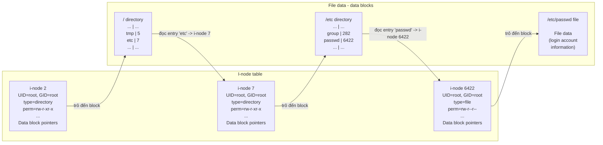
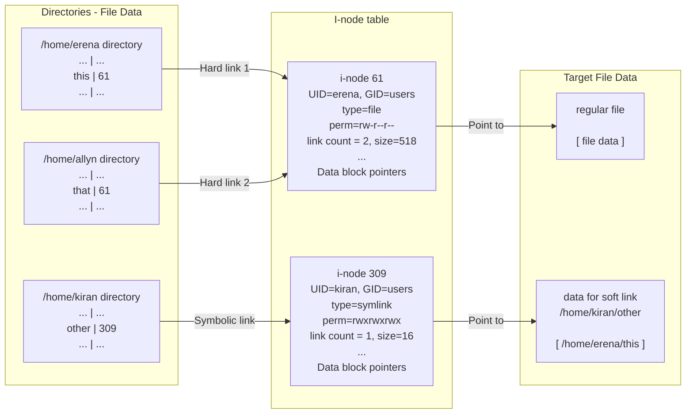

# Chương 18: Thư mục và Liên kết (Directories and Links)

Trong chương này, chúng ta kết thúc phần thảo luận về các chủ đề liên quan đến tập tin bằng cách xem xét các thư mục (directory) và liên kết (link). Sau phần tổng quan về cách thức triển khai của chúng, chúng ta sẽ mô tả các system call (lệnh hệ thống) được sử dụng để tạo và xóa thư mục cũng như liên kết. Tiếp theo, chúng ta xem xét các hàm thư viện (library function) cho phép một tiến trình (process) quét nội dung của một thư mục đơn lẻ và duyệt qua (tức là kiểm tra từng tập tin trong) một cây thư mục (directory tree).

Mỗi tiến trình có hai thuộc tính liên quan đến thư mục: thư mục gốc (root directory), xác định điểm khởi đầu để diễn giải các đường dẫn tuyệt đối (absolute pathname), và thư mục làm việc hiện tại (current working directory), xác định điểm khởi đầu để diễn giải các đường dẫn tương đối (relative pathname). Chúng ta sẽ tìm hiểu các system call cho phép một tiến trình thay đổi cả hai thuộc tính này.

Chúng ta kết thúc chương bằng phần thảo luận về các hàm thư viện được sử dụng để phân giải các đường dẫn (resolve pathname) và phân tích cú pháp chúng thành các thành phần thư mục và tên tập tin.

## 18.1 Thư mục và Liên kết Cứng (Hard Links)

Một thư mục được lưu trữ trong hệ thống tập tin (file system) theo cách tương tự như một tập tin thông thường (regular file). Có hai điểm phân biệt giữa một thư mục và một tập tin thông thường:

- Một thư mục được đánh dấu bằng một loại tập tin khác trong mục nhập i-node (i-node entry) của nó (Mục 14.4).
- Một thư mục là một tập tin có cấu trúc đặc biệt. Về bản chất, nó là một bảng bao gồm các tên tập tin và số hiệu i-node (i-node number).

Trên hầu hết các hệ thống tập tin nguyên bản của Linux (native Linux file system), tên tập tin có thể dài tới 255 ký tự. Mối quan hệ giữa các thư mục và i-node được minh họa trong [Hình 18-1,](#page-1-0) hiển thị một phần nội dung của bảng i-node hệ thống tập tin và các tập tin thư mục có liên quan được duy trì cho một tập tin ví dụ (/etc/passwd).

> [!NOTE]
> Mặc dù một tiến trình có thể mở (open) một thư mục, nhưng nó không thể sử dụng `read()` để đọc nội dung của thư mục đó. Để truy xuất nội dung của một thư mục, thay vào đó, tiến trình phải sử dụng các system call và hàm thư viện được thảo luận sau trong chương này. (Trên một số bản cài đặt UNIX, việc thực hiện `read()` trên một thư mục là khả thi, nhưng điều này không có tính di động (portable).) Tiến trình cũng không thể trực tiếp thay đổi nội dung của thư mục bằng `write()`; nó chỉ có thể thay đổi nội dung một cách gián tiếp (tức là yêu cầu kernel) bằng cách sử dụng các system call như `open()` (để tạo một tập tin mới), `link()`, `mkdir()`, `symlink()`, `unlink()`, và `rmdir()`. (Tất cả các system call này được mô tả sau trong chương này, ngoại trừ `open()`, đã được mô tả ở Mục 4.3.)

> [!NOTE]
> Bảng i-node được đánh số bắt đầu từ 1, thay vì 0, bởi vì số 0 trong trường i-node của một mục nhập thư mục (directory entry) cho biết mục nhập đó không được sử dụng. I-node 1 được sử dụng để ghi lại các khối bị lỗi (bad block) trong hệ thống tập tin. Thư mục gốc (/) của một hệ thống tập tin luôn được lưu trữ trong mục nhập i-node 2 (như được hiển thị trong [Hình 18-1\)](#page-1-0), để kernel biết nơi bắt đầu khi phân giải một đường dẫn (pathname).



**Hình 18-1:** Mối quan hệ giữa các cấu trúc i-node và thư mục đối với tập tin /etc/passwd

Nếu chúng ta xem xét lại danh sách thông tin được lưu trữ trong i-node của tập tin (Mục 14.4), chúng ta thấy rằng i-node không chứa tên tập tin; nó chỉ là phép ánh xạ trong danh sách thư mục dùng để xác định tên của tập tin. Điều này mang lại một hệ quả hữu ích: chúng ta có thể tạo nhiều tên—trong cùng một thư mục hoặc trong các thư mục khác nhau—mỗi tên đều trỏ đến cùng một i-node. Những tên đa dạng này được gọi là liên kết (link), hoặc đôi khi là liên kết cứng (hard link) để phân biệt chúng với liên kết tượng trưng (symbolic link), mà chúng ta sẽ thảo luận ngay sau đây.

> [!NOTE]
> Tất cả các hệ thống tập tin nguyên bản của Linux và UNIX đều hỗ trợ liên kết cứng. Tuy nhiên, nhiều hệ thống tập tin phi UNIX (ví dụ: VFAT của Microsoft) thì không. (Hệ thống tập tin NTFS của Microsoft có hỗ trợ liên kết cứng.)

Từ shell, chúng ta có thể tạo các liên kết cứng mới trỏ đến một tập tin hiện có bằng cách sử dụng lệnh `ln`, như minh họa trong nhật ký phiên làm việc shell sau đây:

```
$ echo -n 'It is good to collect things,' > abc
$ ls -li abc
 122232 -rw-r--r-- 1 mtk users 29 Jun 15 17:07 abc
$ ln abc xyz
$ echo ' but it is better to go on walks.' >> xyz
$ cat abc
It is good to collect things, but it is better to go on walks.
$ ls -li abc xyz
 122232 -rw-r--r-- 2 mtk users 63 Jun 15 17:07 abc
 122232 -rw-r--r-- 2 mtk users 63 Jun 15 17:07 xyz
```

Các số hiệu i-node (i-node number) được hiển thị (ở cột đầu tiên) bởi lệnh `ls –li` xác nhận những gì đã rõ ràng từ đầu ra của lệnh `cat`: các tên `abc` và `xyz` cùng trỏ đến một mục i-node (i-node entry), và do đó trỏ đến cùng một tệp (file). Ở trường thứ ba do `ls –li` hiển thị, chúng ta có thể thấy số lượng liên kết (link count) của i-node. Sau lệnh `ln abc xyz`, số lượng liên kết của i-node mà `abc` trỏ tới đã tăng lên 2, vì hiện tại có hai tên cùng trỏ đến tệp này. (Cùng số lượng liên kết đó được hiển thị cho tệp `xyz`, vì nó trỏ đến cùng một i-node).

Nếu một trong các tên tệp này bị xóa, tên còn lại và chính tệp đó vẫn tiếp tục tồn tại:

```
$ rm abc
$ ls -li xyz
 122232 -rw-r--r-- 1 mtk users 63 Jun 15 17:07 xyz
```

Mục i-node và các khối dữ liệu (data block) của tệp chỉ bị xóa (thu hồi bộ nhớ - deallocated) khi số lượng liên kết của i-node giảm xuống 0 — nghĩa là, khi tất cả các tên trỏ đến tệp đã bị xóa. Tóm lại: lệnh `rm` xóa một tên tệp khỏi danh sách thư mục (directory list), giảm số lượng liên kết của i-node tương ứng đi 1, và nếu số lượng liên kết do đó giảm xuống 0, lệnh này sẽ thu hồi i-node và các khối dữ liệu mà nó trỏ tới.

Tất cả các tên (liên kết) của một tệp đều có giá trị ngang nhau — không có tên nào (ví dụ: tên đầu tiên) có ưu tiên hơn các tên khác. Như chúng ta đã thấy trong ví dụ trên, sau khi tên đầu tiên liên kết với tệp bị xóa, tệp vật lý (physical file) vẫn tiếp tục tồn tại, nhưng lúc đó chỉ có thể truy cập được thông qua tên còn lại.

Một câu hỏi thường được đặt ra trên các diễn đàn trực tuyến là "Làm thế nào tôi có thể tìm tên tệp liên quan đến bộ mô tả tệp (file descriptor) X trong chương trình của mình?" Câu trả lời ngắn gọn là chúng ta không thể — ít nhất là không theo cách có tính di động (portable) và rõ ràng — vì một file descriptor trỏ đến một i-node, và nhiều tên tệp (hoặc thậm chí, như được mô tả trong Mục [18.3,](#page-5-0) không có tên nào cả) có thể cùng trỏ tới i-node này.

> [!NOTE]
> Trên Linux, chúng ta có thể xem những tệp nào đang được mở bởi một tiến trình (process) bằng cách sử dụng `readdir()` (Mục [18.8](#page-13-0)) để quét nội dung của thư mục đặc trưng của Linux `/proc/PID/fd`, nơi chứa các liên kết tượng trưng (symbolic link) cho từng file descriptor hiện đang được mở bởi tiến trình đó. Các công cụ `lsof(1)` và `fuser(1)`, vốn đã được chuyển port (port) sang nhiều hệ thống UNIX, cũng rất hữu ích trong trường hợp này.

Hard link (liên kết cứng) có hai hạn chế, cả hai đều có thể được khắc phục bằng cách sử dụng symbolic link:

- Vì các mục thư mục (directory entry) (hard link) trỏ đến các tệp chỉ bằng một số hiệu i-node, và số hiệu i-node chỉ là duy nhất trong phạm vi một hệ thống tệp (file system), một hard link phải nằm trên cùng một hệ thống tệp với tệp mà nó trỏ tới.
- Không thể tạo hard link trỏ đến một thư mục. Điều này ngăn chặn việc tạo ra các liên kết vòng (circular link), vốn sẽ làm rối loạn nhiều chương trình hệ thống.

Các phiên bản UNIX đời đầu cho phép siêu người dùng (superuser) tạo hard link trỏ đến các thư mục. Điều này là cần thiết vì các phiên bản đó không cung cấp System Call `mkdir()`. Thay vào đó, một thư mục được tạo bằng `mknod()`, và sau đó các liên kết cho các mục `.` và `..` được tạo ([Vahalia, 1996]). Mặc dù tính năng này không còn cần thiết nữa, một số hệ thống UNIX hiện đại vẫn giữ lại nó để đảm bảo khả năng tương thích ngược (backward compatibility).

Một hiệu ứng tương tự như hard link áp dụng cho thư mục có thể đạt được bằng cách sử dụng bind mount (Mục 14.9.4).

## 18.2 Symbolic (Soft) Links

Symbolic link (liên kết tượng trưng), đôi khi còn được gọi là soft link (liên kết mềm), là một loại tệp đặc biệt có dữ liệu chính là tên của một tệp khác. [Hình 18-2](#page-4-0) minh họa tình huống trong đó hai hard link, `/home/erena/this` và `/home/allyn/that`, cùng trỏ đến một tệp, và một symbolic link, `/home/kiran/other`, trỏ đến tên `/home/erena/this`.

Từ shell, symbolic link được tạo bằng lệnh `ln –s`. Lệnh `ls –F` hiển thị ký tự `@` ở cuối các symbolic link.

Đường dẫn (pathname) mà symbolic link trỏ tới có thể là tuyệt đối (absolute) hoặc tương đối (relative). Một symbolic link tương đối được thông dịch tương ứng với vị trí của chính liên kết đó.

Symbolic link không có trạng thái giống như hard link. Cụ thể, một symbolic link không được tính vào số lượng liên kết của tệp mà nó trỏ tới. (Do đó, số lượng liên kết của i-node 61 trong [Hình 18-2](#page-4-0) là 2, chứ không phải 3). Do đó, nếu tên tệp mà symbolic link trỏ tới bị xóa, chính symbolic link đó vẫn tiếp tục tồn tại, mặc dù nó không còn có thể được giải tham chiếu (dereferenced - đi theo liên kết) nữa. Chúng ta gọi đó là một liên kết treo (dangling link). Thậm chí có thể tạo một symbolic link trỏ đến một tên tệp không hề tồn tại tại thời điểm liên kết được tạo.

> [!NOTE]
> Symbolic link được giới thiệu bởi 4.2BSD. Mặc dù chúng không có trong POSIX.1-1990, nhưng sau đó chúng đã được đưa vào SUSv1, và do đó có mặt trong SUSv3.



**Hình 18-2:** Biểu diễn liên kết cứng (hard link) và liên kết tượng trưng (symbolic link)

Vì liên kết tượng trưng (symbolic link) trỏ đến một tên tệp (filename) thay vì một số i-node (i-node number), nó có thể được sử dụng để liên kết đến một tệp nằm trong một hệ thống tệp (file system) khác. Các liên kết tượng trưng cũng không gặp phải hạn chế khác của liên kết cứng (hard link): chúng ta có thể tạo liên kết tượng trưng đến các thư mục (directory). Các công cụ như `find` và `tar` có thể phân biệt được sự khác biệt giữa liên kết cứng và liên kết tượng trưng, và theo mặc định chúng hoặc không đi theo (không dereference) các liên kết tượng trưng, hoặc tránh bị mắc kẹt trong các vòng lặp tham chiếu do liên kết tượng trưng tạo ra.

Có thể chuỗi hóa các liên kết tượng trưng (ví dụ: `a` là liên kết tượng trưng trỏ đến `b`, và `b` là liên kết tượng trưng trỏ đến `c`). Khi một liên kết tượng trưng được chỉ định trong các system call (system call) liên quan đến tệp khác nhau, kernel (kernel) sẽ giải tham chiếu (dereference) chuỗi liên kết để đi đến tệp đích cuối cùng.

SUSv3 yêu cầu một cài đặt phải cho phép ít nhất `_POSIX_SYMLOOP_MAX` lần giải tham chiếu (dereference) cho mỗi thành phần liên kết tượng trưng của một đường dẫn (pathname). Giá trị được chỉ định cho `_POSIX_SYMLOOP_MAX` là 8. Tuy nhiên, trước kernel phiên bản 2.6.18, Linux áp dụng giới hạn 5 lần giải tham chiếu khi duyệt qua chuỗi liên kết tượng trưng. Bắt đầu từ kernel 2.6.18, Linux đã triển khai mức tối thiểu 8 lần giải tham chiếu theo quy định của SUSv3. Linux cũng áp dụng tổng cộng 40 lần giải tham chiếu cho toàn bộ đường dẫn (pathname). Các giới hạn này là bắt buộc để ngăn chặn các chuỗi liên kết tượng trưng cực kỳ dài, cũng như các vòng lặp liên kết tượng trưng (symbolic link loop), gây ra hiện tượng tràn ngăn xếp (stack overflow) trong mã nguồn kernel thực hiện việc phân giải liên kết tượng trưng.

Một số hệ thống tệp UNIX thực hiện một tối ưu hóa không được đề cập trong văn bản chính cũng như không được hiển thị trong [Hình 18-2.](#page-4-0) Khi tổng chiều dài của chuỗi tạo nên nội dung của liên kết tượng trưng đủ nhỏ để vừa vặn trong phần của i-node vốn thông thường được dùng cho các con trỏ dữ liệu (data pointer), chuỗi liên kết sẽ được lưu trữ ngay tại đó thay vì cấp phát một khối đĩa (disk block). Điều này giúp tiết kiệm việc cấp phát khối đĩa và đồng thời tăng tốc độ truy cập vào thông tin liên kết tượng trưng, vì nó được truy xuất cùng với i-node của tệp. Ví dụ, `ext2`, `ext3` và `ext4` áp dụng kỹ thuật này để nhét các chuỗi liên kết ngắn vào 60 byte thường được dùng cho các con trỏ khối dữ liệu (data block pointer). Trên thực tế, đây có thể là một tối ưu hóa rất hiệu quả. Trong số 20.700 liên kết tượng trưng trên một hệ thống được kiểm tra bởi tác giả, 97% có kích thước từ 60 byte trở xuống.

### Giải thích về liên kết tượng trưng qua các system call

Nhiều system call thực hiện việc giải tham chiếu (dereference / đi theo) liên kết tượng trưng và do đó hoạt động trên tệp mà liên kết trỏ tới. Một số system call không giải tham chiếu liên kết tượng trưng, thay vào đó chúng thao tác trực tiếp trên chính tệp liên kết đó. Khi mỗi system call được đề cập, chúng tôi sẽ mô tả hành vi của nó đối với các liên kết tượng trưng. Hành vi này cũng được tóm tắt trong Bảng 18-1.

Trong một số ít trường hợp cần có chức năng tương tự cho cả tệp mà liên kết tượng trưng trỏ tới lẫn cho chính liên kết tượng trưng đó, các system call thay thế sẽ được cung cấp: một lệnh thực hiện giải tham chiếu liên kết và một lệnh khác thì không, với lệnh thứ hai có tiền tố là chữ cái `l`; ví dụ: `stat()` và `lstat()`.

Một điểm nhìn chung được áp dụng: các liên kết tượng trưng nằm trong phần thư mục của một đường dẫn (pathname) (tức là tất cả các thành phần đứng trước dấu gạch chéo cuối cùng) sẽ luôn luôn được giải tham chiếu. Do đó, trong đường dẫn `/somedir/somesubdir/file`, `somedir` và `somesubdir` sẽ luôn luôn được giải tham chiếu nếu chúng là liên kết tượng trưng, và `file` có thể được giải tham chiếu hay không còn tùy thuộc vào system call mà đường dẫn đó được truyền vào.

> [!NOTE]
> Trong Mục [18.11](#page-26-0), chúng tôi mô tả một tập hợp các system call được bổ sung từ Linux 2.6.16, nhằm mở rộng chức năng của một số giao diện hiển thị trong Bảng 18-1. Đối với một số system call này, hành vi liên quan đến việc đi theo liên kết tượng trưng có thể được điều khiển thông qua tham số cờ (`flags`) truyền vào hàm.

### Quyền hạn và chủ sở hữu của liên kết tượng trưng (symbolic link)

Quyền sở hữu và quyền truy cập của một liên kết tượng trưng (symbolic link) bị bỏ qua đối với hầu hết các thao tác (liên kết tượng trưng luôn được tạo ra với tất cả các quyền được bật). Thay vào đó, quyền sở hữu và quyền truy cập của tệp mà liên kết trỏ tới sẽ được sử dụng để xác định xem một thao tác có được phép hay không. Quyền sở hữu của một liên kết tượng trưng chỉ có ý nghĩa khi chính liên kết đó bị xóa hoặc đổi tên trong một thư mục được thiết lập bit quyền dính (sticky permission bit) (Mục 15.4.5).

## 18.3 Tạo và Xóa Liên kết Cứng (Hard Link): link() và unlink()

Các lời gọi hệ thống (System Call) `link()` và `unlink()` tạo và xóa các liên kết cứng (hard link).

```c
## include <unistd.h>
int link(const char *oldpath, const char *newpath);
                                            Trả về 0 khi thành công, hoặc –1 khi lỗi
```

**Bảng 18-1:** Cách giải thích các liên kết tượng trưng bởi các hàm khác nhau

| Hàm                 | Có theo dấu liên kết không? | Ghi chú                                            |
|---------------------|-----------------------------|----------------------------------------------------|
| access()            | z                           |                                                    |
| acct()              | z                           |                                                    |
| bind()              | z                           | Socket miền UNIX (UNIX domain socket) có tên đường dẫn |
| chdir()             | z                           |                                                    |
| chmod()             | z                           |                                                    |
| chown()             | z                           |                                                    |
| chroot()            | z                           |                                                    |
| creat()             | z                           |                                                    |
| exec()              | z                           |                                                    |
| getxattr()          | z                           |                                                    |
| lchown()            |                             |                                                    |
| lgetxattr()         |                             |                                                    |
| link()              |                             | Xem Mục 18.3                                       |
| listxattr()         | z                           |                                                    |
| llistxattr()        |                             |                                                    |
| lremovexattr()      |                             |                                                    |
| lsetxattr()         |                             |                                                    |
| lstat()             |                             |                                                    |
| lutimes()           |                             |                                                    |
| open()              | z                           | Trừ khi chỉ định O_NOFOLLOW hoặc O_EXCL<br>  O_CREAT |
| opendir()           | z                           |                                                    |
| pathconf()          | z                           |                                                    |
| pivot_root()        | z                           |                                                    |
| quotactl()          | z                           |                                                    |
| readlink()          |                             |                                                    |
| removexattr()       | z                           |                                                    |
| rename()            |                             | Không theo dấu liên kết trong cả hai đối tham số   |
| rmdir()             |                             | Thất bại với ENOTDIR nếu tham số là liên kết tượng trưng |
| setxattr()          | z                           |                                                    |
| stat()              | z                           |                                                    |
| statfs(), statvfs() | z                           |                                                    |
| swapon(), swapoff() | z                           |                                                    |
| truncate()          | z                           |                                                    |
| unlink()            |                             |                                                    |
| uselib()            | z                           |                                                    |
| utime(), utimes()   | z                           |                                                    |

Với đường dẫn của một tệp hiện có trong `oldpath`, lời gọi hệ thống `link()` tạo ra một liên kết mới, sử dụng đường dẫn được chỉ định trong `newpath`. Nếu `newpath` đã tồn tại, nó không bị ghi đè; thay vào đó, một lỗi (`EEXIST`) sẽ trả về.

Trên Linux, lời gọi hệ thống `link()` không giải tham chiếu (dereference) các liên kết tượng trưng. Nếu `oldpath` là một liên kết tượng trưng, thì `newpath` được tạo như một liên kết cứng mới trỏ đến chính tệp liên kết tượng trưng đó. (Nói cách khác, `newpath` cũng là một liên kết tượng trưng trỏ đến cùng một tệp mà `oldpath` trỏ tới). Hành vi này không tuân thủ SUSv3, tiêu chuẩn quy định rằng tất cả các hàm thực hiện phân giải đường dẫn (pathname resolution) phải giải tham chiếu các liên kết tượng trưng trừ khi được chỉ định khác (và không có ngoại lệ nào được chỉ định cho `link()`). Hầu hết các bản cài đặt UNIX khác hoạt động theo cách được quy định bởi SUSv3. Một ngoại lệ đáng chú ý là Solaris, cung cấp hành vi giống như Linux theo mặc định, nhưng cung cấp hành vi tuân thủ SUSv3 nếu các tùy chọn trình biên dịch thích hợp được sử dụng. Hệ quả của sự thiếu nhất quán này giữa các hệ thống là các ứng dụng khả chuyển (portable application) nên tránh chỉ định liên kết tượng trưng cho tham số `oldpath`.

> [!NOTE]
> SUSv4 thừa nhận sự không nhất quán giữa các cài đặt (implementation) hiện có và quy định rằng việc lựa chọn `link()` có giải tham chiếu (dereference) các symbolic link hay không là do cài đặt quyết định (implementation-defined). SUSv4 cũng bổ sung đặc tả của `linkat()`, thực hiện tác vụ giống như `link()`, nhưng có thêm một tham số `flags` có thể được sử dụng để kiểm soát việc system call này có giải tham chiếu các symbolic link hay không. Xem Mục [18.11](#page-26-0) để biết thêm chi tiết.

```c
## include <unistd.h>
int unlink(const char *pathname);
                                            Trả về 0 khi thành công, hoặc –1 khi lỗi
```

System call `unlink()` xóa một liên kết (xóa một tên tệp - filename) và, nếu đó là liên kết cuối cùng trỏ đến tệp, cũng sẽ xóa chính tệp đó. Nếu liên kết được chỉ định trong `pathname` không tồn tại, thì `unlink()` sẽ thất bại với lỗi `ENOENT`.

Chúng ta không thể sử dụng `unlink()` để xóa một thư mục; tác vụ đó yêu cầu `rmdir()` hoặc `remove()`, mà chúng ta sẽ xem xét ở Mục [18.6](#page-11-0).

> [!NOTE]
> SUSv3 quy định rằng nếu `pathname` chỉ định một thư mục, thì `unlink()` phải thất bại với lỗi `EPERM`. Tuy nhiên, trên Linux, `unlink()` lại thất bại với lỗi `EISDIR` trong trường hợp này. (LSB cho phép một cách rõ ràng sự sai lệch này so với SUSv3.) Một ứng dụng khả chuyển (portable application) nên sẵn sàng xử lý cả hai giá trị nếu kiểm tra trường hợp này.

System call `unlink()` không giải tham chiếu symbolic link. Nếu `pathname` là một symbolic link, chính liên kết đó sẽ bị xóa, chứ không phải tên tệp mà nó trỏ tới.

### Một tệp đang mở chỉ bị xóa khi tất cả các File Descriptor đã được đóng

Ngoài việc duy trì bộ đếm liên kết (link count) cho mỗi i-node, kernel cũng đếm các mô tả tệp đang mở (open file description) cho tệp đó (xem Hình 5-2, trang 95). Nếu liên kết cuối cùng đến một tệp bị xóa và có bất kỳ process nào đang giữ các mô tả tệp (file descriptor) mở trỏ đến tệp đó, tệp sẽ không thực sự bị xóa cho đến khi tất cả các descriptor đều được đóng. Đây là một tính năng hữu ích, vì nó cho phép chúng ta hủy liên kết (unlink) một tệp mà không cần phải lo lắng về việc liệu có process nào khác đang mở nó hay không. (Tuy nhiên, chúng ta không thể gắn lại một tên mới vào một tệp đang mở có link count đã giảm xuống 0.) Ngoài ra, chúng ta có thể thực hiện các thủ thuật như tạo và mở một tệp tạm thời, hủy liên kết nó ngay lập tức, sau đó tiếp tục sử dụng nó trong chương trình của mình, dựa trên thực tế là tệp chỉ bị tiêu hủy khi chúng ta đóng file descriptor — một cách tường minh (explicitly) hoặc ngầm định (implicitly) khi chương trình thoát. (Đây là những gì hàm `tmpfile()` được mô tả ở Mục 5.12 thực hiện.)

Chương trình trong [Danh sách 18-1](#page-8-0) minh họa rằng ngay cả khi liên kết cuối cùng đến một tệp bị xóa, tệp đó chỉ bị xóa khi tất cả các open file descriptor trỏ đến nó được đóng lại.

```c
––––––––––––––––––––––––––––––––––––––––––––––––––––– dirs_links/t_unlink.c
## include <sys/stat.h>
## include <fcntl.h>
## include "tlpi_hdr.h"
## define CMD_SIZE 200
## define BUF_SIZE 1024
int
main(int argc, char *argv[])
{
int fd, j, numBlocks;
char shellCmd[CMD_SIZE]; /* Lệnh được truyền vào system() */
char buf[BUF_SIZE]; /* Các byte ngẫu nhiên để ghi vào tệp */
if (argc < 2 || strcmp(argv[1], "--help") == 0)
usageErr("%s temp-file [num-1kB-blocks] \n", argv[0]);
numBlocks = (argc > 2) ? getInt(argv[2], GN_GT_0, "num-1kB-blocks")
: 100000;
fd = open(argv[1], O_WRONLY | O_CREAT | O_EXCL, S_IRUSR | S_IWUSR);
if (fd == -1)
errExit("open");
if (unlink(argv[1]) == -1) /* Xóa tên tệp */
errExit("unlink");
for (j = 0; j < numBlocks; j++) /* Ghi rất nhiều dữ liệu rác vào tệp */
if (write(fd, buf, BUF_SIZE) != BUF_SIZE)
fatal("ghi một phần/thất bại");
snprintf(shellCmd, CMD_SIZE, "df -k `dirname %s`", argv[1]);
system(shellCmd); /* Xem dung lượng được sử dụng trong hệ thống tệp */
if (close(fd) == -1) /* Tệp lúc này đã bị tiêu hủy */
errExit("close");
printf("********** Đã đóng file descriptor\n");
system(shellCmd); /* Xem lại dung lượng được sử dụng trong hệ thống tệp */
exit(EXIT_SUCCESS);
}
––––––––––––––––––––––––––––––––––––––––––––––––––––– dirs_links/t_unlink.c

```

Chương trình trong Danh sách 18-1 nhận hai đối số dòng lệnh (command-line argument). Đối số đầu tiên xác định tên của tệp mà chương trình nên tạo. Chương trình mở tệp này và sau đó ngay lập tức hủy liên kết tên tệp đó. Mặc dù tên tệp biến mất, bản thân tệp vẫn tiếp tục tồn tại. Chương trình sau đó ghi các khối dữ liệu ngẫu nhiên vào tệp. Số lượng các khối này được chỉ định trong đối số dòng lệnh thứ hai tùy chọn của chương trình. Tại thời điểm này, chương trình sử dụng lệnh `df(1)` để hiển thị dung lượng được sử dụng trên hệ thống tệp (file system). Chương trình sau đó đóng file descriptor, tại thời điểm đó tệp được gỡ bỏ, và sử dụng lại `df(1)` để cho thấy rằng dung lượng đĩa đang sử dụng đã giảm xuống. Phiên làm việc shell sau đây minh họa việc sử dụng chương trình trong Danh sách 18-1:

### \$ **./t\_unlink /tmp/tfile 1000000**

```

Filesystem 1K-blocks Used Available Use% Mounted on
/dev/sda10 5245020 3204044 2040976 62% /
********** Closed file descriptor
Filesystem 1K-blocks Used Available Use% Mounted on
/dev/sda10 5245020 2201128 3043892 42% /

```

Trong [Liệt kê 18-1](#page-8-0), chúng ta sử dụng hàm `system()` để thực thi một câu lệnh shell. Chúng ta sẽ mô tả chi tiết về `system()` trong Mục 27.6.

## 18.4 Thay đổi Tên của một File: rename()

System Call (lệnh gọi hệ thống) `rename()` có thể được sử dụng để đổi tên một file cũng như di chuyển nó sang một thư mục khác trên cùng một file system (hệ thống file).

```c

## include <stdio.h>

int rename(const char *oldpath, const char *newpath);
Trả về 0 nếu thành công, hoặc –1 nếu có lỗi

```

Đối số `oldpath` là một đường dẫn (pathname) hiện có, sẽ được đổi tên thành đường dẫn được chỉ định trong `newpath`.

Lệnh gọi `rename()` chỉ thao tác với các mục nhập thư mục (directory entries); nó không di chuyển dữ liệu của file. Việc đổi tên một file không ảnh hưởng đến các hard link (liên kết cứng) khác trỏ tới file đó, cũng như không ảnh hưởng đến bất kỳ tiến trình (process) nào đang giữ File Descriptor (bộ mô tả file) mở cho file đó, vì các bộ mô tả này tham chiếu đến các open file description (mô tả file mở), vốn (sau lời gọi `open()`) không có kết nối nào với tên file.

Các quy tắc sau đây được áp dụng khi sử dụng `rename()`:

- Nếu `newpath` đã tồn tại, nó sẽ bị ghi đè.
- Nếu `newpath` và `oldpath` tham chiếu đến cùng một file, thì không có thay đổi nào được thực hiện (và lời gọi thành công). Điều này có vẻ khá phản trực giác. Theo điểm trước đó, thông thường chúng ta kỳ vọng rằng nếu có hai tên file `x` và `y` tồn tại, thì lời gọi `rename("x", "y")` sẽ xóa tên `x`. Điều này không xảy ra nếu `x` và `y` là các liên kết trỏ đến cùng một file.

Lý do cho quy tắc này, xuất phát từ phần cài đặt BSD ban đầu, có lẽ là để đơn giản hóa các bước kiểm tra mà kernel (nhân) phải thực hiện nhằm đảm bảo rằng các lời gọi như `rename("x", "x")`, `rename("x", "./x")`, và `rename("x", "somedir/../x")` không làm xóa mất file.

System Call `rename()` không giải tham chiếu (dereference) symbolic link (liên kết tượng trưng) ở bất kỳ đối số nào trong hai đối số của nó. Nếu `oldpath` là một symbolic link, thì bản thân symbolic link đó sẽ được đổi tên. Nếu `newpath` là một symbolic link, thì nó được coi như một đường dẫn thông thường mà `oldpath` sẽ được đổi tên thành (nghĩa là symbolic link `newpath` hiện có sẽ bị xóa).

Nếu `oldpath` tham chiếu đến một file không phải là thư mục, thì `newpath` không thể chỉ định đường dẫn của một thư mục (lỗi trả về là `EISDIR`). Để đổi tên một file vào một vị trí bên trong một thư mục (tức là di chuyển file sang thư mục khác), `newpath` phải bao gồm tên file mới. Lệnh gọi sau đây vừa di chuyển một file sang một thư mục khác vừa thay đổi tên của nó:

```

rename("sub1/x", "sub2/y");

```

- Việc chỉ định tên của một thư mục trong `oldpath` cho phép chúng ta đổi tên thư mục đó. Trong trường hợp này, `newpath` hoặc không được tồn tại hoặc phải là tên của một thư mục trống. Nếu `newpath` là một file đã tồn tại hoặc là một thư mục không trống đã tồn tại, thì sẽ xảy ra lỗi (tương ứng là `ENOTDIR` và `ENOTEMPTY`).
- Nếu `oldpath` là một thư mục, thì `newpath` không được chứa tiền tố thư mục giống với `oldpath`. Ví dụ, chúng ta không thể đổi tên `/home/mtk` thành `/home/mtk/bin` (lỗi trả về là `EINVAL`).
- Các file được tham chiếu bởi `oldpath` và `newpath` phải nằm trên cùng một file system. Điều này là bắt buộc vì một thư mục là một danh sách các hard link tham chiếu đến các i-node trong cùng một file system với thư mục đó. Như đã nêu trước đây, `rename()` chỉ đơn giản là thao tác với nội dung của các danh sách thư mục. Cố gắng đổi tên một file sang một file system khác sẽ thất bại với lỗi `EXDEV`. (Để đạt được kết quả mong muốn, thay vào đó, chúng ta phải sao chép nội dung của file từ file system này sang file system khác và sau đó xóa file cũ. Đây là những gì câu lệnh `mv` thực hiện trong trường hợp này.)

## 18.5 Làm việc với Symbolic Link: symlink() và readlink()

Bây giờ chúng ta xem xét các system call được sử dụng để tạo symbolic link và kiểm tra nội dung của chúng.

System Call `symlink()` tạo một symbolic link mới, `linkpath`, trỏ tới đường dẫn được chỉ định trong `filepath`. (Để xóa một symbolic link, chúng ta sử dụng `unlink()`.)

```c

## include <unistd.h>

int symlink(const char *filepath, const char *linkpath);
Trả về 0 nếu thành công, hoặc –1 nếu có lỗi

```

Nếu đường dẫn được cung cấp trong `linkpath` đã tồn tại, thì lời gọi sẽ thất bại (với `errno` được đặt thành `EEXIST`). Đường dẫn được chỉ định trong `filepath` có thể là tuyệt đối hoặc tương đối.

File hoặc thư mục được đặt tên trong `filepath` không cần phải tồn tại tại thời điểm gọi hàm. Ngay cả khi nó tồn tại tại thời điểm đó, không có gì ngăn cản việc nó bị xóa sau đó. Trong trường hợp này, `linkpath` trở thành một dangling link (liên kết treo), và các cố gắng giải tham chiếu nó trong các system call khác sẽ sinh ra lỗi (thường là `ENOENT`).

Nếu chúng ta chỉ định một symbolic link làm đối số đường dẫn cho `open()`, nó sẽ mở file mà liên kết đó trỏ tới. Đôi khi, chúng ta muốn lấy nội dung của chính liên kết đó—tức là đường dẫn mà nó trỏ tới. System Call `readlink()` thực hiện tác vụ này, đặt một bản sao của chuỗi symbolic link vào mảng ký tự được trỏ tới bởi `buffer`.

```c

## include <unistd.h>

ssize_t readlink(const char *pathname, char *buffer, size_t bufsiz);
Trả về số byte thực tế được ghi vào buffer nếu thành công, hoặc –1 nếu lỗi

```

Tham số `bufsiz` là một số nguyên được dùng để thông báo cho `readlink()` biết số byte có sẵn trong `buffer`.

Nếu không có lỗi xảy ra, `readlink()` sẽ trả về số byte thực sự được đưa vào `buffer`. Nếu độ dài của liên kết (link) vượt quá `bufsiz`, một chuỗi bị cắt bớt (truncated string) sẽ được đặt vào `buffer` (và `readlink()` trả về kích thước của chuỗi đó—nghĩa là `bufsiz`).

Vì một byte null kết thúc (terminating null byte) không được đặt ở cuối `buffer`, nên không có cách nào để phân biệt giữa trường hợp `readlink()` trả về một chuỗi bị cắt bớt và trường hợp nó trả về một chuỗi lấp đầy hoàn toàn `buffer`. Một cách để kiểm tra xem trường hợp sau có xảy ra hay không là cấp phát lại một mảng đệm lớn hơn và gọi lại `readlink()`. Ngoài ra, chúng ta có thể định kích thước cho `pathname` bằng cách sử dụng hằng số `PATH_MAX` (được mô tả trong Mục 11.1), định nghĩa độ dài của đường dẫn dài nhất mà một chương trình cần phải đáp ứng.

Chúng ta minh họa việc sử dụng `readlink()` trong Liệt kê (Listing) 18-4.

SUSv3 định nghĩa một giới hạn mới, `SYMLINK_MAX`, mà một cài đặt (implementation) nên định nghĩa để chỉ ra số byte tối đa có thể được lưu trữ trong một liên kết tượng trưng (symbolic link). Giới hạn này được yêu cầu tối thiểu là 255 byte. Tại thời điểm viết bài này, Linux không định nghĩa giới hạn này. Trong phần nội dung chính, chúng tôi đề xuất sử dụng `PATH_MAX` vì giới hạn đó ít nhất phải lớn bằng `SYMLINK_MAX`.

Trong SUSv2, kiểu trả về của `readlink()` được quy định là `int`, và nhiều cài đặt hiện tại (cũng như các phiên bản glibc cũ hơn trên Linux) tuân theo quy định đó. SUSv3 đã thay đổi kiểu trả về thành `ssize_t`.

## 18.6 Tạo và Xóa Thư mục: mkdir() và rmdir()

System Call `mkdir()` tạo ra một thư mục mới.

```c

## include <sys/stat.h>

int mkdir(const char *pathname, mode_t mode);
Trả về 0 nếu thành công, hoặc –1 nếu lỗi

```

Tham số `pathname` chỉ định đường dẫn của thư mục mới. Đường dẫn này có thể là tương đối (relative) hoặc tuyệt đối (absolute). Nếu một tệp (file) với đường dẫn này đã tồn tại, lời gọi sẽ thất bại với mã lỗi `EEXIST`.

Quyền sở hữu (ownership) của thư mục mới được thiết lập theo các quy tắc được mô tả trong Mục 15.3.1.

Tham số `mode` chỉ định các quyền (permissions) cho thư mục mới. (Chúng tôi mô tả ý nghĩa của các bit quyền cho thư mục trong các Mục 15.3.1, 15.3.2 và 15.4.5). Giá trị mặt nạ bit (bit-mask) này có thể được chỉ định bằng cách thực hiện phép toán OR (`|`) các hằng số từ Bảng 15-4 ở trang 295, nhưng giống như `open()`, nó cũng có thể được chỉ định dưới dạng một số bát phân (octal number). Giá trị được cung cấp trong `mode` sẽ được thực hiện phép toán AND với umask của tiến trình (Process) (Mục 15.4.6). Thêm vào đó, bit set-user-ID (`S_ISUID`) luôn bị vô hiệu hóa, vì nó không có ý nghĩa gì đối với thư mục.

Nếu bit dính (sticky bit - `S_ISVTX`) được thiết lập trong `mode`, thì nó sẽ được thiết lập trên thư mục mới.

Việc thiết lập bit set-group-ID (`S_ISGID`) trong `mode` sẽ bị bỏ qua. Thay vào đó, nếu bit set-group-ID được thiết lập trên thư mục cha (parent directory), thì nó cũng sẽ được thiết lập trên thư mục mới tạo. Trong Mục 15.3.1, chúng tôi đã lưu ý rằng việc thiết lập bit quyền set-group-ID trên một thư mục khiến các tệp mới được tạo trong thư mục đó lấy ID nhóm (group ID) từ ID nhóm của thư mục, thay vì ID nhóm hiệu dụng (effective group ID) của tiến trình. System Call `mkdir()` lan truyền bit quyền set-group-ID theo cách được mô tả ở đây để tất cả các thư mục con (subdirectory) bên dưới một thư mục sẽ chia sẻ cùng một hành vi.

SUSv3 lưu ý rõ ràng rằng cách thức mà `mkdir()` xử lý các bit set-user-ID, set-group-ID và sticky là do cài đặt quyết định (implementation-defined). Trên một số cài đặt UNIX, 3 bit này luôn bị vô hiệu hóa trên một thư mục mới.

Thư mục mới tạo chứa hai mục nhập (entries): `.` (dot - chấm), là liên kết trỏ đến chính thư mục đó, và `..` (dot-dot - hai chấm), là liên kết trỏ đến thư mục cha.

> SUSv3 không bắt buộc các thư mục phải chứa các mục nhập `.` và `..`. Nó chỉ yêu cầu một cài đặt phải giải thích chính xác `.` và `..` khi chúng xuất hiện trong đường dẫn. Một ứng dụng khả chuyển (portable application) không nên dựa vào sự tồn tại của các mục nhập này trong một thư mục.

System Call `mkdir()` chỉ tạo thành phần cuối cùng của `pathname`. Nói cách khác, lời gọi `mkdir("aaa/bbb/ccc", mode)` sẽ chỉ thành công nếu các thư mục `aaa` và `aaa/bbb` đã tồn tại trước đó. (Điều này tương ứng với hoạt động mặc định của lệnh `mkdir(1)`, nhưng `mkdir(1)` cũng cung cấp tùy chọn `-p` để tạo tất cả các tên thư mục trung gian nếu chúng chưa tồn tại).

> Thư viện C của GNU (GNU C library) cung cấp hàm `mkdtemp(template)`, đây là hàm tương tự dành cho thư mục của hàm `mkstemp()`. Nó tạo ra một thư mục có tên duy nhất với các quyền đọc, ghi và thực thi được bật cho chủ sở hữu (owner), và không cho phép bất kỳ quyền nào đối với các người dùng khác. Thay vì trả về một File Descriptor làm kết quả, `mkdtemp()` trả về con trỏ trỏ đến một chuỗi đã được sửa đổi chứa tên thư mục thực tế trong `template`. SUSv3 không quy định hàm này và nó không có sẵn trên tất cả các cài đặt UNIX; nó được quy định trong SUSv4.

System call `rmdir()` dùng để xóa thư mục được chỉ định bởi `pathname`, có thể là đường dẫn tuyệt đối (absolute pathname) hoặc đường dẫn tương đối (relative pathname).

```c

## include <unistd.h>

int rmdir(const char *pathname);
Trả về 0 khi thành công, hoặc –1 khi lỗi

```

Để `rmdir()` thực hiện thành công, thư mục đó phải trống (empty). Nếu thành phần cuối cùng của `pathname` là một liên kết tượng trưng (symbolic link), nó sẽ không bị giải tham chiếu (dereference); thay vào đó, lỗi `ENOTDIR` sẽ xảy ra.

## 18.7 Xóa File hoặc Thư mục: remove()

Hàm thư viện `remove()` dùng để xóa một file hoặc một thư mục trống.

```c

## include <stdio.h>

int remove(const char *pathname);
Trả về 0 khi thành công, hoặc –1 khi lỗi

```

Nếu `pathname` là một file, `remove()` sẽ gọi `unlink()`; nếu `pathname` là một thư mục, `remove()` gọi `rmdir()`.

Giống như `unlink()` và `rmdir()`, `remove()` không giải tham chiếu (dereference) các liên kết tượng trưng (symbolic links). Nếu `pathname` là một liên kết tượng trưng, `remove()` sẽ xóa chính liên kết đó, chứ không phải file mà nó trỏ tới.

Nếu chúng ta muốn xóa một file để chuẩn bị tạo một file mới có cùng tên, thì việc sử dụng `remove()` sẽ đơn giản hơn đoạn mã phải kiểm tra xem `pathname` trỏ tới file hay thư mục rồi mới gọi `unlink()` hoặc `rmdir()`.

> Hàm `remove()` được phát minh cho thư viện chuẩn C (standard C library), vốn được triển khai trên cả hệ thống UNIX và phi-UNIX. Hầu hết các hệ thống phi-UNIX không hỗ trợ liên kết cứng (hard links), vì vậy việc xóa các file bằng một hàm có tên là `unlink()` sẽ không hợp lý.

## 18.8 Đọc Thư mục: opendir() và readdir()

Các hàm thư viện được mô tả trong phần này có thể được sử dụng để mở một thư mục và lấy ra tên của các file chứa bên trong nó từng cái một.

> Các hàm thư viện dùng để đọc thư mục được xây dựng chồng lên trên (layered on top of) system call `getdents()` (vốn không phải là một phần của chuẩn SUSv3), nhưng cung cấp một giao diện dễ sử dụng hơn. Linux cũng cung cấp system call `readdir(2)` (ngược lại với hàm thư viện `readdir(3)` được mô tả ở đây), thực hiện tác vụ tương tự nhưng đã trở nên lỗi thời (obsolete) bởi `getdents()`.

Hàm `opendir()` mở một thư mục và trả về một handle được sử dụng để tham chiếu đến thư mục đó trong các lời gọi sau.

```

## include <dirent.h>

DIR *opendir(const char *dirpath);
Trả về handle của luồng thư mục (directory stream), hoặc NULL nếu lỗi

```

Hàm `opendir()` mở thư mục được chỉ định bởi `dirpath` và trả về một con trỏ trỏ tới một cấu trúc kiểu `DIR`. Cấu trúc này được gọi là một luồng thư mục (directory stream), đây là một handle mà tiến trình gọi (caller) truyền cho các hàm khác được mô tả bên dưới. Ngay khi trả về từ `opendir()`, luồng thư mục được định vị ở mục (entry) đầu tiên trong danh sách thư mục.

Hàm `fdopendir()` tương tự như `opendir()`, ngoại trừ việc thư mục cần tạo luồng được chỉ định thông qua bộ mô tả file (file descriptor) `fd` đã được mở.

```

## include <dirent.h>

DIR *fdopendir(int fd);
Trả về handle của luồng thư mục, hoặc NULL nếu lỗi

```

Hàm `fdopendir()` được cung cấp để các ứng dụng có thể tránh được các loại điều kiện tranh chấp (race conditions) được mô tả trong Mục [18.11](#page-26-0).

Sau một lời gọi thành công đến `fdopendir()`, file descriptor này nằm dưới sự kiểm soát của hệ thống và chương trình không được truy cập nó theo bất kỳ cách nào khác ngoài việc sử dụng các hàm được mô tả trong phần còn lại của mục này.

Hàm `fdopendir()` được định nghĩa trong chuẩn SUSv4 (nhưng không có trong SUSv3).

Hàm `readdir()` đọc các mục kế tiếp từ một luồng thư mục.

```

## include <dirent.h>

struct dirent *readdir(DIR *dirp);
Trả về con trỏ tới cấu trúc được cấp phát tĩnh (statically allocated structure)
mô tả mục thư mục tiếp theo, hoặc NULL khi kết thúc thư mục hoặc lỗi

```

Mỗi lời gọi `readdir()` đọc thư mục tiếp theo từ luồng thư mục do `dirp` tham chiếu và trả về một con trỏ trỏ tới cấu trúc được cấp phát tĩnh kiểu `dirent`, chứa các thông tin sau về mục đó:

```

struct dirent {
ino_t d_ino; /* Số i-node của file */
char d_name[]; /* Tên file kết thúc bằng ký tự null */
};

```

Cấu trúc này bị ghi đè (overwritten) tại mỗi lời gọi `readdir()`.

Chúng ta đã bỏ qua các trường phi tiêu chuẩn khác nhau trong cấu trúc `dirent` của Linux khỏi định nghĩa trên, vì việc sử dụng chúng làm cho ứng dụng không thể mang tính di port (nonportable). Trường thú vị nhất trong số các trường phi tiêu chuẩn này là `d_type`, cũng xuất hiện trên các hệ phái BSD (BSD derivatives), nhưng không có trên các triển khai UNIX khác. Trường này chứa một giá trị biểu thị loại file có tên trong `d_name`, chẳng hạn như `DT_REG` (file thông thường), `DT_DIR` (thư mục), `DT_LNK` (liên kết tượng trưng), hoặc `DT_FIFO` (FIFO). (Các tên này tương tự như các macro trong Bảng 15-1, trang 282). Việc sử dụng thông tin trong trường này giúp tiết kiệm chi phí khi gọi `lstat()` để khám phá loại file. Tuy nhiên, xin lưu ý rằng tại thời điểm viết bài này, trường này chỉ được hỗ trợ hoàn toàn trên Btrfs, ext2, ext3 và ext4.

Thông tin chi tiết về tệp được trỏ tới bởi `d_name` có thể được lấy bằng cách gọi `stat()` trên đường dẫn (pathname) được cấu trúc bằng cách nối đối số `dirpath` đã được chỉ định cho `opendir()` với (một dấu gạch chéo và) giá trị được trả về trong trường `d_name`.

Các tên tệp do `readdir()` trả về không theo thứ tự được sắp xếp (sorted order), mà theo thứ tự xuất hiện ngẫu nhiên của chúng trong thư mục (điều này phụ thuộc vào thứ tự mà hệ thống tệp tin (file system) thêm tệp vào thư mục và cách nó lấp đầy các khoảng trống trong danh sách thư mục sau khi các tệp bị xóa). (Lệnh `ls –f` liệt kê các tệp theo cùng một thứ tự chưa sắp xếp giống như cách chúng được truy xuất bởi `readdir()`.)

> Chúng ta có thể sử dụng hàm `scandir(3)` để truy xuất một danh sách tệp đã được sắp xếp khớp với các tiêu chí do lập trình viên định nghĩa; hãy xem trang hướng dẫn sử dụng (manual page) để biết thêm chi tiết. Mặc dù không được quy định trong chuẩn SUSv3, `scandir()` vẫn được cung cấp trên hầu hết các cài đặt UNIX.

Khi kết thúc thư mục (end-of-directory) hoặc xảy ra lỗi, `readdir()` trả về `NULL`, và trong trường hợp xảy ra lỗi, nó sẽ thiết lập biến `errno` để chỉ ra mã lỗi đó. Để phân biệt hai trường hợp này, chúng ta có thể viết đoạn mã sau:

```c

errno = 0;
direntp = readdir(dirp);
if (direntp == NULL) {
if (errno != 0) {
/* Xử lý lỗi */
} else {
/* Chúng ta đã đến cuối thư mục */
}
}

```

Nếu nội dung của một thư mục thay đổi trong khi một chương trình đang quét (scanning) nó bằng `readdir()`, chương trình có thể sẽ không nhìn thấy các thay đổi đó. Chuẩn SUSv3 lưu ý rõ ràng rằng không xác định liệu `readdir()` có trả về tên tệp đã được thêm vào hoặc xóa khỏi thư mục kể từ lần gọi `opendir()` hoặc `rewinddir()` gần nhất hay không. Tất cả các tên tệp không bị thêm vào cũng không bị xóa kể từ lần gọi gần nhất như vậy được đảm bảo sẽ được trả về.

Hàm `rewinddir()` đưa luồng thư mục (directory stream) quay trở lại phần đầu để lệnh gọi `readdir()` tiếp theo sẽ bắt đầu lại từ tệp đầu tiên trong thư mục.

```c

## include <dirent.h>

void rewinddir(DIR *dirp);

```

Hàm `closedir()` đóng luồng thư mục đang mở được trỏ tới bởi `dirp`, giải phóng các tài nguyên mà luồng này đang sử dụng.

```c

## include <dirent.h>

int closedir(DIR *dirp);
Trả về 0 khi thành công, hoặc –1 khi lỗi

```

Hai hàm bổ sung khác là `telldir()` và `seekdir()`, cũng được quy định trong SUSv3, cho phép truy cập ngẫu nhiên (random access) bên trong một luồng thư mục. Hãy tham khảo các trang hướng dẫn sử dụng (manual pages) để biết thêm thông tin về các hàm này.

### Luồng thư mục và bộ mô tả tệp (Directory streams and file descriptors)

Một luồng thư mục (directory stream) sẽ gắn liền với một bộ mô tả tệp (file descriptor). Hàm `dirfd()` trả về bộ mô tả tệp liên kết với luồng thư mục được trỏ tới bởi `dirp`.

```c

## include <dirent.h>

int dirfd(DIR *dirp);
Trả về bộ mô tả tệp khi thành công, hoặc –1 khi lỗi

```

Ví dụ, chúng ta có thể truyền bộ mô tả tệp do `dirfd()` trả về cho hàm `fchdir()` (Mục [18.10](#page-24-0)) nhằm thay đổi thư mục làm việc hiện tại (current working directory) của tiến trình (process) thành thư mục tương ứng. Ngoài ra, chúng ta cũng có thể truyền bộ mô tả tệp làm đối số `dirfd` cho một trong các hàm được mô tả tại Mục [18.11](#page-26-0).

Hàm `dirfd()` cũng xuất hiện trên các hệ thống BSD, nhưng có mặt ở rất ít các bản cài đặt khác. Nó không được quy định trong SUSv3, nhưng đã được quy định trong SUSv4.

Tại thời điểm này, cần lưu ý rằng `opendir()` sẽ tự động thiết lập cờ đóng-khi-thực-thi (close-on-exec flag - `FD_CLOEXEC`) cho bộ mô tả tệp liên kết với luồng thư mục. Điều này đảm bảo rằng bộ mô tả tệp sẽ được tự động đóng lại khi một lệnh gọi `exec()` được thực thi. (Chuẩn SUSv3 yêu cầu hành vi này.) Chúng ta sẽ mô tả cờ close-on-exec trong Mục 27.4.

### Chương trình ví dụ

[Liệt kê 18-2](#page-17-0) sử dụng các hàm `opendir()`, `readdir()` và `closedir()` để liệt kê nội dung của từng thư mục được chỉ định trong dòng lệnh của nó (hoặc trong thư mục làm việc hiện tại nếu không có đối số nào được cung cấp). Dưới đây là một ví dụ về cách sử dụng chương trình này:

```

$ mkdir sub Tạo một thư mục kiểm tra
$ touch sub/a sub/b Tạo một số tệp trong thư mục kiểm tra
$ ./list_files sub Liệt kê nội dung của thư mục
sub/a
sub/b

```

```

––––––––––––––––––––––––––––––––––––––––––––––––––– dirs_links/list_files.c

## include <dirent.h>

## include "tlpi_hdr.h"

static void /* Liệt kê tất cả các tệp trong thư mục 'dirPath' */
listFiles(const char *dirpath)
{
DIR *dirp;
struct dirent *dp;
Boolean isCurrent; /* True nếu 'dirpath' là "." */
isCurrent = strcmp(dirpath, ".") == 0;
dirp = opendir(dirpath);
if (dirp == NULL) {
errMsg("opendir thất bại trên '%s'", dirpath);
return;
}
/* Đối với mỗi mục trong thư mục này, in ra thư mục + tên tệp */
for (;;) {
errno = 0; /* Để phân biệt lỗi với điểm kết thúc thư mục */
dp = readdir(dirp);
if (dp == NULL)
break;
if (strcmp(dp->d_name, ".") == 0 || strcmp(dp->d_name, "..") == 0)
continue; /* Bỏ qua . và .. */
if (!isCurrent)
printf("%s/", dirpath);
printf("%s\n", dp->d_name);
}
if (errno != 0)
errExit("readdir");
if (closedir(dirp) == -1)
errMsg("closedir");
}
int
main(int argc, char *argv[])
{
if (argc > 1 && strcmp(argv[1], "--help") == 0)
usageErr("%s [dir...]\n", argv[0]);
if (argc == 1) /* Không có đối số - sử dụng thư mục hiện tại */
listFiles(".");

```

```

else
for (argv++; *argv; argv++)
listFiles(*argv);
exit(EXIT_SUCCESS);
}
––––––––––––––––––––––––––––––––––––––––––––––––––– dirs_links/list_files.c

```

### Hàm readdir\_r()

Hàm `readdir_r()` là một biến thể của `readdir()`. Sự khác biệt ngữ nghĩa quan trọng giữa `readdir_r()` và `readdir()` là hàm đầu tiên có khả năng tái nhập (reentrant), trong khi hàm sau thì không. Điều này là do `readdir_r()` trả về mục tệp thông qua tham số `entry` do người gọi cấp phát, trong khi `readdir()` trả về thông tin thông qua một con trỏ trỏ đến một cấu trúc được cấp phát tĩnh (statically allocated structure). Chúng ta thảo luận về tính tái nhập (reentrancy) tại Mục 21.1.2 và 31.1.

```

## include <dirent.h>

int readdir_r(DIR *dirp, struct dirent *entry, struct dirent **result);
Trả về 0 khi thành công, hoặc một số lỗi dương khi có lỗi

```

Với `dirp` là một luồng thư mục (directory stream) đã được mở trước đó thông qua `opendir()`, hàm `readdir_r()` đặt thông tin về mục thư mục tiếp theo vào cấu trúc `dirent` được trỏ bởi `entry`. Ngoài ra, một con trỏ trỏ đến cấu trúc này sẽ được đặt vào `result`. Nếu đã đến cuối luồng thư mục, giá trị `NULL` sẽ được đặt vào `result` thay vào đó (và `readdir_r()` trả về 0). Khi xảy ra lỗi, `readdir_r()` không trả về `-1`, mà thay vào đó trả về một số nguyên dương tương ứng với một trong các giá trị `errno`.

Trên Linux, trường `d_name` của cấu trúc `dirent` có kích thước là một mảng 256 byte, đủ dài để chứa tên tệp lớn nhất có thể. Mặc dù một số hệ triển khai UNIX khác cũng định nghĩa cùng kích thước cho `d_name`, chuẩn SUSv3 lại không quy định điểm này, và một số hệ triển khai UNIX thay vào đó định nghĩa trường này như một mảng 1 byte, khiến chương trình gọi phải tự thực hiện việc cấp phát một cấu trúc có kích thước chính xác. Khi làm điều này, chúng ta nên đặt kích thước cho trường `d_name` lớn hơn giá trị của hằng số `NAME_MAX` một đơn vị (để chứa byte null kết thúc). Do đó, các ứng dụng di động (portable applications) nên cấp phát cấu trúc `dirent` như sau:

```

struct dirent *entryp;
size_t len;
len = offsetof(struct dirent, d_name) + NAME_MAX + 1;
entryp = malloc(len);
if (entryp == NULL)
errExit("malloc");

```

Việc sử dụng macro `offsetof()` (được định nghĩa trong `<stddef.h>`) giúp tránh mọi sự phụ thuộc cụ thể của hệ triển khai vào số lượng và kích thước các trường trong cấu trúc `dirent` đứng trước trường `d_name` (luôn là trường cuối cùng trong cấu trúc).

Macro `offsetof()` nhận hai đối số—một kiểu cấu trúc và tên của một trường bên trong cấu trúc đó—và trả về một giá trị kiểu `size_t` chính là độ dịch chuyển tính bằng byte của trường đó kể từ điểm bắt đầu của cấu trúc. Macro này là cần thiết bởi vì trình biên dịch có thể chèn các byte đệm (padding bytes) vào một cấu trúc để đáp ứng các yêu cầu canh lề (alignment requirements) đối với các kiểu dữ liệu như `int`, dẫn đến việc độ dịch chuyển của một trường trong cấu trúc có thể lớn hơn tổng kích thước của các trường đứng trước nó.

## 18.9 Duyệt Cây Thư mục: nftw()

Hàm `nftw()` cho phép một chương trình duyệt đệ quy qua toàn bộ một cây con thư mục (directory subtree), thực hiện một số thao tác nào đó (tức là gọi một hàm do lập trình viên định nghĩa) cho mỗi tệp trong cây con đó.

> Hàm `nftw()` là một phiên bản cải tiến của hàm `ftw()` cũ hơn, vốn thực hiện một tác vụ tương tự. Các ứng dụng mới nên sử dụng `nftw()` (new ftw) vì nó cung cấp nhiều tính năng hơn và cách xử lý liên kết tượng trưng (symbolic link) có thể dự đoán được (SUSv3 cho phép `ftw()` hoặc tuân theo hoặc không tuân theo các liên kết tượng trưng). SUSv3 quy định cả `nftw()` và `ftw()`, nhưng hàm sau được đánh dấu là lỗi thời (obsolete) trong SUSv4.

> Thư viện GNU C cũng cung cấp API `fts` có nguồn gốc từ BSD (`fts_open()`, `fts_read()`, `fts_children()`, `fts_set()`, và `fts_close()`). Các hàm này thực hiện một nhiệm vụ tương tự như `ftw()` và `nftw()`, nhưng mang lại sự linh hoạt lớn hơn cho một ứng dụng duyệt cây (tree walking). Tuy nhiên, API này không chuẩn hóa và chỉ được cung cấp trên một số ít các triển khai UNIX ngoài các hệ phái BSD, vì vậy chúng tôi bỏ qua việc thảo luận về nó ở đây.

Hàm `nftw()` duyệt qua cây thư mục (directory tree) được chỉ định bởi `dirpath` và gọi hàm `func` do lập trình viên định nghĩa một lần cho mỗi tệp trong cây thư mục đó.

```

## define _XOPEN_SOURCE 500

## include <ftw.h>

int nftw(const char *dirpath,
int (*func) (const char *pathname, const struct stat *statbuf,
int typeflag, struct FTW *ftwbuf),
int nopenfd, int flags);
Trả về 0 sau khi duyệt thành công toàn bộ cây, hoặc –1 khi lỗi,
hoặc giá trị khác 0 đầu tiên được trả về bởi một lời gọi tới func

```

Theo mặc định, `nftw()` thực hiện việc duyệt theo thứ tự trước (preorder traversal) không sắp xếp của cây cho trước, xử lý từng thư mục trước khi xử lý các tệp và thư mục con bên trong thư mục đó.

Trong quá trình duyệt cây thư mục, `nftw()` mở tối đa một File Descriptor cho mỗi cấp (level) của cây. Tham số `nopenfd` chỉ định số lượng File Descriptor tối đa mà `nftw()` có thể sử dụng. Nếu độ sâu của cây thư mục vượt quá mức tối đa này, `nftw()` sẽ thực hiện một số việc quản lý sổ sách (bookkeeping), đồng thời đóng và mở lại các Descriptor để tránh việc giữ mở nhiều hơn `nopenfd` Descriptor cùng một lúc (và do đó chạy chậm hơn). Sự cần thiết của tham số này lớn hơn dưới các triển khai UNIX cũ, một số trong đó có giới hạn 20 File Descriptor mở cho mỗi Process (tiến trình). Các triển khai UNIX hiện đại cho phép một Process mở một số lượng lớn File Descriptor, do đó chúng ta có thể chỉ định một con số thoải mái ở đây (giả sử là 10 hoặc lớn hơn).

Tham số `flags` trong `nftw()` được tạo bằng cách thực hiện phép OR (`|`) trên không hoặc nhiều hằng số sau đây, nhằm thay đổi hoạt động của hàm:

### FTW\_CHDIR

Thực hiện `chdir()` vào mỗi thư mục trước khi xử lý nội dung của nó. Điều này rất hữu ích nếu `func` được thiết kế để thực hiện một số công việc trong thư mục nơi tệp được chỉ định bởi tham số `pathname` của nó cư trú.

### FTW\_DEPTH

Thực hiện duyệt cây thư mục theo thứ tự sau (postorder traversal). Điều này có nghĩa là `nftw()` gọi `func` trên tất cả các tệp (và thư mục con) bên trong một thư mục trước khi thực thi `func` trên chính thư mục đó. (Tên của cờ này có chút gây nhầm lẫn—`nftw()` luôn thực hiện duyệt theo chiều sâu (depth-first) thay vì theo chiều rộng (breadth-first) của cây thư mục. Tất cả những gì cờ này làm là chuyển đổi việc duyệt từ thứ tự trước (preorder) sang thứ tự sau (postorder)).

### FTW\_MOUNT

Không băng qua (cross over) hệ thống tệp khác. Do đó, nếu một trong các thư mục con của cây là một điểm gắn kết (mount point), nó sẽ không bị duyệt qua.

### FTW\_PHYS

Theo mặc định, `nftw()` giải tham chiếu (dereference) các liên kết tượng trưng (symbolic links). Cờ này yêu cầu nó không làm như vậy. Thay vào đó, một liên kết tượng trưng được truyền đến `func` với giá trị `typeflag` là `FTW_SL`, như được mô tả bên dưới.

Đối với mỗi tệp, `nftw()` truyền bốn tham số khi gọi `func`. Tham số đầu tiên trong số này, `pathname`, là đường dẫn của tệp. Đường dẫn này có thể là tuyệt đối, nếu `dirpath` được chỉ định là đường dẫn tuyệt đối, hoặc tương đối với thư mục làm việc hiện tại (current working directory) của Process gọi tại thời điểm gọi `ntfw()`, nếu `dirpath` được thể hiện dưới dạng đường dẫn tương đối. Tham số thứ hai, `statbuf`, là một con trỏ tới một cấu trúc `stat` (Mục 15.1) chứa thông tin về tệp này. Tham số thứ ba, `typeflag`, cung cấp thêm thông tin về tệp và nhận một trong các giá trị tượng trưng sau:

FTW\_D

Đây là một thư mục.

FTW\_DNR

Đây là một thư mục không thể đọc được (và do đó `nftw()` không duyệt qua bất kỳ hậu duệ nào của nó).

FTW\_DP

Chúng ta đang thực hiện duyệt theo thứ tự sau (`FTW_DEPTH`) của một thư mục, và mục hiện tại là một thư mục có các tệp và thư mục con đã được xử lý xong.

FTW\_F

Đây là một tệp thuộc bất kỳ loại nào ngoài thư mục hoặc liên kết tượng trưng.

FTW\_NS

Việc gọi `stat()` trên tệp này đã thất bại, có thể do các hạn chế về quyền (permission restrictions). Giá trị trong `statbuf` là không xác định (undefined).

FTW\_SL

Đây là một liên kết tượng trưng. Giá trị này chỉ được trả về nếu `nftw()` được gọi với cờ `FTW_PHYS`.

FTW\_SLN

Mục này là một liên kết tượng trưng treo (dangling symbolic link). Giá trị này chỉ xuất hiện nếu `FTW_PHYS` không được chỉ định trong tham số `flags`.

Tham số thứ tư của `func`, `ftwbuf`, là con trỏ tới một cấu trúc được định nghĩa như sau:

```

struct FTW {
int base; /* Độ lệch đến phần tên cơ sở (basename) của đường dẫn */
int level; /* Độ sâu của tệp trong quá trình duyệt cây */
};

```

Trường `base` của cấu trúc này là độ lệch số nguyên (integer offset) của phần tên tệp (thành phần sau dấu `/` cuối cùng) của tham số `pathname` trong `func`. Trường `level` là độ sâu của mục này tính từ điểm bắt đầu của quá trình duyệt (là cấp 0).

Mỗi khi được gọi, `func` phải trả về một giá trị số nguyên và giá trị này được diễn giải bởi `nftw()`. Trả về 0 bảo `nftw()` tiếp tục việc duyệt cây, và nếu tất cả các lời gọi tới `func` đều trả về 0, bản thân `nftw()` sẽ trả về 0 cho hàm gọi nó. Trả về một giá trị khác 0 bảo `nftw()` ngay lập tức dừng việc duyệt cây, trong trường hợp đó `nftw()` trả về chính giá trị khác 0 đó làm giá trị trả về của nó.

Vì `nftw()` sử dụng các cấu trúc dữ liệu được cấp phát động (dynamically allocated data structures), cách duy nhất để một chương trình chấm dứt sớm việc duyệt cây thư mục (directory tree walk) là trả về một giá trị khác không từ `func`. Việc sử dụng `longjmp()` (Mục 6.8) để thoát khỏi `func` có thể dẫn đến các kết quả không thể đoán trước—ít nhất là gây rò rỉ bộ nhớ (memory leaks) trong chương trình.

### Chương trình ví dụ

Liệt kê 18-3 minh họa việc sử dụng `nftw()`.

**Liệt kê 18-3:** Sử dụng `nftw()` để duyệt cây thư mục

```

––––––––––––––––––––––––––––––––––––––––––––––––– dirs_links/nftw_dir_tree.c

## define _XOPEN_SOURCE 600 /* Get nftw() and S_IFSOCK declarations */

## include <ftw.h>

## include "tlpi_hdr.h"

static void
usageError(const char *progName, const char *msg)
{
if (msg != NULL)
fprintf(stderr, "%s\n", msg);
fprintf(stderr, "Usage: %s [-d] [-m] [-p] [directory-path]\n", progName);
fprintf(stderr, "\t-d Use FTW_DEPTH flag\n");
fprintf(stderr, "\t-m Use FTW_MOUNT flag\n");
fprintf(stderr, "\t-p Use FTW_PHYS flag\n");
exit(EXIT_FAILURE);
}
static int /* Function called by nftw() */
dirTree(const char *pathname, const struct stat *sbuf, int type,
struct FTW *ftwb)

```

```

{
switch (sbuf->st_mode & S_IFMT) { /* Print file type */
case S_IFREG: printf("-"); break;
case S_IFDIR: printf("d"); break;
case S_IFCHR: printf("c"); break;
case S_IFBLK: printf("b"); break;
case S_IFLNK: printf("l"); break;
case S_IFIFO: printf("p"); break;
case S_IFSOCK: printf("s"); break;
default: printf("?"); break; /* Should never happen (on Linux) */
}
printf(" %s ",
(type == FTW_D) ? "D " : (type == FTW_DNR) ? "DNR" :
(type == FTW_DP) ? "DP " : (type == FTW_F) ? "F " :
(type == FTW_SL) ? "SL " : (type == FTW_SLN) ? "SLN" :
(type == FTW_NS) ? "NS " : " ");
if (type != FTW_NS)
printf("%7ld ", (long) sbuf->st_ino);
else
printf(" ");
printf(" %*s", 4 * ftwb->level, ""); /* Indent suitably */
printf("%s\n", &pathname[ftwb->base]); /* Print basename */
return 0; /* Tell nftw() to continue */
}
int
main(int argc, char *argv[])
{
int flags, opt;
flags = 0;
while ((opt = getopt(argc, argv, "dmp")) != -1) {
switch (opt) {
case 'd': flags |= FTW_DEPTH; break;
case 'm': flags |= FTW_MOUNT; break;
case 'p': flags |= FTW_PHYS; break;
default: usageError(argv[0], NULL);
}
}
if (argc > optind + 1)
usageError(argv[0], NULL);
if (nftw((argc > optind) ? argv[optind] : ".", dirTree, 10, flags) == -1) {
perror("nftw");
exit(EXIT_FAILURE);
}
exit(EXIT_SUCCESS);
}
––––––––––––––––––––––––––––––––––––––––––––––––– dirs_links/nftw_dir_tree.c

```

Chương trình trong Liệt kê 18-3 hiển thị hệ thống phân cấp được thụt lề của các tên tệp trong cây thư mục, mỗi tệp trên một dòng, cũng như loại tệp và số i-node (i-node number). Các tùy chọn dòng lệnh (command-line options) có thể được sử dụng để chỉ định các thiết lập cho đối số `flags` được truyền khi gọi `nftw()`. Phiên dòng lệnh (shell session) sau đây cho thấy các ví dụ về những gì chúng ta nhìn thấy khi chạy chương trình này. Đầu tiên, chúng ta tạo một thư mục con trống mới, điền vào đó các loại tệp khác nhau:

```

$ mkdir dir
$ touch dir/a dir/b Tạo một số tệp thông thường (plain files)
$ ln -s a dir/sl và một liên kết tượng trưng (symbolic link)
$ ln -s x dir/dsl và một liên kết tượng trưng bị treo (dangling symbolic link)
$ mkdir dir/sub và một thư mục con
$ touch dir/sub/x với một tệp của riêng nó
$ mkdir dir/sub2 và một thư mục con khác
$ chmod 0 dir/sub2 không có quyền đọc (not readable)

```

Sau đó, chúng ta sử dụng chương trình của mình để gọi `nftw()` với đối số `flags` bằng 0:

```

$ ./nftw_dir_tree dir
d D 2327983 dir

- F 2327984 a
- F 2327985 b
- F 2327984 sl Liên kết tượng trưng sl đã được phân giải (resolved) thành a
l SLN 2327987 dsl
d D 2327988 sub

- F 2327989 x
d DNR 2327994 sub2

```

Trong phần đầu ra ở trên, chúng ta có thể thấy rằng liên kết tượng trưng `sl` đã được phân giải.

Tiếp theo, chúng ta sử dụng chương trình để gọi `nftw()` với đối số `flags` chứa `FTW_PHYS` và `FTW_DEPTH`:

```

$ ./nftw_dir_tree -p -d dir

- F 2327984 a
- F 2327985 b
l SL 2327986 sl Liên kết tượng trưng sl không được phân giải
l SL 2327987 dsl

- F 2327989 x
d DP 2327988 sub
d DNR 2327994 sub2
d DP 2327983 dir

```

Từ phần đầu ra ở trên, chúng ta có thể thấy rằng liên kết tượng trưng `sl` không được phân giải.

### Cờ FTW\_ACTIONRETVAL của nftw()

Bắt đầu từ phiên bản 2.3.3, glibc cho phép chỉ định một cờ bổ sung, phi tiêu chuẩn (nonstandard) trong tham số `flags`. Cờ này, `FTW\_ACTIONRETVAL`, làm thay đổi cách `nftw()` diễn giải giá trị trả về từ các lời gọi hàm `func()`. Khi cờ này được chỉ định, `func()` nên trả về một trong các giá trị sau:

### FTW\_CONTINUE

Tiếp tục xử lý các mục trong cây thư mục (directory tree), giống như cách trả về 0 truyền thống từ `func()`.

### FTW\_SKIP\_SIBLINGS

Không xử lý thêm bất kỳ mục nào trong thư mục hiện tại; tiếp tục xử lý ở thư mục cha (parent directory).

### FTW\_SKIP\_SUBTREE

Nếu `pathname` là một thư mục (tức là `typeflag` là `FTW\_D`), thì không gọi `func()` cho các mục nằm bên trong thư mục đó. Quá trình xử lý tiếp tục với mục anh em (sibling) tiếp theo của thư mục này.

### FTW\_STOP

Không xử lý thêm bất kỳ mục nào trong cây thư mục, giống như cách trả về giá trị khác không (nonzero) truyền thống từ `func()`. Giá trị `FTW\_STOP` được trả về cho tiến trình gọi `nftw()`.

Macro kiểm tra tính năng `_GNU\_SOURCE` phải được định nghĩa để có được định nghĩa của `FTW\_ACTIONRETVAL` từ `<ftw.h>`.

## 18.10 Thư mục làm việc hiện tại của một Process

Thư mục làm việc hiện tại (current working directory) của một process định nghĩa điểm bắt đầu cho việc phân giải (resolution) các đường dẫn tương đối (relative pathname) được tham chiếu bởi process đó. Một process mới kế thừa thư mục làm việc hiện tại từ process cha của nó.

### Truy xuất thư mục làm việc hiện tại

Một process có thể truy xuất thư mục làm việc hiện tại của nó bằng cách sử dụng `getcwd()`.

```c

## include <unistd.h>

char *getcwd(char *cwdbuf, size_t size);
Trả về cwdbuf khi thành công, hoặc NULL khi lỗi

```

Hàm `getcwd()` đặt một chuỗi kết thúc bằng ký tự null (null-terminated string) chứa đường dẫn tuyệt đối (absolute pathname) của thư mục làm việc hiện tại vào vùng đệm (buffer) được cấp phát do `cwdbuf` trỏ tới. Người gọi phải cấp phát bộ đệm `cwdbuf` có độ dài ít nhất là `size` byte. (Thông thường, chúng ta sẽ đặt kích thước cho `cwdbuf` bằng cách sử dụng hằng số `PATH_MAX`).

Khi thành công, `getcwd()` trả về một con trỏ trỏ tới `cwdbuf` làm kết quả hàm. Nếu đường dẫn của thư mục làm việc hiện tại vượt quá `size` byte, thì `getcwd()` trả về `NULL`, với `errno` được thiết lập thành `ERANGE`.

Trên Linux/x86-32, `getcwd()` trả về tối đa 4096 (`PATH_MAX`) byte. Nếu thư mục làm việc hiện tại (và `cwdbuf` cùng `size`) vượt quá giới hạn này, thì đường dẫn sẽ bị cắt cụt một cách âm thầm (silently truncated), loại bỏ các tiền tố thư mục hoàn chỉnh từ đầu chuỗi (vẫn được kết thúc bằng ký tự null). Nói cách khác, chúng ta không thể sử dụng `getcwd()` một cách đáng tin cậy khi độ dài của đường dẫn tuyệt đối cho thư mục làm việc hiện tại vượt quá giới hạn này.

> Trên thực tế, System Call `getcwd()` của Linux cấp phát nội bộ một trang bộ nhớ ảo (virtual memory page) cho đường dẫn được trả về. Trên kiến trúc x86-32, kích thước trang (page size) là 4096 byte, nhưng trên các kiến trúc có kích thước trang lớn hơn (ví dụ: Alpha với kích thước trang là 8192 byte), `getcwd()` có thể trả về các đường dẫn lớn hơn.

Nếu đối số `cwdbuf` là `NULL` và `size` là 0, thì hàm bao bọc (wrapper function) của glibc cho `getcwd()` sẽ cấp phát một bộ đệm lớn tùy theo yêu cầu và trả về một con trỏ trỏ đến bộ đệm đó làm kết quả của hàm. Để tránh rò rỉ bộ nhớ (memory leak), người gọi phải giải phóng bộ đệm này sau đó bằng `free()`. Nên tránh phụ thuộc vào tính năng này trong các ứng dụng có tính di động cao (portable applications). Hầu hết các implementations khác cung cấp một phần mở rộng đơn giản hơn của đặc tả SUSv3: nếu `cwdbuf` là `NULL`, thì `getcwd()` cấp phát `size` byte và sử dụng bộ đệm này để trả về kết quả cho người gọi. Implementation `getcwd()` của glibc cũng cung cấp tính năng này.

> Thư viện GNU C cũng cung cấp hai hàm khác để lấy thư mục làm việc hiện tại. Hàm `getwd(path)` có nguồn gốc từ BSD dễ bị tràn bộ đệm (buffer overrun), vì nó không cung cấp phương pháp nào để chỉ định giới hạn trên cho kích thước của đường dẫn được trả về. Hàm `get_current_dir_name()` trả về một chuỗi chứa tên thư mục làm việc hiện tại làm kết quả hàm. Hàm này rất dễ sử dụng, nhưng nó không có tính di động (portable). Vì lý do bảo mật và tính di động, `getcwd()` được ưu tiên hơn hai hàm này (miễn là chúng ta tránh sử dụng các phần mở rộng của GNU).

Với các quyền thích hợp (đại khái là chúng ta sở hữu process đó hoặc có capability `CAP_SYS_PTRACE`), chúng ta có thể xác định thư mục làm việc hiện tại của bất kỳ process nào bằng cách đọc (`readlink()`) nội dung của symbolic link `/proc/PID/cwd` đặc trưng của Linux.

### Thay đổi thư mục làm việc hiện tại (current working directory)

System call `chdir()` thay đổi thư mục làm việc hiện tại (current working directory) của tiến trình gọi (calling process) thành đường dẫn tuyệt đối hoặc tương đối được chỉ định trong `pathname` (đường dẫn này sẽ được giải tham chiếu nếu nó là một symbolic link).

```

## include <unistd.h>

int chdir(const char *pathname);
Trả về 0 khi thành công, hoặc –1 khi lỗi

```

System call `fchdir()` thực hiện chức năng tương tự như `chdir()`, ngoại trừ việc thư mục được chỉ định thông qua một file descriptor (mô tả tệp) có được trước đó bằng cách mở thư mục đó bằng `open()`.

```

## define _XOPEN_SOURCE 500 /* Hoặc: #define _BSD_SOURCE */

## include <unistd.h>

int fchdir(int fd);
Trả về 0 khi thành công, hoặc –1 khi lỗi

```

Chúng ta có thể sử dụng `fchdir()` để thay đổi thư mục làm việc hiện tại của tiến trình sang một vị trí khác, và sau đó quay lại vị trí ban đầu như sau:

```

int fd;
fd = open(".", O_RDONLY); /* Ghi nhớ vị trí hiện tại của chúng ta */
chdir(somepath); /* Đi đến một nơi khác */
fchdir(fd); /* Quay lại thư mục ban đầu */
close(fd);

```

Cách tương đương sử dụng `chdir()` được thực hiện như sau:

```

char buf[PATH_MAX];
getcwd(buf, PATH_MAX); /* Ghi nhớ vị trí hiện tại của chúng ta */
chdir(somepath); /* Đi đến một nơi khác */
chdir(buf); /* Quay lại thư mục ban đầu */

```

## 18.11 Thao tác tương đối theo một File Descriptor của Thư mục

Bắt đầu từ phiên bản kernel 2.6.16, Linux cung cấp một loạt các system call mới thực hiện các tác vụ tương tự như các system call truyền thống khác, nhưng cung cấp thêm các tính năng hữu ích cho một số ứng dụng. Các system call này được tóm tắt trong [Bảng 18-2.](#page-26-1) Chúng tôi mô tả các system call này trong chương này vì chúng cung cấp các biến thể dựa trên ngữ nghĩa truyền thống của thư mục làm việc hiện tại của tiến trình.

| Giao diện mới<br>(New interface) | Bản tương đương truyền thống<br>(Traditional analog) | Ghi chú<br>(Notes)                                   |
|----------------------------------|------------------------------------------------------|------------------------------------------------------|
| faccessat()                      | access()                                             | Hỗ trợ các cờ AT_EACCESS và AT_SYMLINK_NOFOLLOW      |
| fchmodat()                       | chmod()                                              |                                                      |
| fchownat()                       | chown()                                              | Hỗ trợ cờ AT_SYMLINK_NOFOLLOW                        |
| fstatat()                        | stat()                                               | Hỗ trợ cờ AT_SYMLINK_NOFOLLOW                        |
| linkat()                         | link()                                               | Hỗ trợ cờ AT_SYMLINK_FOLLOW (từ Linux 2.6.18)        |
| mkdirat()                        | mkdir()                                              |                                                      |
| mkfifoat()                       | mkfifo()                                             | Hàm thư viện được xây dựng chồng lên trên mknodat()  |
| mknodat()                        | mknod()                                              |                                                      |
| openat()                         | open()                                               |                                                      |
| readlinkat()                     | readlink()                                           |                                                      |
| renameat()                       | rename()                                             |                                                      |
| symlinkat()                      | symlink()                                            |                                                      |
| unlinkat()                       | unlink()                                             | Hỗ trợ cờ AT_REMOVEDIR                               |
| utimensat()                      | utimes()                                             | Hỗ trợ cờ AT_SYMLINK_NOFOLLOW                        |

Để mô tả các system call này, chúng ta sẽ sử dụng một ví dụ cụ thể: `openat()`.

```c

## define _XOPEN_SOURCE 700 /* Hoặc định nghĩa _POSIX_C_SOURCE >= 200809 */

## include <fcntl.h>

int openat(int dirfd, const char *pathname, int flags, ... /* mode_t mode */);
Returns file descriptor khi thành công, hoặc –1 khi lỗi

```

System call `openat()` tương tự như system call `open()` truyền thống, nhưng bổ sung thêm một đối số `dirfd`, được sử dụng như sau:

- Nếu `pathname` chỉ định một đường dẫn tương đối, thì nó được hiểu là tương đối với thư mục được trỏ tới bởi file descriptor mở `dirfd`, thay vì tương đối với thư mục làm việc hiện tại của tiến trình.
- Nếu `pathname` chỉ định một đường dẫn tương đối và `dirfd` chứa giá trị đặc biệt `AT_FDCWD`, thì `pathname` được hiểu là tương đối với thư mục làm việc hiện tại của tiến trình (tức là có hành vi giống như `open(2)`).
- Nếu `pathname` chỉ định một đường dẫn tuyệt đối, thì `dirfd` sẽ bị bỏ qua.

Đối số `flags` của `openat()` phục vụ cùng một mục đích như đối với `open()`. Tuy nhiên, một số system call được liệt kê trong [Bảng 18-2](#page-26-1) hỗ trợ đối số `flags` không được cung cấp bởi system call truyền thống tương ứng và mục đích của đối số này là sửa đổi ngữ nghĩa của lệnh gọi. Cờ được cung cấp thường xuyên nhất là `AT_SYMLINK_NOFOLLOW`, chỉ định rằng nếu `pathname` là một symbolic link, thì system call sẽ thao tác trên chính liên kết đó, thay vì tệp mà nó trỏ tới. (System call `linkat()` cung cấp cờ `AT_SYMLINK_FOLLOW`, thực hiện hành động ngược lại, thay đổi hành vi mặc định của `linkat()` sao cho nó giải tham chiếu `oldpath` nếu đó là một symbolic link). Để biết chi tiết về các cờ khác, hãy tham khảo các trang manual (man pages) tương ứng.

Các system call được liệt kê trong [Table 18-2](#page-26-1) được hỗ trợ vì hai lý do (một lần nữa, chúng ta giải thích bằng cách sử dụng ví dụ về openat()):

- Sử dụng openat() cho phép một ứng dụng tránh được một số race condition nhất định có thể xảy ra khi open() được dùng để mở các tệp ở các vị trí không phải là thư mục làm việc hiện tại (current working directory). Các hiện tượng tranh chấp này có thể xảy ra do một số thành phần trong phần tiền tố thư mục (directory prefix) của đường dẫn tệp (pathname) có thể bị thay đổi đồng thời (in parallel) với lời gọi open(). Bằng cách mở một file descriptor cho thư mục đích và truyền descriptor đó cho openat(), các race condition như vậy có thể được tránh khỏi.
- Trong Chương 29, chúng ta sẽ thấy rằng thư mục làm việc là một thuộc tính của tiến trình (process attribute) được chia sẻ bởi tất cả các thread của tiến trình đó. Đối với một số ứng dụng, việc các thread khác nhau có các thư mục làm việc "ảo" ("virtual" working directories) khác nhau là rất hữu ích. Một ứng dụng có thể giả lập (emulate) tính năng này bằng cách sử dụng openat() kết hợp với các file descriptor thư mục được duy trì bởi ứng dụng.

Các system call này không được tiêu chuẩn hóa trong SUSv3, nhưng đã được đưa vào SUSv4. Để hiển thị khai báo của mỗi system call này, macro kiểm tra tính năng (feature test macro) `_XOPEN_SOURCE` phải được định nghĩa với giá trị lớn hơn hoặc bằng 700 trước khi bao gồm (include) tệp header thích hợp (ví dụ: `<fcntl.h>` cho open()). Ngoài ra, macro `_POSIX_C_SOURCE` có thể được định nghĩa với giá trị lớn hơn hoặc bằng 200809. (Trước glibc 2.10, macro `_ATFILE_SOURCE` cần phải được định nghĩa để hiển thị các khai báo của các system call này.)

> Solaris 9 trở về sau cung cấp các phiên bản của một số giao diện được liệt kê trong [Table 18-2](#page-26-1), với ngữ nghĩa có sự khác biệt nhỏ.

## 18.12 Thay đổi Thư mục Gốc của một Tiến trình: chroot()

Mọi tiến trình (process) đều có một thư mục gốc (root directory), là điểm xuất phát từ đó các đường dẫn tuyệt đối (absolute pathnames, tức là những đường dẫn bắt đầu bằng `/`) được diễn giải. Theo mặc định, đây là thư mục gốc thực sự của hệ thống tệp (file system). (Một tiến trình mới kế thừa thư mục gốc của tiến trình cha.) Thỉnh thoảng, việc một tiến trình thay đổi thư mục gốc của chính nó là rất hữu ích, và một tiến trình có đặc quyền (privileged - `CAP_SYS_CHROOT`) có thể thực hiện điều này bằng cách sử dụng system call chroot().

```c

## define _BSD_SOURCE

## include <unistd.h>

int chroot(const char *pathname);
Trả về 0 khi thành công, hoặc –1 khi lỗi

```

System call chroot() thay đổi thư mục gốc của tiến trình thành thư mục được chỉ định bởi `pathname` (đường dẫn này sẽ được giải tham chiếu - dereferenced nếu nó là một liên kết tượng trưng - symbolic link). Sau đó, tất cả các đường dẫn tuyệt đối đều được diễn giải là bắt đầu từ vị trí đó trong hệ thống tệp. Điều này đôi khi được gọi là thiết lập một chroot jail, vì chương trình lúc đó bị giới hạn (confined) trong một khu vực cụ thể của hệ thống tệp.

SUSv2 có chứa đặc tả kỹ thuật cho chroot() (được đánh dấu là `LEGACY`), nhưng điều này đã bị loại bỏ trong SUSv3. Mặc dù vậy, chroot() vẫn xuất hiện trên hầu hết các cài đặt UNIX.

> System call chroot() được sử dụng bởi lệnh chroot, cho phép chúng ta thực thi các lệnh shell bên trong một chroot jail.

> Thư mục gốc của bất kỳ tiến trình nào cũng có thể được tìm thấy bằng cách đọc (`readlink()`) nội dung của liên kết tượng trưng đặc trưng của Linux `/proc/PID/root`.

Ví dụ cổ điển về việc sử dụng chroot() là trong chương trình ftp. Như một biện pháp bảo mật, khi một người dùng đăng nhập ẩn danh ( anonymously) qua FTP, chương trình ftp sẽ sử dụng chroot() để đặt thư mục gốc cho tiến trình mới thành thư mục được dành riêng cụ thể cho việc đăng nhập ẩn danh. Sau lời gọi chroot(), người dùng bị giới hạn trong cây con của hệ thống tệp (file-system subtree) nằm dưới thư mục gốc mới của họ, do đó họ không thể di chuyển khắp toàn bộ hệ thống tệp. (Điều này dựa trên thực tế là thư mục gốc tự nhận nó là thư mục cha của chính nó; nghĩa là, `/..` là một liên kết trỏ đến `/`, do đó việc chuyển thư mục đến `/` và sau đó cố gắng thực hiện `cd ..` vẫn giữ người dùng ở cùng một thư mục đó.)

> Một số bản cài đặt UNIX (nhưng không phải Linux) cho phép nhiều hard link trỏ đến một thư mục, do đó có thể tạo một hard link bên trong một thư mục con trỏ ngược lại thư mục cha của nó (hoặc một thư mục cấp cao hơn nữa - ancestor). Trên các bản cài đặt cho phép điều này, sự hiện diện của một hard link vươn ra bên ngoài cây thư mục của jail sẽ làm thỏa hiệp (compromise) sự an toàn của jail. Các symbolic link trỏ đến các thư mục bên ngoài jail không gây ra vấn đề gì vì chúng được diễn giải trong khuôn khổ thư mục gốc mới của tiến trình, chúng không thể vươn ra bên ngoài chroot jail.

Thông thường, chúng ta không thể thực thi các chương trình tùy ý bên trong một chroot jail. Lý do là vì hầu hết các chương trình đều được liên kết động (dynamically linked) với các thư viện chia sẻ (shared libraries). Do đó, chúng ta hoặc phải tự giới hạn chỉ thực thi các chương trình được liên kết tĩnh (statically linked), hoặc phải sao chép một tập hợp các thư mục hệ thống chuẩn chứa các thư viện chia sẻ (bao gồm, ví dụ, `/lib` và `/usr/lib`) vào bên trong jail (về mặt này, tính năng bind mount được mô tả trong Mục 14.9.4 có thể rất hữu ích).

System call chroot() không được thiết kế như một cơ chế jail hoàn toàn bảo mật. Trước hết, có nhiều cách khác nhau mà một chương trình có quyền đặc biệt (privileged program) sau đó có thể sử dụng thêm một lời gọi chroot() nữa để phá vỡ jail thoát ra ngoài. Ví dụ, một chương trình có đặc quyền (`CAP_MKNOD`) có thể sử dụng mknod() để tạo một tệp thiết bị bộ nhớ (memory device file, tương tự như `/dev/mem`) cung cấp quyền truy cập vào nội dung của RAM, và từ thời điểm đó, mọi thứ đều có thể xảy ra. Nhìn chung, bạn nên tránh bao gồm các chương trình set-user-ID-root bên trong hệ thống tệp của chroot jail.

Ngay cả với các chương trình không có đặc quyền (unprivileged program), chúng ta vẫn phải cẩn trọng ngăn chặn các con đường có thể xảy ra để thoát khỏi chroot jail (vùng cách ly chroot):

-  Việc gọi `chroot()` không làm thay đổi thư mục làm việc hiện tại (current working directory) của tiến trình (Process). Do đó, một lời gọi `chroot()` thường đi kèm trước hoặc sau đó bằng một lời gọi `chdir()` (ví dụ: `chdir("/")` sau lời gọi `chroot()`). Nếu điều này không được thực hiện, tiến trình có thể sử dụng đường dẫn tương đối (relative pathname) để truy cập các tệp và thư mục nằm bên ngoài vùng cách ly. (Một số hệ phái phái sinh từ BSD ngăn chặn khả năng này — nếu thư mục làm việc hiện tại nằm bên ngoài cây thư mục gốc mới, nó sẽ được thay đổi bởi lời gọi `chroot()` để trở thành giống với thư mục gốc mới.)
-  Nếu một tiến trình nắm giữ một bộ mô tả tệp đang mở (open file descriptor) trỏ đến một thư mục bên ngoài vùng cách ly, thì sự kết hợp giữa `fchdir()` và `chroot()` có thể được sử dụng để thoát khỏi vùng cách ly, như được minh họa trong đoạn mã nguồn sau:

```c

int fd;
fd = open("/", O_RDONLY);
chroot("/home/mtk"); /* Jailed */
fchdir(fd);
chroot("."); /* Out of jail */

```

Để ngăn chặn khả năng này, chúng ta phải đóng tất cả các bộ mô tả tệp đang mở trỏ đến các thư mục bên ngoài vùng cách ly. (Một số cài đặt UNIX khác cung cấp System Call `fchroot()`, có thể được sử dụng để đạt được kết quả tương tự như đoạn mã nguồn trên.)

Ngay cả việc ngăn chặn các khả năng trước đó vẫn là chưa đủ để ngăn một chương trình không có đặc quyền tùy ý (tức là chương trình mà ta không kiểm soát được cách thức hoạt động của nó) thoát khỏi vùng cách ly. Tiến trình bị giam giữ vẫn có thể sử dụng một UNIX domain socket để nhận một bộ mô tả tệp (từ một tiến trình khác) trỏ đến một thư mục nằm bên ngoài vùng cách ly. (Chúng tôi giải thích ngắn gọn về khái niệm truyền bộ mô tả tệp giữa các tiến trình thông qua socket tại Mục 61.13.3.) Bằng cách chỉ định bộ mô tả tệp này trong lời gọi `fchdir()`, chương trình có thể đặt thư mục làm việc hiện tại của nó ra bên ngoài vùng cách ly và sau đó truy cập vào các tệp và thư mục tùy ý bằng cách sử dụng đường dẫn tương đối.

> Một số hệ phái phái sinh từ BSD cung cấp System Call `jail()`, giải quyết các vấn đề được mô tả ở trên cũng như một số vấn đề khác, nhằm tạo ra một vùng cách ly an toàn ngay cả đối với một tiến trình có đặc quyền (privileged process).

## 18.13 Phân giải Đường dẫn: realpath()

Hàm thư viện `realpath()` thực hiện giải tham chiếu (dereference) tất cả các liên kết tượng trưng (symbolic link) trong `pathname` (một chuỗi kết thúc bằng byte null) và phân giải tất cả các tham chiếu đến `/.` và `/..` để tạo ra một chuỗi kết thúc bằng byte null chứa đường dẫn tuyệt đối (absolute pathname) tương ứng.

```c

## include <stdlib.h>

char *realpath(const char *pathname, char *resolved_path);
Trả về con trỏ đến đường dẫn đã phân giải nếu thành công, hoặc NULL nếu lỗi

```

Chuỗi kết quả được đặt trong bộ đệm do `resolved_path` trỏ tới, vốn nên là một mảng ký tự có kích thước ít nhất là `PATH_MAX` byte. Khi thành công, `realpath()` cũng trả về một con trỏ trỏ tới chuỗi đã phân giải này.

Việc cài đặt `realpath()` trong glibc cho phép bên gọi chỉ định `resolved_path` là `NULL`. Trong trường hợp này, `realpath()` sẽ tự động cấp phát một bộ đệm có kích thước lên tới `PATH_MAX` byte cho đường dẫn đã phân giải và trả về con trỏ trỏ tới bộ đệm đó như là kết quả của hàm. (Bên gọi phải giải phóng bộ đệm này bằng cách sử dụng `free()`.) Tiêu chuẩn SUSv3 không quy định phần mở rộng này, nhưng nó đã được quy định trong SUSv4.

Chương trình trong Liệt kê 18-4 sử dụng `readlink()` và `realpath()` để đọc nội dung của một liên kết tượng trưng và phân giải liên kết đó thành một đường dẫn tuyệt đối. Dưới đây là một ví dụ về cách sử dụng chương trình này:

```bash

$ pwd Chúng ta đang ở đâu?
/home/mtk
$ touch x Tạo một tệp
$ ln -s x y và một liên kết tượng trưng trỏ đến nó
$ ./view_symlink y
readlink: y --> x
realpath: y --> /home/mtk/x

```

**Liệt kê 18-4:** Đọc và phân giải một liên kết tượng trưng

–––––––––––––––––––––––––––––––––––––––––––––––––– **dirs_links/view_symlink.c**

```c

## include <sys/stat.h>

## include <limits.h> /* Cho định nghĩa của PATH_MAX */

## include "tlpi_hdr.h"

## define BUF_SIZE PATH_MAX

int
main(int argc, char *argv[])
{
struct stat statbuf;
char buf[BUF_SIZE];
ssize_t numBytes;
if (argc != 2 || strcmp(argv[1], "--help") == 0)
usageErr("%s pathname\n", argv[0]);

```

```c

if (lstat(argv[1], &statbuf) == -1)
errExit("lstat");
if (!S_ISLNK(statbuf.st_mode))
fatal("%s is not a symbolic link", argv[1]);
numBytes = readlink(argv[1], buf, BUF_SIZE - 1);
if (numBytes == -1)
errExit("readlink");
buf[numBytes] = '\0'; /* Thêm byte null kết thúc chuỗi */
printf("readlink: %s --> %s\n", argv[1], buf);
if (realpath(argv[1], buf) == NULL)
errExit("realpath");
printf("realpath: %s --> %s\n", argv[1], buf);
exit(EXIT_SUCCESS);
}
–––––––––––––––––––––––––––––––––––––––––––––––––– dirs_links/view_symlink.c

```

## 18.14 Phân tích Chuỗi Đường dẫn: dirname() và basename()

Các hàm dirname() và basename() tách một chuỗi đường dẫn (pathname string) thành phần thư mục (directory) và phần tên tệp (filename). (Các hàm này thực hiện tác vụ tương tự như các lệnh dirname(1) và basename(1)).

```

## include <libgen.h>

char *dirname(char *pathname);
char *basename(char *pathname);
Cả hai đều trả về một con trỏ trỏ đến chuỗi kết thúc bằng
null (và có thể được cấp phát tĩnh)

```

Ví dụ, với đường dẫn `/home/britta/prog.c`, `dirname()` trả về `/home/britta` và `basename()` trả về `prog.c`. Việc nối chuỗi do `dirname()` trả về, một dấu gạch chéo (`/`), và chuỗi do `basename()` trả về sẽ tạo ra một đường dẫn hoàn chỉnh.

Lưu ý các điểm sau đây về hoạt động của `dirname()` và `basename()`:

- Các ký tự dấu gạch chéo ở cuối (trailing slash) trong `pathname` sẽ bị bỏ qua.
- Nếu `pathname` không chứa dấu gạch chéo nào, thì `dirname()` trả về chuỗi `.` (dấu chấm) và `basename()` trả về chính `pathname`.
- Nếu `pathname` chỉ gồm một dấu gạch chéo duy nhất, thì cả `dirname()` và `basename()` đều trả về chuỗi `/`. Áp dụng quy tắc nối chuỗi ở trên để tạo một đường dẫn từ các chuỗi được trả về này sẽ mang lại chuỗi `///`. Đây là một đường dẫn hợp lệ. Do nhiều dấu gạch chéo liên tiếp tương đương với một dấu gạch chéo duy nhất, đường dẫn `///` tương đương với đường dẫn `/`.

 Nếu `pathname` là một con trỏ `NULL` hoặc là một chuỗi rỗng, thì cả `dirname()` và `basename()` đều trả về chuỗi `.` (dấu chấm). (Việc nối các chuỗi này tạo ra đường dẫn `./.`, tương đương với `.`, tức là thư mục hiện tại).

[Bảng 18-3](#page-32-0) minh họa các chuỗi do `dirname()` và `basename()` trả về cho các đường dẫn ví dụ khác nhau.

**Bảng 18-3:** Ví dụ về các chuỗi được trả về bởi dirname() và basename()

| Chuỗi đường dẫn (Pathname string) | dirname() | basename() |
|-----------------------------------|-----------|------------|
| /                                 | /         | /          |
| /usr/bin/zip                      | /usr/bin  | zip        |
| /etc/passwd////                   | /etc      | passwd     |
| /etc////passwd                    | /etc      | passwd     |
| etc/passwd                        | etc       | passwd     |
| passwd                            | .         | passwd     |
| passwd/                           | .         | passwd     |
|                                   | .         | .          |
| NULL                              | .         | .          |

**Liệt kê 18-5:** Sử dụng dirname() và basename()

```

––––––––––––––––––––––––––––––––––––––––––––––––– dirs_links/t_dirbasename.c

## include <libgen.h>

## include "tlpi_hdr.h"

int
main(int argc, char *argv[])
{
char *t1, *t2;
int j;
for (j = 1; j < argc; j++) {
t1 = strdup(argv[j]);
if (t1 == NULL)
errExit("strdup");
t2 = strdup(argv[j]);
if (t2 == NULL)
errExit("strdup");
printf("%s ==> %s + %s\n", argv[j], dirname(t1), basename(t2));
free(t1);
free(t2);
}
exit(EXIT_SUCCESS);
}
––––––––––––––––––––––––––––––––––––––––––––––––– dirs_links/t_dirbasename.c

```

Cả `dirname()` và `basename()` đều có thể sửa đổi chuỗi mà `pathname` trỏ tới. Do đó, nếu muốn giữ nguyên chuỗi đường dẫn ban đầu, chúng ta phải truyền các bản sao của nó cho `dirname()` và `basename()`, như được minh họa trong Liệt kê 18-5 (trang 371). Chương trình này sử dụng hàm `strdup()` (gọi `malloc()`) để tạo các bản sao của chuỗi truyền vào `dirname()` và `basename()`, sau đó sử dụng `free()` để giải phóng bộ nhớ của các chuỗi nhân bản này.

Cuối cùng, cần lưu ý rằng cả `dirname()` và `basename()` đều có thể trả về các con trỏ trỏ đến các chuỗi được cấp phát tĩnh, các chuỗi này có thể bị sửa đổi bởi các lần gọi tiếp theo đến chính các hàm đó.

## 18.15 Tóm tắt

Một i-node không chứa tên của tệp. Thay vào đó, các tệp được gán tên thông qua các mục nhập trong thư mục (directory entries), vốn là các bảng ánh xạ mối tương quan giữa tên tệp và số hiệu i-node. Các mục nhập thư mục này được gọi là liên kết cứng (hard links). Một tệp có thể có nhiều liên kết, tất cả đều có vị thế ngang bằng nhau. Các liên kết được tạo và xóa bằng cách sử dụng `link()` và `unlink()`. Một tệp có thể được đổi tên bằng System Call `rename()`.

Một liên kết tượng trưng (symbolic hoặc soft link) được tạo bằng cách sử dụng `symlink()`. Liên kết tượng trưng tương tự như liên kết cứng ở một vài khía cạnh, với sự khác biệt là liên kết tượng trưng có thể vượt qua ranh giới hệ thống tệp (filesystem boundaries) và có thể trỏ đến các thư mục. Một liên kết tượng trưng đơn thuần là một tệp chứa tên của một tệp khác; tên này có thể được truy xuất bằng `readlink()`. Liên kết tượng trưng không được tính vào bộ đếm liên kết của i-node (mục tiêu), và nó có thể bị treo (dangling) nếu tên tệp mà nó trỏ tới bị xóa. Một số System Call tự động giải tham chiếu (dereference / đi theo) liên kết tượng trưng; số khác thì không. Trong một số trường hợp, có hai phiên bản của một System Call được cung cấp: một phiên bản giải tham chiếu liên kết tượng trưng và phiên bản còn lại thì không. Các ví dụ bao gồm `stat()` và `lstat()`.

Các thư mục được tạo bằng `mkdir()` và được xóa bằng `rmdir()`. Để quét nội dung của một thư mục, chúng ta có thể sử dụng `opendir()`, `readdir()` và các hàm liên quan. Hàm `nftw()` cho phép một chương trình duyệt qua toàn bộ cây thư mục (directory tree), gọi một hàm do lập trình viên định nghĩa để thao tác trên từng tệp trong cây.

Hàm `remove()` có thể được sử dụng để xóa một tệp (tức là một liên kết) hoặc một thư mục trống.

Mỗi tiến trình (process) có một thư mục gốc (root directory), quyết định điểm bắt đầu để diễn giải các đường dẫn tuyệt đối (absolute pathnames), và một thư mục làm việc hiện tại (current working directory), quyết định điểm bắt đầu để diễn giải các đường dẫn tương đối (relative pathnames). Các System Call `chroot()` và `chdir()` được sử dụng để thay đổi các thuộc tính này. Hàm `getcwd()` trả về thư mục làm việc hiện tại của một tiến trình.

Linux cung cấp một tập hợp các System Call (ví dụ: `openat()`) hoạt động giống như các hàm tương đương truyền thống của chúng (ví dụ: `open()`), ngoại trừ việc các đường dẫn tương đối có thể được diễn giải dựa trên thư mục được chỉ định bởi một File Descriptor được cung cấp cho lệnh gọi (thay vì sử dụng thư mục làm việc hiện tại của tiến trình). Điều này rất hữu ích để tránh một số loại điều kiện tranh đua (race conditions) nhất định và để triển khai các thư mục làm việc ảo theo từng luồng (per-thread virtual working directories).

Hàm `realpath()` phân giải một đường dẫn — giải tham chiếu tất cả các liên kết tượng trưng và phân giải tất cả các tham chiếu đến `.` và `..` thành các thư mục tương ứng — để tạo ra một đường dẫn tuyệt đối tương ứng. Các hàm `dirname()` và `basename()` có thể được sử dụng để phân tích cú pháp một đường dẫn thành các thành phần thư mục và tên tệp.

## 18.16 Bài tập

**18-1.** Trong Mục 4.3.2, chúng ta đã lưu ý rằng không thể mở một tệp để ghi nếu tệp đó đang được thực thi (`open()` trả về –1, với `errno` được đặt thành `ETXTBSY`). Mặc dù vậy, chúng ta vẫn có thể thực hiện các thao tác sau từ shell:

```

$ cc -o longrunner longrunner.c
$ ./longrunner & Để chạy trong nền
$ vi longrunner.c Thực hiện một số thay đổi đối với mã nguồn
$ cc -o longrunner longrunner.c

```

Lệnh cuối cùng ghi đè lên tệp thực thi hiện có cùng tên. Điều này làm sao có được? (Để có gợi ý, hãy sử dụng `ls –li` để xem số i-node của tệp thực thi sau mỗi lần biên dịch).

**18-2.** Tại sao lệnh gọi `chmod()` trong đoạn mã sau lại thất bại?

```

mkdir("test", S_IRUSR | S_IWUSR | S_IXUSR);
chdir("test");
fd = open("myfile", O_RDWR | O_CREAT, S_IRUSR | S_IWUSR);
symlink("myfile", "../mylink");
chmod("../mylink", S_IRUSR);

```

- **18-3.** Triển khai hàm `realpath()`.
- **18-4.** Sửa đổi chương trình trong [Listing 18-2](#page-17-0) (`list_files.c`) để sử dụng `readdir_r()` thay vì `readdir()`.
- **18-5.** Triển khai một hàm thực hiện chức năng tương đương với `getcwd()`. Một mẹo hữu ích để giải quyết vấn đề này là bạn có thể tìm tên của thư mục làm việc hiện tại (current working directory) bằng cách sử dụng `opendir()` và `readdir()` để duyệt qua từng mục trong thư mục cha (`..`) nhằm tìm một mục có cùng số i-node và số thiết bị như thư mục làm việc hiện tại (tương ứng là các trường `st_ino` và `st_dev` trong cấu trúc `stat` do `stat()` và `lstat()` trả về). Do đó, có thể xây dựng đường dẫn thư mục bằng cách đi ngược lên cây thư mục (`chdir("..")`) từng bước một và thực hiện việc quét như vậy. Quá trình duyệt có thể kết thúc khi thư mục cha trùng với thư mục hiện tại (cần nhớ rằng `/..` cũng chính là `/`). Người gọi phải được giữ ở nguyên thư mục ban đầu khi bắt đầu, bất kể hàm `getcwd()` của bạn thành công hay thất bại (`open()` kết hợp với `fchdir()` rất hữu ích cho mục đích này).
- **18-6.** Sửa đổi chương trình trong Listing 18-3 (`nftw_dir_tree.c`) để sử dụng cờ `FTW_DEPTH`. Hãy chú ý sự khác biệt về thứ tự mà cây thư mục được duyệt qua.
- **18-7.** Viết một chương trình sử dụng `nftw()` để duyệt qua một cây thư mục và kết thúc bằng việc in ra số lượng và tỷ lệ phần trăm của các loại tệp khác nhau (tệp thông thường, thư mục, liên kết tượng trưng, v.v.) có trong cây đó.
- **18-8.** Triển khai hàm `nftw()`. (Việc này sẽ đòi hỏi phải sử dụng các System Call như `opendir()`, `readdir()`, `closedir()` và `stat()`, cùng với một số hàm khác).
- **18-9.** Trong Mục [18.10,](#page-24-0) chúng ta đã trình bày hai kỹ thuật khác nhau (lần lượt sử dụng `fchdir()` và `chdir()`) để quay trở lại thư mục làm việc hiện tại trước đó sau khi đã chuyển thư mục làm việc hiện tại sang một vị trí khác. Giả sử chúng ta đang thực hiện thao tác đó lặp đi lặp lại. Bạn kỳ vọng phương pháp nào sẽ hiệu quả (efficient) hơn? Tại sao? Hãy viết một chương trình để kiểm chứng câu trả lời của bạn.
