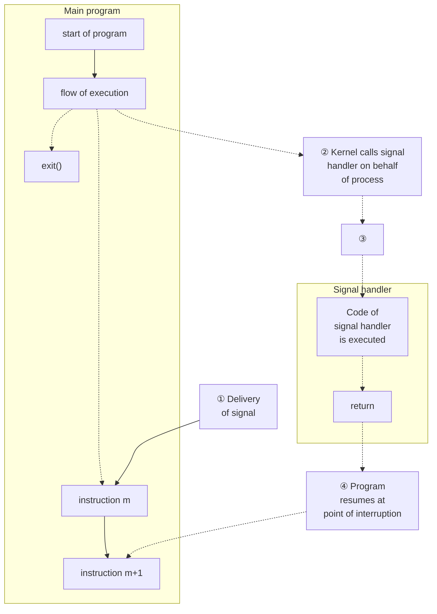

# Chương 20: Tín hiệu: Các khái niệm cơ bản (Signals: Fundamental Concepts)

Chương này và hai chương tiếp theo sẽ thảo luận về tín hiệu (signal). Mặc dù các khái niệm cơ bản rất đơn giản, nhưng phần thảo luận của chúng ta khá dài do có nhiều chi tiết cần bao phủ. Chương này đề cập đến các chủ đề sau:

- các tín hiệu khác nhau và mục đích của chúng;
- các trường hợp nhân hệ điều hành (kernel) có thể tạo ra một tín hiệu cho một tiến trình (process), và các system call (lời gọi hệ thống) mà một tiến trình có thể sử dụng để gửi tín hiệu cho một tiến trình khác;
- cách một tiến trình phản ứng lại tín hiệu theo mặc định, và các phương thức mà qua đó tiến trình có thể thay đổi phản ứng của mình đối với một tín hiệu, cụ thể là thông qua việc sử dụng trình xử lý tín hiệu (signal handler) — một hàm do lập trình viên định nghĩa được tự động gọi khi nhận được tín hiệu;
- việc sử dụng mặt nạ tín hiệu của tiến trình (process signal mask) để chặn (block) các tín hiệu, và khái niệm liên quan về tín hiệu đang chờ xử lý (pending signal); và
- cách một tiến trình có thể tạm dừng thực thi (suspend execution) và chờ đợi việc phân phối (delivery) của một tín hiệu.

## 20.1 Các khái niệm và Tổng quan

Tín hiệu (signal) là một thông báo gửi đến một tiến trình rằng một sự kiện đã xảy ra. Tín hiệu đôi khi được mô tả là các ngắt phần mềm (software interrupts). Tín hiệu tương tự như ngắt phần cứng (hardware interrupts) ở chỗ chúng làm gián đoạn luồng thực thi bình thường của một chương trình; trong hầu hết các trường hợp, không thể dự đoán chính xác khi nào một tín hiệu sẽ đến.

Một tiến trình có thể (nếu có các quyền phù hợp) gửi tín hiệu cho một tiến trình khác. Trong cách sử dụng này, tín hiệu có thể được dùng làm kỹ thuật đồng bộ hóa (synchronization technique), hoặc thậm chí là một hình thức truyền thông điệp giữa các tiến trình (Interprocess Communication - IPC) thô sơ. Một tiến trình cũng có thể tự gửi tín hiệu cho chính nó. Tuy nhiên, nguồn thông thường của nhiều tín hiệu gửi đến một tiến trình là từ kernel. Trong số các loại sự kiện khiến kernel tạo ra tín hiệu cho một tiến trình bao gồm:

- Xảy ra một ngoại lệ phần cứng (hardware exception), có nghĩa là phần cứng phát hiện ra một điều kiện lỗi được thông báo cho kernel, từ đó kernel gửi một tín hiệu tương ứng đến tiến trình liên quan. Ví dụ về ngoại lệ phần cứng bao gồm thực thi một câu lệnh mã máy không hợp lệ (malformed machine-language instruction), chia cho 0, hoặc tham chiếu đến một vùng bộ nhớ không thể truy cập được.
- Người dùng gõ một trong các ký tự đặc biệt của terminal tạo ra tín hiệu. Các ký tự này bao gồm ký tự ngắt (thường là Control-C) và ký tự tạm dừng (thường là Control-Z).
- Một sự kiện phần mềm đã xảy ra. Ví dụ: dữ liệu đầu vào có sẵn trên một bộ mô tả tệp (file descriptor), cửa sổ terminal bị thay đổi kích thước, bộ hẹn giờ (timer) hết giờ, giới hạn thời gian CPU của tiến trình bị vượt quá, hoặc một tiến trình con (child process) của tiến trình này kết thúc.

Mỗi tín hiệu được định nghĩa là một số nguyên (nhỏ) duy nhất, bắt đầu tuần tự từ 1. Các số nguyên này được định nghĩa trong `<signal.h>` với các tên ký hiệu có dạng `SIGxxxx`. Vì các số thực tế được sử dụng cho mỗi tín hiệu có thể khác nhau giữa các cài đặt (implementations), nên những tên ký hiệu này luôn được sử dụng trong các chương trình. Ví dụ, khi người dùng gõ ký tự ngắt, `SIGINT` (tín hiệu số 2) sẽ được phân phối đến tiến trình.

Tín hiệu được chia thành hai loại lớn. Tập hợp đầu tiên cấu thành các tín hiệu truyền thống hoặc tiêu chuẩn (standard signals), được kernel sử dụng để thông báo cho các tiến trình về các sự kiện. Trên Linux, các tín hiệu tiêu chuẩn được đánh số từ 1 đến 31. Chúng ta sẽ mô tả các tín hiệu tiêu chuẩn trong chương này. Tập hợp tín hiệu thứ hai bao gồm các tín hiệu thời gian thực (realtime signals), những điểm khác biệt của chúng so với tín hiệu tiêu chuẩn được mô tả trong Mục 22.8.

Một tín hiệu được cho là được **tạo ra** (generated) bởi một sự kiện nào đó. Sau khi được tạo ra, tín hiệu sẽ được **phân phối** (delivered) đến một tiến trình sau đó, tiến trình này sẽ thực hiện một hành động nào đó để phản hồi lại tín hiệu. Trong khoảng thời gian từ lúc nó được tạo ra đến lúc nó được phân phối, tín hiệu được gọi là **đang chờ xử lý** (pending).

Thông thường, một tín hiệu đang chờ xử lý sẽ được phân phối đến một tiến trình ngay khi nó được lên lịch chạy tiếp theo, hoặc ngay lập tức nếu tiến trình đó đang chạy (ví dụ, nếu tiến trình tự gửi tín hiệu cho chính nó). Tuy nhiên, đôi khi chúng ta cần đảm bảo rằng một đoạn mã (code segment) không bị gián đoạn bởi việc phân phối tín hiệu. Để làm điều này, chúng ta có thể thêm một tín hiệu vào mặt nạ tín hiệu của tiến trình (signal mask) — một tập hợp các tín hiệu có việc phân phối hiện đang bị chặn (blocked). Nếu một tín hiệu được tạo ra trong khi nó bị chặn, nó sẽ tiếp tục ở trạng thái chờ xử lý cho đến khi được bỏ chặn sau đó (bị loại bỏ khỏi mặt nạ tín hiệu). Các system call khác nhau cho phép một tiến trình thêm và xóa các tín hiệu khỏi mặt nạ tín hiệu của nó.

Khi phân phối một tín hiệu, một tiến trình thực hiện một trong các hành động mặc định sau đây, tùy thuộc vào tín hiệu đó:

- Tín hiệu bị bỏ qua (ignored); nghĩa là, nó bị kernel loại bỏ và không có tác động gì đến tiến trình. (Tiến trình thậm chí không bao giờ biết rằng nó đã xảy ra.)
- Tiến trình bị chấm dứt (terminated/killed). Điều này đôi khi được gọi là chấm dứt tiến trình bất thường (abnormal process termination), trái ngược với việc chấm dứt tiến trình bình thường xảy ra khi một tiến trình kết thúc bằng cách sử dụng `exit()`.
- Một tệp kết xuất lõi (core dump file) được tạo ra và tiến trình bị chấm dứt. Tệp core dump chứa một bản ảnh bộ nhớ ảo (virtual memory image) của tiến trình, có thể được tải vào trình gỡ lỗi (debugger) để kiểm tra trạng thái của tiến trình tại thời điểm nó bị chấm dứt.

- Tiến trình bị dừng — quá trình thực thi của tiến trình bị tạm ngưng (suspended).
- Quá trình thực thi của tiến trình được tiếp tục sau khi đã bị dừng trước đó.

Thay vì chấp nhận hành vi mặc định (default) đối với một tín hiệu (signal) cụ thể, một chương trình có thể thay đổi hành động xảy ra khi tín hiệu đó được gửi tới (delivered). Quá trình này được gọi là thiết lập cách xử lý (setting the disposition) của tín hiệu. Một chương trình có thể thiết lập một trong các cách xử lý sau cho một tín hiệu:

- Hành động mặc định sẽ diễn ra. Điều này hữu ích để hoàn tác việc thay đổi cách xử lý tín hiệu trước đó về lại trạng thái ban đầu thay vì trạng thái khác.
- Tín hiệu bị bỏ qua (ignored). Điều này hữu ích đối với một tín hiệu mà hành động mặc định của nó là chấm dứt tiến trình (terminate the process).
- Một hàm xử lý tín hiệu (signal handler) được thực thi.

Signal handler là một hàm do lập trình viên viết, thực hiện các tác vụ phù hợp để phản hồi lại việc một tín hiệu được gửi đến. Ví dụ, shell có một handler cho tín hiệu `SIGINT` (được tạo ra bởi ký tự ngắt, Control-C) khiến nó dừng công việc đang làm và trả lại quyền điều khiển cho vòng lặp nhập liệu chính, nhờ đó người dùng lại nhìn thấy dấu nhắc lệnh (prompt) của shell. Việc thông báo cho kernel rằng một hàm handler nên được gọi thường được gọi là cài đặt (installing) hoặc thiết lập (establishing) một signal handler. Khi một signal handler được gọi để phản hồi lại việc gửi tín hiệu, ta nói rằng tín hiệu đó đã được xử lý (handled) hoặc, theo nghĩa đồng nghĩa, đã được bắt (caught).

Lưu ý rằng không thể thiết lập cách xử lý tín hiệu thành chấm dứt tiến trình hoặc tạo tệp lõi - dump core (trừ khi một trong số đó là cách xử lý mặc định của tín hiệu). Cách gần nhất chúng ta có thể làm là cài đặt một handler cho tín hiệu đó, sau đó gọi `exit()` hoặc `abort()`. Hàm `abort()` (Mục 21.2.2) tạo ra một tín hiệu `SIGABRT` cho tiến trình, khiến nó dump core và chấm dứt.

> [!NOTE]
> Tệp `/proc/PID/status` đặc trưng của Linux chứa các trường mặt nạ bit (bit-mask fields) khác nhau có thể được kiểm tra để xác định cách mà một tiến trình xử lý các tín hiệu. Các mặt nạ bit được hiển thị dưới dạng số thập lục phân (hexadecimal), với bit có trọng số thấp nhất (least significant bit) đại diện cho tín hiệu 1, bit tiếp theo bên trái đại diện cho tín hiệu 2, v.v. Các trường này bao gồm `SigPnd` (các tín hiệu đang chờ xử lý trên mỗi luồng - per-thread pending signals), `ShdPnd` (các tín hiệu đang chờ xử lý trên toàn tiến trình - process-wide pending signals; kể từ Linux 2.6), `SigBlk` (các tín hiệu bị chặn - blocked signals), `SigIgn` (các tín hiệu bị bỏ qua), và `SigCgt` (các tín hiệu đã bắt). (Sự khác biệt giữa các trường `SigPnd` và `ShdPnd` sẽ trở nên rõ ràng khi chúng ta mô tả việc xử lý tín hiệu trong các tiến trình đa luồng - multithreaded processes ở Mục 33.2). Thông tin tương tự cũng có thể thu được bằng cách sử dụng các tùy chọn khác nhau cho lệnh `ps(1)`.

Signals xuất hiện trong các bản cài đặt UNIX rất sớm, nhưng đã trải qua một số thay đổi đáng kể kể từ khi ra đời. Trong các bản cài đặt đầu tiên, các tín hiệu có thể bị mất (nghĩa là không được chuyển đến tiến trình đích) trong một số hoàn cảnh nhất định. Hơn nữa, mặc dù các cơ chế đã được cung cấp để chặn việc gửi tín hiệu trong khi mã nguồn quan trọng (critical code) đang được thực thi, nhưng trong một số trường hợp, việc chặn này không đáng tin cậy. Những vấn đề này đã được khắc phục trong 4.2BSD, nơi cung cấp cái gọi là tín hiệu đáng tin cậy (reliable signals). (Một cải tiến khác của BSD là việc bổ sung các tín hiệu bổ sung để hỗ trợ việc điều khiển tác vụ shell - shell job control, mà chúng ta mô tả ở Mục 34.7).

System V cũng bổ sung ngữ nghĩa đáng tin cậy cho các tín hiệu, nhưng sử dụng một mô hình không tương thích với BSD. Những điểm không tương thích này chỉ được giải quyết khi tiêu chuẩn POSIX.1-1990 ra đời, tiêu chuẩn này áp dụng một thông số kỹ thuật cho các tín hiệu đáng tin cậy dựa phần lớn vào mô hình của BSD.

Chúng ta sẽ xem xét các chi tiết về tín hiệu đáng tin cậy và không đáng tin cậy ở Mục 22.7, và mô tả ngắn gọn các API tín hiệu BSD và System V cũ hơn ở Mục 22.13.

## 20.2 Các loại tín hiệu và Hành động mặc định

Trước đó, chúng ta đã đề cập rằng các tín hiệu chuẩn được đánh số từ 1 đến 31 trên Linux. Tuy nhiên, trang hướng dẫn (manual page) `signal(7)` của Linux liệt kê nhiều hơn 31 tên tín hiệu. Các tên thừa này có thể được giải thích theo nhiều cách khác nhau. Một số tên đơn giản là từ đồng nghĩa của các tên khác, và được định nghĩa để đảm bảo khả năng tương thích mã nguồn (source compatibility) với các bản cài đặt UNIX khác. Các tên khác được định nghĩa nhưng không được sử dụng. Danh sách sau đây mô tả các tín hiệu khác nhau:

### SIGABRT

Một tiến trình (process) sẽ nhận được tín hiệu (signal) này khi nó gọi hàm `abort()` (Mục 21.2.2). Theo mặc định, tín hiệu này chấm dứt tiến trình kèm theo một bản kết xuất bộ nhớ (core dump). Điều này đạt được mục đích dự kiến của lệnh gọi `abort()`: tạo ra một core dump phục vụ cho mục đích gỡ lỗi (debugging).

### SIGALRM

Kernel tạo ra tín hiệu này khi hết thời gian của một bộ định thời gian thực (real-time timer) được thiết lập bởi lệnh gọi `alarm()` hoặc `setitimer()`. Bộ định thời gian thực là bộ định thời đếm theo thời gian thực (tức là khái niệm thời gian trôi qua của con người). Để biết thêm chi tiết, hãy xem Mục 23.1.

### SIGBUS

Tín hiệu này ("lỗi bus" - bus error) được tạo ra để chỉ ra các loại lỗi truy cập bộ nhớ (memory access error) cụ thể. Một lỗi như vậy có thể xảy ra khi sử dụng các ánh xạ bộ nhớ (memory mapping) được tạo bằng `mmap()`, nếu chúng ta cố gắng truy cập một địa chỉ nằm vượt quá phần cuối của tệp được ánh xạ bộ nhớ cơ sở (underlying memory-mapped file), như được mô tả trong Mục 49.4.3.

### SIGCHLD

Tín hiệu này được gửi (bởi kernel) tới một tiến trình cha (parent process) khi một trong các tiến trình con (child process) của nó kết thúc (hoặc bằng cách gọi `exit()` hoặc do bị tiêu diệt bởi một tín hiệu). Nó cũng có thể được gửi tới một tiến trình khi một trong các tiến trình con của nó bị dừng (stopped) hoặc tiếp tục (resumed) bởi một tín hiệu. Chúng ta xem xét chi tiết về SIGCHLD trong Mục 26.3.

SIGCLD

Đây là một tên đồng nghĩa (synonym) của SIGCHLD.

SIGCONT

Khi được gửi tới một tiến trình đang dừng (stopped process), tín hiệu này khiến tiến trình tiếp tục chạy (tức là được lên lịch lại để chạy vào một thời điểm sau đó). Khi được nhận bởi một tiến trình hiện không dừng, tín hiệu này bị bỏ qua theo mặc định. Một tiến trình có thể bắt (catch) tín hiệu này để nó thực hiện một số hành động nào đó khi tiếp tục chạy. Tín hiệu này được đề cập chi tiết hơn trong Mục 22.2 và 34.7.

SIGEMT

Trong các hệ thống UNIX nói chung, tín hiệu này được sử dụng để chỉ ra một lỗi phần cứng phụ thuộc vào cài đặt (implementation-dependent hardware error). Trên Linux, tín hiệu này chỉ được sử dụng trong bản cài đặt Sun SPARC. Hậu tố EMT bắt nguồn từ cụm từ emulator trap, một từ ghi nhớ của trình hợp dịch (assembler mnemonic) trên Digital PDP-11.

SIGFPE

Tín hiệu này được tạo ra đối với các loại lỗi số học nhất định, chẳng hạn như lỗi chia cho số không (divide-by-zero). Hậu tố FPE là chữ viết tắt của ngoại lệ dấu phẩy động (floating-point exception), mặc dù tín hiệu này cũng có thể được tạo ra đối với các lỗi số học số nguyên (integer arithmetic error). Các chi tiết chính xác về thời điểm tín hiệu này được tạo ra phụ thuộc vào kiến trúc phần cứng và các cài đặt của thanh ghi điều khiển CPU (CPU control register). Ví dụ, trên x86-32, phép chia số nguyên cho số không luôn tạo ra SIGFPE, nhưng việc xử lý phép chia dấu phẩy động cho số không lại phụ thuộc vào việc ngoại lệ `FE_DIVBYZERO` đã được bật hay chưa. Nếu ngoại lệ này được bật (sử dụng `feenableexcept()`), thì phép chia dấu phẩy động cho số không sẽ tạo ra SIGFPE; nếu không, nó sẽ trả về kết quả chuẩn IEEE cho các toán hạng (biểu diễn dấu phẩy động của vô cực). Xem trang hướng dẫn (manual page) `fenv(3)` và `<fenv.h>` để biết thêm thông tin.

SIGHUP

Khi xảy ra ngắt kết nối thiết bị đầu cuối (hangup), tín hiệu này được gửi tới tiến trình điều khiển (controlling process) của thiết bị đầu cuối đó. Chúng ta mô tả khái niệm về tiến trình điều khiển và các hoàn cảnh khác nhau trong đó SIGHUP được gửi ở Mục 34.6. Một mục đích sử dụng thứ hai của SIGHUP là với các tiến trình nền (daemon, ví dụ: `init`, `httpd`, và `inetd`). Nhiều daemon được thiết kế để phản hồi khi nhận được SIGHUP bằng cách tự khởi tạo lại (reinitializing) và đọc lại các tệp cấu hình của chúng. Quản trị viên hệ thống (system administrator) kích hoạt các hành động này bằng cách gửi thủ công SIGHUP tới daemon, hoặc bằng cách sử dụng lệnh `kill` rõ ràng hoặc bằng cách thực thi một chương trình hoặc tập lệnh (script) làm điều tương tự.

SIGILL

Tín hiệu này được gửi tới một tiến trình nếu nó cố gắng thực thi một tập lệnh máy không hợp lệ (tức là được định dạng sai).

SIGINFO

Trên Linux, tên tín hiệu này là từ đồng nghĩa của SIGPWR. Trên các hệ thống BSD, tín hiệu SIGINFO, được tạo ra bằng cách gõ Control-T, được dùng để lấy thông tin trạng thái về nhóm tiến trình nền trước (foreground process group).

SIGINT

Khi người dùng gõ ký tự ngắt thiết bị đầu cuối (thường là Control-C), trình điều khiển thiết bị đầu cuối (terminal driver) sẽ gửi tín hiệu này tới nhóm tiến trình nền trước. Hành động mặc định cho tín hiệu này là chấm dứt tiến trình.

SIGIO

Sử dụng system call `fcntl()`, có thể sắp xếp để tín hiệu này được tạo ra khi một sự kiện I/O (ví dụ: đầu vào có sẵn) xảy ra trên một số loại file descriptor mở nhất định, chẳng hạn như các file descriptor dành cho thiết bị đầu cuối và socket. Tính năng này được mô tả chi tiết hơn trong Mục 63.3.

SIGIOT

Trên Linux, đây là từ đồng nghĩa của SIGABRT. Trên một số cài đặt UNIX khác, tín hiệu này cho biết lỗi phần cứng được xác định theo cài đặt (implementation-defined hardware fault).

SIGKILL

Đây là tín hiệu tiêu diệt chắc chắn (sure kill signal). Nó không thể bị chặn (blocked), bỏ qua (ignored), hay bị bắt bởi một trình xử lý (handler), và do đó luôn chấm dứt một tiến trình.

SIGLOST

Tên tín hiệu này tồn tại trên Linux, nhưng không được sử dụng. Trên một số cài đặt UNIX khác, client NFS sẽ gửi tín hiệu này tới các tiến trình cục bộ đang giữ các khóa (lock) nếu client NFS không thể khôi phục lại các khóa bị giữ bởi các tiến trình đó sau khi máy chủ NFS từ xa bị treo (crash) được phục hồi. (Tính năng này không được chuẩn hóa trong các thông số kỹ thuật của NFS).

SIGPIPE

Tín hiệu này được tạo ra khi một tiến trình cố gắng ghi vào một pipe, một FIFO, hoặc một socket mà không có tiến trình đọc tương ứng nào. Điều này thường xảy ra vì tiến trình đọc đã đóng file descriptor của nó đối với kênh IPC (Inter-Process Communication). Xem Mục 44.2 để biết thêm chi tiết.

SIGPOLL

Tín hiệu (signal) này, bắt nguồn từ System V, là một tên đồng nghĩa (synonym) với SIGIO trên Linux.

SIGPROF

Kernel tạo ra tín hiệu này khi hết hạn của một bộ định thời đo lường hiệu năng (profiling timer) được thiết lập bởi lời gọi `setitimer()` (Mục 23.1). Bộ định thời đo lường hiệu năng là bộ định thời đếm thời gian CPU được sử dụng bởi một tiến trình (process). Khác với bộ định thời ảo (virtual timer - xem SIGVTALRM bên dưới), bộ định thời đo lường hiệu năng đếm thời gian CPU được sử dụng ở cả chế độ người dùng (user mode) và chế độ nhân (kernel mode).

SIGPWR

Đây là tín hiệu mất nguồn điện. Trên các hệ thống có trang bị bộ lưu điện (UPS - uninterruptible power supply), có thể thiết lập một tiến trình nền (daemon process) để giám sát mức dung lượng pin dự phòng trong trường hợp xảy ra sự cố mất điện. Nếu năng lượng pin sắp cạn kiệt (sau một thời gian dài mất điện), tiến trình giám sát sẽ gửi SIGPWR đến tiến trình `init`. Tiến trình `init` hiểu tín hiệu này như một yêu cầu tắt hệ thống một cách nhanh chóng và có trật tự.

### SIGQUIT

Khi người dùng gõ ký tự thoát (thường là tổ hợp phím `Control-\`) trên bàn phím, tín hiệu này được gửi đến nhóm tiến trình tiền cảnh (foreground process group). Theo mặc định, tín hiệu này chấm dứt một tiến trình (terminate) và làm cho nó tạo ra một bản kết xuất bộ nhớ (core dump), sau đó có thể được sử dụng cho việc gỡ lỗi (debugging). Việc sử dụng SIGQUIT theo cách này rất hữu ích với một chương trình bị mắc kẹt trong vòng lặp vô hạn hoặc không phản hồi theo các cách khác. Bằng cách gõ `Control-\` sau đó nạp bản core dump thu được bằng trình gỡ lỗi `gdb` và sử dụng lệnh `backtrace` để lấy dấu vết ngăn xếp (stack trace), chúng ta có thể tìm ra phần mã nguồn nào của chương trình đang được thực thi. ([Matloff, 2008] mô tả cách sử dụng `gdb`.)

### SIGSEGV

Tín hiệu rất phổ biến này được tạo ra khi một chương trình thực hiện một tham chiếu bộ nhớ không hợp lệ (invalid memory reference). Một tham chiếu bộ nhớ có thể không hợp lệ vì trang (page) được tham chiếu không tồn tại (ví dụ: nó nằm trong một vùng chưa được ánh xạ ở đâu đó giữa heap và stack), tiến trình cố gắng cập nhật một vị trí trong bộ nhớ chỉ đọc (read-only memory) (ví dụ: phân đoạn văn bản của chương trình - program text segment, hoặc một vùng nhớ được ánh xạ được đánh dấu là chỉ đọc), hoặc tiến trình cố gắng truy cập vào một phần bộ nhớ kernel trong khi đang chạy ở user mode (Mục 2.1). Trong ngôn ngữ C, các sự kiện này thường bắt nguồn từ việc giải tham chiếu (dereferencing) một con trỏ chứa địa chỉ xấu (ví dụ: một con trỏ chưa được khởi tạo) hoặc truyền một tham số không hợp lệ trong một lời gọi hàm. Tên của tín hiệu này bắt nguồn từ thuật ngữ vi phạm phân đoạn (segmentation violation).

### SIGSTKFLT

Được tài liệu hóa trong `signal(7)` là "lỗi ngăn xếp trên bộ đồng xử lý" (stack fault on coprocessor), tín hiệu này được định nghĩa nhưng không được sử dụng trên Linux.

### SIGSTOP

Đây là tín hiệu dừng chắc chắn (sure stop signal). Nó không thể bị chặn (block), bị bỏ qua (ignore), hoặc bị bắt bởi một hàm xử lý (handler); do đó, nó luôn luôn dừng một tiến trình.

### SIGSYS

Tín hiệu này được tạo ra nếu một tiến trình thực hiện một lời gọi hệ thống "xấu" (bad system call). Điều này có nghĩa là tiến trình đã thực thi một tập lệnh được hiểu là một bẫy lời gọi hệ thống (system call trap), nhưng số hiệu lời gọi hệ thống (system call number) liên quan không hợp lệ (tham khảo Mục 3.1).

### SIGTERM

Đây là tín hiệu tiêu chuẩn được sử dụng để kết thúc (terminate) một tiến trình (process) và là tín hiệu mặc định do các lệnh `kill` và `killall` gửi đi. Người dùng đôi khi chủ động gửi tín hiệu SIGKILL tới một tiến trình bằng cách sử dụng `kill –KILL` hoặc `kill –9`. Tuy nhiên, đây thường là một hành động sai lầm. Một ứng dụng được thiết kế tốt sẽ có một hàm xử lý (handler) cho SIGTERM giúp ứng dụng thoát một cách mượt mà (gracefully), dọn dẹp các tập tin tạm thời và giải phóng các tài nguyên khác trước đó. Việc tiêu diệt một tiến trình bằng SIGKILL sẽ bỏ qua hàm xử lý SIGTERM. Do đó, chúng ta nên luôn cố gắng chấm dứt một tiến trình bằng SIGTERM trước, và chỉ coi SIGKILL là biện pháp cuối cùng để tiêu diệt các tiến trình chạy trốn (runaway process) không phản hồi lại SIGTERM.

### SIGTRAP

Tín hiệu này được sử dụng để triển khai các điểm dừng (breakpoint) của trình gỡ lỗi (debugger) và theo dõi System Call (lời gọi hệ thống), như được thực hiện bởi `strace(1)` (Phụ lục A). Xem trang hướng dẫn (manual page) `ptrace(2)` để biết thêm thông tin chi tiết.

### SIGTSTP

Đây là tín hiệu dừng điều khiển công việc (job-control stop signal), được gửi để dừng nhóm tiến trình nền trước (foreground process group) khi người dùng gõ ký tự tạm dừng (thường là Control-Z) trên bàn phím. Chương 34 mô tả chi tiết về các nhóm tiến trình (công việc) và tính năng điều khiển công việc (job control), cũng như các chi tiết về thời điểm và cách thức một chương trình có thể cần xử lý tín hiệu này. Tên của tín hiệu này bắt nguồn từ cụm từ "terminal stop" (dừng thiết bị đầu cuối).

### SIGTTIN

Khi chạy dưới một shell điều khiển công việc (job-control shell), trình điều khiển thiết bị đầu cuối (terminal driver) sẽ gửi tín hiệu này đến một nhóm tiến trình nền sau (background process group) khi nó cố gắng thực hiện hàm `read()` từ thiết bị đầu cuối. Tín hiệu này mặc định sẽ dừng một tiến trình.

### SIGTTOU

Tín hiệu này phục vụ một mục đích tương tự như SIGTTIN, nhưng dành cho đầu ra thiết bị đầu cuối (terminal output) bởi các công việc chạy ở nền sau (background job). Khi chạy dưới một job-control shell, nếu tùy chọn TOSTOP (terminal output stop) đã được bật cho thiết bị đầu cuối (có thể thông qua lệnh `stty tostop`), trình điều khiển thiết bị đầu cuối sẽ gửi SIGTTOU đến một nhóm tiến trình nền sau khi nó cố gắng thực hiện hàm `write()` ra thiết bị đầu cuối (xem Mục 34.7.1). Tín hiệu này mặc định sẽ dừng một tiến trình.

### SIGUNUSED

Đúng như tên gọi, tín hiệu này không được sử dụng. Trên Linux 2.4 trở về sau, tên tín hiệu này đồng nghĩa với SIGSYS trên nhiều kiến trúc. Nói cách khác, số hiệu tín hiệu này không còn là không được sử dụng trên các kiến trúc đó, mặc dù tên tín hiệu vẫn được giữ lại để đảm bảo tính tương thích ngược (backward compatibility).

### SIGURG

Tín hiệu này được gửi đến một tiến trình để báo hiệu sự hiện diện của dữ liệu khẩn cấp (out-of-band data, còn được gọi là urgent data) trên một Socket (Mục 61.13.1).

### SIGUSR1

Tín hiệu này và SIGUSR2 có sẵn cho các mục đích do lập trình viên tự định nghĩa. Kernel (nhân) không bao giờ tự động tạo ra các tín hiệu này cho một tiến trình. Các tiến trình có thể sử dụng các tín hiệu này để thông báo cho nhau về các sự kiện hoặc để đồng bộ hóa với nhau. Trong các cài đặt UNIX đời đầu, đây là hai tín hiệu duy nhất có thể được sử dụng tự do trong các ứng dụng. (Trên thực tế, các tiến trình có thể gửi cho nhau bất kỳ tín hiệu nào, nhưng điều này có tiềm năng gây nhầm lẫn nếu Kernel cũng tạo ra một trong các tín hiệu đó cho tiến trình). Các cài đặt UNIX hiện đại cung cấp một tập hợp lớn các tín hiệu thời gian thực (realtime signal) cũng có sẵn cho các mục đích do lập trình viên định nghĩa (Mục 22.8).

### SIGUSR2

Xem mô tả của SIGUSR1.

### SIGVTALRM

Kernel tạo ra tín hiệu này khi hết hạn một bộ đếm thời gian ảo (virtual timer) được thiết lập bởi lời gọi `setitimer()` (Mục 23.1). Bộ đếm thời gian ảo là bộ đếm thời gian CPU ở chế độ người dùng (usermode CPU time) mà một tiến trình (process) sử dụng.

### SIGWINCH

Trong môi trường cửa sổ (windowing environment), tín hiệu này được gửi đến nhóm tiến trình nền trước (foreground process group) khi kích thước cửa sổ terminal thay đổi (hậu quả của việc người dùng thay đổi kích thước thủ công hoặc của một chương trình thay đổi kích thước thông qua lời gọi `ioctl()`, như được mô tả trong Mục 62.9). Bằng cách cài đặt một trình xử lý (handler) cho tín hiệu này, các chương trình như `vi` và `less` có thể biết cách vẽ lại (redraw) đầu ra của chúng sau khi kích thước cửa sổ thay đổi.

### SIGXCPU

Tín hiệu này được gửi đến một tiến trình khi nó vượt quá giới hạn tài nguyên thời gian CPU (RLIMIT_CPU, được mô tả trong Mục 36.3).

### SIGXFSZ

Tín hiệu này được gửi đến một tiến trình nếu nó cố gắng (sử dụng `write()` hoặc `truncate()`) tăng kích thước của một tệp vượt quá giới hạn tài nguyên kích thước tệp của tiến trình (RLIMIT_FSIZE, được mô tả trong Mục 36.3).

Bảng 20-1 tóm tắt một loạt thông tin về các tín hiệu trên Linux. Lưu ý các điểm sau đây về bảng này:

- Cột số tín hiệu (signal number) hiển thị số được gán cho tín hiệu này trên các kiến trúc phần cứng khác nhau. Trừ khi có chỉ định khác, các tín hiệu có cùng một số trên tất cả các kiến trúc. Sự khác biệt về kiến trúc trong số tín hiệu được thể hiện trong ngoặc đơn, và xuất hiện trên các kiến trúc Sun SPARC và SPARC64 (S), HP/Compaq/Digital Alpha (A), MIPS (M), và HP PA-RISC (P). Trong cột này, `undef` biểu thị rằng một ký hiệu không được định nghĩa trên các kiến trúc được chỉ định.
- Cột SUSv3 cho biết tín hiệu có được chuẩn hóa trong SUSv3 hay không.
- Cột Mặc định (Default) cho biết hành động mặc định của tín hiệu: `term` có nghĩa là tín hiệu chấm dứt tiến trình (terminate the process), `core` có nghĩa là tiến trình tạo ra tệp kết xuất lõi (core dump file) và chấm dứt, `ignore` có nghĩa là tín hiệu bị bỏ qua, `stop` có nghĩa là tín hiệu dừng tiến trình (stop the process), và `cont` có nghĩa là tín hiệu tiếp tục một tiến trình đã bị dừng.

Một số tín hiệu được liệt kê trước đó không được hiển thị trong Bảng 20-1: SIGCLD (từ đồng nghĩa với SIGCHLD), SIGINFO (không sử dụng), SIGIOT (từ đồng nghĩa với SIGABRT), SIGLOST (không sử dụng), và SIGUNUSED (từ đồng nghĩa với SIGSYS trên nhiều kiến trúc).

**Bảng 20-1:** Các tín hiệu trên Linux

| Tên       | Số tín hiệu            | Mô tả                            | SUSv3 | Mặc định |
|-----------|------------------------|----------------------------------|-------|----------|
| SIGABRT   | 6                      | Hủy bỏ tiến trình                | •     | core     |
| SIGALRM   | 14                     | Hết giờ bộ đếm thời gian thực<br>• |      | term     |
| SIGBUS    | 7 (SAMP=10)            | Lỗi truy cập bộ nhớ<br>•         |       | core     |
| SIGCHLD   | 17 (SA=20, MP=18)      | •<br>Tiến trình con kết thúc hoặc dừng | | ignore |
| SIGCONT   | 18 (SA=19, M=25, P=26) | Tiếp tục nếu bị dừng<br>•        |       | cont     |
| SIGEMT    | undef (SAMP=7)         | Lỗi phần cứng                    |       | term     |
| SIGFPE    | 8                      | •<br>Ngoại lệ số học             |       | core     |
| SIGHUP    | 1                      | Ngắt kết nối (Hangup)<br>•       |       | term     |
| SIGILL    | 4                      | Lệnh không hợp lệ<br>•           |       | core     |
| SIGINT    | 2                      | •<br>Ngắt terminal               |       | term     |
| SIGIO /   | 29 (SA=23, MP=22)      | Có thể I/O                       | •     | term     |
| SIGPOLL   |                        |                                  |       |          |
| SIGKILL   | 9                      | Tiêu diệt bắt buộc               | •     | term     |
| SIGPIPE   | 13                     | Đường ống bị đứt (Broken pipe)   | •     | term     |
| SIGPROF   | 27 (M=29, P=21)        | Hết giờ bộ đếm lập hồ sơ (profiling) | • | term     |
| SIGPWR    | 30 (SA=29, MP=19)      | Nguồn điện sắp hỏng              |       | term     |
| SIGQUIT   | 3                      | Thoát từ terminal                | •     | core     |
| SIGSEGV   | 11                     | Tham chiếu bộ nhớ không hợp lệ   | •     | core     |
| SIGSTKFLT | 16 (SAM=undef, P=36)   | Lỗi ngăn xếp trên bộ đồng xử lý  |       | term     |
| SIGSTOP   | 19 (SA=17, M=23, P=24) | Dừng bắt buộc<br>•               |       | stop     |
| SIGSYS    | 31 (SAMP=12)           | System Call không hợp lệ         | •     | core     |
| SIGTERM   | 15                     | Chấm dứt tiến trình              | •     | term     |
| SIGTRAP   | 5                      | Bẫy vết/điểm dừng (Trace/breakpoint) | • | core     |
| SIGTSTP   | 20 (SA=18, M=24, P=25) | Dừng từ terminal                 |       | stop     |
| SIGTTIN   | 21 (M=26, P=27)        | Terminal đọc từ nền (BG)         |       | stop     |
| SIGTTOU   | 22 (M=27, P=28)        | Terminal ghi từ nền (BG)         |       | stop     |

| SIGURG    | 23 (SA=16, M=21, P=29) | Dữ liệu khẩn cấp trên socket (socket) | •     | ignore  |
| SIGUSR1   | 10 (SA=30, MP=16)      | Tín hiệu do người dùng định nghĩa 1   | •     | term    |
| SIGUSR2   | 12 (SA=31, MP=17)      | Tín hiệu do người dùng định nghĩa 2   | •     | term    |
| SIGVTALRM | 26 (M=28, P=20)        | Hết hạn bộ định thời ảo (virtual timer)| •     | term    |
| SIGWINCH  | 28 (M=20, P=23)        | Thay đổi kích thước cửa sổ terminal   |       | ignore  |
| SIGXCPU   | 24 (M=30, P=33)        | Vượt quá giới hạn thời gian CPU       | •     | core    |
| SIGXFSZ   | 25 (M=31, P=34)        | Vượt quá giới hạn kích thước tập tin  | •     | core    |

Lưu ý các điểm sau đây liên quan đến hành vi mặc định được hiển thị cho một số tín hiệu trong Bảng 20-1:

- Trên Linux 2.2, hành vi mặc định đối với các tín hiệu SIGXCPU, SIGXFSZ, SIGSYS và SIGBUS là chấm dứt tiến trình (terminate the process) mà không tạo ra tập tin core dump. Từ phiên bản kernel 2.4 trở đi, Linux tuân thủ các yêu cầu của SUSv3, trong đó các tín hiệu này gây ra việc chấm dứt tiến trình kèm theo việc tạo core dump. Trên một số hệ thống cài đặt UNIX khác, SIGXCPU và SIGXFSZ được xử lý theo cách tương tự như trên Linux 2.2.
- SIGPWR thường bị bỏ qua theo mặc định trên các hệ thống cài đặt UNIX khác có hỗ trợ tín hiệu này.
- SIGIO bị bỏ qua theo mặc định trên một số hệ thống cài đặt UNIX (đặc biệt là các hệ phái sinh từ BSD).
- Mặc dù không được quy định bởi bất kỳ tiêu chuẩn nào, SIGEMT vẫn xuất hiện trên hầu hết các hệ thống cài đặt UNIX. Tuy nhiên, tín hiệu này thường dẫn đến việc chấm dứt tiến trình kèm theo core dump trên các hệ thống khác.
- Trong SUSv1, hành vi mặc định cho SIGURG được quy định là chấm dứt tiến trình, và đây là hành vi mặc định ở một số hệ thống UNIX cũ hơn. SUSv2 đã áp dụng đặc tả hiện tại (bỏ qua - ignore).

## 20.3 Thay Đổi Trạng Thái Xử Lý Tín Hiệu: signal()

Các hệ thống UNIX cung cấp hai cách để thay đổi trạng thái xử lý tín hiệu (signal disposition): `signal()` và `sigaction()`. System Call `signal()`, được mô tả trong phần này, là API ban đầu để thiết lập trạng thái xử lý tín hiệu và nó cung cấp một giao diện đơn giản hơn so với `sigaction()`. Mặt khác, `sigaction()` cung cấp các tính năng không có sẵn ở `signal()`. Hơn nữa, có sự khác biệt trong hành vi của `signal()` giữa các hệ thống cài đặt UNIX khác nhau (Mục 22.7), điều này có nghĩa là không bao giờ nên sử dụng nó để thiết lập trình xử lý tín hiệu (signal handler) trong các chương trình có tính di portability (portable). Do các vấn đề về tính di động này, `sigaction()` là API được (rất) ưu tiên để thiết lập một signal handler. Sau khi chúng ta giải thích cách sử dụng `sigaction()` ở Mục [20.13,](#page-29-0) chúng ta sẽ luôn sử dụng lời gọi đó khi thiết lập các signal handler trong các chương trình ví dụ của mình.

> [!NOTE]
> Mặc dù được tài liệu hóa trong phần 2 của các trang hướng dẫn (manual pages) trên Linux, `signal()` thực chất được cài đặt trong glibc như một hàm thư viện nằm chồng lên trên System Call `sigaction()`.

```c
## include <signal.h>
void ( *signal(int sig, void (*handler)(int)) ) (int);
              Trả về trạng thái xử lý tín hiệu trước đó nếu thành công, hoặc SIG_ERR nếu có lỗi
```

Nguyên mẫu hàm (function prototype) cho `signal()` đòi hỏi một số bước giải mã. Đối số đầu tiên, `sig`, xác định tín hiệu mà chúng ta muốn thay đổi trạng thái xử lý. Đối số thứ hai, `handler`, là địa chỉ của hàm nên được gọi khi tín hiệu này được phân phối (delivered). Hàm này không trả về giá trị gì (`void`) và nhận một đối số kiểu số nguyên (integer). Do đó, một signal handler có dạng tổng quát như sau:

```c
void
handler(int sig)
{
 /* Mã nguồn cho handler */
}
```

Chúng ta sẽ mô tả mục đích của đối số `sig` đối với hàm handler ở Mục [20.4](#page-11-0). Giá trị trả về của `signal()` là trạng thái xử lý tín hiệu trước đó. Giống như đối số `handler`, đây là một con trỏ (pointer) trỏ đến một hàm không trả về giá trị gì và nhận một đối số kiểu số nguyên. Nói cách khác, chúng ta có thể viết mã nguồn như sau để tạm thời thiết lập một handler cho một tín hiệu, và sau đó khôi phục lại trạng thái xử lý của tín hiệu đó về như cũ:

```c
void (*oldHandler)(int);
oldHandler = signal(SIGINT, newHandler);
if (oldHandler == SIG_ERR)
 errExit("signal");
/* Làm gì đó ở đây. Trong thời gian này, nếu SIGINT được
 gửi đến, newHandler sẽ được sử dụng để xử lý tín hiệu. */
if (signal(SIGINT, oldHandler) == SIG_ERR)
 errExit("signal");
```

Không thể sử dụng `signal()` để truy xuất trạng thái xử lý hiện tại của một tín hiệu mà không đồng thời thay đổi trạng thái đó. Để làm được điều đó, chúng ta bắt buộc phải sử dụng `sigaction()`.

Chúng ta có thể làm cho nguyên mẫu của `signal()` dễ hiểu hơn rất nhiều bằng cách sử dụng định nghĩa kiểu dữ liệu (type definition) sau đây cho một con trỏ trỏ đến hàm signal handler:

```c
typedef void (*sighandler_t)(int);
```

Điều này cho phép chúng ta viết lại nguyên mẫu của `signal()` như sau:

```c
sighandler_t signal(int sig, sighandler_t handler);
```

Nếu macro kiểm tra tính năng `_GNU_SOURCE` được định nghĩa, thì glibc sẽ cung cấp kiểu dữ liệu phi chuẩn `sighandler_t` trong tệp tiêu đề (header file) `<signal.h>`.

Thay vì chỉ định địa chỉ của một hàm làm đối số handler của `signal()`, chúng ta có thể chỉ định một trong các giá trị sau:

SIG\_DFL

Đặt lại disposition (cách xử lý) của signal về mặc định (Bảng 20-1). Điều này hữu ích để hoàn tác hiệu ứng của một lời gọi trước đó tới `signal()` mà đã thay đổi disposition của signal đó.

SIG\_IGN

Bỏ qua signal. Nếu signal được tạo ra cho process này, kernel sẽ âm thầm hủy bỏ nó. Process thậm chí không bao giờ biết rằng signal đã xảy ra.

Một lời gọi thành công tới `signal()` sẽ trả về disposition trước đó của signal, có thể là địa chỉ của một hàm handler đã được thiết lập trước đó, hoặc một trong các hằng số `SIG_DFL` hoặc `SIG_IGN`. Khi có lỗi xảy ra, `signal()` trả về giá trị `SIG_ERR`.

## 20.4 Giới thiệu về Signal Handler

Một signal handler (còn được gọi là signal catcher) là một hàm được gọi khi một signal được chỉ định được gửi (deliver) tới một process. Chúng ta mô tả các nguyên lý cơ bản của signal handler trong phần này, sau đó đi vào chi tiết trong Chương 21.

Việc gọi (invocation) một signal handler có thể làm gián đoạn luồng chương trình chính (main program flow) tại bất kỳ thời điểm nào; kernel sẽ gọi handler thay mặt cho process, và khi handler trả về (return), việc thực thi chương trình sẽ tiếp tục tại điểm mà nó bị handler làm gián đoạn. Trình tự này được minh họa trong [Hình 20-1.](#page-12-0)



**Hình 20-1:** Gửi signal và thực thi handler

Mặc dù signal handler có thể làm hầu như mọi thứ, nhưng nhìn chung chúng nên được thiết kế càng đơn giản càng tốt. Chúng ta sẽ mở rộng điểm này ở Phần 21.1.

**Listing 20-1:** Thiết lập một handler cho SIGINT

```c
––––––––––––––––––––––––––––––––––––––––––––––––––––––––––– signals/ouch.c
## include <signal.h>
## include "tlpi_hdr.h"
static void
sigHandler(int sig)
{
 printf("Ouch!\n"); /* UNSAFE (xem Phần 21.1.2) */
}
int
main(int argc, char *argv[])
{
 int j;
 if (signal(SIGINT, sigHandler) == SIG_ERR)
 errExit("signal");
 for (j = 0; ; j++) {
 printf("%d\n", j);
 sleep(3); /* Vòng lặp chậm... */
 }
}
––––––––––––––––––––––––––––––––––––––––––––––––––––––––––– signals/ouch.c
```

[Listing 20-1](#page-12-1) (ở trang [399\)](#page-12-1) cho thấy một ví dụ đơn giản về một hàm signal handler và chương trình chính thiết lập nó làm handler cho signal `SIGINT`. (Terminal driver tạo ra signal này khi chúng ta gõ ký tự ngắt terminal, thường là Control-C). Handler này đơn giản là in ra một thông báo và trả về.

Chương trình chính lặp liên tục. Trong mỗi vòng lặp (iteration), chương trình tăng một bộ đếm (counter) rồi in giá trị của nó, sau đó chương trình tạm dừng (sleep) trong vài giây. (Để sleep theo cách này, chúng ta sử dụng hàm `sleep()`, hàm này làm tạm dừng việc thực thi của tiến trình gọi nó trong một số giây được chỉ định. Chúng ta mô tả hàm này trong Phần 23.4.1).

Khi chúng ta chạy chương trình trong [Listing 20-1,](#page-12-1) chúng ta thấy kết quả sau:

```
$ ./ouch
0 Main program loops, displaying successive integers
Type Control-C
Ouch! Signal handler is executed, and returns
1 Control has returned to main program
2
Type Control-C again
Ouch!
3
Type Control-\ (the terminal quit character)
Quit (core dumped)
```

Khi kernel gọi một signal handler, nó truyền số hiệu của signal gây ra lời gọi đó dưới dạng một đối số kiểu số nguyên (integer argument) cho handler. (Đây là đối số `sig` trong handler của [Listing 20-1\)](#page-12-1). Nếu một signal handler chỉ bắt (catch) một loại signal duy nhất, thì đối số này ít có giá trị sử dụng. Tuy nhiên, chúng ta có thể thiết lập cùng một handler để bắt các loại signal khác nhau và sử dụng đối số này để xác định signal nào đã khiến handler được gọi.

Điều này được minh họa trong [Listing 20-2,](#page-14-0) một chương trình thiết lập cùng một handler cho cả `SIGINT` và `SIGQUIT`. (`SIGQUIT` được tạo ra bởi terminal driver khi chúng ta gõ ký tự thoát terminal, thường là Control-\). Mã nguồn của handler phân biệt hai signal bằng cách kiểm tra đối số `sig`, và thực hiện các hành động khác nhau cho mỗi signal. Trong hàm `main()`, chúng ta sử dụng `pause()` (được mô tả ở Phần [20.14](#page-31-0)) để chặn (block) process cho đến khi một signal bị bắt.

Nhật ký phiên shell (shell session) sau đây minh họa cách sử dụng chương trình này:

```
$ ./intquit
Type Control-C
Caught SIGINT (1)
Type Control-C again
Caught SIGINT (2)
and again
Caught SIGINT (3)
Type Control-\
Caught SIGQUIT - that's all folks!
```

Trong [Liệt kê 20-1](#page-12-1) và [Liệt kê 20-2,](#page-14-0) chúng ta sử dụng `printf()` để hiển thị thông báo từ hàm xử lý tín hiệu (signal handler). Vì những lý do mà chúng ta thảo luận trong Mục 21.1.2, các ứng dụng thực tế nhìn chung không bao giờ nên gọi các hàm `stdio` từ bên trong hàm xử lý tín hiệu. Tuy nhiên, trong các chương trình ví dụ khác nhau, chúng ta vẫn sẽ gọi `printf()` từ hàm xử lý tín hiệu như một cách đơn giản để quan sát thời điểm hàm xử lý được gọi.

**Liệt kê 20-2:** Thiết lập cùng một hàm xử lý cho hai tín hiệu khác nhau

```c
––––––––––––––––––––––––––––––––––––––––––––––––––––––––– signals/intquit.c
## include <signal.h>
## include "tlpi_hdr.h"
static void
sigHandler(int sig)
{
 static int count = 0;
 /* UNSAFE: This handler uses non-async-signal-safe functions
 (printf(), exit(); see Section 21.1.2) */
 if (sig == SIGINT) {
 count++;
 printf("Caught SIGINT (%d)\n", count);
 return; /* Resume execution at point of interruption */
 }
 /* Must be SIGQUIT - print a message and terminate the process */
 printf("Caught SIGQUIT - that's all folks!\n");
 exit(EXIT_SUCCESS);
}
int
main(int argc, char *argv[])
{
 /* Establish same handler for SIGINT and SIGQUIT */
 if (signal(SIGINT, sigHandler) == SIG_ERR)
 errExit("signal");
 if (signal(SIGQUIT, sigHandler) == SIG_ERR)
 errExit("signal");
 for (;;) /* Loop forever, waiting for signals */
 pause(); /* Block until a signal is caught */
}
––––––––––––––––––––––––––––––––––––––––––––––––––––––––– signals/intquit.c
```

## 20.5 Gửi Tín hiệu: kill()

Một tiến trình (process) có thể gửi một tín hiệu đến tiến trình khác bằng cách sử dụng System Call `kill()`, đây là hàm tương đương với lệnh shell `kill`. (Thuật ngữ kill được chọn vì hành động mặc định của hầu hết các tín hiệu có sẵn trên các phiên bản UNIX thời kỳ đầu là chấm dứt tiến trình - terminate the process).

## include <signal.h>

int kill(pid_t pid, int sig);
Trả về 0 khi thành công, hoặc –1 nếu có lỗi

```

Tham số `pid` xác định một hoặc nhiều tiến trình mà tín hiệu được chỉ định bởi `sig` sẽ được gửi tới. Bốn trường hợp khác nhau quyết định cách `pid` được diễn giải:

- Nếu `pid` lớn hơn 0, tín hiệu được gửi đến tiến trình có ID tiến trình (Process ID) do `pid` chỉ định.
- Nếu `pid` bằng 0, tín hiệu được gửi đến mọi tiến trình nằm trong cùng nhóm tiến trình (process group) với tiến trình gọi, bao gồm cả bản thân tiến trình gọi đó. (SUSv3 nêu rõ rằng tín hiệu nên được gửi đến tất cả các tiến trình trong cùng nhóm tiến trình, ngoại trừ một "tập hợp các tiến trình hệ thống không xác định" và bổ sung điều kiện tương tự cho từng trường hợp còn lại).
- Nếu `pid` nhỏ hơn –1, tín hiệu sẽ được gửi đến tất cả các tiến trình trong nhóm tiến trình có ID bằng giá trị tuyệt đối của `pid`. Việc gửi tín hiệu đến tất cả các tiến trình trong một nhóm tiến trình có ứng dụng đặc biệt trong việc điều khiển công việc của shell (shell job control - Mục 34.7).
- Nếu `pid` bằng –1, tín hiệu được gửi đến mọi tiến trình mà tiến trình gọi có quyền gửi tín hiệu, ngoại trừ `init` (ID tiến trình là 1) và tiến trình gọi. Nếu một tiến trình có đặc quyền (privileged process) thực hiện lời gọi này, thì tất cả các tiến trình trên hệ thống sẽ nhận được tín hiệu, ngoại trừ hai tiến trình sau cùng này. Vì những lý do hiển nhiên, các tín hiệu được gửi theo cách này đôi khi được gọi là tín hiệu quảng bá (broadcast signals). (SUSv3 không yêu cầu tiến trình gọi phải bị loại khỏi việc nhận tín hiệu; Linux tuân theo các ngữ nghĩa của BSD về mặt này).

Nếu không có tiến trình nào khớp với `pid` được chỉ định, `kill()` sẽ thất bại và đặt `errno` thành `ESRCH` ("No such process" - Không có tiến trình như vậy).

Một tiến trình cần có các quyền thích hợp để có thể gửi tín hiệu đến một tiến trình khác. Các quy tắc về quyền hạn như sau:

- Một tiến trình có đặc quyền (`CAP_KILL`) có thể gửi tín hiệu đến bất kỳ tiến trình nào.
- Tiến trình `init` (ID tiến trình là 1), chạy với người dùng (user) và nhóm (group) là `root`, là một trường hợp đặc biệt. Nó chỉ có thể nhận các tín hiệu mà nó đã cài đặt hàm xử lý (handler). Điều này ngăn cản quản trị viên hệ thống vô tình tiêu diệt (kill) `init`, vốn là thành phần cốt lõi đối với hoạt động của hệ thống.
- Một tiến trình không có đặc quyền (unprivileged process) có thể gửi tín hiệu đến một tiến trình khác nếu ID người dùng thực (real user ID) hoặc ID người dùng hiệu dụng (effective user ID) của tiến trình gửi khớp với ID người dùng thực hoặc ID người dùng được lưu (saved set-user-ID) của tiến trình nhận, như được minh họa trong [Hình 20-2](#page-16-0). Quy tắc này cho phép người dùng gửi tín hiệu đến các chương trình set-user-ID mà họ đã khởi động, bất kể cài đặt hiện tại của ID người dùng hiệu dụng của tiến trình đích là gì. Việc loại trừ ID người dùng hiệu dụng của tiến trình đích khỏi quá trình kiểm tra phục vụ một mục đích bổ trợ: nó ngăn người dùng này gửi tín hiệu đến tiến trình của người dùng khác đang chạy một chương trình set-user-ID thuộc về người dùng đang cố gắng gửi tín hiệu. (SUSv3 bắt buộc các quy tắc được hiển thị trong [Hình 20-2,](#page-16-0) nhưng Linux tuân theo các quy tắc hơi khác một chút ở các phiên bản kernel trước 2.0, như được mô tả trong trang hướng dẫn (man page) `kill(2)`).

Tín hiệu `SIGCONT` được xử lý theo một cách đặc biệt. Một tiến trình đặc quyền thấp (unprivileged process) có thể gửi tín hiệu này tới bất kỳ tiến trình nào khác trong cùng một phiên (session), không cần quan tâm đến các kiểm tra ID người dùng (user ID checks). Quy tắc này cho phép các shell kiểm soát công việc (job-control shells) khởi động lại các công việc bị dừng (nhóm tiến trình - process groups), ngay cả khi các tiến trình trong công việc đó đã thay đổi ID người dùng của chúng (tức là chúng là các tiến trình có đặc quyền đã sử dụng các system call được mô tả tại Mục 9.7 để thay đổi thông tin xác thực - credentials của mình).

```text

Sending process              Receiving process
┌─────────────────────┐      ┌─────────────────────┐
│   real user ID      │─────>│   real user ID      │
├─────────────────────┤  ┌──>├─────────────────────┤
│ effective user ID   │──┤   │ effective user ID   │
├─────────────────────┤  └──>├─────────────────────┤
│ saved set-user-ID   │─────>│ saved set-user-ID   │
└─────────────────────┘      └─────────────────────┘

indicates that if IDs match,
───────> then sender has permission
to send a signal to receiver

```

**Hình 20-2:** Các quyền cần thiết để một tiến trình đặc quyền thấp (unprivileged process) gửi tín hiệu

Nếu một tiến trình không có quyền gửi tín hiệu đến pid được yêu cầu, thì hàm `kill()` sẽ thất bại và thiết lập `errno` thành `EPERM`. Trong trường hợp pid chỉ định một tập hợp các tiến trình (tức là pid mang giá trị âm), hàm `kill()` sẽ thành công nếu có ít nhất một tiến trình trong số đó có thể nhận được tín hiệu.

Chúng tôi minh họa cách sử dụng `kill()` trong Liệt kê 20-3 (Listing 20-3).

## 20.6 Kiểm tra sự tồn tại của một tiến trình

System call `kill()` có thể phục vụ một mục đích khác. Nếu đối số `sig` được chỉ định là 0 (được gọi là tín hiệu rỗng - null signal), thì không có tín hiệu nào được gửi đi. Thay vào đó, `kill()` chỉ thực hiện việc kiểm tra lỗi để xem tiến trình đó có thể nhận được tín hiệu hay không. Hiểu theo cách khác, điều này có nghĩa là chúng ta có thể sử dụng tín hiệu rỗng để kiểm tra xem một tiến trình với một ID tiến trình (process ID) cụ thể có tồn tại hay không. Nếu việc gửi tín hiệu rỗng thất bại với mã lỗi `ESRCH`, thì chúng ta biết rằng tiến trình đó không tồn tại. Nếu lời gọi hàm thất bại với lỗi `EPERM` (có nghĩa là tiến trình tồn tại, nhưng chúng ta không có quyền gửi tín hiệu đến nó) hoặc thành công (có nghĩa là chúng ta có quyền gửi tín hiệu đến tiến trình), thì chúng ta biết rằng tiến trình đó thực sự tồn tại.

Việc xác minh sự tồn tại của một ID tiến trình cụ thể không đảm bảo rằng một chương trình cụ thể vẫn đang chạy. Bởi vì kernel tái chế các ID tiến trình khi các tiến trình được sinh ra và kết thúc, cùng một ID tiến trình theo thời gian có thể trỏ đến một tiến trình khác. Hơn nữa, một ID tiến trình cụ thể có thể tồn tại nhưng lại là một tiến trình thây ma (zombie - tức là một tiến trình đã chết, nhưng tiến trình cha của nó vẫn chưa thực hiện `wait()` để lấy trạng thái kết thúc của nó, như được mô tả trong Mục 26.2).

Nhiều kỹ thuật khác cũng có thể được sử dụng để kiểm tra xem một tiến trình cụ thể có đang chạy hay không, bao gồm các kỹ thuật sau:

- Các system call `wait()`: Các lời gọi này được mô tả trong Chương 26. Chúng chỉ có thể được sử dụng nếu tiến trình được giám sát là tiến trình con (child) của tiến trình gọi.
- Semaphore và khóa tệp độc quyền (exclusive file locks): Nếu tiến trình đang được giám sát liên tục giữ một semaphore hoặc một khóa tệp, thì nếu chúng ta có thể chiếm được semaphore hoặc khóa đó, chúng ta biết rằng tiến trình đã kết thúc. Chúng tôi mô tả semaphore trong Chương 47 và 53, và khóa tệp trong Chương 55.
- Các kênh IPC (IPC channels) như pipe và FIFO: Chúng ta thiết lập tiến trình được giám sát sao cho nó giữ một file descriptor ở trạng thái mở để ghi trên kênh chừng nào nó còn sống. Trong khi đó, tiến trình giám sát giữ một descriptor đọc mở cho kênh đó, và nó biết rằng tiến trình được giám sát đã kết thúc khi đầu ghi của kênh bị đóng (vì nó nhìn thấy dấu kết thúc tệp - end-of-file). Tiến trình giám sát có thể xác định điều này bằng cách đọc từ file descriptor của nó hoặc bằng cách giám sát descriptor đó bằng sử dụng một trong các kỹ thuật được mô tả trong Chương 63.
- Giao diện `/proc/PID`: Ví dụ, nếu một tiến trình có ID tiến trình là 12345 tồn tại, thì thư mục `/proc/12345` sẽ tồn tại và chúng ta có thể kiểm tra điều này bằng cách sử dụng một lời gọi như `stat()`.

Tất cả các kỹ thuật này, ngoại trừ kỹ thuật cuối cùng, không bị ảnh hưởng bởi việc tái chế các ID tiến trình. Liệt kê 20-3 minh họa việc sử dụng `kill()`. Chương trình này nhận hai đối số dòng lệnh (command-line arguments), gồm một số hiệu tín hiệu (signal number) và một ID tiến trình, và sử dụng `kill()` để gửi tín hiệu đến tiến trình được chỉ định. Nếu tín hiệu 0 (tín hiệu rỗng) được chỉ định, chương trình sẽ báo cáo về sự tồn tại của tiến trình mục tiêu.

## 20.7 Các cách khác để gửi tín hiệu: raise() và killpg()

Đôi khi, việc một tiến trình tự gửi tín hiệu cho chính mình rất hữu ích. (Chúng ta thấy một ví dụ về điều này trong Mục 34.7.3). Hàm `raise()` thực hiện tác vụ này.

```c

## include <signal.h>

int raise(int sig);
Returns 0 on success, or nonzero on error

```

Trong một chương trình đơn luồng (single-threaded program), một lời gọi đến `raise()` tương đương với lời gọi `kill()` sau đây:

```

kill(getpid(), sig);

```

Trên một hệ thống hỗ trợ luồng (threads), `raise(sig)` được hiện thực như sau:

```

pthread_kill(pthread_self(), sig)

```

Chúng tôi mô tả hàm `pthread_kill()` trong Mục 33.2.3, nhưng hiện tại chỉ cần nói rằng cách hiện thực này có nghĩa là tín hiệu sẽ được chuyển giao (delivered) đến chính xác luồng đã gọi `raise()`. Ngược lại, lời gọi `kill(getpid(), sig)` gửi tín hiệu tới tiến trình gọi, và tín hiệu đó có thể được chuyển giao tới bất kỳ luồng nào trong tiến trình.

> Hàm `raise()` bắt nguồn từ chuẩn C89. Các tiêu chuẩn C không đề cập đến các chi tiết cụ thể của hệ điều hành như định danh tiến trình (process ID), nhưng `raise()` vẫn có thể được định nghĩa trong chuẩn C vì nó không yêu cầu tham chiếu đến process ID.

Khi một tiến trình tự gửi tín hiệu (signal) cho chính nó bằng cách sử dụng `raise()` (hoặc `kill()`), tín hiệu đó sẽ được chuyển giao (deliver) ngay lập tức (tức là trước khi `raise()` trả về cho hàm gọi).

Lưu ý rằng `raise()` trả về một giá trị khác 0 (không nhất thiết là –1) khi xảy ra lỗi. Lỗi duy nhất có thể xảy ra với `raise()` là `EINVAL`, do tham số `sig` không hợp lệ. Do đó, khi chúng ta chỉ định một trong các hằng số `SIGxxxx`, chúng ta thường không kiểm tra trạng thái trả về của hàm này.

```c

––––––––––––––––––––––––––––––––––––––––––––––––––––––––––signals/t_kill.c

## include <signal.h>

## include "tlpi_hdr.h"

int
main(int argc, char *argv[])
{
int s, sig;
if (argc != 3 || strcmp(argv[1], "--help") == 0)
usageErr("%s sig-num pid\n", argv[0]);
sig = getInt(argv[2], 0, "sig-num");
s = kill(getLong(argv[1], 0, "pid"), sig);
if (sig != 0) {
if (s == -1)
errExit("kill");
} else { /* Null signal: process existence check */
if (s == 0) {
printf("Process exists and we can send it a signal\n");
} else {
if (errno == EPERM)
printf("Process exists, but we don't have "
"permission to send it a signal\n");
else if (errno == ESRCH)
printf("Process does not exist\n");
else
errExit("kill");
}
}
exit(EXIT_SUCCESS);
}
––––––––––––––––––––––––––––––––––––––––––––––––––––––––––signals/t_kill.c

```

Hàm `killpg()` gửi một tín hiệu đến tất cả các thành viên của một nhóm tiến trình (process group).

```c

## include <signal.h>

int killpg(pid_t pgrp, int sig);
Returns 0 on success, or –1 on error

```

Một lời gọi đến `killpg()` tương đương với lời gọi `kill()` sau đây:

```

kill(-pgrp, sig);

```

Nếu `pgrp` được chỉ định là 0, thì tín hiệu sẽ được gửi đến tất cả các tiến trình nằm trong cùng một nhóm tiến trình với tiến trình gọi. Chuẩn SUSv3 không quy định chi tiết trường hợp này, nhưng hầu hết các cài đặt UNIX đều diễn giải trường hợp này giống như Linux.

## 20.8 Hiển thị Mô tả Tín hiệu

Mỗi tín hiệu đều có một mô tả có thể in được đi kèm. Các mô tả này được liệt kê trong mảng `sys_siglist`. Ví dụ, chúng ta có thể tham chiếu đến `sys_siglist[SIGPIPE]` để lấy mô tả cho `SIGPIPE` (đường ống bị đứt - broken pipe). Tuy nhiên, thay vì sử dụng trực tiếp mảng `sys_siglist`, hàm `strsignal()` được ưu tiên hơn.

```c

## define _BSD_SOURCE

## include <signal.h>

extern const char *const sys_siglist[];

## define _GNU_SOURCE

## include <string.h>

char *strsignal(int sig);
Returns pointer to signal description string

```

Hàm `strsignal()` thực hiện kiểm tra biên (bounds checking) đối với tham số `sig`, sau đó trả về một con trỏ trỏ đến chuỗi mô tả tín hiệu có thể in được, hoặc một con trỏ trỏ đến chuỗi lỗi nếu số hiệu tín hiệu không hợp lệ. (Trên một số hệ implementation UNIX khác, `strsignal()` trả về `NULL` nếu `sig` không hợp lệ).

Ngoài việc kiểm tra biên, một ưu điểm khác của `strsignal()` so với việc sử dụng trực tiếp `sys_siglist` là `strsignal()` hỗ trợ định locale (locale-sensitive, Mục 10.4), do đó các mô tả tín hiệu sẽ được hiển thị bằng ngôn ngữ của hệ thống.

Một ví dụ về việc sử dụng `strsignal()` được thể hiện trong Liệt kê 20-4 (Listing 20-4).

Hàm `psignal()` hiển thị (trên luồng lỗi chuẩn - standard error) chuỗi được truyền vào qua tham số `msg`, theo sau là dấu hai chấm, và sau đó là mô tả tín hiệu tương ứng với `sig`. Giống như `strsignal()`, `psignal()` cũng hỗ trợ locale (locale-sensitive).

```c

## include <signal.h>

void psignal(int sig, const char *msg);

```

Mặc dù `psignal()`, `strsignal()`, và `sys_siglist` không được chuẩn hóa như một phần của SUSv3, chúng vẫn có sẵn trên nhiều cài đặt UNIX. (Chuẩn SUSv4 bổ sung các đặc tả cho `psignal()` và `strsignal()`).

## 20.9 Tập hợp Tín hiệu (Signal Sets)

Nhiều System Call liên quan đến tín hiệu cần có khả năng biểu diễn một nhóm gồm các tín hiệu khác nhau. Ví dụ, `sigaction()` và `sigprocmask()` cho phép một chương trình chỉ định một nhóm tín hiệu sẽ bị chặn (block) bởi một tiến trình, trong khi `sigpending()` trả về một nhóm tín hiệu hiện đang chờ xử lý (pending) đối với một tiến trình. (Chúng ta sẽ mô tả các System Call này ngay sau đây).

Nhiều tín hiệu được biểu diễn bằng một cấu trúc dữ liệu gọi là tập hợp tín hiệu (signal set), được cung cấp bởi kiểu dữ liệu hệ thống `sigset_t`. Chuẩn SUSv3 quy định một loạt các hàm để thao tác với tập hợp tín hiệu, và bây giờ chúng ta sẽ mô tả các hàm này.

> Trên Linux, cũng như trên hầu hết các cài đặt UNIX, kiểu dữ liệu `sigset_t` là một mặt nạ bit (bit mask). Tuy nhiên, SUSv3 không bắt buộc điều này. Một tập hợp tín hiệu có thể được biểu diễn bằng một số loại cấu trúc khác. SUSv3 chỉ yêu cầu kiểu `sigset_t` có thể gán được (assignable). Do đó, nó phải được cài đặt bằng cách sử dụng một kiểu dữ liệu vô hướng (scalar type, ví dụ: một số nguyên) hoặc một cấu trúc C (có thể chứa một mảng các số nguyên).

Hàm `sigemptyset()` khởi tạo một tập hợp tín hiệu sao cho không chứa phần tử nào. Hàm `sigfillset()` khởi tạo một tập hợp chứa tất cả các tín hiệu (bao gồm tất cả các tín hiệu thời gian thực - realtime signal).

```c

## include <signal.h>

int sigemptyset(sigset_t *set);
int sigfillset(sigset_t *set);
Both return 0 on success, or –1 on error

```

Phải sử dụng một trong các hàm sigemptyset() hoặc sigaddset() để khởi tạo một tập tín hiệu (signal set). Lý do là ngôn ngữ C không tự động khởi tạo các biến tự động (automatic variables), và việc khởi tạo các biến tĩnh (static variables) về 0 không thể được đảm bảo một cách tương thích (portably) là biểu thị cho một tập tín hiệu rỗng, vì các tập tín hiệu có thể được thực thi bằng các cấu trúc khác ngoài mặt nạ bit (bit masks). (Vì lý do tương tự, việc sử dụng `memset(3)` để xóa nội dung của một tập tín hiệu nhằm đánh dấu nó là rỗng là không chính xác).

Sau khi khởi tạo, các tín hiệu riêng lẻ có thể được thêm vào một tập bằng cách sử dụng `sigaddset()` và bị loại bỏ bằng cách sử dụng `sigdelset()`.

```c

## include <signal.h>

int sigaddset(sigset_t *set, int sig);
int sigdelset(sigset_t *set, int sig);
Both return 0 on success, or –1 on error

```

Đối với cả `sigaddset()` và `sigdelset()`, tham số `sig` là một số hiệu tín hiệu (signal number). Hàm `sigismember()` được sử dụng để kiểm tra xem một tín hiệu có thuộc về một tập hay không.

```c

## include <signal.h>

int sigismember(const sigset_t *set, int sig);
Returns 1 if sig is a member of set, otherwise 0

```

Hàm `sigismember()` trả về 1 (true) nếu `sig` là một thành viên của `set`, và ngược lại trả về 0 (false).

Thư viện GNU C thực thi ba hàm phi chuẩn thực hiện các tác vụ bổ sung cho các hàm tập tín hiệu chuẩn vừa được mô tả.

```c

## define _GNU_SOURCE

## include <signal.h>

int sigandset(sigset_t *set, sigset_t *left, sigset_t *right);
int sigorset(sigset_t *dest, sigset_t *left, sigset_t *right);
Both return 0 on success, or –1 on error
int sigisemptyset(const sigset_t *set);
Returns 1 if sig is empty, otherwise 0

```

Các hàm này thực hiện các tác vụ sau:

- `sigandset()` đặt giao của hai tập `left` và `right` vào tập `dest`;
- `sigorset()` đặt hợp của hai tập `left` và `right` vào tập `dest`; và
- `sigisemptyset()` trả về true nếu `set` không chứa tín hiệu nào.

### Chương trình ví dụ

Sử dụng các hàm được mô tả trong mục này, chúng ta có thể viết các hàm được hiển thị trong [Listing 20-4](#page-21-0), mà chúng ta sẽ sử dụng trong các chương trình khác nhau sau này. Hàm đầu tiên trong số đó, `printSigset()`, hiển thị các tín hiệu là thành viên của tập tín hiệu được chỉ định. Hàm này sử dụng hằng số `NSIG`, được định nghĩa trong `<signal.h>` lớn hơn một đơn vị so với số hiệu tín hiệu cao nhất. Chúng ta sử dụng `NSIG` làm giới hạn trên trong một vòng lặp kiểm tra tất cả các số hiệu tín hiệu xem có thuộc về một tập hay không.

> Mặc dù `NSIG` không được quy định trong SUSv3, nó lại được định nghĩa trên hầu hết các cài đặt UNIX. Tuy nhiên, có thể cần phải sử dụng các tùy chọn trình biên dịch cụ thể theo từng hệ thống (implementation-specific) để làm cho nó hiển thị. Ví dụ, trên Linux, chúng ta phải định nghĩa một trong các macro kiểm tra tính năng (feature test macros) là `_BSD_SOURCE`, `_SVID_SOURCE` hoặc `_GNU_SOURCE`.

Các hàm `printSigMask()` và `printPendingSigs()` sử dụng `printSigset()` để hiển thị lần lượt mặt nạ tín hiệu của tiến trình (process signal mask) và tập các tín hiệu đang chờ xử lý hiện tại (currently pending signals). Các hàm `printSigMask()` và `printPendingSigs()` sử dụng các System Call `sigprocmask()` và `sigpending()` tương ứng. Chúng ta mô tả các System Call `sigprocmask()` và `sigpending()` ở các Mục [20.10](#page-23-0) và [20.11](#page-24-0).

**Listing 20-4:** Các hàm dùng để hiển thị tập tín hiệu

```c

––––––––––––––––––––––––––––––––––––––––––––––––– signals/signal_functions.c

## define _GNU_SOURCE

## include <string.h>

## include <signal.h>

## include "signal_functions.h" /* Khai báo các hàm được định nghĩa ở đây */

## include "tlpi_hdr.h"

/* LƯU Ý: Tất cả các hàm sau đây đều sử dụng fprintf(), vốn
không an toàn với tín hiệu bất đồng bộ (async-signal-safe) (xem Mục 21.1.2). Do đó, các

```

```c

hàm này cũng không an toàn với tín hiệu bất đồng bộ (tức là hãy cẩn thận khi
gọi bừa bãi chúng từ các trình xử lý tín hiệu - signal handlers). */
void /* In danh sách các tín hiệu bên trong một tập tín hiệu */
printSigset(FILE *of, const char *prefix, const sigset_t *sigset)
{
int sig, cnt;
cnt = 0;
for (sig = 1; sig < NSIG; sig++) {
if (sigismember(sigset, sig)) {
cnt++;
fprintf(of, "%s%d (%s)\n", prefix, sig, strsignal(sig));
}
}
if (cnt == 0)
fprintf(of, "%s<tập tín hiệu rỗng>\n", prefix);
}
int /* In mặt nạ các tín hiệu bị chặn đối với tiến trình này */
printSigMask(FILE *of, const char *msg)
{
sigset_t currMask;
if (msg != NULL)
fprintf(of, "%s", msg);
if (sigprocmask(SIG_BLOCK, NULL, &currMask) == -1)
return -1;
printSigset(of, "\t\t", &currMask);
return 0;
}
int /* In các tín hiệu đang chờ xử lý hiện tại đối với tiến trình này */
printPendingSigs(FILE *of, const char *msg)
{
sigset_t pendingSigs;
if (msg != NULL)
fprintf(of, "%s", msg);
if (sigpending(&pendingSigs) == -1)
return -1;
printSigset(of, "\t\t", &pendingSigs);
return 0;
}
––––––––––––––––––––––––––––––––––––––––––––––––– signals/signal_functions.c

```

## 20.10 Mặt nạ tín hiệu (Signal Mask - Chặn việc gửi tín hiệu)

Đối với mỗi tiến trình (process), kernel duy trì một mặt nạ tín hiệu (signal mask) — một tập hợp các tín hiệu (signal) có việc gửi đến tiến trình bị chặn tại thời điểm đó. Nếu một tín hiệu đang bị chặn được gửi đến một tiến trình, việc gửi tín hiệu đó sẽ bị trì hoãn cho đến khi nó được bỏ chặn bằng cách loại bỏ khỏi mặt nạ tín hiệu của tiến trình. (Tại Mục 33.2.1, chúng ta sẽ thấy rằng mặt nạ tín hiệu thực chất là một thuộc tính mang tính cục bộ của từng luồng (per-thread attribute), và mỗi luồng trong một tiến trình đa luồng (multithreaded process) có thể độc lập kiểm tra và sửa đổi mặt nạ tín hiệu của chính nó bằng cách sử dụng hàm `pthread_sigmask()`).

Một tín hiệu có thể được thêm vào mặt nạ tín hiệu theo các cách sau:

- Khi một hàm xử lý tín hiệu (signal handler) được gọi, tín hiệu gây ra lệnh gọi đó có thể được tự động thêm vào mặt nạ tín hiệu. Việc này có xảy ra hay không tùy thuộc vào các cờ (flag) được sử dụng khi thiết lập hàm xử lý thông qua `sigaction()`.
- Khi một hàm xử lý tín hiệu được thiết lập bằng `sigaction()`, có thể chỉ định thêm một tập hợp các tín hiệu bổ sung sẽ bị chặn khi hàm xử lý được gọi.
- System call `sigprocmask()` có thể được sử dụng bất cứ lúc nào để thêm rõ ràng các tín hiệu vào và xóa các tín hiệu khỏi mặt nạ tín hiệu.

Chúng ta sẽ hoãn thảo luận về hai trường hợp đầu tiên cho đến khi nghiên cứu về `sigaction()` tại Mục [20.13](#page-29-0), và thảo luận về `sigprocmask()` ngay bây giờ.

```c

## include <signal.h>

int sigprocmask(int how, const sigset_t *set, sigset_t *oldset);
Trả về 0 nếu thành công, hoặc –1 nếu có lỗi

```

Chúng ta có thể sử dụng `sigprocmask()` để thay đổi mặt nạ tín hiệu của tiến trình, lấy ra mặt nạ hiện tại, hoặc thực hiện cả hai. Đối số `how` xác định các thay đổi mà `sigprocmask()` thực hiện đối với mặt nạ tín hiệu:

### SIG\_BLOCK

Các tín hiệu được chỉ định trong tập hợp tín hiệu do `set` trỏ tới sẽ được thêm vào mặt nạ tín hiệu. Nói cách khác, mặt nạ tín hiệu được đặt thành hợp (union) của giá trị hiện tại của nó và `set`.

### SIG\_UNBLOCK

Các tín hiệu trong tập hợp tín hiệu do `set` trỏ tới sẽ bị xóa khỏi mặt nạ tín hiệu. Việc bỏ chặn một tín hiệu hiện không bị chặn sẽ không gây ra lỗi trả về.

### SIG\_SETMASK

Tập hợp tín hiệu do `set` trỏ tới được gán cho mặt nạ tín hiệu.

Trong mọi trường hợp, nếu đối số `oldset` không phải là `NULL`, nó trỏ tới một vùng đệm `sigset_t` được sử dụng để trả về mặt nạ tín hiệu trước đó.

Nếu chúng ta muốn lấy mặt nạ tín hiệu mà không làm thay đổi nó, thì chúng ta có thể chỉ định `NULL` cho đối số `set`, trong trường hợp đó đối số `how` sẽ bị bỏ qua.

Để tạm thời ngăn chặn việc gửi một tín hiệu, chúng ta có thể sử dụng chuỗi các lời gọi được hiển thị trong [Liệt kê 20-5](#page-24-1) để chặn tín hiệu đó, và sau đó bỏ chặn nó bằng cách khôi phục mặt nạ tín hiệu về trạng thái trước đó.

**Liệt kê 20-5:** Tạm thời chặn việc gửi một tín hiệu

```

sigset_t blockSet, prevMask;
/* Khởi tạo một tập hợp tín hiệu chứa SIGINT */
sigemptyset(&blockSet);
sigaddset(&blockSet, SIGINT);
/* Chặn SIGINT, lưu lại mặt nạ tín hiệu trước đó */
if (sigprocmask(SIG_BLOCK, &blockSet, &prevMask) == -1)
errExit("sigprocmask1");
/* ... Mã nguồn không được phép bị ngắt bởi SIGINT ... */
/* Khôi phục mặt nạ tín hiệu trước đó, bỏ chặn SIGINT */
if (sigprocmask(SIG_SETMASK, &prevMask, NULL) == -1)
errExit("sigprocmask2");

```

SUSv3 quy định rằng nếu bất kỳ tín hiệu đang chờ xử lý (pending signal) nào được bỏ chặn bởi một lời gọi `sigprocmask()`, thì ít nhất một trong các tín hiệu đó sẽ được gửi đi trước khi lời gọi trả về. Nói cách khác, nếu chúng ta bỏ chặn một tín hiệu đang chờ xử lý, nó sẽ được gửi đến tiến trình ngay lập tức.

Các cố gắng chặn `SIGKILL` và `SIGSTOP` sẽ âm thầm bị bỏ qua. Nếu chúng ta cố gắng chặn các tín hiệu này, `sigprocmask()` sẽ không thực hiện yêu cầu cũng như không tạo ra lỗi. Điều này có nghĩa là chúng ta có thể sử dụng đoạn mã sau để chặn tất cả các tín hiệu ngoại trừ `SIGKILL` và `SIGSTOP`:

```

sigfillset(&blockSet);
if (sigprocmask(SIG_BLOCK, &blockSet, NULL) == -1)
errExit("sigprocmask");

```

## 20.11 Tín hiệu đang chờ xử lý (Pending Signals)

Nếu một tiến trình nhận được một tín hiệu mà nó đang chặn tại thời điểm đó, tín hiệu đó sẽ được thêm vào tập hợp các tín hiệu đang chờ xử lý (pending signals) của tiến trình. Khi (và nếu) tín hiệu đó sau đó được bỏ chặn, nó sẽ được gửi đến tiến trình. Để xác định tín hiệu nào đang chờ xử lý đối với một tiến trình, chúng ta có thể gọi hàm `sigpending()`.

```c

## include <signal.h>

int sigpending(sigset_t *set);
Trả về 0 nếu thành công, hoặc –1 nếu có lỗi

```

System call `sigpending()` trả về tập hợp các tín hiệu đang chờ xử lý đối với tiến trình gọi trong cấu trúc `sigset_t` do `set` trỏ tới. Sau đó, chúng ta có thể kiểm tra `set` bằng cách sử dụng hàm `sigismember()` được mô tả ở Mục [20.9](#page-19-0).

Nếu chúng ta thay đổi cách thức xử lý (disposition) của một tín hiệu đang chờ xử lý, thì khi tín hiệu đó được bỏ chặn sau đó, nó sẽ được xử lý theo cách thức xử lý mới của nó. Mặc dù ít khi được sử dụng, một ứng dụng của kỹ thuật này là ngăn chặn việc gửi một tín hiệu đang chờ xử lý bằng cách đặt cách thức xử lý của nó thành `SIG_IGN`, hoặc thành `SIG_DFL` nếu hành động mặc định cho tín hiệu đó là bỏ qua. Kết quả là, tín hiệu bị xóa khỏi tập hợp các tín hiệu đang chờ xử lý của tiến trình và do đó không được gửi đi.

## 20.12 Tín hiệu không được xếp hàng đợi (Signals Are Not Queued)

Tập hợp các tín hiệu đang chờ xử lý (set of pending signals) chỉ là một mặt nạ (mask); nó chỉ ra liệu một tín hiệu đã xảy ra hay chưa, chứ không đếm số lần tín hiệu đó đã xảy ra. Nói cách khác, nếu cùng một tín hiệu được tạo ra nhiều lần trong khi nó đang bị chặn (blocked), thì nó chỉ được ghi nhận một lần duy nhất trong tập hợp các tín hiệu đang chờ xử lý và sau đó được gửi đến tiến trình (delivered) đúng một lần. (Một trong những điểm khác biệt giữa tín hiệu chuẩn và tín hiệu thời gian thực - realtime signals là các tín hiệu thời gian thực được xếp hàng đợi (queued), như đã thảo luận trong Mục 22.8.)

[Liệt kê 20-6](#page-25-0) và [Liệt kê 20-7](#page-27-0) trình bày hai chương trình có thể được sử dụng để quan sát thấy rằng các tín hiệu không được xếp hàng đợi. Chương trình trong [Liệt kê 20-6](#page-25-0) nhận tối đa bốn đối số dòng lệnh (command-line arguments) như sau:

### \$ **./sig\_sender** *PID num-sigs sig-num [sig-num-2]*

Đối số đầu tiên là định danh tiến trình (process ID - PID) của tiến trình đích mà chương trình nên gửi tín hiệu tới. Đối số thứ hai chỉ định số lượng tín hiệu cần gửi đến tiến trình đích. Đối số thứ ba chỉ định số hiệu tín hiệu (signal number) sẽ được gửi đến tiến trình đích. Nếu một số hiệu tín hiệu được cung cấp làm đối số thứ tư, chương trình sẽ gửi một thể hiện (instance) của tín hiệu đó sau khi đã gửi các tín hiệu được chỉ định bởi các đối số trước đó. Trong phiên làm việc trên shell dưới đây, chúng ta sử dụng đối số cuối cùng này để gửi tín hiệu SIGINT đến tiến trình đích; mục đích của việc gửi tín hiệu này sẽ sớm được làm rõ.

**Liệt kê 20-6:** Gửi nhiều tín hiệu

```c

–––––––––––––––––––––––––––––––––––––––––––––––––––––– signals/sig_sender.c

## include <signal.h>

## include "tlpi_hdr.h"

int
main(int argc, char *argv[])
{
int numSigs, sig, j;
pid_t pid;
if (argc < 4 || strcmp(argv[1], "--help") == 0)
usageErr("%s pid num-sigs sig-num [sig-num-2]\n", argv[0]);

```

```c

pid = getLong(argv[1], 0, "PID");
numSigs = getInt(argv[2], GN_GT_0, "num-sigs");
sig = getInt(argv[3], 0, "sig-num");
/* Gửi tín hiệu đến bộ nhận */
printf("%s: sending signal %d to process %ld %d times\n",
argv[0], sig, (long) pid, numSigs);
for (j = 0; j < numSigs; j++)
if (kill(pid, sig) == -1)
errExit("kill");
/* Nếu đối số dòng lệnh thứ tư được chỉ định, hãy gửi tín hiệu đó */
if (argc > 4)
if (kill(pid, getInt(argv[4], 0, "sig-num-2")) == -1)
errExit("kill");
printf("%s: exiting\n", argv[0]);
exit(EXIT_SUCCESS);
}
–––––––––––––––––––––––––––––––––––––––––––––––––––––– signals/sig_sender.c

```

Chương trình được hiển thị trong [Liệt kê 20-7](#page-27-0) được thiết kế để bắt và báo cáo thống kê về các tín hiệu được gửi bởi chương trình trong [Liệt kê 20-6](#page-25-0). Chương trình này thực hiện các bước sau:

- Chương trình thiết lập một hàm xử lý duy nhất (single handler) để bắt tất cả các tín hiệu w. (Không thể bắt được SIGKILL và SIGSTOP, nhưng chúng ta bỏ qua lỗi xảy ra khi cố gắng thiết lập hàm xử lý cho các tín hiệu này.) Đối với hầu hết các loại tín hiệu, hàm xử lý q đơn giản là đếm số lượng tín hiệu bằng cách sử dụng một mảng. Nếu nhận được SIGINT, hàm xử lý sẽ bật một cờ (gotSigint) khiến chương trình thoát khỏi vòng lặp chính của nó (vòng lặp while được mô tả bên dưới). (Chúng ta giải thích việc sử dụng địnhqualifier `volatile` và kiểu dữ liệu `sig_atomic_t` dùng để khai báo biến gotSigint trong Mục 21.1.3.)
- Nếu một đối số dòng lệnh được cung cấp cho chương trình, chương trình sẽ chặn tất cả các tín hiệu trong khoảng thời gian (tính bằng giây) được chỉ định bởi đối số đó, và sau đó, trước khi bỏ chặn (unblocking) các tín hiệu, sẽ hiển thị tập hợp các tín hiệu đang chờ xử lý e. Điều này cho phép chúng ta gửi tín hiệu đến tiến trình trước khi nó bắt đầu bước tiếp theo.
- Chương trình thực thi một vòng lặp while tiêu tốn thời gian CPU cho đến khi gotSigint được bật r. (Các Mục [20.14](#page-31-0) và 22.9 mô tả việc sử dụng `pause()` và `sigsuspend()`, đây là những cách tiết kiệm CPU hơn để chờ tín hiệu đến.)
- Sau khi thoát khỏi vòng lặp while, chương trình hiển thị số lượng của tất cả các tín hiệu đã nhận được t.

Trước tiên, chúng ta sử dụng hai chương trình này để minh họa rằng một tín hiệu bị chặn chỉ được gửi đến tiến trình một lần duy nhất, bất kể nó được tạo ra bao nhiêu lần. Chúng ta thực hiện điều này bằng cách chỉ định một khoảng thời gian ngủ (sleep interval) cho tiến trình nhận và gửi tất cả các tín hiệu trước khi khoảng thời gian ngủ đó kết thúc.

```bash

$ ./sig_receiver 15 & Tiến trình nhận chặn tín hiệu trong 15 giây
[1] 5368
./sig_receiver: PID is 5368
./sig_receiver: sleeping for 15 seconds

```

```bash

$ ./sig_sender 5368 1000000 10 2 Gửi các tín hiệu SIGUSR1, cộng với SIGINT
./sig_sender: sending signal 10 to process 5368 1000000 times
./sig_sender: exiting
./sig_receiver: pending signals are:
2 (Interrupt)
10 (User defined signal 1)
./sig_receiver: signal 10 caught 1 time
[1]+ Done ./sig_receiver 15

```

Các đối số dòng lệnh cho chương trình gửi đã chỉ định các tín hiệu SIGUSR1 và SIGINT, tương ứng là tín hiệu số 10 và số 2 trên Linux/x86.

Từ kết quả đầu ra ở trên, chúng ta có thể thấy rằng mặc dù một triệu tín hiệu đã được gửi đi, nhưng chỉ có một tín hiệu được chuyển đến tiến trình nhận.

Ngay cả khi một tiến trình không chặn tín hiệu, nó vẫn có thể nhận được ít tín hiệu hơn số lượng được gửi tới. Điều này có thể xảy ra nếu các tín hiệu được gửi quá nhanh đến mức chúng xuất hiện trước khi tiến trình nhận có cơ hội được kernel lên lịch thực thi (scheduled for execution), dẫn đến việc nhiều tín hiệu bị ghi nhận chỉ một lần duy nhất trong tập hợp tín hiệu đang chờ xử lý của tiến trình. Nếu chúng ta chạy chương trình trong [Liệt kê 20-7](#page-27-0) mà không có bất kỳ đối số dòng lệnh nào (để nó không chặn tín hiệu và không ngủ), chúng ta sẽ thấy kết quả sau:

```

$ ./sig_receiver &
[1] 5393
./sig_receiver: PID is 5393
$ ./sig_sender 5393 1000000 10 2
./sig_sender: sending signal 10 to process 5393 1000000 times
./sig_sender: exiting
./sig_receiver: signal 10 caught 52 times
[1]+ Done ./sig_receiver

```

Trong số một triệu tín hiệu được gửi đi, chỉ có 52 tín hiệu được tiến trình nhận (receiving process) bắt được. (Con số chính xác các tín hiệu bắt được sẽ thay đổi tùy thuộc vào các yếu tố ngẫu nhiên từ thuật toán lập lịch của kernel (kernel scheduling algorithm)). Lý do cho hiện tượng này là mỗi lần chương trình gửi (sending program) được cấp lịch chạy, nó sẽ gửi nhiều tín hiệu đến tiến trình nhận. Tuy nhiên, chỉ có một trong các tín hiệu đó được đánh dấu là đang chờ xử lý (pending) và sau đó được chuyển giao (delivered) khi tiến trình nhận có cơ hội chạy.

**Listing 20-7:** Bắt và đếm các tín hiệu

```c

––––––––––––––––––––––––––––––––––––––––––––––––––––– signals/sig_receiver.c

## define _GNU_SOURCE

## include <signal.h>

## include "signal_functions.h" /* Declaration of printSigset() */

## include "tlpi_hdr.h"

static int sigCnt[NSIG]; /* Counts deliveries of each signal */
static volatile sig_atomic_t gotSigint = 0;
/* Set nonzero if SIGINT is delivered */
static void
q handler(int sig)
{

```

```

if (sig == SIGINT)
gotSigint = 1;
else
sigCnt[sig]++;
}
int
main(int argc, char *argv[])
{
int n, numSecs;
sigset_t pendingMask, blockingMask, emptyMask;
printf("%s: PID is %ld\n", argv[0], (long) getpid());
w for (n = 1; n < NSIG; n++) /* Same handler for all signals */
(void) signal(n, handler); /* Ignore errors */
/* If a sleep time was specified, temporarily block all signals,
sleep (while another process sends us signals), and then
display the mask of pending signals and unblock all signals */
e if (argc > 1) {
numSecs = getInt(argv[1], GN_GT_0, NULL);
sigfillset(&blockingMask);
if (sigprocmask(SIG_SETMASK, &blockingMask, NULL) == -1)
errExit("sigprocmask");
printf("%s: sleeping for %d seconds\n", argv[0], numSecs);
sleep(numSecs);
if (sigpending(&pendingMask) == -1)
errExit("sigpending");
printf("%s: pending signals are: \n", argv[0]);
printSigset(stdout, "\t\t", &pendingMask);
sigemptyset(&emptyMask); /* Unblock all signals */
if (sigprocmask(SIG_SETMASK, &emptyMask, NULL) == -1)
errExit("sigprocmask");
}
r while (!gotSigint) /* Loop until SIGINT caught */
continue;
t for (n = 1; n < NSIG; n++) /* Display number of signals received */
if (sigCnt[n] != 0)
printf("%s: signal %d caught %d time%s\n", argv[0], n,
sigCnt[n], (sigCnt[n] == 1) ? "" : "s");
exit(EXIT_SUCCESS);
}
–––––––––––––––––––––––––––––––––––––––––––––––––––– signals/sig_receiver.c

```

## 20.13 Thay đổi Thiết lập Xử lý Tín hiệu: sigaction()

System call `sigaction()` là một giải pháp thay thế cho `signal()` dùng để thiết lập cách xử lý (disposition) một tín hiệu. Mặc dù `sigaction()` có phần phức tạp hơn khi sử dụng so với `signal()`, đổi lại nó mang lại tính linh hoạt cao hơn. Cụ thể, `sigaction()` cho phép chúng ta truy vấn cách xử lý hiện tại của một tín hiệu mà không làm thay đổi nó, cũng như thiết lập các thuộc tính khác nhau để kiểm soát chính xác những gì xảy ra khi một signal handler (trình xử lý tín hiệu) được gọi. Thêm vào đó, như chúng ta sẽ trình bày chi tiết hơn trong Mục 22.7, `sigaction()` có tính di động (portable) cao hơn `signal()` khi thiết lập một signal handler.

```c

## include <signal.h>

int sigaction(int sig, const struct sigaction *act, struct sigaction *oldact);
Trả về 0 khi thành công, hoặc –1 khi lỗi

```

Tham số `sig` xác định tín hiệu mà chúng ta muốn truy vấn hoặc thay đổi cách xử lý. Tham số này có thể là bất kỳ tín hiệu nào ngoại trừ `SIGKILL` hoặc `SIGSTOP`.

Tham số `act` là một con trỏ trỏ đến một cấu trúc chỉ định cách xử lý mới cho tín hiệu. Nếu chúng ta chỉ quan tâm đến việc tìm kiếm cách xử lý hiện có của tín hiệu, chúng ta có thể truyền `NULL` cho tham số này. Tham số `oldact` là một con trỏ trỏ đến một cấu trúc cùng kiểu, và được sử dụng để trả về thông tin về cách xử lý trước đó của tín hiệu. Nếu chúng ta không quan tâm đến thông tin này, chúng ta có thể truyền `NULL` cho tham số này. Các cấu trúc mà `act` và `oldact` trỏ tới có kiểu như sau:

```

struct sigaction {
void (*sa_handler)(int); /* Địa chỉ của handler */
sigset_t sa_mask; /* Các tín hiệu bị chặn trong quá trình
thực thi handler */
int sa_flags; /* Các cờ điều khiển việc thực thi handler */
void (*sa_restorer)(void); /* Không dành cho ứng dụng sử dụng */
};

```

Cấu trúc `sigaction` thực tế còn phức tạp hơn một chút so với đoạn mã hiển thị ở đây. Chúng ta sẽ xem xét các chi tiết xa hơn trong Mục 21.4.

Trường `sa_handler` tương ứng với tham số `handler` được truyền cho `signal()`. Nó chỉ định địa chỉ của một signal handler, hoặc một trong các hằng số `SIG_IGN` hoặc `SIG_DFL`. Các trường `sa_mask` và `sa_flags`, mà chúng ta sẽ thảo luận ngay sau đây, chỉ được diễn giải nếu `sa_handler` là địa chỉ của một signal handler — nghĩa là một giá trị khác với `SIG_IGN` hoặc `SIG_DFL`. Trường còn lại, `sa_restorer`, không được dùng cho các ứng dụng (và không được quy định bởi chuẩn SUSv3).

> Trường `sa_restorer` được sử dụng nội bộ để đảm bảo rằng khi hoàn tất một trình xử lý tín hiệu (signal handler), một lời gọi đến System Call chuyên dụng `sigreturn()` được thực hiện, thao tác này sẽ khôi phục ngữ cảnh thực thi (execution context) của tiến trình (process) để nó có thể tiếp tục thực thi tại điểm mà nó bị ngắt bởi trình xử lý tín hiệu. Một ví dụ về cách sử dụng này có thể được tìm thấy trong tệp mã nguồn glibc `sysdeps/unix/sysv/linux/i386/sigaction.c`.

Trường `sa_mask` xác định một tập hợp các tín hiệu sẽ bị chặn (block) trong quá trình gọi trình xử lý được định nghĩa bởi `sa_handler`. Khi trình xử lý tín hiệu được gọi, bất kỳ tín hiệu nào trong tập hợp này mà hiện không phải là một phần của mặt nạ tín hiệu tiến trình (process signal mask) sẽ tự động được thêm vào mặt nạ trước khi trình xử lý được gọi. Các tín hiệu này vẫn nằm trong mặt nạ tín hiệu tiến trình cho đến khi trình xử lý tín hiệu trả về (return), tại thời điểm đó chúng sẽ tự động bị xóa. Trường `sa_mask` cho phép chúng ta chỉ định một tập hợp các tín hiệu không được phép ngắt quá trình thực thi của trình xử lý này. Ngoài ra, tín hiệu gây ra việc gọi trình xử lý cũng được tự động thêm vào mặt nạ tín hiệu tiến trình. Điều này có nghĩa là một trình xử lý tín hiệu sẽ không tự ngắt một cách đệ quy (recursively interrupt) nếu một thể hiện thứ hai của cùng tín hiệu đó đến trong khi trình xử lý đang thực thi. Do các tín hiệu bị chặn không được đưa vào hàng đợi (queued), nếu bất kỳ tín hiệu nào trong số này được tạo ra nhiều lần trong quá trình thực thi của trình xử lý, chúng sẽ (sau đó) chỉ được gửi (deliver) một lần duy nhất.

Trường `sa_flags` là một bit mask chỉ định các tùy chọn khác nhau điều khiển cách thức tín hiệu được xử lý. Các bit sau đây có thể được kết hợp bằng phép toán OR (`|`) trong trường này:

### SA_NOCLDSTOP

Nếu `sig` là `SIGCHLD`, không tạo ra tín hiệu này khi một tiến trình con (child process) bị dừng (stopped) hoặc tiếp tục (resumed) do kết quả của việc nhận được một tín hiệu. Tham khảo Mục 26.3.2.

### SA_NOCLDWAIT

(từ Linux 2.6) Nếu `sig` là `SIGCHLD`, không biến các tiến trình con thành tiến trình thây ma (zombie) khi chúng kết thúc. Để biết thêm chi tiết, hãy xem Mục 26.3.3.

### SA_NODEFER

Khi tín hiệu này được bắt (caught), không tự động thêm nó vào mặt nạ tín hiệu tiến trình trong khi trình xử lý đang thực thi. Tên `SA_NOMASK` được cung cấp như một từ đồng nghĩa lịch sử cho `SA_NODEFER`, nhưng tên sau được ưu tiên hơn vì nó đã được chuẩn hóa trong SUSv3.

### SA_ONSTACK

Gọi trình xử lý cho tín hiệu này bằng cách sử dụng một ngăn xếp thay thế (alternate stack) được cài đặt bởi `sigaltstack()`. Tham khảo Mục 21.3.

### SA_RESETHAND

Khi tín hiệu này được bắt, hãy đặt lại disposition của nó về mặc định (nghĩa là `SIG_DFL`) trước khi gọi trình xử lý. (Theo mặc định, một trình xử lý tín hiệu vẫn duy trì cho đến khi nó bị hủy thiết lập một cách rõ ràng bằng một lời gọi tiếp theo tới `sigaction()`.) Tên `SA_ONESHOT` được cung cấp như một từ đồng nghĩa lịch sử cho `SA_RESETHAND`, nhưng tên sau được ưu tiên hơn vì nó đã được chuẩn hóa trong SUSv3.

### SA_RESTART

Tự động khởi động lại các System Call bị ngắt bởi trình xử lý tín hiệu (signal handler) này. Xem Mục 21.5.

### SA_SIGINFO

Triệu gọi trình xử lý tín hiệu với các đối số bổ sung cung cấp thêm thông tin về tín hiệu. Chúng tôi mô tả cờ (flag) này trong Mục 21.4.

### Tất cả các tùy chọn trên đều được quy định trong SUSv3.

Một ví dụ về việc sử dụng `sigaction()` được minh họa trong Liệt kê (Listing) 21-1.

## 20.14 Chờ một Tín hiệu: pause()

Gọi hàm `pause()` sẽ tạm dừng thực thi tiến trình (Process) cho đến khi lệnh gọi bị ngắt bởi một trình xử lý tín hiệu (hoặc cho đến khi một tín hiệu không được xử lý làm chấm dứt tiến trình).

```c

## include <unistd.h>

int pause(void);
Luôn trả về –1 với errno được thiết lập thành EINTR

```

Khi một tín hiệu được xử lý, `pause()` bị ngắt và luôn trả về –1 với `errno` được thiết lập thành `EINTR`. (Chúng tôi sẽ trình bày chi tiết hơn về lỗi `EINTR` trong Mục 21.5).

Một ví dụ về việc sử dụng `pause()` được cung cấp tại [Liệt kê 20-2.](#page-14-0)

Trong các Mục 22.9, 22.10 và 22.11, chúng ta sẽ xem xét các cách khác nhau mà một chương trình có thể tạm dừng thực thi trong lúc chờ một tín hiệu.

## 20.15 Tổng kết

Tín hiệu (Signal) là một thông báo cho biết một loại sự kiện nào đó đã xảy ra và có thể được gửi tới một tiến trình bởi kernel (Kernel), bởi một tiến trình khác, hoặc bởi chính nó. Có một dải các loại tín hiệu chuẩn, mỗi loại có một số hiệu và mục đích duy nhất.

Việc phân phối tín hiệu (Signal Delivery) thường là bất đồng bộ (asynchronous), có nghĩa là thời điểm tín hiệu làm gián đoạn quá trình thực thi của tiến trình là không thể đoán trước. Trong một số trường hợp (ví dụ: tín hiệu do phần cứng tạo ra), tín hiệu được phân phối đồng bộ (synchronous), có nghĩa là việc phân phối diễn ra một cách có thể dự đoán và tái tạo được tại một thời điểm nhất định trong quá trình thực thi của chương trình.

Theo mặc định, một tín hiệu sẽ bị bỏ qua, chấm dứt một tiến trình (có hoặc không có tạo core dump), dừng một tiến trình đang chạy, hoặc khởi động lại một tiến trình đã dừng. Hành động mặc định cụ thể phụ thuộc vào loại tín hiệu. Ngoài ra, một chương trình có thể sử dụng `signal()` hoặc `sigaction()` để bỏ qua một tín hiệu một cách rõ ràng hoặc để thiết lập một hàm xử lý tín hiệu do lập trình viên định nghĩa, hàm này sẽ được triệu gọi khi tín hiệu được phân phối. Vì lý do tính di động (portability), việc thiết lập một trình xử lý tín hiệu tốt nhất nên được thực hiện bằng cách sử dụng `sigaction()`.

Một tiến trình (với các quyền thích hợp) có thể gửi tín hiệu đến một tiến trình khác bằng cách sử dụng `kill()`. Việc gửi tín hiệu rỗng (null signal - giá trị 0) là một cách để xác định xem một ID tiến trình (Process ID) cụ thể có đang được sử dụng hay không.

Mỗi tiến trình có một mặt nạ tín hiệu (Signal Mask), đây là tập hợp các tín hiệu có việc phân phối hiện đang bị chặn (blocked). Các tín hiệu có thể được thêm vào và xóa khỏi mặt nạ tín hiệu bằng cách sử dụng `sigprocmask()`.

Nếu một tín hiệu được nhận trong khi nó đang bị chặn, thì nó vẫn ở trạng thái đang chờ xử lý (pending) cho đến khi nó được bỏ chặn. Các tín hiệu chuẩn không thể được xếp hàng đợi (queue); nghĩa là một tín hiệu chỉ có thể được đánh dấu là đang chờ xử lý (và do đó được phân phối sau đó) đúng một lần. Một tiến trình có thể sử dụng System Call `sigpending()` để truy xuất một tập hợp tín hiệu (cấu trúc dữ liệu dùng để đại diện cho nhiều tín hiệu khác nhau) nhằm xác định các tín hiệu đang ở trạng thái chờ xử lý của nó.

System Call `sigaction()` cung cấp khả năng kiểm soát và tính linh hoạt cao hơn so với `signal()` khi thiết lập trạng thái xử lý (disposition) của một tín hiệu. Đầu tiên, chúng ta có thể chỉ định một tập hợp các tín hiệu bổ sung sẽ bị chặn khi một trình xử lý được triệu gọi. Thêm vào đó, các cờ khác nhau có thể được sử dụng để kiểm soát các hành động xảy ra khi trình xử lý tín hiệu được triệu gọi. Ví dụ, có các cờ chọn ngữ nghĩa tín hiệu không đáng tin cậy kiểu cũ (không chặn tín hiệu gây ra việc triệu gọi trình xử lý, và đặt lại trạng thái xử lý của tín hiệu về mặc định trước khi trình xử lý được gọi).

Sử dụng `pause()`, một tiến trình có thể tạm dừng thực thi cho đến khi một tín hiệu đến.

### Thông tin thêm

[Bovet & Cesati, 2005] và [Maxwell, 1999] cung cấp các kiến thức nền tảng về việc cài đặt tín hiệu (signal) trong Linux. [Goodheart & Cox, 1994] trình bày chi tiết việc cài đặt tín hiệu trên System V Release 4. Sổ tay thư viện GNU C (có trực tuyến tại http://www.gnu.org/) chứa đựng một mô tả chi tiết và mở rộng về tín hiệu (signal).

## 20.16 Bài tập

- **20-1.** Như đã lưu ý tại Mục [20.3,](#page-10-0) `sigaction()` có tính di động (portable) cao hơn `signal()` khi thiết lập một trình xử lý tín hiệu (signal handler). Hãy thay thế việc sử dụng `signal()` bằng `sigaction()` trong chương trình tại [Liệt kê 20-7](#page-27-0) (`sig_receiver.c`).
- **20-2.** Viết một chương trình cho thấy rằng khi hành vi xử lý (disposition) của một tín hiệu đang chờ xử lý (pending signal) được thay đổi thành `SIG_IGN`, chương trình sẽ không bao giờ nhìn thấy (bắt được) tín hiệu đó.
- **20-3.** Viết các chương trình kiểm chứng hiệu ứng của các cờ (flag) `SA_RESETHAND` và `SA_NODEFER` khi thiết lập một trình xử lý tín hiệu (signal handler) bằng `sigaction()`.
- **20-4.** Cài đặt hàm `siginterrupt()` bằng cách sử dụng `sigaction()`.
