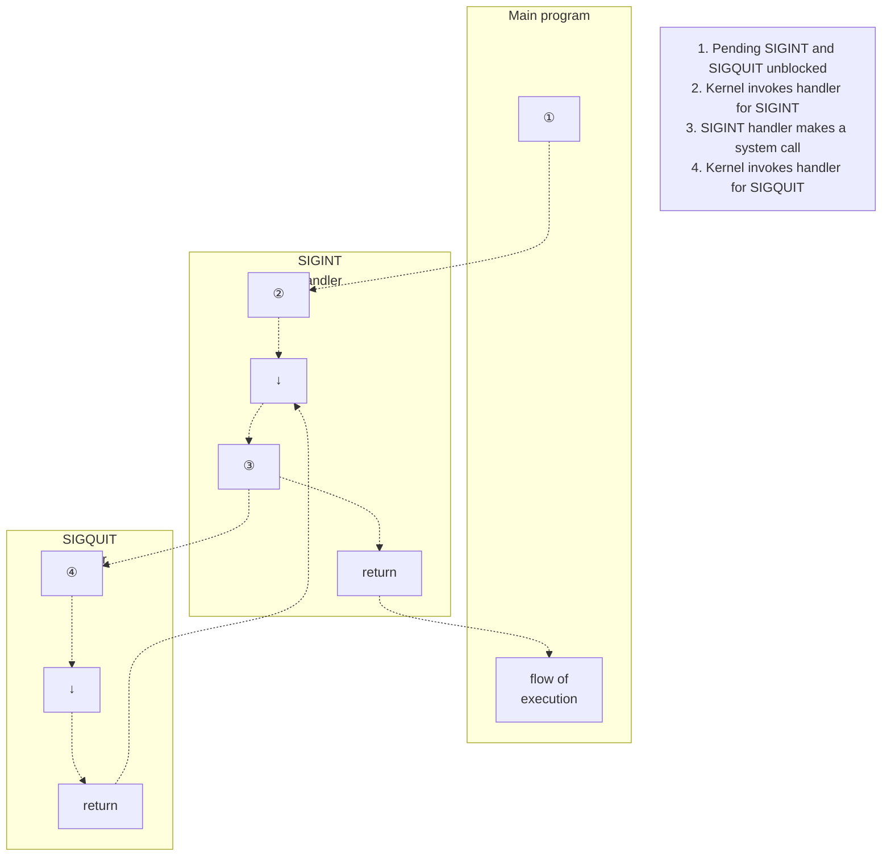

# Chương 22: Tín hiệu: Các tính năng nâng cao (Signals: Advanced Features)

Chương này hoàn thiện phần thảo luận về tín hiệu (signal) mà chúng ta đã bắt đầu ở Chương 20, bao gồm một số chủ đề nâng cao hơn, cụ thể như sau:

- các tệp core dump;
- các trường hợp đặc biệt liên quan đến việc phân phối (delivery), disposition (cơ chế xử lý mặc định/tùy chỉnh) và xử lý tín hiệu;
- việc sinh tín hiệu đồng bộ và bất đồng bộ;
- tín hiệu được phân phối khi nào và theo thứ tự nào;
- sự ngắt các System Call (lệnh gọi hệ thống) bởi các trình xử lý tín hiệu (signal handler), và cách tự động khởi động lại các System Call bị ngắt;
- tín hiệu thời gian thực (realtime signal);
- việc sử dụng `sigsuspend()` để thiết lập signal mask của tiến trình và chờ tín hiệu đến;
- việc sử dụng `sigwaitinfo()` (và `sigtimedwait()`) để chờ đồng bộ tín hiệu đến;
- việc sử dụng `signalfd()` để nhận tín hiệu thông qua File Descriptor (bộ mô tả tệp); và
- các API tín hiệu BSD và System V cũ hơn.

## 22.1 Các tệp Core Dump

Một số tín hiệu nhất định làm cho một tiến trình tạo ra một bản kết xuất lõi (core dump) và chấm dứt hoạt động (Bảng 20-1, trang 396). Core dump là một tệp chứa ảnh bộ nhớ (memory image) của tiến trình tại thời điểm nó bị chấm dứt. (Thuật ngữ *core* bắt nguồn từ một công nghệ bộ nhớ cũ). Ảnh bộ nhớ này có thể được nạp vào một trình gỡ lỗi (debugger) để kiểm tra trạng thái mã nguồn và dữ liệu của chương trình tại khoảnh khắc tín hiệu đến.

Một cách để khiến chương trình tạo ra core dump là gõ ký tự thoát (quit character) (thường là Control-\), thao tác này làm phát sinh tín hiệu `SIGQUIT`:

```
$ ulimit -c unlimited Giải thích trong văn bản chính
$ sleep 30
Gõ Control-\
Quit (core dumped)
$ ls -l core Hiển thị tệp core dump cho lệnh sleep(1)
-rw------- 1 mtk users 57344 Nov 30 13:39 core
```

Trong ví dụ này, thông báo `Quit (core dumped)` được in ra bởi shell, khi shell phát hiện ra rằng tiến trình con của nó (tiến trình đang chạy lệnh `sleep`) đã bị tiêu diệt bởi `SIGQUIT` và đã tạo ra một core dump.

Tệp core dump được tạo ra trong thư mục làm việc (working directory) của tiến trình, với tên gọi là `core`. Đây là vị trí và tên mặc định cho một tệp core dump; ngay sau đây, chúng ta sẽ giải thích cách các giá trị mặc định này có thể được thay đổi.

> [!NOTE]
> Nhiều hệ thống cung cấp một công cụ (ví dụ: `gcore` trên FreeBSD và Solaris) để lấy core dump của một tiến trình đang chạy. Tính năng tương tự cũng có sẵn trên Linux bằng cách gắn (attach) vào một tiến trình đang chạy sử dụng `gdb` và sau đó dùng lệnh `gcore`.

### Các trường hợp tệp core dump không được tạo ra

Core dump không được tạo ra trong các trường hợp sau:

- Tiến trình không có quyền ghi tệp core dump. Điều này có thể xảy ra do tiến trình không có quyền ghi đối với thư mục nơi tệp core dump chuẩn bị được tạo, hoặc do một tệp có cùng tên đã tồn tại nhưng không có quyền ghi hoặc không phải là một tệp thông thường (ví dụ: nó là một thư mục hoặc một liên kết tượng trưng - symbolic link).
- Một tệp thông thường có cùng tên đã tồn tại, có quyền ghi, nhưng có nhiều hơn một liên kết cứng (hard link) trỏ tới tệp đó.
- Thư mục nơi tệp core dump được tạo ra không tồn tại.
- Giới hạn tài nguyên (resource limit) của tiến trình về kích thước của tệp core dump được thiết lập bằng 0. Giới hạn này, `RLIMIT_CORE`, được thảo luận chi tiết hơn trong Mục 36.3. Trong ví dụ trên, chúng ta đã sử dụng lệnh `ulimit` (lệnh `limit` trong C shell) để đảm bảo rằng không có giới hạn nào về kích thước của tệp core.
- Giới hạn tài nguyên của tiến trình về kích thước của tệp có thể được tạo bởi tiến trình được thiết lập bằng 0. Chúng ta mô tả giới hạn này, `RLIMIT_FSIZE`, trong Mục 36.3.
- Tệp thực thi nhị phân (binary executable file) mà tiến trình đang thực thi không được bật quyền đọc (read permission). Điều này ngăn cản người dùng sử dụng core dump để lấy một bản sao mã nguồn của chương trình mà lẽ ra họ không có quyền đọc.

- Hệ thống tệp (file system) mà thư mục làm việc hiện tại đang nằm trên đó được gắn (mount) ở chế độ chỉ đọc (read-only), bị đầy, hoặc đã cạn kiệt các i-node. Hoặc, người dùng đã đạt đến giới hạn định mức (quota) của họ trên hệ thống tệp đó.
- Các chương trình Set-user-ID (set-group-ID) được thực thi bởi một người dùng không phải là chủ sở hữu tệp (chủ sở hữu nhóm) sẽ không tạo ra core dump. Điều này ngăn chặn những kẻ độc hại kết xuất bộ nhớ của một chương trình bảo mật và kiểm tra nó để tìm kiếm các thông tin nhạy cảm như mật khẩu.

Bằng cách sử dụng thao tác `PR_SET_DUMPABLE` của lệnh gọi hệ thống `prctl()` đặc trưng trên Linux, chúng ta có thể thiết lập cờ có thể kết xuất (dumpable flag) cho một tiến trình, sao cho khi một chương trình set-user-ID (set-group-ID) được chạy bởi một người dùng không phải là chủ sở hữu (chủ sở hữu nhóm), một tệp core dump vẫn có thể được tạo ra. Thao tác `PR_SET_DUMPABLE` khả dụng từ Linux 2.4 trở đi. Xem trang hướng dẫn (manual page) `prctl(2)` để biết thêm chi tiết. Ngoài ra, kể từ Linux kernel 2.6.13, tệp `/proc/sys/fs/suid_dumpable` cung cấp khả năng điều khiển trên toàn hệ thống (system-wide) về việc liệu các tiến trình set-user-ID và set-group-ID có tạo ra core dump hay không. Để biết chi tiết, hãy xem trang hướng dẫn `proc(5)`.

Kể từ kernel 2.6.23, tệp đặc trưng của Linux `/proc/PID/coredump_filter` có thể được sử dụng trên cơ sở từng tiến trình (per-process basis) để xác định loại ánh xạ bộ nhớ (memory mapping) nào được ghi vào tệp core dump. (Chúng ta giải thích về memory mapping trong Chương 49). Giá trị trong tệp này là một mặt nạ (mask) gồm bốn bit tương ứng với bốn loại ánh xạ bộ nhớ: ánh xạ ẩn danh riêng tư (private anonymous mapping), ánh xạ tệp riêng tư (private file mapping), ánh xạ ẩn danh chia sẻ (shared anonymous mapping), và ánh xạ tệp chia sẻ (shared file mapping). Giá trị mặc định của tệp cung cấp hành vi truyền thống của Linux: chỉ các ánh xạ ẩn danh riêng tư và chia sẻ mới được kết xuất. Xem trang hướng dẫn `core(5)` để biết thêm chi tiết.

### Đặt tên cho tệp core dump: /proc/sys/kernel/core\_pattern

Bắt đầu từ Linux 2.6, chuỗi định dạng (format string) nằm trong tệp chuyên biệt của Linux `/proc/sys/kernel/core_pattern` kiểm soát việc đặt tên của tất cả các tệp core dump được tạo ra trên hệ thống. Theo mặc định, tệp này chứa chuỗi `core`. Một người dùng đặc quyền (privileged user) có thể định cấu hình tệp này để bao gồm bất kỳ bộ định dạng nào (format specifier) được hiển thị trong Bảng 22-1. Các bộ định dạng này được thay thế bằng giá trị được chỉ ra ở cột bên phải của bảng. Thêm vào đó, chuỗi này có thể bao gồm các dấu gạch chéo (`/`). Nói cách khác, chúng ta không chỉ kiểm soát tên của tệp core mà còn kiểm soát cả thư mục (tuyệt đối hoặc tương đối) nơi nó được tạo ra. Sau khi tất cả các bộ định dạng đã được thay thế, chuỗi đường dẫn kết quả sẽ bị cắt ngắn (truncate) tối đa là 128 ký tự (64 ký tự trước Linux 2.6.19).

Kể từ kernel 2.6.19, Linux hỗ trợ thêm một cú pháp trong tệp `core_pattern`. Nếu tệp này chứa một chuỗi bắt đầu bằng ký tự ống dẫn (pipe symbol `|`), thì các ký tự còn lại trong tệp sẽ được diễn giải là một chương trình — kèm theo các đối số tùy chọn có thể bao gồm các bộ định dạng `%` được hiển thị trong Bảng 22-1 — sẽ được thực thi khi một tiến trình (process) thực hiện core dump. Tệp core dump được ghi vào đầu vào chuẩn (standard input) của chương trình đó thay vì ghi vào một tệp. Xem trang hướng dẫn (manual page) `core(5)` để biết thêm chi tiết.

> [!NOTE]
> Một số hệ triển khai UNIX khác cung cấp các tính năng tương tự như `core_pattern`. Ví dụ, trong các hệ phái sinh BSD, tên chương trình được nối vào tên tệp, do đó có dạng `core.progname`. Solaris cung cấp một công cụ (`coreadm`) cho phép người dùng chọn tên tệp và thư mục nơi các tệp core dump được đặt.

**Bảng 22-1:** Các bộ định dạng cho `/proc/sys/kernel/core_pattern`

| Bộ định dạng | Được thay thế bằng |
|--------------|-----------------------------------------------------------------|
| `%c`         | Giới hạn tài nguyên mềm (soft resource limit) về kích thước tệp core (tính bằng byte; kể từ Linux 2.6.24) |
| `%e`         | Tên tệp thực thi (không có tiền tố đường dẫn) |
| `%g`         | ID nhóm thực tế (real group ID) của tiến trình bị dump |
| `%h`         | Tên của hệ thống máy chủ (host system) |
| `%p`         | ID tiến trình (Process ID) của tiến trình bị dump |
| `%s`         | Số hiệu tín hiệu (signal number) đã chấm dứt tiến trình |
| `%t`         | Thời gian dump, tính bằng giây kể từ Epoch (time since the Epoch) |
| `%u`         | ID người dùng thực tế (real user ID) của tiến trình bị dump |
| `%%`         | Một ký tự `%` đơn lẻ |

## 22.2 Các trường hợp đặc biệt về việc gửi, xử lý và định hướng tín hiệu

Đối với một số tín hiệu nhất định, các quy tắc đặc biệt được áp dụng liên quan đến việc gửi (delivery), xử lý/hành vi mặc định (disposition) và thao tác xử lý (handling), như được mô tả trong phần này.

### SIGKILL và SIGSTOP

Không thể thay đổi hành vi mặc định (disposition) đối với SIGKILL (luôn chấm dứt một tiến trình - process) và SIGSTOP (luôn dừng một tiến trình). Cả hai hàm `signal()` và `sigaction()` đều trả về lỗi khi có nỗ lực thay đổi hành vi của các tín hiệu này. Hai tín hiệu này cũng không thể bị chặn (block). Đây là một quyết định thiết kế có chủ đích. Việc không cho phép thay đổi hành vi mặc định của các tín hiệu này có nghĩa là chúng luôn có thể được sử dụng để tiêu diệt hoặc dừng một tiến trình chạy trốn (runaway process).

### SIGCONT và các tín hiệu dừng

Như đã lưu ý trước đó, tín hiệu SIGCONT được sử dụng để tiếp tục chạy một tiến trình trước đó đã bị dừng bởi một trong các tín hiệu dừng (SIGSTOP, SIGTSTP, SIGTTIN và SIGTTOU). Do mục đích độc đáo của chúng, trong một số tình huống nhất định, kernel (nhân hệ điều hành) xử lý các tín hiệu này khác với các tín hiệu khác.

Nếu một tiến trình hiện đang dừng, sự xuất hiện của tín hiệu SIGCONT sẽ luôn khiến tiến trình tiếp tục chạy, ngay cả khi tiến trình đó hiện đang chặn hoặc bỏ qua SIGCONT. Tính năng này là cần thiết vì nếu không thì sẽ không thể tiếp tục các tiến trình đã dừng đó. (Nếu tiến trình bị dừng đang chặn SIGCONT và đã thiết lập một trình xử lý - handler cho SIGCONT, thì sau khi tiến trình tiếp tục, trình xử lý đó chỉ được gọi khi SIGCONT được bỏ chặn sau đó).

> [!NOTE]
> Nếu bất kỳ tín hiệu nào khác được gửi đến một tiến trình đang dừng, tín hiệu đó sẽ không thực sự được gửi (deliver) đến tiến trình cho đến khi nó được tiếp tục thông qua việc nhận tín hiệu SIGCONT. Ngoại lệ duy nhất là SIGKILL, tín hiệu này luôn tiêu diệt một tiến trình—ngay cả tiến trình đang dừng.

Bất cứ khi nào SIGCONT được gửi đến một tiến trình, bất kỳ tín hiệu dừng đang chờ xử lý (pending) nào đối với tiến trình đó sẽ bị hủy bỏ (tức là tiến trình không bao giờ nhìn thấy chúng). Ngược lại, nếu bất kỳ tín hiệu dừng nào được gửi đến một tiến trình, thì bất kỳ tín hiệu SIGCONT đang chờ xử lý nào sẽ tự động bị hủy bỏ. Các bước này được thực hiện nhằm ngăn chặn hành động của tín hiệu SIGCONT bị hoàn tác sau đó bởi một tín hiệu dừng thực sự đã được gửi trước đó, và ngược lại.

### Không thay đổi hành vi của các tín hiệu do thiết bị đầu cuối tạo ra bị bỏ qua

Nếu tại thời điểm thực thi (`execed`), một chương trình phát hiện ra rằng hành vi của một tín hiệu do thiết bị đầu cuối tạo ra đã được đặt thành `SIG_IGN` (bỏ qua), thì nhìn chung chương trình không nên cố gắng thay đổi hành vi của tín hiệu đó. Đây không phải là quy tắc được cưỡng chế bởi hệ thống, mà là một quy ước nên tuân theo khi viết các ứng dụng. Chúng tôi giải thích lý do cho việc này trong Mục 34.7.3. Các tín hiệu mà quy ước này có liên quan là SIGHUP, SIGINT, SIGQUIT, SIGTTIN, SIGTTOU và SIGTSTP.

## 22.3 Trạng thái ngủ ngắt được và không ngắt được của tiến trình (Interruptible and Uninterruptible Process Sleep States)

Chúng ta cần bổ sung một điều kiện cho tuyên bố trước đó của mình rằng SIGKILL và SIGSTOP luôn tác động ngay lập tức lên một tiến trình. Tại nhiều thời điểm khác nhau, kernel có thể đặt một tiến trình vào trạng thái ngủ (sleep), và có hai trạng thái ngủ được phân biệt:

- `TASK_INTERRUPTIBLE`: Tiến trình đang chờ một sự kiện nào đó. Ví dụ, nó đang chờ đầu vào từ thiết bị đầu cuối (terminal input), chờ dữ liệu được ghi vào một đường ống (pipe) hiện đang trống, hoặc chờ giá trị của một semaphore System V được tăng lên. Một tiến trình có thể dành một khoảng thời gian tùy ý ở trạng thái này. Nếu một tín hiệu được tạo ra cho một tiến trình ở trạng thái này, thì thao tác sẽ bị ngắt (interrupt) và tiến trình được đánh thức bằng việc gửi tín hiệu. Khi được liệt kê bởi `ps(1)`, các tiến trình ở trạng thái `TASK_INTERRUPTIBLE` được đánh dấu bằng chữ cái `S` trong trường `STAT` (trạng thái tiến trình - process state).
- `TASK_UNINTERRUPTIBLE`: Tiến trình đang chờ một số loại sự kiện đặc biệt nhất định, chẳng hạn như hoàn tất việc I/O đĩa (disk I/O). Nếu một tín hiệu được tạo ra cho một tiến trình ở trạng thái này, thì tín hiệu đó sẽ không được gửi cho đến khi tiến trình thoát ra khỏi trạng thái này. Các tiến trình ở trạng thái `TASK_UNINTERRUPTIBLE` được liệt kê bởi `ps(1)` với chữ cái `D` trong trường `STAT`.

Vì một tiến trình thường chỉ dành thời gian rất ngắn ở trạng thái `TASK_UNINTERRUPTIBLE`, nên thực tế là tín hiệu chỉ được gửi khi tiến trình rời khỏi trạng thái này là điều không thể nhận thấy. Tuy nhiên, trong những trường hợp hiếm hoi, một tiến trình có thể bị treo (hang) ở trạng thái này, có thể là do lỗi phần cứng, sự cố NFS hoặc lỗi kernel. Trong những trường hợp như vậy, SIGKILL sẽ không chấm dứt được tiến trình bị treo. Nếu sự cố cơ bản không thể được giải quyết bằng cách khác, thì chúng ta phải khởi động lại hệ thống để loại bỏ tiến trình đó.

Trạng thái `TASK_INTERRUPTIBLE` và `TASK_UNINTERRUPTIBLE` có mặt trên hầu hết các bản cài đặt UNIX. Bắt đầu từ phiên bản kernel 2.6.25, Linux bổ sung trạng thái thứ ba để giải quyết vấn đề tiến trình bị treo vừa được mô tả:

`TASK_KILLABLE`: Trạng thái này giống như `TASK_UNINTERRUPTIBLE`, nhưng sẽ đánh thức tiến trình nếu nhận được một tín hiệu gây tử vong (fatal signal - tức là tín hiệu sẽ giết chết tiến trình). Bằng cách chuyển đổi các phần có liên quan trong mã nguồn kernel sang sử dụng trạng thái này, các kịch bản khác nhau nơi tiến trình bị treo đòi hỏi phải khởi động lại hệ thống có thể được tránh khỏi. Thay vào đó, tiến trình có thể bị tiêu diệt bằng cách gửi cho nó một tín hiệu gây tử vong. Phần mã nguồn kernel đầu tiên được chuyển đổi sang sử dụng `TASK_KILLABLE` là NFS.

## 22.4 Tín hiệu do Phần cứng Tạo ra (Hardware-Generated Signals)

Các tín hiệu SIGBUS, SIGFPE, SIGILL và SIGSEGV có thể được tạo ra do một ngoại lệ phần cứng (hardware exception) hoặc, ít phổ biến hơn, do hàm `kill()` gửi đến. Trong trường hợp xảy ra ngoại lệ phần cứng, tiêu chuẩn SUSv3 quy định rằng hành vi của một tiến trình (process) là không xác định (undefined) nếu nó trả về (return) từ một hàm xử lý tín hiệu (signal handler), hoặc nếu nó bỏ qua (ignore) hay chặn (block) tín hiệu đó. Lý do cho điều này như sau:

- Trở về từ hàm xử lý tín hiệu (Returning from the signal handler): Giả sử một lệnh mã máy (machine-language instruction) tạo ra một trong các tín hiệu này, và do đó một hàm xử lý tín hiệu được gọi. Khi trở về bình thường từ hàm xử lý, chương trình cố gắng tiếp tục thực thi tại điểm mà nó bị ngắt. Nhưng đây chính là câu lệnh đã tạo ra tín hiệu từ đầu, vì vậy tín hiệu lại được tạo ra một lần nữa. Hậu quả thường là chương trình rơi vào một vòng lặp vô hạn (infinite loop), liên tục gọi hàm xử lý tín hiệu.
- Bỏ qua tín hiệu (Ignoring the signal): Việc bỏ qua một tín hiệu do phần cứng tạo ra có rất ít ý nghĩa, vì không rõ chương trình nên tiếp tục thực thi thế nào sau, ví dụ, một ngoại lệ số học (arithmetic exception). Khi một trong các tín hiệu này được tạo ra do ngoại lệ phần cứng, Linux sẽ cưỡng bức gửi nó, ngay cả khi chương trình đã yêu cầu bỏ qua tín hiệu đó.
- Chặn tín hiệu (Blocking the signal): Giống như trường hợp trước, việc chặn một tín hiệu do phần cứng tạo ra có rất ít ý nghĩa, vì không rõ chương trình nên tiếp tục thực thi thế nào sau đó. Trên Linux 2.4 và các phiên bản trước, kernel đơn giản là phớt lờ các nỗ lực chặn tín hiệu do phần cứng tạo ra; tín hiệu vẫn được gửi đến tiến trình, sau đó hoặc chấm dứt tiến trình hoặc được bắt bởi hàm xử lý tín hiệu nếu đã thiết lập một hàm như vậy. Bắt đầu từ Linux 2.6, nếu tín hiệu bị chặn, thì tiến trình sẽ luôn bị tiêu diệt ngay lập tức bởi tín hiệu đó, ngay cả khi tiến trình đã cài đặt một hàm xử lý cho tín hiệu (Lý do đằng sau sự thay đổi trong Linux 2.6 về cách xử lý các tín hiệu do phần cứng tạo ra bị chặn là hành vi của Linux 2.4 che giấu các lỗi và có thể gây ra hiện tượng bế tắc - deadlock trong các chương trình đa luồng - threaded programs).

Chương trình `signals/demo_SIGFPE.c` trong gói mã nguồn của cuốn sách này có thể được sử dụng để minh họa kết quả của việc bỏ qua hoặc chặn SIGFPE, hoặc bắt tín hiệu bằng một hàm xử lý thực hiện thao tác trở về bình thường.

Cách chính xác để xử lý các tín hiệu do phần cứng tạo ra là hoặc chấp nhận hành động mặc định của chúng (chấm dứt tiến trình) hoặc viết các hàm xử lý không thực hiện việc trở về bình thường. Ngoài việc trở về bình thường, một hàm xử lý có thể hoàn tất việc thực thi bằng cách gọi `_exit()` để chấm dứt tiến trình hoặc gọi `siglongjmp()` (Mục [21.2.1](#page-8-1)) để đảm bảo rằng quyền điều khiển được chuyển đến một điểm nào đó trong chương trình thay vì câu lệnh đã tạo ra tín hiệu.

## 22.5 Sinh tín hiệu đồng bộ và bất đồng bộ (Synchronous and Asynchronous Signal Generation)

Chúng ta đã thấy rằng một tiến trình (process) nhìn chung không thể dự đoán được khi nào nó sẽ nhận được một tín hiệu (signal). Bây giờ chúng ta cần làm rõ nhận định này bằng cách phân biệt giữa việc sinh tín hiệu đồng bộ và bất đồng bộ.

Mô hình mà chúng ta ngầm xem xét từ đầu đến giờ là sinh tín hiệu bất đồng bộ (asynchronous signal generation), trong đó tín hiệu được gửi bởi một tiến trình khác hoặc được nhân hệ thống (kernel) tạo ra cho một sự kiện xảy ra độc lập với quá trình thực thi của tiến trình (ví dụ: người dùng gõ ký tự ngắt hoặc một tiến trình con của tiến trình này kết thúc). Đối với các tín hiệu được sinh ra một cách bất đồng bộ, phát biểu trước đó rằng một tiến trình không thể dự đoán khi nào tín hiệu sẽ được chuyển giao (delivery) là hoàn toàn chính xác.

Tuy nhiên, trong một số trường hợp, một tín hiệu được sinh ra trong khi chính tiến trình đó đang thực thi. Chúng ta đã thấy hai ví dụ về điều này:

- Các tín hiệu do phần cứng sinh ra (SIGBUS, SIGFPE, SIGILL, SIGSEGV và SIGEMT) được mô tả trong Mục [22.4](#page-31-1) được sinh ra như một hệ quả của việc thực thi một lệnh mã máy cụ thể dẫn đến một ngoại lệ phần cứng (hardware exception).
- Một tiến trình có thể sử dụng `raise()`, `kill()` hoặc `killpg()` để gửi tín hiệu cho chính nó.

Trong những trường hợp này, việc sinh tín hiệu mang tính đồng bộ (synchronous) — tín hiệu được chuyển giao ngay lập tức (trừ khi nó bị chặn, nhưng hãy xem Mục [22.4](#page-31-1) để thảo luận về điều gì xảy ra khi chặn các tín hiệu do phần cứng sinh ra). Nói cách khác, phát biểu trước đó về tính không thể dự đoán của việc chuyển giao tín hiệu không áp dụng ở đây. Đối với các tín hiệu được sinh ra đồng bộ, việc chuyển giao là có thể dự đoán và tái lập được (reproducible).

Lưu ý rằng tính đồng bộ là một thuộc tính của cách mà tín hiệu được sinh ra, chứ không phải của bản thân tín hiệu đó. Tất cả các tín hiệu đều có thể được sinh ra một cách đồng bộ (ví dụ: khi một tiến trình tự gửi tín hiệu cho chính nó bằng `kill()`) hoặc bất đồng bộ (ví dụ: khi tín hiệu được gửi bởi một tiến trình khác bằng `kill()`).

## 22.6 Thời điểm và Thứ tự Chuyển giao Tín hiệu (Timing and Order of Signal Delivery)

Là chủ đề đầu tiên của phần này, chúng ta xem xét chính xác thời điểm một tín hiệu đang chờ xử lý (pending signal) được chuyển giao. Sau đó, chúng ta xem xét điều gì xảy ra nếu nhiều tín hiệu đang chờ bị chặn (blocked) được gỡ chặn (unblocked) đồng thời.

### Khi nào một tín hiệu được chuyển giao?

Như đã lưu ý trong Mục [22.5](#page-31-2), các tín hiệu được sinh ra đồng bộ sẽ được chuyển giao ngay lập tức. Ví dụ, một ngoại lệ phần cứng kích hoạt một tín hiệu ngay lập tức, và khi một tiến trình tự gửi tín hiệu cho chính nó bằng hàm `raise()`, tín hiệu đó sẽ được chuyển giao trước khi lời gọi hàm `raise()` trả về.

Khi một tín hiệu được sinh ra một cách bất đồng bộ, có thể có một độ trễ (nhỏ) trong lúc tín hiệu đang ở trạng thái chờ xử lý (pending) giữa thời điểm nó được sinh ra và thời điểm nó thực sự được chuyển giao, ngay cả khi chúng ta không chặn tín hiệu đó. Lý do là vì nhân hệ thống chỉ chuyển giao một tín hiệu đang chờ cho tiến trình tại thời điểm chuyển đổi tiếp theo từ chế độ nhân (kernel mode) sang chế độ người dùng (user mode) trong khi đang thực thi tiến trình đó. Trong thực tế, điều này có nghĩa là tín hiệu được chuyển giao vào một trong các thời điểm sau:

- khi tiến trình được lập lịch lại (rescheduled) sau khi hết thời gian trước đó (ví dụ: tại điểm bắt đầu của một lát cắt thời gian - time slice); hoặc
- khi hoàn thành một lời gọi hệ thống (system call) (việc chuyển giao tín hiệu có thể khiến một lời gọi hệ thống mang tính chặn kết thúc sớm).

### Thứ tự chuyển giao của nhiều tín hiệu chưa bị chặn

Nếu một tiến trình có nhiều tín hiệu đang chờ xử lý và được gỡ chặn bằng `sigprocmask()`, thì tất cả các tín hiệu này sẽ được chuyển giao ngay lập tức cho tiến trình.

Theo cách triển khai hiện tại, nhân Linux chuyển giao các tín hiệu theo thứ tự tăng dần. Ví dụ, nếu cả hai tín hiệu đang chờ là `SIGINT` (tín hiệu số 2) và `SIGQUIT` (tín hiệu số 3) đồng thời được gỡ chặn, thì tín hiệu `SIGINT` sẽ được chuyển giao trước `SIGQUIT`, bất kể thứ tự mà hai tín hiệu đó được sinh ra.

Tuy nhiên, chúng ta không thể dựa vào việc các tín hiệu (tiêu chuẩn) được chuyển giao theo bất kỳ thứ tự cụ thể nào, bởi vì tiêu chuẩn SUSv3 quy định rằng thứ tự chuyển giao của nhiều tín hiệu là do hệ thống tự định nghĩa (implementation-defined). (Phát biểu này chỉ áp dụng cho các tín hiệu tiêu chuẩn. Như chúng ta sẽ thấy trong Mục [22.8,](#page-35-0) các tiêu chuẩn chi phối tín hiệu thời gian thực - realtime signals thực sự cung cấp các đảm bảo về thứ tự chuyển giao của nhiều tín hiệu thời gian thực chưa bị chặn).

Khi có nhiều tín hiệu chưa bị chặn đang chờ được chuyển giao, nếu việc chuyển đổi giữa chế độ nhân (kernel mode) và chế độ người dùng (user mode) xảy ra trong quá trình thực thi của một hàm xử lý tín hiệu (signal handler), thì việc thực thi hàm xử lý đó sẽ bị ngắt bởi việc gọi một hàm xử lý tín hiệu thứ hai (và cứ tiếp tục như vậy), như được minh họa trong [Hình 22-1.](#page-33-0)



**Hình 22-1:** Giao nhận nhiều tín hiệu (signal) không bị chặn (unblocked)

## 22.7 Cài đặt và Tính khả chuyển (Portability) của signal()

Trong phần này, chúng ta sẽ xem cách cài đặt hàm `signal()` sử dụng `sigaction()`. Việc cài đặt rất đơn giản, nhưng cần phải lưu ý đến một thực tế rằng, trong lịch sử và trên các cài đặt UNIX khác nhau, `signal()` có các ngữ nghĩa (semantics) khác nhau. Cụ thể, các cài đặt tín hiệu (signal) ban đầu là không đáng tin cậy (unreliable), nghĩa là:

Khi bước vào trình xử lý tín hiệu (signal handler), thiết lập xử lý (disposition) của tín hiệu đó sẽ được đặt lại về mặc định. (Điều này tương ứng với cờ `SA_RESETHAND` được mô tả trong Mục 20.13). Để trình xử lý tín hiệu được gọi lại cho lần giao nhận tiếp theo của cùng một tín hiệu đó, lập trình viên cần phải gọi hàm `signal()` từ bên trong trình xử lý để thiết lập lại tường minh (explicitly) trình xử lý. Vấn đề trong kịch bản này là có một khoảng thời gian nhỏ giữa lúc bước vào trình xử lý tín hiệu và lúc thiết lập lại trình xử lý, trong khoảng thời gian đó, nếu tín hiệu đến lần thứ hai, nó sẽ được xử lý theo thiết lập mặc định của nó.

Việc giao nhận các lần xuất hiện tiếp theo của một tín hiệu không bị chặn (blocked) trong quá trình thực thi của trình xử lý tín hiệu. (Điều này tương ứng với cờ `SA_NODEFER` được mô tả trong Mục 20.13). Điều này có nghĩa là nếu tín hiệu được giao nhận lại trong khi trình xử lý vẫn đang thực thi, thì trình xử lý sẽ được gọi một cách đệ quy (recursively invoked). Với một luồng tín hiệu đến đủ nhanh, các lần gọi đệ quy kết quả của trình xử lý có thể gây tràn ngăn xếp (overflow the stack).

Cùng với việc không đáng tin cậy, các cài đặt UNIX ban đầu cũng không cung cấp tính năng tự động khởi động lại System Call (tức là hành vi được mô tả cho cờ `SA_RESTART` trong Mục [21.5](#page-21-0)).

Việc cài đặt tín hiệu đáng tin cậy của 4.2BSD đã khắc phục những hạn chế này và một vài cài đặt UNIX khác đã làm theo. Tuy nhiên, ngữ nghĩa cũ vẫn tồn tại cho đến ngày nay trong cài đặt System V của `signal()`, và thậm chí các tiêu chuẩn hiện đại như SUSv3 và C99 vẫn cố tình để ngỏ (unspecified) các khía cạnh này của `signal()`.

Tổng hợp các thông tin trên lại, chúng ta cài đặt `signal()` như được hiển thị trong [Liệt kê](#page-34-0) [22-1.](#page-34-0) Theo mặc định, bản cài đặt này cung cấp ngữ nghĩa tín hiệu hiện đại. Nếu được biên dịch với cờ `-DOLD_SIGNAL`, nó sẽ cung cấp ngữ nghĩa tín hiệu không đáng tin cậy thời kỳ đầu và không bật tính năng tự động khởi động lại System Call.

**Liệt kê 22-1:** Một bản cài đặt của `signal()`

```c
––––––––––––––––––––––––––––––––––––––––––––––––––––––––––signals/signal.c
## include <signal.h>
typedef void (*sighandler_t)(int);
sighandler_t
signal(int sig, sighandler_t handler)
{
 struct sigaction newDisp, prevDisp;
 newDisp.sa_handler = handler;
 sigemptyset(&newDisp.sa_mask);
## ifdef OLD_SIGNAL
 newDisp.sa_flags = SA_RESETHAND | SA_NODEFER;
## else
 newDisp.sa_flags = SA_RESTART;
## endif
 if (sigaction(sig, &newDisp, &prevDisp) == -1)
 return SIG_ERR;
 else
 return prevDisp.sa_handler;
}
––––––––––––––––––––––––––––––––––––––––––––––––––––––––––signals/signal.c
```

### Một số chi tiết về glibc

Việc cài đặt hàm thư viện `signal()` của glibc đã thay đổi theo thời gian. Trong các phiên bản thư viện mới hơn (glibc 2 trở về sau), ngữ nghĩa hiện đại (modern semantics) được cung cấp theo mặc định. Trong các phiên bản thư viện cũ hơn, ngữ nghĩa không đáng tin cậy trước đây (tương thích với System V - System V-compatible) được cung cấp.

> [!NOTE]
> Linux kernel chứa một phần cài đặt `signal()` dưới dạng một System Call. Phần cài đặt này cung cấp ngữ nghĩa cũ, không đáng tin cậy. Tuy nhiên, glibc bỏ qua System Call này bằng cách cung cấp một hàm thư viện `signal()` gọi đến `sigaction()`.

Nếu chúng ta muốn có được ngữ nghĩa tín hiệu không đáng tin cậy (unreliable signal semantics) với các phiên bản glibc hiện đại, chúng ta có thể thay thế rõ ràng các lệnh gọi `signal()` bằng các lệnh gọi đến hàm `sysv_signal()` (không chuẩn - nonstandard).

```c
## define _GNU_SOURCE
## include <signal.h>
void ( *sysv_signal(int sig, void (*handler)(int)) ) (int);
              Trả về thiết lập tín hiệu (signal disposition) trước đó nếu thành công, hoặc SIG_ERR nếu có lỗi
```

Hàm `sysv_signal()` nhận các tham số giống như `signal()`.

Nếu macro kiểm tra tính năng `_BSD_SOURCE` không được định nghĩa khi biên dịch chương trình, glibc sẽ tự động định nghĩa lại tất cả các lệnh gọi `signal()` thành các lệnh gọi `sysv_signal()`, điều này có nghĩa là `signal()` mang ngữ nghĩa không đáng tin cậy. Theo mặc định, `_BSD_SOURCE` được định nghĩa, nhưng nó sẽ bị vô hiệu hóa (trừ khi được định nghĩa rõ ràng) nếu các macro kiểm tra tính năng khác như `_SVID_SOURCE` hoặc `_XOPEN_SOURCE` được định nghĩa khi biên dịch chương trình.

### sigaction() là API được ưu tiên để thiết lập một trình xử lý tín hiệu (signal handler)

Do các vấn đề về tính di động (portability) giữa System V và BSD (cũng như giữa glibc cũ và gần đây) được mô tả ở trên, thực hành tốt nhất là luôn sử dụng `sigaction()` thay vì `signal()` để thiết lập các trình xử lý tín hiệu (`signal handler`). Chúng ta tuân theo thực hành này trong suốt phần còn lại của cuốn sách này. (Một giải pháp thay thế là tự viết phiên bản `signal()` của riêng chúng ta, có lẽ tương tự như [List](#page-34-0)[ing 22-1,](#page-34-0) chỉ định chính xác các cờ mà chúng ta yêu cầu và sử dụng phiên bản đó với các ứng dụng của mình). Tuy nhiên, lưu ý rằng việc sử dụng `signal()` để đặt trạng thái của một tín hiệu thành `SIG_IGN` hoặc `SIG_DFL` là có thể di port (và ngắn gọn hơn), và chúng ta sẽ thường xuyên sử dụng `signal()` cho mục đích đó.

## 22.8 Tín hiệu thời gian thực (Realtime Signals)

Tín hiệu thời gian thực (Realtime signals) được định nghĩa trong POSIX.1b để khắc phục một số hạn chế của tín hiệu chuẩn (standard signals). Chúng có các ưu điểm sau so với tín hiệu chuẩn:

- Tín hiệu thời gian thực cung cấp một dải tín hiệu rộng hơn có thể được sử dụng cho các mục đích do ứng dụng định nghĩa. Chỉ có hai tín hiệu chuẩn có sẵn tự do cho các mục đích do ứng dụng định nghĩa: `SIGUSR1` và `SIGUSR2`.
- Tín hiệu thời gian thực được xếp hàng đợi (queued). Nếu nhiều thể hiện (instance) của một tín hiệu thời gian thực được gửi đến một Process, thì tín hiệu đó sẽ được chuyển đến nhiều lần. Ngược lại, nếu chúng ta gửi thêm các thể hiện của một tín hiệu chuẩn vốn đã đang chờ xử lý (pending) đối với một Process, tín hiệu đó chỉ được chuyển đến một lần duy nhất.

- Khi gửi một tín hiệu thời gian thực, có thể chỉ định dữ liệu (một giá trị số nguyên hoặc con trỏ) đi kèm với tín hiệu đó. Trình xử lý tín hiệu trong Process nhận có thể truy xuất dữ liệu này.
- Thứ tự chuyển đến của các tín hiệu thời gian thực khác nhau được đảm bảo. Nếu có nhiều tín hiệu thời gian thực khác nhau đang chờ xử lý (pending), thì tín hiệu có số thứ tự nhỏ nhất sẽ được chuyển đến đầu tiên. Nói cách khác, các tín hiệu được ưu tiên, với các tín hiệu có số thứ tự nhỏ hơn sẽ có độ ưu tiên cao hơn. Khi nhiều tín hiệu cùng loại được xếp hàng đợi, chúng sẽ được chuyển đến — cùng với dữ liệu đi kèm — theo thứ tự mà chúng được gửi.

SUSv3 yêu cầu một hệ thống cài đặt phải cung cấp tối thiểu `_POSIX_RTSIG_MAX` (được định nghĩa là 8) tín hiệu thời gian thực khác nhau. Linux kernel định nghĩa 32 tín hiệu thời gian thực khác nhau, được đánh số từ 32 đến 63. Tệp tiêu đề `<signal.h>` định nghĩa hằng số `RTSIG_MAX` để chỉ ra số lượng tín hiệu thời gian thực khả dụng, và các hằng số `SIGRTMIN` và `SIGRTMAX` để chỉ ra số hiệu tín hiệu thời gian thực khả dụng thấp nhất và cao nhất.

> [!NOTE]
> Trên các hệ thống sử dụng cơ chế luồng (threading implementation) LinuxThreads, `SIGRTMIN` được định nghĩa là 35 (thay vì 32) để tính đến việc LinuxThreads sử dụng nội bộ ba tín hiệu thời gian thực đầu tiên. Trên các hệ thống sử dụng cơ chế luồng NPTL, `SIGRTMIN` được định nghĩa là 34 để tính đến việc NPTL sử dụng nội bộ hai tín hiệu thời gian thực đầu tiên.

Tín hiệu thời gian thực không được định danh riêng lẻ bằng các hằng số khác nhau theo cách của tín hiệu chuẩn. Tuy nhiên, một ứng dụng không nên mã hóa cứng (hard-code) các giá trị số nguyên cho chúng, vì dải số được sử dụng cho tín hiệu thời gian thực khác nhau giữa các hệ thống cài đặt UNIX. Thay vào đó, số hiệu tín hiệu thời gian thực có thể được tham chiếu bằng cách cộng thêm một giá trị vào `SIGRTMIN`; ví dụ, biểu thức `(SIGRTMIN + 1)` tham chiếu đến tín hiệu thời gian thực thứ hai.

Cần lưu ý rằng SUSv3 không yêu cầu `SIGRTMAX` và `SIGRTMIN` phải là các giá trị số nguyên đơn giản. Chúng có thể được định nghĩa như các hàm (giống như trên Linux). Điều này có nghĩa là chúng ta không thể viết mã cho bộ tiền xử lý (preprocessor) như sau:

```c
## if SIGRTMIN+100 > SIGRTMAX /* SAI! */
## error "Not enough realtime signals"
## endif
```

Thay vào đó, chúng ta phải thực hiện các kiểm tra tương đương tại thời điểm chạy (run time).

### Giới hạn số lượng tín hiệu thời gian thực được xếp hàng đợi (Queued Realtime Signals)

Việc xếp hàng đợi các tín hiệu thời gian thực (realtime signals) (kèm theo dữ liệu đi kèm) yêu cầu kernel duy trì các cấu trúc dữ liệu (data structures) liệt kê các tín hiệu đang được xếp hàng đợi cho mỗi tiến trình (process). Vì các cấu trúc dữ liệu này tiêu thụ bộ nhớ của kernel (kernel memory), kernel đặt ra các giới hạn về số lượng tín hiệu thời gian thực có thể được xếp hàng đợi.

SUSv3 cho phép một bản cài đặt (implementation) đặt giới hạn trên cho số lượng tín hiệu thời gian thực (của tất cả các loại) có thể được xếp hàng đợi cho một tiến trình, và yêu cầu giới hạn này phải ít nhất là `_POSIX_SIGQUEUE_MAX` (được định nghĩa là 32). Một bản cài đặt có thể định nghĩa hằng số `SIGQUEUE_MAX` để chỉ ra số lượng tín hiệu thời gian thực mà nó cho phép xếp hàng đợi. Nó cũng có thể cung cấp thông tin này thông qua lời gọi sau:

```c
lim = sysconf(_SC_SIGQUEUE_MAX);
```

Trên Linux, lời gọi này trả về –1. Lý do là vì Linux áp dụng một mô hình khác để giới hạn số lượng tín hiệu thời gian thực có thể được xếp hàng đợi cho một tiến trình. Trong các phiên bản Linux từ 2.6.7 trở xuống, kernel thực thi một giới hạn trên toàn hệ thống (system-wide limit) đối với tổng số tín hiệu thời gian thực có thể được xếp hàng đợi cho tất cả các tiến trình. Giới hạn này có thể được xem và (với quyền đặc quyền - privilege) thay đổi thông qua tệp đặc trưng của Linux `/proc/sys/kernel/rtsig-max`. Giá trị mặc định trong tệp này là 1024. Số lượng tín hiệu thời gian thực hiện đang được xếp hàng đợi có thể được tìm thấy trong tệp đặc trưng của Linux `/proc/sys/kernel/rtsig-nr`.

Bắt đầu từ Linux 2.6.8, mô hình này đã được thay đổi và các giao diện `/proc` nói trên đã bị loại bỏ. Theo mô hình mới, giới hạn tài nguyên mềm (soft resource limit) `RLIMIT_SIGPENDING` xác định giới hạn về số lượng tín hiệu có thể được xếp hàng đợi cho tất cả các tiến trình thuộc sở hữu của một ID người dùng thực (real user ID) cụ thể. Chúng ta sẽ mô tả kỹ hơn về giới hạn này trong Mục 36.3.

### Sử dụng tín hiệu thời gian thực

Để một cặp tiến trình có thể gửi và nhận tín hiệu thời gian thực, SUSv3 yêu cầu các điều kiện sau:

Tiến trình gửi (sending process) gửi tín hiệu cộng với dữ liệu kèm theo bằng cách sử dụng System Call `sigqueue()`.

> [!NOTE]
> Tín hiệu thời gian thực cũng có thể được gửi bằng cách sử dụng `kill()`, `killpg()`, và `raise()`. Tuy nhiên, SUSv3 để ngỏ việc liệu các tín hiệu thời gian thực được gửi bằng các giao diện này có được xếp hàng đợi hay không là tùy thuộc vào từng bản cài đặt (implementation-dependent). Trên Linux, các giao diện này thực sự xếp hàng đợi các tín hiệu thời gian thực, nhưng trên nhiều bản cài đặt UNIX khác thì không.

Tiến trình nhận (receiving process) thiết lập một trình xử lý (handler) cho tín hiệu bằng cách gọi `sigaction()` và chỉ định cờ `SA_SIGINFO`. Điều này khiến cho trình xử lý tín hiệu (signal handler) được kích hoạt với các đối số bổ sung, trong đó có một đối số chứa dữ liệu đi kèm với tín hiệu thời gian thực.

> [!NOTE]
> Trên Linux, việc xếp hàng đợi các tín hiệu thời gian thực vẫn có thể thực hiện được ngay cả khi tiến trình nhận không chỉ định cờ `SA_SIGINFO` khi thiết lập trình xử lý tín hiệu (mặc dù trong trường hợp này, không thể lấy được dữ liệu liên quan đến tín hiệu). Tuy nhiên, SUSv3 không yêu cầu các bản cài đặt phải đảm bảo hành vi này, vì vậy mã ứng dụng không nên dựa vào đặc tính này nếu muốn đảm bảo tính khả chuyển (portability).

### 22.8.1 Gửi Realtime Signal

System call `sigqueue()` gửi một realtime signal được chỉ định bởi `sig` đến tiến trình (process) được chỉ định bởi `pid`.

```c
## define _POSIX_C_SOURCE 199309
## include <signal.h>
int sigqueue(pid_t pid, int sig, const union sigval value);
                                             Trả về 0 khi thành công, hoặc –1 khi lỗi
```

Các quyền tương tự được yêu cầu để gửi một signal bằng `sigqueue()` giống như khi sử dụng `kill()` (xem Mục 20.5). Một null signal (tức là signal 0) có thể được gửi, với ý nghĩa tương tự như đối với `kill()`. (Không giống như `kill()`, chúng ta không thể sử dụng `sigqueue()` để gửi một signal cho toàn bộ nhóm tiến trình - process group bằng cách chỉ định một giá trị âm trong `pid`.)

```c
–––––––––––––––––––––––––––––––––––––––––––––––––––––– signals/t_sigqueue.c
## define _POSIX_C_SOURCE 199309
## include <signal.h>
## include "tlpi_hdr.h"
int
main(int argc, char *argv[])
{
 int sig, numSigs, j, sigData;
 union sigval sv;
 if (argc < 4 || strcmp(argv[1], "--help") == 0)
 usageErr("%s pid sig-num data [num-sigs]\n", argv[0]);
 /* Hiển thị PID và UID của chúng ta, để chúng có thể được so sánh với các
 trường tương ứng của đối số siginfo_t được cung cấp cho
 hàm xử lý (handler) trong tiến trình nhận */
 printf("%s: PID is %ld, UID is %ld\n", argv[0],
 (long) getpid(), (long) getuid());
 sig = getInt(argv[2], 0, "sig-num");
 sigData = getInt(argv[3], GN_ANY_BASE, "data");
 numSigs = (argc > 4) ? getInt(argv[4], GN_GT_0, "num-sigs") : 1;
 for (j = 0; j < numSigs; j++) {
 sv.sival_int = sigData + j;
 if (sigqueue(getLong(argv[1], 0, "pid"), sig, sv) == -1)
 errExit("sigqueue %d", j);
 }
 exit(EXIT_SUCCESS);
}
–––––––––––––––––––––––––––––––––––––––––––––––––––––– signals/t_sigqueue.c
```

Đối số `value` chỉ định dữ liệu đi kèm với signal. Đối số này có dạng sau:

```c
union sigval {
 int sival_int; /* Giá trị số nguyên cho dữ liệu đi kèm */
 void *sival_ptr; /* Giá trị con trỏ cho dữ liệu đi kèm */
};
```

Cách diễn giải của đối số này phụ thuộc vào ứng dụng (application-dependent), cũng như việc lựa chọn thiết lập trường `sival_int` hay `sival_ptr` của union. Trường `sival_ptr` hiếm khi hữu ích với `sigqueue()`, vì một giá trị con trỏ có ý nghĩa trong một tiến trình thì hiếm khi có ý nghĩa trong một tiến trình khác. Tuy nhiên, trường này lại hữu ích trong các hàm khác sử dụng union `sigval`, như chúng ta sẽ thấy khi xem xét POSIX timer ở Mục 23.6 và thông báo qua POSIX message queue ở Mục 52.6.

> [!NOTE]
> Một số cài đặt UNIX, bao gồm cả Linux, định nghĩa kiểu dữ liệu `sigval_t` như một từ đồng nghĩa cho `union sigval`. Tuy nhiên, kiểu này không được chỉ định trong SUSv3 và không có sẵn trên một số hệ thống cài đặt. Các ứng dụng có tính di động (portable applications) nên tránh sử dụng nó.

Một lời gọi đến `sigqueue()` có thể thất bại nếu giới hạn về số lượng signal được đưa vào hàng đợi (queued signals) đã đạt tới. Trong trường hợp này, `errno` được thiết lập thành `EAGAIN`, cho biết rằng chúng ta cần gửi lại signal (vào một thời điểm sau đó khi một số signal hiện đang nằm trong hàng đợi đã được chuyển giao - delivered).

Một ví dụ về việc sử dụng `sigqueue()` được cung cấp trong [Liệt kê 22-2](#page-38-0) (trang [459\)](#page-38-0). Chương trình này nhận tối đa bốn đối số, trong đó ba đối số đầu tiên là bắt buộc: số hiệu signal (signal number), ID của tiến trình đích (target process ID), và một giá trị số nguyên đi kèm với realtime signal. Nếu có nhiều hơn một thể hiện (instance) của signal được chỉ định cần gửi, đối số thứ tư tùy chọn sẽ chỉ định số lượng thể hiện; trong trường hợp này, giá trị dữ liệu số nguyên đi kèm sẽ được tăng thêm một cho mỗi signal tiếp theo. Chúng ta minh họa việc sử dụng chương trình này ở Mục [22.8.2.](#page-39-0)

### 22.8.2 Xử lý Tín hiệu Thời gian Thực (Realtime Signals)

Chúng ta có thể xử lý tín hiệu thời gian thực (realtime signal) giống như tín hiệu chuẩn (standard signal), bằng cách sử dụng một hàm xử lý tín hiệu thông thường (nhận một tham số) (single-argument signal handler). Ngoài ra, chúng ta có thể xử lý tín hiệu thời gian thực bằng hàm xử lý tín hiệu ba tham số được thiết lập sử dụng cờ `SA_SIGINFO` (Mục [21.4](#page-16-0)). Dưới đây là ví dụ về việc sử dụng `SA_SIGINFO` để thiết lập hàm xử lý cho tín hiệu thời gian thực thứ sáu:

```c

struct sigaction act;
sigemptyset(&act.sa_mask);
act.sa_sigaction = handler;
act.sa_flags = SA_RESTART | SA_SIGINFO;
if (sigaction(SIGRTMIN + 5, &act, NULL) == -1)
errExit("sigaction");

```

Khi sử dụng cờ `SA_SIGINFO`, tham số thứ hai được truyền vào hàm xử lý tín hiệu là một cấu trúc `siginfo_t` chứa thông tin bổ sung về tín hiệu thời gian thực. Chúng ta đã mô tả chi tiết cấu trúc này ở Mục [21.4](#page-16-0). Đối với tín hiệu thời gian thực (realtime signal), các trường sau đây được thiết lập trong cấu trúc `siginfo_t`:

- Trường `si_signo` có giá trị giống với giá trị được truyền vào tham số đầu tiên của hàm xử lý tín hiệu (signal handler).
- Trường `si_code` chỉ định nguồn gốc của tín hiệu và chứa một trong các giá trị được hiển thị trong [Bảng 21-2](#page-20-0) (trang [441](#page-20-0)). Đối với tín hiệu thời gian thực được gửi thông qua `sigqueue()`, trường này luôn có giá trị `SI_QUEUE`.
- Trường `si_value` chứa dữ liệu được chỉ định trong tham số `value` (phần kết hợp `sigval`) bởi tiến trình (process) đã gửi tín hiệu bằng hàm `sigqueue()`. Như đã lưu ý, việc diễn giải dữ liệu này do ứng dụng định nghĩa. (Trường `si_value` không chứa thông tin hợp lệ nếu tín hiệu được gửi bằng hàm `kill()`).
- Các trường `si_pid` và `si_uid` lần lượt chứa ID tiến trình (Process ID) và ID người dùng thực (real user ID) của tiến trình gửi tín hiệu.

[Liệt kê 22-3](#page-41-1) cung cấp một ví dụ về việc xử lý tín hiệu thời gian thực (realtime signal). Chương trình này bắt các tín hiệu và hiển thị các trường khác nhau từ cấu trúc `siginfo_t` được truyền tới hàm xử lý tín hiệu. Chương trình nhận hai tham số dòng lệnh kiểu số nguyên tùy chọn. Nếu tham số đầu tiên được cung cấp, chương trình chính sẽ chặn (block) tất cả các tín hiệu, sau đó tạm dừng (sleep) trong khoảng thời gian bằng số giây được chỉ định bởi tham số này. Trong thời gian này, chúng ta có thể xếp hàng (queue) nhiều tín hiệu thời gian thực đến tiến trình (process) và quan sát điều gì xảy ra khi các tín hiệu được bỏ chặn (unblock). Tham số thứ hai chỉ định số giây mà hàm xử lý tín hiệu nên tạm dừng trước khi trả về (return). Việc chỉ định một giá trị khác không (mặc định là 1 giây) rất hữu ích để làm chậm chương trình xuống, giúp chúng ta dễ dàng quan sát hơn các sự kiện diễn ra khi nhiều tín hiệu được xử lý.

Chúng ta có thể sử dụng chương trình trong [Liệt kê 22-3,](#page-41-1) cùng với chương trình trong [Liệt kê 22-2](#page-38-0) (`t_sigqueue.c`) để khám phá hành vi của tín hiệu thời gian thực, như được minh họa trong nhật ký phiên dòng lệnh (shell session log) sau:

```bash

$ ./catch_rtsigs 60 &
[1] 12842
$ ./catch_rtsigs: PID is 12842 Shell prompt mixed with program output
./catch_rtsigs: signals blocked - sleeping 60 seconds
Press Enter to see next shell prompt
$ ./t_sigqueue 12842 54 100 3 Send signal three times
./t_sigqueue: PID is 12843, UID is 1000
$ ./t_sigqueue 12842 43 200
./t_sigqueue: PID is 12844, UID is 1000
$ ./t_sigqueue 12842 40 300
./t_sigqueue: PID is 12845, UID is 1000

```

Cuối cùng, chương trình `catch_rtsigs` hoàn thành việc tạm dừng và hiển thị các thông báo khi hàm xử lý tín hiệu bắt được các tín hiệu khác nhau. (Chúng ta thấy dấu nhắc lệnh shell xen lẫn với dòng tiếp theo của đầu ra chương trình vì chương trình `catch_rtsigs` đang ghi đầu ra từ tiến trình nền - background). Đầu tiên, chúng ta quan sát thấy các tín hiệu thời gian thực được phân phối (deliver) theo thứ tự từ tín hiệu có số hiệu nhỏ nhất trước, và cấu trúc `siginfo_t` được truyền cho hàm xử lý bao gồm ID tiến trình (Process ID) và ID người dùng (User ID) của tiến trình đã gửi tín hiệu:

```bash

$ ./catch_rtsigs: sleep complete
caught signal 40
si_signo=40, si_code=-1 (SI_QUEUE), si_value=300
si_pid=12845, si_uid=1000
caught signal 43
si_signo=43, si_code=-1 (SI_QUEUE), si_value=200
si_pid=12844, si_uid=1000

```

Phần đầu ra còn lại được tạo ra bởi ba thể hiện (instance) của cùng một tín hiệu thời gian thực. Nhìn vào các giá trị `si_value`, chúng ta có thể thấy rằng các tín hiệu này đã được phân phối theo đúng thứ tự mà chúng được gửi đi:

```bash

caught signal 54
si_signo=54, si_code=-1 (SI_QUEUE), si_value=100
si_pid=12843, si_uid=1000
caught signal 54
si_signo=54, si_code=-1 (SI_QUEUE), si_value=101
si_pid=12843, si_uid=1000
caught signal 54
si_signo=54, si_code=-1 (SI_QUEUE), si_value=102
si_pid=12843, si_uid=1000

```

Chúng ta tiếp tục sử dụng lệnh `kill` của shell để gửi một tín hiệu đến chương trình `catch_rtsigs`. Giống như trước, chúng ta thấy rằng cấu trúc `siginfo_t` nhận được bởi hàm xử lý bao gồm ID tiến trình và ID người dùng của tiến trình gửi, nhưng trong trường hợp này, giá trị `si_code` là `SI_USER`:

```bash

Press Enter to see next shell prompt
$ echo $$ Display PID of shell
12780
$ kill -40 12842 Uses kill(2) to send a signal
$ caught signal 40
si_signo=40, si_code=0 (SI_USER), si_value=0
si_pid=12780, si_uid=1000 PID is that of the shell
Press Enter to see next shell prompt
$ kill 12842 Kill catch_rtsigs by sending SIGTERM
Caught 6 signals
Press Enter to see notification from shell about terminated background job
[1]+ Done ./catch_rtsigs 60

```

**Liệt kê 22-3:** Xử lý tín hiệu thời gian thực (realtime signal)

```c
––––––––––––––––––––––––––––––––––––––––––––––––––––– signals/catch_rtsigs.c
## define _GNU_SOURCE
## include <string.h>
## include <signal.h>
## include "tlpi_hdr.h"
static volatile int handlerSleepTime;
static volatile int sigCnt = 0; /* Số lượng tín hiệu đã nhận */
static volatile int allDone = 0;
static void /* Hàm xử lý (Handler) cho các tín hiệu được thiết lập bằng SA_SIGINFO */
siginfoHandler(int sig, siginfo_t *si, void *ucontext)
{
 /* KHÔNG AN TOÀN (UNSAFE): Hàm xử lý này sử dụng các hàm không async-signal-safe
 (printf()); xem Mục 21.1.2) */
 /* Có thể dùng SIGINT hoặc SIGTERM để kết thúc chương trình */
 if (sig == SIGINT || sig == SIGTERM) {
 allDone = 1;
 return;
 }
 sigCnt++;
 printf("caught signal %d\n", sig);
 printf(" si_signo=%d, si_code=%d (%s), ", si->si_signo, si->si_code,
 (si->si_code == SI_USER) ? "SI_USER" :
 (si->si_code == SI_QUEUE) ? "SI_QUEUE" : "other");
 printf("si_value=%d\n", si->si_value.sival_int);
 printf(" si_pid=%ld, si_uid=%ld\n", (long) si->si_pid, (long) si->si_uid);
 sleep(handlerSleepTime);
}

int
main(int argc, char *argv[])
{
 struct sigaction sa;
 int sig;
 sigset_t prevMask, blockMask;
 if (argc > 1 && strcmp(argv[1], "--help") == 0)
 usageErr("%s [block-time [handler-sleep-time]]\n", argv[0]);
 printf("%s: PID is %ld\n", argv[0], (long) getpid());
 handlerSleepTime = (argc > 2) ?
 getInt(argv[2], GN_NONNEG, "handler-sleep-time") : 1;
 /* Thiết lập hàm xử lý cho hầu hết các tín hiệu. Trong quá trình thực thi hàm xử lý,
 chặn tất cả các tín hiệu khác để ngăn chặn việc các hàm xử lý ngắt lẫn nhau
 một cách đệ quy (điều này sẽ làm cho đầu ra khó đọc). */
 sa.sa_sigaction = siginfoHandler;
 sa.sa_flags = SA_SIGINFO;
 sigfillset(&sa.sa_mask);
 for (sig = 1; sig < NSIG; sig++)
 if (sig != SIGTSTP && sig != SIGQUIT)
 sigaction(sig, &sa, NULL);
 /* Tùy chọn chặn tín hiệu và tạm dừng (sleep), cho phép các tín hiệu được gửi
 đến tiến trình trước khi chúng được bỏ chặn (unblocked) và xử lý */
 if (argc > 1) {
 sigfillset(&blockMask);
 sigdelset(&blockMask, SIGINT);
 sigdelset(&blockMask, SIGTERM);
 if (sigprocmask(SIG_SETMASK, &blockMask, &prevMask) == -1)
 errExit("sigprocmask");
 printf("%s: signals blocked - sleeping %s seconds\n", argv[0], argv[1]);
 sleep(getInt(argv[1], GN_GT_0, "block-time"));
 printf("%s: sleep complete\n", argv[0]);
 if (sigprocmask(SIG_SETMASK, &prevMask, NULL) == -1)
 errExit("sigprocmask");
 }
 while (!allDone) /* Chờ các tín hiệu đến */
 pause();
}
–––––––––––––––––––––––––––––––––––––––––––––––––––– signals/catch_rtsigs.c
```

## 22.9 Chờ một Signal Sử dụng Mặt nạ: sigsuspend()

Trước khi giải thích chức năng của `sigsuspend()`, chúng ta hãy mô tả một tình huống cần phải sử dụng hàm này. Hãy xem xét kịch bản sau thường gặp khi lập trình với signal:

- 1. Chúng ta tạm thời chặn (block) một signal để trình xử lý signal (signal handler) không làm gián đoạn việc thực thi một số đoạn mã tới hạn (critical section).
- 2. Chúng ta bỏ chặn (unblock) signal đó, và sau đó tạm dừng việc thực thi (suspend execution) cho đến khi signal được gửi đến (delivered).

Để làm điều này, chúng ta có thể thử sử dụng đoạn mã như trong [Liệt kê 22-4.](#page-43-0)

**Liệt kê 22-4:** Bỏ chặn và chờ signal một cách không chính xác

```

sigset_t prevMask, intMask;
struct sigaction sa;
sigemptyset(&intMask);
sigaddset(&intMask, SIGINT);
sigemptyset(&sa.sa_mask);
sa.sa_flags = 0;
sa.sa_handler = handler;
if (sigaction(SIGINT, &sa, NULL) == -1)
errExit("sigaction");
/* Chặn SIGINT trước khi thực thi đoạn mã tới hạn. (Tại thời điểm này,
chúng ta giả định rằng SIGINT chưa bị chặn từ trước.) */
if (sigprocmask(SIG_BLOCK, &intMask, &prevMask) == -1)
errExit("sigprocmask - SIG_BLOCK");
/* Đoạn mã tới hạn: thực hiện một số công việc không được phép
bị gián đoạn bởi trình xử lý SIGINT */
/* Kết thúc đoạn mã tới hạn - khôi phục mặt nạ cũ để bỏ chặn SIGINT */
if (sigprocmask(SIG_SETMASK, &prevMask, NULL) == -1)
errExit("sigprocmask - SIG_SETMASK");
/* LỖI (BUG): điều gì xảy ra nếu SIGINT đến ngay lúc này... */
pause(); /* Chờ SIGINT */

```

Có một vấn đề với đoạn mã trong Liệt kê 22-4. Giả sử rằng signal SIGINT được gửi đến sau khi thực thi lời gọi `sigprocmask()` thứ hai, nhưng trước lời gọi `pause()`. (Signal thực tế có thể được tạo ra tại bất kỳ thời điểm nào trong quá trình thực thi đoạn mã tới hạn, và sau đó chỉ được gửi đến khi nó được bỏ chặn.) Việc gửi signal SIGINT sẽ khiến trình xử lý được kích hoạt, và sau khi trình xử lý trả về (return) và chương trình chính tiếp tục chạy, lời gọi `pause()` sẽ bị chặn (block) cho đến khi một thể hiện (instance) thứ hai của SIGINT được gửi đến. Điều này phá vỡ mục đích của đoạn mã, vốn là để bỏ chặn SIGINT và sau đó chờ lần xuất hiện đầu tiên của nó.

Ngay cả khi xác suất SIGINT được tạo ra giữa thời điểm bắt đầu đoạn mã tới hạn (tức là lời gọi `sigprocmask()` đầu tiên) và lời gọi `pause()` là rất nhỏ, điều này vẫn cấu thành một lỗi trong đoạn mã trên. Lỗi phụ thuộc vào thời gian này là một ví dụ về tình trạng tranh chấp (Race Condition) (Mục 5.1). Thông thường, race condition xảy ra khi hai tiến trình (Process) hoặc luồng (Thread) chia sẻ tài nguyên chung. Tuy nhiên, trong trường hợp này, chương trình chính đang tranh chấp với chính trình xử lý signal của nó.

Để tránh vấn đề này, chúng ta cần một cơ chế để đồng thời (atomically) bỏ chặn một signal và tạm dừng tiến trình. Đó là mục đích của System Call `sigsuspend()`.

```

## include <signal.h>

int sigsuspend(const sigset_t *mask);
(Thông thường) trả về –1 với errno được thiết lập thành EINTR

```

System Call `sigsuspend()` thay thế mặt nạ signal của tiến trình (Process Signal Mask) bằng tập hợp các signal được trỏ tới bởi `mask`, và sau đó tạm dừng việc thực thi tiến trình cho đến khi một signal bị bắt (caught) và trình xử lý của nó trả về. Ngay khi trình xử lý trả về, `sigsuspend()` khôi phục mặt nạ signal của tiến trình về giá trị mà nó có trước khi gọi hàm.

Gọi `sigsuspend()` tương đương với việc thực hiện các thao tác này một cách nguyên tử (atomically):

```

sigprocmask(SIG_SETMASK, &mask, &prevMask); /* Gán mặt nạ mới */
pause();
sigprocmask(SIG_SETMASK, &prevMask, NULL); /* Khôi phục mặt nạ cũ */

```

Mặc dù việc khôi phục mặt nạ signal cũ (tức là bước cuối cùng trong chuỗi trên) thoạt đầu có vẻ bất tiện, nhưng nó là điều cần thiết để tránh các race condition trong các tình huống mà chúng ta cần liên tục chờ các signal. Trong những tình huống như vậy, các signal phải được giữ ở trạng thái bị chặn ngoại trừ trong các lời gọi `sigsuspend()`. Nếu sau đó chúng ta cần bỏ chặn các signal vốn đã bị chặn trước lời gọi `sigsuspend()`, chúng ta có thể sử dụng thêm một lời gọi `sigprocmask()`.

Khi `sigsuspend()` bị gián đoạn bởi việc gửi một signal, nó trả về –1, với `errno` được thiết lập thành `EINTR`. Nếu `mask` không trỏ tới một địa chỉ hợp lệ, `sigsuspend()` thất bại với lỗi `EFAULT`.

### Chương trình ví dụ

[Liệt kê 22-5](#page-45-1) minh họa việc sử dụng `sigsuspend()`. Chương trình này thực hiện các bước sau:

- Hiển thị giá trị ban đầu của mặt nạ signal tiến trình bằng cách sử dụng hàm `printSigMask()` (Liệt kê 20-4, trang 408) q.
- Chặn SIGINT và SIGQUIT, đồng thời lưu lại mặt nạ signal ban đầu của tiến trình w.
- Thiết lập cùng một trình xử lý cho cả SIGINT và SIGQUIT e. Trình xử lý này hiển thị một thông báo, và nếu nó được kích hoạt thông qua việc gửi SIGQUIT, sẽ thiết lập biến toàn cục `gotSigquit`.
- Lặp cho đến khi `gotSigquit` được thiết lập r. Mỗi vòng lặp thực hiện các bước sau:
  - Hiển thị giá trị hiện tại của mặt nạ signal bằng cách sử dụng hàm `printSigMask()` của chúng ta.
  - Mô phỏng một đoạn mã tới hạn bằng cách chạy một vòng lặp bận CPU (CPU busy loop) trong vài giây.

- Hiển thị mặt nạ tín hiệu đang chờ xử lý (pending signal mask) bằng hàm `printPendingSigs()` của chúng ta (Liệt kê 20-4).
  - Sử dụng `sigsuspend()` để bỏ chặn (unblock) `SIGINT` và `SIGQUIT` và chờ một tín hiệu (nếu chưa có tín hiệu nào đang chờ xử lý).
- Sử dụng `sigprocmask()` để khôi phục mặt nạ tín hiệu của tiến trình (process signal mask) về trạng thái ban đầu t, và sau đó hiển thị mặt nạ tín hiệu bằng hàm `printSigMask()` y.

**Liệt kê 22-5:** Sử dụng `sigsuspend()`

```

–––––––––––––––––––––––––––––––––––––––––––––––––––– signals/t_sigsuspend.c

## define _GNU_SOURCE /* Get strsignal() declaration from <string.h> */

## include <string.h>

## include <signal.h>

## include <time.h>

## include "signal_functions.h" /* Declarations of printSigMask()

and printPendingSigs() */

## include "tlpi_hdr.h"

static volatile sig_atomic_t gotSigquit = 0;
static void
handler(int sig)
{
printf("Caught signal %d (%s)\n", sig, strsignal(sig));
/* UNSAFE (see Section 21.1.2) */
if (sig == SIGQUIT)
gotSigquit = 1;
}
int
main(int argc, char *argv[])
{
int loopNum;
time_t startTime;
sigset_t origMask, blockMask;
struct sigaction sa;
q printSigMask(stdout, "Initial signal mask is:\n");
sigemptyset(&blockMask);
sigaddset(&blockMask, SIGINT);
sigaddset(&blockMask, SIGQUIT);
w if (sigprocmask(SIG_BLOCK, &blockMask, &origMask) == -1)
errExit("sigprocmask - SIG_BLOCK");
sigemptyset(&sa.sa_mask);
sa.sa_flags = 0;
sa.sa_handler = handler;

```

```

e if (sigaction(SIGINT, &sa, NULL) == -1)
errExit("sigaction");
if (sigaction(SIGQUIT, &sa, NULL) == -1)
errExit("sigaction");
r for (loopNum = 1; !gotSigquit; loopNum++) {
printf("=== LOOP %d\n", loopNum);
/* Simulate a critical section by delaying a few seconds */
printSigMask(stdout, "Starting critical section, signal mask is:\n");
for (startTime = time(NULL); time(NULL) < startTime + 4; )
continue; /* Run for a few seconds elapsed time */
printPendingSigs(stdout,
"Before sigsuspend() - pending signals:\n");
if (sigsuspend(&origMask) == -1 && errno != EINTR)
errExit("sigsuspend");
}
t if (sigprocmask(SIG_SETMASK, &origMask, NULL) == -1)
errExit("sigprocmask - SIG_SETMASK");
y printSigMask(stdout, "=== Exited loop\nRestored signal mask to:\n");
/* Do other processing... */
exit(EXIT_SUCCESS);
}
–––––––––––––––––––––––––––––––––––––––––––––––––––– signals/t_sigsuspend.c

```

Nhật ký phiên shell sau đây cho thấy một ví dụ về những gì chúng ta nhìn thấy khi chạy chương trình trong Liệt kê 22-5:

```

$ ./t_sigsuspend
Initial signal mask is:
<empty signal set>
=== LOOP 1
Starting critical section, signal mask is:
2 (Interrupt)
3 (Quit)
Type Control-C; SIGINT is generated, but remains pending because it is blocked
Before sigsuspend() - pending signals:
2 (Interrupt)
Caught signal 2 (Interrupt) sigsuspend() is called, signals are unblocked

```

Dòng đầu ra cuối cùng xuất hiện khi chương trình gọi `sigsuspend()`, khiến `SIGINT` được bỏ chặn. Tại thời điểm đó, trình xử lý tín hiệu (signal handler) được gọi và hiển thị dòng đầu ra đó.

Chương trình chính tiếp tục vòng lặp của mình:

```

=== LOOP 2
Starting critical section, signal mask is:
2 (Interrupt)
3 (Quit)
Type Control-\ to generate SIGQUIT
Before sigsuspend() - pending signals:
3 (Quit)
Caught signal 3 (Quit) sigsuspend() is called, signals are unblocked
=== Exited loop Signal handler set gotSigquit
Restored signal mask to:
<empty signal set>

```

Lần này, chúng ta gõ Control-\, điều này khiến trình xử lý tín hiệu thiết lập cờ `gotSigquit`, và cờ này lại khiến chương trình chính kết thúc vòng lặp của nó.

## 22.10 Chờ một Tín hiệu một cách Đồng bộ (Synchronously)

Trong Mục [22.9](#page-43-1), chúng ta đã thấy cách sử dụng trình xử lý tín hiệu kết hợp với `sigsuspend()` để tạm dừng việc thực thi của một tiến trình (process) cho đến khi một tín hiệu được chuyển giao (deliver). Tuy nhiên, việc cần phải viết một trình xử lý tín hiệu và xử lý các độ phức tạp của việc chuyển giao bất đồng bộ (asynchronous delivery) làm cho cách tiếp cận này trở nên cồng kềnh đối với một số ứng dụng. Thay vào đó, chúng ta có thể sử dụng System Call `sigwaitinfo()` để chấp nhận một tín hiệu một cách đồng bộ.

```

## define _POSIX_C_SOURCE 199309

## include <signal.h>

int sigwaitinfo(const sigset_t *set, siginfo_t *info);
Trả về số hiệu của tín hiệu được chuyển giao khi thành công, hoặc –1 khi lỗi

```

System Call `sigwaitinfo()` tạm dừng việc thực thi của tiến trình cho đến khi một trong các tín hiệu trong tập hợp tín hiệu (signal set) do `set` trỏ tới được chuyển giao. Nếu một trong các tín hiệu trong `set` đã đang chờ xử lý tại thời điểm gọi, `sigwaitinfo()` sẽ trả về ngay lập tức. Tín hiệu được chuyển giao sẽ bị xóa khỏi danh sách các tín hiệu đang chờ xử lý của tiến trình, và số hiệu tín hiệu được trả về làm kết quả của hàm. Nếu đối số `info` không phải là `NULL`, thì nó trỏ tới một cấu trúc `siginfo_t` được khởi tạo để chứa cùng thông tin được cung cấp cho trình xử lý tín hiệu nhận một đối số `siginfo_t` (Mục [21.4](#page-16-0)).

Thứ tự gửi (delivery order) và các đặc tính hàng đợi (queuing characteristics) của các tín hiệu (signal) được chấp nhận bởi `sigwaitinfo()` giống với các tín hiệu bị bắt bởi một trình xử lý tín hiệu (signal handler); nghĩa là, các tín hiệu chuẩn (standard signals) không được đưa vào hàng đợi, và các tín hiệu thời gian thực (realtime signals) được đưa vào hàng đợi và được gửi theo thứ tự số hiệu tín hiệu từ nhỏ đến lớn trước tiên.

Bên cạnh việc giúp chúng ta tránh được sự rườm rà khi phải viết một trình xử lý tín hiệu (signal handler), việc chờ đợi tín hiệu sử dụng `sigwaitinfo()` nhanh hơn một chút so với sự kết hợp giữa trình xử lý tín hiệu cộng với `sigsuspend()` (xem Bài tập [22-3.](#page-57-0)).

Thường thì việc sử dụng `sigwaitinfo()` chỉ hợp lý khi kết hợp với việc chặn (block) tập hợp các tín hiệu mà chúng ta quan tâm muốn chờ đợi. (Chúng ta có thể lấy một tín hiệu đang chờ xử lý (pending signal) bằng `sigwaitinfo()` ngay cả khi tín hiệu đó đang bị chặn). Nếu chúng ta không làm điều này và một tín hiệu đến trước lệnh gọi đầu tiên, hoặc giữa các lệnh gọi liên tiếp đến `sigwaitinfo()`, thì tín hiệu đó sẽ được xử lý theo bố trí xử lý hiện tại (current disposition) của nó.

Một ví dụ về việc sử dụng `sigwaitinfo()` được thể hiện trong [Liệt kê 22-6.](#page-49-0) Chương trình này trước tiên chặn tất cả các tín hiệu, sau đó tạm dừng (delay) trong khoảng thời gian tính bằng giây được chỉ định trong tham số dòng lệnh tùy chọn của nó. Điều này cho phép các tín hiệu được gửi đến chương trình trước `sigwaitinfo()`. Sau đó, chương trình lặp liên tục sử dụng `sigwaitinfo()` để chấp nhận các tín hiệu đến, cho đến khi nhận được `SIGINT` hoặc `SIGTERM`.

Nhật ký phiên shell sau đây minh họa việc sử dụng chương trình trong Liệt kê 22-6. Chúng ta chạy chương trình ở chế độ nền (background), chỉ định rằng nó nên tạm dừng 60 giây trước khi gọi `sigwaitinfo()`, và sau đó gửi cho nó hai tín hiệu:

```

$ ./t_sigwaitinfo 60 &
./t_sigwaitinfo: PID is 3837
./t_sigwaitinfo: signals blocked
./t_sigwaitinfo: about to delay 60 seconds
[1] 3837
$ ./t_sigqueue 3837 43 100 Send signal 43
./t_sigqueue: PID is 3839, UID is 1000
$ ./t_sigqueue 3837 42 200 Send signal 42
./t_sigqueue: PID is 3840, UID is 1000

```

Cuối cùng, chương trình hoàn thành khoảng thời gian ngủ (sleep interval) của nó, và vòng lặp `sigwaitinfo()` chấp nhận các tín hiệu trong hàng đợi. (Chúng ta thấy dấu nhắc shell trộn lẫn với dòng đầu ra tiếp theo của chương trình vì chương trình `t_sigwaitinfo` đang ghi đầu ra từ chế độ nền). Giống như các tín hiệu thời gian thực bị bắt bởi một trình xử lý (handler), chúng ta thấy rằng các tín hiệu được gửi theo số hiệu nhỏ trước, và cấu trúc `siginfo_t` được truyền tới trình xử lý tín hiệu cho phép chúng ta lấy được ID tiến trình (process ID) và ID người dùng (user ID) của tiến trình gửi:

```

$ ./t_sigwaitinfo: finished delay
got signal: 42
si_signo=42, si_code=-1 (SI_QUEUE), si_value=200
si_pid=3840, si_uid=1000
got signal: 43
si_signo=43, si_code=-1 (SI_QUEUE), si_value=100
si_pid=3839, si_uid=1000

```

Chúng ta tiếp tục, sử dụng lệnh `kill` của shell để gửi một tín hiệu đến tiến trình. Lần này, chúng ta thấy rằng trường `si_code` được đặt thành `SI_USER` (thay vì `SI_QUEUE`):

```

Press Enter to see next shell prompt
$ echo $$ Display PID of shell
3744
$ kill -USR1 3837 Shell sends SIGUSR1 using kill()
$ got signal: 10 Delivery of SIGUSR1
si_signo=10, si_code=0 (SI_USER), si_value=100
si_pid=3744, si_uid=1000 3744 is PID of shell
Press Enter to see next shell prompt
$ kill %1 Terminate program with SIGTERM
$
Press Enter to see notification of background job termination
[1]+ Done ./t_sigwaitinfo 60

```

Trong đầu ra cho tín hiệu `SIGUSR1` được chấp nhận, chúng ta thấy rằng trường `si_value` có giá trị 100. Đây là giá trị mà trường này đã được khởi tạo bởi tín hiệu trước đó được gửi bằng `sigqueue()`. Chúng ta đã lưu ý trước đó rằng trường `si_value` chỉ chứa thông tin hợp lệ đối với các tín hiệu được gửi bằng `sigqueue()`.

**Liệt kê 22-6:** Chờ đợi đồng bộ một tín hiệu bằng `sigwaitinfo()`

––––––––––––––––––––––––––––––––––––––––––––––––––– **signals/t_sigwaitinfo.c** #define \_GNU\_SOURCE #include <string.h> #include <signal.h> #include <time.h> #include "tlpi\_hdr.h" int main(int argc, char \*argv[]) { int sig; siginfo\_t si; sigset\_t allSigs; if (argc > 1 && strcmp(argv[1], "--help") == 0) usageErr("%s [delay-secs]\n", argv[0]); printf("%s: PID is %ld\n", argv[0], (long) getpid()); /\* Chặn tất cả các tín hiệu (ngoại trừ SIGKILL và SIGSTOP) \*/ sigfillset(&allSigs); if (sigprocmask(SIG\_SETMASK, &allSigs, NULL) == -1) errExit("sigprocmask"); printf("%s: signals blocked\n", argv[0]); if (argc > 1) { /\* Tạm dừng để các tín hiệu có thể được gửi đến chúng ta \*/ printf("%s: about to delay %s seconds\n", argv[0], argv[1]); sleep(getInt(argv[1], GN\_GT\_0, "delay-secs")); printf("%s: finished delay\n", argv[0]); } for (;;) { /\* Lấy các tín hiệu cho đến khi gặp SIGINT (^C) hoặc SIGTERM \*/ sig = sigwaitinfo(&allSigs, &si); if (sig == -1) errExit("sigwaitinfo"); if (sig == SIGINT || sig == SIGTERM) exit(EXIT\_SUCCESS); printf("got signal: %d (%s)\n", sig, strsignal(sig)); printf(" si\_signo=%d, si\_code=%d (%s), si\_value=%d\n", si.si\_signo, si.si\_code, (si.si\_code == SI\_USER) ? "SI\_USER" : (si.si\_code == SI\_QUEUE) ? "SI\_QUEUE" : "other",

si.si\_value.sival\_int);

```

printf(" si_pid=%ld, si_uid=%ld\n",
(long) si.si_pid, (long) si.si_uid);
}
}
––––––––––––––––––––––––––––––––––––––––––––––––––– signals/t_sigwaitinfo.c

```

System call (System Call) `sigtimedwait()` là một biến thể của `sigwaitinfo()`. Điểm khác biệt duy nhất là `sigtimedwait()` cho phép chúng ta chỉ định giới hạn thời gian chờ.

```

## define _POSIX_C_SOURCE 199309

## include <signal.h>

int sigtimedwait(const sigset_t *set, siginfo_t *info,
const struct timespec *timeout);
Trả về số lượng tín hiệu được gửi đi khi thành công,
hoặc –1 khi lỗi hoặc hết giờ (EAGAIN)

```

Tham số `timeout` chỉ định thời gian tối đa mà `sigtimedwait()` nên chờ một tín hiệu (Signal). Nó là một con trỏ trỏ đến một cấu trúc có kiểu như sau:

```

struct timespec {
time_t tv_sec; /* Số giây ('time_t' là một kiểu số nguyên) */
long tv_nsec; /* Số nano giây */
};

```

Các trường của cấu trúc `timespec` được điền giá trị để chỉ định số giây và số nano giây tối đa mà `sigtimedwait()` sẽ chờ. Việc chỉ định cả hai trường của cấu trúc bằng 0 sẽ gây ra việc hết thời gian chờ ngay lập tức—tức là một thao tác thăm dò (poll) để kiểm tra xem có bất kỳ tín hiệu nào trong tập hợp được chỉ định đang ở trạng thái treo (pending) hay không. Nếu lệnh gọi hết thời gian chờ mà không có tín hiệu nào được gửi đến, `sigtimedwait()` sẽ thất bại với mã lỗi `EAGAIN`.

Nếu tham số `timeout` được chỉ định là `NULL`, thì `sigtimedwait()` hoàn toàn tương đương với `sigwaitinfo()`. SUSv3 không quy định rõ ý nghĩa của một `timeout` có giá trị `NULL`, và một số cài đặt UNIX thay vào đó hiểu đây là một yêu cầu thăm dò trả về ngay lập tức.

## 22.11 Lấy Tín Hiệu thông qua File Descriptor

Bắt đầu từ phiên bản Linux Kernel 2.6.22, Linux cung cấp system call (không chuẩn) `signalfd()`, tạo ra một file descriptor đặc biệt mà từ đó các tín hiệu hướng đến tiến trình gọi có thể được đọc. Cơ chế `signalfd` cung cấp một giải pháp thay thế cho việc sử dụng `sigwaitinfo()` để chấp nhận tín hiệu một cách đồng bộ (synchronously).

```

## include <sys/signalfd.h>

int signalfd(int fd, const sigset_t *mask, int flags);
Trả về file descriptor khi thành công, hoặc –1 khi lỗi

```

Tham số `mask` là một tập hợp tín hiệu (signal set) chỉ định các tín hiệu mà chúng ta muốn có thể đọc thông qua file descriptor của `signalfd`. Giống như với `sigwaitinfo()`, thông thường chúng ta cũng nên chặn tất cả các tín hiệu trong `mask` bằng cách sử dụng `sigprocmask()`, để các tín hiệu không bị xử lý theo cơ chế mặc định của chúng trước khi chúng ta có cơ hội đọc chúng.

Nếu `fd` được chỉ định là `–1`, thì `signalfd()` sẽ tạo ra một file descriptor mới có thể được sử dụng để đọc các tín hiệu trong `mask`; ngược lại, nó sẽ sửa đổi mặt nạ (`mask`) liên kết với `fd`, và `fd` này bắt buộc phải là một file descriptor được tạo bởi một lời gọi `signalfd()` trước đó.

Trong bản cài đặt ban đầu, tham số `flags` được dành riêng để sử dụng trong tương lai và bắt buộc phải được chỉ định là 0. Tuy nhiên, kể từ Linux 2.6.27, hai cờ (flag) đã được hỗ trợ:

### SFD\_CLOEXEC

Thiết lập cờ đóng khi thực thi (`FD_CLOEXEC`) cho file descriptor mới. Cờ này hữu ích vì những lý do tương tự như cờ `O_CLOEXEC` của hàm `open()` được mô tả trong Mục 4.3.1.

### SFD\_NONBLOCK

Thiết lập cờ `O_NONBLOCK` trên mô tả file mở (open file description) cơ sở, nhờ đó các thao tác đọc trong tương lai sẽ là không chặn (nonblocking). Điều này giúp tiết kiệm các lời gọi bổ sung đến `fcntln()` để đạt được cùng một kết quả.

Sau khi tạo xong file descriptor, chúng ta có thể đọc các tín hiệu từ nó bằng cách sử dụng `read()`. Bộ đệm (buffer) được truyền cho `read()` phải đủ lớn để chứa ít nhất một cấu trúc `signalfd_siginfo`, được định nghĩa như sau trong thư viện `<sys/signalfd.h>`:

```

struct signalfd_siginfo {
uint32_t ssi_signo; /* Số hiệu tín hiệu */
int32_t ssi_errno; /* Số lỗi (thường không dùng) */
int32_t ssi_code; /* Mã tín hiệu */
uint32_t ssi_pid; /* Process ID của tiến trình gửi */
uint32_t ssi_uid; /* User ID thực của người gửi */
int32_t ssi_fd; /* File descriptor (SIGPOLL/SIGIO) */
uint32_t ssi_tid; /* Kernel timer ID (POSIX timers) */
uint32_t ssi_band; /* Band event (SIGPOLL/SIGIO) */
uint32_t ssi_tid; /* Timer ID nội bộ của Kernel (POSIX timers) */
uint32_t ssi_overrun; /* Số lần tràn - overrun count (POSIX timers) */
uint32_t ssi_trapno; /* Số hiệu trap */
int32_t ssi_status; /* Trạng thái thoát hoặc tín hiệu (SIGCHLD) */
int32_t ssi_int; /* Số nguyên được gửi bởi sigqueue() */
uint64_t ssi_ptr; /* Con trỏ được gửi bởi sigqueue() */
uint64_t ssi_utime; /* Thời gian CPU User (SIGCHLD) */
uint64_t ssi_stime; /* Thời gian CPU System (SIGCHLD) */
uint64_t ssi_addr; /* Địa chỉ tạo ra tín hiệu
(chỉ áp dụng cho tín hiệu do phần cứng sinh ra) */
};

```

Các trường trong cấu trúc này trả về thông tin tương tự như các trường có tên tương ứng trong cấu trúc `siginfo_t` truyền thống (Mục [21.4](#page-16-0)).

Mỗi lời gọi `read()` trả về số lượng cấu trúc `signalfd_siginfo` tương ứng với số lượng tín hiệu đang ở trạng thái treo (pending) và vừa vặn với bộ đệm được cung cấp. Nếu không có tín hiệu nào đang treo tại thời điểm gọi, thì `read()` sẽ chặn (block) cho đến khi một tín hiệu đến. Chúng ta cũng có thể sử dụng thao tác `fcntl()` `F_SETFL` (Mục 5.3) để thiết lập cờ `O_NONBLOCK` cho file descriptor, nhờ đó các thao tác đọc sẽ ở chế độ không chặn và sẽ trả về lỗi `EAGAIN` nếu không có tín hiệu nào đang treo.

```

Khi một tín hiệu (signal) được đọc từ một file descriptor của signalfd, nó sẽ bị tiêu thụ và không còn ở trạng thái chờ xử lý (pending) đối với tiến trình (process) đó nữa.

**Liệt kê 22-7:** Sử dụng signalfd() để đọc các tín hiệu

```

–––––––––––––––––––––––––––––––––––––––––––––––––– signals/signalfd_sigval.c

## include <sys/signalfd.h>

## include <signal.h>

## include "tlpi_hdr.h"

int
main(int argc, char *argv[])
{
sigset_t mask;
int sfd, j;
struct signalfd_siginfo fdsi;
ssize_t s;
if (argc < 2 || strcmp(argv[1], "--help") == 0)
usageErr("%s sig-num...\n", argv[0]);
printf("%s: PID = %ld\n", argv[0], (long) getpid());
sigemptyset(&mask);
for (j = 1; j < argc; j++)
sigaddset(&mask, atoi(argv[j]));
if (sigprocmask(SIG_BLOCK, &mask, NULL) == -1)
errExit("sigprocmask");
sfd = signalfd(-1, &mask, 0);
if (sfd == -1)
errExit("signalfd");
for (;;) {
s = read(sfd, &fdsi, sizeof(struct signalfd_siginfo));
if (s != sizeof(struct signalfd_siginfo))
errExit("read");
printf("%s: got signal %d", argv[0], fdsi.ssi_signo);
if (fdsi.ssi_code == SI_QUEUE) {
printf("; ssi_pid = %d; ", fdsi.ssi_pid);
printf("ssi_int = %d", fdsi.ssi_int);
}
printf("\n");
}
}

```

–––––––––––––––––––––––––––––––––––––––––––––––––– **signals/signalfd\_sigval.c**

Một file descriptor của signalfd có thể được giám sát cùng với các descriptor khác bằng cách sử dụng `select()`, `poll()`, và `epoll` (được mô tả trong Chương 63). Trong số các mục đích sử dụng khác, tính năng này cung cấp một giải pháp thay thế cho kỹ thuật mẹo tự nối ống (self-pipe trick) được mô tả trong Mục 63.5.2. Nếu có các tín hiệu đang chờ xử lý (pending), thì các kỹ thuật này sẽ chỉ ra rằng file descriptor có thể đọc được (readable).

Khi chúng ta không còn cần đến file descriptor của signalfd nữa, chúng ta nên đóng nó lại để giải phóng các tài nguyên kernel (kernel resources) liên quan.

[Liệt kê 22-7](#page-52-0) (ở trang [473](#page-52-0)) minh họa cách sử dụng `signalfd()`. Chương trình này tạo ra một mặt nạ (mask) gồm các số hiệu tín hiệu được chỉ định trong các tham số dòng lệnh (command-line arguments) của nó, chặn (block) các tín hiệu đó, và sau đó tạo một file descriptor signalfd để đọc các tín hiệu đó. Tiếp theo, chương trình thực hiện một vòng lặp, đọc các tín hiệu từ file descriptor và hiển thị một số thông tin từ cấu trúc `signalfd_siginfo` được trả về. Trong phiên làm việc shell dưới đây, chúng ta chạy chương trình trong Liệt kê 22-7 ở chế độ nền (background) và gửi cho nó một tín hiệu thời gian thực (realtime signal) kèm theo dữ liệu bằng cách sử dụng chương trình trong [Liệt kê 22-2](#page-38-0) (`t_sigqueue.c`):

```

$ ./signalfd_sigval 44 &
./signalfd_sigval: PID = 6267
[1] 6267
$ ./t_sigqueue 6267 44 123 Send signal 44 with data 123 to PID 6267
./t_sigqueue: PID is 6269, UID is 1000
./signalfd_sigval: got signal 44; ssi_pid=6269; ssi_int=123
$ kill %1 Kill program running in background

```

## 22.12 Giao tiếp giữa các tiến trình với Tín hiệu (Interprocess Communication with Signals)

Từ một góc nhìn nào đó, chúng ta có thể coi tín hiệu như một hình thức giao tiếp giữa các tiến trình (Interprocess Communication - IPC). Tuy nhiên, tín hiệu gặp phải một số hạn chế khi đóng vai trò là cơ chế IPC. Đầu tiên, so với các phương pháp IPC khác mà chúng ta sẽ tìm hiểu trong các chương sau, lập trình với tín hiệu rất cồng kềnh và khó khăn. Lý do cho việc này như sau:

- Bản chất bất đồng bộ (asynchronous) của tín hiệu đồng nghĩa với việc chúng ta phải đối mặt với nhiều vấn đề khác nhau, bao gồm các yêu cầu về tính tái nhập (reentrancy requirements), điều kiện tranh chấp (race conditions), và việc xử lý chính xác các biến toàn cục từ các trình xử lý tín hiệu (signal handlers). (Hầu hết các vấn đề này không xảy ra nếu chúng ta sử dụng `sigwaitinfo()` hoặc `signalfd()` để đồng bộ hóa việc lấy tín hiệu).
- Các tín hiệu chuẩn (standard signals) không được đưa vào hàng đợi (queued). Ngay cả đối với các tín hiệu thời gian thực (realtime signals), vẫn có giới hạn trên về số lượng tín hiệu có thể được đưa vào hàng đợi. Điều này có nghĩa là để tránh mất thông tin, tiến trình nhận tín hiệu phải có một phương pháp thông báo cho bên gửi rằng nó đã sẵn sàng nhận một tín hiệu khác. Phương pháp hiển nhiên nhất để làm điều này là tiến trình nhận gửi một tín hiệu ngược lại cho bên gửi.

Một vấn đề nữa là tín hiệu chỉ mang theo một lượng thông tin rất hạn chế: số hiệu tín hiệu, và trong trường hợp tín hiệu thời gian thực, là một từ (một số nguyên hoặc con trỏ) dữ liệu bổ sung. Băng thông (bandwidth) thấp này làm cho tín hiệu trở nên chậm chạp khi so sánh với các phương pháp IPC khác như pipe.

Hệ quả của các hạn chế trên là tín hiệu hiếm khi được sử dụng cho mục đích IPC.

## 22.13 Các API Signal Cũ (System V và BSD)

Thảo luận của chúng ta về signal (tín hiệu) từ đầu đến giờ tập trung vào API signal chuẩn POSIX. Bây giờ, chúng ta sẽ sơ lược qua các API lịch sử do System V và BSD cung cấp. Mặc dù tất cả các ứng dụng mới nên sử dụng API POSIX, chúng ta có thể vẫn bắt gặp các API lỗi thời này khi porting (chuyển dịch) các ứng dụng (thường là cũ) từ các hệ thống UNIX khác. Do Linux (giống như nhiều hệ thống UNIX khác) cung cấp các API tương thích với System V và BSD, nên việc cần làm để port các chương trình sử dụng các API cũ này thường chỉ là biên dịch lại (recompile) chúng trên Linux.

### API signal của System V

Như đã lưu ý trước đó, một điểm khác biệt quan trọng trong API signal của System V là khi một handler (trình xử lý) được thiết lập bằng `signal()`, chúng ta nhận được các ngữ nghĩa signal cũ và không đáng tin cậy (unreliable signal semantics). Điều này có nghĩa là signal không được thêm vào process signal mask (mặt nạ signal của tiến trình), trạng thái xử lý (disposition) của signal bị đặt lại về mặc định khi handler được gọi và các system call (lời hệ thống) không được tự động khởi động lại (restart).

Dưới đây, chúng ta mô tả ngắn gọn các hàm trong API signal của System V. Các trang tài liệu hướng dẫn (manual pages) cung cấp đầy đủ chi tiết. SUSv3 quy định tất cả các hàm này, nhưng lưu ý rằng các hàm tương đương hiện đại của POSIX được ưu tiên hơn. SUSv4 đánh dấu các hàm này là lỗi thời (obsolete).

```

## define _XOPEN_SOURCE 500

## include <signal.h>

void (*sigset(int sig, void (*handler)(int)))(int);
On success: returns the previous disposition of sig, or SIG_HOLD
if sig was previously blocked; on error –1 is returned

```

Để thiết lập một signal handler với các ngữ nghĩa đáng tin cậy, System V cung cấp lời gọi `sigset()` (với một prototype tương tự như `signal()`). Giống như `signal()`, tham số `handler` cho `sigset()` có thể được chỉ định là `SIG_IGN`, `SIG_DFL` hoặc địa chỉ của một signal handler. Ngoài ra, nó có thể được chỉ định là `SIG_HOLD` để thêm signal vào process signal mask trong khi giữ nguyên disposition của signal đó.

Nếu `handler` được chỉ định là bất kỳ giá trị nào khác ngoài `SIG_HOLD`, `sig` sẽ bị xóa khỏi process signal mask (nghĩa là nếu `sig` trước đó bị chặn, nó sẽ được bỏ chặn).

```

## define _XOPEN_SOURCE 500

## include <signal.h>

int sighold(int sig);
int sigrelse(int sig);
int sigignore(int sig);
All return 0 on success, or –1 on error
int sigpause(int sig);
Always returns –1 with errno set to EINTR

```

Hàm `sighold()` thêm một signal vào process signal mask. Hàm `sigrelse()` xóa một signal khỏi signal mask. Hàm `sigignore()` đặt disposition của một signal thành bỏ qua (ignore). Hàm `sigpause()` tương tự như `sigsuspend()`, nhưng chỉ xóa một signal khỏi process signal mask trước khi tạm dừng tiến trình (suspend) cho đến khi có signal xuất hiện.

### API signal của BSD

API signal của POSIX kế thừa rất nhiều từ API của 4.2BSD, vì vậy các hàm của BSD chủ yếu là các bản tương đương trực tiếp với các hàm trong POSIX.

Tương tự như các hàm trong API signal của System V được mô tả ở trên, chúng tôi trình bày các prototype của các hàm trong API signal của BSD và giải thích ngắn gọn hoạt động của từng hàm. Một lần nữa, các trang manual page sẽ cung cấp đầy đủ chi tiết.

```

## define _BSD_SOURCE

## include <signal.h>

int sigvec(int sig, struct sigvec *vec, struct sigvec *ovec);
Returns 0 on success, or –1 on error

```

Hàm `sigvec()` tương đương với `sigaction()`. Các tham số `vec` và `ovec` là con trỏ trỏ đến các cấu trúc có kiểu dữ liệu sau:

```

struct sigvec {
void (*sv_handler)();
int sv_mask;
int sv_flags;
};

```

Các trường của cấu trúc `sigvec` tương ứng chặt chẽ với các trường của cấu trúc `sigaction`. Điểm khác biệt đáng chú ý đầu tiên là trường `sv_mask` (tương đương với `sa_mask`) là một số nguyên (integer) thay vì một `sigset_t`, điều này có nghĩa là trên các kiến trúc 32-bit, tối đa chỉ có 31 signal khác nhau. Sự khác biệt khác là việc sử dụng cờ `SV_INTERRUPT` trong trường `sv_flags` (tương đương với `sa_flags`). Vì việc tự động khởi động lại system call là mặc định trên 4.2BSD, cờ này được sử dụng để chỉ định rằng các system call chậm (slow system call) nên bị ngắt bởi các signal handler. (Điều này trái ngược với API POSIX, nơi chúng ta phải chỉ định rõ ràng `SA_RESTART` để cho phép khởi động lại các system call khi thiết lập một signal handler bằng `sigaction()`.)

```

## define _BSD_SOURCE

## include <signal.h>

int sigblock(int mask);
int sigsetmask(int mask);
Both return previous signal mask
int sigpause(int sigmask);
Always returns –1 with errno set to EINTR
int sigmask(sig);
Returns signal mask value with bit sig set

```

Hàm `sigblock()` thêm một tập hợp các signal vào process signal mask. Nó tương đương với thao tác `sigprocmask()` `SIG_BLOCK`. Lời gọi `sigsetmask()` chỉ định một giá trị tuyệt đối cho signal mask. Nó tương đương với thao tác `sigprocmask()` `SIG_SETMASK`.

Hàm `sigpause()` tương tự như hàm `sigsuspend()`. Lưu ý rằng hàm này được định nghĩa với các chữ ký gọi (calling signatures) khác nhau trong các API của System V và BSD. Thư viện GNU C (GNU C library) cung cấp phiên bản System V theo mặc định, trừ khi chúng ta chỉ định macro kiểm tra tính năng `_BSD_SOURCE` khi biên dịch chương trình.

Macro `sigmask()` chuyển đổi một số hiệu tín hiệu (signal number) thành giá trị mặt nạ 32-bit tương ứng. Các mặt nạ bit như vậy sau đó có thể được kết hợp bằng phép toán OR để tạo thành một tập hợp các tín hiệu (set of signals), như trong ví dụ sau:

```c

sigblock(sigmask(SIGINT) | sigmask(SIGQUIT));

```

## 22.14 Tóm tắt

Một số tín hiệu nhất định khiến một tiến trình (process) tạo ra một tệp kết xuất lõi (core dump) và chấm dứt hoạt động. Tệp này chứa thông tin có thể được sử dụng bởi một trình gỡ lỗi (debugger) để kiểm tra trạng thái của tiến trình tại thời điểm nó bị chấm dứt. Theo mặc định, tệp core dump được đặt tên là `core`, nhưng Linux cung cấp tệp `/proc/sys/kernel/core_pattern` để kiểm soát việc đặt tên cho các tệp core dump.

Một tín hiệu có thể được tạo ra một cách bất đồng bộ (asynchronously) hoặc đồng bộ (synchronously). Việc tạo bất đồng bộ xảy ra khi một tín hiệu được gửi tới một tiến trình bởi kernel hoặc bởi một tiến trình khác. Một tiến trình không thể dự đoán chính xác khi nào một tín hiệu được tạo bất đồng bộ sẽ được chuyển giao (deliver). (Chúng ta đã lưu ý rằng các tín hiệu bất đồng bộ thường được chuyển giao vào lần tiếp theo khi tiến trình nhận chuyển đổi từ chế độ kernel mode sang chế độ user mode). Việc tạo đồng bộ xảy ra khi chính tiến trình thực thi mã nguồn để tạo ra tín hiệu một cách trực tiếp — ví dụ, bằng cách thực thi một lệnh gây ra ngoại lệ phần cứng hoặc bằng cách gọi hàm `raise()`. Việc chuyển giao một tín hiệu được tạo đồng bộ có thể dự đoán được một cách chính xác (nó xảy ra ngay lập tức).

Tín hiệu thời gian thực (Realtime signal) là phần mở rộng của chuẩn POSIX đối với mô hình tín hiệu ban đầu, và khác với các tín hiệu tiêu chuẩn (standard signal) ở chỗ chúng được đưa vào hàng đợi (queued), có thứ tự chuyển giao được chỉ định, và có thể được gửi kèm theo một phần dữ liệu đi kèm. Realtime signal được thiết kế để sử dụng cho các mục đích do ứng dụng tự định nghĩa. Một realtime signal được gửi bằng cách sử dụng System Call `sigqueue()`, và một đối số bổ sung (cấu trúc `siginfo_t`) được cung cấp cho hàm xử lý tín hiệu (signal handler) để nó có thể lấy dữ liệu đi kèm với tín hiệu, cũng như ID tiến trình (process ID) và ID người dùng thực (real user ID) của tiến trình gửi.

System Call `sigsuspend()` cho phép một chương trình sửa đổi một cách nguyên tử (atomically) mặt nạ tín hiệu của tiến trình (process signal mask) và tạm dừng việc thực thi cho đến khi có tín hiệu đến. Tính nguyên tử của `sigsuspend()` là điều cần thiết để tránh tình trạng tranh chấp điều kiện (race condition) khi bỏ chặn (unblocking) một tín hiệu và sau đó tạm dừng thực thi cho đến khi tín hiệu đó đến.

Chúng ta có thể sử dụng `sigwaitinfo()` và `sigtimedwait()` để chờ tín hiệu một cách đồng bộ. Điều này giúp chúng ta tiết kiệm công sức thiết kế và viết một signal handler, vốn có thể không cần thiết nếu mục đích duy nhất của chúng ta là chờ sự chuyển giao của một tín hiệu.

Giống như `sigwaitinfo()` và `sigtimedwait()`, System Call `signalfd()` đặc trưng của Linux có thể được sử dụng để chờ tín hiệu một cách đồng bộ. Điểm đặc trưng của giao diện này là các tín hiệu có thể được đọc thông qua một File Descriptor (`fd`). File descriptor này cũng có thể được giám sát bằng cách sử dụng các hàm `select()`, `poll()`, và `epoll`.

Mặc dù các tín hiệu có thể được xem như một phương pháp IPC (Inter-Process Communication), nhiều yếu tố khiến chúng nhìn chung không phù hợp cho mục đích này, bao gồm bản chất bất đồng bộ của chúng, việc chúng không được xếp hàng đợi, và băng thông thấp. Thông thường hơn, các tín hiệu được sử dụng như một phương pháp đồng bộ hóa tiến trình (process synchronization) và cho nhiều mục đích khác nhau (ví dụ: thông báo sự kiện, điều khiển công việc (job control), và hết hạn bộ hẹn giờ (timer expiration)).

Mặc dù các khái niệm cơ bản về tín hiệu khá đơn giản, thảo luận của chúng ta đã kéo dài qua ba chương, vì có rất nhiều chi tiết cần phải bao quát. Tín hiệu đóng một vai trò quan trọng trong các phần khác nhau của System Call API, và chúng ta sẽ quay lại tìm hiểu việc sử dụng chúng trong một số chương sau. Ngoài ra, các hàm liên quan đến tín hiệu khác nhau là dành riêng cho luồng (thread-specific) (ví dụ: `pthread_kill()` và `pthread_sigmask()`), và chúng ta sẽ hoãn việc thảo luận về các hàm này cho đến Mục 33.2.

### Thông tin thêm

Xem các nguồn được liệt kê trong Mục 20.15.

## 22.15 Bài tập

- **22-1.** Mục [22.2](#page-29-0) đã lưu ý rằng nếu một tiến trình (process) đang dừng mà đã thiết lập hàm xử lý (handler) và đang chặn (block) tín hiệu `SIGCONT`, sau đó được tiếp tục chạy (resumed) do nhận được tín hiệu `SIGCONT`, thì hàm xử lý chỉ được gọi khi `SIGCONT` được bỏ chặn (unblocked). Hãy viết một chương trình để kiểm chứng điều này. Nhớ rằng một tiến trình có thể bị dừng bằng cách nhấn ký tự dừng trên terminal (thường là Control-Z) và có thể được gửi tín hiệu `SIGCONT` bằng lệnh `kill -CONT` (hoặc ngầm định, sử dụng lệnh `fg` của shell).
- **22-2.** Nếu cả tín hiệu thời gian thực (realtime signal) và tín hiệu tiêu chuẩn (standard signal) đều đang chờ xử lý (pending) đối với một tiến trình, tiêu chuẩn SUSv3 không quy định rõ tín hiệu nào sẽ được gửi đến trước. Hãy viết một chương trình thể hiện hệ thống Linux xử lý như thế nào trong trường hợp này. (Yêu cầu chương trình thiết lập hàm xử lý cho tất cả các tín hiệu, chặn các tín hiệu trong một khoảng thời gian để bạn có thể gửi các tín hiệu khác nhau tới nó, và sau đó bỏ chặn tất cả các tín hiệu).
- **22-3.** Mục [22.10](#page-47-0) đã nêu rằng việc tiếp nhận tín hiệu sử dụng `sigwaitinfo()` nhanh hơn so với việc sử dụng hàm xử lý tín hiệu kết hợp với `sigsuspend()`. Chương trình `signals/sig_speed_sigsuspend.c`, được cung cấp trong mã nguồn của cuốn sách này, sử dụng `sigsuspend()` để gửi qua lại các tín hiệu giữa tiến trình cha (parent process) và tiến trình con (child process). Hãy đo thời gian thực thi của chương trình này để trao đổi một triệu tín hiệu giữa hai tiến trình. (Số lượng tín hiệu cần trao đổi được cung cấp dưới dạng một tham số dòng lệnh cho chương trình). Hãy tạo một phiên bản sửa đổi của chương trình sử dụng `sigwaitinfo()` thay thế, và đo thời gian của phiên bản đó. Sự khác biệt về tốc độ giữa hai chương trình là gì?
- **22-4.** Hiện thực hóa các hàm System V gồm `sigset()`, `sighold()`, `sigrelse()`, `sigignore()` và `sigpause()` bằng cách sử dụng API tín hiệu POSIX (POSIX signal API).
