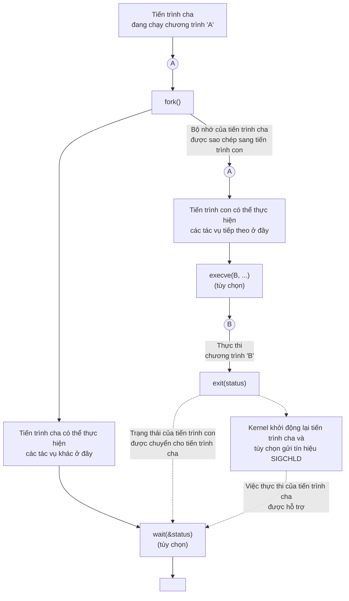
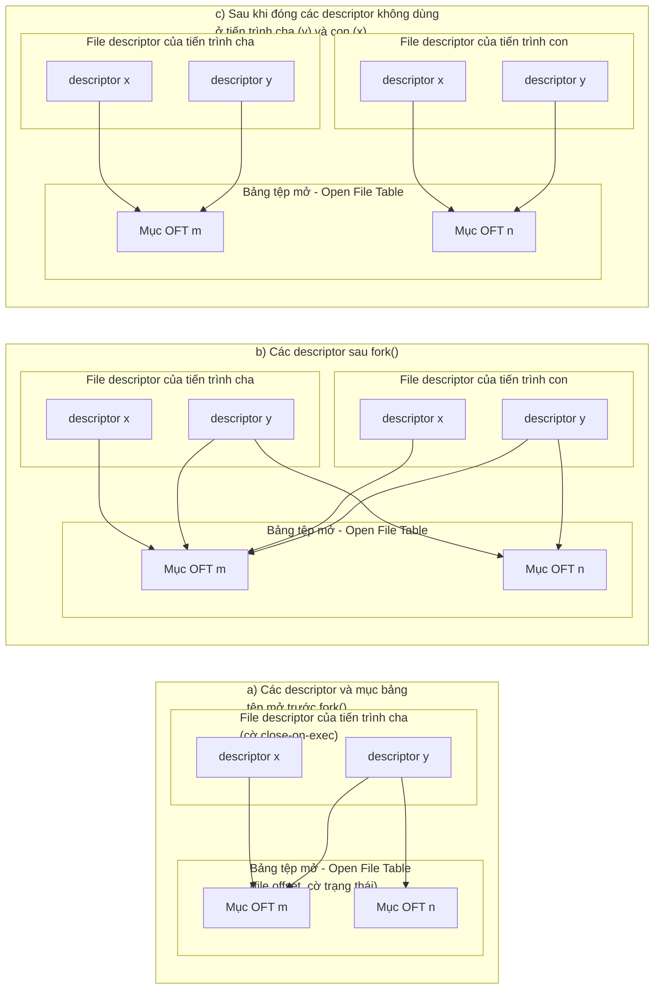
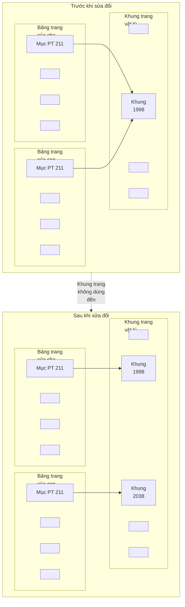

# Chương 24: Tạo tiến trình (Process Creation)

Trong chương này và ba chương tiếp theo, chúng ta sẽ tìm hiểu cách một tiến trình (process) được tạo ra và kết thúc, cũng như cách một tiến trình có thể thực thi một chương trình mới. Chương này đề cập đến việc tạo tiến trình. Tuy nhiên, trước khi đi sâu vào chủ đề đó, chúng ta sẽ xem xét một tóm tắt ngắn gọn về các system call (lời gọi hệ thống) chính được đề cập trong bốn chương này.

## 24.1 Tổng quan về fork(), exit(), wait(), và execve()

Các chủ đề chính của chương này và vài chương tiếp theo là các system call fork(), exit(), wait(), và execve(). Mỗi system call này đều có các biến thể, mà chúng ta cũng sẽ tìm hiểu. Bây giờ, chúng ta cung cấp một tổng quan về bốn system call này và cách chúng thường được sử dụng kết hợp với nhau.

- System call fork() cho phép một tiến trình, tiến trình cha (parent), tạo ra một tiến trình mới, tiến trình con (child). Điều này được thực hiện bằng cách tạo ra tiến trình con mới là một bản sao (gần như) chính xác của tiến trình cha: tiến trình con nhận được các bản sao của phân đoạn ngăn xếp (stack), dữ liệu (data), vùng nhớ cấp phát động (heap), và mã lệnh (text segment) của tiến trình cha (Phần 6.3). Thuật ngữ fork xuất phát từ thực tế là chúng ta có thể hình dung tiến trình cha phân chia để tạo ra hai bản sao của chính nó.
- Thư viện hàm (library function) exit(status) chấm dứt một tiến trình, làm cho tất cả các tài nguyên (bộ nhớ, file descriptor đang mở, v.v.) được sử dụng bởi tiến trình đó sẵn sàng để kernel (nhân hệ điều hành) phân bổ lại sau đó. Đối số status là một số nguyên xác định trạng thái kết thúc (termination status) cho tiến trình. Bằng cách sử dụng system call wait(), tiến trình cha có thể lấy lại trạng thái này.

Thư viện hàm exit() được xây dựng chồng lên trên system call \_exit(). Trong Chương [25](#page-18-0), chúng tôi giải thích sự khác biệt giữa hai giao diện này. Trong lúc này, chúng ta chỉ cần lưu ý rằng, sau một lời gọi fork(), thường chỉ có một trong hai tiến trình cha hoặc con kết thúc bằng cách gọi exit(); tiến trình còn lại nên kết thúc bằng cách sử dụng \_exit().

- System call wait(&status) có hai mục đích. Thứ nhất, nếu tiến trình con của tiến trình này chưa kết thúc bằng cách gọi exit(), thì wait() sẽ tạm dừng việc thực thi tiến trình cha cho đến khi một trong các tiến trình con của nó kết thúc. Thứ hai, trạng thái kết thúc của tiến trình con được trả về trong đối số status của wait().
- System call execve(pathname, argv, envp) tải một chương trình mới (pathname, với danh sách đối số argv và danh sách môi trường envp) vào bộ nhớ của tiến trình. Đoạn mã chương trình hiện tại bị loại bỏ, và các phân đoạn stack, data, heap được tạo mới hoàn toàn cho chương trình mới. Thao tác này thường được gọi là exec một chương trình mới. Sau này, chúng ta sẽ thấy một số thư viện hàm được xây dựng chồng lên trên execve(), mỗi hàm cung cấp một biến thể hữu ích trong giao diện lập trình. Khi chúng ta không quan tâm đến các biến thể giao diện này, chúng ta tuân theo quy ước chung là gọi chung các lời gọi này là exec(), nhưng cần lưu ý rằng không có system call hoặc thư viện hàm nào có tên này.

Một số hệ điều hành khác kết hợp chức năng của fork() và exec() thành một thao tác duy nhất — được gọi là spawn — tạo ra một tiến trình mới, sau đó thực thi một chương trình được chỉ định. So với cách đó, cách tiếp cận của UNIX thường đơn giản và thanh lịch hơn. Việc tách biệt hai bước này giúp các API trở nên đơn giản hơn (system call fork() không nhận đối số nào) và cho phép chương trình có độ linh hoạt cao trong các hành động mà nó thực hiện giữa hai bước. Hơn nữa, việc thực hiện fork() mà không có lời gọi exec() theo sau thường rất hữu ích.

> [!NOTE]
> SUSv3 quy định hàm tùy chọn posix\_spawn(), kết hợp hiệu ứng của cả fork() và exec(). Hàm này, cùng với một số API liên quan được quy định bởi SUSv3, được cài đặt trên Linux trong glibc. SUSv3 quy định posix\_spawn() để cho phép các ứng dụng di động (portable applications) được viết cho các kiến trúc phần cứng không cung cấp cơ chế hoán đổi (swap facilities) hoặc đơn vị quản lý bộ nhớ (memory-management units - đây là điểm đặc trưng của nhiều hệ thống nhúng - embedded systems). Trên các kiến trúc như vậy, một lời gọi fork() truyền thống rất khó hoặc không thể thực hiện được.

Hình 24-1 cung cấp tổng quan về cách fork(), exit(), wait(), và execve() thường được sử dụng kết hợp với nhau. (Biểu đồ này phác thảo các bước được thực hiện bởi shell khi thực thi một lệnh: shell liên tục thực thi một vòng lặp đọc một lệnh, thực hiện các xử lý khác nhau trên lệnh đó, và sau đó fork một tiến trình con để exec lệnh đó.)

Việc sử dụng execve() được hiển thị trong biểu đồ này là tùy chọn. Đôi khi, thay vào đó, việc để tiến trình con tiếp tục thực thi cùng một chương trình với tiến trình cha lại hữu ích hơn. Trong cả hai trường hợp, việc thực thi của tiến trình con cuối cùng sẽ bị chấm dứt bởi một lời gọi exit() (hoặc do nhận được một tín hiệu - signal), mang lại trạng thái kết thúc mà tiến trình cha có thể lấy được thông qua wait().

Lời gọi wait() cũng tương tự như vậy, mang tính tùy chọn. Tiến trình cha có thể đơn giản phớt lờ tiến trình con của mình và tiếp tục thực thi. Tuy nhiên, sau này chúng ta sẽ thấy rằng việc sử dụng wait() thường là điều đáng mong đợi, và thường được sử dụng bên trong một trình xử lý (handler) cho tín hiệu SIGCHLD, mà kernel tạo ra cho tiến trình cha khi một trong các tiến trình con của nó kết thúc. (Theo mặc định, SIGCHLD bị phớt lờ, đó là lý do tại sao chúng ta dán nhãn nó là được gửi đi một cách tùy chọn trong biểu đồ).



**Hình 24-1:** Tổng quan về việc sử dụng `fork()`, `exit()`, `wait()` và `execve()`

## 24.2 Tạo một Tiến trình Mới: fork()

Trong nhiều ứng dụng, việc tạo ra nhiều tiến trình (process) có thể là một cách hữu ích để chia nhỏ một tác vụ. Ví dụ, một tiến trình máy chủ mạng (network server process) có thể lắng nghe các yêu cầu đến từ client và tạo ra một tiến trình con (child process) mới để xử lý từng yêu cầu; trong khi đó, tiến trình máy chủ vẫn tiếp tục lắng nghe các kết nối tiếp theo từ client. Việc phân chia tác vụ theo cách này thường giúp thiết kế ứng dụng trở nên đơn giản hơn. Nó cũng cho phép mức độ đồng thời (concurrency) cao hơn (tức là có thể xử lý đồng thời nhiều tác vụ hoặc yêu cầu hơn).

System call `fork()` tạo ra một tiến trình mới, gọi là tiến trình con (child), là một bản sao gần như chính xác của tiến trình gọi, gọi là tiến trình cha (parent).

```c
## include <unistd.h>
pid_t fork(void);
                Trong tiến trình cha: trả về PID của tiến trình con nếu thành công, hoặc –1 nếu lỗi;
                Trong tiến trình con được tạo thành công: luôn trả về 0
```

Điểm mấu chốt để hiểu về `fork()` là nhận ra rằng sau khi nó hoàn tất công việc, sẽ có hai tiến trình tồn tại, và ở mỗi tiến trình, quá trình thực thi (execution) tiếp tục từ điểm mà `fork()` trả về.

Hai tiến trình đang thực thi cùng một đoạn mã chương trình (program text), nhưng chúng có các bản sao riêng biệt cho các phân đoạn stack, data và heap. Các phân đoạn stack, data và heap của tiến trình con ban đầu là các bản sao chính xác của các phần tương ứng trong bộ nhớ của tiến trình cha. Sau `fork()`, mỗi tiến trình có thể sửa đổi các biến trong các phân đoạn stack, data và heap của riêng mình mà không ảnh hưởng đến tiến trình kia.

Trong mã nguồn của một chương trình, chúng ta có thể phân biệt hai tiến trình thông qua giá trị trả về từ `fork()`. Đối với tiến trình cha, `fork()` trả về Process ID (PID) của tiến trình con mới được tạo. Điều này rất hữu ích vì tiến trình cha có thể tạo ra, và do đó cần theo dõi, nhiều tiến trình con (thông qua `wait()` hoặc các hàm liên quan). Đối với tiến trình con, `fork()` trả về 0. Nếu cần thiết, tiến trình con có thể lấy Process ID của chính nó bằng cách sử dụng `getpid()`, và Process ID của tiến trình cha bằng cách sử dụng `getppid()`.

Nếu một tiến trình mới không thể được tạo, `fork()` trả về –1. Các nguyên nhân có thể dẫn đến thất bại là giới hạn tài nguyên (`RLIMIT_NPROC`, được mô tả trong Mục 36.3) về số lượng tiến trình được phép cho (thực tế là) User ID này đã bị vượt quá, hoặc giới hạn trên toàn hệ thống về số lượng tiến trình có thể được tạo đã đạt đến mức tối đa.

Cấu trúc cú pháp (idiom) sau đây đôi khi được sử dụng khi gọi `fork()`:

```
pid_t childPid; /* Được sử dụng trong tiến trình cha sau khi fork() thành công
 để ghi lại PID của tiến trình con */
switch (childPid = fork()) {
case -1: /* fork() thất bại */
 /* Xử lý lỗi */
case 0: /* Tiến trình con của fork() thành công sẽ đến đây */
 /* Thực hiện các thao tác đặc thù cho tiến trình con */
default: /* Tiến trình cha đến đây sau khi fork() thành công */
 /* Thực hiện các thao tác đặc thù cho tiến trình cha */
}
```

Điều quan trọng cần nhận ra là sau một lệnh `fork()`, việc tiến trình nào trong hai tiến trình được lên lịch (scheduled) sử dụng CPU tiếp theo là không thể xác định trước. Trong các chương trình được viết kém, tính bất định này có thể dẫn đến các lỗi được gọi là điều kiện tranh chấp (race conditions), mà chúng ta sẽ mô tả chi tiết hơn trong Mục [24.4](#page-12-0).

[Liệt kê 24-1](#page-4-0) minh họa việc sử dụng `fork()`. Chương trình này tạo ra một tiến trình con thực hiện việc sửa đổi các bản sao của các biến toàn cục (global variables) và biến tự động (automatic variables) mà nó kế thừa trong quá trình `fork()`.

Việc sử dụng `sleep()` (trong mã lệnh do tiến trình cha thực thi) ở chương trình này cho phép tiến trình con được lên lịch sử dụng CPU trước tiến trình cha, để tiến trình con có thể hoàn thành công việc và kết thúc trước khi tiến trình cha tiếp tục thực thi. Việc sử dụng `sleep()` theo cách này không phải là một phương pháp hoàn hảo để đảm bảo kết quả này; chúng ta sẽ xem xét một phương pháp tốt hơn trong Mục [24.5](#page-14-0).

Khi chạy chương trình trong Liệt kê 24-1, chúng ta thấy kết quả đầu ra như sau:

```
$ ./t_fork
PID=28557 (child) idata=333 istack=666
PID=28556 (parent) idata=111 istack=222
```

Kết quả đầu ra trên chứng minh rằng tiến trình con nhận được bản sao riêng của các phân đoạn stack và data tại thời điểm `fork()`, và nó có thể sửa đổi các biến trong các phân đoạn này mà không làm ảnh hưởng đến tiến trình cha.

**Liệt kê 24-1:** Sử dụng `fork()`

```
–––––––––––––––––––––––––––––––––––––––––––––––––––––––– procexec/t_fork.c
## include "tlpi_hdr.h"
static int idata = 111; /* Được cấp phát trong phân đoạn data */
int
main(int argc, char *argv[])
{
 int istack = 222; /* Được cấp phát trong phân đoạn stack */
 pid_t childPid;
 switch (childPid = fork()) {
 case -1:
 errExit("fork");
 case 0:
 idata *= 3;
 istack *= 3;
 break;
 default:
 sleep(3); /* Cho tiến trình con có cơ hội thực thi */
 break;
 }
 /* Cả tiến trình cha và con đều đi đến đây */
 printf("PID=%ld %s idata=%d istack=%d\n", (long) getpid(),
 (childPid == 0) ? "(child) " : "(parent)", idata, istack);
 exit(EXIT_SUCCESS);
}
–––––––––––––––––––––––––––––––––––––––––––––––––––––––– procexec/t_fork.c
```

### 24.2.1 Chia sẻ File giữa Tiến trình Cha và Tiến trình Con

Khi một lệnh `fork()` được thực thi, tiến trình con (child process) nhận được các bản sao của toàn bộ các File Descriptor (mô tả tệp) của tiến trình cha (parent process). Các bản sao này được tạo theo cách thức của `dup()`, có nghĩa là các descriptor tương ứng ở tiến trình cha và con cùng trỏ tới một Open File Description (mô tả tệp mở) giống nhau. Như chúng ta đã thấy ở Mục 5.4, open file description chứa vị trí con trỏ tệp hiện tại (current file offset - được sửa đổi bởi các hàm `read()`, `write()`, và `lseek()`) và các cờ trạng thái tệp mở (open file status flags - được thiết lập bởi `open()` và thay đổi bởi thao tác `fcntl()` với `F_SETFL`). Do đó, các thuộc tính này của một tệp mở được chia sẻ giữa tiến trình cha và con. Ví dụ, nếu tiến trình con cập nhật vị trí con trỏ tệp, thay đổi này sẽ hiển thị thông qua descriptor tương ứng ở tiến trình cha.

Việc các thuộc tính này được chia sẻ bởi tiến trình cha và con sau lệnh `fork()` được minh họa bằng chương trình trong [Liệt kê 24-2](#page-5-0). Chương trình này mở một tệp tạm thời sử dụng `mkstemp()`, và sau đó gọi `fork()` để tạo một tiến trình con. Tiến trình con thay đổi vị trí con trỏ tệp và các cờ trạng thái tệp mở của tệp tạm thời, sau đó kết thúc. Tiến trình cha sau đó truy xuất vị trí con trỏ tệp và các cờ để xác minh rằng nó có thể nhìn thấy các thay đổi do tiến trình con thực hiện. Khi chúng ta chạy chương trình, kết quả thu được như sau:

```
$ ./fork_file_sharing
File offset before fork(): 0
O_APPEND flag before fork() is: off
Child has exited
File offset in parent: 1000
O_APPEND flag in parent is: on
```

Để giải thích tại sao chúng ta ép kiểu giá trị trả về từ `lseek()` sang `long long` trong [Liệt kê 24-2,](#page-5-0) hãy xem Mục 5.10.

**Liệt kê 24-2:** Chia sẻ vị trí con trỏ tệp và cờ trạng thái tệp mở giữa tiến trình cha và tiến trình con

```
––––––––––––––––––––––––––––––––––––––––––––––– procexec/fork_file_sharing.c
## include <sys/stat.h>
## include <fcntl.h>
## include <sys/wait.h>
## include "tlpi_hdr.h"
int
main(int argc, char *argv[])
{
 int fd, flags;
   char template[] = "/tmp/testXXXXXX";
 setbuf(stdout, NULL); /* Vô hiệu hóa bộ đệm của stdout */
 fd = mkstemp(template);
 if (fd == -1)
 errExit("mkstemp");
 printf("File offset before fork(): %lld\n",
 (long long) lseek(fd, 0, SEEK_CUR));
 flags = fcntl(fd, F_GETFL);
 if (flags == -1)
 errExit("fcntl - F_GETFL");
 printf("O_APPEND flag before fork() is: %s\n",
 (flags & O_APPEND) ? "on" : "off");
```

```
 switch (fork()) {
 case -1:
 errExit("fork");
 case 0: /* Tiến trình con: thay đổi vị trí con trỏ tệp và cờ trạng thái */
 if (lseek(fd, 1000, SEEK_SET) == -1)
 errExit("lseek");
 flags = fcntl(fd, F_GETFL); /* Lấy các cờ hiện tại */
 if (flags == -1)
 errExit("fcntl - F_GETFL");
 flags |= O_APPEND; /* Bật cờ O_APPEND */
 if (fcntl(fd, F_SETFL, flags) == -1)
 errExit("fcntl - F_SETFL");
 _exit(EXIT_SUCCESS);
 default: /* Tiến trình cha: có thể thấy các thay đổi tệp do tiến trình con thực hiện */
 if (wait(NULL) == -1)
 errExit("wait"); /* Đợi tiến trình con kết thúc */
 printf("Child has exited\n");
 printf("File offset in parent: %lld\n",
 (long long) lseek(fd, 0, SEEK_CUR));
 flags = fcntl(fd, F_GETFL);
 if (flags == -1)
 errExit("fcntl - F_GETFL");
 printf("O_APPEND flag in parent is: %s\n",
 (flags & O_APPEND) ? "on" : "off");
 exit(EXIT_SUCCESS);
 }
}
```

––––––––––––––––––––––––––––––––––––––––––––––– **procexec/fork\_file\_sharing.c**

Việc chia sẻ các thuộc tính tệp mở giữa tiến trình cha và tiến trình con thường rất hữu ích. Ví dụ, nếu cả tiến trình cha và con cùng ghi vào một tệp, việc chia sẻ vị trí con trỏ tệp đảm bảo rằng hai tiến trình không ghi đè lên dữ liệu đầu ra của nhau. Tuy nhiên, điều này không ngăn cản việc đầu ra của hai tiến trình bị trộn lẫn ngẫu nhiên vào nhau. Nếu điều này không mong muốn, thì cần phải có một hình thức đồng bộ hóa tiến trình (process synchronization) nào đó. Ví dụ, tiến trình cha có thể sử dụng System Call `wait()` để tạm dừng cho đến khi tiến trình con kết thúc. Đây là cách mà shell hoạt động, để nó chỉ in ra dấu nhắc lệnh (prompt) sau khi tiến trình con thực thi một câu lệnh đã chấm dứt (trừ khi người dùng chạy tường minh câu lệnh ở chế độ nền bằng cách đặt ký tự dấu và `&` ở cuối câu lệnh).

Nếu việc chia sẻ các file descriptor theo cách này là không cần thiết, thì một ứng dụng nên được thiết kế sao cho sau khi gọi `fork()`, tiến trình cha và con sử dụng các file descriptor khác nhau, với mỗi tiến trình sẽ đóng các descriptor không sử dụng (tức là những descriptor được sử dụng bởi tiến trình kia) ngay lập tức sau khi phân nhánh (`fork`). (Nếu một trong các tiến trình thực thi lệnh `exec()`, cờ close-on-exec được mô tả trong Mục [27.4](#page-62-0) cũng có thể hữu ích.) Các bước này được minh họa trong [Hình 24-2](#page-7-0).



**Hình 24-2:** Sự nhân bản các file descriptor trong quá trình `fork()`, và việc đóng các descriptor không sử dụng

### 24.2.2 Ngữ nghĩa bộ nhớ của fork()

Về mặt khái niệm, chúng ta có thể coi `fork()` như việc tạo ra các bản sao của phân đoạn mã (text), dữ liệu (data), vùng nhớ heap, và vùng nhớ stack của tiến trình cha (parent). (Thực tế, trong một số phiên bản UNIX thời kỳ đầu, việc nhân bản này được thực hiện theo đúng nghĩa đen: một tiến trình (process) mới được tạo bằng cách sao chép bộ nhớ của tiến trình cha ra không gian swap (swap space), và biến hình ảnh đã swap out đó thành tiến trình con (child) trong khi tiến trình cha vẫn giữ nguyên bộ nhớ của mình). Tuy nhiên, việc thực hiện một bản sao đơn giản các trang bộ nhớ ảo (virtual memory page) của tiến trình cha sang tiến trình con mới sẽ gây lãng phí vì nhiều lý do — một trong số đó là `fork()` thường được theo sau ngay lập tức bởi lời gọi `exec()`, hành động này thay thế mã của tiến trình bằng một chương trình mới và khởi tạo lại các phân đoạn dữ liệu, heap và stack của tiến trình. Hầu hết các phiên bản UNIX hiện đại, bao gồm cả Linux, sử dụng hai kỹ thuật để tránh việc sao chép lãng phí này:

- Kernel đánh dấu phân đoạn text (text/code segment) của mỗi tiến trình là chỉ đọc (read-only), do đó một tiến trình không thể tự sửa đổi mã lệnh của chính nó. Điều này có nghĩa là tiến trình cha và con có thể chia sẻ chung một phân đoạn text. System call `fork()` tạo ra một phân đoạn text cho tiến trình con bằng cách thiết lập một tập hợp các mục bảng trang của riêng tiến trình (per-process page-table entries) tham chiếu đến cùng các khung trang bộ nhớ (page frames) đã được sử dụng bởi tiến trình cha.
- Đối với các trang trong phân đoạn dữ liệu (data), heap, và stack của tiến trình cha, nhân (kernel) áp dụng một kỹ thuật được gọi là ghi-khi-sao (copy-on-write - COW). (Việc thực thi kỹ thuật copy-on-write được mô tả trong [Bach, 1986] và [Bovet & Cesati, 2005]). Ban đầu, kernel thiết lập sao cho các mục bảng trang (page-table entry) đối với các phân đoạn này tham chiếu đến cùng các trang bộ nhớ vật lý (physical memory page) giống như các mục bảng trang tương ứng ở tiến trình cha, đồng thời bản thân các trang đó được đánh dấu là chỉ đọc (read-only). Sau `fork()`, kernel sẽ bẫy (trap) bất kỳ nỗ lực nào từ phía tiến trình cha hoặc con nhằm sửa đổi một trong các trang này, và tạo ra một bản sao nhân đôi của trang sắp bị sửa đổi đó. Bản sao trang mới này được gán cho tiến trình gây ra lỗi trang (faulting process), và mục bảng trang tương ứng của tiến trình con được điều chỉnh cho phù hợp. Kể từ thời điểm này, tiến trình cha và con có thể tự do sửa đổi các bản sao riêng tư của trang đó mà không làm cho các thay đổi hiển thị đối với tiến trình kia. [Hình 24-3](#page-8-0) minh họa kỹ thuật copy-on-write.



**Hình 24-3:** Bảng trang (page table) trước và sau khi sửa đổi một trang nhớ sao chép-khi-ghi (copy-on-write) được chia sẻ

### Kiểm soát dấu vết bộ nhớ của một tiến trình (memory footprint)

Chúng ta có thể kết hợp việc sử dụng fork() và wait() để kiểm soát dấu vết bộ nhớ (memory footprint) của một tiến trình. Dấu vết bộ nhớ của tiến trình là dải các trang bộ nhớ ảo (virtual memory page) được tiến trình sử dụng, chịu ảnh hưởng bởi các yếu tố như việc điều chỉnh ngăn xếp (stack) khi các hàm được gọi và trả về, các lời gọi exec(), và — một điểm đặc biệt quan tâm trong thảo luận này — sự sửa đổi vùng nhớ heap do kết quả của các lời gọi malloc() và free().

Giả sử chúng ta bao bọc một lời gọi đến hàm nào đó, func(), bằng cách sử dụng fork() và wait() theo cách được minh họa trong [Liệt kê 24-3](#page-9-0). Sau khi thực thi đoạn mã này, chúng ta biết rằng dấu vết bộ nhớ của tiến trình cha (parent) không thay đổi so với thời điểm trước khi func() được gọi, vì tất cả các thay đổi có thể xảy ra sẽ diễn ra trong tiến trình con (child). Điều này có thể hữu ích vì những lý do sau:

- Nếu chúng ta biết rằng func() gây ra hiện tượng rò rỉ bộ nhớ (memory leak) hoặc phân mảnh heap quá mức, kỹ thuật này sẽ loại bỏ vấn đề đó. (Chúng ta có thể không xử lý được những vấn đề này nếu không có quyền truy cập vào mã nguồn của func()).
- Giả sử chúng ta có một thuật toán thực hiện việc cấp phát bộ nhớ trong quá trình phân tích cây (ví dụ: một chương trình trò chơi phân tích một loạt các nước đi có thể xảy ra và các phản ứng đối với chúng). Chúng ta có thể viết mã cho một chương trình như vậy để gọi free() nhằm thu hồi tất cả bộ nhớ đã cấp phát. Tuy nhiên, trong một số trường hợp, việc áp dụng kỹ thuật mà chúng ta mô tả ở đây sẽ đơn giản hơn, cho phép chúng ta quay lui (backtrack), giữ cho tiến trình gọi (tiến trình cha) giữ nguyên dấu vết bộ nhớ ban đầu của nó.

Trong phần cài đặt được hiển thị trong [Liệt kê 24-3](#page-9-0), kết quả của func() phải được thể hiện trong 8 bit mà exit() truyền từ tiến trình con đang kết thúc tới tiến trình cha đang gọi wait(). Tuy nhiên, chúng ta có thể sử dụng một tệp (file), một đường ống (pipe), hoặc kỹ thuật giao tiếp liên tiến trình (interprocess communication) khác để cho phép func() trả về các kết quả lớn hơn.

**Liệt kê 24-3:** Gọi một hàm mà không làm thay đổi dấu vết bộ nhớ của tiến trình

```
–––––––––––––––––––––––––––––––––––––––––––––––––– fromprocexec/footprint.c
 pid_t childPid;
 int status;
 childPid = fork();
 if (childPid == -1)
 errExit("fork");
 if (childPid == 0) /* Tiến trình con gọi func() và */
 exit(func(arg)); /* sử dụng giá trị trả về làm trạng thái thoát */
 /* Tiến trình cha đợi tiến trình con kết thúc. Nó có thể xác định
 kết quả của func() bằng cách kiểm tra 'status'. */
 if (wait(&status) == -1)
 errExit("wait");
–––––––––––––––––––––––––––––––––––––––––––––––––– fromprocexec/footprint.c
```

## 24.3 Lời gọi hệ thống vfork()

Các phiên bản BSD đầu tiên là một trong những hệ thống mà fork() thực hiện việc nhân bản theo từng câu lệnh (literal duplication) dữ liệu, heap và stack của tiến trình cha. Như đã lưu ý trước đó, điều này gây lãng phí, đặc biệt nếu theo sau fork() là một lời gọi exec() ngay lập tức. Vì lý do này, các phiên bản BSD sau đó đã giới thiệu lời gọi hệ thống vfork(), hiệu quả hơn rất nhiều so với fork() của BSD, mặc dù nó hoạt động với ngữ nghĩa hơi khác (thực ra là có phần kỳ lạ). Các hệ thống UNIX hiện đại sử dụng cơ chế sao chép-khi-ghi (copy-on-write) để cài đặt fork() sẽ hiệu quả hơn nhiều so với các phiên bản fork() cũ, do đó phần lớn loại bỏ được nhu cầu sử dụng vfork(). Tuy nhiên, Linux (giống như nhiều hệ thống UNIX khác) vẫn cung cấp lời gọi hệ thống vfork() với ngữ nghĩa BSD cho các chương trình yêu cầu tốc độ fork nhanh nhất có thể. Mặc dù vậy, vì ngữ nghĩa bất thường của vfork() có thể dẫn đến những lỗi lập trình tiềm ẩn rất tinh vi, việc sử dụng nó thông thường nên tránh, ngoại trừ trong những trường hợp hiếm hoi mang lại sự cải thiện hiệu năng rõ rệt.

Giống như fork(), vfork() được sử dụng bởi tiến trình gọi để tạo ra một tiến trình con mới. Tuy nhiên, vfork() được thiết kế có chủ đích để sử dụng trong các chương trình mà tiến trình con thực hiện một lời gọi exec() ngay lập tức.

```c
## include <unistd.h>
pid_t vfork(void);
                Ở tiến trình cha: trả về PID của tiến trình con khi thành công, hoặc –1 khi lỗi;
                Ở tiến trình con được tạo thành công: luôn trả về 0
```

Hai đặc điểm phân biệt lời gọi hệ thống vfork() với fork() và làm cho nó hiệu quả hơn:

- Không có việc nhân bản các trang bộ nhớ ảo (virtual memory page) hoặc bảng trang (page table) nào được thực hiện cho tiến trình con. Thay vào đó, tiến trình con chia sẻ bộ nhớ của tiến trình cha cho đến khi nó thực hiện thành công một lời gọi exec() hoặc gọi \_exit() để kết thúc.
- Việc thực thi của tiến trình cha bị tạm dừng (suspend) cho đến khi tiến trình con thực hiện exec() hoặc \_exit().

Những điểm này có một số hàm ý quan trọng. Vì tiến trình con đang sử dụng bộ nhớ của tiến trình cha, bất kỳ thay đổi nào do tiến trình con thực hiện đối với các phân đoạn dữ liệu (data), heap, hoặc ngăn xếp (stack) sẽ hiển thị với tiến trình cha ngay khi nó tiếp tục chạy. Hơn nữa, nếu tiến trình con thực hiện việc trả về hàm (function return) giữa lời gọi vfork() và lời gọi exec() hoặc \_exit() sau đó, điều này cũng sẽ ảnh hưởng đến tiến trình cha. Việc này tương tự như ví dụ được mô tả trong Mục 6.8 về việc cố gắng thực hiện longjmp() vào một hàm mà từ đó lệnh return đã được thực hiện trước đó. Sự hỗn loạn tương tự — thường là lỗi phân đoạn bộ nhớ (segmentation fault - SIGSEGV) — rất có thể xảy ra.

Có một số thao tác mà tiến trình con (child process) có thể thực hiện giữa `vfork()` và `exec()` mà không làm ảnh hưởng đến tiến trình cha (parent process). Trong số này có các thao tác trên bảng mô tả tệp đang mở (open file descriptors) (nhưng không áp dụng cho các luồng tệp stdio). Vì bảng mô tả tệp cho mỗi tiến trình được duy trì trong không gian nhân (kernel space) (Mục 5.4) và được nhân bản trong quá trình `vfork()`, tiến trình con có thể thực hiện các thao tác mô tả tệp mà không ảnh hưởng đến tiến trình cha.

> [!NOTE]
> SUSv3 quy định rằng hành vi của một chương trình là không xác định (undefined) nếu nó: a) sửa đổi bất kỳ dữ liệu nào khác ngoài biến có kiểu `pid_t` được sử dụng để lưu trữ giá trị trả về của `vfork()`; b) trả về (return) từ hàm mà trong đó `vfork()` được gọi; hoặc c) gọi bất kỳ hàm nào khác trước khi gọi thành công `_exit()` hoặc thực hiện một lệnh `exec()`.

> [!NOTE]
> Khi chúng ta xem xét System Call `clone()` trong Mục [28.2](#page-85-0), chúng ta sẽ thấy rằng một tiến trình con được tạo bằng `fork()` hoặc `vfork()` cũng nhận được các bản sao của riêng nó về một số thuộc tính tiến trình khác.

Ngữ nghĩa của `vfork()` có nghĩa là sau lệnh gọi, tiến trình con được đảm bảo sẽ được lên lịch (scheduled) cho CPU trước tiến trình cha. Trong Mục [24.2](#page-2-0), chúng ta đã lưu ý rằng đây không phải là đảm bảo do `fork()` cung cấp, mà sau `fork()`, tiến trình cha hoặc tiến trình con có thể được lên lịch trước.

[Liệt kê 24-4](#page-11-0) minh họa việc sử dụng `vfork()`, thể hiện cả hai đặc tính ngữ nghĩa phân biệt nó với `fork()`: tiến trình con chia sẻ bộ nhớ của tiến trình cha và tiến trình cha bị tạm dừng (suspended) cho đến khi tiến trình con kết thúc hoặc gọi `exec()`. Khi chúng ta chạy chương trình này, chúng ta thấy đầu ra sau:

```
$ ./t_vfork
Child executing Even though child slept, parent was not scheduled
Parent executing
istack=666
```

**Liệt kê 24-4:** Sử dụng `vfork()`

Từ dòng đầu ra cuối cùng, chúng ta có thể thấy rằng thay đổi do tiến trình con thực hiện đối với biến `istack` đã tác động trực tiếp lên biến của tiến trình cha.

```c
–––––––––––––––––––––––––––––––––––––––––––––––––––––––– procexec/t_vfork.c
## include "tlpi_hdr.h"
int
main(int argc, char *argv[])
{
 int istack = 222;
 switch (vfork()) {
 case -1:
 errExit("vfork");
```

case 0: /\* Tiến trình con thực thi trước, trong không gian bộ nhớ của tiến trình cha \*/ sleep(3); /\* Ngay cả khi chúng ta ngủ một lúc, tiến trình cha vẫn không được lên lịch \*/

istack \*= 3; /\* Thay đổi này sẽ được nhìn thấy bởi tiến trình cha \*/

write(STDOUT\_FILENO, "Child executing\n", 16);

\_exit(EXIT\_SUCCESS); default: /\* Tiến trình cha bị chặn cho đến khi tiến trình con thoát \*/ write(STDOUT\_FILENO, "Parent executing\n", 17); printf("istack=%d\n", istack); exit(EXIT\_SUCCESS); } }

Trừ những trường hợp tốc độ mang tính chất sống còn, các chương trình mới nên tránh sử dụng `vfork()` và thay vào đó hãy dùng `fork()`. Lý do là khi `fork()` được hiện thực hóa bằng ngữ nghĩa copy-on-write (như trên hầu hết các hệ thống UNIX hiện đại), tốc độ của nó tiệm cận với `vfork()`, đồng thời chúng ta tránh được các hành vi kỳ quặc liên quan đến `vfork()` đã mô tả ở trên. (Chúng ta trình bày một số so sánh tốc độ giữa `fork()` và `vfork()` ở Mục [28.3](#page-97-0)).

–––––––––––––––––––––––––––––––––––––––––––––––––––––––– **procexec/t_vfork.c**

SUSv3 đánh dấu `vfork()` là lỗi thời (obsolete), và SUSv4 thậm chí còn tiến xa hơn khi loại bỏ hoàn toàn thông số kỹ thuật của `vfork()`. SUSv3 để ngỏ nhiều chi tiết về hoạt động của `vfork()` không được xác định, cho phép khả năng nó được hiện thực hóa như một lời gọi đến `fork()`. Khi được hiện thực hóa theo cách này, ngữ nghĩa BSD của `vfork()` không được bảo toàn. Một số hệ thống UNIX thực sự hiện thực hóa `vfork()` như một lệnh gọi `fork()`, và Linux cũng đã làm điều này ở nhân (kernel) phiên bản 2.0 trở về trước.

Tại những nơi được sử dụng, `vfork()` nhìn chung nên được theo sau ngay lập tức bởi một lệnh gọi `exec()`. Nếu lệnh gọi `exec()` thất bại, tiến trình con phải kết thúc bằng cách sử dụng `_exit()`. (Tiến trình con của `vfork()` không nên kết thúc bằng cách gọi `exit()`, vì điều đó sẽ khiến các bộ đệm stdio của tiến trình cha bị xả (flush) và đóng lại. Chúng ta sẽ đi sâu hơn vào chi tiết này ở Mục [25.4](#page-24-0)).

Các cách sử dụng `vfork()` khác — đặc biệt là những cách phụ thuộc vào ngữ nghĩa bất thường của nó về chia sẻ bộ nhớ và lập lịch tiến trình — có khả năng khiến chương trình mất tính khả chuyển (nonportable), đặc biệt là trên các hệ thống mà `vfork()` chỉ đơn giản được triển khai như một lời gọi đến `fork()`.

## 24.4 Điều kiện tranh chấp (Race Conditions) Sau fork()

Sau lời gọi hàm `fork()`, quá trình nào—tiến trình cha (parent) hay tiến trình con (child)—sẽ tiếp tục có quyền truy cập vào CPU là điều không thể xác định trước. (Trên hệ thống đa xử lý (multiprocessor system), cả hai có thể đồng thời có quyền truy cập CPU). Các ứng dụng ngầm hiểu hoặc cố tình phụ thuộc vào một chuỗi thực thi (sequence of execution) cụ thể để đạt được kết quả chính xác rất dễ gặp lỗi do điều kiện tranh chấp (race condition), điều mà chúng ta đã mô tả ở Mục 5.1. Những lỗi như vậy có thể rất khó tìm, vì sự xuất hiện của chúng phụ thuộc vào các quyết định lập lịch (scheduling decisions) mà kernel đưa ra tùy theo tải của hệ thống (system load).

Chúng ta có thể sử dụng chương trình trong Liệt kê 24-5 để minh họa tính bất định này. Chương trình này lặp lại, sử dụng `fork()` để tạo ra nhiều tiến trình con. Sau mỗi lần `fork()`, cả tiến trình cha và con đều in ra một thông báo bao gồm giá trị bộ đếm vòng lặp và một chuỗi ký tự cho biết tiến trình đó là cha hay con. Ví dụ, nếu chúng ta yêu cầu chương trình chỉ tạo ra một tiến trình con, chúng ta có thể thấy kết quả như sau:

```
$ ./fork_whos_on_first 1
0 parent
0 child
```

Chúng ta có thể sử dụng chương trình này để tạo ra một số lượng lớn tiến trình con, sau đó phân tích đầu ra để xem tiến trình cha hay tiến trình con là bên đầu tiên in ra thông báo của mình mỗi lần. Việc phân tích kết quả khi sử dụng chương trình này để tạo ra 1 triệu tiến trình con trên hệ thống Linux/x86-32 2.2.19 cho thấy tiến trình cha luôn in thông báo trước trong tất cả các trường hợp ngoại trừ 332 trường hợp (tức là chiếm 99,97% các trường hợp).

> [!NOTE]
> Kết quả từ việc chạy chương trình trong Liệt kê 24-5 đã được phân tích bằng cách sử dụng tập lệnh `procexec/fork_whos_on_first.count.awk`, được cung cấp trong gói mã nguồn của cuốn sách này.

Từ những kết quả này, chúng ta có thể phỏng đoán rằng, trên Linux 2.2.19, quá trình thực thi luôn tiếp tục với tiến trình cha sau một lời gọi `fork()`. Lý do khiến tiến trình con đôi khi in thông báo trước là vì trong 0,03% trường hợp, lát cắt thời gian CPU (CPU time slice) của tiến trình cha đã cạn kiệt trước khi nó kịp in thông báo. Nói cách khác, nếu ví dụ này đại diện cho một trường hợp mà chúng ta phụ thuộc vào việc tiến trình cha luôn được lập lịch trước sau `fork()`, thì mọi thứ thường sẽ diễn ra đúng, nhưng cứ 3000 lần thì sẽ có 1 lần xảy ra sai sót. Tất nhiên, nếu ứng dụng mong đợi tiến trình cha có thể thực hiện một khối lượng công việc lớn hơn trước khi tiến trình con được lập lịch, khả năng xảy ra lỗi sẽ cao hơn. Việc cố gắng gỡ lỗi (debug) các lỗi như vậy trong một chương trình phức tạp có thể rất khó khăn.

**Liệt kê 24-5:** Tiến trình cha và con tranh chấp ghi thông báo sau `fork()`

```
–––––––––––––––––––––––––––––––––––––––––––––– procexec/fork_whos_on_first.c
## include <sys/wait.h>
## include "tlpi_hdr.h"
int
main(int argc, char *argv[])
{
 int numChildren, j;
 pid_t childPid;
 if (argc > 1 && strcmp(argv[1], "--help") == 0)
 usageErr("%s [num-children]\n", argv[0]);
 numChildren = (argc > 1) ? getInt(argv[1], GN_GT_0, "num-children") : 1;
 setbuf(stdout, NULL); /* Make stdout unbuffered */
 for (j = 0; j < numChildren; j++) {
 switch (childPid = fork()) {
 case -1:
 errExit("fork");
 case 0:
 printf("%d child\n", j);
 _exit(EXIT_SUCCESS);
 default:
 printf("%d parent\n", j);
 wait(NULL); /* Wait for child to terminate */
 break;
 }
 }
 exit(EXIT_SUCCESS);
}
–––––––––––––––––––––––––––––––––––––––––––––– procexec/fork_whos_on_first.c
```

Mặc dù Linux 2.2.19 luôn tiếp tục thực thi với tiến trình cha sau lệnh `fork()`, chúng ta không thể dựa vào điều này trên các cài đặt UNIX khác, hoặc thậm chí trên các phiên bản khác nhau của Linux kernel. Trong chuỗi kernel ổn định 2.4, các thử nghiệm đã được thực hiện ngắn gọn với bản vá "tiến trình con chạy trước sau fork()" (`child first after fork()`), bản vá này đảo ngược hoàn toàn kết quả thu được từ phiên bản 2.2.19. Mặc dù thay đổi này sau đó đã bị loại bỏ khỏi dòng kernel 2.4, nhưng nó lại được áp dụng trong Linux 2.6. Do đó, các chương trình giả định hành vi của phiên bản 2.2.19 sẽ bị lỗi trên kernel 2.6.

Một số thử nghiệm gần đây hơn đã đảo ngược đánh giá của các nhà phát triển kernel về việc liệu chạy tiến trình con hay tiến trình cha trước sau `fork()` sẽ tốt hơn, và kể từ Linux 2.6.32, tiến trình cha lại một lần nữa là bên được chạy trước theo mặc định sau một lời gọi `fork()`. Giá trị mặc định này có thể được thay đổi bằng cách gán một giá trị khác không cho tệp đặc trưng của Linux `/proc/sys/kernel/sched_child_runs_first`.

Để hiểu lý do đằng sau hành vi "tiến trình con chạy trước sau fork()", hãy xem xét điều gì xảy ra với ngữ nghĩa sao chép khi ghi (copy-on-write semantics) khi tiến trình con của một lời gọi `fork()` thực hiện một lệnh `exec()` ngay lập tức. Trong trường hợp này, khi tiến trình cha tiếp tục chạy sau `fork()` để sửa đổi các trang dữ liệu và ngăn xếp (stack pages), kernel sẽ nhân bản các trang chuẩn bị bị sửa đổi cho tiến trình con. Vì tiến trình con thực hiện `exec()` ngay khi nó được lập lịch chạy, việc nhân bản này trở nên lãng phí. Theo lý luận này, tốt hơn là nên lập lịch cho tiến trình con chạy trước, để đến thời điểm tiến trình cha được lập lịch tiếp theo, sẽ không cần phải sao chép trang bộ nhớ nào cả. Sử dụng chương trình trong Liệt kê 24-5 để tạo ra 1 triệu tiến trình con trên một hệ thống Linux/x86-32 bận rộn chạy kernel 2.6.30 cho thấy trong 99,98% trường hợp, tiến trình con hiển thị thông báo của nó trước. (Tỷ lệ phần trăm chính xác phụ thuộc vào các yếu tố như tải hệ thống). Thử nghiệm chương trình này trên các hệ thống UNIX khác cho thấy sự biến đổi lớn trong các quy tắc chi phối tiến trình nào chạy trước sau `fork()`.

Lập luận cho việc chuyển đổi trở lại cơ chế "cha chạy trước sau fork()" trong Linux 2.6.32 dựa trên quan sát cho thấy: sau lời gọi `fork()`, trạng thái của tiến trình cha đã sẵn sàng trên CPU và thông tin quản lý bộ nhớ của nó đã nằm sẵn trong bộ đệm dịch địa chỉ TLB (translation look-aside buffer) của đơn vị quản lý bộ nhớ phần cứng (hardware memory management unit - MMU). Do đó, việc cho tiến trình cha chạy trước sẽ mang lại hiệu năng tốt hơn nhờ tận dụng bộ nhớ cache/TLB ấm. Điều này đã được kiểm chứng qua việc đo thời gian cần thiết để biên dịch kernel (kernel build) dưới cả hai cơ chế.

Tóm lại, đáng chú ý là sự khác biệt về hiệu năng giữa hai hành vi này là tương đối nhỏ và sẽ không ảnh hưởng đến hầu hết các ứng dụng.

Từ phần thảo luận trước, rõ ràng chúng ta không thể giả định một thứ tự thực thi (order of execution) cụ thể nào cho tiến trình cha và tiến trình con (child process) sau một lời gọi `fork()`. Nếu cần đảm bảo một thứ tự cụ thể, chúng ta phải sử dụng một số kỹ thuật đồng bộ hóa (synchronization technique) nào đó. Chúng ta sẽ mô tả một số kỹ thuật đồng bộ hóa trong các chương sau, bao gồm semaphore, khóa tập tin (file lock), và truyền thông điệp giữa các tiến trình sử dụng ống dẫn (pipe). Một phương pháp khác, sẽ được mô tả ngay sau đây, là sử dụng tín hiệu (signal).

## 24.5 Tránh tình trạng tranh chấp (Race Conditions) bằng cách đồng bộ hóa với Tín hiệu (Signals)

Sau một lời gọi `fork()`, nếu một trong hai tiến trình cần phải đợi tiến trình kia hoàn thành một hành động nào đó, thì tiến trình đang hoạt động có thể gửi một tín hiệu (signal) sau khi hoàn thành hành động đó; tiến trình còn lại sẽ chờ tín hiệu này.

[Liệt kê 24-6](#page-15-0) minh họa kỹ thuật này. Trong chương trình này, chúng ta giả định rằng tiến trình cha là bên phải đợi tiến trình con thực hiện một hành động nào đó. Các lời gọi liên quan đến tín hiệu ở tiến trình cha và con có thể được hoán đổi nếu tiến trình con phải đợi tiến trình cha. Thậm chí, cả tiến trình cha và con có thể gửi tín hiệu cho nhau nhiều lần để phối hợp các hành động của chúng, mặc dù trên thực tế, việc phối hợp như vậy có nhiều khả năng được thực hiện bằng cách sử dụng semaphore, khóa tập tin (file lock), hoặc truyền thông điệp (message passing).

> [!NOTE]
> [Stevens & Rago, 2005] đề xuất việc đóng gói các bước đồng bộ hóa này (chặn tín hiệu, gửi tín hiệu, bắt tín hiệu) thành một tập hợp các hàm tiêu chuẩn để đồng bộ hóa tiến trình (process synchronization). Ưu điểm của việc đóng gói này là sau đó chúng ta có thể thay thế việc sử dụng tín hiệu bằng một cơ chế IPC (Inter-Process Communication) khác nếu muốn.

Lưu ý rằng chúng ta chặn tín hiệu đồng bộ hóa (`SIGUSR1`) trước lời gọi `fork()` trong [Liệt kê 24-6](#page-15-0). Nếu tiến trình cha cố gắng chặn tín hiệu sau lời gọi `fork()`, nó sẽ vẫn dễ bị tổn thương bởi chính tình trạng tranh chấp (`race condition`) mà chúng ta đang cố gắng tránh. (Trong chương trình này, chúng ta giả định rằng trạng thái của mặt nạ tín hiệu - signal mask - ở tiến trình con là không quan trọng; nếu cần thiết, chúng ta có thể bỏ chặn `SIGUSR1` ở tiến trình con sau `fork()`.)

Nhật ký phiên dòng lệnh shell (shell session log) sau đây cho thấy điều gì xảy ra khi chúng ta chạy chương trình trong Liệt kê 24-6:

```
$ ./fork_sig_sync
[17:59:02 5173] Child started - doing some work
[17:59:02 5172] Parent about to wait for signal
[17:59:04 5173] Child about to signal parent
[17:59:04 5172] Parent got signal
```

**Liệt kê 24-6:** Sử dụng tín hiệu để đồng bộ hóa các hành động của tiến trình

```
–––––––––––––––––––––––––––––––––––––––––––––––––– procexec/fork_sig_sync.c
## include <signal.h>
## include "curr_time.h" /* Declaration of currTime() */
## include "tlpi_hdr.h"
## define SYNC_SIG SIGUSR1 /* Synchronization signal */
static void /* Signal handler - does nothing but return */
handler(int sig)
{
}
int
main(int argc, char *argv[])
{
 pid_t childPid;
 sigset_t blockMask, origMask, emptyMask;
 struct sigaction sa;
 setbuf(stdout, NULL); /* Disable buffering of stdout */
 sigemptyset(&blockMask);
 sigaddset(&blockMask, SYNC_SIG); /* Block signal */
 if (sigprocmask(SIG_BLOCK, &blockMask, &origMask) == -1)
 errExit("sigprocmask");
 sigemptyset(&sa.sa_mask);
 sa.sa_flags = SA_RESTART;
 sa.sa_handler = handler;
 if (sigaction(SYNC_SIG, &sa, NULL) == -1)
 errExit("sigaction");
 switch (childPid = fork()) {
 case -1:
 errExit("fork");
 case 0: /* Child */
 /* Child does some required action here... */
```

```
 printf("[%s %ld] Child started - doing some work\n",
 currTime("%T"), (long) getpid());
 sleep(2); /* Simulate time spent doing some work */
 /* And then signals parent that it's done */
 printf("[%s %ld] Child about to signal parent\n",
 currTime("%T"), (long) getpid());
 if (kill(getppid(), SYNC_SIG) == -1)
 errExit("kill");
 /* Now child can do other things... */
 _exit(EXIT_SUCCESS);
 default: /* Parent */
 /* Parent may do some work here, and then waits for child to
 complete the required action */
 printf("[%s %ld] Parent about to wait for signal\n",
 currTime("%T"), (long) getpid());
 sigemptyset(&emptyMask);
 if (sigsuspend(&emptyMask) == -1 && errno != EINTR)
 errExit("sigsuspend");
 printf("[%s %ld] Parent got signal\n", currTime("%T"), (long) getpid());
 /* If required, return signal mask to its original state */
 if (sigprocmask(SIG_SETMASK, &origMask, NULL) == -1)
 errExit("sigprocmask");
 /* Parent carries on to do other things... */
 exit(EXIT_SUCCESS);
 }
}
–––––––––––––––––––––––––––––––––––––––––––––––––– procexec/fork_sig_sync.c
```

## 24.6 Tóm tắt

System Call (lời gọi hệ thống) `fork()` tạo ra một tiến trình mới (tiến trình con - child process) bằng cách tạo ra một bản sao gần như chính xác của tiến trình gọi (tiến trình cha - parent process). System Call `vfork()` là một phiên bản hiệu quả hơn của `fork()`, nhưng thường tốt nhất là nên tránh dùng vì ngữ nghĩa bất thường của nó, theo đó tiến trình con sử dụng bộ nhớ của tiến trình cha cho đến khi nó thực hiện một lệnh `exec()` hoặc kết thúc; trong thời gian đó, việc thực thi tiến trình cha sẽ bị tạm dừng (suspended).

Sau một lời gọi `fork()`, chúng ta không thể phụ thuộc vào thứ tự mà tiến trình cha và tiến trình con được lập lịch (scheduled) để sử dụng CPU tiếp theo. Các chương trình đưa ra giả định về thứ tự thực thi rất dễ gặp phải các lỗi được gọi là Race Condition (điều kiện tranh chấp). Do sự xuất hiện của các lỗi như vậy phụ thuộc vào các yếu tố bên ngoài như tải của hệ thống (system load), chúng có thể khó tìm kiếm và gỡ lỗi (debug).

### Thông tin thêm

[Bach, 1986] và [Goodheart & Cox, 1994] cung cấp các chi tiết về việc cài đặt `fork()`, `execve()`, `wait()` và `exit()` trên các hệ thống UNIX. [Bovet & Cesati, 2005] và [Love, 2010] cung cấp các chi tiết cài đặt dành riêng cho Linux về việc tạo và kết thúc tiến trình (process creation and termination).

## 24.7 Bài tập

**24-1.** Sau khi một chương trình thực thi chuỗi các lời gọi `fork()` sau đây, bao nhiêu tiến trình mới sẽ được tạo ra (giả sử rằng không có lời gọi nào thất bại)?

```
fork();
fork();
fork();
```

- **24-2.** Viết một chương trình để chứng minh rằng sau một lệnh `vfork()`, tiến trình con có thể đóng một File Descriptor (mô tả tệp, ví dụ: descriptor 0) mà không ảnh hưởng đến File Descriptor tương ứng ở tiến trình cha.
- **24-3.** Giả sử rằng chúng ta có thể sửa đổi mã nguồn chương trình, làm thế nào chúng ta có thể lấy được một bản Core Dump của một tiến trình tại một thời điểm nhất định, trong khi vẫn cho phép tiến trình đó tiếp tục thực thi?
- **24-4.** Thử nghiệm với chương trình trong Liệt kê 24-5 (`fork_whos_on_first.c`) trên các cài đặt UNIX khác để xác định cách các cài đặt này lập lịch cho tiến trình cha và tiến trình con sau một lời gọi `fork()`.
- **24-5.** Giả sử rằng trong chương trình ở [Liệt kê 24-6,](#page-15-0) tiến trình con cũng cần phải đợi tiến trình cha hoàn thành một số hành động. Cần thực hiện những thay đổi nào đối với chương trình để bắt buộc trật tự đồng bộ hai chiều này?
