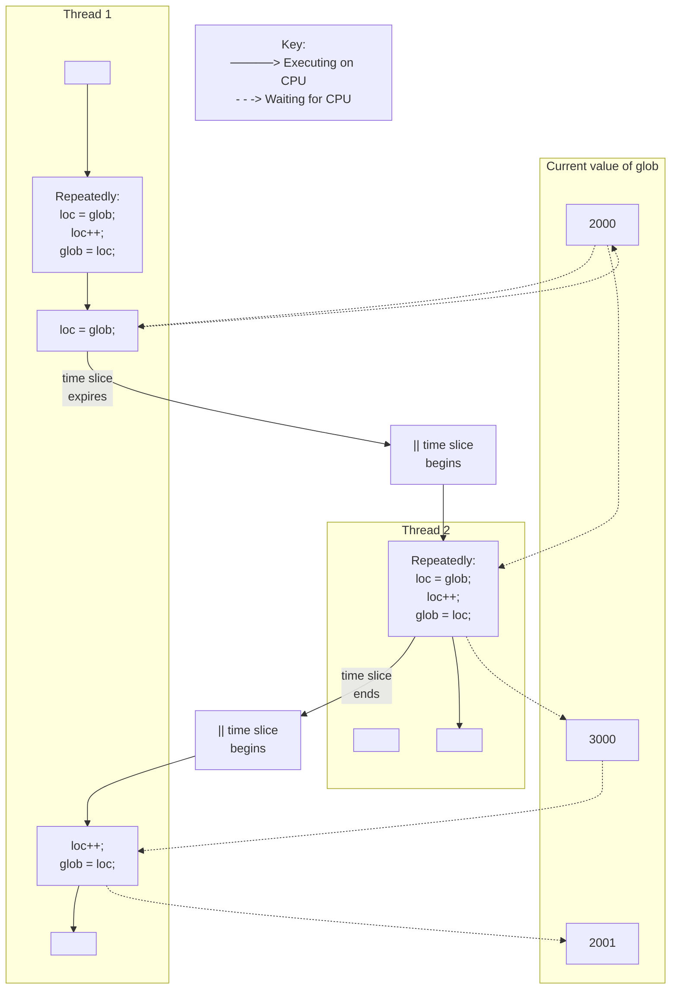

# Chương 30: LUỒNG (THREADS): ĐỒNG BỘ HÓA LUỒNG

Trong chương này, chúng tôi mô tả hai công cụ mà các luồng (threads) có thể sử dụng để đồng bộ hóa các hành động của chúng: mutex và biến điều kiện (condition variables). Mutex cho phép các luồng đồng bộ hóa việc sử dụng một tài nguyên chia sẻ (shared resource), nhờ đó, ví dụ, một luồng không cố gắng truy cập một biến chia sẻ cùng lúc với một luồng khác đang sửa đổi nó. Biến điều kiện (condition variable) thực hiện một tác vụ bổ sung: chúng cho phép các luồng thông báo cho nhau rằng một biến chia sẻ (hoặc tài nguyên chia sẻ khác) đã thay đổi trạng thái.

## 30.1 Bảo Vệ Quyền Truy Cập Vào Các Biến Chia Sẻ: Mutex

Một trong những ưu điểm chính của luồng (threads) là chúng có thể chia sẻ thông tin thông qua các biến toàn cục (global variables). Tuy nhiên, việc chia sẻ dễ dàng này đi kèm với một cái giá phải trả: chúng ta phải cẩn thận để nhiều luồng không cố gắng sửa đổi cùng một biến tại cùng một thời điểm, hoặc một luồng không cố gắng đọc giá trị của một biến trong khi một luồng khác đang sửa đổi nó. Thuật ngữ đoạn găng (critical section) được sử dụng để chỉ một đoạn mã truy cập vào một tài nguyên chia sẻ và việc thực thi của nó phải mang tính nguyên tử (atomic); nghĩa là, việc thực thi của nó không được bị ngắt bởi một luồng khác đồng thời truy cập vào cùng một tài nguyên chia sẻ đó.

Liệt kê (Listing) 30-1 cung cấp một ví dụ đơn giản về loại sự cố có thể xảy ra khi các tài nguyên chia sẻ không được truy cập theo cách nguyên tử (atomically). Chương trình này tạo ra hai luồng, mỗi luồng thực thi cùng một hàm. Hàm này thực thi một vòng lặp liên tục tăng giá trị của một biến toàn cục `glob`, bằng cách sao chép `glob` vào biến cục bộ `loc`, tăng `loc` lên, và sao chép ngược `loc` lại vào `glob`. (Vì `loc` là một biến tự động [automatic variable] được cấp phát trên stack riêng của từng luồng [per-thread stack], mỗi luồng có bản sao riêng của biến này.) Số lần lặp của vòng lặp được xác định bởi đối số dòng lệnh (command-line argument) được truyền cho chương trình, hoặc bởi một giá trị mặc định nếu không có đối số nào được cung cấp.

**Liệt kê 30-1:** Tăng giá trị của một biến toàn cục không đúng cách từ hai luồng

```
––––––––––––––––––––––––––––––––––––––––––––––––––––– threads/thread_incr.c
## include <pthread.h>
## include "tlpi_hdr.h"
static int glob = 0;
static void * /* Loop 'arg' times incrementing 'glob' */
threadFunc(void *arg)
{
 int loops = *((int *) arg);
 int loc, j;
 for (j = 0; j < loops; j++) {
 loc = glob;
 loc++;
 glob = loc;
 }
 return NULL;
}
int
main(int argc, char *argv[])
{
 pthread_t t1, t2;
 int loops, s;
 loops = (argc > 1) ? getInt(argv[1], GN_GT_0, "num-loops") : 10000000;
 s = pthread_create(&t1, NULL, threadFunc, &loops);
 if (s != 0)
 errExitEN(s, "pthread_create");
 s = pthread_create(&t2, NULL, threadFunc, &loops);
 if (s != 0)
 errExitEN(s, "pthread_create");
 s = pthread_join(t1, NULL);
 if (s != 0)
 errExitEN(s, "pthread_join");
 s = pthread_join(t2, NULL);
 if (s != 0)
 errExitEN(s, "pthread_join");
 printf("glob = %d\n", glob);
 exit(EXIT_SUCCESS);
}
––––––––––––––––––––––––––––––––––––––––––––––––––––– threads/thread_incr.c
```



**Hình 30-1:** Hai luồng tăng giá trị một biến toàn cục mà không có sự đồng bộ hóa

Khi chúng ta chạy chương trình trong Liệt kê 30-1 với chỉ định mỗi luồng tăng biến này 1000 lần, mọi thứ có vẻ diễn ra tốt đẹp:

```
$ ./thread_incr 1000
glob = 2000
```

Tuy nhiên, điều có lẽ đã xảy ra ở đây là luồng đầu tiên đã hoàn thành tất cả công việc của nó và kết thúc (terminate) trước khi luồng thứ hai thậm chí còn bắt đầu. Khi chúng ta yêu cầu cả hai luồng thực hiện nhiều công việc hơn nữa, chúng ta thấy một kết quả hoàn toàn khác:

```
$ ./thread_incr 10000000
glob = 16517656
```

Vào cuối chuỗi này, giá trị của `glob` lẽ ra phải là 20 triệu. Vấn đề ở đây xuất phát từ các chuỗi thực thi như sau (xem thêm Hình 30-1 ở trên):

- 1. Luồng 1 (Thread 1) nạp giá trị hiện tại của `glob` vào biến cục bộ `loc` của nó. Giả sử rằng giá trị hiện tại của `glob` là 2000.

- 2. Khoảng thời gian phân bổ CPU (time slice) của luồng (thread) 1 kết thúc, và luồng 2 bắt đầu thực thi.
- 3. Luồng 2 thực hiện nhiều vòng lặp, trong đó nó lấy giá trị hiện tại của `glob` vào biến cục bộ `loc` của nó, tăng `loc` lên, và gán kết quả lại cho `glob`. Trong vòng lặp đầu tiên trong số này, giá trị lấy ra từ `glob` sẽ là 2000. Giả sử rằng đến thời điểm khoảng thời gian phân bổ CPU của luồng 2 kết thúc, `glob` đã được tăng lên 3000.

4. Luồng 1 nhận được một khoảng thời gian phân bổ CPU khác và tiếp tục thực thi từ điểm mà nó đã dừng lại trước đó. Do trước đó (bước 1) đã sao chép giá trị của `glob` (2000) vào `loc` của mình, luồng 1 bây giờ tiến hành tăng `loc` lên và gán kết quả (2001) vào `glob`. Tại thời điểm này, hiệu quả của các phép toán tăng giá trị do luồng 2 thực hiện đã bị mất.

Nếu chúng ta chạy chương trình trong Liệt kê (Listing) 30-1 nhiều lần với cùng một tham số dòng lệnh (command-line argument), chúng ta thấy rằng giá trị được in ra của `glob` dao động một cách hỗn loạn:

```
$ ./thread_incr 10000000
glob = 10880429
$ ./thread_incr 10000000
glob = 13493953
```

Hành vi phi định định (nondeterministic behavior) này là hệ quả từ sự biến động trong các quyết định lập lịch CPU (CPU scheduling decisions) của nhân hệ điều hành (kernel). Trong các chương trình phức tạp, hành vi phi định định này đồng nghĩa với việc các lỗi như vậy có thể rất hiếm khi xảy ra, khó tái hiện, và do đó rất khó để tìm ra.

Có vẻ như chúng ta có thể loại bỏ vấn đề bằng cách thay thế ba câu lệnh bên trong vòng lặp `for` ở hàm `threadFunc()` trong Liệt kê 30-1 bằng một câu lệnh duy nhất:

```
glob++; /* hoặc: ++glob; */
```

Tuy nhiên, trên nhiều kiến trúc phần cứng (ví dụ: các kiến trúc RISC), trình biên dịch (compiler) vẫn sẽ cần chuyển đổi câu lệnh đơn này thành mã máy (machine code) mà các bước thực hiện của nó tương đương với ba câu lệnh bên trong vòng lặp trong `threadFunc()`. Nói cách khác, bất chấp vẻ ngoài đơn giản của nó, thậm chí toán tử tăng giá trị trong C có thể không mang tính nguyên tử (atomic), và nó có thể biểu hiện hành vi mà chúng ta đã mô tả ở trên.

Để tránh các vấn đề có thể xảy ra khi các luồng cố gắng cập nhật một biến được chia sẻ (shared variable), chúng ta phải sử dụng một mutex (viết tắt của mutual exclusion - loại trừ tương hoả) để đảm bảo rằng tại một thời điểm chỉ có một luồng duy nhất có thể truy cập biến đó. Tổng quát hơn, mutex có thể được sử dụng để đảm bảo quyền truy cập mang tính nguyên tử (atomic access) đối với bất kỳ tài nguyên được chia sẻ nào (shared resource), nhưng việc bảo vệ các biến được chia sẻ là ứng dụng phổ biến nhất.

Một mutex có hai trạng thái: đã khóa (locked) và chưa khóa (unlocked). Tại bất kỳ thời điểm nào, có tối đa một luồng được giữ khóa trên một mutex. Việc cố gắng khóa một mutex vốn đã bị khóa sẽ hoặc làm tiến trình/luồng bị chặn (block) hoặc thất bại kèm theo một mã lỗi, tùy thuộc vào phương pháp được sử dụng để đặt khóa.

Khi một luồng khóa một mutex, nó trở thành chủ sở hữu (owner) của mutex đó. Chỉ có chủ sở hữu của mutex mới có thể mở khóa (unlock) mutex đó. Tính chất này giúp cải thiện cấu trúc của mã nguồn sử dụng mutex và đồng thời cho phép thực hiện một số tối ưu hóa trong quá trình triển khai mutex. Do tính chất sở hữu này, các thuật ngữ thu giữ (acquire) và giải phóng (release) đôi khi được sử dụng đồng nghĩa với khóa (lock) và mở khóa (unlock).

Nói chung, chúng ta sử dụng một mutex riêng biệt cho mỗi tài nguyên được chia sẻ (có thể bao gồm nhiều biến có liên quan), và mỗi luồng áp dụng giao thức sau để truy cập tài nguyên:

- khóa mutex của tài nguyên được chia sẻ;
- truy cập tài nguyên được chia sẻ; và
- mở khóa mutex.

Nếu nhiều luồng cố gắng thực thi khối mã này (được gọi là vùng tranh chấp hay critical section), việc chỉ có một luồng có thể giữ mutex (các luồng còn lại tiếp tục ở trạng thái bị chặn) đồng nghĩa với việc tại một thời điểm chỉ có một luồng duy nhất có thể bước vào khối mã đó, như minh họa trong [Hình 30-2.](#page-18-0)

```text
Thread A                         Thread B

lock mutex M
     │
     ▼
access shared resource         lock mutex M
     │                              │
     │                            blocks
     ▼                              │
unlock mutex M ─ ─ ─ ─ ─ ─ ─ ─ ─ ─ -┼─> unblocks, lock granted
     │                              │
     │                              ▼
                           access shared resource
                                    │
                                    ▼
                             unlock mutex M
                                    │
                                    ▼
```

**Hình 30-2:** Sử dụng mutex để bảo vệ một vùng tranh chấp (critical section)

Cuối cùng, cần lưu ý rằng việc khóa mutex mang tính khuyến cáo (advisory) chứ không phải là bắt buộc (mandatory). Ý của chúng ta ở đây là một luồng hoàn toàn có thể tự do phớt lờ việc sử dụng mutex và đơn giản là truy cập trực tiếp vào (các) biến được chia sẻ tương ứng. Để xử lý các biến được chia sẻ một cách an toàn, tất cả các luồng phải hợp tác trong việc sử dụng mutex, tuân thủ các quy tắc khóa mà nó thực thi.

### 30.1.1 Mutex được cấp phát tĩnh (Statically Allocated Mutexes)

Một mutex có thể được cấp phát như một biến tĩnh hoặc được tạo động tại thời điểm chạy (run time) (ví dụ: trong một khối bộ nhớ được cấp phát thông qua hàm `malloc()`). Việc tạo mutex động có phần phức tạp hơn, và chúng ta sẽ hoãn thảo luận về nó cho đến Mục [30.1.5.](#page-22-0)

Một mutex là một biến có kiểu `pthread_mutex_t`. Trước khi có thể sử dụng, một mutex phải luôn luôn được khởi tạo. Đối với một mutex được cấp phát tĩnh (statically allocated mutex), chúng ta có thể thực hiện việc này bằng cách gán cho nó giá trị `PTHREAD_MUTEX_INITIALIZER`, như trong ví dụ sau:

```c
pthread_mutex_t mtx = PTHREAD_MUTEX_INITIALIZER;
```

Theo SUSv3, việc áp dụng các thao tác mà chúng ta mô tả trong phần còn lại của mục này lên một bản sao (copy) của mutex sẽ mang lại kết quả không xác định (undefined). Các thao tác trên mutex phải luôn chỉ được thực hiện trên mutex gốc đã được khởi tạo tĩnh bằng `PTHREAD_MUTEX_INITIALIZER` hoặc được khởi tạo động bằng hàm `pthread_mutex_init()` (được mô tả trong Mục [30.1.5\)](#page-22-0).

### 30.1.2 Khóa và Mở khóa Mutex (Locking and Unlocking a Mutex)

Sau khi khởi tạo, một mutex ở trạng thái chưa được khóa (unlocked). Để khóa và mở khóa một mutex, chúng ta sử dụng các hàm `pthread_mutex_lock()` và `pthread_mutex_unlock()`.

```c
## include <pthread.h>
int pthread_mutex_lock(pthread_mutex_t *mutex);
int pthread_mutex_unlock(pthread_mutex_t *mutex);
                  Cả hai đều trả về 0 khi thành công, hoặc một số lỗi dương nếu có lỗi
```

Để khóa một mutex, chúng ta chỉ định mutex đó trong lệnh gọi hàm `pthread_mutex_lock()`. Nếu mutex hiện đang chưa bị khóa, lệnh gọi này sẽ khóa mutex lại và trả về ngay lập tức. Nếu mutex hiện đang bị khóa bởi một thread (luồng) khác, thì `pthread_mutex_lock()` sẽ chặn (block) cho đến khi mutex được mở khóa, tại thời điểm đó nó sẽ khóa mutex lại và trả về.

Nếu bản thân thread gọi hàm đã khóa mutex được truyền vào `pthread_mutex_lock()`, thì đối với loại mutex mặc định, một trong hai khả năng do cài đặt (implementation-defined) có thể xảy ra: thread sẽ bị deadlock (bế tắc), bị chặn do cố gắng khóa một mutex mà nó đã sở hữu, hoặc lệnh gọi sẽ thất bại, trả về mã lỗi `EDEADLK`. Trên Linux, theo mặc định, thread sẽ bị deadlock. (Chúng ta sẽ mô tả một số hành vi khả dĩ khác khi xem xét các loại mutex tại Mục [30.1.7.](#page-23-0))

Hàm `pthread_mutex_unlock()` sẽ mở khóa một mutex trước đó đã bị khóa bởi thread gọi hàm. Việc mở khóa một mutex hiện không bị khóa, hoặc mở khóa một mutex đang bị khóa bởi một thread khác, là một lỗi.

Nếu có nhiều hơn một thread khác đang chờ để chiếm giữ (acquire) mutex vừa được mở khóa bởi lệnh gọi `pthread_mutex_unlock()`, thì việc thread nào sẽ chiếm giữ thành công là không xác định (indeterminate).

## Chương trình ví dụ

[Listing 30-2](#page-19-0) là một phiên bản đã được chỉnh sửa của chương trình trong Listing 30-1. Nó sử dụng một mutex để bảo vệ quyền truy cập vào biến toàn cục (global variable) `glob`. Khi chúng ta chạy chương trình này với một dòng lệnh (command line) tương tự như trước đó, chúng ta thấy rằng `glob` luôn được tăng lên một cách chính xác:

```
$ ./thread_incr_mutex 10000000
glob = 20000000
```

**Listing 30-2:** Sử dụng một mutex để bảo vệ quyền truy cập vào biến toàn cục

```
–––––––––––––––––––––––––––––––––––––––––––––––– threads/thread_incr_mutex.c
## include <pthread.h>
## include "tlpi_hdr.h"
static int glob = 0;
static pthread_mutex_t mtx = PTHREAD_MUTEX_INITIALIZER;
static void * /* Loop 'arg' times incrementing 'glob' */
threadFunc(void *arg)
{
 int loops = *((int *) arg);
 int loc, j, s;
 for (j = 0; j < loops; j++) {
 s = pthread_mutex_lock(&mtx);
 if (s != 0)
 errExitEN(s, "pthread_mutex_lock");
```

```
 loc = glob;
 loc++;
 glob = loc;
 s = pthread_mutex_unlock(&mtx);
 if (s != 0)
 errExitEN(s, "pthread_mutex_unlock");
 }
 return NULL;
}
int
main(int argc, char *argv[])
{
 pthread_t t1, t2;
 int loops, s;
 loops = (argc > 1) ? getInt(argv[1], GN_GT_0, "num-loops") : 10000000;
 s = pthread_create(&t1, NULL, threadFunc, &loops);
 if (s != 0)
 errExitEN(s, "pthread_create");
 s = pthread_create(&t2, NULL, threadFunc, &loops);
 if (s != 0)
 errExitEN(s, "pthread_create");
 s = pthread_join(t1, NULL);
 if (s != 0)
 errExitEN(s, "pthread_join");
 s = pthread_join(t2, NULL);
 if (s != 0)
 errExitEN(s, "pthread_join");
 printf("glob = %d\n", glob);
 exit(EXIT_SUCCESS);
}
```

–––––––––––––––––––––––––––––––––––––––––––––––– **threads/thread\_incr\_mutex.c**

## pthread\_mutex\_trylock() và pthread\_mutex\_timedlock()

API Pthreads cung cấp hai biến thể của hàm `pthread_mutex_lock()`: `pthread_mutex_trylock()` và `pthread_mutex_timedlock()`. (Xem các trang hướng dẫn sử dụng - manual pages để biết nguyên mẫu - prototype của các hàm này).

Hàm `pthread_mutex_trylock()` hoạt động giống như `pthread_mutex_lock()`, ngoại trừ việc nếu mutex đang bị khóa, `pthread_mutex_trylock()` sẽ thất bại và trả về lỗi `EBUSY`.

Hàm `pthread_mutex_timedlock()` hoạt động giống như `pthread_mutex_lock()`, ngoại trừ việc tiến trình gọi (caller) có thể chỉ định thêm một tham số bổ sung là `abstime`, thiết lập giới hạn thời gian mà thread sẽ ngủ (sleep) trong lúc chờ đợi để chiếm quyền sở hữu mutex. Nếu khoảng thời gian được chỉ định bởi tham số `abstime` trôi qua mà tiến trình gọi vẫn chưa trở thành chủ sở hữu của mutex, `pthread_mutex_timedlock()` sẽ trả về lỗi `ETIMEDOUT`.

Các hàm `pthread_mutex_trylock()` và `pthread_mutex_timedlock()` ít được sử dụng hơn rất nhiều so với `pthread_mutex_lock()`. Trong hầu hết các ứng dụng được thiết kế tốt, một thread chỉ nên giữ mutex trong một khoảng thời gian ngắn, để các thread khác không bị cản trở thực thi song song (in parallel). Điều này đảm bảo rằng các thread khác đang bị chặn (blocked) trên mutex sẽ sớm được cấp quyền khóa mutex. Một thread sử dụng `pthread_mutex_trylock()` để liên tục thăm dò (poll) mutex xem nó có thể khóa được hay không sẽ phải đối mặt với rủi ro bị đói tài nguyên (starved) quyền truy cập mutex, trong khi các thread khác trong hàng đợi (queued threads) lần lượt được cấp quyền truy cập mutex thông qua `pthread_mutex_lock()`.

### 30.1.3 Hiệu năng của Mutex

Chi phí khi sử dụng mutex là gì? Chúng ta đã thấy hai phiên bản khác nhau của một chương trình thực hiện tăng một biến chia sẻ (shared variable): một phiên bản không dùng mutex (Liệt kê 30-1) và một phiên bản có dùng mutex ([Liệt kê 30-2](#page-19-0)). Khi chạy hai chương trình này trên hệ thống x86-32 chạy Linux 2.6.31 (với NPTL), chúng ta thấy rằng phiên bản không dùng mutex mất tổng cộng 0,35 giây để thực thi 10 triệu vòng lặp trong mỗi luồng (thread) (và cho ra kết quả sai), trong khi phiên bản dùng mutex mất 3,1 giây.

Thoạt nhìn, điều này có vẻ tốn kém. Tuy nhiên, hãy xem xét vòng lặp chính do phiên bản không sử dụng mutex thực thi (Liệt kê 30-1). Trong phiên bản đó, hàm `threadFunc()` thực thi một vòng lặp `for` làm tăng biến điều khiển vòng lặp, so sánh biến đó với một biến khác, thực hiện hai phép gán và một phép tăng khác, sau đó rẽ nhánh trở lại đầu vòng lặp. Phiên bản sử dụng mutex ([Liệt kê 30-2](#page-19-0)) thực hiện các bước tương tự, đồng thời khóa (lock) và mở khóa (unlock) mutex ở mỗi vòng lặp. Nói cách khác, chi phí khóa và mở khóa một mutex thấp hơn một chút so với mười lần chi phí của các thao tác mà chúng ta đã liệt kê cho chương trình đầu tiên. Mức chi phí này là tương đối rẻ. Hơn nữa, trong trường hợp điển hình, một luồng (thread) sẽ dành nhiều thời gian hơn để làm các công việc khác và thực hiện ít thao tác khóa và mở khóa mutex hơn tương đối, do đó ảnh hưởng hiệu năng của việc sử dụng mutex là không đáng kể trong hầu hết các ứng dụng.

Để hiểu rõ hơn vấn đề này, việc chạy một số chương trình kiểm thử đơn giản trên cùng một hệ thống cho thấy 20 triệu vòng lặp khóa và mở khóa một vùng tập tin sử dụng `fcntl()` (Mục 55.3) mất 44 giây, và 20 triệu vòng lặp tăng và giảm một semaphore System V (Chương 47) mất 28 giây. Vấn đề với các khóa tập tin (file locks) và semaphore là chúng luôn đòi hỏi một lời gọi hệ thống (System Call) cho các thao tác khóa và mở khóa, và mỗi lời gọi hệ thống đều có một chi phí nhỏ nhưng đáng kể (Mục 3.1). Ngược lại, mutex được thực hiện bằng các thao tác ngôn ngữ máy nguyên tử (atomic machine-language operations) (được thực hiện trên các vị trí bộ nhớ có thể nhìn thấy bởi tất cả các luồng) và chỉ yêu cầu các lời gọi hệ thống trong trường hợp xảy ra tranh chấp khóa (lock contention).

> Trên Linux, mutex được triển khai bằng cách sử dụng futex (tên viết tắt của fast user space mutex - mutex không gian người dùng nhanh), và các trường hợp tranh chấp khóa được xử lý bằng cách sử dụng lời gọi hệ thống `futex()`. Chúng tôi không mô tả futex trong cuốn sách này (chúng không dành cho việc sử dụng trực tiếp trong các ứng dụng không gian người dùng - user-space applications), nhưng các chi tiết có thể được tìm thấy trong [Drepper, 2004 (a)], tài liệu này cũng mô tả cách mutex được triển khai bằng cách sử dụng futex. [Franke et al., 2002] là một bài báo (nay đã lỗi thời) được viết bởi các nhà phát triển futex, mô tả việc triển khai futex ban đầu và xem xét các mức tăng hiệu năng thu được từ futex.

### 30.1.4 Tình trạng bế tắc của Mutex (Mutex Deadlocks)

Đôi khi, một thread (luồng) cần đồng thời truy cập hai hoặc nhiều tài nguyên chia sẻ (shared resource) khác nhau, mỗi tài nguyên được quản lý bởi một mutex riêng biệt. Khi có nhiều hơn một thread cùng khóa (lock) một tập hợp các mutex giống nhau, các tình trạng bế tắc (deadlock) có thể phát sinh. [Hình 30-3](#page-22-1) minh họa một ví dụ về deadlock, trong đó mỗi thread khóa thành công một mutex, sau đó cố gắng khóa mutex mà thread kia đã khóa. Cả hai thread sẽ tiếp tục bị chặn (block) vô thời hạn.

| Thread A                       | Thread B                       |
|--------------------------------|--------------------------------|
| 1. pthread_mutex_lock(mutex1); | 1. pthread_mutex_lock(mutex2); |
| 2. pthread_mutex_lock(mutex2); | 2. pthread_mutex_lock(mutex1); |
| blocks (bị chặn)               | blocks (bị chặn)               |

**Hình 30-3:** Tình trạng bế tắc khi hai thread khóa hai mutex

Cách đơn giản nhất để tránh các deadlock như vậy là định ra một phân cấp mutex (mutex hierarchy). Khi các thread có thể khóa cùng một tập hợp các mutex, chúng phải luôn khóa các mutex đó theo cùng một thứ tự. Ví dụ, trong kịch bản ở [Hình 30-3,](#page-22-1) deadlock có thể tránh được nếu hai thread luôn khóa các mutex theo thứ tự mutex1 rồi đến mutex2. Đôi khi, có một phân cấp mutex rõ ràng về mặt logic. Tuy nhiên, ngay cả khi không có, chúng ta vẫn có thể thiết lập một thứ tự phân cấp tùy ý mà tất cả các thread phải tuân theo.

Một chiến lược thay thế ít được sử dụng hơn là "thử, rồi lùi lại" (try, and then back off). Trong chiến lược này, một thread khóa mutex đầu tiên bằng hàm `pthread_mutex_lock()`, sau đó khóa các mutex còn lại bằng hàm `pthread_mutex_trylock()`. Nếu bất kỳ lời gọi `pthread_mutex_trylock()` nào thất bại (trả về mã lỗi `EBUSY`), thì thread sẽ giải phóng tất cả các mutex, rồi thử lại, có thể là sau một khoảng thời gian chờ (delay interval). Cách tiếp cận này kém hiệu quả hơn so với phân cấp khóa, vì có thể cần nhiều vòng lặp (iteration). Mặt khác, nó có thể linh hoạt hơn vì không đòi hỏi một phân cấp mutex cứng nhắc. Một ví dụ về chiến lược này được trình bày trong [Butenhof, 1996].

### 30.1.5 Khởi tạo Mutex động (Dynamically Initializing a Mutex)

Giá trị khởi tạo tĩnh `PTHREAD_MUTEX_INITIALIZER` chỉ có thể được sử dụng để khởi tạo một mutex được cấp phát tĩnh (statically allocated) với các thuộc tính mặc định (default attributes). Trong tất cả các trường hợp khác, chúng ta phải khởi tạo mutex một cách động (dynamically) bằng cách sử dụng `pthread_mutex_init()`.

```
## include <pthread.h>
int pthread_mutex_init(pthread_mutex_t *mutex, const pthread_mutexattr_t *attr);
                      Trả về 0 khi thành công, hoặc một số dương biểu thị mã lỗi khi thất bại
```

Tham số `mutex` xác định mutex cần khởi tạo. Tham số `attr` là một con trỏ trỏ tới đối tượng `pthread_mutexattr_t` đã được khởi tạo trước đó để định nghĩa các thuộc tính cho mutex. (Chúng ta sẽ bàn thêm về các thuộc tính của mutex ở phần tiếp theo). Nếu `attr` được chỉ định là `NULL`, thì mutex sẽ được gán các thuộc tính mặc định khác nhau.

SUSv3 quy định rằng việc khởi tạo một mutex đã được khởi tạo trước đó sẽ dẫn đến hành vi không xác định (undefined behavior); chúng ta không nên làm điều này.

Trong số các trường hợp mà chúng ta bắt buộc phải sử dụng `pthread_mutex_init()` thay vì bộ khởi tạo tĩnh (static initializer) bao gồm:

- Mutex được cấp phát động trên heap. Ví dụ, giả sử chúng ta tạo một danh sách liên kết (linked list) gồm các cấu trúc được cấp phát động, và mỗi cấu trúc trong danh sách bao gồm một trường `pthread_mutex_t` chứa một mutex được dùng để bảo vệ quyền truy cập vào cấu trúc đó.
- Mutex là một biến tự động (automatic variable) được cấp phát trên stack.
- Chúng ta muốn khởi tạo một mutex được cấp phát tĩnh với các thuộc tính khác với mặc định.

Khi một mutex được cấp phát tự động hoặc động không còn cần thiết nữa, nó nên được hủy (destroy) bằng cách sử dụng `pthread_mutex_destroy()`. (Không bắt buộc phải gọi `pthread_mutex_destroy()` trên một mutex đã được khởi tạo tĩnh bằng `PTHREAD_MUTEX_INITIALIZER`.)

```
## include <pthread.h>
int pthread_mutex_destroy(pthread_mutex_t *mutex);
                      Trả về 0 khi thành công, hoặc một số dương biểu thị mã lỗi khi thất bại
```

Việc hủy một mutex chỉ an toàn khi nó đang ở trạng thái mở khóa (unlocked) và không có thread nào sau đó cố gắng khóa nó nữa. Nếu mutex nằm trong một vùng nhớ được cấp phát động, thì nó nên được hủy trước khi giải phóng vùng nhớ đó. Một mutex được cấp phát tự động nên được hủy trước khi hàm chứa nó trả về.

Một mutex đã bị hủy bằng `pthread_mutex_destroy()` sau đó có thể được khởi tạo lại bởi `pthread_mutex_init()`.

### 30.1.6 Các thuộc tính của Mutex (Mutex Attributes)

Như đã lưu ý trước đó, tham số `attr` trong `pthread_mutex_init()` có thể được sử dụng để chỉ định một đối tượng `pthread_mutexattr_t` nhằm định nghĩa các thuộc tính của một mutex. Nhiều hàm Pthreads khác nhau có thể được sử dụng để khởi tạo và truy xuất các thuộc tính trong một đối tượng `pthread_mutexattr_t`. Chúng ta sẽ không đi sâu vào tất cả các chi tiết về thuộc tính của mutex hay hiển thị nguyên mẫu (prototype) của các hàm khác nhau dùng để khởi tạo thuộc tính trong một đối tượng `pthread_mutexattr_t`. Tuy nhiên, chúng ta sẽ mô tả một trong các thuộc tính có thể được thiết lập cho mutex: kiểu (type) của nó.

### 30.1.7 Các kiểu Mutex (Mutex Types)

Ở các trang trước, chúng ta đã đưa ra một số khẳng định về hành vi của mutex:

- Một Thread đơn không được phép khóa (lock) cùng một mutex hai lần.
- Một Thread không được phép mở khóa (unlock) một mutex mà nó hiện không sở hữu (nghĩa là nó không khóa mutex đó).
- Một Thread không được phép mở khóa một mutex hiện không bị khóa.

Chính xác điều gì xảy ra trong mỗi trường hợp này phụ thuộc vào kiểu của mutex. SUSv3 định nghĩa các kiểu mutex sau:

### PTHREAD\_MUTEX\_NORMAL

Khả năng phát hiện bế tắc (Self-deadlock) không được cung cấp cho kiểu mutex này. Nếu một Thread cố gắng khóa một mutex mà nó đã khóa trước đó, thì sẽ dẫn đến bế tắc (Deadlock). Việc mở khóa một mutex không bị khóa hoặc đang bị khóa bởi một Thread khác sẽ tạo ra kết quả không xác định (undefined results). (Trên Linux, cả hai thao tác này đều thành công đối với kiểu mutex này).

### PTHREAD\_MUTEX\_ERRORCHECK

Việc kiểm tra lỗi (Error checking) được thực hiện trên tất cả các thao tác. Cả ba kịch bản trên đều khiến hàm Pthreads liên quan trả về một lỗi. Kiểu mutex này thường chậm hơn mutex thông thường (normal mutex), nhưng có thể hữu ích như một công cụ gỡ lỗi (debugging tool) để phát hiện nơi ứng dụng vi phạm các quy tắc về cách sử dụng mutex.

### PTHREAD\_MUTEX\_RECURSIVE

Một mutex đệ quy (recursive mutex) duy trì khái niệm về số lượng khóa (lock count). Khi một Thread lần đầu tiên giành được mutex, số lượng khóa được đặt thành 1. Mỗi thao tác khóa tiếp theo bởi cùng Thread đó sẽ tăng số lượng khóa lên, và mỗi thao tác mở khóa sẽ giảm số lượng đó xuống. Mutex chỉ được giải phóng (tức là sẵn sàng cho các Thread khác giành quyền sở hữu) khi số lượng khóa giảm về 0. Việc mở khóa một mutex chưa bị khóa sẽ thất bại, cũng như việc mở khóa một mutex hiện đang bị khóa bởi một Thread khác.

Việc triển khai luồng (threading implementation) trên Linux cung cấp các hàm khởi tạo tĩnh phi tiêu chuẩn (nonstandard static initializers) cho mỗi kiểu mutex trên (ví dụ: `PTHREAD_RECURSIVE_MUTEX_INITIALIZER_NP`), do đó việc sử dụng `pthread_mutex_init()` là không bắt buộc để khởi tạo các kiểu mutex này đối với các mutex được phân bổ tĩnh (statically allocated). Tuy nhiên, các ứng dụng có tính di port (portable applications) nên tránh sử dụng các trình khởi tạo này.

Ngoài các kiểu mutex trên, SUSv3 định nghĩa kiểu `PTHREAD_MUTEX_DEFAULT`, đây là kiểu mutex mặc định nếu chúng ta sử dụng `PTHREAD_MUTEX_INITIALIZER` hoặc chỉ định `attr` là `NULL` trong lệnh gọi `pthread_mutex_init()`. Hành vi của kiểu mutex này cố ý không được xác định (undefined) trong cả ba kịch bản được mô tả ở phần đầu của mục này, điều này cho phép sự linh hoạt tối đa để triển khai mutex hiệu quả. Trên Linux, một mutex `PTHREAD_MUTEX_DEFAULT` hoạt động giống như một mutex `PTHREAD_MUTEX_NORMAL`.

Đoạn mã được hiển thị trong [Liệt kê 30-3](#page-24-0) minh họa cách thiết lập kiểu của một mutex, trong trường hợp này là tạo ra một mutex kiểm tra lỗi (error-checking mutex).

### **Liệt kê 30-3:** Thiết lập kiểu của mutex

```c
 pthread_mutex_t mtx;
 pthread_mutexattr_t mtxAttr;
 int s, type;
 s = pthread_mutexattr_init(&mtxAttr);
 if (s != 0)
 errExitEN(s, "pthread_mutexattr_init");
```

```c
 s = pthread_mutexattr_settype(&mtxAttr, PTHREAD_MUTEX_ERRORCHECK);
 if (s != 0)
 errExitEN(s, "pthread_mutexattr_settype");
 s = pthread_mutex_init(mtx, &mtxAttr);
 if (s != 0)
 errExitEN(s, "pthread_mutex_init");
 s = pthread_mutexattr_destroy(&mtxAttr); /* Không còn cần thiết nữa */
 if (s != 0)
 errExitEN(s, "pthread_mutexattr_destroy");
```

## 30.2 Báo hiệu sự thay đổi trạng thái: Biến điều kiện (Condition Variables)

Một mutex ngăn cản nhiều Thread truy cập vào một biến chia sẻ (shared variable) cùng một lúc. Biến điều kiện (Condition Variable) cho phép một Thread thông báo cho các Thread khác về những thay đổi trong trạng thái của biến chia sẻ (hoặc tài nguyên chia sẻ khác) và cho phép các Thread khác chờ đợi (block) thông báo đó.

Một ví dụ đơn giản không sử dụng biến điều kiện sẽ giúp chứng minh lý do tại sao chúng hữu ích. Giả định rằng chúng ta có một số Thread sản xuất ra một số "đơn vị kết quả" (result units) được tiêu thụ bởi Thread chính (main thread), và chúng ta sử dụng một biến được bảo vệ bởi mutex là `avail` để biểu thị số lượng đơn vị đã được sản xuất đang chờ được tiêu thụ:

```c
static pthread_mutex_t mtx = PTHREAD_MUTEX_INITIALIZER;
static int avail = 0;
```

Các đoạn mã được hiển thị trong phần này có thể được tìm thấy trong tệp `threads/prod_no_condvar.c` trong gói mã nguồn của cuốn sách này.

Trong các Thread sản xuất (producer threads), chúng ta sẽ có mã nguồn như sau:

```
/* Code to produce a unit omitted */
s = pthread_mutex_lock(&mtx);
if (s != 0)
 errExitEN(s, "pthread_mutex_lock");
avail++; /* Let consumer know another unit is available */
s = pthread_mutex_unlock(&mtx);
if (s != 0)
 errExitEN(s, "pthread_mutex_unlock");
```

Và trong tiến trình (thread) chính (consumer), chúng ta có thể sử dụng đoạn mã sau:

```
for (;;) {
 s = pthread_mutex_lock(&mtx);
 if (s != 0)
 errExitEN(s, "pthread_mutex_lock");
```

```
 while (avail > 0) { /* Tiêu thụ tất cả các đơn vị có sẵn */
 /* Xử lý đơn vị đã được tạo ra */
 avail--;
 }
 s = pthread_mutex_unlock(&mtx);
 if (s != 0)
 errExitEN(s, "pthread_mutex_unlock");
}
```

Đoạn mã trên hoạt động được, nhưng nó lãng phí thời gian của CPU (CPU time), bởi vì tiến trình chính liên tục lặp, kiểm tra trạng thái của biến `avail`. Biến điều kiện (condition variable) khắc phục vấn đề này. Nó cho phép một tiến trình ngủ (sleep / wait) cho đến khi một tiến trình khác thông báo (signal) cho nó biết rằng nó phải làm một việc gì đó (tức là một "điều kiện" nào đó đã phát sinh mà tiến trình đang ngủ giờ đây phải phản ứng lại).

Biến điều kiện (condition variable) luôn được sử dụng kết hợp với một mutex. Mutex cung cấp khả năng loại trừ lẫn nhau (mutual exclusion) để truy cập biến dùng chung (shared variable), trong khi biến điều kiện được sử dụng để báo hiệu các thay đổi trong trạng thái của biến đó. (Việc sử dụng thuật ngữ signal ở đây không liên quan gì đến các tín hiệu được mô tả trong Chương 20 đến 22; thay vào đó, nó được dùng theo nghĩa là chỉ báo/báo hiệu).

### 30.2.1 Biến điều kiện được cấp phát tĩnh (Statically Allocated Condition Variables)

Giống như mutex, các biến điều kiện có thể được cấp phát tĩnh hoặc động. Chúng ta sẽ hoãn việc thảo luận về các biến điều kiện được cấp phát động cho đến Mục [30.2.5,](#page-34-0) và xem xét các biến điều kiện được cấp phát tĩnh ở đây.

Một biến điều kiện có kiểu `pthread_cond_t`. Giống như mutex, biến điều kiện phải được khởi tạo trước khi sử dụng. Đối với một biến điều kiện được cấp phát tĩnh, việc này được thực hiện bằng cách gán cho nó giá trị `PTHREAD_COND_INITIALIZER`, như trong ví dụ sau:

```
pthread_cond_t cond = PTHREAD_COND_INITIALIZER;
```

Theo SUSv3, việc áp dụng các thao tác mà chúng ta mô tả trong phần còn lại của mục này cho một bản sao của biến điều kiện sẽ mang lại kết quả không xác định (undefined). Các thao tác phải luôn được thực hiện chỉ trên biến điều kiện gốc đã được khởi tạo tĩnh bằng cách sử dụng `PTHREAD_COND_INITIALIZER` hoặc được khởi tạo động bằng `pthread_cond_init()` (được mô tả trong Mục [30.2.5](#page-34-0)).

### 30.2.2 Báo hiệu và Chờ trên Biến điều kiện (Signaling and Waiting on Condition Variables)

Các thao tác trên biến điều kiện chính là báo hiệu (signal) và chờ (wait). Thao tác báo hiệu là một thông báo cho một hoặc nhiều tiến trình đang chờ rằng trạng thái của biến dùng chung (shared variable) đã thay đổi. Thao tác chờ là phương1 thức chặn (block) cho đến khi nhận được thông báo như vậy.

Các hàm `pthread_cond_signal()` và `pthread_cond_broadcast()` đều báo hiệu cho biến điều kiện được chỉ định bởi `cond`. Hàm `pthread_cond_wait()` chặn một tiến trình cho đến khi biến điều kiện `cond` nhận được tín hiệu.

```
## include <pthread.h>
int pthread_cond_signal(pthread_cond_t *cond);
int pthread_cond_broadcast(pthread_cond_t *cond);
int pthread_cond_wait(pthread_cond_t *cond, pthread_mutex_t *mutex);
                    Tất cả trả về 0 nếu thành công, hoặc một số lỗi dương nếu có lỗi
```

Sự khác biệt giữa `pthread_cond_signal()` và `pthread_cond_broadcast()` nằm ở những gì xảy ra nếu có nhiều tiến trình bị chặn (blocked) trong `pthread_cond_wait()`. Với `pthread_cond_signal()`, chúng ta chỉ được đảm bảo rằng ít nhất một trong số các tiến trình bị chặn được đánh thức; với `pthread_cond_broadcast()`, tất cả các tiến trình bị chặn đều được đánh thức.

Sử dụng `pthread_cond_broadcast()` luôn mang lại kết quả chính xác (vì tất cả các tiến trình nên được lập trình để xử lý việc thức dậy dư thừa và giả mạo - redundant and spurious wake-ups), nhưng `pthread_cond_signal()` có thể hiệu quả hơn. Tuy nhiên, `pthread_cond_signal()` chỉ nên được sử dụng nếu chỉ cần một trong các tiến trình đang chờ được đánh thức để xử lý sự thay đổi trạng thái của biến dùng chung, và việc tiến trình nào trong số các tiến trình đang chờ được đánh thức không quan trọng. Kịch bản này thường áp dụng khi tất cả các tiến trình đang chờ được thiết kế để thực hiện chính xác cùng một tác vụ. Với những giả định này, `pthread_cond_signal()` có thể hiệu quả hơn `pthread_cond_broadcast()`, bởi vì nó tránh được khả năng sau:

- 1. Tất cả các tiến trình đang chờ đều được đánh thức.
- 2. Một tiến trình được lập lịch trước. Tiến trình này kiểm tra trạng thái của (các) biến dùng chung (dưới sự bảo vệ của mutex liên quan) và thấy rằng có công việc cần làm. Tiến trình thực hiện công việc được yêu cầu, thay đổi trạng thái của (các) biến dùng chung để biểu thị rằng công việc đã được hoàn thành, và mở khóa mutex liên quan.
- 3. Lần lượt từng tiến trình trong số các tiến trình còn lại khóa mutex và kiểm tra trạng thái của biến dùng chung. Tuy nhiên, do sự thay đổi được thực hiện bởi tiến trình đầu tiên, các tiến trình này thấy rằng không có công việc nào cần làm, do đó chúng mở khóa mutex và quay trở lại trạng thái ngủ (tức là gọi lại `pthread_cond_wait()`).

```

Ngược lại, `pthread_cond_broadcast()` xử lý trường hợp các luồng (thread) đang chờ được thiết kế để thực hiện các tác vụ khác nhau (trong trường hợp đó, chúng có thể có các điều kiện kiểm tra - predicate liên kết với biến điều kiện khác nhau).

Một biến điều kiện (condition variable) không lưu trữ thông tin trạng thái nào cả. Nó đơn giản là một cơ chế để truyền đạt thông tin về trạng thái của ứng dụng. Nếu không có luồng nào đang chờ trên biến điều kiện tại thời điểm nó phát tín hiệu (signal), thì tín hiệu đó sẽ bị mất. Một luồng thực hiện chờ trên biến điều kiện sau đó sẽ chỉ được mở khóa (unblock) khi biến này phát tín hiệu thêm một lần nữa.

Hàm `pthread_cond_timedwait()` hoạt động giống như `pthread_cond_wait()`, ngoại trừ việc tham số `abstime` chỉ định giới hạn trên về thời gian mà luồng sẽ ngủ (sleep) trong khi chờ biến điều kiện phát tín hiệu.

```

## include <pthread.h>

int pthread_cond_timedwait(pthread_cond_t *cond, pthread_mutex_t *mutex,
const struct timespec *abstime);
Trả về 0 khi thành công, hoặc một số mã lỗi dương khi có lỗi

```

Tham số `abstime` là một cấu trúc `timespec` (Mục 23.4.2) chỉ định thời gian tuyệt định (absolute time) được tính bằng giây và nano giây kể từ thời điểm gốc Epoch (Section 10.1). Nếu khoảng thời gian do `abstime` chỉ định trôi qua mà biến điều kiện vẫn chưa phát tín hiệu, thì `pthread_cond_timedwait()` sẽ trả về mã lỗi `ETIMEDOUT`.

### Sử dụng biến điều kiện trong ví dụ nhà sản xuất - người tiêu dùng (producer-consumer)

Hãy sửa lại ví dụ trước của chúng ta để sử dụng biến điều kiện. Các khai báo biến toàn cục, mutex và biến điều kiện đi kèm như sau:

```

static pthread_mutex_t mtx = PTHREAD_MUTEX_INITIALIZER;
static pthread_cond_t cond = PTHREAD_COND_INITIALIZER;
static int avail = 0;

```

Các đoạn mã được trình bày trong mục này có thể được tìm thấy trong tệp `threads/prod_condvar.c` trong mã nguồn phân phối của cuốn sách này.

Mã nguồn trong các luồng nhà sản xuất (producer thread) tương tự như trước, ngoại trừ việc chúng ta thêm lời gọi đến `pthread_cond_signal()`:

```

s = pthread_mutex_lock(&mtx);
if (s != 0)
errExitEN(s, "pthread_mutex_lock");
avail++; /* Cho người tiêu dùng biết có thêm một đơn vị sẵn có */
s = pthread_mutex_unlock(&mtx);
if (s != 0)
errExitEN(s, "pthread_mutex_unlock");
s = pthread_cond_signal(&cond); /* Đánh thức luồng tiêu dùng đang ngủ */
if (s != 0)
errExitEN(s, "pthread_cond_signal");

```

Trước khi xem xét mã nguồn của bên tiêu dùng (consumer), chúng ta cần giải thích chi tiết hơn về hàm `pthread_cond_wait()`. Như chúng ta đã lưu ý trước đó, một biến điều kiện luôn đi kèm với một mutex liên kết. Cả hai đối tượng này đều được truyền làm tham số cho `pthread_cond_wait()`, hàm này thực hiện các bước sau:

- mở khóa (unlock) mutex được chỉ định bởi `mutex`;
- chặn (block) luồng gọi cho đến khi một luồng khác phát tín hiệu đến biến điều kiện `cond`; và
- khóa lại (relock) `mutex`.

Hàm `pthread_cond_wait()` được thiết kế để thực hiện các bước này bởi vì thông thường, chúng ta truy cập một biến chia sẻ (shared variable) theo cách sau:

```

s = pthread_mutex_lock(&mtx);
if (s != 0)
errExitEN(s, "pthread_mutex_lock");
while (/* Kiểm tra xem biến chia sẻ có ở trạng thái chúng ta muốn không */)
pthread_cond_wait(&cond, &mtx);
/* Lúc này biến chia sẻ đã ở trạng thái mong muốn; thực hiện công việc */
s = pthread_mutex_unlock(&mtx);
if (s != 0)
errExitEN(s, "pthread_mutex_unlock");

```

(Chúng ta sẽ giải thích lý do tại sao lời gọi `pthread_cond_wait()` được đặt trong vòng lặp `while` thay vì câu lệnh `if` ở mục tiếp theo.)

Trong đoạn mã trên, cả hai lần truy cập vào biến chia sẻ đều phải được bảo vệ bằng mutex vì những lý do mà chúng ta đã giải thích trước đó. Nói cách khác, có một sự kết hợp tự nhiên giữa mutex và biến điều kiện:

- 1. Luồng khóa mutex để chuẩn bị kiểm tra trạng thái của biến chia sẻ.
- 2. Trạng thái của biến chia sẻ được kiểm tra.
- 3. Nếu biến chia sẻ chưa ở trạng thái mong muốn, luồng phải mở khóa mutex (để các luồng khác có thể truy cập biến chia sẻ) trước khi nó đi vào trạng thái ngủ trên biến điều kiện.
- 4. Khi luồng được đánh thức trở lại do biến điều kiện phát tín hiệu, mutex phải được khóa lại một lần nữa, vì thông thường luồng đó sẽ ngay lập tức truy cập vào biến chia sẻ.

Hàm `pthread_cond_wait()` tự động thực hiện việc mở khóa và khóa mutex theo yêu cầu trong hai bước cuối cùng này. Ở bước thứ ba, việc giải phóng mutex và chặn luồng trên biến điều kiện được thực hiện một cách nguyên tử (atomically). Nói cách khác, luồng khác không thể có được mutex và phát tín hiệu cho biến điều kiện trước khi luồng gọi `pthread_cond_wait()` kịp bị chặn trên biến điều kiện đó.

> Có một hệ quả rút ra từ quan sát về mối quan hệ tự nhiên giữa biến điều kiện và mutex: tất cả các luồng đồng thời chờ trên một biến điều kiện cụ thể phải chỉ định cùng một mutex trong các lời gọi `pthread_cond_wait()` (hoặc `pthread_cond_timedwait()`) của chúng. Trên thực tế, một lời gọi `pthread_cond_wait()` sẽ liên kết động biến điều kiện với một mutex duy nhất trong suốt thời gian diễn ra lời gọi đó. Chuẩn SUSv3 lưu ý rằng kết quả của việc sử dụng nhiều hơn một mutex cho các lời gọi `pthread_cond_wait()` đồng thời trên cùng một biến điều kiện là không xác định (undefined).

Kết hợp các chi tiết trên lại với nhau, giờ đây chúng ta có thể sửa đổi luồng (thread) chính (tiêu thụ - consumer) để sử dụng `pthread_cond_wait()`, như sau:

```

for (;;) {
s = pthread_mutex_lock(&mtx);
if (s != 0)
errExitEN(s, "pthread_mutex_lock");
while (avail == 0) { /* Chờ có gì đó để tiêu thụ */
s = pthread_cond_wait(&cond, &mtx);
if (s != 0)
errExitEN(s, "pthread_cond_wait");
}
while (avail > 0) { /* Tiêu thụ tất cả các đơn vị có sẵn */
/* Xử lý đơn vị đã được sản xuất */
avail--;
}
s = pthread_mutex_unlock(&mtx);
if (s != 0)
errExitEN(s, "pthread_mutex_unlock");
/* Có thể thực hiện công việc khác ở đây mà không cần khóa mutex */
}

```

Chúng ta kết thúc với một quan sát cuối cùng về việc sử dụng `pthread_cond_signal()` (và `pthread_cond_broadcast()`). Trong mã nguồn của bên sản xuất (producer) được hiển thị trước đó, chúng ta đã gọi `pthread_mutex_unlock()`, và sau đó gọi `pthread_cond_signal()`; nghĩa là, trước tiên chúng ta mở khóa mutex liên kết với biến chia sẻ (shared variable), và sau đó phát tín hiệu cho biến điều kiện (condition variable) tương ứng. Chúng ta có thể đảo ngược hai bước này; SUSv3 cho phép thực hiện theo cả hai thứ tự.

> [Butenhof, 1996] chỉ ra rằng, trên một số triển khai, việc mở khóa mutex rồi mới phát tín hiệu cho biến điều kiện có thể mang lại hiệu suất tốt hơn so với thực hiện theo thứ tự ngược lại. Nếu mutex chỉ được mở khóa sau khi biến điều kiện được phát tín hiệu, luồng thực hiện `pthread_cond_wait()` có thể thức dậy trong khi mutex vẫn đang bị khóa, và sau đó ngay lập tức chuyển lại trạng thái ngủ khi phát hiện thấy mutex đang bị khóa. Điều này dẫn đến hai lần chuyển đổi ngữ cảnh (context switch) thừa thãi. Một số triển khai loại bỏ vấn đề này bằng cách áp dụng một kỹ thuật gọi là "biến hình chờ" (wait morphing), kỹ thuật này sẽ di chuyển luồng được báo hiệu từ hàng đợi chờ của biến điều kiện sang hàng đợi chờ của mutex mà không cần thực hiện chuyển đổi ngữ cảnh nếu mutex đang bị khóa.

### 30.2.3 Kiểm tra Vị từ của Biến Điều kiện (Condition Variable's Predicate)

Mỗi biến điều kiện có một vị từ (predicate) đi kèm liên quan đến một hoặc nhiều biến chia sẻ (shared variable). Ví dụ, trong đoạn mã ở phần trước, vị từ liên quan đến `cond` là `(avail == 0)`. Đoạn mã này minh họa một nguyên tắc thiết kế chung: lệnh gọi `pthread_cond_wait()` phải được điều khiển bởi một vòng lặp `while` thay vì một câu lệnh `if`. Lý do là vì, khi trả về từ `pthread_cond_wait()`, không có đảm bảo nào về trạng thái của vị từ; do đó, chúng ta phải ngay lập tức kiểm tra lại vị từ và tiếp tục ngủ nếu nó chưa ở trạng thái mong muốn.

Chúng ta không thể đưa ra bất kỳ giả định nào về trạng thái của vị từ sau khi trả về từ `pthread_cond_wait()`, vì những lý do sau:

- Các luồng khác có thể được đánh thức trước. Có thể có một số luồng đang chờ để chiếm (acquire) mutex liên kết với biến điều kiện. Ngay cả khi luồng phát tín hiệu cho mutex đã thiết lập vị từ về trạng thái mong muốn, vẫn có khả năng một luồng khác có thể chiếm mutex trước và thay đổi trạng thái của (các) biến chia sẻ liên quan, và do đó làm thay đổi trạng thái của vị từ.
- Thiết kế cho các vị từ "lỏng lẻo" (loose predicates) có thể đơn giản hơn. Đôi khi, việc thiết kế các ứng dụng dựa trên các biến điều kiện biểu thị khả năng (possibility) thay vì sự chắc chắn (certainty) sẽ dễ dàng hơn. Nói cách khác, việc phát tín hiệu cho một biến điều kiện có nghĩa là "có thể có việc gì đó" cho luồng được đánh thức làm, chứ không phải là "chắc chắn có việc" phải làm. Sử dụng phương pháp này, biến điều kiện có thể được phát tín hiệu dựa trên các xấp xỉ về trạng thái của vị từ, và luồng nhận tín hiệu có thể xác định xem thực sự có việc gì để làm hay không bằng cách kiểm tra lại vị từ.
- Hiện tượng đánh thức giả (Spurious wake-ups) có thể xảy ra. Trên một số triển khai, một luồng đang chờ trên biến điều kiện có thể bị đánh thức ngay cả khi không có luồng nào thực sự phát tín hiệu cho biến điều kiện đó. Những lần thức dậy giả như vậy là hệ quả (hiếm gặp) của các kỹ thuật cần thiết để triển khai hiệu quả trên một số hệ thống đa xử lý (multiprocessor systems), và được SUSv3 cho phép một cách rõ ràng.

### 30.2.4 Chương trình ví dụ: Thu hồi (Join) bất kỳ Thread nào đã kết thúc

Chúng ta đã lưu ý trước đó rằng `pthread_join()` chỉ có thể được sử dụng để thu hồi (join) một Thread (Thread) cụ thể. Hàm này không cung cấp cơ chế nào để thu hồi bất kỳ Thread nào đã kết thúc. Giờ đây, chúng ta sẽ cho thấy cách biến điều kiện (Condition Variable) có thể được sử dụng để vượt qua hạn chế này.

Chương trình trong [Liệt kê 30-4](#page-32-0) tạo ra một Thread cho mỗi đối số dòng lệnh (command-line argument) của nó. Mỗi Thread tạm dừng hoạt động (sleep) trong khoảng thời gian bằng số giây được chỉ định trong đối số dòng lệnh tương ứng và sau đó kết thúc. Khoảng thời gian sleep này là cách chúng ta mô phỏng ý tưởng về một Thread thực hiện công việc trong một khoảng thời gian.

Chương trình duy trì một tập hợp các biến toàn cục (global variable) ghi lại thông tin về tất cả các Thread đã được tạo. Đối với mỗi Thread, một phần tử trong mảng Thread toàn cục sẽ ghi lại ID của Thread (trường `tid`) và trạng thái hiện tại của nó (trường `state`). Trường `state` có một trong các giá trị sau: `TS_ALIVE`, có nghĩa là Thread vẫn đang hoạt động; `TS_TERMINATED`, có nghĩa là Thread đã kết thúc nhưng chưa được thu hồi; hoặc `TS_JOINED`, có nghĩa là Thread đã kết thúc và đã được thu hồi.

Khi mỗi Thread kết thúc, nó gán giá trị `TS_TERMINATED` cho trường `state` của phần tử tương ứng trong mảng Thread, tăng biến đếm toàn cục của các Thread đã kết thúc nhưng chưa được thu hồi (`numUnjoined`), và phát tín hiệu (signal) cho biến điều kiện `threadDied`.

Thread chính (Main Thread) sử dụng một vòng lặp liên tục chờ (wait) trên biến điều kiện `threadDied`. Bất cứ khi nào `threadDied` phát tín hiệu và có các Thread đã kết thúc nhưng chưa được thu hồi, Thread chính sẽ quét mảng Thread, tìm kiếm các phần tử có trạng thái được đặt thành `TS_TERMINATED`. Đối với mỗi Thread ở trạng thái này, `pthread_join()` được gọi bằng cách sử dụng trường `tid` tương ứng từ mảng Thread, và sau đó trạng thái được đặt thành `TS_JOINED`. Vòng lặp chính kết thúc khi tất cả các Thread do Thread chính tạo ra đã chết — nghĩa là khi biến toàn cục `numLive` bằng 0.

Nhật ký phiên shell sau đây minh họa việc sử dụng chương trình trong Liệt kê 30-4:

```

$ ./thread_multijoin 1 1 2 3 3 Create 5 threads
Thread 0 terminating
Thread 1 terminating
Reaped thread 0 (numLive=4)
Reaped thread 1 (numLive=3)
Thread 2 terminating
Reaped thread 2 (numLive=2)
Thread 3 terminating
Thread 4 terminating
Reaped thread 3 (numLive=1)
Reaped thread 4 (numLive=0)

```

Cuối cùng, cần lưu ý rằng mặc dù các Thread trong chương trình ví dụ được tạo ở trạng thái có thể thu hồi (joinable) và được thu hồi ngay lập tức khi kết thúc bằng cách sử dụng `pthread_join()`, chúng ta không nhất thiết phải sử dụng phương pháp này để tìm hiểu về việc kết thúc của Thread. Chúng ta có thể đặt các Thread ở trạng thái tách biệt (detached), loại bỏ việc sử dụng `pthread_join()`, và đơn giản sử dụng mảng Thread (và các biến toàn cục liên quan) làm phương tiện để ghi lại việc kết thúc của từng Thread.

**Liệt kê 30-4:** Một Thread chính có thể thu hồi bất kỳ Thread nào đã kết thúc

```

–––––––––––––––––––––––––––––––––––––––––––––––––threads/thread_multijoin.c

## include <pthread.h>

## include "tlpi_hdr.h"

static pthread_cond_t threadDied = PTHREAD_COND_INITIALIZER;
static pthread_mutex_t threadMutex = PTHREAD_MUTEX_INITIALIZER;
/* Bảo vệ tất cả các biến toàn cục sau đây */
static int totThreads = 0; /* Tổng số Thread đã được tạo */
static int numLive = 0; /* Tổng số Thread vẫn đang hoạt động hoặc
đã kết thúc nhưng chưa được thu hồi */
static int numUnjoined = 0; /* Số lượng Thread đã kết thúc nhưng
vẫn chưa được thu hồi */
enum tstate { /* Trạng thái của Thread */
TS_ALIVE, /* Thread đang hoạt động */
TS_TERMINATED, /* Thread đã kết thúc, chưa được thu hồi */
TS_JOINED /* Thread đã kết thúc và đã được thu hồi */
};
static struct { /* Thông tin về từng Thread */
pthread_t tid; /* ID của Thread này */
enum tstate state; /* Trạng thái Thread (các hằng số TS_* ở trên) */
int sleepTime; /* Số giây tồn tại trước khi kết thúc */
} *thread;
static void * /* Hàm khởi ạo cho Thread */
threadFunc(void *arg)
{
int idx = *((int *) arg);
int s;

```

```

sleep(thread[idx].sleepTime); /* Mô phỏng việc thực hiện một số công việc */
printf("Thread %d terminating\n", idx);
s = pthread_mutex_lock(&threadMutex);
if (s != 0)
errExitEN(s, "pthread_mutex_lock");
numUnjoined++;
thread[idx].state = TS_TERMINATED;
s = pthread_mutex_unlock(&threadMutex);
if (s != 0)
errExitEN(s, "pthread_mutex_unlock");
s = pthread_cond_signal(&threadDied);
if (s != 0)
errExitEN(s, "pthread_cond_signal");
return NULL;
}
int
main(int argc, char *argv[])
{
int s, idx;
if (argc < 2 || strcmp(argv[1], "--help") == 0)
usageErr("%s nsecs...\n", argv[0]);
thread = calloc(argc - 1, sizeof(*thread));
if (thread == NULL)
errExit("calloc");
/* Tạo tất cả các Thread */
for (idx = 0; idx < argc - 1; idx++) {
thread[idx].sleepTime = getInt(argv[idx + 1], GN_NONNEG, NULL);
thread[idx].state = TS_ALIVE;
s = pthread_create(&thread[idx].tid, NULL, threadFunc, &idx);
if (s != 0)
errExitEN(s, "pthread_create");
}
totThreads = argc - 1;
numLive = totThreads;
/* Thu hồi các Thread đã kết thúc */
while (numLive > 0) {
s = pthread_mutex_lock(&threadMutex);
if (s != 0)
errExitEN(s, "pthread_mutex_lock");

```

```c

while (numUnjoined == 0) {
s = pthread_cond_wait(&threadDied, &threadMutex);
if (s != 0)
errExitEN(s, "pthread_cond_wait");
}
for (idx = 0; idx < totThreads; idx++) {
if (thread[idx].state == TS_TERMINATED){
s = pthread_join(thread[idx].tid, NULL);
if (s != 0)
errExitEN(s, "pthread_join");
thread[idx].state = TS_JOINED;
numLive--;
numUnjoined--;
printf("Reaped thread %d (numLive=%d)\n", idx, numLive);
}
}
s = pthread_mutex_unlock(&threadMutex);
if (s != 0)
errExitEN(s, "pthread_mutex_unlock");
}
exit(EXIT_SUCCESS);
}
–––––––––––––––––––––––––––––––––––––––––––––––––threads/thread_multijoin.c

```

### 30.2.5 Biến điều kiện cấp phát động (Dynamically Allocated Condition Variables)

Hàm `pthread_cond_init()` được sử dụng để khởi tạo động một biến điều kiện (condition variable). Các trường hợp chúng ta cần sử dụng `pthread_cond_init()` tương tự như những trường hợp cần dùng `pthread_mutex_init()` để khởi tạo động một mutex (Phần [30.1.5](#page-22-0)); nghĩa là chúng ta phải sử dụng `pthread_cond_init()` để khởi tạo các biến điều kiện được cấp phát tự động và động, cũng như để khởi tạo một biến điều kiện cấp phát tĩnh với các thuộc tính (attributes) khác với mặc định.

```c

## include <pthread.h>

int pthread_cond_init(pthread_cond_t *cond, const pthread_condattr_t *attr);
Trả về 0 nếu thành công, hoặc một số dương biểu thị lỗi khi thất bại

```

Tham số `cond` xác định biến điều kiện cần khởi tạo. Giống như mutex, chúng ta có thể chỉ định một tham số `attr` đã được khởi tạo trước đó để xác định các thuộc tính cho biến điều kiện. Nhiều hàm Pthreads khác nhau có thể được sử dụng để khởi tạo các thuộc tính trong đối tượng `pthread_condattr_t` được trỏ tới bởi `attr`. Nếu `attr` là `NULL`, một tập hợp thuộc tính mặc định sẽ được gán cho biến điều kiện.

SUSv3 quy định rằng việc khởi tạo một biến điều kiện đã được khởi tạo trước đó sẽ dẫn đến hành vi không xác định (undefined behavior); chúng ta không nên làm điều này.

Khi một biến điều kiện được cấp phát tự động hoặc động không còn cần thiết nữa, nó phải được hủy bằng hàm `pthread_cond_destroy()`. Không cần thiết phải gọi `pthread_cond_destroy()` trên một biến điều kiện được khởi tạo tĩnh bằng `PTHREAD_COND_INITIALIZER`.

```c

## include <pthread.h>

int pthread_cond_destroy(pthread_cond_t *cond);
Trả về 0 nếu thành công, hoặc một số dương biểu thị lỗi khi thất bại

```

Việc hủy một biến điều kiện chỉ được coi là an toàn khi không có luồng (thread) nào đang đợi trên nó. Nếu biến điều kiện nằm trong một vùng nhớ được cấp phát động, thì nó nên được hủy trước khi giải phóng vùng nhớ đó. Một biến điều kiện được cấp phát tự động nên bị hủy trước khi hàm chứa nó trả về (returns).

Một biến điều kiện đã bị hủy bằng `pthread_cond_destroy()` sau đó có thể được khởi tạo lại bởi `pthread_cond_init()`.

## 30.3 Tóm tắt

Việc chia sẻ tài nguyên ở mức độ cao hơn mà các tiến trình nhẹ (thread) mang lại luôn đi kèm với một cái giá phải trả. Các ứng dụng đa luồng (threaded application) phải sử dụng các nguyên hàm đồng bộ hóa (synchronization primitives) như mutex và biến điều kiện (condition variable) để phối hợp việc truy cập vào các biến được chia sẻ. Một mutex cung cấp quyền truy cập độc quyền (exclusive access) vào một biến được chia sẻ. Một biến điều kiện cho phép một hoặc nhiều thread chờ đợi thông báo rằng một thread khác đã thay đổi trạng thái của một biến được chia sẻ.

### Thông tin thêm

Tham khảo các nguồn thông tin bổ sung được liệt kê tại Mục [29.10.](#page-12-0)

## 30.4 Bài tập

**30-1.** Sửa đổi chương trình trong Liệt kê 30-1 (`thread_incr.c`) sao cho mỗi vòng lặp trong hàm khởi động của thread (thread's start function) xuất ra giá trị hiện tại của `glob` và một định danh nào đó xác định duy nhất thread đó. Định danh duy nhất cho thread có thể được chỉ định làm đối số cho lời gọi hàm `pthread_create()` được sử dụng để tạo thread. Đối với chương trình này, việc đó đòi hỏi phải thay đổi đối số của hàm khởi động của thread thành một con trỏ trỏ đến một cấu trúc (structure) chứa định danh duy nhất và một giá trị giới hạn vòng lặp. Chạy chương trình, chuyển hướng đầu ra (redirect output) vào một tệp, và sau đó kiểm tra tệp để xem điều gì xảy ra với `glob` khi bộ lập lịch kernel (kernel scheduler) luân phiên thực thi giữa hai thread.

**30-2.** Triển khai một tập hợp các hàm an toàn cho thread (thread-safe function) để cập nhật và tìm kiếm một cây nhị phân không cân bằng (unbalanced binary tree). Thư viện này nên bao gồm các hàm (với các mục đích hiển nhiên) có dạng như sau:

```c

initialize(tree);
add(tree, char *key, void *value);
delete(tree, char *key)
Boolean lookup(char *key, void **value)

```

Trong các nguyên mẫu (prototype) trên, `tree` là một cấu trúc trỏ đến gốc của cây (bạn sẽ cần định nghĩa một cấu trúc phù hợp cho mục đích này). Mỗi phần tử của cây nắm giữ một cặp khóa-giá trị (key-value pair). Bạn cũng sẽ cần định nghĩa cấu trúc cho từng phần tử để bao gồm một mutex bảo vệ phần tử đó sao cho tại một thời điểm chỉ có một thread có thể truy cập nó. Các hàm `initialize()`, `add()`, và `lookup()` tương đối đơn giản để triển khai. Thao tác `delete()` đòi hỏi thêm một chút nỗ lực.

> Việc loại bỏ nhu cầu duy trì một cây cân bằng (balanced tree) giúp đơn giản hóa đáng kể các yêu cầu khóa (locking requirement) của việc triển khai, nhưng lại mang theo rủi ro là các mẫu đầu vào (input pattern) nhất định sẽ dẫn đến một cấu trúc cây hoạt động kém hiệu quả. Việc duy trì một cây cân bằng đòi hỏi phải di chuyển các nút (node) giữa các cây con trong các thao tác `add()` và `delete()`, điều này đòi hỏi các chiến lược khóa phức tạp hơn rất nhiều.
