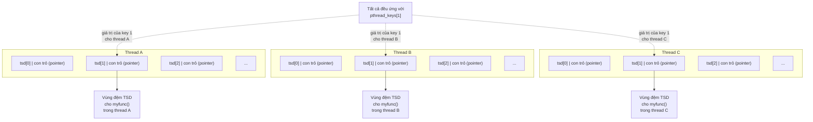

# Chương 31: Luồng: An toàn luồng và Bộ nhớ riêng từng luồng (Threads: Thread Safety and Per-Thread Storage)

Chương này mở rộng phần thảo luận về API POSIX threads, cung cấp mô tả về các hàm an toàn luồng (thread-safe functions) và khởi tạo một lần (one-time initialization). Chúng ta cũng sẽ thảo luận cách sử dụng dữ liệu đặc thù của luồng (thread-specific data) hoặc lưu trữ cục bộ của luồng (thread-local storage) để làm cho một hàm có sẵn trở nên an toàn luồng mà không cần thay đổi giao diện (interface) của hàm đó.

## 31.1 Tính an toàn luồng (Và xem xét lại tính khả nhập)

Một hàm được gọi là an toàn luồng (thread-safe) nếu nó có thể được gọi một cách an toàn bởi nhiều luồng (multiple threads) cùng một lúc; ngược lại, nếu một hàm không an toàn luồng, thì chúng ta không thể gọi nó từ một luồng này trong khi nó đang được thực thi ở một luồng khác. Ví dụ, hàm sau đây (tương tự như đoạn mã mà chúng ta đã xem xét trong Mục [30.1](#page-14-1)) là không an toàn luồng:

```c
static int glob = 0;
static void
incr(int loops)
{
 int loc, j;
```

```c
 for (j = 0; j < loops; j++) {
 loc = glob;
 loc++;
 glob = loc;
 }
}
```

Nếu nhiều luồng gọi hàm này đồng thời (concurrently), giá trị cuối cùng trong biến `glob` sẽ không thể đoán trước được. Hàm này minh họa nguyên nhân điển hình khiến một hàm không an toàn luồng: nó sử dụng các biến toàn cục (global variables) hoặc biến tĩnh (static variables) được chia sẻ bởi tất cả các luồng.

Có nhiều phương pháp khác nhau để làm cho một hàm trở nên an toàn luồng. Một cách là liên kết một mutex với hàm đó (hoặc có thể với tất cả các hàm trong một thư viện, nếu tất cả chúng cùng chia sẻ các biến toàn cục), khóa (lock) mutex đó khi hàm được gọi và mở khóa (unlock) khi hàm trả về. Cách tiếp cận này có ưu điểm là sự đơn giản. Mặt khác, điều đó có nghĩa là tại một thời điểm chỉ có một luồng có thể thực thi hàm—chúng ta gọi việc truy cập vào hàm này là được tuần tự hóa (serialized). Nếu các luồng tiêu tốn một lượng thời gian đáng kể để thực thi hàm này, thì việc tuần tự hóa này sẽ dẫn đến sự sụt giảm khả năng đồng thời (concurrency), bởi vì các luồng của chương trình không còn có thể thực thi song song (parallel) được nữa.

Một giải pháp tinh vi hơn là liên kết mutex với một biến được chia sẻ (shared variable). Sau đó, chúng ta xác định phần nào của hàm là vùng găng (critical section) truy cập vào biến được chia sẻ đó, và chỉ chiếm giữ (acquire) cũng như giải phóng (release) mutex trong quá trình thực thi các vùng găng này. Điều này cho phép nhiều luồng thực thi hàm cùng lúc và hoạt động song song, ngoại trừ khi có nhiều hơn một luồng cần thực thi một vùng găng.

### Các hàm không an toàn luồng (Non-thread-safe functions)

Để hỗ trợ việc phát triển các ứng dụng đa luồng (threaded applications), tất cả các hàm được chỉ định trong SUSv3 đều bắt buộc phải được triển khai theo cách an toàn luồng, ngoại trừ những hàm được liệt kê trong [Bảng 31-1](#page-40-0). (Nhiều hàm trong số này không được thảo luận trong cuốn sách này). Ngoài các hàm được liệt kê trong [Bảng 31-1](#page-40-0), SUSv3 còn quy định những điểm sau:

- Các hàm `ctermid()` và `tmpnam()` không bắt buộc phải an toàn luồng nếu được truyền một đối số `NULL`.
- Các hàm `wcrtomb()` và `wcsrtombs()` không bắt buộc phải an toàn luồng nếu đối số cuối cùng của chúng (`ps`) là `NULL`.

SUSv4 sửa đổi danh sách các hàm trong [Bảng 31-1](#page-40-0) như sau:

- Các hàm `ecvt()`, `fcvt()`, `gcvt()`, `gethostbyname()` và `gethostbyaddr()` bị loại bỏ, vì các hàm này đã bị loại khỏi tiêu chuẩn.
- Các hàm `strsignal()` và `system()` được bổ sung thêm. Hàm `system()` không khả nhập (nonreentrant) vì các thao tác mà nó phải thực hiện đối với trạng thái xử lý tín hiệu (signal dispositions) có hiệu lực trên toàn tiến trình (process-wide).

Các tiêu chuẩn không cấm một bản triển khai (implementation) làm cho các hàm trong [Bảng 31-1](#page-40-0) trở nên an toàn luồng. Tuy nhiên, ngay cả khi một số hàm này an toàn luồng trên một số bản triển khai cụ thể, một ứng dụng có tính di động (portable application) không thể dựa vào điều này trên tất cả các bản triển khai khác nhau.

**Bảng 31-1:** Các hàm không bắt buộc phải an toàn luồng theo SUSv3

| asctime()      | fcvt()             | getpwnam()      | nl_langinfo()      |
|----------------|--------------------|-----------------|--------------------|
| basename()     | ftw()              | getpwuid()      | ptsname()          |
| catgets()      | gcvt()             | getservbyname() | putc_unlocked()    |
| crypt()        | getc_unlocked()    | getservbyport() | putchar_unlocked() |
| ctime()        | getchar_unlocked() | getservent()    | putenv()           |
| dbm_clearerr() | getdate()          | getutxent()     | pututxline()       |
| dbm_close()    | getenv()           | getutxid()      | rand()             |
| dbm_delete()   | getgrent()         | getutxline()    | readdir()          |
| dbm_error()    | getgrgid()         | gmtime()        | setenv()           |
| dbm_fetch()    | getgrnam()         | hcreate()       | setgrent()         |
| dbm_firstkey() | gethostbyaddr()    | hdestroy()      | setkey()           |
| dbm_nextkey()  | gethostbyname()    | hsearch()       | setpwent()         |
| dbm_open()     | gethostent()       | inet_ntoa()     | setutxent()        |
| dbm_store()    | getlogin()         | l64a()          | strerror()         |

| dirname()      | getnetbyaddr()     | lgamma()        | strtok()           |
| dlerror()      | getnetbyname()     | lgammaf()       | ttyname()          |
| drand48()      | getnetent()        | lgammal()       | unsetenv()         |
| ecvt()         | getopt()           | localeconv()    | wcstombs()         |
| encrypt()      | getprotobyname()   | localtime()     | wctomb()           |
| endgrent()     | getprotobynumber() | lrand48()       |                    |
| endpwent()     | getprotoent()      | mrand48()       |                    |
| endutxent()    | getpwent()         | nftw()          |                    |

### Hàm khả nhập (Reentrant) và không khả nhập (Nonreentrant)

Mặc dù việc sử dụng các vùng găng (critical section) để thực thi tính an toàn luồng (thread safety) là một cải tiến đáng kể so với việc sử dụng các mutex riêng cho từng hàm, nhưng nó vẫn có phần kém hiệu quả do chi phí khóa và mở khóa mutex. Một hàm khả nhập (reentrant function) đạt được tính an toàn luồng (thread safety) mà không cần sử dụng mutex. Nó thực hiện điều này bằng cách tránh sử dụng các biến toàn cục (global variable) và biến tĩnh (static variable). Bất kỳ thông tin nào cần trả về cho hàm gọi, hoặc được duy trì giữa các lần gọi hàm, đều được lưu trữ trong các bộ đệm (buffer) do hàm gọi cấp phát. (Chúng ta đã lần đầu gặp khái niệm tính khả nhập khi thảo luận về việc xử lý các biến toàn cục bên trong trình xử lý tín hiệu - signal handler tại Mục 21.1.2). Tuy nhiên, không phải tất cả các hàm đều có thể làm cho khả nhập. Các lý do thông thường bao gồm:

- Bản chất của một số hàm là phải truy cập vào các cấu trúc dữ liệu toàn cục (global data structure). Các hàm trong thư viện `malloc` cung cấp một ví dụ điển hình. Các hàm này duy trì một danh sách liên kết toàn cục (global linked list) các khối trống trên heap. Các hàm của thư viện `malloc` được làm cho an toàn luồng (thread-safe) thông qua việc sử dụng các mutex.
- Một số hàm (được định nghĩa trước khi luồng - thread ra đời) có giao diện theo định nghĩa là không khả nhập (nonreentrant), bởi vì chúng trả về con trỏ đến bộ nhớ được cấp phát tĩnh (statically allocated) bởi chính hàm đó, hoặc chúng sử dụng bộ nhớ tĩnh để duy trì thông tin giữa các lần gọi liên tiếp đến cùng một hàm (hoặc một hàm có liên quan). Hầu hết các hàm trong [Bảng 31-1](#page-40-0) thuộc danh mục này. Ví dụ, hàm `asctime()` (Mục 10.2.3) trả về một con trỏ đến một bộ đệm được cấp phát tĩnh chứa chuỗi ngày-giờ.

Đối với một số hàm có giao diện không khả nhập, SUSv3 quy định các hàm tương đương khả nhập có tên kết thúc bằng hậu tố `_r`. Các hàm này yêu cầu bên gọi cấp phát một bộ đệm mà địa chỉ của nó sau đó được truyền cho hàm và được dùng để trả về kết quả. Điều này cho phép luồng gọi (calling thread) sử dụng một biến cục bộ (trên stack) cho bộ đệm kết quả của hàm. Vì mục đích này, SUSv3 quy định `asctime_r()`, `ctime_r()`, `getgrgid_r()`, `getgrnam_r()`, `getlogin_r()`, `getpwnam_r()`, `getpwuid_r()`, `gmtime_r()`, `localtime_r()`, `rand_r()`, `readdir_r()`, `strerror_r()`, `strtok_r()` và `ttyname_r()`.

> [!NOTE]
> Một số bản cài đặt (implementation) cũng cung cấp các hàm tương đương khả nhập bổ sung cho các hàm không khả nhập truyền thống khác. Ví dụ, glibc cung cấp `crypt_r()`, `gethostbyname_r()`, `getservbyname_r()`, `getutent_r()`, `getutid_r()`, `getutline_r()` và `ptsname_r()`. Tuy nhiên, một ứng dụng có tính di động (portable application) không thể dựa dẫm vào việc các hàm này có mặt trên các bản cài đặt khác. Trong một số trường hợp, SUSv3 không quy định các hàm tương đương khả nhập này bởi vì đã tồn tại các lựa chọn thay thế cho các hàm truyền thống vừa ưu việt hơn vừa khả nhập. Ví dụ, `getaddrinfo()` là lựa chọn thay thế hiện đại, khả nhập cho `gethostbyname()` và `getservbyname()`.

## 31.2 Khởi tạo một lần (One-Time Initialization)

Đôi khi, một ứng dụng đa luồng (threaded application) cần đảm bảo rằng một số thao tác khởi tạo chỉ diễn ra đúng một lần, bất kể có bao nhiêu luồng (thread) được tạo ra. Ví dụ, một mutex cần được khởi tạo với các thuộc tính đặc biệt bằng cách sử dụng `pthread_mutex_init()`, và việc khởi tạo đó phải xảy ra đúng một lần. Nếu chúng ta tạo các luồng từ chương trình chính, việc này nhìn chung khá dễ thực hiện—chúng ta thực hiện khởi tạo trước khi tạo bất kỳ luồng nào phụ thuộc vào quá trình khởi tạo đó. Tuy nhiên, trong một hàm thư viện (library function), điều này là không thể, bởi vì chương trình gọi (calling program) có thể đã tạo các luồng trước lần gọi đầu tiên tới hàm thư viện đó. Do đó, hàm thư viện cần một phương pháp để thực hiện khởi tạo vào lần đầu tiên nó được gọi từ bất kỳ luồng nào.

Một hàm thư viện có thể thực hiện khởi tạo một lần bằng cách sử dụng hàm `pthread_once()`.

## include <pthread.h>

int pthread_once(pthread_once_t *once_control, void (*init)(void));
Trả về 0 nếu thành công, hoặc một số lỗi dương nếu thất bại

```

Hàm `pthread_once()` sử dụng trạng thái của tham số `once_control` để đảm bảo rằng hàm do người gọi định nghĩa được trỏ tới bởi `init` chỉ được gọi đúng một lần, bất kể hàm `pthread_once()` được gọi bao nhiêu lần hoặc từ bao nhiêu luồng khác nhau.

Hàm `init` được gọi mà không có bất kỳ tham số nào, do đó có dạng sau:

```

void
init(void)
{
/* Thân hàm */
}

```

Tham số `once_control` là một con trỏ trỏ đến một biến phải được khởi tạo tĩnh (statically initialized) với giá trị `PTHREAD_ONCE_INIT`:

```

pthread_once_t once_var = PTHREAD_ONCE_INIT;

```

Lần gọi đầu tiên tới `pthread_once()` chỉ định con trỏ đến một biến `pthread_once_t` cụ thể sẽ sửa đổi giá trị của biến được trỏ tới bởi `once_control` sao cho các lần gọi tiếp theo tới `pthread_once()` không gọi lại `init`.

Một cách sử dụng phổ biến của `pthread_once()` là kết hợp với dữ liệu riêng của luồng (thread-specific data), mà chúng ta sẽ mô tả tiếp theo.

> Lý do chính cho sự tồn tại của `pthread_once()` là trong các phiên bản Pthreads đầu tiên, việc khởi tạo tĩnh một mutex là không thể. Thay vào đó, việc sử dụng `pthread_mutex_init()` là bắt buộc ([Butenhof, 1996]). Với việc bổ sung sau đó các mutex được cấp phát tĩnh (statically allocated mutexes), một hàm thư viện có thể thực hiện khởi tạo một lần bằng cách sử dụng một mutex được cấp phát tĩnh và một biến Boolean tĩnh. Mặc dù vậy, `pthread_once()` vẫn được giữ lại để cho thuận tiện.

## 31.3 Dữ liệu riêng của luồng (Thread-Specific Data)

Cách hiệu quả nhất để làm cho một hàm an toàn luồng (thread-safe) là làm cho nó có tính khả nhập (reentrant). Tất cả các hàm thư viện mới nên được triển khai theo cách này. Tuy nhiên, đối với một hàm thư viện không khả nhập (nonreentrant) đã có sẵn (có thể được thiết kế trước khi việc sử dụng luồng trở nên phổ biến), phương pháp này thường yêu cầu thay đổi giao diện (interface) của hàm, đồng nghĩa với việc phải sửa đổi tất cả các chương trình đang sử dụng hàm đó.

Dữ liệu đặc thù của luồng (Thread-specific data - TSD) là một kỹ thuật giúp một hàm hiện có trở nên an toàn luồng mà không cần thay đổi giao diện của nó. Một hàm sử dụng dữ liệu đặc thù của luồng có thể kém hiệu quả hơn một chút so với hàm khả nhập, nhưng cho phép chúng ta giữ nguyên mã nguồn của các chương trình gọi hàm đó.

Dữ liệu riêng của luồng cho phép một hàm duy trì một bản sao riêng của biến cho mỗi luồng gọi hàm đó, như được minh họa trong [Hình 31-1](#page-42-1). Dữ liệu riêng của luồng có tính bền vững (persistent); biến của mỗi luồng tiếp tục tồn tại giữa các lần luồng gọi hàm đó. Điều này cho phép hàm duy trì thông tin trên mỗi luồng (per-thread information) giữa các lần gọi hàm, và cho phép hàm truyền các vùng đệm kết quả khác biệt (nếu cần) tới từng luồng gọi.

```text

┌──────────┐        ┌─────────────────┐
│ Thread A │───────>│   TSD buffer    │
└──────────┘        │  for myfunc()   │
│   in thread A   │
└─────────────────┘

┌──────────┐        ┌─────────────────┐
│ Thread B │───────>│   TSD buffer    │
└──────────┘        │  for myfunc()   │
│   in thread B   │
└─────────────────┘

┌──────────┐        ┌─────────────────┐
│ Thread C │───────>│   TSD buffer    │
└──────────┘        │  for myfunc()   │
│   in thread C   │
└─────────────────┘

```

**Hình 31-1:** Dữ liệu riêng của luồng (Thread-specific data - TSD) cung cấp vùng lưu trữ cho mỗi luồng (per-thread storage) đối với một hàm

### 31.3.1 Dữ liệu đặc thù của luồng từ góc nhìn của hàm thư viện

Để hiểu cách sử dụng API dữ liệu đặc thù của luồng (thread-specific data API), chúng ta cần xem xét vấn đề từ góc độ của một hàm thư viện sử dụng dữ liệu đặc thù của luồng:

- Hàm phải cấp phát (allocate) một khối bộ nhớ riêng biệt cho mỗi luồng gọi hàm đó. Khối này cần được cấp phát một lần, vào lần đầu tiên luồng gọi hàm.
- Trong mỗi lần gọi tiếp theo từ cùng một luồng, hàm cần phải có khả năng lấy được địa chỉ của khối bộ nhớ đã được cấp phát trong lần đầu tiên luồng này gọi hàm. Hàm không thể duy trì một con trỏ (pointer) trỏ đến khối bộ nhớ trong một biến tự động (automatic variable), vì các biến tự động sẽ biến mất khi hàm trả về; hàm cũng không thể lưu con trỏ trong một biến tĩnh (static variable), vì chỉ có duy nhất một thể hiện (instance) của mỗi biến tĩnh tồn tại trong tiến trình (process). Pthreads API cung cấp các hàm để xử lý tác vụ này.
- Các hàm khác nhau (tức là độc lập) có thể cần đến dữ liệu đặc thù của luồng riêng của mình. Mỗi hàm cần một phương thức để nhận diện dữ liệu đặc thù của luồng của nó (một khóa - key), tách biệt với dữ liệu đặc thù của luồng được sử dụng bởi các hàm khác.
- Hàm không có quyền kiểm soát trực tiếp đối với những gì xảy ra khi luồng kết thúc (terminate). Khi luồng kết thúc, nó có thể đang thực thi mã nguồn (code) bên ngoài hàm. Tuy nhiên, phải có một cơ chế nào đó (một hàm hủy - destructor) để đảm bảo rằng khối bộ nhớ được cấp phát cho luồng này sẽ được tự động giải phóng (deallocate) khi luồng kết thúc. Nếu điều này không được thực hiện, rò rỉ bộ nhớ (memory leak) có thể xảy ra khi các luồng được tạo ra liên tục, gọi hàm, rồi sau đó kết thúc.

### 31.3.2 Tổng quan về API dữ liệu đặc thù của luồng

Các bước tổng quát mà một hàm thư viện thực hiện để sử dụng dữ liệu đặc thù của luồng như sau:

- 1. Hàm tạo một khóa (key), đây là phương tiện để phân biệt mục dữ liệu đặc thù của luồng do hàm này sử dụng với các mục dữ liệu đặc thù của luồng do các hàm khác sử dụng. Khóa được tạo bằng cách gọi hàm `pthread_key_create()`. Việc tạo khóa chỉ cần được thực hiện một lần, khi luồng đầu tiên gọi hàm. Cho mục đích này, hàm `pthread_once()` được sử dụng. Việc tạo khóa không cấp phát bất kỳ khối dữ liệu đặc thù của luồng nào.
- 2. Lời gọi đến `pthread_key_create()` phục vụ một mục đích thứ hai: nó cho phép người gọi chỉ định địa chỉ của hàm hủy do lập trình viên định nghĩa (programmer-defined destructor function), được sử dụng để giải phóng từng khối bộ nhớ được cấp phát cho khóa này (xem bước tiếp theo). Khi một luồng có dữ liệu đặc thù kết thúc, Pthreads API sẽ tự động gọi hàm hủy này, truyền cho nó một con trỏ trỏ đến khối dữ liệu dành cho luồng này.
- 3. Hàm cấp phát một khối dữ liệu đặc thù của luồng cho mỗi luồng gọi đến nó. Việc này được thực hiện bằng cách sử dụng `malloc()` (hoặc một hàm tương tự). Việc cấp phát này được thực hiện một lần cho mỗi luồng, vào lần đầu tiên luồng đó gọi hàm.
- 4. Để lưu con trỏ trỏ đến vùng nhớ đã được cấp phát ở bước trước, hàm sử dụng hai hàm Pthreads: `pthread_setspecific()` và `pthread_getspecific()`. Một lời gọi đến `pthread_setspecific()` là một yêu cầu gửi tới tiến trình thực thi Pthreads (Pthreads implementation) nhằm thông báo:

"hãy lưu con trỏ này, ghi nhận thực tế rằng nó được liên kết với một khóa cụ thể (khóa dành cho hàm này) và một luồng cụ thể (luồng gọi hàm)." Việc gọi `pthread_getspecific()` thực hiện tác vụ ngược lại, trả về con trỏ đã được liên kết trước đó với một khóa cho trước đối với luồng gọi hàm. Nếu không có con trỏ nào được liên kết trước đó với một khóa và luồng cụ thể, thì `pthread_getspecific()` sẽ trả về `NULL`. Đây là cách một hàm có thể xác định rằng nó đang được gọi lần đầu tiên bởi luồng này, và do đó phải tiến hành cấp phát khối bộ nhớ cho luồng đó.

### 31.3.3 Chi tiết về API Dữ liệu Đặc thù của Luồng

Trong phần này, chúng ta sẽ đi sâu vào chi tiết của từng hàm đã được nhắc đến ở phần trước, đồng thời làm rõ cách thức hoạt động của dữ liệu đặc thù của luồng (thread-specific data) thông qua việc mô tả cách thức triển khai điển hình của nó. Phần tiếp theo sẽ trình bày cách sử dụng dữ liệu đặc thù của luồng để viết một phiên bản an toàn luồng (thread-safe) của hàm thư viện C chuẩn `strerror()`.

Gọi hàm `pthread_key_create()` sẽ tạo ra một khóa dữ liệu đặc thù của luồng (thread-specific data key) mới và trả về cho bên gọi thông qua vùng đệm mà `key` trỏ tới.

```c

## include <pthread.h>

int pthread_key_create(pthread_key_t *key, void (*destructor)(void *));
Trả về 0 nếu thành công, hoặc một số dương báo lỗi nếu thất bại

```

Vì khóa được trả về này được sử dụng bởi tất cả các thread trong tiến trình (process), nên `key` phải trỏ đến một biến toàn cục (global variable).

Đối số `destructor` trỏ tới một hàm do lập trình viên định nghĩa có dạng như sau:

```

void
dest(void *value)
{
/* Giải phóng bộ nhớ do 'value' trỏ tới */
}

```

Khi một thread kết thúc mà có một giá trị khác NULL (non-NULL) liên kết với `key`, hàm hủy (destructor) sẽ được tự động gọi bởi Pthreads API và truyền giá trị đó làm đối số. Giá trị được truyền này thông thường là một con trỏ trỏ đến khối dữ liệu riêng tư của thread này dành cho khóa đó. Nếu không cần hàm hủy, thì `destructor` có thể được chỉ định là `NULL`.

> Nếu một thread có nhiều khối dữ liệu riêng tư của thread, thì thứ tự gọi các hàm hủy là không xác định. Các hàm hủy nên được thiết kế để hoạt động độc lập với nhau.

Việc xem xét cách hiện thực dữ liệu riêng tư của thread sẽ giúp chúng ta hiểu cách nó được sử dụng. Một cách hiện thực điển hình (NPTL là một ví dụ điển hình) bao gồm các mảng sau:

một mảng toàn cục duy nhất (tức là phạm vi toàn tiến trình - process-wide) chứa thông tin về các khóa dữ liệu riêng tư của thread; và

một tập hợp các mảng cho mỗi thread (per-thread array), mỗi mảng chứa các con trỏ trỏ đến tất cả các khối dữ liệu riêng tư của thread được cấp phát cho một thread cụ thể (tức là mảng này chứa các con trỏ được lưu trữ bởi các lần gọi hàm `pthread_setspecific()`).

Trong cách hiện thực này, giá trị `pthread_key_t` được trả về bởi `pthread_key_create()` đơn giản là một chỉ số (index) trỏ vào mảng toàn cục, mà chúng ta gọi là `pthread_keys`, với cấu trúc được thể hiện ở [Hình 31-2](#page-45-0). Mỗi phần tử của mảng này là một cấu trúc (structure) chứa hai trường (field). Trường đầu tiên cho biết phần tử mảng này có đang được sử dụng hay không (tức là đã được cấp phát bởi một lời gọi `pthread_key_create()` trước đó hay chưa). Trường thứ hai được sử dụng để lưu trữ con trỏ trỏ đến hàm hủy cho các khối dữ liệu riêng tư của thread tương ứng với khóa này (tức là một bản sao của đối số `destructor` trong hàm `pthread_key_create()`).

```text

pthread_keys[0]  ┌──────────────────┐
│   Cờ "in use"    │
├──────────────────┤
│ Con trỏ destructor│
├──────────────────┤
pthread_keys[1]  │   Cờ "in use"    │
├──────────────────┤
│ Con trỏ destructor│
├──────────────────┤
pthread_keys[2]  │   Cờ "in use"    │
├──────────────────┤
│ Con trỏ destructor│
├──────────────────┤
│       ...        │
└──────────────────┘

```

**Hình 31-2:** Cách hiện thực các khóa dữ liệu riêng tư của thread

Hàm `pthread_setspecific()` yêu cầu Pthreads API lưu một bản sao của `value` vào một cấu trúc dữ liệu nhằm liên kết nó với thread gọi và với `key` — một khóa được trả về từ lời gọi `pthread_key_create()` trước đó. Hàm `pthread_getspecific()` thực hiện thao tác ngược lại, trả về giá trị đã được liên kết trước đó với khóa cho trước đối với thread này.

```c

## include <pthread.h>

int pthread_setspecific(pthread_key_t key, const void *value);
Trả về 0 nếu thành công, hoặc một số dương báo lỗi nếu thất bại
void *pthread_getspecific(pthread_key_t key);
Trả về con trỏ, hoặc NULL nếu không có dữ liệu đặc thù của luồng nào liên kết với key

```

Đối số `value` được truyền cho `pthread_setspecific()` thông thường là một con trỏ trỏ đến một khối bộ nhớ đã được người gọi cấp phát trước đó. Con trỏ này sẽ được truyền làm đối số cho hàm hủy của khóa này khi thread kết thúc.

> Đối số `value` không nhất thiết phải là một con trỏ trỏ tới một khối bộ nhớ. Nó có thể là một giá trị vô hướng (scalar value) nào đó có thể gán (bằng cách ép kiểu - cast) sang kiểu `void *`. Trong trường hợp này, lời gọi `pthread_key_create()` trước đó sẽ chỉ định `destructor` là `NULL`.

[Hình 31-3](#page-46-0) minh họa một cách hiện thực tiêu biểu của cấu trúc dữ liệu dùng để lưu trữ `value`. Trong sơ đồ này, chúng ta giả sử rằng `pthread_keys[1]` đã được cấp phát cho một hàm có tên là `myfunc()`. Đối với mỗi thread, Pthreads API duy trì một mảng các con trỏ trỏ tới các khối dữ liệu riêng tư của thread. Các phần tử của mỗi mảng riêng cho từng thread này có mối quan hệ tương ứng một-một với các phần tử của mảng toàn cục `pthread_keys` được hiển thị ở [Hình 31-2](#page-45-0). Hàm `pthread_setspecific()` thiết lập phần tử tương ứng với `key` trong mảng dành cho thread gọi.



**Hình 31-3:** Cấu trúc dữ liệu được sử dụng để triển khai các con trỏ dữ liệu đặc thù của luồng (TSD pointers)

Khi một luồng mới được tạo ra, tất cả các con trỏ dữ liệu đặc thù của nó đều được khởi tạo thành `NULL`. Điều này có nghĩa là khi hàm thư viện của chúng ta được gọi bởi một luồng lần đầu tiên, nó phải bắt đầu bằng việc dùng `pthread_getspecific()` để kiểm tra xem luồng đó đã có giá trị liên kết với khóa `key` hay chưa. Nếu chưa, hàm sẽ cấp phát một khối bộ nhớ và lưu con trỏ trỏ tới khối đó bằng cách gọi `pthread_setspecific()`. Chúng ta sẽ thấy ví dụ về kỹ thuật này trong bản triển khai `strerror()` an toàn luồng được trình bày ở phần tiếp theo.

### 31.3.4 Sử dụng API Dữ liệu Riêng biệt của Thread (Thread-Specific Data API)

Khi chúng ta mô tả lần đầu tiên hàm tiêu chuẩn `strerror()` trong Mục 3.4, chúng ta đã lưu ý rằng nó có thể trả về một con trỏ trỏ đến một chuỗi được cấp phát tĩnh làm kết quả của hàm. Điều này có nghĩa là `strerror()` có thể không an toàn trong môi trường đa luồng (thread-safe). Trong vài trang tiếp theo, chúng ta sẽ xem xét một hiện thực của `strerror()` không an toàn đa luồng (non-thread-safe), và sau đó cho thấy cách dữ liệu riêng biệt của thread (thread-specific data) có thể được sử dụng để làm cho hàm này trở nên an toàn đa luồng (thread-safe).

Trên nhiều hiện thực UNIX, bao gồm cả Linux, hàm `strerror()` được cung cấp bởi thư viện C chuẩn là an toàn đa luồng (thread-safe). Tuy nhiên, chúng ta vẫn sử dụng ví dụ về `strerror()` bởi vì tiêu chuẩn SUSv3 không bắt buộc hàm này phải an toàn đa luồng, và hiện thực của nó cung cấp một ví dụ đơn giản về việc sử dụng dữ liệu riêng biệt của thread.

[Liệt kê 31-1](#page-47-0) cho thấy một hiện thực đơn giản không an toàn đa luồng của `strerror()`. Hàm này sử dụng một cặp biến toàn cục (global variables) được định nghĩa bởi glibc: `_sys_errlist` là một mảng các con trỏ trỏ đến các chuỗi tương ứng với các mã lỗi trong `errno` (do đó, ví dụ, `_sys_errlist[EINVAL]` trỏ đến chuỗi `Invalid operation`), và `_sys_nerr` chỉ định số lượng phần tử trong `_sys_errlist`.

**Liệt kê 31-1:** Một hiện thực của `strerror()` không an toàn đa luồng (not thread-safe)

```c

–––––––––––––––––––––––––––––––––––––––––––––––––––––––– threads/strerror.c

## define _GNU_SOURCE /* Lấy khai báo '_sys_nerr' và '_sys_errlist'

từ <stdio.h> */

## include <stdio.h>

## include <string.h> /* Lấy khai báo của strerror() */

## define MAX_ERROR_LEN 256 /* Chiều dài tối đa của chuỗi

do strerror() trả về */
static char buf[MAX_ERROR_LEN]; /* Vùng đệm trả về được cấp phát tĩnh */
char *
strerror(int err)
{
if (err < 0 || err >= _sys_nerr || _sys_errlist[err] == NULL) {
snprintf(buf, MAX_ERROR_LEN, "Unknown error %d", err);
} else {
strncpy(buf, _sys_errlist[err], MAX_ERROR_LEN - 1);
buf[MAX_ERROR_LEN - 1] = '\0'; /* Đảm bảo có ký tự kết thúc chuỗi null */
}
return buf;
}
–––––––––––––––––––––––––––––––––––––––––––––––––––––––– threads/strerror.c

```

Chúng ta có thể sử dụng chương trình trong [Liệt kê 31-2](#page-48-0) để minh họa hậu quả của việc hiện thực `strerror()` trong [Liệt kê 31-1](#page-47-0) không an toàn đa luồng. Chương trình này gọi `strerror()` từ hai thread khác nhau, nhưng chỉ hiển thị giá trị trả về sau khi cả hai thread đã gọi `strerror()`. Mặc dù mỗi thread chỉ định một giá trị khác nhau (`EINVAL` và `EPERM`) làm đối số cho `strerror()`, đây là kết quả chúng ta thấy khi biên dịch và liên kết (link) chương trình này với phiên bản `strerror()` được hiển thị trong [Liệt kê 31-1](#page-47-0):

```

$ ./strerror_test

```

```

Main thread has called strerror()
Other thread about to call strerror()
Other thread: str (0x804a7c0) = Operation not permitted
Main thread: str (0x804a7c0) = Operation not permitted

```

Cả hai thread đều hiển thị chuỗi `errno` tương ứng với `EPERM`, bởi vì lệnh gọi `strerror()` bởi thread thứ hai (trong `threadFunc`) đã ghi đè lên vùng đệm vốn đã được ghi bởi lệnh gọi `strerror()` trong thread chính (main thread). Kiểm tra kết quả đầu ra cho thấy biến cục bộ `str` trong hai thread trỏ đến cùng một địa chỉ bộ nhớ.

**Liệt kê 31-2:** Gọi strerror() từ hai Thread khác nhau

```c

––––––––––––––––––––––––––––––––––––––––––––––––––– threads/strerror_test.c

## include <stdio.h>

## include <string.h> /* Lấy khai báo của strerror() */

## include <pthread.h>

## include "tlpi_hdr.h"

static void *
threadFunc(void *arg)
{
char *str;
printf("Other thread about to call strerror()\n");
str = strerror(EPERM);
printf("Other thread: str (%p) = %s\n", str, str);
return NULL;
}
int
main(int argc, char *argv[])
{
pthread_t t;
int s;
char *str;
str = strerror(EINVAL);
printf("Main thread has called strerror()\n");
s = pthread_create(&t, NULL, threadFunc, NULL);
if (s != 0)
errExitEN(s, "pthread_create");
s = pthread_join(t, NULL);
if (s != 0)
errExitEN(s, "pthread_join");
printf("Main thread: str (%p) = %s\n", str, str);
exit(EXIT_SUCCESS);
}
––––––––––––––––––––––––––––––––––––––––––––––––––– threads/strerror_test.c

```

[Liệt kê 31-3](#page-49-0) minh họa cách cài đặt lại hàm strerror() sử dụng dữ liệu riêng biệt của thread (Thread-Specific Data - TSD) nhằm đảm bảo tính an toàn đơn luồng/đa luồng (thread safety).

Bước đầu tiên được thực hiện bởi hàm strerror() phiên bản sửa đổi là gọi `pthread_once()` r nhằm đảm bảo rằng lần gọi đầu tiên của hàm này (từ bất kỳ thread nào) sẽ kích hoạt hàm `createKey()` w. Hàm `createKey()` gọi `pthread_key_create()` để cấp phát một khóa dữ liệu riêng biệt của thread (thread-specific data key) được lưu trữ trong biến toàn cục `strerrorKey` e. Lời gọi `pthread_key_create()` đồng thời ghi lại địa chỉ của hàm hủy q (destructor), hàm này sẽ được sử dụng để giải phóng các bộ đệm riêng biệt của thread tương ứng với khóa này.

Hàm strerror() sau đó gọi `pthread_getspecific()` t để truy xuất địa chỉ bộ đệm độc nhất của thread hiện tại tương ứng với `strerrorKey`. Nếu `pthread_getspecific()` trả về NULL, điều đó có nghĩa là thread này đang gọi strerror() lần đầu tiên; do đó, hàm sẽ cấp phát một bộ đệm mới sử dụng `malloc()` y và lưu lại địa chỉ của bộ đệm đó bằng cách sử dụng `pthread_setspecific()` u. Nếu lời gọi `pthread_getspecific()` trả về một giá trị khác NULL, con trỏ đó sẽ trỏ đến một bộ đệm đã tồn tại được cấp phát từ lần gọi strerror() trước đó của thread này.

Phần còn lại của việc cài đặt strerror() này tương tự như phiên bản chúng ta đã xem trước đó, chỉ khác ở điểm `buf` là địa chỉ của một bộ đệm dữ liệu riêng biệt của thread, thay vì là một biến tĩnh (static variable).

**Liệt kê 31-3:** Cài đặt an toàn đa luồng cho strerror() sử dụng dữ liệu riêng biệt của thread

```c

–––––––––––––––––––––––––––––––––––––––––––––––––––– threads/strerror_tsd.c

## define _GNU_SOURCE /* Lấy các khai báo '_sys_nerr' và '_sys_errlist'

từ <stdio.h> */

## include <stdio.h>

## include <string.h> /* Lấy khai báo của strerror() */

## include <pthread.h>

## include "tlpi_hdr.h"

static pthread_once_t once = PTHREAD_ONCE_INIT;
static pthread_key_t strerrorKey;

## define MAX_ERROR_LEN 256 /* Độ dài tối đa của chuỗi trong bộ đệm

trên mỗi luồng được trả về bởi strerror() */
static void /* Giải phóng bộ đệm dữ liệu đặc thù của luồng */
destructor(void *buf)
{
free(buf);
}
static void /* Hàm tạo khóa một lần */
createKey(void)
{
int s;
/* Cấp phát một khóa dữ liệu đặc thù của luồng duy nhất và lưu địa chỉ
của hàm hủy cho các bộ đệm dữ liệu đặc thù của luồng */
s = pthread_key_create(&strerrorKey, destructor);
if (s != 0)
errExitEN(s, "pthread_key_create");
}

char *
strerror(int err)
{
int s;
char *buf;
/* Bắt luồng gọi đầu tiên cấp phát khóa cho dữ liệu đặc thù của luồng */
s = pthread_once(&once, createKey);
if (s != 0)
errExitEN(s, "pthread_once");
buf = pthread_getspecific(strerrorKey);
if (buf == NULL) { /* Nếu là lần gọi đầu tiên từ luồng này, cấp phát
bộ đệm cho luồng và lưu vị trí của nó */
buf = malloc(MAX_ERROR_LEN);
if (buf == NULL)
errExit("malloc");
s = pthread_setspecific(strerrorKey, buf);
if (s != 0)
errExitEN(s, "pthread_setspecific");
}
if (err < 0 || err >= _sys_nerr || _sys_errlist[err] == NULL) {
snprintf(buf, MAX_ERROR_LEN, "Unknown error %d", err);
} else {
strncpy(buf, _sys_errlist[err], MAX_ERROR_LEN - 1);
buf[MAX_ERROR_LEN - 1] = '\0'; /* Đảm bảo kết thúc bằng ký tự null */
}
return buf;
}
–––––––––––––––––––––––––––––––––––––––––––––––––––– threads/strerror_tsd.c

```

Nếu chúng ta biên dịch và liên kết chương trình kiểm thử của mình ([Liệt kê 31-2](#page-48-0)) với phiên bản strerror() mới ([Liệt kê 31-3](#page-49-0)) để tạo ra một tệp thực thi `strerror_test_tsd`, chúng ta sẽ thu được kết quả sau khi chạy chương trình:

```

$ ./strerror_test_tsd
Main thread has called strerror()

```

```

Other thread about to call strerror()
Other thread: str (0x804b158) = Operation not permitted
Main thread: str (0x804b008) = Invalid argument

```

Từ kết quả đầu ra này, chúng ta thấy rằng phiên bản strerror() mới đã an toàn đa luồng (thread-safe). Chúng ta cũng nhận thấy rằng địa chỉ mà biến cục bộ `str` trỏ tới ở hai thread là khác nhau.

### 31.3.5 Giới hạn Triển khai Dữ liệu Riêng biệt của Luồng (Thread-Specific Data)

Như đã ngụ ý qua phần mô tả về cách dữ liệu riêng biệt của luồng (thread-specific data) thường được triển khai, một hệ thống có thể cần áp đặt các giới hạn về số lượng khóa (key) dữ liệu riêng biệt của luồng mà nó hỗ trợ. SUSv3 yêu cầu một hệ thống phải hỗ trợ ít nhất 128 (\_POSIX\_THREAD\_KEYS\_MAX) khóa. Một ứng dụng có thể xác định số lượng khóa mà hệ thống thực tế hỗ trợ thông qua định nghĩa của PTHREAD\_KEYS\_MAX (được định nghĩa trong <limits.h>) hoặc bằng cách gọi hàm sysconf(\_SC\_THREAD\_KEYS\_MAX). Linux hỗ trợ tối đa 1024 khóa.

Ngay cả 128 khóa cũng phải là quá đủ đối với hầu hết các ứng dụng. Điều này là do mỗi hàm thư viện chỉ nên sử dụng một số lượng nhỏ các khóa—thường chỉ là một. Nếu một hàm yêu cầu nhiều giá trị dữ liệu riêng biệt của luồng, chúng thường có thể được đặt trong một cấu trúc duy nhất chỉ có một khóa dữ liệu riêng biệt của luồng đi kèm.

## 31.4 Lưu trữ Cục bộ Luồng (Thread-Local Storage)

Giống như dữ liệu riêng biệt của luồng (thread-specific data), lưu trữ cục bộ luồng (thread-local storage - TLS) cung cấp bộ nhớ bền vững cho từng luồng (per-thread storage). Tính năng này không phải là chuẩn mực (nonstandard), nhưng nó được cung cấp dưới dạng tương tự hoặc giống nhau trên nhiều hệ thống UNIX khác (ví dụ: Solaris và FreeBSD).

Ưu điểm chính của lưu trữ cục bộ luồng là nó đơn giản hơn rất nhiều khi sử dụng so với dữ liệu riêng biệt của luồng. Để tạo một biến cục bộ luồng, chúng ta chỉ cần thêm bộ xác định (specifier) `__thread` vào phần khai báo của một biến toàn cục (global) hoặc tĩnh (static):

```

static __thread buf[MAX_ERROR_LEN];

```

Mỗi luồng có bản sao riêng của các biến được khai báo với bộ xác định này. Các biến trong bộ lưu trữ cục bộ luồng tồn tại cho đến khi luồng kết thúc, tại thời điểm đó bộ nhớ sẽ tự động được giải phóng (deallocated).

Lưu ý các điểm sau đây về việc khai báo và sử dụng các biến cục bộ luồng:

- Từ khóa `__thread` phải đứng ngay sau từ khóa `static` hoặc `extern`, nếu một trong hai từ khóa này được chỉ định trong phần khai báo của biến.
- Việc khai báo một biến cục bộ luồng có thể bao gồm một hàm khởi tạo (initializer), theo cách tương tự như khai báo biến toàn cục hoặc tĩnh thông thường.
- Toán tử lấy địa chỉ `&` của C có thể được sử dụng để lấy địa chỉ của một biến cục bộ luồng.

Lưu trữ cục bộ luồng yêu cầu hỗ trợ từ kernel (được cung cấp từ Linux 2.6), phần triển khai Pthreads (được cung cấp trong NPTL) và trình biên dịch C (được cung cấp trên x86-32 với gcc 3.3 trở lên).

[Liệt kê 31-4](#page-52-0) cho thấy một cách triển khai an toàn luồng (thread-safe) của hàm strerror() sử dụng lưu trữ cục bộ luồng. Nếu chúng ta biên dịch và liên kết chương trình kiểm tra của mình [\(Liệt kê 31-2](#page-48-0)) với phiên bản strerror() này để tạo ra một tệp thực thi, strerror\_test\_tls, thì chúng ta sẽ thấy kết quả sau khi chạy chương trình:

```

$ ./strerror_test_tls

```

```

Main thread has called strerror()
Other thread about to call strerror()
Other thread: str (0x40376ab0) = Operation not permitted
Main thread: str (0x40175080) = Invalid argument

```

**Liệt kê 31-4:** Một bản triển khai an toàn luồng của strerror() sử dụng lưu trữ cục bộ luồng

```c

–––––––––––––––––––––––––––––––––––––––––––––––––––– threads/strerror_tls.c

## define _GNU_SOURCE /* Lấy khai báo '_sys_nerr' và '_sys_errlist'

từ <stdio.h> */

## include <stdio.h>

## include <string.h> /* Lấy khai báo của strerror() */

## include <pthread.h>

## define MAX_ERROR_LEN 256 /* Độ dài tối đa của chuỗi trong bộ đệm

trên mỗi luồng được trả về bởi strerror() */
static __thread char buf[MAX_ERROR_LEN];
/* Bộ đệm trả về cục bộ của luồng */
char *
strerror(int err)
{
if (err < 0 || err >= _sys_nerr || _sys_errlist[err] == NULL) {
snprintf(buf, MAX_ERROR_LEN, "Unknown error %d", err);
} else {
strncpy(buf, _sys_errlist[err], MAX_ERROR_LEN - 1);
buf[MAX_ERROR_LEN - 1] = '\0'; /* Đảm bảo kết thúc bằng ký tự null */
}
return buf;
}
––––––––––––––––––––––––––––––––––––––––––––––––––––– threads/strerror_tls.c

```

## 31.5 Tóm tắt

Một hàm được gọi là an toàn luồng (thread-safe) nếu nó có thể được gọi một cách an toàn từ nhiều luồng (thread) cùng một lúc. Lý do thông thường khiến một hàm không an toàn luồng là vì nó sử dụng các biến toàn cục (global) hoặc tĩnh (static). Một cách để làm cho một hàm không an toàn luồng trở nên an toàn trong một ứng dụng đa luồng (multithreaded application) là bảo vệ tất cả các lần gọi hàm bằng một khóa mutex (mutex lock). Phương pháp này gặp vấn đề là làm giảm tính đồng thời (concurrency), bởi vì chỉ có một luồng có thể ở bên trong hàm tại bất kỳ thời điểm nào. Một phương pháp cho phép tính đồng thời lớn hơn là thêm các khóa mutex chỉ xung quanh những phần của hàm thao tác với các biến được chia sẻ (các vùng tranh chấp - critical sections).

Mutex có thể được sử dụng để làm cho hầu hết các hàm trở thành an toàn luồng, nhưng chúng đi kèm với cái giá về hiệu năng (performance penalty) vì có chi phí cho việc khóa và mở khóa một mutex. Bằng cách tránh sử dụng các biến toàn cục và tĩnh, một hàm tái nhập (reentrant function) đạt được tính an toàn luồng mà không cần sử dụng mutex.

Hầu hết các hàm được chỉ định trong SUSv3 đều được yêu cầu phải an toàn luồng. SUSv3 cũng liệt kê một tập hợp nhỏ các hàm không bắt buộc phải an toàn luồng. Thông thường, đây là những hàm sử dụng bộ nhớ tĩnh (static storage) để trả về thông tin cho hàm gọi hoặc để duy trì thông tin giữa các lần gọi liên tiếp. Theo định nghĩa, các hàm như vậy không thể tái nhập (non-reentrant), và không thể dùng mutex để làm cho chúng an toàn luồng. Chúng ta đã xem xét hai kỹ thuật lập trình gần như tương đương nhau—dữ liệu đặc thù luồng (thread-specific data) và lưu trữ cục bộ luồng (thread-local storage)—có thể được sử dụng để biến một hàm không an toàn thành an toàn luồng mà không cần thay đổi giao diện (interface) của nó. Cả hai kỹ thuật này đều cho phép một hàm phân bổ vùng nhớ bền vững, riêng biệt cho từng luồng (per-thread storage).

## Thông tin thêm

Tham khảo các nguồn thông tin bổ sung được liệt kê trong Mục [29.10.](#page-12-0)

## 31.6 Bài tập

- **31-1.** Triển khai một hàm `one_time_init(control, init)`, thực hiện chức năng tương đương với `pthread_once()`. Đối số `control` phải là con trỏ tới một cấu trúc được cấp phát tĩnh bao gồm một biến kiểu Boolean và một mutex. Biến Boolean cho biết hàm `init` đã được gọi hay chưa, và mutex điều khiển quyền truy cập vào biến đó. Để giữ cho việc triển khai đơn giản, bạn có thể bỏ qua các khả năng như `init()` bị lỗi hoặc bị hủy khi được gọi lần đầu tiên từ một luồng (nghĩa là, không cần thiết phải devised một cơ chế sao cho, nếu sự kiện đó xảy ra, luồng tiếp theo gọi `one_time_init()` sẽ thử gọi lại `init()`).
- **31-2.** Sử dụng dữ liệu đặc thù luồng (thread-specific data) để viết các phiên bản an toàn luồng của `dirname()` và `basename()` (Mục 18.14).
