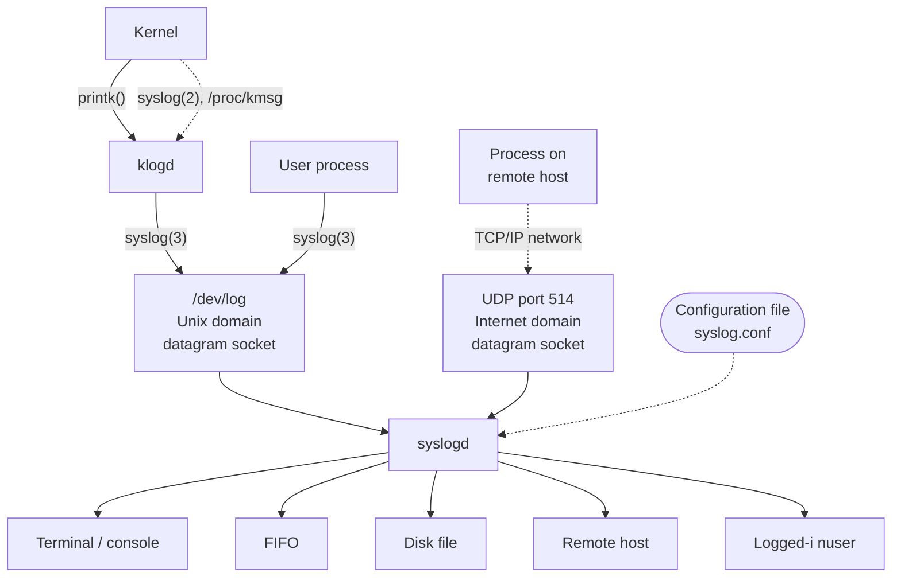

# Chương 37: Tiến trình nền (Daemons)

Chương này khảo sát các đặc điểm của tiến trình nền (daemon process) và xem xét các bước cần thiết để biến một tiến trình thành một daemon. Chúng ta cũng sẽ tìm hiểu cách ghi log các thông điệp từ một daemon bằng cách sử dụng tiện ích `syslog`.

## 37.1 Tổng quan

Một daemon là một tiến trình có các đặc điểm sau:

- Nó có vòng đời dài (long-lived). Thường thì một daemon được tạo ra khi khởi động hệ thống và chạy cho đến khi hệ thống tắt.
- Nó chạy ở nền (background) và không có terminal điều khiển (controlling terminal). Việc thiếu terminal điều khiển đảm bảo rằng kernel không bao giờ tự động tạo ra bất kỳ tín hiệu kiểm soát công việc (job-control) hoặc liên quan đến terminal nào (như `SIGINT`, `SIGTSTP` và `SIGHUP`) cho một daemon.

Các daemon được viết để thực hiện các tác vụ cụ thể, được minh họa qua các ví dụ sau:

- `cron`: một daemon thực thi các câu lệnh vào thời điểm đã lên lịch.
- `sshd`: daemon Secure Shell, cho phép đăng nhập từ các máy chủ từ xa sử dụng giao thức truyền thông bảo mật.
- `httpd`: daemon máy chủ HTTP (Apache), phục vụ các trang web.
- `inetd`: daemon siêu máy chủ Internet (được mô tả trong Mục 60.5), lắng nghe các kết nối mạng đến trên các cổng TCP/IP được chỉ định và khởi chạy các chương trình máy chủ phù hợp để xử lý các kết nối này.

Nhiều daemon chuẩn chạy dưới dạng các tiến trình có đặc quyền (tức là có ID người dùng hiệu dụng - effective user ID bằng 0), do đó nên được mã hóa tuân theo các hướng dẫn được cung cấp trong Chương [38.](#page-50-0)

Có một quy ước (không phải lúc nào cũng tuân thủ phổ biến) rằng các daemon có tên kết thúc bằng chữ cái `d`.

> [!NOTE]
> Trên Linux, một số daemon chạy dưới dạng các luồng nhân (kernel thread). Mã nguồn của các daemon như vậy là một phần của kernel và chúng thường được tạo ra trong quá trình khởi động hệ thống. Khi được liệt kê bằng lệnh `ps(1)`, tên của các daemon này được đặt trong dấu ngoặc vuông ([]). Một ví dụ về kernel thread là `pdflush`, có nhiệm vụ định kỳ xả (flush) các trang bẩn (dirty pages, ví dụ: các trang từ bộ đệm `buffer cache`) xuống đĩa.

## 37.2 Tạo một Daemon

Để trở thành một daemon, một chương trình thực hiện các bước sau:

- 1. Thực hiện một lời gọi `fork()`, sau đó tiến trình cha kết thúc (exits) và tiến trình con tiếp tục chạy. (Do đó, daemon trở thành tiến trình con của tiến trình `init`.) Bước này được thực hiện vì hai lý do:
  - Giả sử daemon được khởi động từ dòng lệnh (command line), việc tiến trình cha chấm dứt sẽ được shell chú ý, shell sau đó sẽ hiển thị một dấu nhắc lệnh (shell prompt) khác và để tiến trình con tiếp tục chạy ở nền (background).
  - Tiến trình con được đảm bảo không phải là tiến trình dẫn đầu nhóm (process group leader), vì nó kế thừa ID nhóm tiến trình (process group ID) từ tiến trình cha và nhận được ID tiến trình (process ID) độc lập của riêng mình, khác với ID nhóm tiến trình được kế thừa. Điều này là bắt buộc để có thể thực hiện thành công bước tiếp theo.
- 2. Tiến trình con gọi `setsid()` (Mục 34.3) để bắt đầu một phiên làm việc (session) mới và tự giải phóng khỏi bất kỳ mối liên hệ nào với terminal điều khiển (controlling terminal).
- 3. Nếu daemon không bao giờ mở bất kỳ thiết bị terminal nào sau đó, thì chúng ta không cần lo lắng về việc daemon tái chiếm terminal điều khiển. Nếu daemon có thể mở một thiết bị terminal sau đó, thì chúng ta phải thực hiện các bước để đảm bảo rằng thiết bị đó không trở thành terminal điều khiển. Chúng ta có thể làm điều này theo hai cách:
  - Chỉ định cờ `O_NOCTTY` trên bất kỳ lời gọi `open()` nào có thể áp dụng cho thiết bị terminal.
  - Hoặc đơn giản hơn, thực hiện một lời gọi `fork()` thứ hai sau lời gọi `setsid()`, và một lần nữa để tiến trình cha kết thúc và tiến trình con (cháu) tiếp tục chạy. Điều này đảm bảo rằng tiến trình con không phải là tiến trình dẫn đầu phiên làm việc (session leader), và do đó, theo các quy ước của System V đối vối việc chiếm terminal điều khiển (mà Linux tuân theo), tiến trình không bao giờ có thể tái chiếm terminal điều khiển (Mục 34.4).

Trên các hệ thống thực thi theo quy ước BSD, một tiến trình chỉ có thể lấy được terminal điều khiển thông qua một thao tác `ioctl()` `TIOCSCTTY` rõ ràng, do đó lời gọi `fork()` thứ hai này không có tác dụng liên quan đến việc chiếm terminal điều khiển, nhưng việc gọi `fork()` thừa thãi này cũng không gây hại gì.

- 4. Xóa umask của tiến trình (Mục 15.4.6), để đảm bảo rằng khi daemon tạo các tệp và thư mục, chúng có các quyền hạn (permissions) đã yêu cầu.
- 5. Thay đổi thư mục làm việc hiện tại (current working directory) của tiến trình, thường là về thư mục gốc (`/`). Điều này là cần thiết vì một tiến trình daemon thường chạy cho đến khi hệ thống tắt; nếu thư mục làm việc hiện tại của daemon nằm trên một hệ thống tệp (file system) khác với hệ thống tệp chứa `/`, thì hệ thống tệp đó không thể bị gỡ gắn kết (unmount) (Mục 14.8.2). Ngoài ra, daemon có thể thay đổi thư mục làm việc của nó thành một vị trí nơi nó thực hiện công việc hoặc một vị trí được xác định trong tệp cấu hình của nó, miễn là chúng ta biết rằng hệ thống tệp chứa thư mục này không bao giờ cần phải gỡ gắn kết. Ví dụ, `cron` đặt nó vào `/var/spool/cron`.
- 6. Đóng tất cả các mô tả tệp (file descriptor) đang mở mà daemon đã kế thừa từ tiến trình cha. (Một daemon có thể cần giữ một số mô tả tệp được kế thừa ở trạng thái mở, vì vậy bước này là tùy chọn hoặc có thể thay đổi tùy trường hợp.) Điều này được thực hiện vì nhiều lý do. Vì daemon đã mất terminal điều khiển và đang chạy ở nền, việc daemon giữ các mô tả tệp 0, 1 và 2 ở trạng thái mở là vô nghĩa nếu chúng trỏ đến terminal. Hơn nữa, chúng ta không thể gỡ gắn kết bất kỳ hệ thống tệp nào mà daemon có vòng đời dài đang giữ các tệp mở trên đó. Và như thường lệ, chúng ta nên đóng các mô tả tệp đang mở nhưng không sử dụng vì mô tả tệp là một tài nguyên hữu hạn.

Một số bản cài đặt UNIX (ví dụ: Solaris 9 và một số phiên bản BSD gần đây) cung cấp một hàm có tên là closefrom(n) (hoặc tương tự), dùng để đóng tất cả các bộ mô tả tệp (File Descriptor) lớn hơn hoặc bằng n. Hàm này không có sẵn trên Linux.

- 7. Sau khi đã đóng các bộ mô tả tệp 0, 1 và 2, một tiến trình nền (daemon) thường mở /dev/null và sử dụng dup2() (hoặc hàm tương tự) để khiến tất cả các bộ mô tả đó trỏ đến thiết bị này. Việc này được thực hiện vì hai lý do:
  - Nó đảm bảo rằng nếu daemon gọi các hàm thư viện thực hiện các thao tác I/O trên các bộ mô tả này, những hàm đó sẽ không bị lỗi một cách bất ngờ.
  - Nó ngăn ngừa khả năng daemon sau đó mở một tệp sử dụng bộ mô tả 1 hoặc 2, tệp này sau đó bị ghi vào—và do đó bị hỏng—bởi một hàm thư viện vốn mong đợi đối xử với các bộ mô tả này như là đầu ra chuẩn (standard output) và lỗi chuẩn (standard error).

/dev/null là một thiết bị ảo luôn hủy bỏ dữ liệu được ghi vào nó. Khi chúng ta muốn loại bỏ đầu ra chuẩn hoặc lỗi chuẩn của một lệnh shell, chúng ta có thể chuyển hướng (redirect) nó vào tệp này. Các thao tác đọc từ thiết bị này luôn trả về dấu hiệu kết thúc tệp (end-of-file).

Bây giờ chúng ta sẽ trình bày việc hiện thực một hàm, becomeDaemon(), thực hiện các bước được mô tả ở trên nhằm biến tiến trình gọi (caller) thành một daemon.

```c
## include <syslog.h>
int becomeDaemon(int flags);
                                             Trả về 0 khi thành công, hoặc –1 khi lỗi
```

Hàm becomeDaemon() nhận một tham số mặt nạ bit (bit-mask), flags, cho phép tiến trình gọi chọn lọc việc vô hiệu hóa một số bước, như được mô tả trong phần chú thích ở tệp tiêu đề (header file) trong [Listing 37-1](#page-37-0).

```c
––––––––––––––––––––––––––––––––––––––––––––––––––– daemons/become_daemon.h
## ifndef BECOME_DAEMON_H /* Ngăn chặn việc include nhiều lần */
## define BECOME_DAEMON_H
/* Các giá trị mặt nạ bit cho tham số 'flags' của becomeDaemon() */
## define BD_NO_CHDIR 01 /* Không chdir("/") */
## define BD_NO_CLOSE_FILES 02 /* Không đóng tất cả các tệp đang mở */
## define BD_NO_REOPEN_STD_FDS 04 /* Không mở lại stdin, stdout, và
 stderr vào /dev/null */
## define BD_NO_UMASK0 010 /* Không thực hiện umask(0) */
## define BD_MAX_CLOSE 8192 /* Số lượng file descriptor tối đa cần đóng nếu
 sysconf(_SC_OPEN_MAX) không xác định */
int becomeDaemon(int flags);
## endif
––––––––––––––––––––––––––––––––––––––––––––––––––– daemons/become_daemon.h
```

Việc hiện thực hàm becomeDaemon() được thể hiện trong [Listing 37-2.](#page-37-1)

Thư viện chuẩn C của GNU cung cấp một hàm phi chuẩn, daemon(), biến tiến trình gọi thành một daemon. Hàm daemon() của glibc không có phần tương đương với tham số flags của hàm becomeDaemon() của chúng ta.

**Listing 37-2:** Tạo một tiến trình daemon

```c
––––––––––––––––––––––––––––––––––––––––––––––––––– daemons/become_daemon.c
## include <sys/stat.h>
## include <fcntl.h>
## include "become_daemon.h"
## include "tlpi_hdr.h"
int /* Trả về 0 khi thành công, -1 khi lỗi */
becomeDaemon(int flags)
{
 int maxfd, fd;
 switch (fork()) { /* Trở thành tiến trình nền (background process) */
 case -1: return -1;
 case 0: break; /* Tiến trình con tiếp tục thực thi... */
 default: _exit(EXIT_SUCCESS); /* trong khi tiến trình cha kết thúc */
 }
 if (setsid() == -1) /* Trở thành tiến trình dẫn đầu (leader) của phiên (session) mới */
 return -1;
 switch (fork()) { /* Đảm bảo chúng ta không phải là tiến trình dẫn đầu phiên */
 case -1: return -1;
 case 0: break;
 default: _exit(EXIT_SUCCESS);
 }
```

```c
 if (!(flags & BD_NO_UMASK0))
 umask(0); /* Xóa mặt nạ tạo chế độ tệp (file mode creation mask) */
 if (!(flags & BD_NO_CHDIR))
 chdir("/"); /* Chuyển đến thư mục gốc (root directory) */
 if (!(flags & BD_NO_CLOSE_FILES)) { /* Đóng tất cả các tệp đang mở */
 maxfd = sysconf(_SC_OPEN_MAX);
 if (maxfd == -1) /* Giới hạn không xác định... */
 maxfd = BD_MAX_CLOSE; /* nên đưa ra một phỏng đoán */
 for (fd = 0; fd < maxfd; fd++)
 close(fd);
 }
 if (!(flags & BD_NO_REOPEN_STD_FDS)) {
 close(STDIN_FILENO); /* Mở lại các file descriptor chuẩn tới /dev/null */
 fd = open("/dev/null", O_RDWR);
 if (fd != STDIN_FILENO) /* 'fd' phải là 0 */
 return -1;
 if (dup2(STDIN_FILENO, STDOUT_FILENO) != STDOUT_FILENO)
 return -1;
 if (dup2(STDIN_FILENO, STDERR_FILENO) != STDERR_FILENO)
 return -1;
 }
 return 0;
}
––––––––––––––––––––––––––––––––––––––––––––––––––– daemons/become_daemon.c
```

Nếu chúng ta viết một chương trình thực hiện lệnh gọi becomeDaemon(0) và sau đó tạm dừng (sleep) một khoảng thời gian, chúng ta có thể sử dụng ps(1) để xem xét một số thuộc tính của tiến trình kết quả:

```
$ ./test_become_daemon
$ ps -C test_become_daemon -o "pid ppid pgid sid tty command"
 PID PPID PGID SID TT COMMAND
24731 1 24730 24730 ? ./test_become_daemon
```

Chúng tôi không hiển thị mã nguồn cho daemons/test\_become\_daemon.c vì nó rất đơn giản, nhưng chương trình này được cung cấp trong gói mã nguồn của cuốn sách này.

Trong đầu ra của lệnh ps, dấu ? dưới tiêu đề TT cho biết tiến trình không có terminal điều khiển (controlling terminal). Từ việc ID tiến trình (Process ID) không giống với ID phiên (Session ID - SID), chúng ta cũng có thể thấy rằng tiến trình không phải là tiến trình dẫn đầu phiên của nó, và do đó sẽ không chiếm lại terminal điều khiển nếu nó mở một thiết bị terminal. Mọi thứ nên diễn ra đúng như vậy đối với một daemon.

## 37.3 Nguyên tắc viết Daemon

Như đã lưu ý trước đó, một daemon (tiến trình nền) thường chỉ chấm dứt hoạt động (terminate) khi hệ thống tắt nguồn. Nhiều daemon chuẩn được dừng bởi các tập lệnh (script) chuyên dụng của ứng dụng được thực thi trong quá trình tắt hệ thống. Những daemon không bị chấm dứt theo cách này sẽ nhận được tín hiệu `SIGTERM`, mà tiến trình `init` gửi đến tất cả các tiến trình con của nó trong quá trình tắt hệ thống. Theo mặc định, `SIGTERM` sẽ chấm dứt một tiến trình. Nếu daemon cần thực hiện bất kỳ thao tác dọn dẹp (cleanup) nào trước khi kết thúc, nó phải làm điều đó bằng cách thiết lập một trình xử lý (handler) cho tín hiệu này. Trình xử lý này phải được thiết kế để thực hiện việc dọn dẹp đó một cách nhanh chóng, vì `init` sẽ tiếp nối tín hiệu `SIGTERM` bằng tín hiệu `SIGKILL` sau 5 giây. (Điều này không có nghĩa là daemon có thể thực hiện khối lượng công việc CPU tương đương 5 giây; `init` phát tín hiệu cho tất cả các tiến trình trên hệ thống cùng một lúc, và tất cả chúng có thể đều đang cố gắng dọn dẹp trong khoảng thời gian 5 giây đó).

Vì các daemon chạy trong thời gian dài (long-lived), chúng ta phải đặc biệt cảnh giác với các hiện tượng rò rỉ bộ nhớ (memory leak) có thể xảy ra (Mục 7.1.3) và rò rỉ file descriptor (file descriptor leak — trường hợp ứng dụng không đóng tất cả các file descriptor mà nó đã mở). Nếu các lỗi như vậy ảnh hưởng đến daemon, biện pháp khắc phục duy nhất là tiêu diệt nó (kill) và khởi động lại sau khi (đã sửa lỗi).

Nhiều daemon cần đảm bảo rằng chỉ có đúng một thể hiện (instance) của daemon hoạt động tại một thời điểm. Ví dụ, việc có hai bản sao của daemon `cron` cùng cố gắng thực thi các tác vụ theo lịch trình là điều vô nghĩa. Trong Mục 55.6, chúng ta sẽ xem xét một kỹ thuật để đạt được điều này.

## 37.4 Sử dụng SIGHUP để Khởi động lại Daemon

Việc nhiều daemon phải chạy liên tục đặt ra một vài rào cản lập trình:

- Thông thường, một daemon đọc các tham số vận hành từ một tệp cấu hình (configuration file) liên kết khi khởi động. Đôi khi, chúng ta mong muốn có thể thay đổi các tham số này "khi đang chạy" (on the fly), mà không cần phải dừng và khởi động lại daemon.
- Một số daemon tạo ra các tệp nhật ký (log file). Nếu daemon không bao giờ đóng tệp log, thì nó có thể phát triển vô hạn, cuối cùng làm nghẽn hệ thống tệp (file system). (Trong Mục 18.3, chúng ta đã lưu ý rằng ngay cả khi chúng ta xóa tên cuối cùng của một tệp, tệp đó vẫn tiếp tục tồn tại miễn là có bất kỳ tiến trình nào đang mở nó). Điều chúng ta cần là một cách để ra lệnh cho daemon đóng tệp log của nó và mở một tệp mới, để chúng ta có thể xoay vòng tệp log (rotate log files) theo yêu cầu.

Giải pháp cho cả hai vấn đề này là để daemon thiết lập một trình xử lý tín hiệu cho `SIGHUP`, và thực hiện các bước cần thiết khi nhận được tín hiệu này. Trong Mục 34.4, chúng ta đã lưu ý rằng `SIGHUP` được sinh ra cho tiến trình điều khiển (controlling process) khi ngắt kết nối khỏi thiết bị đầu cuối điều khiển (controlling terminal). Vì daemon không có thiết bị đầu cuối điều khiển, kernel không bao giờ sinh tín hiệu này cho một daemon. Do đó, các daemon có thể sử dụng `SIGHUP` cho mục đích được mô tả ở đây.

> [!NOTE]
> Chương trình `logrotate` có thể được sử dụng để tự động hóa việc xoay vòng tệp log của daemon. Xem trang hướng dẫn sử dụng (manual page) `logrotate(8)` để biết thêm chi tiết.

[Danh sách 37-3](#page-41-0) cung cấp một ví dụ về cách một daemon có thể sử dụng `SIGHUP`. Chương trình này thiết lập một trình xử lý cho `SIGHUP` w, trở thành một daemon e, mở tệp log r, và đọc tệp cấu hình của nó t. Trình xử lý `SIGHUP` q chỉ thiết lập một biến cờ toàn cục (global flag variable), `hupReceived`, biến này được kiểm tra bởi chương trình chính. Chương trình chính nằm trong một vòng lặp, in thông báo ra tệp log cứ sau 15 giây i. Các lệnh gọi hàm `sleep()` y trong vòng lặp này nhằm mô phỏng một loại xử lý nào đó được thực hiện bởi một ứng dụng thực tế. Sau mỗi lần trả về từ `sleep()` trong vòng lặp này, chương trình kiểm tra xem `hupReceived` đã được thiết lập hay chưa u; nếu có, nó sẽ mở lại tệp log, đọc lại tệp cấu hình và xóa cờ `hupReceived`.

Để ngắn gọn, các hàm `logOpen()`, `logClose()`, `logMessage()` và `readConfigFile()` được lược bỏ khỏi [Danh sách 37-3](#page-41-0), nhưng được cung cấp cùng với bản phân phối mã nguồn của cuốn sách này. Ba hàm đầu tiên thực hiện những gì chúng ta mong đợi từ tên của chúng. Hàm `readConfigFile()` đơn giản là đọc một dòng từ tệp cấu hình và lặp lại (echo) nó vào tệp log.

> [!NOTE]
> Một số daemon sử dụng một phương pháp thay thế để khởi động lại chính chúng khi nhận được `SIGHUP`: chúng đóng tất cả các tệp và sau đó tự khởi động lại bằng lệnh gọi `exec()`.

Dưới đây là một ví dụ về những gì chúng ta có thể thấy khi chạy chương trình trong [Danh sách 37-3](#page-41-0). Chúng ta bắt đầu bằng cách tạo một tệp cấu hình giả (dummy configuration file) và sau đó khởi chạy daemon:

```
$ echo START > /tmp/ds.conf
$ ./daemon_SIGHUP
$ cat /tmp/ds.log Xem tệp log
2011-01-17 11:18:34: Opened log file
2011-01-17 11:18:34: Read config file: START
```

Bây giờ chúng ta sửa đổi tệp cấu hình và đổi tên tệp log trước khi gửi `SIGHUP` tới daemon:

```
$ echo CHANGED > /tmp/ds.conf
$ date +'%F %X'; mv /tmp/ds.log /tmp/old_ds.log
2011-01-17 11:19:03 AM
$ date +'%F %X'; killall -HUP daemon_SIGHUP
2011-01-17 11:19:23 AM
$ ls /tmp/*ds.log Tệp log đã được mở lại
/tmp/ds.log /tmp/old_ds.log
$ cat /tmp/old_ds.log Xem tệp log cũ
2011-01-17 11:18:34: Opened log file
2011-01-17 11:18:34: Read config file: START
2011-01-17 11:18:49: Main: 1
2011-01-17 11:19:04: Main: 2
2011-01-17 11:19:19: Main: 3
2011-01-17 11:19:23: Closing log file
```

Kết quả của lệnh `ls` cho thấy chúng ta có cả tệp log cũ và tệp log mới. Khi sử dụng `cat` để xem nội dung của tệp log cũ, chúng ta thấy rằng ngay cả sau khi lệnh `mv` được sử dụng để đổi tên tệp, daemon vẫn tiếp tục ghi các thông điệp (message) log vào đó. Tại thời điểm này, chúng ta có thể xóa tệp log cũ đi nếu không còn cần đến nó nữa. Khi nhìn vào tệp log mới, chúng ta thấy rằng tệp cấu hình (configuration file) đã được đọc lại:

```
$ cat /tmp/ds.log
2011-01-17 11:19:23: Opened log file
2011-01-17 11:19:23: Read config file: CHANGED
2011-01-17 11:19:34: Main: 4
$ killall daemon_SIGHUP Kill our daemon
```

Lưu ý rằng các tệp log và tệp cấu hình của một daemon thường được đặt trong các thư mục tiêu chuẩn, chứ không phải trong thư mục `/tmp` như trong chương trình ở [Liệt kê 37-3.](#page-41-0) Theo quy ước, các tệp cấu hình được đặt trong `/etc` hoặc một trong các thư mục con của nó, trong khi các tệp log thường được đặt trong `/var/log`. Các chương trình daemon thường cung cấp các tùy chọn dòng lệnh (command-line option) để chỉ định các vị trí thay thế thay cho các giá trị mặc định.

**Liệt kê 37-3:** Sử dụng `SIGHUP` để tái khởi tạo (reinitialize) một daemon

```c
––––––––––––––––––––––––––––––––––––––––––––––––––– daemons/daemon_SIGHUP.c
## include <sys/stat.h>
## include <signal.h>
## include "become_daemon.h"
## include "tlpi_hdr.h"
```

static const char *LOG_FILE = "/tmp/ds.log";
static const char *CONFIG_FILE = "/tmp/ds.conf";
/* Các định nghĩa của logMessage(), logOpen(), logClose(), và
readConfigFile() được lược bỏ khỏi đoạn mã này */
static volatile sig_atomic_t hupReceived = 0;
/* Được thiết lập khác 0 khi nhận được SIGHUP */
from
static void
sighupHandler(int sig)
{
q hupReceived = 1;
}
int
main(int argc, char *argv[])
{
const int SLEEP_TIME = 15; /* Thời gian ngủ giữa các thông điệp */
int count = 0; /* Số khoảng thời gian SLEEP_TIME đã hoàn thành */
int unslept; /* Thời gian còn lại trong khoảng thời gian ngủ */
struct sigaction sa;
sigemptyset(&sa.sa_mask);
sa.sa_flags = SA_RESTART;
sa.sa_handler = sighupHandler;
w if (sigaction(SIGHUP, &sa, NULL) == -1)
errExit("sigaction");
e if (becomeDaemon(0) == -1)
errExit("becomeDaemon");
r logOpen(LOG_FILE);
t readConfigFile(CONFIG_FILE);
unslept = SLEEP_TIME;
for (;;) {
y unslept = sleep(unslept); /* Trả về > 0 nếu bị ngắt */
u if (hupReceived) { /* Nếu chúng ta nhận được SIGHUP... */
logClose();

```

```

logOpen(LOG_FILE);
readConfigFile(CONFIG_FILE);
hupReceived = 0; /* Chuẩn bị cho SIGHUP tiếp theo */
}
if (unslept == 0) { /* Khi hoàn thành khoảng thời gian */
count++;
i logMessage("Main: %d", count);
unslept = SLEEP_TIME; /* Đặt lại khoảng thời gian */
}
}
}
––––––––––––––––––––––––––––––––––––––––––––––––––– daemons/daemon_SIGHUP.c

```

## 37.5 Ghi Log Thông Điệp và Lỗi Sử Dụng syslog

Khi viết một daemon, một vấn đề chúng ta gặp phải là làm thế nào để hiển thị các thông báo lỗi. Vì một daemon chạy ở chế độ nền (background), chúng ta không thể hiển thị thông điệp trên một terminal liên kết như cách chúng ta thường làm với các chương trình khác. Một giải pháp thay thế khả thi là ghi các thông điệp vào một tệp log cụ thể của ứng dụng, như được thực hiện trong chương trình ở [Liệt kê 37-3.](#page-41-0) Vấn đề chính với cách tiếp cận này là quản trị viên hệ thống (system administrator) sẽ gặp khó khăn trong việc quản lý nhiều tệp log ứng dụng khác nhau và theo dõi tất cả chúng để tìm thông báo lỗi. Tiện ích `syslog` (syslog facility) được tạo ra để giải quyết vấn đề này.

### 37.5.1 Tổng quan

Tiện ích syslog cung cấp một hệ thống ghi nhật ký (logging) tập trung duy nhất, có thể được sử dụng để ghi lại các thông điệp bởi tất cả các ứng dụng trên hệ thống. Tổng quan về tiện ích này được trình bày tại [Hình 37-1.](#page-42-0)



**Hình 37-1:** Tổng quan về hệ thống ghi nhật ký (system logging)

Tiện ích syslog có hai thành phần chính: tiến trình nền (daemon) `syslogd` và hàm thư viện `syslog(3)`.

Tiến trình nền ghi nhật ký hệ thống (System Log daemon), `syslogd`, tiếp nhận các thông điệp nhật ký từ hai nguồn khác nhau: một ổ cắm miền UNIX (UNIX domain socket), `/dev/log`, chứa các thông điệp được tạo ra cục bộ; và (nếu được bật) một ổ cắm miền Internet (Internet domain socket) (cổng UDP 514), chứa các thông điệp được gửi qua mạng TCP/IP. (Trên một số triển khai UNIX khác, ổ cắm syslog nằm tại `/var/run/log`.)

Mỗi thông điệp được xử lý bởi `syslogd` có một số thuộc tính, bao gồm `facility` (lĩnh vực), chỉ định loại chương trình tạo ra thông điệp, và `level` (mức độ), chỉ định mức độ nghiêm trọng (ưu tiên) của thông điệp. Tiến trình nền `syslogd` kiểm tra `facility` và `level` của từng thông điệp, sau đó chuyển tiếp nó đến bất kỳ đích đến nào khả dĩ tùy theo các quy tắc trong tệp cấu hình liên quan, `/etc/syslog.conf`. Các đích đến khả dĩ bao gồm một thiết bị đầu cuối (terminal) hoặc bảng điều khiển ảo (virtual console), một tệp trên đĩa (disk file), một FIFO, một hoặc nhiều (hoặc tất cả) người dùng đã đăng nhập (logged-in users), hoặc một tiến trình (thường là một tiến trình nền `syslogd` khác) trên một hệ thống khác được kết nối thông qua mạng TCP/IP. (Việc gửi thông điệp đến một tiến trình trên hệ thống khác rất hữu ích trong việc giảm chi phí quản trị bằng cách hợp nhất các thông điệp từ nhiều hệ thống về một vị trí duy nhất.) Một thông điệp đơn lẻ có thể được gửi đến nhiều đích đến (hoặc hoàn toàn không gửi đến đâu), và các thông điệp với các tổ hợp `facility` và `level` khác nhau có thể được nhắm mục tiêu đến các đích đến khác nhau hoặc các phiên bản đích đến khác nhau (tức là các console khác nhau, các tệp đĩa khác nhau, v.v.).

> Việc gửi thông điệp syslog sang một hệ thống khác thông qua mạng TCP/IP cũng có thể hỗ trợ trong việc phát hiện hành vi đột nhập hệ thống. Các vụ đột nhập thường để lại dấu vết trong nhật ký hệ thống, nhưng kẻ tấn công thường cố gắng che giấu hoạt động của chúng bằng cách xóa các bản ghi nhật ký. Với tính năng ghi nhật ký từ xa (remote logging), kẻ tấn công sẽ cần phải xâm nhập vào một hệ thống khác để làm được điều đó.

Hàm thư viện `syslog(3)` có thể được sử dụng bởi bất kỳ tiến trình (process) nào để ghi lại một thông điệp. Hàm này, mà chúng ta sẽ mô tả chi tiết ngay sau đây, sử dụng các đối số được cung cấp để xây dựng một thông điệp theo định dạng chuẩn, sau đó đặt nó lên ổ cắm `/dev/log` để `syslogd` đọc.

Một nguồn thay thế cho các thông điệp được đặt trên `/dev/log` là tiến trình nền ghi nhật ký nhân (Kernel Log daemon), `klogd`, chuyên thu thập các thông điệp nhật ký nhân (do kernel tạo ra bằng hàm `printk()`). Các thông điệp này được thu thập bằng một trong hai giao diện đặc thù của Linux tương đương nhau—tệp `/proc/kmsg` và System Call `syslog(2)`—và sau đó được đặt lên `/dev/log` bằng cách sử dụng hàm thư viện `syslog(3)`.

> Mặc dù `syslog(2)` và `syslog(3)` có chung tên gọi, chúng thực hiện các tác vụ hoàn toàn khác nhau. Giao diện cho `syslog(2)` được cung cấp trong `glibc` dưới tên gọi `klogctl()`. Trừ khi được chỉ định rõ ràng ngược lại, khi chúng ta nhắc đến `syslog()` trong phần này, ý chúng ta là `syslog(3)`.

Tiện ích syslog lần đầu tiên xuất hiện trong 4.2BSD, nhưng hiện nay đã có mặt trên hầu hết các bản triển khai UNIX. SUSv3 đã chuẩn hóa `syslog(3)` và các hàm liên quan, nhưng không quy định chi tiết việc triển khai và vận hành của `syslogd`, cũng như định dạng của tệp `syslog.conf`. Việc triển khai `syslogd` trên Linux khác với tiện ích BSD gốc ở chỗ nó cho phép một số phần mở rộng đối với các quy tắc xử lý thông điệp có thể được chỉ định trong `syslog.conf`.

### 37.5.2 API syslog

API syslog bao gồm ba hàm chính:

- Hàm openlog() thiết lập các cấu hình mặc định áp dụng cho các lời gọi tiếp theo tới syslog(). Việc sử dụng openlog() là tùy chọn. Nếu bỏ qua, kết nối đến cơ chế ghi nhật ký (logging facility) sẽ được thiết lập với các cấu hình mặc định tại lời gọi syslog() đầu tiên.
- Hàm syslog() dùng để ghi một thông điệp nhật ký.
- Hàm closelog() được gọi sau khi chúng ta đã hoàn tất việc ghi nhật ký, nhằm ngắt kết nối với hệ thống nhật ký (log).

Không có hàm nào trong số này trả về giá trị trạng thái. Một phần là vì hệ thống ghi nhật ký (system logging) nên luôn luôn phải sẵn sàng hoạt động (quản trị viên hệ thống [system administrator] sẽ nhanh chóng nhận ra nếu nó không hoạt động). Hơn nữa, nếu xảy ra lỗi với hệ thống ghi nhật ký, ứng dụng thường có rất ít việc hữu ích có thể làm để báo cáo lỗi đó.

> Thư viện chuẩn GNU C (GNU C library) cũng cung cấp hàm `void vsyslog(int priority, const char \*format, va\_list args)`. Hàm này thực hiện tác vụ giống như syslog(), nhưng nhận một danh sách đối số đã được xử lý trước đó bởi API stdarg(3). (Do đó, vsyslog() đối với syslog() cũng giống như vprintf() đối với printf().) SUSv3 không quy định về vsyslog() và nó không có sẵn trên tất cả các hệ hiện thực UNIX.

### Thiết lập kết nối đến nhật ký hệ thống

Hàm openlog() tùy chọn thiết lập kết nối tới cơ chế nhật ký hệ thống (system log facility) và thiết lập các giá trị mặc định áp dụng cho các lời gọi syslog() tiếp theo.

```c

## include <syslog.h>

void openlog(const char *ident, int log_options, int facility);

```

Đối số ident là một con trỏ trỏ tới chuỗi được đính kèm trong mỗi thông điệp được ghi bởi syslog(); thông thường, tên chương trình được chỉ định cho đối số này. Lưu ý rằng openlog() chỉ đơn thuần sao chép giá trị của con trỏ này. Miễn là nó vẫn tiếp tục gọi syslog(), ứng dụng phải đảm bảo rằng chuỗi được tham chiếu không bị thay đổi sau đó.

> Nếu ident được chỉ định là NULL, thì giống như một số hệ hiện thực khác, hệ hiện thực syslog của glibc sẽ tự động sử dụng tên chương trình làm giá trị ident. Tuy nhiên, tính năng này không được yêu cầu bởi SUSv3 và không được cung cấp trên một số hệ hiện thực. Các ứng dụng có tính di động (portable applications) nên tránh phụ thuộc vào tính năng này.

Đối số log\_options của openlog() là một mặt nạ bit (bit mask) được tạo bằng cách thực hiện phép toán OR các hằng số sau lại với nhau:

```c

LOG_CONS

```

Nếu có lỗi xảy ra khi gửi đến bộ ghi nhật ký hệ thống, hãy ghi thông điệp đó ra bảng điều khiển hệ thống (system console) (/dev/console).

### LOG\_NDELAY

Mở kết nối tới hệ thống ghi nhật ký (tức là socket miền UNIX cơ sở [underlying UNIX domain socket], /dev/log) ngay lập tức. Theo mặc định (LOG\_ODELAY), kết nối chỉ được mở khi (và nếu) thông điệp đầu tiên được ghi bằng syslog(). Cờ O\_NDELAY rất hữu ích trong các chương trình cần kiểm soát chính xác thời điểm bộ mô tả tệp (file descriptor) cho /dev/log được cấp phát. Một ví dụ về yêu cầu như vậy là trong một chương trình gọi chroot(). Sau một lời gọi chroot(), đường dẫn /dev/log sẽ không còn hiển thị nữa, do đó lời gọi openlog() chỉ định LOG\_NDELAY phải được thực hiện trước chroot(). Tiến trình nền (daemon) tftpd (Trivial File Transfer) là một ví dụ về chương trình sử dụng LOG\_NDELAY cho mục đích này.

### LOG\_NOWAIT

Không chờ đợi (`wait()`) bất kỳ tiến trình con (child process) nào có thể đã được tạo để ghi thông điệp. Trên các hệ hiện thực tạo tiến trình con để ghi thông điệp, LOG\_NOWAIT là cần thiết nếu tiến trình gọi cũng đang tạo và chờ các tiến trình con, để syslog() không cố gắng chờ một tiến trình con đã được tiến trình gọi thu hoạch trạng thái (`reaped`). Trên Linux, LOG\_NOWAIT không có tác dụng, vì không có tiến trình con nào được tạo khi ghi thông điệp.

### LOG\_ODELAY

Cờ này trái ngược với LOG\_NDELAY—việc kết nối đến hệ thống ghi nhật ký bị trì hoãn cho đến khi thông điệp đầu tiên được ghi. Đây là mặc định và không cần phải chỉ định rõ ràng.

### LOG\_PERROR

Ghi các thông điệp ra đầu ra lỗi chuẩn (standard error) cũng như vào nhật ký hệ thống. Thông thường, các tiến trình daemon đóng đầu ra lỗi chuẩn hoặc chuyển hướng nó tới /dev/null, trong trường hợp đó, LOG\_PERROR không có tác dụng.

### LOG\_PID

Ghi lại ID tiến trình (process ID) của tiến trình gọi với mỗi thông điệp. Việc sử dụng LOG\_PID trong một máy chủ (server) tạo ra (fork) nhiều tiến trình con cho phép chúng ta phân biệt tiến trình nào đã ghi một thông điệp cụ thể.

Tất cả các hằng số trên đều được quy định trong SUSv3, ngoại trừ LOG\_PERROR xuất hiện trên nhiều (nhưng không phải tất cả) hệ hiện thực UNIX khác.

Đối số facility của openlog() chỉ định giá trị facility mặc định sẽ được sử dụng trong các lời gọi syslog() tiếp theo. Các giá trị khả dĩ cho đối số này được liệt kê trong Bảng 37-1.

Phần lớn các giá trị facility trong Bảng 37-1 xuất hiện trong SUSv3, như được chỉ ra bởi cột SUSv3 của bảng. Các ngoại lệ là LOG\_AUTHPRIV và LOG\_FTP, chỉ xuất hiện trên một số ít hệ hiện thực UNIX khác, và LOG\_SYSLOG, xuất hiện trên hầu hết các hệ hiện thực. Giá trị LOG\_AUTHPRIV rất hữu ích để ghi các thông điệp chứa mật khẩu hoặc thông tin nhạy cảm khác đến một vị trí khác với LOG\_AUTH.

Giá trị facility `LOG_KERN` được sử dụng cho các thông điệp của nhân hệ điều hành (kernel messages). Các thông điệp nhật ký (log messages) cho facility này không thể được tạo ra từ các chương trình ở vùng người dùng (user-space programs). Hằng số `LOG_KERN` có giá trị là 0. Nếu nó được sử dụng trong một lời gọi hàm `syslog()`, giá trị 0 sẽ được dịch thành "sử dụng mức mặc định" (use the default level).

**Bảng 37-1:** Các giá trị facility cho `openlog()` và tham số `priority` của `syslog()`

| Giá trị      | Mô tả                                                    | SUSv3 |
|--------------|----------------------------------------------------------|-------|
| LOG_AUTH     | Các thông điệp bảo mật và xác thực (ví dụ: su)           | •     |
| LOG_AUTHPRIV | Các thông điệp bảo mật và xác thực riêng tư              |       |
| LOG_CRON     | Các thông điệp từ cron và các tiến trình nền (daemons) at | •     |
| LOG_DAEMON   | Các thông điệp từ các tiến trình nền hệ thống khác       | •     |
| LOG_FTP      | Các thông điệp từ tiến trình nền ftp (ftpd)              |       |
| LOG_KERN     | Thông điệp kernel (không thể tạo từ tiến trình người dùng)| •     |
| LOG_LOCAL0   | Dành riêng cho sử dụng cục bộ (bao gồm LOG_LOCAL1 đến LOG_LOCAL7) | •     |
| LOG_LPR      | Thông điệp từ hệ thống máy in (lpr, lpd, lpc)            | •     |
| LOG_MAIL     | Thông điệp từ hệ thống thư điện tử                       | •     |
| LOG_NEWS     | Thông điệp liên quan đến tin tức mạng Usenet             | •     |
| LOG_SYSLOG   | Thông điệp nội bộ từ tiến trình nền syslogd              |       |
| LOG_USER     | Thông điệp được tạo bởi các tiến trình người dùng (mặc định) | •     |
| LOG_UUCP     | Thông điệp từ hệ thống UUCP                              |       |

### Ghi một thông điệp nhật ký (Logging a message)

Để ghi một thông điệp nhật ký, chúng ta gọi hàm `syslog()`.

```c

## include <syslog.h>

void syslog(int priority, const char *format, ...);

```

Tham số `priority` được tạo bằng cách thực hiện phép toán OR kết hợp giữa một giá trị facility và một giá trị level. Facility cho biết danh mục chung của ứng dụng đang ghi nhật ký và được chỉ định là một trong các giá trị được liệt kê trong Bảng 37-1. Nếu bị bỏ qua, facility sẽ nhận giá trị mặc định được chỉ định trong lời gọi `openlog()` trước đó, hoặc nhận `LOG_USER` nếu lời gọi đó bị bỏ qua. Giá trị level cho biết mức độ nghiêm trọng của thông điệp và được chỉ định là một trong các giá trị trong [Bảng 37-2.](#page-46-0) Tất cả các giá trị level được liệt kê trong bảng này đều có trong chuẩn SUSv3.

**Bảng 37-2:** Các giá trị level cho tham số `priority` của `syslog()` (từ mức độ nghiêm trọng cao nhất đến thấp nhất)

| Giá trị     | Mô tả                                                                |
|-------------|----------------------------------------------------------------------|
| LOG_EMERG   | Tình trạng khẩn cấp hoặc hoảng loạn (hệ thống không thể sử dụng)     |
| LOG_ALERT   | Tình trạng đòi hỏi hành động ngay lập tức (ví dụ: cơ sở dữ liệu hệ thống bị hỏng) |
| LOG_CRIT    | Tình trạng nghiêm trọng (ví dụ: lỗi trên thiết bị đĩa)               |
| LOG_ERR     | Tình trạng lỗi chung                                                 |
| LOG_WARNING | Thông điệp cảnh báo                                                  |
| LOG_NOTICE  | Tình trạng bình thường có thể yêu cầu xử lý đặc biệt                 |
| LOG_INFO    | Thông điệp mang tính thông tin                                       |
| LOG_DEBUG   | Thông điệp gỡ lỗi (debugging)                                        |

Các tham số còn lại của `syslog()` bao gồm một chuỗi định dạng (format string) và các tham số tương ứng theo cách thức của hàm `printf()`. Một điểm khác biệt so với `printf()` là chuỗi định dạng không cần phải bao gồm ký tự xuống dòng kết thúc (terminating newline character). Ngoài ra, chuỗi định dạng có thể chứa chuỗi 2 ký tự `%m`, chuỗi này sẽ được thay thế bằng chuỗi lỗi tương ứng với giá trị hiện tại của `errno` (tức là tương đương với `strerror(errno)`).

Đoạn mã sau minh họa việc sử dụng `openlog()` và `syslog()`:

```

openlog(argv[0], LOG_PID | LOG_CONS | LOG_NOWAIT, LOG_LOCALO);
syslog(LOG_ERROR, "Bad argument: %s", argv[1]);
syslog(LOG_USER | LOG_INFO, "Exiting");

```

Vì không có facility nào được chỉ định trong lời gọi `syslog()` đầu tiên, giá trị mặc định do `openlog()` chỉ định (`LOG_LOCAL0`) sẽ được sử dụng. Trong lời gọi `syslog()` thứ hai, việc chỉ định rõ ràng `LOG_USER` sẽ ghi đè lên giá trị mặc định được thiết lập bởi `openlog()`.

> Từ shell, chúng ta có thể sử dụng lệnh `logger(1)` để thêm các mục vào nhật ký hệ thống (system log). Lệnh này cho phép chỉ định mức độ (priority) và định danh (ident/tag) được liên kết với các thông điệp nhật ký. Để biết thêm chi tiết, hãy xem trang hướng dẫn sử dụng (man page) của `logger(1)`. Lệnh logger được định nghĩa (một cách lỏng lẻo) trong SUSv3 và phiên bản của lệnh này được cung cấp trên hầu hết các hệ thống cài đặt UNIX.

Việc sử dụng `syslog()` để ghi một chuỗi do người dùng cung cấp theo cách sau đây là một lỗi:

```

syslog(priority, user_supplied_string);

```

Vấn đề với đoạn mã này là nó khiến ứng dụng gặp rủi ro trước cái gọi là các cuộc tấn công lỗi định dạng chuỗi (format-string attacks). Nếu chuỗi do người dùng cung cấp chứa các bộ chỉ định định dạng (ví dụ: `%s`), thì kết quả sẽ không thể đoán trước và từ góc độ bảo mật, có khả năng gây nguy hiểm. (Quan sát tương tự cũng áp dụng cho việc sử dụng hàm `printf()` thông thường). Thay vào đó, chúng ta nên viết lại lời gọi trên như sau:

```

syslog(priority, "%s", user_supplied_string);

```

### Đóng bản ghi nhật ký (Closing the log)

Khi đã hoàn tất việc ghi nhật ký (logging), chúng ta có thể gọi `closelog()` để giải phóng (deallocate) file descriptor được sử dụng cho socket `/dev/log`.

```c

## include <syslog.h>

void closelog(void);

```

Vì một tiến trình nền (daemon) thường duy trì kết nối liên tục đến system log, nên việc bỏ qua lời gọi `closelog()` là một thực tiễn phổ biến.

### Lọc thông điệp nhật ký (Filtering log messages)

Hàm `setlogmask()` thiết lập một mặt nạ (mask) dùng để lọc các thông điệp được ghi bởi `syslog()`.

```c

## include <syslog.h>

int setlogmask(int mask_priority);
Trả về mặt nạ độ ưu tiên log trước đó

```

Bất kỳ thông điệp nào có mức độ không nằm trong cài đặt mặt nạ hiện tại sẽ bị loại bỏ. Giá trị mặt nạ mặc định cho phép tất cả các mức độ nghiêm trọng (severity levels) được ghi lại.

Macro `LOG_MASK()` (được định nghĩa trong `<syslog.h>`) chuyển đổi các giá trị mức độ của [Bảng 37-2](#page-46-0) thành các giá trị bit thích hợp để truyền vào `setlogmask()`. Ví dụ, để loại bỏ tất cả các thông điệp ngoại trừ những thông điệp có độ ưu tiên từ `LOG_ERR` trở lên, chúng ta sẽ thực hiện lời gọi sau:

```

setlogmask(LOG_MASK(LOG_EMERG) | LOG_MASK(LOG_ALERT) |
LOG_MASK(LOG_CRIT) | LOG_MASK(LOG_ERR));

```

Macro `LOG_MASK()` được quy định bởi SUSv3. Hầu hết các cài đặt UNIX (bao gồm cả Linux) cũng cung cấp macro không chuẩn hóa `LOG_UPTO()`, tạo ra một mặt nạ bit lọc tất cả các thông điệp từ một mức độ nhất định trở lên. Sử dụng macro này, chúng ta có thể đơn giản hóa lời gọi `setlogmask()` trước đó thành:

```

setlogmask(LOG_UPTO(LOG_ERR));

```

### 37.5.3 Tệp /etc/syslog.conf

Tệp cấu hình `/etc/syslog.conf` điều khiển hoạt động của tiến trình nền `syslogd`. Tệp này bao gồm các quy tắc và chú thích (bắt đầu bằng ký tự `#`). Các quy tắc có dạng tổng quát sau:

```

facility.level action

```

Kết hợp lại, `facility` (lĩnh vực/nguồn) và `level` (mức độ) được gọi là bộ lựa chọn (selector), vì chúng chọn ra các thông điệp mà quy tắc đó áp dụng. Các trường này là chuỗi ký tự tương ứng với các giá trị được liệt kê trong Bảng 37-1 và [Bảng 37-2.](#page-46-0) Trường `action` (hành động) chỉ định nơi gửi các thông điệp khớp với bộ lựa chọn này. Khoảng trắng được dùng để phân tách phần bộ lựa chọn và phần hành động của một quy tắc. Dưới đây là các ví dụ về quy tắc:

```

*.err /dev/tty10
auth.notice root
*.debug;mail.none;news.none -/var/log/messages

```

Quy tắc đầu tiên nêu rằng các thông điệp từ mọi lĩnh vực (`*`) có mức độ từ `err` (`LOG_ERR`) trở lên phải được gửi đến thiết bị console `/dev/tty10`. Quy tắc thứ hai nêu rằng các thông điệp từ lĩnh vực xác thực (`LOG_AUTH`) có mức độ từ `notice` (`LOG_NOTICE`) trở lên phải được gửi đến bất kỳ console hoặc terminal nào mà người dùng `root` đang đăng nhập. Quy tắc cụ thể này sẽ cho phép một người dùng `root` đã đăng nhập có thể ngay lập tức nhìn thấy các thông điệp về các lần cố gắng thực hiện lệnh `su` thất bại chẳng hạn.

Quy tắc cuối cùng minh họa một số tính năng nâng cao hơn của cú pháp quy tắc. Một quy tắc có thể chứa nhiều bộ lựa chọn được phân tách bằng dấu chấm phẩy. Bộ lựa chọn đầu tiên chỉ định tất cả các thông điệp, sử dụng ký tự đại diện `*` cho `facility` và `debug` cho `level`, nghĩa là tất cả các thông điệp từ mức độ `debug` (mức thấp nhất) trở lên. (Trên Linux, cũng như trên một số hệ thống UNIX khác, có thể chỉ định `level` là `*`, mang ý nghĩa tương tự như `debug`. Tuy nhiên, tính năng này không khả dụng trên tất cả các hệ thống syslog). Thông thường, một quy tắc chứa nhiều bộ lựa chọn sẽ khớp với các thông điệp tương ứng với bất kỳ bộ lựa chọn nào, nhưng việc chỉ định mức độ `none` có tác dụng loại trừ tất cả các thông điệp thuộc về `facility` tương ứng. Do đó, quy tắc này gửi tất cả các thông điệp ngoại trừ các thông điệp dành cho lĩnh vực `mail` và `news` vào tệp `/var/log/messages`. Dấu gạch nối (`-`) đứng trước tên tệp này chỉ định rằng việc đồng bộ hóa xuống đĩa (sync to disk) không xảy ra ở mỗi lần ghi vào tệp (tham khảo Mục 13.3). Điều này có nghĩa là các thao tác ghi diễn ra nhanh hơn, nhưng một số dữ liệu có thể bị mất nếu hệ thống gặp sự cố (crash) ngay sau khi ghi.

Bất cứ khi nào chúng ta thay đổi tệp `syslog.conf`, chúng ta phải yêu cầu tiến trình nền khởi tạo lại chính nó từ tệp này theo cách thức thông thường:

$ **killall -HUP syslogd** Gửi tín hiệu SIGHUP đến syslogd

Các tính năng bổ sung của cú pháp quy tắc trong `syslog.conf` cho phép tạo ra các quy tắc mạnh mẽ hơn nhiều so với những gì chúng ta đã trình bày. Chi tiết đầy đủ được cung cấp trong trang hướng dẫn sử dụng (man page) `syslog.conf(5)`.

## 37.6 Tổng kết
```

Daemon là một tiến trình chạy lâu dài (long-lived process) không có terminal điều khiển (tức là nó chạy ở chế độ nền - background). Các daemon thực hiện các tác vụ cụ thể, chẳng hạn như cung cấp tiện ích đăng nhập mạng hoặc phục vụ các trang web. Để trở thành một daemon, chương trình thực hiện một chuỗi các bước tiêu chuẩn, bao gồm các lời gọi đến `fork()` và `setsid()`.

Khi thích hợp, các daemon nên xử lý chính xác sự xuất hiện của các tín hiệu (signal) `SIGTERM` và `SIGHUP`. Tín hiệu `SIGTERM` sẽ dẫn đến việc tắt daemon một cách có trật tự (orderly shutdown), trong khi tín hiệu `SIGHUP` cung cấp một cách để kích hoạt daemon tự khởi động lại bằng cách đọc lại tệp cấu hình của nó và mở lại bất kỳ tệp nhật ký (log file) nào mà nó đang sử dụng.

Tiện ích syslog (syslog facility) cung cấp một cách thuận tiện để các daemon (và các ứng dụng khác) ghi nhật ký lỗi và các thông điệp khác vào một vị trí tập trung. Các thông điệp này được xử lý bởi daemon `syslogd`, tiến trình này phân phối lại các thông điệp theo các chỉ thị của tệp cấu hình `syslogd.conf`. Các thông điệp có thể được phân phối lại đến một số đích, bao gồm terminal, tệp trên đĩa, người dùng đã đăng nhập, và thông qua mạng TCP/IP, tới các tiến trình khác trên các máy chủ từ xa (thường là các daemon `syslogd` khác).

### Thông tin thêm

Có lẽ nguồn thông tin tốt nhất về cách viết daemon là mã nguồn (source code) của các daemon hiện có khác nhau.

## 37.7 Bài tập

**37-1.** Viết một chương trình (tương tự như `logger(1)`) sử dụng `syslog(3)` để ghi các thông điệp tùy ý vào tệp nhật ký hệ thống (system log file). Ngoài việc chấp nhận một đối số dòng lệnh (command-line argument) duy nhất chứa thông điệp cần ghi nhật ký, chương trình cũng nên cho phép một tùy chọn để chỉ định mức độ (level) của thông điệp.
