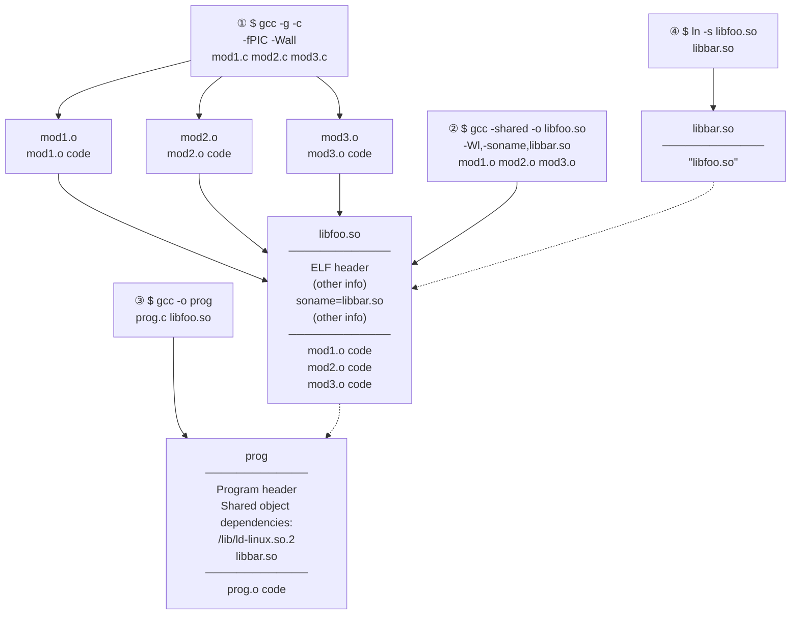
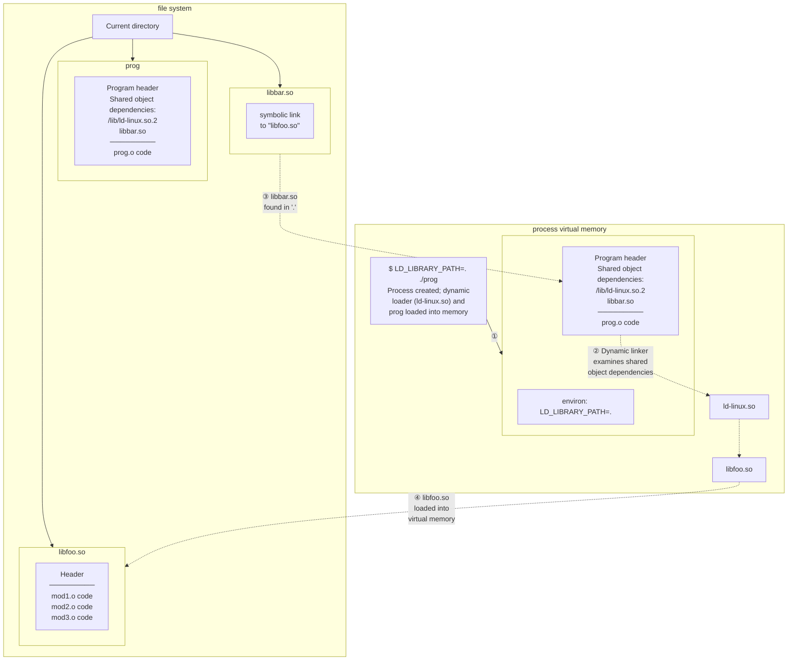

# Chương 41: Cơ bản về Thư viện chia sẻ (Fundamentals of Shared Libraries)

Thư viện dùng chung (Shared Library) là một kỹ thuật đặt các hàm thư viện vào một đơn vị duy nhất có thể được chia sẻ bởi nhiều tiến trình (process) tại thời điểm thực thi (run time). Kỹ thuật này có thể tiết kiệm cả dung lượng đĩa và RAM. Chương này bao gồm các nguyên tắc cơ bản về thư viện dùng chung. Chương tiếp theo sẽ đề cập đến một số tính năng nâng cao của thư viện dùng chung.

## 41.1 Thư viện đối tượng (Object Libraries)

Một cách để xây dựng một chương trình là đơn giản biên dịch từng tệp nguồn của nó để tạo ra các tệp đối tượng (object file) tương ứng, sau đó liên kết (link) tất cả các tệp đối tượng này lại với nhau để tạo ra chương trình thực thi (executable program), như sau:

```
$ cc -g -c prog.c mod1.c mod2.c mod3.c
$ cc -g -o prog_nolib prog.o mod1.o mod2.o mod3.o
```

Việc liên kết thực chất được thực hiện bởi một chương trình liên kết (linker) riêng biệt có tên là `ld`. Khi chúng ta liên kết một chương trình sử dụng lệnh `cc` (hoặc `gcc`), trình biên dịch sẽ gọi `ld` ở phía sau. Trên Linux, trình liên kết (linker) nên luôn được gọi gián tiếp thông qua `gcc`, vì `gcc` đảm bảo rằng `ld` được gọi với các tùy chọn chính xác và liên kết chương trình với các tệp thư viện phù hợp.

Tuy nhiên, trong nhiều trường hợp, chúng ta có thể có các tệp nguồn được sử dụng bởi nhiều chương trình. Như là bước đầu tiên để tiết kiệm công sức cho bản thân, chúng ta có thể biên dịch các tệp nguồn này chỉ một lần, và sau đó liên kết chúng vào các tệp thực thi khác nhau tùy theo yêu cầu. Mặc dù kỹ thuật này giúp tiết kiệm thời gian biên dịch, nó vẫn nhược điểm là chúng ta phải liệt kê tên của tất cả các tệp đối tượng trong giai đoạn liên kết (link phase). Hơn nữa, các thư mục của chúng ta có thể bị bừa bộn một cách bất tiện với một số lượng lớn các tệp đối tượng.

Để khắc phục những vấn đề này, chúng ta có thể nhóm một tập hợp các tệp đối tượng thành một đơn vị duy nhất, được gọi là thư viện đối tượng (object library). Thư viện đối tượng có hai loại: tĩnh (static) và dùng chung (shared). Thư viện dùng chung là loại thư viện đối tượng hiện đại hơn và mang lại một số ưu điểm so với thư viện tĩnh, như chúng ta sẽ mô tả trong Mục [41.3](#page-103-0).

### Một lưu ý bên lề: bao gồm thông tin trình gỡ lỗi khi biên dịch chương trình

Trong lệnh `cc` hiển thị ở trên, chúng ta đã sử dụng tùy chọn `-g` để bao gồm thông tin gỡ lỗi (debugging information) trong chương trình đã được biên dịch. Nhìn chung, việc luôn tạo các chương trình và thư viện cho phép gỡ lỗi là một ý tưởng hay. (Trước đây, thông tin gỡ lỗi đôi khi được lược bỏ để tệp thực thi kết quả sử dụng ít đĩa và RAM hơn, nhưng ngày nay đĩa và RAM rất rẻ.)

Thêm vào đó, trên một số kiến trúc như x86-32, tùy chọn `-fomit-frame-pointer` không nên được chỉ định vì nó làm cho việc gỡ lỗi trở nên bất khả thi. (Trên một số kiến trúc như x86-64, tùy chọn này được bật theo mặc định vì nó không cản trở việc gỡ lỗi.) Vì lý do tương tự, các tệp thực thi và thư viện không nên bị loại bỏ thông tin gỡ lỗi bằng cách sử dụng `strip(1)`.

## 41.2 Thư viện tĩnh (Static Libraries)

Trước khi bắt đầu thảo luận về thư viện dùng chung, chúng ta bắt đầu với một mô tả ngắn gọn về thư viện tĩnh để làm rõ sự khác biệt và ưu điểm của thư viện dùng chung.

Thư viện tĩnh, còn được gọi là các kho lưu trữ (archives), là loại thư viện đầu tiên được cung cấp trên các hệ thống UNIX. Chúng mang lại những lợi ích sau:

- Chúng ta có thể đặt một tập hợp các tệp đối tượng thường dùng vào một tệp thư viện duy nhất, sau đó có thể được sử dụng để xây dựng nhiều tệp thực thi, mà không cần phải biên dịch lại các tệp nguồn ban đầu khi xây dựng mỗi ứng dụng.
- Các lệnh liên kết (link commands) trở nên đơn giản hơn. Thay vì liệt kê một chuỗi dài các tệp đối tượng trên dòng lệnh liên kết, chúng ta chỉ định tên của thư viện tĩnh. Trình liên kết (linker) biết cách tìm kiếm trong thư viện tĩnh và trích xuất các đối tượng được yêu cầu bởi tệp thực thi.

### Tạo và duy trì một thư viện tĩnh (static library)

Thực chất, một thư viện tĩnh (static library) đơn giản là một tệp chứa các bản sao của tất cả các tệp đối tượng (object file) đã được thêm vào nó. Kho lưu trữ (archive) này cũng ghi lại các thuộc tính khác nhau của từng tệp đối tượng thành phần, bao gồm quyền của tệp (file permissions), ID người dùng và nhóm dạng số (numeric user and group IDs), và thời gian chỉnh sửa lần cuối. Theo quy ước, các thư viện tĩnh có tên dạng `libname.a`.

Một thư viện tĩnh được tạo và duy trì bằng cách sử dụng lệnh `ar(1)`, có dạng tổng quát như sau:

\$ **ar** *options archive object-file*...

Đối số tùy chọn (options) bao gồm một chuỗi các ký tự, trong đó một ký tự là mã thao tác (operation code), trong khi các ký tự khác là các bộ bổ trợ (modifiers) ảnh hưởng đến cách thức thực hiện thao tác. Một số mã thao tác được sử dụng phổ biến bao gồm:

r (replace - thay thế): Chèn một tệp đối tượng vào kho lưu trữ, thay thế bất kỳ tệp đối tượng trước đó nào có cùng tên. Đây là phương pháp tiêu chuẩn để tạo và cập nhật một kho lưu trữ. Do đó, chúng ta có thể xây dựng một kho lưu trữ bằng các lệnh sau:

```
$ cc -g -c mod1.c mod2.c mod3.c
$ ar r libdemo.a mod1.o mod2.o mod3.o
$ rm mod1.o mod2.o mod3.o
```

Như đã hiển thị ở trên, sau khi xây dựng thư viện, chúng ta có thể xóa các tệp đối tượng ban đầu nếu muốn, vì chúng không còn cần thiết nữa.

t (table of contents - mục lục): Hiển thị mục lục của kho lưu trữ. Theo mặc định, lệnh này chỉ liệt kê tên của các tệp đối tượng trong kho lưu trữ. Bằng cách thêm bổ trợ `v` (verbose - chi tiết), chúng ta sẽ thấy bổ sung tất cả các thuộc tính khác được ghi lại trong kho lưu trữ cho từng tệp đối tượng, như trong ví dụ sau:

```
$ ar tv libdemo.a
rw-r--r-- 1000/100 1001016 Nov 15 12:26 2009 mod1.o
rw-r--r-- 1000/100 406668 Nov 15 12:21 2009 mod2.o
rw-r--r-- 1000/100 46672 Nov 15 12:21 2009 mod3.o
```

Các thuộc tính bổ sung mà chúng ta thấy cho mỗi đối tượng, từ trái sang phải, lần lượt là: quyền của nó khi được thêm vào kho lưu trữ, ID người dùng (user ID) và ID nhóm (group ID), kích thước của nó, và ngày giờ khi nó được sửa đổi lần cuối.

d (delete - xóa): Xóa một mô-đun có tên khỏi kho lưu trữ, như trong ví dụ này:

```
$ ar d libdemo.a mod3.o
```

### Sử dụng thư viện tĩnh (static library)

Chúng ta có thể liên kết một chương trình (link a program) với một thư viện tĩnh theo hai cách. Cách thứ nhất là đặt tên thư viện tĩnh như một phần của lệnh liên kết (link command), giống như sau:

```
$ cc -g -c prog.c
$ cc -g -o prog prog.o libdemo.a
```

Ngoài ra, chúng ta có thể đặt thư viện vào một trong các thư mục tiêu chuẩn được trình liên kết (linker) tìm kiếm (ví dụ: `/usr/lib`), và sau đó chỉ định tên thư viện (tức là tên tệp của thư viện nhưng bỏ tiền tố `lib` và hậu tố `.a`) bằng cách sử dụng tùy chọn `-l`:

```
$ cc -g -o prog prog.o -ldemo
```

Nếu thư viện nằm trong một thư mục không được trình liên kết tìm kiếm thông thường, chúng ta có thể chỉ định rằng trình liên kết nên tìm kiếm thư mục bổ sung này bằng cách sử dụng tùy chọn `-L`:

```
$ cc -g -o prog prog.o -Lmylibdir -ldemo
```

Mặc dù một thư viện tĩnh có thể chứa nhiều mô-đun đối tượng (object module), trình liên kết chỉ đưa vào những mô-đun mà chương trình yêu cầu.

Sau khi liên kết chương trình, chúng ta có thể chạy nó theo cách thông thường:

\$ **./prog** Called mod1-x1 Called mod2-x2

## 41.3 Tổng quan về Thư viện chia sẻ (Shared Libraries)

Khi một chương trình được xây dựng bằng cách liên kết với một thư viện tĩnh (hoặc thậm chí là không sử dụng thư viện nào cả), tệp thực thi (executable file) kết quả sẽ bao gồm các bản sao của tất cả các tệp đối tượng đã được liên kết vào chương trình. Do đó, khi một số tệp thực thi khác nhau sử dụng cùng một mô-đun đối tượng, mỗi tệp thực thi đều có bản sao riêng của các mô-đun đối tượng đó. Sự dư thừa mã nguồn (redundancy of code) này có một số bất lợi:

- Không gian đĩa bị lãng phí khi lưu trữ nhiều bản sao của cùng một mô-đun đối tượng. Sự lãng phí này có thể rất đáng kể.
- Nếu một vài chương trình khác nhau sử dụng cùng các mô-đun đang chạy cùng một lúc, thì mỗi chương trình sẽ giữ các bản sao riêng biệt của các mô-đun đối tượng trong bộ nhớ ảo (virtual memory), qua đó làm tăng nhu cầu bộ nhớ ảo tổng thể trên hệ thống.
- Nếu cần thực hiện một thay đổi (có thể là bản vá bảo mật hoặc sửa lỗi) đối với một mô-đun đối tượng trong thư viện tĩnh, thì tất cả các tệp thực thi sử dụng mô-đun đó phải được liên kết lại (relinked) để áp dụng thay đổi. Nhược điểm này càng trở nên phức tạp hơn bởi thực tế là quản trị viên hệ thống (system administrator) cần phải biết những ứng dụng nào đã được liên kết với thư viện đó.

Các thư viện chia sẻ (shared libraries) được thiết kế để khắc phục những thiếu sót này. Ý tưởng cốt lõi của một thư viện chia sẻ là một bản sao duy nhất của các mô-đun đối tượng được chia sẻ bởi tất cả các chương trình yêu cầu các mô-đun đó. Các mô-đun đối tượng không được sao chép vào tệp thực thi đã liên kết; thay vào đó, một bản sao duy nhất của thư viện được nạp vào bộ nhớ tại thời điểm chạy (run time), khi chương trình đầu tiên yêu cầu các mô-đun từ thư viện chia sẻ được khởi động. Khi các chương trình khác sử dụng cùng thư viện chia sẻ đó được thực thi sau đó, chúng sẽ sử dụng bản sao của thư viện đã được nạp sẵn vào bộ nhớ. Việc sử dụng các thư viện chia sẻ có nghĩa là các chương trình thực thi yêu cầu ít không gian hơn trên đĩa và (khi chạy) trong bộ nhớ ảo.

> [!NOTE]
> Mặc dù mã nguồn của một thư viện chia sẻ (shared library) được chia sẻ giữa nhiều tiến trình (process), các biến của chúng thì không. Mỗi tiến trình sử dụng thư viện đều có bản sao riêng của các biến toàn cục (global variable) và biến tĩnh (static variable) được định nghĩa bên trong thư viện đó.

Các thư viện chia sẻ mang lại những ưu điểm bổ sung sau:

- Do kích thước tổng thể của chương trình nhỏ hơn, trong một số trường hợp, các chương trình có thể được nạp vào bộ nhớ (memory) và khởi động nhanh hơn. Điểm này chỉ đúng với các thư viện chia sẻ lớn vốn đã được sử dụng bởi một chương trình khác. Chương trình đầu tiên nạp thư viện chia sẻ thực tế sẽ mất nhiều thời gian hơn để khởi động, vì thư viện chia sẻ phải được tìm kiếm và nạp vào bộ nhớ.
- Vì các mô-đun đối tượng (object module) không bị sao chép vào các tệp thực thi (executable file), mà thay vào đó được quản lý tập trung trong thư viện chia sẻ, nên có thể (tuân theo các giới hạn được mô tả trong Mục [41.8](#page-117-0)) thực hiện các thay đổi đối với các mô-đun đối tượng mà không yêu cầu liên kết lại (relink) chương trình để thấy được các thay đổi đó. Những thay đổi như vậy có thể được thực hiện ngay cả khi các chương trình đang chạy vẫn đang sử dụng phiên bản hiện tại của thư viện chia sẻ.

Chi phí chính cho tính năng bổ sung này bao gồm:

- Các thư viện chia sẻ phức tạp hơn so với thư viện tĩnh (static library), cả ở cấp độ khái niệm lẫn cấp độ thực tế khi tạo thư viện chia sẻ và xây dựng các chương trình sử dụng chúng.
- Các thư viện chia sẻ phải được biên dịch để sử dụng mã độc lập với vị trí (position-independent code - được mô tả trong Mục 41.4.2), điều này gây ra chi phí hiệu năng (performance overhead) trên hầu hết các kiến trúc (architecture) vì nó yêu cầu sử dụng thêm một thanh ghi (register) phụ ([Hubička, 2003]).
- Quá trình định vị lại ký hiệu (symbol relocation) phải được thực hiện tại thời điểm chạy (run time). Trong quá trình định vị lại ký hiệu, các tham chiếu đến từng ký hiệu (một biến hoặc hàm) trong thư viện chia sẻ cần phải được sửa đổi để tương ứng với vị trí thực tế khi chạy mà ký hiệu đó được đặt trong bộ nhớ ảo (virtual memory). Do quá trình định vị lại này, một chương trình sử dụng thư viện chia sẻ có thể mất nhiều thời gian hơn một chút để thực thi so với chương trình tương đương được liên kết tĩnh.

Một ứng dụng bổ sung nữa của thư viện chia sẻ là đóng vai trò là khối xây dựng trong *Java Native Interface* (JNI), cho phép mã Java truy cập trực tiếp các tính năng của hệ điều hành bên dưới bằng cách gọi các hàm C bên trong một thư viện chia sẻ. Để biết thêm thông tin, hãy xem [Liang, 1999] và [Rochkind, 2004].

## 41.4 Tạo và Sử dụng Thư viện Chia sẻ—Lần Tiếp cận Đầu tiên

Để bắt đầu hiểu cách thức hoạt động của các thư viện chia sẻ, chúng ta xem xét trình tự các bước tối thiểu cần thiết để xây dựng và sử dụng một thư viện chia sẻ. Hiện tại, chúng ta sẽ bỏ qua quy ước thường được sử dụng để đặt tên các tệp thư viện chia sẻ. Quy ước này, được mô tả trong Mục 41.6, cho phép các chương trình tự động nạp phiên bản cập nhật mới nhất của các thư viện mà chúng yêu cầu, đồng thời cho phép nhiều phiên bản không tương thích (được gọi là *phiên bản chính* - *major version*) của một thư viện cùng tồn tại một cách ổn định.

Trong chương này, chúng ta chỉ quan tâm đến các thư viện chia sẻ định dạng Executable and Linking Format (ELF), vì ELF là định dạng được sử dụng cho các tệp thực thi và thư viện chia sẻ trong các phiên bản Linux hiện đại, cũng như trong nhiều hệ triển khai UNIX khác.

ELF thay thế cho các định dạng *a.out* và *COFF* cũ hơn.

### 41.4.1 Tạo một Thư viện Liên kết Động (Shared Library)

Để xây dựng một phiên bản liên kết động (shared version) của thư viện tĩnh mà chúng ta đã tạo trước đó, chúng ta thực hiện các bước sau:

```
$ gcc -g -c -fPIC -Wall mod1.c mod2.c mod3.c
$ gcc -g -shared -o libfoo.so mod1.o mod2.o mod3.o
```

Lệnh đầu tiên trong số này tạo ra ba module đối tượng (object module) sẽ được đưa vào thư viện. (Chúng ta sẽ giải thích tùy chọn *cc -fPIC* trong phần tiếp theo). Lệnh *cc -shared* tạo ra một thư viện liên kết động (Shared Library) chứa ba module đối tượng đó.

Theo quy ước, các thư viện liên kết động (Shared Library) có tiền tố là `lib` và hậu tố là `.so` (viết tắt của *shared object*).

Trong các ví dụ của mình, chúng tôi sử dụng lệnh `gcc` thay vì lệnh tương đương `cc`, để nhấn mạnh rằng các tùy chọn dòng lệnh mà chúng tôi đang sử dụng để tạo thư viện liên kết động là phụ thuộc vào trình biên dịch (compiler-dependent). Việc sử dụng một trình biên dịch C khác trên một cài đặt UNIX khác có thể sẽ yêu cầu các tùy chọn khác nhau.

Lưu ý rằng có thể biên dịch các tệp mã nguồn và tạo thư viện liên kết động trong một lệnh duy nhất:

```
$ gcc -g -fPIC -Wall mod1.c mod2.c mod3.c -shared -o libfoo.so
```

Tuy nhiên, để phân biệt rõ ràng giữa các bước biên dịch và xây dựng thư viện, chúng tôi sẽ viết chúng thành hai lệnh riêng biệt trong các ví dụ được trình bày ở chương này.

Không giống như thư viện tĩnh (static library), không thể thêm hoặc xóa các module đối tượng riêng lẻ khỏi một thư viện liên kết động đã được xây dựng trước đó. Giống như các tệp thực thi (executable) bình thường, các tệp đối tượng bên trong thư viện liên kết động không còn duy trì các định danh riêng biệt nữa.

### 41.4.2 Mã Độc lập Vị trí (Position-Independent Code)

Tùy chọn `cc –fPIC` chỉ định rằng trình biên dịch nên tạo ra mã độc lập vị trí (Position-Independent Code - PIC). Điều này thay đổi cách trình biên dịch tạo mã cho các thao tác như truy cập các biến toàn cục, tĩnh và ngoại vi; truy cập các hằng số chuỗi; và lấy địa chỉ của các hàm. Các thay đổi này cho phép mã nguồn được đặt tại bất kỳ địa chỉ ảo (virtual address) nào tại thời điểm chạy (run time). Điều này là cần thiết đối với các thư viện liên kết động (Shared Library), vì không có cách nào biết được tại thời điểm liên kết (link time) rằng mã của thư viện liên kết động sẽ được đặt ở đâu trong bộ nhớ. (Vị trí bộ nhớ lúc chạy của một thư viện liên kết động phụ thuộc vào các yếu tố khác nhau, chẳng hạn như dung lượng bộ nhớ đã bị chiếm bởi chương trình đang tải thư viện và chương trình đó đã tải những thư viện liên kết động nào khác).

Trên nền tảng Linux/x86-32, có thể tạo một thư viện liên kết động bằng cách sử dụng các module được biên dịch mà không có tùy chọn `–fPIC`. Tuy nhiên, việc làm đó sẽ làm mất đi một số lợi ích của thư viện liên kết động, vì các trang (page) của văn bản chương trình chứa các tham chiếu bộ nhớ phụ thuộc vị trí sẽ không được chia sẻ giữa các tiến trình (process). Trên một số kiến trúc, việc xây dựng thư viện liên kết động mà không có tùy chọn `–fPIC` là điều không thể.

Để xác định xem một tệp đối tượng (object file) hiện có đã được biên dịch với tùy chọn `–fPIC` hay chưa, chúng ta có thể kiểm tra sự hiện diện của tên `_GLOBAL_OFFSET_TABLE_` trong bảng ký hiệu (symbol table) của tệp đối tượng, bằng cách sử dụng một trong các lệnh sau:

```
$ nm mod1.o | grep _GLOBAL_OFFSET_TABLE_
$ readelf -s mod1.o | grep _GLOBAL_OFFSET_TABLE_
```

Ngược lại, nếu một trong các lệnh tương đương sau đây trả ra bất kỳ kết quả đầu ra nào, thì thư viện liên kết động được chỉ định sẽ bao gồm ít nhất một module đối tượng chưa được biên dịch với `–fPIC`:

```
$ objdump --all-headers libfoo.so | grep TEXTREL
$ readelf -d libfoo.so | grep TEXTREL
```

Chuỗi `TEXTREL` cho biết sự hiện diện của một module đối tượng mà phân đoạn văn bản (text segment) của nó chứa một tham chiếu đòi hỏi phải định vị lại khi chạy (run-time relocation).

Chúng tôi sẽ nói thêm về các lệnh `nm`, `readelf`, và `objdump` trong Mục [41.5](#page-110-0).

### 41.4.3 Sử dụng Thư viện Động (Shared Library)

Để sử dụng một thư viện động (shared library), hai bước bắt buộc phải diễn ra mà đối với các chương trình sử dụng thư viện tĩnh (static library) không cần đến:

- Vì tệp thực thi (executable file) không còn chứa các bản sao của các tệp đối tượng (object files) mà nó yêu cầu, nó phải có một cơ chế nào đó để xác định thư viện động mà nó cần tại thời điểm chạy (run time). Điều này được thực hiện bằng cách nhúng tên của thư viện động vào bên trong tệp thực thi trong pha liên kết (link phase). (Theo thuật ngữ ELF, phần phụ thuộc thư viện được ghi lại trong thẻ `DT_NEEDED` bên trong tệp thực thi.) Danh sách tất cả các phần phụ thuộc thư viện động của một chương trình được gọi là danh sách phụ thuộc động (dynamic dependency list) của nó.
- Tại thời điểm chạy, phải có một cơ chế nào đó để phân giải (resolve) tên thư viện được nhúng—nghĩa là tìm tệp thư viện động tương ứng với tên được chỉ định trong tệp thực thi—và sau đó tải thư viện vào bộ nhớ (Memory), nếu nó chưa có sẵn.

Việc nhúng tên của thư viện vào bên trong tệp thực thi diễn ra tự động khi chúng ta liên kết chương trình của mình với một thư viện động:

```
$ gcc -g -Wall -o prog prog.c libfoo.so
```

Nếu bây giờ chúng ta cố gắng chạy chương trình của mình, chúng ta sẽ nhận được thông báo lỗi sau:

```
$ ./prog
./prog: error in loading shared libraries: libfoo.so: cannot
open shared object file: No such file or directory
```

Điều này đưa chúng ta đến bước thứ hai bắt buộc: liên kết động (dynamic linking), đây là nhiệm vụ phân giải tên thư viện được nhúng tại thời điểm chạy. Nhiệm vụ này được thực hiện bởi trình liên kết động (dynamic linker) (còn gọi là trình nạp liên kết động - dynamic linking loader, hoặc trình liên kết thời gian chạy - run-time linker). Bản thân trình liên kết động là một thư viện động, có tên là `/lib/ld-linux.so.2`, được sử dụng bởi mọi tệp thực thi ELF có dùng thư viện động.

> [!NOTE]
> Đường dẫn `/lib/ld-linux.so.2` thông thường là một liên kết tượng trưng (symbolic link) trỏ đến tệp thực thi của trình liên kết động. Tệp này có tên là `ld-version.so`, trong đó `version` là phiên bản glibc được cài đặt trên hệ thống—ví dụ: `ld-2.11.so`. Đường dẫn của trình liên kết động sẽ khác nhau trên một số kiến trúc (architectures). Ví dụ, trên IA-64, liên kết tượng trưng của trình liên kết động có tên là `/lib/ld-linux-ia64.so.2`.

Trình liên kết động kiểm tra danh sách các thư viện động được yêu cầu bởi một chương trình và sử dụng một tập hợp các quy tắc được định nghĩa trước để tìm các tệp thư viện trong hệ thống tệp (file system). Một số quy tắc trong số này chỉ định một tập hợp các thư mục chuẩn mà các thư viện động thường trú ngụ. Ví dụ, nhiều thư viện động nằm trong `/lib` và `/usr/lib`. Thông báo lỗi ở trên xảy ra vì thư viện của chúng ta nằm trong thư mục làm việc hiện tại (current working directory), vốn không nằm trong danh sách chuẩn được tìm kiếm bởi trình liên kết động.

> [!NOTE]
> Một số kiến trúc (ví dụ: zSeries, PowerPC64 và x86-64) hỗ trợ thực thi cả chương trình 32-bit và 64-bit. Trên các hệ thống như vậy, các thư viện 32-bit nằm trong các thư mục con `*/lib`, và các thư viện 64-bit nằm trong các thư mục con `*/lib64`.

### Biến môi trường LD\_LIBRARY\_PATH

Một cách để thông báo cho trình liên kết động (dynamic linker) rằng một thư viện chia sẻ (shared library) nằm trong một thư mục không tiêu chuẩn là chỉ định thư mục đó như một phần trong danh sách các thư mục được phân tách bằng dấu hai chấm trong biến môi trường `LD_LIBRARY_PATH`. (Dấu chấm phẩy cũng có thể được sử dụng để phân tách các thư mục, trong trường hợp này, danh sách phải được đặt trong dấu ngoặc kép để ngăn shell hiểu nhầm dấu chấm phẩy). Nếu `LD_LIBRARY_PATH` được định nghĩa, thì trình liên kết động sẽ tìm kiếm thư viện chia sẻ trong các thư mục được liệt kê trong đó trước khi tìm kiếm trong các thư mục thư viện tiêu chuẩn. (Sau này, chúng ta sẽ thấy rằng một ứng dụng môi trường sản xuất (production application) không bao giờ nên phụ thuộc vào `LD_LIBRARY_PATH`, nhưng hiện tại, biến này cung cấp cho chúng ta một cách đơn giản để bắt đầu làm quen với các thư viện chia sẻ). Do đó, chúng ta có thể chạy chương trình của mình bằng lệnh sau:

```
$ LD_LIBRARY_PATH=. ./prog
Called mod1-x1
Called mod2-x2
```

Cú pháp shell (bash, Korn và Bourne) được sử dụng trong lệnh trên tạo ra một định nghĩa biến môi trường bên trong tiến trình (process) đang thực thi `prog`. Định nghĩa này ra lệnh cho trình liên kết động tìm kiếm các thư viện chia sẻ trong `.`, thư mục làm việc hiện tại (current working directory).

> [!NOTE]
> Một định nghĩa thư mục trống trong danh sách `LD_LIBRARY_PATH` (ví dụ: phần tử ở giữa trong `dirx::diry`) tương đương với `.`, thư mục làm việc hiện tại (nhưng lưu ý rằng việc đặt `LD_LIBRARY_PATH` thành một chuỗi rỗng không mang lại kết quả tương tự). Chúng ta tránh sử dụng cách này (SUSv3 không khuyến khích việc sử dụng tương tự trong biến môi trường `PATH`).

### So sánh giữa liên kết tĩnh và liên kết động

Thông thường, thuật ngữ liên kết (linking) được dùng để mô tả việc sử dụng trình liên kết (linker), `ld`, để kết hợp một hoặc nhiều tệp đối tượng (object file) đã biên dịch thành một tệp thực thi (executable file) duy nhất. Đôi khi, thuật ngữ liên kết tĩnh (static linking) được dùng để phân biệt bước này với liên kết động (dynamic linking), quá trình nạp tại thời điểm chạy (run-time loading) các thư viện chia sẻ được sử dụng bởi một tệp thực thi. (Liên kết tĩnh đôi khi cũng được gọi là chỉnh sửa liên kết - link editing, và một trình liên kết tĩnh như `ld` đôi khi được gọi là trình biên tập liên kết - link editor). Mọi chương trình—bao gồm cả những chương trình sử dụng thư viện chia sẻ—đều trải qua một giai đoạn liên kết tĩnh. Tại thời điểm chạy (run time), một chương trình sử dụng thư viện chia sẻ sẽ đồng thời trải qua quá trình liên kết động.

### 41.4.4 Soname của thư viện chia sẻ

Trong ví dụ được trình bày cho đến nay, tên được nhúng vào tệp thực thi và được tìm kiếm bởi trình liên kết động tại thời điểm chạy chính là tên thực tế của tệp thư viện chia sẻ. Đây được gọi là tên thực (real name) của thư viện. Tuy nhiên, hoàn toàn có thể—và trên thực tế là thông lệ—tạo ra một thư viện chia sẻ với một dạng tên thay thế, được gọi là soname (thẻ `DT_SONAME` theo thuật ngữ ELF).

Nếu một thư viện chia sẻ có soname, thì trong quá trình liên kết tĩnh, soname sẽ được nhúng vào tệp thực thi thay vì tên thực, và sau đó được sử dụng bởi trình liên kết động khi tìm kiếm thư viện tại thời điểm chạy. Mục đích của soname là cung cấp một lớp gián tiếp (indirection) cho phép một tệp thực thi sử dụng, tại thời điểm chạy, một phiên bản của thư viện chia sẻ khác với (nhưng tương thích với) thư viện mà nó đã được liên kết cùng.

Trong Mục [41.6](#page-111-0), chúng ta sẽ xem xét các quy ước được sử dụng cho tên thực và soname của thư viện chia sẻ. Hiện tại, chúng ta sẽ xem xét một ví dụ đơn giản hóa để minh họa các nguyên lý này.

Bước đầu tiên trong việc sử dụng soname là chỉ định nó khi tạo thư viện chia sẻ:

```
$ gcc -g -c -fPIC -Wall mod1.c mod2.c mod3.c
$ gcc -g -shared -Wl,-soname,libbar.so -o libfoo.so mod1.o mod2.o mod3.o
```

Tùy chọn `-Wl,-soname,libbar.so` là một chỉ thị yêu cầu trình liên kết đánh dấu thư viện chia sẻ `libfoo.so` với soname là `libbar.so`.

Nếu chúng ta muốn xác định soname của một thư viện chia sẻ có sẵn, chúng ta có thể sử dụng một trong các lệnh sau:

```
$ objdump -p libfoo.so | grep SONAME
 SONAME libbar.so
$ readelf -d libfoo.so | grep SONAME
 0x0000000e (SONAME) Library soname: [libbar.so]
```

Sau khi tạo một thư viện chia sẻ có soname, chúng ta tiếp tục tạo tệp thực thi như bình thường:

```
$ gcc -g -Wall -o prog prog.c libfoo.so
```

Tuy nhiên, lần này, trình liên kết phát hiện ra rằng thư viện `libfoo.so` chứa soname `libbar.so` và nhúng tên sau vào bên trong tệp thực thi.

Bây giờ, khi chúng ta cố gắng chạy chương trình, đây là kết quả hiển thị:

```
$ LD_LIBRARY_PATH=. ./prog
prog: error in loading shared libraries: libbar.so: cannot open
shared object file: No such file or directory
```

Vấn đề ở đây là trình liên kết động không thể tìm thấy bất kỳ thứ gì có tên là `libbar.so`. Khi sử dụng soname, cần thêm một bước nữa: chúng ta phải tạo một liên kết tượng trưng (symbolic link) từ soname đến tên thực của thư viện. Liên kết tượng trưng này phải được tạo trong một trong các thư viện được tìm kiếm bởi trình liên kết động. Do đó, chúng ta có thể chạy chương trình của mình như sau:

```
$ ln -s libfoo.so libbar.so Tạo liên kết tượng trưng soname trong thư mục hiện tại
$ LD_LIBRARY_PATH=. ./prog
Called mod1-x1
Called mod2-x2
```

Hình 41-1 minh họa các bước biên dịch (compilation) và liên kết (linking) để tạo ra một thư viện chia sẻ (shared library) có nhãn `soname` được nhúng bên trong, liên kết một chương trình (program) với thư viện chia sẻ đó, và tạo liên kết tượng trưng (symbolic link) `soname` cần thiết để chạy chương trình.



Hình 41-1: Tạo một thư viện chia sẻ (shared library) và liên kết một chương trình (program) với nó

Hình 41-2 minh họa các bước diễn ra khi chương trình được tạo ở Hình 41-1 được nạp vào bộ nhớ (memory) để chuẩn bị thực thi (execution).

Để tìm hiểu xem một tiến trình (process) hiện đang sử dụng những thư viện chia sẻ (shared library) nào, chúng ta có thể liệt kê nội dung của tệp `/proc/PID/maps` đặc trưng cho Linux tương ứng (Mục 48.5).



**Hình 41-2:** Thực thi một chương trình nạp thư viện chia sẻ (shared library)

## 41.5 Các công cụ hữu ích khi làm việc với thư viện chia sẻ (Shared Libraries)

Trong phần này, chúng ta sẽ mô tả ngắn gọn một vài công cụ hữu ích để phân tích các thư viện chia sẻ, file thực thi và file đối tượng (.o) đã được biên dịch.

### Lệnh ldd

Lệnh ldd(1) (liệt kê các phụ thuộc động - list dynamic dependencies) hiển thị các thư viện chia sẻ mà một chương trình (hoặc một thư viện chia sẻ) yêu cầu để chạy. Dưới đây là một ví dụ:

```
$ ldd prog
 libdemo.so.1 => /usr/lib/libdemo.so.1 (0x40019000)
 libc.so.6 => /lib/tls/libc.so.6 (0x4017b000)
 /lib/ld-linux.so.2 => /lib/ld-linux.so.2 (0x40000000)
```

Lệnh ldd phân giải từng tham chiếu thư viện (sử dụng các quy ước tìm kiếm giống như bộ liên kết động - dynamic linker) và hiển thị kết quả theo định dạng sau:

```
library-name => resolves-to-path
```

Đối với hầu hết các file thực thi ELF, ldd sẽ liệt kê các mục ít nhất cho ld-linux.so.2 (bộ liên kết động) và libc.so.6 (thư viện C chuẩn).

> [!NOTE]
> Tên của thư viện C sẽ khác nhau trên một số kiến trúc phần cứng. Ví dụ, thư viện này có tên là libc.so.6.1 trên IA-64 và Alpha.

### Các lệnh objdump và readelf

Lệnh objdump có thể được sử dụng để lấy các thông tin khác nhau—bao gồm cả mã máy nhị phân đã dịch ngược (disassembled binary machine code)—từ một file thực thi, file đối tượng đã biên dịch hoặc thư viện chia sẻ. Nó cũng có thể được dùng để hiển thị thông tin từ các phần header của các phân vùng ELF khác nhau trong các file này; khi được sử dụng theo cách này, nó tương tự như lệnh readelf, vốn hiển thị thông tin tương tự nhưng theo một định dạng khác. Các nguồn tài liệu cung cấp thêm thông tin về objdump và readelf được liệt kê ở cuối chương này.

### Lệnh nm

Lệnh nm liệt kê tập hợp các ký hiệu (symbols) được định nghĩa bên trong một thư viện đối tượng hoặc chương trình thực thi. Một trong các công dụng của lệnh này là tìm xem trong số nhiều thư viện thì thư viện nào định nghĩa một ký hiệu cụ thể. Ví dụ, để tìm xem thư viện nào định nghĩa hàm crypt(), chúng ta có thể thực hiện lệnh sau:

```
$ nm -A /usr/lib/lib*.so 2> /dev/null | grep ' crypt$'
/usr/lib/libcrypt.so:00007080 W crypt
```

Tùy chọn –A của lệnh nm chỉ định rằng tên thư viện phải được liệt kê ở đầu mỗi dòng hiển thị ký hiệu. Điều này là cần thiết bởi vì theo mặc định, nm liệt kê tên thư viện một lần, và sau đó ở các dòng tiếp theo là tất cả các ký hiệu mà nó chứa, điều này không thuận tiện cho việc lọc dữ liệu như trong ví dụ trên. Thêm vào đó, chúng ta loại bỏ luồng lỗi chuẩn (standard error output) để ẩn các thông báo lỗi về các định dạng file không được nm hỗ trợ. Từ kết quả đầu ra trên, chúng ta có thể thấy rằng hàm crypt() được định nghĩa trong thư viện libcrypt.

## 41.6 Các phiên bản thư viện chia sẻ và quy ước đặt tên

Chúng ta hãy xem xét những yếu tố liên quan đến việc quản lý phiên bản thư viện chia sẻ (shared library versioning). Thông thường, các phiên bản kế tiếp nhau của một thư viện chia sẻ sẽ tương thích ngược với nhau, có nghĩa là các hàm trong mỗi module cung cấp cùng một giao diện gọi hàm (calling interface) và tương đương về mặt ngữ nghĩa (nghĩa là chúng mang lại kết quả giống hệt nhau). Những phiên bản khác nhau nhưng tương thích như vậy được gọi là các phiên bản phụ (minor versions) của thư viện chia sẻ. Tuy nhiên, đôi khi cần phải tạo ra một phiên bản chính (major version) mới cho thư viện—một phiên bản không tương thích với phiên bản trước đó. (Trong Mục [41.8,](#page-117-0) chúng ta sẽ tìm hiểu chi tiết hơn về những nguyên nhân có thể gây ra sự không tương thích này). Đồng thời, hệ thống vẫn phải đảm bảo khả năng tiếp tục chạy các chương trình yêu cầu phiên bản cũ hơn của thư viện.

Để giải quyết các yêu cầu quản lý phiên bản này, một quy ước đặt tên chuẩn được áp dụng cho tên thực (real name) và tên soname của thư viện chia sẻ.

### Tên thực (Real names), tên soname và tên liên kết (linker names)

Mỗi phiên bản không tương thích của một thư viện chia sẻ được phân biệt bằng một định danh phiên bản chính (major version identifier) duy nhất, là một phần trong tên thực của nó. Theo quy ước, định danh phiên bản chính có dạng một con số được tăng dần tuần tự theo mỗi lần phát hành bản mới không tương thích của thư viện. Ngoài định danh phiên bản chính, tên thực còn bao gồm định danh phiên bản phụ (minor version identifier), dùng để phân biệt các phiên bản phụ tương thích trong cùng một phiên bản chính của thư viện. Tên thực tuân theo quy ước định dạng `libname.so.major-id.minor-id`.

Giống như định danh phiên bản chính, định danh phiên bản phụ có thể là bất kỳ chuỗi ký tự nào, nhưng theo quy ước, nó có thể là một số hoặc hai số được ngăn cách bằng dấu chấm, trong đó số đầu tiên xác định phiên bản phụ, và số thứ hai chỉ định cấp độ bản vá (patch level) hoặc số hiệu bản revision bên trong phiên bản phụ đó. Dưới đây là một số ví dụ về tên thực của các thư viện chia sẻ:

```
libdemo.so.1.0.1
libdemo.so.1.0.2 Phiên bản phụ, tương thích với phiên bản 1.0.1
libdemo.so.2.0.0 Phiên bản chính mới, không tương thích với phiên bản 1.*
libreadline.so.5.0
```

Tên `soname` của thư viện chia sẻ bao gồm định danh phiên bản chính giống như tên thư viện thực tương ứng của nó, nhưng lược bỏ đi định danh phiên bản phụ. Do đó, soname có dạng `libname.so.major-id`.

Thông thường, soname được tạo dưới dạng một liên kết mềm (symbolic link) tương đối trong thư mục chứa tên thực (real name). Dưới đây là một số ví dụ về soname, đi kèm với các tên thực mà chúng có thể liên kết tới:

```
libdemo.so.1 -> libdemo.so.1.0.2
libdemo.so.2 -> libdemo.so.2.0.0
libreadline.so.5 -> libreadline.so.5.0
```

Đối với một phiên bản major (major version) cụ thể của thư viện chia sẻ (shared library), có thể có nhiều tệp thư viện được phân biệt bằng các định danh phiên bản minor (minor version) khác nhau. Thông thường, soname tương ứng với mỗi phiên bản major của thư viện sẽ trỏ đến phiên bản minor mới nhất trong phạm vi phiên bản major đó (như được minh họa trong các ví dụ trên đối với `libdemo.so`). Thiết lập này cho phép cơ chế quản lý phiên bản (versioning) hoạt động chính xác trong quá trình chạy (run-time) của các thư viện chia sẻ. Bởi vì giai đoạn liên kết tĩnh (static-linking phase) nhúng một bản sao của soname (không phụ thuộc vào phiên bản minor) vào tệp thực thi (executable), và liên kết mềm soname sau đó có thể được sửa đổi để trỏ đến một phiên bản minor mới hơn của thư viện chia sẻ, nên ta có thể đảm bảo rằng tệp thực thi sẽ tải phiên bản minor cập nhật nhất của thư viện tại thời điểm chạy (run time). Hơn nữa, vì các phiên bản major khác nhau của một thư viện có các soname khác nhau, chúng có thể cùng tồn tại một cách suôn sẻ và được truy cập bởi các chương trình yêu cầu chúng.

Ngoài tên thực (real name) và soname, một tên thứ ba thường được định nghĩa cho mỗi thư viện chia sẻ: tên liên kết (linker name), được sử dụng khi liên kết một tệp thực thi với thư viện chia sẻ. Tên liên kết là một liên kết mềm chỉ chứa tên thư viện mà không có định danh phiên bản major hoặc minor, do đó có dạng `libname.so`. Tên liên kết cho phép chúng ta xây dựng các câu lệnh liên kết độc lập với phiên bản (version-independent link commands) mà vẫn tự động hoạt động với phiên bản chính xác (tức là phiên bản mới nhất) của thư viện chia sẻ.

Thông thường, tên liên kết được tạo trong cùng thư mục với tệp mà nó trỏ tới. Nó có thể được liên kết tới tên thực hoặc tới soname của phiên bản major mới nhất của thư viện. Thông thường, liên kết tới soname sẽ được ưu tiên hơn, để các thay đổi đối với soname được phản ánh tự động vào tên liên kết. (Trong Mục [41.7,](#page-114-0) chúng ta sẽ thấy rằng chương trình `ldconfig` tự động hóa tác vụ giữ cho các soname luôn được cập nhật, và do đó ngầm duy trì tên liên kết nếu chúng ta sử dụng quy ước vừa mô tả.)

> [!NOTE]
> Nếu chúng ta muốn liên kết một chương trình với một phiên bản major cũ hơn của thư viện chia sẻ, chúng ta không thể sử dụng tên liên kết. Thay vào đó, như một phần của câu lệnh liên kết, chúng ta cần chỉ định phiên bản (major) yêu cầu bằng cách chỉ định một tên thực hoặc soname cụ thể.

Dưới đây là một số ví dụ về tên liên kết:

```
libdemo.so -> libdemo.so.2
libreadline.so -> libreadline.so.5
```

[Bảng 41-1](#page-113-1) tóm tắt thông tin về tên thực, soname và tên liên kết của thư viện chia sẻ, và [Hình 41-3](#page-113-0) minh họa mối quan hệ giữa các tên này.

| Tên (Name) | Định dạng (Format) | Mô tả (Description) |
|-------------|--------------------|---------------------------------------------------------------------------------------------------------------------------------------------------------------------------------------------------------------------------|
| tên thực (real name) | libname.so.maj.min | Tệp chứa mã thư viện; có một thể hiện cho mỗi phiên bản major<br>kèm minor của thư viện. |
| soname | libname.so.maj | Một thể hiện cho mỗi phiên bản major của thư viện;<br>được nhúng vào tệp thực thi tại thời điểm liên kết (link time); được sử dụng khi chạy<br>để tìm thư viện thông qua một liên kết mềm có cùng<br>tên trỏ đến tên thực tương ứng (mới nhất). |
| tên liên kết (linker name) | libname.so | Liên kết mềm trỏ đến tên thực mới nhất hoặc (thường là)<br>soname mới nhất; là một thể hiện duy nhất; cho phép xây dựng<br>các câu lệnh liên kết độc lập với phiên bản. |

```text
real name              soname                linker name
   libname.so.maj.min     libname.so.maj         libname.so
  ┌──────────────────┐   ┌────────────────────┐  ┌────────────────────┐
  │  (regular file)  │◄--│  (symbolic link)   │◄-│  (symbolic link)   │
  │  Object code for │   │ libname.so.maj.min  │  │  libname.so.maj    │
  │ library modules  │   └────────────────────┘  └────────────────────┘
  └──────────────────┘
```

**Hình 41-3:** Sắp xếp quy ước các tên của thư viện chia sẻ

### Tạo thư viện chia sẻ sử dụng các quy ước chuẩn

Kết hợp tất cả các thông tin trên lại với nhau, giờ đây chúng ta trình bày cách xây dựng thư viện minh họa tuân theo các quy ước chuẩn. Đầu tiên, chúng ta tạo ra các tệp đối tượng (object files):

```
$ gcc -g -c -fPIC -Wall mod1.c mod2.c mod3.c
```

Sau đó, chúng ta tạo thư viện chia sẻ (shared library) với tên thực (real name) là `libdemo.so.1.0.1` và tên định danh (soname) là `libdemo.so.1`.

```
$ gcc -g -shared -Wl,-soname,libdemo.so.1 -o libdemo.so.1.0.1 \
 mod1.o mod2.o mod3.o
```

Tiếp theo, chúng ta tạo các liên kết tượng trưng (symbolic links) phù hợp cho soname và tên liên kết của trình liên kết (linker name):

```
$ ln -s libdemo.so.1.0.1 libdemo.so.1
$ ln -s libdemo.so.1 libdemo.so
```

Chúng ta có thể sử dụng lệnh `ls` để xác minh thiết lập (với `awk` được sử dụng để chọn các trường quan tâm):

```
$ ls -l libdemo.so* | awk '{print $1, $9, $10, $11}'
lrwxrwxrwx libdemo.so -> libdemo.so.1
lrwxrwxrwx libdemo.so.1 -> libdemo.so.1.0.1
-rwxr-xr-x libdemo.so.1.0.1
```

Sau đó, chúng ta có thể xây dựng (build) tệp thực thi (executable) của mình bằng cách sử dụng linker name (lưu ý rằng lệnh liên kết không đề cập đến số phiên bản) và chạy chương trình như bình thường:

```
$ gcc -g -Wall -o prog prog.c -L. -ldemo
$ LD_LIBRARY_PATH=. ./prog
Called mod1-x1
Called mod2-x2
```

## 41.7 Cài đặt Thư viện Chia sẻ (Installing Shared Libraries)

Trong các ví dụ trước đây, chúng ta đã tạo một thư viện chia sẻ (shared library) trong một thư mục riêng tư của người dùng (user-private directory), sau đó sử dụng biến môi trường `LD_LIBRARY_PATH` để đảm bảo rằng trình liên kết động (dynamic linker) tìm kiếm trong thư mục đó. Cả người dùng có đặc quyền (privileged user) và không có đặc quyền (unprivileged user) đều có thể sử dụng kỹ thuật này. Tuy nhiên, kỹ thuật này không nên được áp dụng trong các ứng dụng môi trường sản xuất (production applications). Thông thường, một thư viện chia sẻ và các liên kết tượng trưng (symbolic links) đi kèm của nó được cài đặt vào một trong số các thư mục thư viện tiêu chuẩn, cụ thể là một trong các thư mục sau:

- `/usr/lib`, thư mục mà hầu hết các thư viện tiêu chuẩn được cài đặt;
- `/lib`, thư mục chứa các thư viện cần thiết trong quá trình khởi động hệ thống (vì trong quá trình khởi động hệ thống, `/usr/lib` có thể chưa được gắn kết - mount);
- `/usr/local/lib`, thư mục chứa các thư viện phi tiêu chuẩn hoặc thử nghiệm (việc đặt các thư viện vào thư mục này cũng rất hữu ích nếu `/usr/lib` là một ổ đĩa mạng chia sẻ giữa nhiều hệ thống và chúng ta muốn cài đặt thư viện chỉ để sử dụng trên hệ thống này); hoặc
- một trong các thư mục được liệt kê trong `/etc/ld.so.conf` (sẽ được mô tả ngay sau đây).

Trong hầu hết các trường hợp, việc sao chép một tệp vào một trong các thư mục này đòi hỏi quyền siêu người dùng (superuser privilege).

Sau khi cài đặt, các liên kết tượng trưng (symbolic links) cho soname và linker name phải được tạo, thường là các liên kết tượng trưng tương đối (relative symbolic links) nằm trong cùng thư mục với tệp thư viện. Do đó, để cài đặt thư viện trình diễn của chúng ta vào `/usr/lib` (nơi có quyền hạn chỉ cho phép người dùng `root` cập nhật), chúng ta thực hiện các bước sau:

```
$ su
Password:
## mv libdemo.so.1.0.1 /usr/lib
```

## cd /usr/lib

## ln -s libdemo.so.1.0.1 libdemo.so.1

## ln -s libdemo.so.1 libdemo.so

```

Hai dòng cuối cùng trong phiên làm việc shell này tạo ra các liên kết tượng trưng cho soname và linker name.

### ldconfig

Chương trình `ldconfig(8)` giải quyết hai vấn đề tiềm ẩn liên quan đến thư viện chia sẻ (shared libraries):

- Các thư viện chia sẻ có thể nằm trong nhiều thư mục khác nhau. Nếu trình liên kết động (dynamic linker) cần tìm kiếm tất cả các thư mục này để tìm một thư viện, quá trình tải thư viện có thể trở nên rất chậm.
- Khi các phiên bản mới của thư viện được cài đặt hoặc các phiên bản cũ bị xóa, các liên kết tượng trưng soname có thể trở nên lỗi thời (out of date).

Chương trình `ldconfig` giải quyết các vấn đề này bằng cách thực hiện hai tác vụ:

1. Nó tìm kiếm một tập hợp các thư mục tiêu chuẩn và tạo hoặc cập nhật một tệp bộ nhớ đệm (cache file), `/etc/ld.so.cache`, chứa danh sách các phiên bản chính (major versions) của thư viện (cụ thể là các phiên bản phụ mới nhất của mỗi phiên bản chính) trong tất cả các thư mục đó. Ngược lại, trình liên kết động (dynamic linker) sử dụng tệp cache này khi phân giải tên thư viện tại thời điểm chạy (run time). Để xây dựng cache, `ldconfig` tìm kiếm các thư mục được chỉ định trong tệp `/etc/ld.so.conf`, sau đó đến `/lib` và `/usr/lib`. Tệp `/etc/ld.so.conf` bao gồm danh sách các đường dẫn thư mục (đường dẫn tuyệt đối - absolute pathnames), được ngăn cách bằng ký tự xuống dòng, khoảng trắng, tab, dấu phẩy hoặc dấu hai chấm. Ở một số bản phân phối (distributions), thư mục `/usr/local/lib` được bao gồm trong danh sách này. (Nếu chưa có, chúng ta có thể cần phải thêm thủ công).

Lệnh `ldconfig –p` hiển thị nội dung hiện tại của `/etc/ld.so.cache`.

2. Nó kiểm tra phiên bản phụ mới nhất (tức là phiên bản có số hiệu phụ lớn nhất) của mỗi phiên bản chính của mỗi thư viện để tìm soname được nhúng (embedded soname), sau đó tạo (hoặc cập nhật) các liên kết tượng trưng tương đối (relative symbolic links) cho từng soname trong cùng thư mục đó.

Để thực hiện các thao tác này một cách chính xác, `ldconfig` yêu cầu các thư viện phải được đặt tên theo các quy ước đã mô tả trước đó (tức là tên thực của thư viện bao gồm các định danh phiên bản chính và phụ tăng dần một cách thích hợp từ phiên bản thư viện này sang phiên bản tiếp theo).

Theo mặc định, `ldconfig` thực hiện cả hai thao tác trên. Các tùy chọn dòng lệnh (command-line options) có thể được sử dụng để vô hiệu hóa có chọn lọc một trong hai thao tác: tùy chọn `-N` ngăn việc xây dựng lại bộ nhớ đệm (cache), và tùy chọn `-X` ngăn việc tạo các liên kết tượng trưng soname. Ngoài ra, tùy chọn `-v` (verbose) khiến `ldconfig` hiển thị đầu ra mô tả các hành động mà nó đang thực hiện.

Chúng ta nên chạy `ldconfig` bất cứ khi nào một thư viện mới được cài đặt, một thư viện hiện có được cập nhật hoặc gỡ bỏ, hoặc danh sách các thư mục trong `/etc/ld.so.conf` bị thay đổi.

Như một ví dụ về hoạt động của `ldconfig`, giả sử chúng ta muốn cài đặt hai phiên bản chính (major version) khác nhau của một thư viện. Chúng ta thực hiện việc này như sau:

```

$ su
Password:

## mv libdemo.so.1.0.1 libdemo.so.2.0.0 /usr/lib

## ldconfig -v | grep libdemo

libdemo.so.1 -> libdemo.so.1.0.1 (changed)
libdemo.so.2 -> libdemo.so.2.0.0 (changed)

```

Ở trên, chúng ta lọc đầu ra của `ldconfig` để chỉ nhìn thấy thông tin liên quan đến các thư viện có tên `libdemo`.

Tiếp theo, chúng ta liệt kê các tệp có tên `libdemo` trong `/usr/lib` để xác minh thiết lập của các liên kết tượng trưng (symbolic link) `soname`:

## cd /usr/lib
## ls -l libdemo* | awk '{print $1, $9, $10, $11}'
lrwxrwxrwx libdemo.so.1 -> libdemo.so.1.0.1
-rwxr-xr-x libdemo.so.1.0.1
lrwxrwxrwx libdemo.so.2 -> libdemo.so.2.0.0
-rwxr-xr-x libdemo.so.2.0.0
```

Chúng ta vẫn phải tạo liên kết tượng trưng cho tên trình liên kết (linker name), như được hiển thị trong câu lệnh tiếp theo:

## ln -s libdemo.so.2 libdemo.so

```

Tuy nhiên, nếu chúng ta cài đặt một phiên bản phụ (minor version) 2.x mới của thư viện, thì vì tên trình liên kết trỏ đến `soname` mới nhất, `ldconfig` cũng sẽ có tác dụng giữ cho tên trình liên kết được cập nhật mới nhất, như ví dụ sau cho thấy:

## mv libdemo.so.2.0.1 /usr/lib
## ldconfig -v | grep libdemo
 libdemo.so.1 -> libdemo.so.1.0.1
 libdemo.so.2 -> libdemo.so.2.0.1 (changed)
```

Nếu chúng ta đang xây dựng và sử dụng một thư viện riêng tư (private library - nghĩa là thư viện không được cài đặt trong một trong các thư mục tiêu chuẩn), chúng ta có thể yêu cầu `ldconfig` tạo liên kết tượng trưng `soname` cho chúng ta bằng cách sử dụng tùy chọn `-n`. Tùy chọn này chỉ định rằng `ldconfig` chỉ nên xử lý các thư viện nằm trong các thư mục được chỉ định trên dòng lệnh và không cập nhật tệp bộ nhớ đệm (cache file). Trong ví dụ sau, chúng ta sử dụng `ldconfig` để xử lý các thư viện trong thư mục làm việc hiện tại:

```

$ gcc -g -c -fPIC -Wall mod1.c mod2.c mod3.c
$ gcc -g -shared -Wl,-soname,libdemo.so.1 -o libdemo.so.1.0.1 \
mod1.o mod2.o mod3.o
$ /sbin/ldconfig -nv .
.:
libdemo.so.1 -> libdemo.so.1.0.1
$ ls -l libdemo.so* | awk '{print $1, $9, $10, $11}'
lrwxrwxrwx libdemo.so.1 -> libdemo.so.1.0.1
-rwxr-xr-x libdemo.so.1.0.1

```

Trong ví dụ trên, chúng ta đã chỉ định đường dẫn tuyệt đối (pathname) khi chạy `ldconfig`, bởi vì chúng ta đang sử dụng một tài khoản không có đặc quyền (unprivileged account) mà biến môi trường `PATH` của tài khoản đó không bao gồm thư mục `/sbin`.

## 41.8 Thư viện tương thích so với Thư viện không tương thích

Theo thời gian, chúng ta có thể cần thực hiện các thay đổi đối với mã nguồn của một thư viện chia sẻ (shared library). Những thay đổi như vậy dẫn đến một phiên bản mới của thư viện có thể tương thích với các phiên bản trước đó (có nghĩa là chúng ta chỉ cần thay đổi định danh phiên bản phụ của tên thực của thư viện), hoặc không tương thích (có nghĩa là chúng ta phải định nghĩa một phiên bản chính mới của thư viện).

Một thay đổi đối với thư viện được coi là tương thích với một phiên bản thư viện hiện có nếu tất cả các điều kiện sau đây đều thỏa mãn:

- Ngữ nghĩa của mỗi hàm và biến công khai (public function and variable) trong thư viện vẫn giữ nguyên. Nói cách khác, mỗi hàm giữ nguyên danh sách đối số, tiếp tục tạo ra hiệu ứng đã định trên các biến toàn cục và đối số trả về, đồng thời trả về cùng một giá trị kết quả. Do đó, các thay đổi dẫn đến cải thiện hiệu suất hoặc sửa lỗi (dẫn đến tuân thủ tốt hơn hành vi đã định) có thể được coi là các thay đổi tương thích.
- Không có hàm hoặc biến nào trong API công khai (public API) của thư viện bị xóa. Tuy nhiên, việc bổ sung các hàm và biến mới vào API công khai là hoàn toàn tương thích.
- Các cấu trúc (structure) được cấp phát bên trong và được trả về bởi mỗi hàm vẫn giữ nguyên. Tương tự, các cấu trúc công khai do thư viện xuất ra vẫn giữ nguyên. Một ngoại lệ đối với quy tắc này là trong một số điều kiện nhất định, các mục mới có thể được thêm vào cuối của một cấu trúc hiện có, mặc dù điều này vẫn có thể gặp phải những cạm bẫy nếu, ví dụ, chương trình gọi cố gắng cấp phát mảng cho loại cấu trúc này. Các nhà thiết kế thư viện đôi khi khắc phục hạn chế này bằng cách định nghĩa các cấu trúc được xuất ra lớn hơn mức cần thiết trong bản phát hành ban đầu của thư viện, với một số trường đệm (padding field) bổ sung được "để dành cho sử dụng trong tương lai" (reserved for future use).

Nếu không có điều kiện nào trong số này bị vi phạm, thì tên thư viện mới có thể được cập nhật bằng cách điều chỉnh phiên bản phụ của tên hiện có. Ngược lại, một phiên bản chính mới của thư viện nên được tạo ra.

## 41.9 Nâng cấp Thư viện Chia sẻ (Shared Libraries)

Một trong những ưu điểm của thư viện chia sẻ (shared library) là phiên bản major hoặc minor mới của thư viện có thể được cài đặt ngay cả khi các chương trình đang chạy vẫn đang sử dụng phiên bản hiện có. Tất cả những gì chúng ta cần làm là tạo phiên bản thư viện mới, cài đặt nó vào thư mục thích hợp, và cập nhật các liên kết tượng trưng (symbolic link) soname và linker name theo yêu cầu (hoặc thông thường hơn, là để `ldconfig` thực hiện công việc đó thay chúng ta). Để tạo một phiên bản minor mới (tức là một bản nâng cấp tương thích) của thư viện chia sẻ `/usr/lib/libdemo.1.0.1`, chúng ta thực hiện các bước sau:

```
$ su
Password:
## gcc -g -c -fPIC -Wall mod1.c mod2.c mod3.c
## gcc -g -shared -Wl,-soname,libdemo.so.1 -o libdemo.so.1.0.2 \
 mod1.o mod2.o mod3.o
## mv libdemo.so.1.0.2 /usr/lib
## ldconfig -v | grep libdemo
 libdemo.so.1 -> libdemo.so.1.0.2 (changed)
```

Giả sử liên kết tượng trưng linker name đã được thiết lập chính xác từ trước (tức là trỏ tới soname của thư viện), chúng ta sẽ không cần phải chỉnh sửa lại nó.

Các chương trình đang chạy sẽ tiếp tục sử dụng phiên bản minor trước đó của thư viện chia sẻ. Chỉ khi chúng bị chấm dứt (terminated) và khởi động lại thì chúng mới sử dụng phiên bản minor mới của thư viện chia sẻ.

Nếu sau đó chúng ta muốn tạo một phiên bản major mới (2.0.0) của thư viện chia sẻ, chúng ta sẽ thực hiện như sau:

## gcc -g -c -fPIC -Wall mod1.c mod2.c mod3.c

## gcc -g -shared -Wl,-soname,libdemo.so.2 -o libdemo.so.2.0.0 \

mod1.o mod2.o mod3.o

## mv libdemo.so.2.0.0 /usr/lib

## ldconfig -v | grep libdemo

libdemo.so.1 -> libdemo.so.1.0.2
libdemo.so.2 -> libdemo.so.2.0.0 (changed)

## cd /usr/lib

## ln -sf libdemo.so.2 libdemo.so

```

Như có thể thấy trong kết quả đầu ra ở trên, `ldconfig` sẽ tự động tạo một liên kết tượng trưng soname cho phiên bản major mới. Tuy nhiên, như câu lệnh cuối cùng cho thấy, chúng ta phải thủ công cập nhật liên kết tượng trưng linker name.

## 41.10 Chỉ định Thư mục Tìm kiếm Thư viện trong Tệp Đối tượng (Object File)

Chúng ta đã thấy hai cách để thông báo cho trình liên kết động (dynamic linker) về vị trí của các thư viện chia sẻ: sử dụng biến môi trường `LD_LIBRARY_PATH` và cài đặt thư viện chia sẻ vào một trong các thư mục thư viện chuẩn (`/lib`, `/usr/lib`, hoặc một trong các thư mục được liệt kê trong `/etc/ld.so.conf`).

Có một cách thứ ba: trong giai đoạn biên tập liên kết tĩnh (static editing phase), chúng ta có thể chèn vào tệp thực thi (executable) một danh sách các thư mục cần được tìm kiếm tại thời điểm chạy (run time) cho các thư viện chia sẻ. Điều này hữu ích nếu chúng ta có các thư viện nằm ở các vị trí cố định không nằm trong số các vị trí chuẩn được tìm kiếm bởi trình liên kết động. Để làm điều này, chúng ta sử dụng tùy chọn trình liên kết `-rpath` khi tạo một tệp thực thi:

```

$ gcc -g -Wall -Wl,-rpath,/home/mtk/pdir -o prog prog.c libdemo.so

```

Câu lệnh trên sao chép chuỗi `/home/mtk/pdir` vào danh sách đường dẫn thư viện tại thời điểm chạy (rpath) của tệp thực thi `prog`, do đó khi chương trình được chạy, trình liên kết động cũng sẽ tìm kiếm thư mục này khi phân giải các tham chiếu đến thư viện chia sẻ.

Nếu cần thiết, tùy chọn `-rpath` có thể được chỉ định nhiều lần; tất cả các thư mục sẽ được nối thành một danh sách rpath có thứ tự duy nhất được đặt trong tệp thực thi. Ngoài ra, nhiều thư mục có thể được chỉ định dưới dạng danh sách phân tách bằng dấu hai chấm trong một tùy chọn `-rpath` duy nhất. Tại thời điểm chạy, trình liên kết động sẽ tìm kiếm các thư mục theo thứ tự chúng được chỉ định trong (các) tùy chọn `-rpath`.

> Một lựa chọn thay thế cho tùy chọn `-rpath` là biến môi trường `LD_RUN_PATH`. Biến này có thể được gán một chuỗi chứa một chuỗi các thư mục phân tách bằng dấu hai chấm sẽ được sử dụng làm danh sách rpath khi xây dựng tệp thực thi. `LD_RUN_PATH` chỉ được sử dụng nếu tùy chọn `-rpath` không được chỉ định khi xây dựng tệp thực thi.

### Sử dụng tùy chọn liên kết –rpath khi xây dựng một thư viện chia sẻ

Tùy chọn trình liên kết (linker option) –rpath cũng rất hữu ích khi xây dựng một thư viện chia sẻ (shared library). Giả sử chúng ta có một thư viện chia sẻ, libx1.so, phụ thuộc vào một thư viện khác là libx2.so, như được minh họa trong [Hình 41-4](#page-119-0). Giả sử thêm rằng các thư viện này nằm trong các thư mục không chuẩn lần lượt là d1 và d2. Bây giờ chúng ta sẽ đi qua các bước cần thiết để xây dựng các thư viện này và chương trình sử dụng chúng.

```text

prog              d1/libx1.so           d2/libx2.so
(prog.c)             (modx1.c)             (modx2.c)
┌──────────┐         ┌──────────┐          ┌──────────┐
│ main() { │────────►│  x1() { │─────────►│  x2() { │
│   x1();  │         │   x2(); │          │          │
│ }        │         │ }       │          │ }        │
└──────────┘         └──────────┘          └──────────┘

```

**Hình 41-4:** Một thư viện chia sẻ phụ thuộc vào một thư viện chia sẻ khác

Đầu tiên, chúng ta xây dựng libx2.so trong thư mục pdir/d2. (Để giữ cho ví dụ đơn giản, chúng ta bỏ qua việc đánh số phiên bản thư viện và tên soname tường minh).

```

$ cd /home/mtk/pdir/d2
$ gcc -g -c -fPIC -Wall modx2.c
$ gcc -g -shared -o libx2.so modx2.o

```

Tiếp theo, chúng ta xây dựng libx1.so trong thư mục pdir/d1. Vì libx1.so phụ thuộc vào libx2.so (thư viện không nằm trong một thư mục chuẩn), chúng ta chỉ định vị trí thời gian chạy (run-time location) của thư viện này bằng tùy chọn trình liên kết –rpath. Vị trí này có thể khác với vị trí liên kết (link-time location) của thư viện (được chỉ định bởi tùy chọn –L), mặc dù trong trường hợp này, hai vị trí là giống nhau.

```

$ cd /home/mtk/pdir/d1
$ gcc -g -c -Wall -fPIC modx1.c
$ gcc -g -shared -o libx1.so modx1.o -Wl,-rpath,/home/mtk/pdir/d2 \
-L/home/mtk/pdir/d2 -lx2

```

Cuối cùng, chúng ta xây dựng chương trình chính (main program) trong thư mục pdir. Vì chương trình chính sử dụng libx1.so và thư viện này nằm trong một thư mục không chuẩn, chúng ta lại sử dụng tùy chọn trình liên kết –rpath:

```

$ cd /home/mtk/pdir
$ gcc -g -Wall -o prog prog.c -Wl,-rpath,/home/mtk/pdir/d1 \
-L/home/mtk/pdir/d1 -lx1

```

Lưu ý rằng chúng ta không cần phải đề cập đến libx2.so khi liên kết chương trình chính. Vì trình liên kết (linker) có khả năng phân tích danh sách rpath trong libx1.so, nó có thể tìm thấy libx2.so, và do đó có thể đáp ứng yêu cầu rằng tất cả các ký hiệu (symbol) phải được phân giải (resolve) tại thời điểm liên kết tĩnh (static link time).

Chúng ta có thể sử dụng các lệnh sau để kiểm tra prog và libx1.so nhằm xem nội dung danh sách rpath của chúng:

```

$ objdump -p prog | grep PATH
RPATH /home/mtk/pdir/d1 libx1.so sẽ được tìm kiếm ở đây tại thời điểm chạy
$ objdump -p d1/libx1.so | grep PATH
RPATH /home/mtk/pdir/d2 libx2.so sẽ được tìm kiếm ở đây tại thời điểm chạy

```

Chúng ta cũng có thể xem danh sách rpath bằng cách lọc (grep) đầu ra của lệnh `readelf ––dynamic` (hoặc tương đương là `readelf –d`).

Chúng ta có thể sử dụng lệnh ldd để hiển thị toàn bộ tập hợp các phụ thuộc động (dynamic dependency) của prog:

```

$ ldd prog
libx1.so => /home/mtk/pdir/d1/libx1.so (0x40017000)
libc.so.6 => /lib/tls/libc.so.6 (0x40024000)
libx2.so => /home/mtk/pdir/d2/libx2.so (0x4014c000)
/lib/ld-linux.so.2 => /lib/ld-linux.so.2 (0x40000000)

```

### Các mục DT\_RPATH và DT\_RUNPATH của ELF

Trong đặc tả ELF (ELF specification) gốc, chỉ có một loại danh sách rpath có thể được nhúng vào một tệp thực thi (executable) hoặc thư viện chia sẻ (shared library). Điều này tương ứng với thẻ DT\_RPATH trong tệp ELF. Các đặc tả ELF sau đó đã đánh dấu DT\_RPATH là lỗi thời (deprecated) và giới thiệu một thẻ mới, DT\_RUNPATH, để biểu diễn các danh sách rpath. Sự khác biệt giữa hai loại danh sách rpath này là mức độ ưu tiên tương đối của chúng đối với biến môi trường `LD_LIBRARY_PATH` khi trình liên kết động (dynamic linker) tìm kiếm các thư viện chia sẻ tại thời điểm chạy (run time): DT\_RPATH có mức độ ưu tiên cao hơn, trong khi DT\_RUNPATH có mức độ ưu tiên thấp hơn (tham khảo Mục [41.11\)](#page-121-0).

Theo mặc định, trình liên kết (linker) tạo danh sách rpath dưới dạng thẻ DT\_RPATH. Để trình liên kết tạo danh sách rpath thành mục DT\_RUNPATH thay thế, chúng ta phải sử dụng thêm tùy chọn trình liên kết `--enable-new-dtags` (bật các thẻ động mới). Nếu chúng ta biên dịch lại chương trình của mình bằng tùy chọn này và kiểm tra tệp thực thi kết quả bằng `objdump`, chúng ta sẽ thấy kết quả sau:

```

$ gcc -g -Wall -o prog prog.c -Wl,--enable-new-dtags \
-Wl,-rpath,/home/mtk/pdir/d1 -L/home/mtk/pdir/d1 -lx1
$ objdump -p prog | grep PATH
RPATH /home/mtk/pdir/d1
RUNPATH /home/mtk/pdir/d1

```

Như có thể thấy, tệp thực thi chứa cả hai thẻ DT\_RPATH và DT\_RUNPATH. Trình liên kết sao chép danh sách rpath theo cách này để hỗ trợ các trình liên kết động cũ hơn có thể không hiểu thẻ DT\_RUNPATH. (Hỗ trợ cho DT\_RUNPATH đã được thêm vào phiên bản 2.2 của glibc). Các trình liên kết động hiểu thẻ DT\_RUNPATH sẽ bỏ qua thẻ DT\_RPATH (xem Mục [41.11\)](#page-121-0).

### Sử dụng \$ORIGIN trong rpath

Giả sử rằng chúng ta muốn phân phối một ứng dụng sử dụng một số thư viện chia sẻ của riêng nó, nhưng chúng ta không muốn bắt buộc người dùng phải cài đặt các thư viện vào một trong các thư mục tiêu chuẩn. Thay vào đó, chúng ta muốn cho phép người dùng giải nén ứng dụng dưới một thư mục tùy ý do họ lựa chọn và sau đó có thể chạy ngay ứng dụng đó. Vấn đề là ứng dụng không có cách nào xác định các thư viện chia sẻ của nó được đặt ở đâu, trừ khi nó yêu cầu người dùng thiết lập `LD_LIBRARY_PATH` hoặc chúng ta yêu cầu người dùng chạy một số loại tập lệnh cài đặt (installation script) để xác định các thư mục bắt buộc. Không có cách tiếp cận nào trong số này là tối ưu.

Để khắc phục vấn đề này, trình liên kết động được xây dựng để hiểu một chuỗi ký tự đặc biệt, `$ORIGIN` (hoặc tương đương là `${ORIGIN}`), trong cấu hình rpath. Trình liên kết động hiểu chuỗi này có nghĩa là "thư mục chứa ứng dụng". Điều này có nghĩa là chúng ta có thể, ví dụ, biên dịch một ứng dụng với câu lệnh sau:

```

$ gcc -Wl,-rpath,'$ORIGIN'/lib ...

```

Điều này giả định rằng tại thời điểm chạy, các thư viện chia sẻ của ứng dụng sẽ nằm trong thư mục con `lib` nằm ngay bên trong thư mục chứa tệp thực thi của ứng dụng. Sau đó, chúng ta có thể cung cấp cho người dùng một gói cài đặt đơn giản chứa ứng dụng và các thư viện liên quan, và người dùng có thể cài đặt gói ở bất kỳ vị trí nào rồi chạy ứng dụng (tức là cái gọi là "ứng dụng sẵn sàng chạy" - "turn-key application").

## 41.11 Tìm kiếm thư viện chia sẻ tại thời điểm chạy (Run Time)

Khi phân giải các phần phụ thuộc thư viện (library dependencies), trình liên kết động trước tiên kiểm tra từng chuỗi phần phụ thuộc để xem nó có chứa dấu gạch chéo (`/`) hay không, điều này có thể xảy ra nếu chúng ta chỉ định tường minh đường dẫn thư viện khi liên kết tệp thực thi. Nếu tìm thấy dấu gạch chéo, chuỗi phần phụ thuộc được hiểu là một đường dẫn (tuyệt đối hoặc tương đối) và thư viện được tải bằng đường dẫn đó. Nếu không, trình liên kết động sẽ tìm kiếm thư viện chia sẻ theo các quy tắc sau:

- 1. Nếu tệp thực thi có bất kỳ thư mục nào được liệt kê trong danh sách đường dẫn thư viện thời gian chạy DT\_RPATH (rpath) của nó và tệp thực thi không chứa danh sách DT\_RUNPATH, thì các thư mục này sẽ được tìm kiếm (theo thứ tự mà chúng được cung cấp khi liên kết chương trình).
- 2. Nếu biến môi trường `LD_LIBRARY_PATH` được định nghĩa, thì lần lượt từng thư mục được phân tách bằng dấu hai chấm (colon-separated) được liệt kê trong giá trị của biến này sẽ được tìm kiếm. Nếu tệp thực thi là một chương trình set-user-ID hoặc set-group-ID, thì `LD_LIBRARY_PATH` sẽ bị bỏ qua. Đây là một biện pháp bảo mật nhằm ngăn chặn người dùng đánh lừa trình liên kết động tải một phiên bản riêng tư của thư viện có cùng tên với thư viện được yêu cầu bởi tệp thực thi.
- 3. Nếu tệp thực thi có bất kỳ thư mục nào được liệt kê trong danh sách đường dẫn thư viện thời gian chạy DT\_RUNPATH của nó, thì các thư mục này sẽ được tìm kiếm (theo thứ tự mà chúng được cung cấp khi liên kết chương trình).
- 4. Tệp `/etc/ld.so.cache` được kiểm tra xem có chứa một mục cho thư viện đó hay không.
- 5. Các thư mục `/lib` và `/usr/lib` được tìm kiếm (theo thứ tự đó).

## 41.12 Phân giải ký hiệu tại thời điểm chạy (Run-Time Symbol Resolution)

Giả sử rằng một ký hiệu toàn cục (global symbol) (nghĩa là một hàm hoặc biến) được định nghĩa ở nhiều vị trí, chẳng hạn như trong một tệp thực thi (executable) và trong một thư viện chia sẻ (shared library), hoặc trong nhiều thư viện chia sẻ. Một tham chiếu đến ký hiệu đó được phân giải (resolved) như thế nào?

Ví dụ, giả sử chúng ta có một chương trình chính (main program) và một thư viện chia sẻ, cả hai đều định nghĩa một hàm toàn cục `xyz()`, và một hàm khác bên trong thư viện chia sẻ gọi `xyz()`, như minh họa trong [Hình 41-5](#page-122-0).

```text

prog                          libfoo.so
┌─────────────────────────┐   ┌─────────────────────────┐
│ xyz(){                  │   │ xyz(){                  │
│     printf("main-xyz\n");│   │     printf("foo-xyz\n"); │
│ }                       │   │ }                       │
│                         │   │                         │
│ main() {                │   │ func() {                │
│     func();─────────────┼──►│     xyz();              │
│ }                       │   │ }                       │
└─────────────────────────┘   └─────────────────────────┘

```

**Hình 41-5:** Phân giải một tham chiếu ký hiệu toàn cục (global symbol reference)

Khi chúng ta xây dựng thư viện chia sẻ và chương trình thực thi, sau đó chạy chương trình, đây là kết quả chúng ta thấy:

```

$ gcc -g -c -fPIC -Wall -c foo.c
$ gcc -g -shared -o libfoo.so foo.o
$ gcc -g -o prog prog.c libfoo.so
$ LD_LIBRARY_PATH=. ./prog
main-xyz

```

Từ dòng đầu ra cuối cùng, chúng ta có thể thấy rằng định nghĩa của `xyz()` trong chương trình chính ghi đè (interposes) lên định nghĩa trong thư viện chia sẻ.

Mặc dù điều này thoạt đầu có vẻ đáng ngạc nhiên, nhưng lại có một lý do lịch sử chính đáng giải thích tại sao mọi thứ được thực hiện theo cách này. Các cài đặt thư viện chia sẻ đầu tiên được thiết kế sao cho ngữ nghĩa mặc định (default semantics) cho việc phân giải ký hiệu phản ánh chính xác ngữ nghĩa của các ứng dụng được liên kết (linked) với các phiên bản tĩnh (static equivalents) tương đương của chính các thư viện đó. Điều này có nghĩa là các ngữ nghĩa sau được áp dụng:

- Một định nghĩa về ký hiệu toàn cục trong chương trình chính sẽ ghi đè lên định nghĩa trong thư viện.
- Nếu một ký hiệu toàn cục được định nghĩa ở nhiều thư viện, thì tham chiếu đến ký hiệu đó sẽ được liên kết (bound) với định nghĩa đầu tiên tìm thấy bằng cách quét các thư viện theo thứ tự từ trái sang phải như khi chúng được liệt kê trên dòng lệnh liên kết tĩnh (static link command line).

Mặc dù các ngữ nghĩa này làm cho quá trình chuyển đổi từ thư viện tĩnh sang thư viện chia sẻ trở tương đối đơn giản, nhưng chúng có thể gây ra một số vấn đề. Vấn đề quan trọng nhất là các ngữ nghĩa này mâu thuẫn với mô hình của một thư viện chia sẻ như là việc thực thi một hệ thống con độc lập (self-contained subsystem). Theo mặc định, một thư viện chia sẻ không thể đảm bảo rằng một tham chiếu đến một trong các ký hiệu toàn cục của chính nó sẽ thực sự được liên kết với định nghĩa về ký hiệu đó của thư viện. Do đó, các thuộc tính của một thư viện chia sẻ có thể thay đổi khi nó được gom nhóm vào một đơn vị lớn hơn. Điều này có thể dẫn đến việc các ứng dụng bị lỗi theo những cách không ngờ tới, đồng thời cũng gây khó khăn trong việc thực hiện gỡ lỗi theo phương pháp chia để trị (divide-and-conquer debugging) (nghĩa là cố gắng tái tạo một sự cố bằng cách sử dụng ít thư viện chia sẻ hơn hoặc các thư viện chia sẻ khác nhau).

Trong kịch bản trên, nếu chúng ta muốn đảm bảo rằng lệnh gọi `xyz()` trong thư viện chia sẻ thực sự gọi phiên bản của hàm được định nghĩa bên trong thư viện, thì chúng ta có thể sử dụng tùy chọn bộ liên kết (linker option) `-Bsymbolic` khi xây dựng thư viện chia sẻ:

```

$ gcc -g -c -fPIC -Wall -c foo.c
$ gcc -g -shared -Wl,-Bsymbolic -o libfoo.so foo.o
$ gcc -g -o prog prog.c libfoo.so
$ LD_LIBRARY_PATH=. ./prog
foo-xyz

```

Tùy chọn bộ liên kết `-Bsymbolic` chỉ định rằng các tham chiếu đến các ký hiệu toàn cục bên trong một thư viện chia sẻ nên được ưu tiên liên kết với các định nghĩa (nếu chúng tồn tại) bên trong thư viện đó. (Lưu ý rằng, bất kể tùy chọn này là gì, việc gọi `xyz()` từ chương trình chính sẽ luôn gọi phiên bản của `xyz()` được định nghĩa trong chương trình chính.)

## 41.13 Sử dụng Thư viện tĩnh (Static Library) thay cho Thư viện chia sẻ (Shared Library)

Mặc dù việc sử dụng thư viện chia sẻ hầu như luôn được ưu tiên hơn, nhưng đôi khi vẫn có những tình huống mà thư viện tĩnh lại phù hợp. Cụ thể, thực tế là một ứng dụng liên kết tĩnh (statically linked application) chứa tất cả mã nguồn mà nó cần tại thời điểm chạy (run time) có thể mang lại những ưu điểm nhất định. Ví dụ, liên kết tĩnh rất hữu ích nếu người dùng không thể, hoặc không muốn, cài đặt thư viện chia sẻ trên hệ thống nơi chương trình sẽ được sử dụng, hoặc nếu chương trình được chạy trong một môi trường (có lẽ là một chroot jail chẳng hạn) nơi các thư viện chia sẻ không khả dụng. Thêm vào đó, ngay cả một bản nâng cấp thư viện chia sẻ tương thích cũng có thể vô tình tạo ra một lỗi (bug) làm hỏng ứng dụng. Bằng cách liên kết một ứng dụng tĩnh, chúng ta có thể đảm bảo rằng nó miễn nhiễm với các thay đổi trong các thư viện chia sẻ trên hệ thống và nó có tất cả mã nguồn cần thiết để chạy (đổi lại là kích thước chương trình lớn hơn, dẫn đến yêu cầu về đĩa cứng và bộ nhớ tăng lên).

Theo mặc định, khi bộ liên kết có sự lựa chọn giữa thư viện chia sẻ và thư viện tĩnh cùng tên (ví dụ, chúng ta liên kết bằng cách sử dụng `-Lsomedir -ldemo`, và cả `libdemo.so` lẫn `libdemo.a` đều tồn tại), phiên bản thư viện chia sẻ sẽ được sử dụng. Để ép buộc sử dụng phiên bản thư viện tĩnh, chúng ta có thể thực hiện một trong các cách sau:

- Chỉ định đường dẫn tệp của thư viện tĩnh (bao gồm cả phần mở rộng `.a`) trên dòng lệnh `gcc`.
- Chỉ định tùy chọn `-static` cho `gcc`.
- Sử dụng các tùy chọn của `gcc` là `-Wl,-Bstatic` và `-Wl,-Bdynamic` để chuyển đổi tường minh lựa chọn của trình liên kết (linker) giữa thư viện tĩnh và thư viện chia sẻ (shared library). Các tùy chọn này có thể được đan xen với các tùy chọn `-l` trên dòng lệnh `gcc`. Trình liên kết xử lý các tùy chọn theo đúng thứ tự mà chúng được chỉ định.

## 41.14 Tóm tắt

Một thư viện đối tượng (object library) là tập hợp các mô-đun đối tượng đã được biên dịch (compiled object modules), có thể được sử dụng bởi các chương trình liên kết với thư viện đó. Giống như các triển khai UNIX khác, Linux cung cấp hai loại thư viện đối tượng: thư viện tĩnh (static library) — loại thư viện duy nhất có sẵn trong các hệ thống UNIX đời đầu, và thư viện chia sẻ (shared library) hiện đại hơn.

Do mang lại nhiều ưu điểm so với thư viện tĩnh, thư viện chia sẻ là loại thư viện chiếm ưu thế được sử dụng trên các hệ thống UNIX đương đại. Các ưu điểm của thư viện chia sẻ xuất phát chủ yếu từ việc khi một chương trình được liên kết với thư viện, các bản sao của các mô-đun đối tượng mà chương trình yêu cầu sẽ không bị nhúng vào tệp thực thi (executable) kết quả. Thay vào đó, trình liên kết tĩnh (static linker) chỉ đơn thuần ghi thông tin vào tệp thực thi về các thư viện chia sẻ cần thiết tại thời điểm chạy (run time). Khi tệp được thực thi, trình liên kết động (dynamic linker) sử dụng thông tin này để tải các thư viện chia sẻ được yêu cầu. Tại thời điểm chạy, tất cả các chương trình sử dụng cùng một thư viện chia sẻ sẽ dùng chung một bản sao duy nhất của thư viện đó trong bộ nhớ (memory). Vì các thư viện chia sẻ không bị sao chép vào các tệp thực thi và chỉ có một bản sao duy nhất nằm trong bộ nhớ được sử dụng bởi tất cả các chương trình khi chạy, thư viện chia sẻ giúp giảm lượng dung lượng đĩa (disk space) và bộ nhớ mà hệ thống yêu cầu.

Tên liên kết chia sẻ (soname) của thư viện chia sẻ cung cấp một mức độ gián tiếp (indirection) trong việc phân giải các tham chiếu thư viện chia sẻ tại thời điểm chạy. Nếu một thư viện chia sẻ có soname, thì tên này — thay vì tên thực tế của thư viện — sẽ được ghi lại trong tệp thực thi do trình liên kết tĩnh tạo ra. Một lược đồ đánh phiên bản (versioning scheme), trong đó một thư viện chia sẻ được đặt tên thực theo định dạng `libname.so.major-id.minor-id`, trong khi soname có định dạng `libname.so.major-id`, cho phép tạo ra các chương trình tự động sử dụng phiên bản phụ (minor version) mới nhất của thư viện chia sẻ (mà không yêu cầu phải liên kết lại chương trình), đồng thời cho phép tạo ra các phiên bản chính (major version) mới và không tương thích của thư viện.

Để tìm một thư viện chia sẻ tại thời điểm chạy, trình động liên kết tuân theo một tập hợp các quy tắc tìm kiếm tiêu chuẩn, bao gồm việc tìm kiếm một tập hợp các thư mục (ví dụ: `/lib` và `/usr/lib`) nơi phần lớn các thư viện chia sẻ được cài đặt.

### Thông tin thêm

Các thông tin khác nhau liên quan đến thư viện tĩnh (static library) và thư viện chia sẻ (shared library) có thể được tìm thấy trong các trang manual page `ar(1)`, `gcc(1)`, `ld(1)`, `ldconfig(8)`, `ld.so(8)`, `dlopen(3)`, và `objdump(1)`, cũng như trong tài liệu info cho `ld` và `readelf`. [Drepper, 2004 (b)] đề cập đến nhiều chi tiết chuyên sâu hơn về việc viết thư viện chia sẻ trên Linux. Các thông tin hữu ích khác cũng có thể được tìm thấy trong tài liệu Program Library HOWTO của David Wheeler, có sẵn trực tuyến tại trang web của LDP, http://www.tldp.org/. Cơ chế thư viện chia sẻ của GNU có nhiều điểm tương đồng với cơ chế được triển khai trong Solaris, do đó, việc đọc tài liệu Linker and Libraries Guide của Sun (có tại http://docs.sun.com/) để biết thêm thông tin và các ví dụ là rất đáng giá. [Levine, 2000] cung cấp phần giới thiệu về hoạt động của các trình liên kết tĩnh (static linker) và trình liên kết động (dynamic linker).

Thông tin về GNU Libtool, một công cụ giúp lập trình viên tránh khỏi các chi tiết cụ thể theo từng hệ thống khi xây dựng thư viện chia sẻ, có thể tìm thấy trực tuyến tại http://www.gnu.org/software/libtool và trong [Vaughan et al., 2000].

Tài liệu Executable and Linking Format (Định dạng Thực thi và Liên kết), từ ủy ban Tools Interface Standards (Tiêu chuẩn Giao diện Công cụ), cung cấp các chi tiết về ELF. Tài liệu này có thể tìm thấy trực tuyến tại http://refspecs.freestandards.org/elf/elf.pdf. [Lu, 1995] cũng cung cấp rất nhiều chi tiết hữu ích về ELF.

## 41.15 Bài tập

**41-1.** Thử biên dịch một chương trình có và không có tùy chọn `--static`, để thấy sự khác biệt về kích thước giữa một tệp thực thi được liên kết động với thư viện C và một tệp được liên kết với phiên bản tĩnh của thư viện C.
