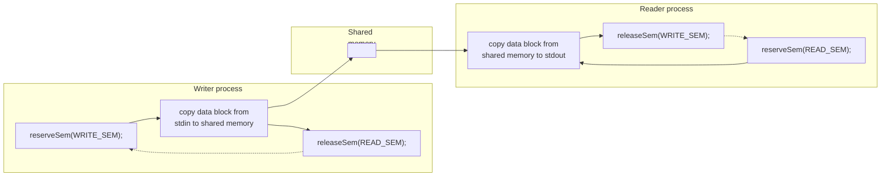

# Chương 48: Bộ nhớ chia sẻ System V (System V Shared Memory)

Chương trình này mô tả bộ nhớ chia sẻ System V (System V shared memory). Bộ nhớ chia sẻ cho phép hai hoặc nhiều tiến trình (process) cùng chia sẻ một vùng (thường được gọi là một phân đoạn - segment) bộ nhớ vật lý. Vì một phân đoạn bộ nhớ chia sẻ trở thành một phần trong bộ nhớ không gian người dùng (user-space memory) của tiến trình, nên không cần sự can thiệp của kernel cho hoạt động IPC (Inter-Process Communication - Giao tiếp giữa các tiến trình). Tất cả những gì cần làm là một tiến trình sao chép dữ liệu vào bộ nhớ chia sẻ; dữ liệu đó sẽ ngay lập tức có sẵn cho tất cả các tiến trình khác đang chia sẻ cùng phân đoạn đó. Điều này cung cấp cơ chế IPC tốc độ cao so với các kỹ thuật như pipe (đường ống) hoặc message queue (hàng đợi thông điệp), trong đó tiến trình gửi sao chép dữ liệu từ một vùng đệm (buffer) trong không gian người dùng (user space) vào bộ nhớ kernel và tiến trình nhận sao chép theo chiều ngược lại. (Mỗi tiến trình cũng gánh chịu chi phí phát sinh của một System Call để thực hiện thao tác sao chép).

Mặt khác, việc IPC sử dụng bộ nhớ chia sẻ không được trung gian hóa bởi kernel đồng nghĩa với việc thông thường, cần phải có một phương pháp đồng bộ hóa (synchronization) để các tiến trình không cùng lúc truy cập vào bộ nhớ chia sẻ (ví dụ: hai tiến trình thực hiện cập nhật đồng thời, hoặc một tiến trình lấy dữ liệu từ bộ nhớ chia sẻ trong khi một tiến trình khác đang ở giữa quá trình cập nhật nó). Semaphore System V (System V semaphore) là một phương pháp tự nhiên cho việc đồng bộ hóa như vậy. Các phương pháp khác, chẳng hạn như semaphore POSIX (POSIX semaphore - Chương 53) và khóa tệp (file lock - Chương 55), cũng khả thi.

> [!NOTE]
> Theo thuật ngữ của `mmap()`, một vùng bộ nhớ được ánh xạ (mapped) tại một địa chỉ, trong khi theo thuật ngữ của System V, một phân đoạn bộ nhớ chia sẻ được gắn (attached) tại một địa chỉ. Các thuật ngữ này là tương đương; sự khác biệt về thuật ngữ là hệ quả từ nguồn gốc phát triển riêng biệt của hai API này.

## 48.1 Tổng quan

Để sử dụng một phân đoạn bộ nhớ chia sẻ, thông thường chúng ta thực hiện các bước sau:

- Gọi `shmget()` để tạo một phân đoạn bộ nhớ chia sẻ mới hoặc lấy định danh (identifier) của một phân đoạn đã tồn tại (tức là phân đoạn được tạo bởi một tiến trình khác). Lời gọi này trả về một định danh bộ nhớ chia sẻ để sử dụng cho các lời gọi sau đó.
- Sử dụng `shmat()` để gắn (attach) phân đoạn bộ nhớ chia sẻ; nghĩa là, làm cho phân đoạn trở thành một phần trong bộ nhớ ảo (virtual memory) của tiến trình gọi.
- Tại thời điểm này, phân đoạn bộ nhớ chia sẻ có thể được xử lý giống như bất kỳ vùng nhớ nào khác khả dụng đối với chương trình. Để tham chiếu đến bộ nhớ chia sẻ, chương trình sử dụng giá trị `addr` do lời gọi `shmat()` trả về, vốn là một con trỏ (pointer) trỏ đến điểm đầu của phân đoạn bộ nhớ chia sẻ trong không gian địa chỉ ảo (virtual address space) của tiến trình.
- Gọi `shmdt()` để tách (detach) phân đoạn bộ nhớ chia sẻ. Sau lời gọi này, tiến trình không còn có thể tham chiếu đến bộ nhớ chia sẻ nữa. Bước này là tùy chọn và sẽ tự động diễn ra khi tiến trình kết thúc.
- Gọi `shmctl()` để xóa phân đoạn bộ nhớ chia sẻ. Phân đoạn sẽ chỉ bị hủy sau khi tất cả các tiến trình hiện đang gắn kết đã tách nó ra. Chỉ cần một tiến trình thực hiện bước này.

## 48.2 Tạo hoặc Mở một Phân đoạn Bộ nhớ Chia sẻ (Shared Memory Segment)

System Call `shmget()` tạo một phân đoạn bộ nhớ chia sẻ (shared memory segment) mới hoặc lấy định danh (identifier) của một phân đoạn đã tồn tại. Nội dung của một phân đoạn bộ nhớ chia sẻ mới được khởi tạo về 0.

```c
## include <sys/types.h> /* Cho tính di động */
## include <sys/shm.h>
int shmget(key_t key, size_t size, int shmflg);
          Trả về định danh phân đoạn bộ nhớ chia sẻ nếu thành công, hoặc –1 nếu lỗi
```

Đối số `key` là một khóa được tạo bằng cách sử dụng một trong các phương pháp được mô tả trong Mục [45.2](#page-48-1) (nghĩa là, thường là giá trị `IPC_PRIVATE` hoặc một khóa do `ftok()` trả về).

Khi chúng ta sử dụng `shmget()` để tạo một phân đoạn bộ nhớ chia sẻ mới, `size` chỉ định một số nguyên dương biểu thị kích thước mong muốn của phân đoạn, tính bằng byte. Kernel phân bổ bộ nhớ chia sẻ theo bội số của kích thước trang hệ thống (system page size), do đó `size` thực tế được làm tròn lên thành bội số tiếp theo của kích thước trang hệ thống. Nếu chúng ta sử dụng `shmget()` để lấy định danh của một phân đoạn đã tồn tại, thì `size` không có tác động gì đến phân đoạn đó, nhưng nó phải nhỏ hơn hoặc bằng kích thước của phân đoạn.

Đối số `shmflg` thực hiện tác vụ giống như đối với các lệnh gọi lấy IPC khác, chỉ định các quyền (Bảng 15-4, trang 295) được áp dụng cho phân đoạn bộ nhớ chia sẻ mới hoặc được kiểm tra đối với một phân đoạn đã tồn tại. Ngoài ra, có thể kết hợp (dùng toán tử OR `|`) không hoặc nhiều cờ sau đây trong `shmflg` để điều khiển hoạt động của `shmget()`:

`IPC_CREAT`

Nếu chưa có phân đoạn nào với khóa được chỉ định tồn tại, hãy tạo một phân đoạn mới.

`IPC_EXCL`

Nếu `IPC_CREAT` cũng được chỉ định và một phân đoạn với khóa đã cho đã tồn tại, lệnh gọi sẽ thất bại với mã lỗi `EEXIST`.

Các cờ trên được mô tả chi tiết hơn trong Mục [45.1](#page-45-0). Ngoài ra, Linux cho phép các cờ phi tiêu chuẩn sau:

```
SHM_HUGETLB (từ Linux 2.6)
```

Một tiến trình (process) có đặc quyền (`CAP_IPC_LOCK`) có thể sử dụng cờ này để tạo một phân đoạn bộ nhớ chia sẻ sử dụng trang lớn (huge pages). Huge pages là một tính năng được cung cấp bởi nhiều kiến trúc phần cứng hiện đại để quản lý bộ nhớ sử dụng kích thước trang rất lớn. (Ví dụ: x86-32 cho phép các trang 4-MB như một giải pháp thay thế cho các trang 4-kB.) Trên các hệ thống có lượng lớn bộ nhớ và nơi các ứng dụng yêu cầu các khối bộ nhớ lớn, việc sử dụng huge pages làm giảm số lượng mục cần thiết trong bộ đệm dịch địa chỉ translation look-aside buffer (TLB) của đơn vị quản lý bộ nhớ phần cứng (memory management unit). Điều này có lợi vì các mục trong TLB thường là tài nguyên khan hiếm. Xem tệp mã nguồn kernel `Documentation/vm/hugetlbpage.txt` để biết thêm thông tin.

```
SHM_NORESERVE (từ Linux 2.6.15)
```

Cờ này phục vụ cùng một mục đích cho `shmget()` giống như cờ `MAP_NORESERVE` phục vụ cho `mmap()`. Xem Mục [49.9](#page-161-0).

Khi thành công, `shmget()` trả về định danh cho phân đoạn bộ nhớ chia sẻ mới hoặc đã tồn tại.

## 48.3 Sử dụng Bộ nhớ Chia sẻ (Shared Memory)

System Call `shmat()` đính kèm (attach) phân đoạn bộ nhớ chia sẻ được xác định bởi `shmid` vào không gian địa chỉ ảo (virtual address space) của tiến trình gọi.

```c
## include <sys/types.h> /* Cho tính di động */
## include <sys/shm.h>
void *shmat(int shmid, const void *shmaddr, int shmflg);
               Trả về địa chỉ nơi bộ nhớ chia sẻ được đính kèm nếu thành công,
                                                        hoặc (void *) –1 nếu lỗi
```

Đối số `shmaddr` và cài đặt của bit `SHM_RND` trong đối số mặt nạ bit `shmflg` kiểm soát cách phân đoạn được đính kèm:

- Nếu `shmaddr` là `NULL`, thì phân đoạn được đính kèm tại một địa chỉ thích hợp do kernel lựa chọn. Đây là phương pháp đính kèm phân đoạn được ưu tiên.
- Nếu `shmaddr` không phải là `NULL` và `SHM_RND` không được thiết lập, thì phân đoạn được đính kèm tại địa chỉ do `shmaddr` chỉ định, địa chỉ này phải là bội số của kích thước trang hệ thống (nếu không sẽ dẫn đến lỗi `EINVAL`).
- Nếu `shmaddr` không phải là `NULL` và `SHM_RND` được thiết lập, thì phân đoạn được ánh xạ (map) tại địa chỉ được cung cấp trong `shmaddr`, được làm tròn xuống thành bội số gần nhất của hằng số `SHMLBA` (shared memory low boundary address - địa chỉ ranh giới thấp của bộ nhớ chia sẻ). Hằng số này bằng một số

bội của kích thước trang hệ thống. Việc đính kèm một phân đoạn tại một địa chỉ là bội số của `SHMLBA` là cần thiết trên một số kiến trúc nhằm cải thiện hiệu năng bộ nhớ đệm CPU (CPU cache performance) và ngăn ngừa khả năng các lần đính kèm khác nhau của cùng một phân đoạn có các góc nhìn không nhất quán bên trong bộ nhớ đệm CPU.

> [!NOTE]
> Trên các kiến trúc x86, `SHMLBA` giống với kích thước trang hệ thống, phản ánh thực tế là những sự không nhất quán về bộ nhớ đệm như vậy không thể phát sinh trên các kiến trúc đó.

Việc chỉ định một giá trị khác `NULL` cho `shmaddr` (tức là tùy chọn thứ hai hoặc thứ ba được liệt kê ở trên) không được khuyến khích vì những lý do sau:

- Nó làm giảm tính di động (portability) của ứng dụng. Một địa chỉ hợp lệ trên một cài đặt UNIX này có thể không hợp lệ trên cài đặt khác.
- Nỗ lực đính kèm một phân đoạn bộ nhớ chia sẻ tại một địa chỉ cụ thể sẽ thất bại nếu địa chỉ đó đang được sử dụng. Điều này có thể xảy ra nếu, ví dụ, ứng dụng (có thể nằm bên trong một hàm thư viện) đã đính kèm một phân đoạn khác hoặc tạo một ánh xạ bộ nhớ tại địa chỉ đó.

Là kết quả của hàm, `shmat()` trả về địa chỉ mà tại đó phân đoạn bộ nhớ chia sẻ (shared memory segment) được đính kèm (attach). Giá trị này có thể được xử lý giống như một con trỏ C thông thường; phân đoạn trông giống hệt như bất kỳ phần nào khác trong bộ nhớ ảo (virtual memory) của tiến trình (process). Thông thường, chúng ta gán giá trị trả về từ `shmat()` cho một con trỏ tới một cấu trúc do lập trình viên định nghĩa, nhằm áp đặt cấu trúc đó lên phân đoạn (ví dụ, xem [Listing 48-2](#page-126-0)).

Để đính kèm phân đoạn bộ nhớ chia sẻ với quyền chỉ đọc (read-only access), chúng ta chỉ định cờ `SHM_RDONLY` trong `shmflg`. Các cố gắng cập nhật nội dung của phân đoạn chỉ đọc sẽ dẫn đến lỗi phân đoạn (segmentation fault) (tín hiệu `SIGSEGV`). Nếu `SHM_RDONLY` không được chỉ định, bộ nhớ có thể vừa được đọc vừa được sửa đổi.

Để đính kèm một phân đoạn bộ nhớ chia sẻ, tiến trình (process) yêu cầu quyền đọc và ghi đối với phân đoạn đó, trừ khi `SHM_RDONLY` được chỉ định, trong trường hợp này chỉ cần quyền đọc.

> [!NOTE]
> Có thể đính kèm cùng một phân đoạn bộ nhớ chia sẻ nhiều lần trong một tiến trình, và thậm chí làm cho một lần đính kèm là chỉ đọc trong khi lần khác là đọc-ghi. Nội dung của bộ nhớ tại mỗi điểm đính kèm là giống nhau, vì các mục khác nhau trong bảng trang bộ nhớ ảo (virtual memory page tables) của tiến trình đang trỏ đến cùng các trang bộ nhớ vật lý (physical pages) cụ thể.

Một giá trị cuối cùng có thể được chỉ định trong `shmflg` là `SHM_REMAP`. Trong trường hợp này, `shmaddr` không được là `NULL`. Cờ này yêu cầu lệnh gọi `shmat()` thay thế bất kỳ đính kèm bộ nhớ chia sẻ hoặc ánh xạ bộ nhớ (memory mapping) hiện có nào trong dải bắt đầu từ `shmaddr` và kéo dài bằng chiều dài của phân đoạn bộ nhớ chia sẻ. Thông thường, nếu chúng ta cố gắng đính kèm một phân đoạn bộ nhớ chia sẻ tại một dải địa chỉ đã được sử dụng, lỗi `EINVAL` sẽ xảy ra. `SHM_REMAP` là một phần mở rộng Linux phi tiêu chuẩn (nonstandard Linux extension).

[Table 48-1](#page-124-1) tóm tắt các hằng số có thể được kết hợp bằng phép OR trong tham số `shmflg` của `shmat()`.

Khi một tiến trình không còn cần truy cập phân đoạn bộ nhớ chia sẻ nữa, nó có thể gọi `shmdt()` để tách (detach) phân đoạn khỏi không gian địa chỉ ảo (virtual address space) của mình. Tham số `shmaddr` xác định phân đoạn cần tách. Nó phải là giá trị do lần gọi `shmat()` trước đó trả về.

```c
## include <sys/types.h> /* Cho tính di động */
## include <sys/shm.h>
int shmdt(const void *shmaddr);
                                           Trả về 0 nếu thành công, hoặc –1 nếu lỗi
```

Việc tách một phân đoạn bộ nhớ chia sẻ không giống như việc xóa nó. Việc xóa được thực hiện bằng cách sử dụng thao tác `shmctl()` với `IPC_RMID`, như được mô tả trong Mục [48.7](#page-134-1).

Tiến trình con được tạo bởi `fork()` kế thừa các phân đoạn bộ nhớ chia sẻ đã đính kèm của tiến trình cha. Do đó, bộ nhớ chia sẻ cung cấp một phương pháp IPC dễ dàng giữa tiến trình cha và tiến trình con.

Trong quá trình thực thi `exec()`, tất cả các phân đoạn bộ nhớ chia sẻ đã đính kèm đều bị tách ra. Các phân đoạn bộ nhớ chia sẻ cũng tự động bị tách ra khi tiến trình chấm dứt (process termination).

| Bảng 48-1: Các giá trị mặt nạ bit shmflg cho shmat() | |
|---|---|
| Giá trị | Mô tả |
| SHM_RDONLY | Đính kèm phân đoạn ở chế độ chỉ đọc |
| SHM_REMAP | Thay thế bất kỳ ánh xạ hiện có nào tại shmaddr |
| SHM_RND | Làm tròn shmaddr xuống bội số của SHMLBA byte |

## 48.4 Ví dụ: Truyền dữ liệu qua bộ nhớ chia sẻ

Bây giờ chúng ta xem xét một ứng dụng mẫu sử dụng bộ nhớ chia sẻ và semaphore System V. Ứng dụng bao gồm hai chương trình: chương trình ghi (writer) và chương trình đọc (reader). Chương trình ghi đọc các khối dữ liệu từ đầu vào chuẩn (standard input) và sao chép ("ghi") chúng vào một phân đoạn bộ nhớ chia sẻ. Chương trình đọc sao chép ("đọc") các khối dữ liệu từ phân đoạn bộ nhớ chia sẻ ra đầu ra chuẩn (standard output). Trên thực tế, các chương trình coi bộ nhớ chia sẻ hơi giống một đường ống (pipe).

Hai chương trình sử dụng một cặp semaphore System V trong một giao thức semaphore nhị phân (binary semaphore protocol) (các hàm `initSemAvailable()`, `initSemInUse()`, `reserveSem()` và `releaseSem()` được định nghĩa trong Mục [47.9](#page-111-0)) để đảm bảo rằng:

- chỉ có một tiến trình truy cập phân đoạn bộ nhớ chia sẻ tại một thời điểm; và
- các tiến trình luân phiên truy cập phân đoạn (nghĩa là, chương trình ghi ghi một số dữ liệu, sau đó chương trình đọc đọc dữ liệu đó, sau đó chương trình ghi lại ghi tiếp, cứ như vậy).

[Figure 48-1](#page-125-1) cung cấp cái nhìn tổng quan về việc sử dụng hai semaphore này. Lưu ý rằng chương trình ghi khởi tạo hai semaphore sao cho nó là chương trình đầu tiên trong hai chương trình có thể truy cập phân đoạn bộ nhớ chia sẻ; nghĩa là, semaphore của chương trình ghi ban đầu khả dụng (`available`), và semaphore của chương trình đọc ban đầu đang được sử dụng (`in use`).

Mã nguồn của ứng dụng bao gồm ba tệp. Tệp đầu tiên, [Listing 48-1,](#page-125-0) là một tệp tiêu đề (header file) được chia sẻ bởi cả chương trình đọc và chương trình ghi. Tệp tiêu đề này định nghĩa cấu trúc `shmseg` mà chúng ta sử dụng để khai báo các con trỏ tới phân đoạn bộ nhớ chia sẻ. Làm như vậy cho phép chúng ta áp đặt một cấu trúc lên các byte của phân đoạn bộ nhớ chia sẻ.



**Hình 48-1:** Sử dụng Semaphore (semaphore) để đảm bảo quyền truy cập độc quyền, luân phiên vào Shared Memory (bộ nhớ chia sẻ)

**Liệt kê 48-1:** Tệp tiêu đề (Header file) cho `svshm_xfr_writer.c` và `svshm_xfr_reader.c`

```c
–––––––––––––––––––––––––––––––––––––––––––––––––––––––– svshm/svshm_xfr.h
## include <sys/types.h>
## include <sys/stat.h>
## include <sys/sem.h>
## include <sys/shm.h>
## include "binary_sems.h" /* Khai báo các hàm semaphore nhị phân của chúng ta */
## include "tlpi_hdr.h"
## define SHM_KEY 0x1234 /* Key cho phân đoạn shared memory */
## define SEM_KEY 0x5678 /* Key cho tập hợp semaphore */
## define OBJ_PERMS (S_IRUSR | S_IWUSR | S_IRGRP | S_IWGRP)
 /* Quyền truy cập cho các đối tượng IPC của chúng ta */
## define WRITE_SEM 0 /* Writer có quyền truy cập vào shared memory */
## define READ_SEM 1 /* Reader có quyền truy cập vào shared memory */
## ifndef BUF_SIZE /* Cho phép "cc -D" ghi đè định nghĩa */
## define BUF_SIZE 1024 /* Kích thước bộ đệm truyền dữ liệu */
## endif
struct shmseg { /* Định nghĩa cấu trúc của phân đoạn shared memory */
 int cnt; /* Số byte được sử dụng trong 'buf' */
 char buf[BUF_SIZE]; /* Dữ liệu đang được truyền */
};
–––––––––––––––––––––––––––––––––––––––––––––––––––––––– svshm/svshm_xfr.h
```

[Liệt kê 48-2](#page-126-0) là chương trình ghi (writer). Chương trình này thực hiện các bước sau:

- Tạo một tập hợp (set) chứa hai semaphore được sử dụng bởi chương trình ghi và đọc để đảm bảo chúng luân phiên truy cập vào phân đoạn shared memory q. Các semaphore được khởi tạo sao cho writer có quyền truy cập vào phân đoạn shared memory trước. Vì writer tạo ra tập hợp semaphore, nó phải được khởi chạy trước reader.

- Tạo phân đoạn shared memory và đính kèm (attach) nó vào Virtual Address Space (không gian địa chỉ ảo) của writer tại một địa chỉ do hệ thống lựa chọn w.
- Đi vào một vòng lặp truyền dữ liệu từ Standard Input (đầu vào chuẩn) sang phân đoạn shared memory e. Các bước sau được thực hiện trong mỗi lần lặp của vòng lặp:
  - Giữ chỗ / khóa (Reserve - giảm giá trị) semaphore của writer r.
  - Đọc dữ liệu từ standard input vào phân đoạn shared memory t.
  - Giải phóng (Release - tăng giá trị) semaphore của reader y.
- Vòng lặp kết thúc khi không còn dữ liệu từ standard input u. Ở lần chạy qua vòng lặp cuối cùng, writer báo cho reader biết rằng không còn dữ liệu nữa bằng cách truyền một khối dữ liệu có độ dài bằng 0 (`shmp–>cnt` bằng 0).
- Sau khi thoát khỏi vòng lặp, writer một lần nữa giữ chỗ semaphore của chính nó, để đảm bảo rằng reader đã hoàn thành lần truy cập cuối cùng vào shared memory i. Sau đó, writer tiến hành gỡ bỏ phân đoạn shared memory và tập hợp semaphore o.

[Liệt kê 48-3](#page-128-0) là chương trình đọc (reader). Nó truyền các khối dữ liệu từ phân đoạn shared memory đến Standard Output (đầu ra chuẩn). Reader thực hiện các bước sau:

- Lấy ID của tập hợp semaphore và phân đoạn shared memory đã được tạo bởi chương trình writer q.
- Đính kèm phân đoạn shared memory ở chế độ chỉ đọc (read-only access) w.
- Đi vào vòng lặp truyền dữ liệu từ phân đoạn shared memory e. Các bước sau được thực hiện trong mỗi lần lặp của vòng lặp:
  - Giữ chỗ (giảm giá trị) semaphore của reader r.
  - Kiểm tra xem `shmp–>cnt` có bằng 0 hay không; nếu có, thoát khỏi vòng lặp t.
  - Ghi khối dữ liệu trong phân đoạn shared memory ra standard output y.
  - Giải phóng (tăng giá trị) semaphore của writer u.
- Sau khi thoát khỏi vòng lặp, tách (detach) phân đoạn shared memory i và giải phóng semaphore của writer o, để chương trình writer có thể xóa các đối tượng IPC (IPC objects).

**Liệt kê 48-2:** Truyền các khối dữ liệu từ stdin sang một phân đoạn System V Shared Memory

```
–––––––––––––––––––––––––––––––––––––––––––––––––– svshm/svshm_xfr_writer.c
## include "semun.h" /* Định nghĩa union semun */
## include "svshm_xfr.h"
  int
  main(int argc, char *argv[])
  {
   int semid, shmid, bytes, xfrs;
   struct shmseg *shmp;
   union semun dummy;
q semid = semget(SEM_KEY, 2, IPC_CREAT | OBJ_PERMS);
   if (semid == -1)
   errExit("semget");
```

```
 if (initSemAvailable(semid, WRITE_SEM) == -1)
   errExit("initSemAvailable");
   if (initSemInUse(semid, READ_SEM) == -1)
   errExit("initSemInUse");
w shmid = shmget(SHM_KEY, sizeof(struct shmseg), IPC_CREAT | OBJ_PERMS);
   if (shmid == -1)
   errExit("shmget");
   shmp = shmat(shmid, NULL, 0);
   if (shmp == (void *) -1)
   errExit("shmat");
   /* Truyền các khối dữ liệu từ stdin sang shared memory */
e for (xfrs = 0, bytes = 0; ; xfrs++, bytes += shmp->cnt) {
r if (reserveSem(semid, WRITE_SEM) == -1) /* Chờ đến lượt của chúng ta */
   errExit("reserveSem");
t shmp->cnt = read(STDIN_FILENO, shmp->buf, BUF_SIZE);
   if (shmp->cnt == -1)
   errExit("read");
y if (releaseSem(semid, READ_SEM) == -1) /* Nhường lượt cho reader */
   errExit("releaseSem");
   /* Chúng ta đã đến EOF (End-of-File) chưa? Chúng ta kiểm tra điều này sau khi nhường lượt
   cho reader để nó có thể nhìn thấy giá trị 0 trong shmp->cnt. */
u if (shmp->cnt == 0)
   break;
   }
   /* Chờ cho đến khi reader cho phép chúng ta thêm một lượt nữa. Khi đó chúng ta biết
   rằng reader đã hoàn tất, và do đó chúng ta có thể xóa các đối tượng IPC. */
i if (reserveSem(semid, WRITE_SEM) == -1)
   errExit("reserveSem");
o if (semctl(semid, 0, IPC_RMID, dummy) == -1)
   errExit("semctl");
   if (shmdt(shmp) == -1)
   errExit("shmdt");
   if (shmctl(shmid, IPC_RMID, 0) == -1)
   errExit("shmctl");
   fprintf(stderr, "Đã gửi %d byte (%d lần truyền)\n", bytes, xfrs);
   exit(EXIT_SUCCESS);
  }
  –––––––––––––––––––––––––––––––––––––––––––––––––– svshm/svshm_xfr_writer.c
```

**Listing 48-3:** Chuyển các khối dữ liệu từ một phân vùng bộ nhớ chia sẻ (shared memory segment) System V ra stdout

```
–––––––––––––––––––––––––––––––––––––––––––––––––– svshm/svshm_xfr_reader.c
## include "svshm_xfr.h"
  int
  main(int argc, char *argv[])
  {
   int semid, shmid, xfrs, bytes;
   struct shmseg *shmp;
   /* Lấy các ID cho tập semaphore và bộ nhớ chia sẻ do tiến trình ghi tạo ra */
q semid = semget(SEM_KEY, 0, 0);
   if (semid == -1)
   errExit("semget");
   shmid = shmget(SHM_KEY, 0, 0);
   if (shmid == -1)
   errExit("shmget");
w shmp = shmat(shmid, NULL, SHM_RDONLY);
   if (shmp == (void *) -1)
   errExit("shmat");
   /* Chuyển các khối dữ liệu từ bộ nhớ chia sẻ ra stdout */
e for (xfrs = 0, bytes = 0; ; xfrs++) {
r if (reserveSem(semid, READ_SEM) == -1) /* Chờ đến lượt chúng ta */
   errExit("reserveSem");
t if (shmp->cnt == 0) /* Tiến trình ghi gặp EOF */
   break;
   bytes += shmp->cnt;
y if (write(STDOUT_FILENO, shmp->buf, shmp->cnt) != shmp->cnt)
   fatal("ghi một phần/thất bại");
u if (releaseSem(semid, WRITE_SEM) == -1) /* Nhường lượt cho tiến trình ghi */
   errExit("releaseSem");
   }
i if (shmdt(shmp) == -1)
   errExit("shmdt");
   /* Nhường tiến trình ghi thêm một lượt để nó có thể dọn dẹp */
o if (releaseSem(semid, WRITE_SEM) == -1)
   errExit("releaseSem");
   fprintf(stderr, "Đã nhận %d byte (%d lần chuyển)\n", bytes, xfrs);
   exit(EXIT_SUCCESS);
  }
  –––––––––––––––––––––––––––––––––––––––––––––––––– svshm/svshm_xfr_reader.c
```

Phiên làm việc shell sau đây minh họa việc sử dụng các chương trình trong [Listing 48-2](#page-126-0) và [Listing 46-9](#page-83-1). Chúng ta gọi tiến trình ghi (writer), sử dụng tệp `/etc/services` làm đầu vào, và sau đó gọi tiến trình đọc (reader), điều hướng đầu ra của nó sang một tệp khác:

```
$ wc -c /etc/services Hiển thị kích thước của tệp kiểm tra
764360 /etc/services
$ ./svshm_xfr_writer < /etc/services &
[1] 9403
$ ./svshm_xfr_reader > out.txt
Received 764360 bytes (747 xfrs) Thông điệp từ tiến trình đọc
Sent 764360 bytes (747 xfrs) Thông điệp từ tiến trình ghi
[1]+ Done ./svshm_xfr_writer < /etc/services
$ diff /etc/services out.txt
$
```

Lệnh `diff` không tạo ra đầu ra nào, cho thấy tệp đầu ra do tiến trình đọc tạo ra có nội dung giống hệt với tệp đầu vào mà tiến trình ghi đã sử dụng.

## 48.5 Vị trí của Bộ nhớ Chia sẻ trong Bộ nhớ ảo

Trong Mục 6.3, chúng ta đã xem xét bố cục của các thành phần khác nhau của một process trong bộ nhớ ảo (virtual memory). Việc xem lại chủ đề này trong bối cảnh đính kèm (attach) các phân vùng bộ nhớ chia sẻ System V là rất hữu ích. Nếu chúng ta tuân theo cách tiếp cận được khuyến nghị là để kernel tự chọn vị trí đính kèm phân vùng bộ nhớ chia sẻ, thì (trên kiến trúc x86-32) bố cục bộ nhớ sẽ xuất hiện như được hiển thị trong [Hình 48-2](#page-130-0), với phân vùng được đính kèm trong không gian chưa được cấp phát (unallocated space) giữa heap (phát triển lên trên) và stack (phát triển xuống dưới). Để chừa không gian cho heap và stack phát triển, các phân vùng bộ nhớ chia sẻ được đính kèm bắt đầu từ địa chỉ ảo `0x40000000`. Các ánh xạ bộ nhớ (memory mappings) (Chương [49](#page-140-0)) và thư viện chia sẻ (shared libraries) (Chương 41 và 42) cũng được đặt trong khu vực này. (Có một số biến thể về vị trí mặc định nơi các ánh xạ bộ nhớ chia sẻ và phân vùng bộ nhớ được đặt, tùy thuộc vào các phiên bản kernel và cấu hình giới hạn tài nguyên `RLIMIT_STACK` của process.)

> [!NOTE]
> Địa chỉ `0x40000000` được định nghĩa là hằng số kernel `TASK_UNMAPPED_BASE`. Có thể thay đổi địa chỉ này bằng cách định nghĩa hằng số này với một giá trị khác và biên dịch lại kernel.

> [!NOTE]
> Một phân vùng bộ nhớ chia sẻ (hoặc ánh xạ bộ nhớ) có thể được đặt tại một địa chỉ bên dưới `TASK_UNMAPPED_BASE`, nếu chúng ta áp dụng cách tiếp cận không được khuyến nghị là chỉ định rõ ràng một địa chỉ khi gọi `shmat()` (hoặc `mmap()`).

Sử dụng tệp `/proc/PID/maps` đặc trưng của Linux, chúng ta có thể thấy vị trí của các phân vùng bộ nhớ chia sẻ và thư viện chia sẻ được ánh xạ bởi một chương trình, như chúng ta minh họa trong phiên làm việc shell bên dưới.

> [!NOTE]
> Bắt đầu từ kernel 2.6.14, Linux cũng cung cấp tệp `/proc/PID/smaps`, cung cấp nhiều thông tin hơn về mức tiêu thụ bộ nhớ của từng ánh xạ trong process. Để biết thêm chi tiết, hãy xem trang hướng dẫn thủ công (manual page) `proc(5)`.

### Địa chỉ bộ nhớ ảo (hệ thập lục phân)

```text
Địa chỉ bộ nhớ ảo
    (hệ thập lục phân)
                        ┌─────────────────────────────┐
    0xC0000000          │      argc, environ          │
                        ├─────────────────────────────┤
                        │          Stack              │
                        ├ ─ ─ ─ ─ ─ ─ ─ ─ ─ ─ ─ ─ ─ --┤◄── Đỉnh
                        │            │                │    stack
                        │            ▼                │
                        │                             │
                        ├ ─ ─ ─ ─ ─ ─ ─ ─ ─ ─ ─ ─ ─ --┤
                        │                             │
                        │   Bộ nhớ chia sẻ, ánh xạ    │
                        │   bộ nhớ và thư viện chia   │
                        │   sẻ được đặt ở đây         │
                        │                             │
    0x40000000          ├─────────────────────────────┤
TASK_UNMAPPED_BASE      │                             │
                        │ Dành riêng cho việc mở rộng │
        ▲               │ heap                        │
        │               │                             │
        │               │            ▲                │
        │               ├ ─ ─ ─ ─ ─ ─│─ ─ ─ ─ ─ ─ ─ --┤◄── Program
        │               │                             │    break
Địa chỉ ảo tăng dần     │          Heap               │
        │               ├─────────────────────────────┤
        │               │ Dữ liệu chưa khởi tạo (bss) │
        │               ├─────────────────────────────┤
        │               │    Dữ liệu đã khởi tạo      │
                        ├─────────────────────────────┤
    0x08048000          │   Text (mã chương trình)    │
                        ├─────────────────────────────┤
    0x00000000          │                             │
                        └─────────────────────────────┘
```

**Hình 48-2:** Vị trí của bộ nhớ chia sẻ (shared memory), ánh xạ bộ nhớ (memory mappings), và thư viện chia sẻ (shared libraries) (x86-32)

Trong phiên dòng lệnh (shell session) dưới đây, chúng tôi sử dụng ba chương trình không được minh họa trong chương này, nhưng được cung cấp trong thư mục con `svshm` thuộc mã nguồn phân phối của cuốn sách này. Các chương trình này thực hiện các tác vụ sau:

- Chương trình `svshm_create.c` tạo một phân đoạn bộ nhớ chia sẻ (shared memory segment). Chương trình này nhận các tùy chọn dòng lệnh tương tự như các chương trình tương ứng mà chúng tôi cung cấp cho hàng đợi thông điệp (message queues) [(\(Liệt kê 46-1](#page-61-1), trang [938\)](#page-61-1) và semaphore, nhưng bao gồm một tham số bổ sung xác định kích thước của phân đoạn.
- Chương trình `svshm_attach.c` gắn (attach) các phân đoạn bộ nhớ chia sẻ được xác định bởi các tham số dòng lệnh của nó. Mỗi tham số này là một cặp số được phân tách bằng dấu hai chấm, bao gồm định danh bộ nhớ chia sẻ (shared memory identifier) và địa chỉ gắn (attach address). Việc chỉ định giá trị `0` cho địa chỉ gắn có nghĩa là hệ thống nên tự chọn địa chỉ. Chương trình hiển thị địa chỉ mà tại đó bộ nhớ thực sự được gắn. Vì mục đích cung cấp thông tin, chương trình cũng hiển thị giá trị của hằng số `SHMLBA` và ID tiến trình (Process ID - PID) của tiến trình đang chạy chương trình đó.
- Chương trình `svshm_rm.c` xóa các phân đoạn bộ nhớ chia sẻ được xác định bởi các tham số dòng lệnh của nó.

Chúng ta bắt đầu phiên dòng lệnh bằng cách tạo hai phân đoạn bộ nhớ chia sẻ (có kích thước 100 kB và 3200 kB):

```
$ ./svshm_create -p 102400
9633796
$ ./svshm_create -p 3276800
9666565
$ ./svshm_create -p 102400
1015817
$ ./svshm_create -p 3276800
1048586
```

Sau đó, chúng ta khởi động một chương trình gắn hai phân đoạn này tại các địa chỉ do kernel lựa chọn:

```
$ ./svshm_attach 9633796:0 9666565:0
SHMLBA = 4096 (0x1000), PID = 9903
1: 9633796:0 ==> 0xb7f0d000
2: 9666565:0 ==> 0xb7bed000
Sleeping 5 seconds
```

Đầu ra ở trên hiển thị các địa chỉ mà tại đó các phân đoạn được gắn. Trước khi chương trình hoàn thành thời gian ngủ (sleep), chúng ta tạm dừng (suspend) nó, và sau đó kiểm tra nội dung của tệp `/proc/PID/maps` tương ứng:

```
Nhấn Control-Z để tạm dừng chương trình
[1]+ Stopped ./svshm_attach 9633796:0 9666565:0
$ cat /proc/9903/maps
```

Đầu ra được tạo bởi lệnh `cat` được thể hiện trong [Liệt kê 48-4.](#page-131-0)

**Liệt kê 48-4:** Ví dụ về nội dung của tệp `/proc/PID/maps`

```
$ cat /proc/9903/maps
q 08048000-0804a000 r-xp 00000000 08:05 5526989 /home/mtk/svshm_attach
  0804a000-0804b000 r--p 00001000 08:05 5526989 /home/mtk/svshm_attach
  0804b000-0804c000 rw-p 00002000 08:05 5526989 /home/mtk/svshm_attach
w b7bed000-b7f0d000 rw-s 00000000 00:09 9666565 /SYSV00000000 (deleted)
  b7f0d000-b7f26000 rw-s 00000000 00:09 9633796 /SYSV00000000 (deleted)
  b7f26000-b7f27000 rw-p b7f26000 00:00 0
e b7f27000-b8064000 r-xp 00000000 08:06 122031 /lib/libc-2.8.so
  b8064000-b8066000 r--p 0013d000 08:06 122031 /lib/libc-2.8.so
  b8066000-b8067000 rw-p 0013f000 08:06 122031 /lib/libc-2.8.so
  b8067000-b806b000 rw-p b8067000 00:00 0
  b8082000-b8083000 rw-p b8082000 00:00 0
r b8083000-b809e000 r-xp 00000000 08:06 122125 /lib/ld-2.8.so
  b809e000-b809f000 r--p 0001a000 08:06 122125 /lib/ld-2.8.so
  b809f000-b80a0000 rw-p 0001b000 08:06 122125 /lib/ld-2.8.so
t bfd8a000-bfda0000 rw-p bffea000 00:00 0 [stack]
y ffffe000-fffff000 r-xp 00000000 00:00 0 [vdso]
```

Trong phần đầu ra từ `/proc/PID/maps` được hiển thị ở [Liệt kê 48-4,](#page-131-0) chúng ta có thể thấy các thành phần sau:

- Ba dòng cho chương trình chính, `shm_attach`. Các dòng này tương ứng với các phân đoạn văn bản (text) và dữ liệu (data) của chương trình q. Dòng thứ hai trong số này dành cho một trang chỉ đọc (read-only page) chứa các hằng số chuỗi được sử dụng bởi chương trình.
- Hai dòng cho các phân đoạn bộ nhớ chia sẻ System V đã được gắn w.
- Các dòng tương ứng với các phân đoạn của hai thư viện chia sẻ. Một trong số đó là thư viện C chuẩn (`libc-version.so`) e. Thư viện còn lại là trình liên kết động (dynamic linker - `ld-version.so`), mà chúng tôi mô tả trong Mục 41.4.3 r.
- Một dòng được dán nhãn `[stack]`. Dòng này tương ứng với stack của tiến trình t.
- Một dòng chứa thẻ `[vdso]` y. Đây là một mục nhập (entry) cho đối tượng chia sẻ động ảo (virtual dynamic shared object - DSO) `linux-gate`. Mục nhập này chỉ xuất hiện trong các kernel từ phiên bản 2.6.12 trở đi. Xem http://www.trilithium.com/johan/2005/08/linux-gate/ để biết thêm thông tin về mục nhập này.

Các cột sau đây được hiển thị trong mỗi dòng của `/proc/PID/maps`, theo thứ tự từ trái sang phải:

- 1. Một cặp số được ngăn cách bằng dấu gạch ngang cho biết dải địa chỉ ảo (virtual address range) (tính theo hệ thập lục phân - hexadecimal) tại đó phân đoạn bộ nhớ được ánh xạ. Số thứ hai trong các số này là địa chỉ của byte tiếp theo ngay sau phần cuối của phân đoạn.
- 2. Quyền bảo vệ (protection) và các cờ (flags) cho phân đoạn bộ nhớ này. Ba chữ cái đầu tiên cho biết quyền bảo vệ của phân đoạn: đọc (`r`), ghi (`w`), và thực thi (`x`). Dấu gạch ngang (`-`) thay cho bất kỳ chữ cái nào trong số này cho biết quyền bảo vệ tương ứng đã bị vô hiệu hóa. Chữ cái cuối cùng cho biết cờ ánh xạ (mapping flag) cho phân đoạn bộ nhớ; đó là riêng tư (`p` - private) hoặc chia sẻ (`s` - shared). Để giải thích về các cờ này, hãy xem phần mô tả về các cờ `MAP_PRIVATE` và `MAP_SHARED` trong Mục [49.2](#page-143-0). (Một phân đoạn bộ nhớ chia sẻ System V luôn được đánh dấu là chia sẻ).

- 3. Độ lệch hệ thập lục phân (tính bằng byte) của đoạn (segment) trong tệp được ánh xạ tương ứng. Ý nghĩa của cột này và hai cột tiếp theo sẽ trở nên rõ ràng hơn khi chúng ta mô tả System Call `mmap()` ở Chương [49](#page-140-0). Đối với một đoạn bộ nhớ chia sẻ System V (System V shared memory segment), độ lệch luôn là 0.
- 4. Số hiệu thiết bị (ID chính và phụ - major and minor IDs) của thiết bị mà trên đó tệp được ánh xạ tương ứng đang nằm.
- 5. Số i-node của tệp được ánh xạ, hoặc đối với các đoạn bộ nhớ chia sẻ System V, là định danh cho đoạn đó.
- 6. Tên tệp hoặc thẻ định danh khác được liên kết với đoạn bộ nhớ này. Đối với một đoạn bộ nhớ chia sẻ System V, tên này bao gồm chuỗi `SYSV` được nối với khóa (key) `shmget()` của đoạn (được biểu diễn dưới dạng thập lục phân). Trong ví dụ này, theo sau `SYSV` là các số không vì chúng ta đã tạo các đoạn bằng cách sử dụng khóa `IPC_PRIVATE` (có giá trị là 0). Chuỗi `(deleted)` xuất hiện sau trường `SYSV` đối với một đoạn bộ nhớ chia sẻ System V là một hệ quả từ việc triển khai các đoạn bộ nhớ chia sẻ. Các đoạn như vậy được tạo ra dưới dạng tệp được ánh xạ trong một hệ thống tệp `tmpfs` ẩn (Mục 14.10), và sau đó bị hủy liên kết (`unlinked`). Các ánh xạ bộ nhớ ẩn chia sẻ (shared anonymous memory mappings) được thực hiện theo cùng một cách. (Chúng ta mô tả các tệp được ánh xạ và ánh xạ bộ nhớ ẩn chia sẻ ở Chương [49](#page-140-0)).

## 48.6 Lưu trữ Con trỏ trong Bộ nhớ Chia sẻ (Shared Memory)

Mỗi tiến trình (process) có thể sử dụng các thư viện chia sẻ và ánh xạ bộ nhớ khác nhau, đồng thời có thể đính kèm các tập hợp đoạn bộ nhớ chia sẻ khác nhau. Do đó, nếu chúng ta tuân theo thực tiễn được khuyến nghị là để kernel (nhân) chọn vị trí đính kèm đoạn bộ nhớ chia sẻ, đoạn đó có thể được đính kèm tại một địa chỉ khác nhau ở mỗi tiến trình. Vì lý do này, khi lưu trữ các tham chiếu bên trong một đoạn bộ nhớ chia sẻ trỏ đến các địa chỉ khác trong cùng đoạn đó, chúng ta nên sử dụng độ lệch (relative offsets) thay vì con trỏ tuyệt đối (absolute pointers).

Ví dụ, giả sử chúng ta có một đoạn bộ nhớ chia sẻ có địa chỉ bắt đầu được trỏ bởi `baseaddr` (tức là `baseaddr` là giá trị trả về bởi `shmat()`). Hơn nữa, tại vị trí được trỏ bởi `p`, chúng ta muốn lưu trữ một con trỏ trỏ đến cùng vị trí được trỏ bởi `target`, như được hiển thị trong [Hình 48-3.](#page-133-0) Kiểu thao tác này rất điển hình nếu chúng ta đang xây dựng một danh sách liên kết (linked list) hoặc cây nhị phân (binary tree) bên trong đoạn đó. Cách viết C thông thường để thiết lập `*p` sẽ như sau:

```text
*p = target;          /* Đặt con trỏ vào *p (SAI!) */

Đoạn bộ nhớ chia sẻ
              ┌─────────┐
              │         │
target ──────>│         │◄─┐
              │         │  │
              │         │  │
              │         │  │
p ───────────>│         │──┘
              │         │
              │         │
baseaddr ────>└─────────┘
```

**Hình 48-3:** Sử dụng con trỏ trong một đoạn bộ nhớ chia sẻ

Vấn đề với đoạn mã này là vị trí được trỏ bởi `target` có thể nằm ở một địa chỉ ảo (virtual address) khác khi đoạn bộ nhớ chia sẻ được đính kèm trong một tiến trình khác, điều đó có nghĩa là giá trị được lưu trữ tại `*p` sẽ vô nghĩa trong tiến trình đó. Cách tiếp cận chính xác là lưu trữ một độ lệch tại `*p`, như trong đoạn mã sau:

```
*p = (target - baseaddr); /* Đặt độ lệch vào *p */
```

Khi tham chiếu ngược (dereferencing) các con trỏ như vậy, chúng ta đảo ngược bước trên:

```
target = baseaddr + *p; /* Giải dịch độ lệch */
```

Ở đây, chúng ta giả định rằng trong mỗi tiến trình, `baseaddr` trỏ đến phần đầu của đoạn bộ nhớ chia sẻ (tức là nó là giá trị trả về bởi `shmat()` trong mỗi tiến trình). Với giả định này, một giá trị độ lệch sẽ được diễn giải chính xác, bất kể đoạn bộ nhớ chia sẻ được đính kèm ở đâu trong không gian địa chỉ ảo (virtual address space) của tiến trình.

Ngoài ra, nếu chúng ta đang liên kết một tập hợp các cấu trúc có kích thước cố định, chúng ta có thể ép kiểu (cast) đoạn bộ nhớ chia sẻ (hoặc một phần của nó) thành một mảng, và sau đó sử dụng các số chỉ mục (index numbers) làm "con trỏ" tham chiếu từ cấu trúc này sang cấu trúc khác.

## 48.7 Các Thao tác Kiểm soát Bộ nhớ Chia sẻ (Shared Memory Control Operations)

```

System Call `shmctl()` thực hiện một loạt các thao tác kiểm soát trên đoạn bộ nhớ chia sẻ được xác định bởi `shmid`.

```c

## include <sys/types.h> /* Cho tính di động */

## include <sys/shm.h>

int shmctl(int shmid, int cmd, struct shmid_ds *buf);
Trả về 0 khi thành công, hoặc –1 khi lỗi

```

Đối số `cmd` chỉ định thao tác kiểm soát cần thực hiện. Đối số `buf` là bắt buộc đối với các thao tác `IPC_STAT` và `IPC_SET` (được mô tả bên dưới), và nên được chỉ định là `NULL` cho các thao tác còn lại.

Trong phần còn lại của mục này, chúng ta mô tả các thao tác khác nhau có thể được chỉ định cho `cmd`.

## Các thao tác điều khiển chung (Generic control operations)

Các thao tác sau đây giống với các đối tượng System V IPC khác. Các chi tiết bổ sung về các thao tác này, bao gồm các đặc quyền (privilege) và quyền hạn (permission) mà tiến trình gọi (calling process) yêu cầu, được mô tả trong Mục [45.3.](#page-50-0)

IPC\_RMID

Đánh dấu đoạn bộ nhớ chia sẻ (shared memory segment) và cấu trúc dữ liệu `shmid_ds` liên quan của nó để xóa. Nếu hiện tại không có tiến trình nào đang đính kèm (attach) đoạn này, việc xóa sẽ diễn ra ngay lập tức; nếu không, đoạn này sẽ bị gỡ bỏ sau khi tất cả các tiến trình đã gỡ đính kèm (detach) khỏi nó (tức là khi giá trị của trường `shm_nattch` trong cấu trúc dữ liệu `shmid_ds` giảm về 0). Trong một số ứng dụng, chúng ta có thể đảm bảo rằng một đoạn bộ nhớ chia sẻ được dọn dẹp sạch sẽ khi ứng dụng kết thúc bằng cách đánh dấu nó để xóa ngay sau khi tất cả các tiến trình đã đính kèm nó vào không gian địa chỉ ảo (virtual address space) của chúng bằng `shmat()`. Điều này tương tự như việc hủy liên kết (unlink) một file sau khi chúng ta đã mở nó.

Trên Linux, nếu một đoạn chia sẻ đã được đánh dấu để xóa bằng `IPC_RMID`, nhưng vẫn chưa bị gỡ bỏ do một số tiến trình vẫn đang đính kèm nó, thì một tiến trình khác vẫn có thể đính kèm đoạn đó. Tuy nhiên, hành vi này không có tính di động (portable): hầu hết các cài đặt UNIX đều ngăn cản việc đính kèm mới vào một đoạn đã bị đánh dấu để xóa. (SUSv3 không đưa ra quy định cụ thể nào về hành vi nên xảy ra trong kịch bản này.) Một số ít ứng dụng Linux phụ thuộc vào hành vi này, đó là lý do tại sao Linux chưa bị thay đổi để khớp với các cài đặt UNIX khác.

IPC\_STAT

Đặt một bản sao của cấu trúc dữ liệu `shmid_ds` liên quan đến đoạn bộ nhớ chia sẻ này vào vùng đệm (buffer) do `buf` trỏ tới. (Chúng ta mô tả cấu trúc dữ liệu này trong Mục [48.8.](#page-135-0))

IPC\_SET

Cập nhật các trường được chọn của cấu trúc dữ liệu `shmid_ds` liên quan đến đoạn bộ nhớ chia sẻ này bằng cách sử dụng các giá trị trong vùng đệm do `buf` trỏ tới.

## Khóa và mở khóa bộ nhớ chia sẻ (Locking and unlocking shared memory)

Một đoạn bộ nhớ chia sẻ có thể được khóa vào RAM, sao cho nó không bao giờ bị hoán đổi ra ngoài (swap out). Điều này mang lại lợi ích về hiệu năng (performance), vì một khi mỗi trang (page) của đoạn này nằm thường trú trong bộ nhớ (memory-resident), ứng dụng được đảm bảo không bao giờ bị chậm trễ bởi lỗi trang (page fault) khi nó truy cập trang đó. Có hai thao tác khóa `shmctl()`:

- Thao tác `SHM_LOCK` khóa một đoạn bộ nhớ chia sẻ vào trong bộ nhớ.
- Thao tác `SHM_UNLOCK` mở khóa đoạn bộ nhớ chia sẻ, cho phép nó bị hoán đổi ra ngoài.

Các thao tác này không được quy định bởi SUSv3 và chúng không được cung cấp trên tất cả các cài đặt UNIX.

Trong các phiên bản Linux trước 2.6.10, chỉ các tiến trình có đặc quyền (`CAP_IPC_LOCK`) mới có thể khóa một đoạn bộ nhớ chia sẻ vào bộ nhớ. Kể từ Linux 2.6.10, một tiến trình không có đặc quyền có thể khóa và mở khóa một đoạn bộ nhớ chia sẻ nếu ID người dùng hiệu dụng (effective user ID) của nó khớp với ID người dùng sở hữu hoặc người dùng tạo ra đoạn đó và (trong trường hợp `SHM_LOCK`) tiến trình đó có giới hạn tài nguyên `RLIMIT_MEMLOCK` đủ cao. Xem Mục 50.2 để biết chi tiết.

Việc khóa một đoạn bộ nhớ chia sẻ không đảm bảo rằng tất cả các trang của đoạn đó đều thường trú trong bộ nhớ khi lệnh gọi `shmctl()` hoàn tất. Thay vào đó, các trang không thường trú (nonresident pages) chỉ được khóa riêng lẻ khi chúng được đưa vào bộ nhớ do lỗi trang bởi các tham chiếu tiếp theo từ các tiến trình đã đính kèm đoạn bộ nhớ chia sẻ đó. Một khi đã được đưa vào bộ nhớ qua cơ chế lỗi trang, các trang sẽ tiếp tục thường trú cho đến khi được mở khóa sau đó, ngay cả khi tất cả các tiến trình đều gỡ đính kèm đoạn đó. (Nói cách khác, thao tác `SHM_LOCK` thiết lập một thuộc tính của đoạn bộ nhớ chia sẻ, chứ không phải thuộc tính của tiến trình gọi.)

> Được đưa vào bộ nhớ thông qua lỗi trang (faulted into memory) có nghĩa là khi tiến trình tham chiếu đến trang không thường trú, một lỗi trang (page fault) sẽ xảy ra. Tại thời điểm này, nếu trang nằm trong vùng swap, nó sẽ được tải lại vào bộ nhớ. Nếu trang được tham chiếu lần đầu tiên, không có trang tương ứng nào tồn tại trong file swap. Do đó, kernel phân bổ một trang bộ nhớ vật lý mới và điều chỉnh các bảng trang (page table) của tiến trình cũng như các cấu trúc dữ liệu sổ sách (bookkeeping data structures) cho đoạn bộ nhớ chia sẻ.

Một phương pháp thay thế để khóa bộ nhớ, với ngữ nghĩa hơi khác một chút, là sử dụng `mlock()`, mà chúng ta mô tả trong Mục 50.2.

## 48.8 Cấu trúc dữ liệu liên quan đến bộ nhớ chia sẻ (Shared Memory Associated Data Structure)

Mỗi đoạn bộ nhớ chia sẻ có một cấu trúc dữ liệu `shmid_ds` liên quan có dạng sau:

```c

struct shmid_ds {
struct ipc_perm shm_perm; /* Quyền sở hữu và quyền hạn */
size_t shm_segsz; /* Kích thước của đoạn tính bằng byte */
time_t shm_atime; /* Thời gian thực hiện shmat() gần nhất */
time_t shm_dtime; /* Thời gian thực hiện shmdt() gần nhất */
time_t shm_ctime; /* Thời gian thay đổi gần nhất */
pid_t shm_cpid; /* PID của tiến trình tạo */
pid_t shm_lpid; /* PID của shmat() / shmdt() gần nhất */
shmatt_t shm_nattch; /* Số lượng tiến trình đang đính kèm */
};

```

SUSv3 yêu cầu tất cả các trường được hiển thị ở đây. Một số cài đặt UNIX khác bao gồm các trường phi chuẩn bổ sung trong cấu trúc `shmid_ds`.

Các trường của cấu trúc `shmid_ds` được cập nhật ngầm định bởi các System Call về bộ nhớ chia sẻ khác nhau, và một số trường con nhất định của trường `shm_perm` có thể được cập nhật một cách tường minh bằng cách sử dụng thao tác `shmctl()` `IPC_SET`. Chi tiết như sau:

### shm\_perm

Khi phân vùng bộ nhớ chia sẻ (shared memory segment) được tạo, các trường của cấu trúc con này được khởi tạo như được mô tả trong Mục [45.3](#page-50-0). Các trường con uid, gid, và mode (9 bit thấp của mode) có thể được cập nhật thông qua lệnh `IPC_SET`. Ngoài các bit quyền hạn thông thường, trường `shm.perm.mode` còn chứa hai cờ mặt nạ bit chỉ đọc (read-only bit-mask flag). Cờ đầu tiên, `SHM_DEST` (destroy - hủy), cho biết liệu phân vùng có được đánh dấu để xóa hay không (thông qua thao tác `shmctl()` với `IPC_RMID`) khi tất cả các tiến trình (Process) đã gỡ (detach) nó khỏi không gian địa chỉ (Address Space) của chúng. Cờ thứ hai, `SHM_LOCKED`, cho biết liệu phân vùng có bị khóa trong bộ nhớ vật lý (Physical Memory) hay không (thông qua thao tác `shmctl()` với `SHM_LOCK`). Không có cờ nào trong số này được chuẩn hóa trong SUSv3, và các cờ tương đương chỉ xuất hiện trên một số ít các cài đặt UNIX khác, trong một số trường hợp với các tên gọi khác nhau.

### shm\_segsz

Khi tạo phân vùng bộ nhớ chia sẻ, trường này được đặt thành kích thước được yêu cầu của phân vùng tính bằng byte (tức là giá trị của tham số `size` được chỉ định trong lời gọi `shmget()`). Như đã lưu ý trong Mục [48.2,](#page-121-0) bộ nhớ chia sẻ được cấp phát theo đơn vị trang (page), vì vậy kích thước thực tế của phân vùng có thể lớn hơn giá trị này.

### shm\_atime

Trường này được đặt thành 0 khi phân vùng bộ nhớ chia sẻ được tạo, và được đặt thành thời gian hiện tại bất cứ khi nào một tiến trình gắn (attach) phân vùng (`shmat()`). Trường này và các trường dấu thời gian (timestamp) khác trong cấu trúc `shmid_ds` có kiểu dữ liệu là `time_t`, và lưu trữ thời gian tính bằng giây kể từ mốc thời gian Unix Epoch.

### shm\_dtime

Trường này được đặt thành 0 khi phân vùng bộ nhớ chia sẻ được tạo, và được đặt thành thời gian hiện tại bất cứ khi nào một tiến trình gỡ (detach) phân vùng (`shmdt()`).

### shm\_ctime

Trường này được đặt thành thời gian hiện tại khi phân vùng được tạo, và trong mỗi lần thực hiện thao tác `IPC_SET` thành công.

### shm\_cpid

Trường này được đặt thành ID tiến trình (Process ID - PID) của tiến trình đã tạo phân vùng bằng cách sử dụng `shmget()`.

### shm\_lpid

Trường này được đặt thành 0 khi phân vùng bộ nhớ chia sẻ được tạo, và sau đó được đặt thành ID tiến trình của tiến trình gọi trong mỗi thao tác `shmat()` hoặc `shmdt()` thành công.

### shm\_nattch

Trường này đếm số lượng tiến trình hiện đang gắn phân vùng. Nó được khởi tạo bằng 0 khi phân vùng được tạo, sau đó được tăng lên bởi mỗi thao tác `shmat()` thành công và giảm xuống bởi mỗi thao tác `shmdt()` thành công. Kiểu dữ liệu `shmatt_t` được sử dụng để định nghĩa trường này là một kiểu số nguyên không dấu (unsigned integer) mà SUSv3 yêu cầu phải có kích thước ít nhất bằng kiểu `unsigned short`. (Trên Linux, kiểu này được định nghĩa là `unsigned long`.)

## 48.9 Giới hạn Bộ nhớ Chia sẻ (Shared Memory Limits)

Hầu hết các bản cài đặt UNIX đều áp đặt các giới hạn khác nhau đối với bộ nhớ chia sẻ System V. Dưới đây là danh sách các giới hạn bộ nhớ chia sẻ của Linux. System Call bị ảnh hưởng bởi giới hạn và mã lỗi trả về nếu đạt đến giới hạn được ghi chú trong dấu ngoặc đơn.

SHMMNI

Đây là giới hạn trên toàn hệ thống (system-wide limit) đối với số lượng định danh bộ nhớ chia sẻ (nói cách khác là các phân vùng bộ nhớ chia sẻ) có thể được tạo. (`shmget()`, `ENOSPC`)

SHMMIN

Đây là kích thước tối thiểu (tính bằng byte) của một phân vùng bộ nhớ chia sẻ. Giới hạn này được định nghĩa với giá trị là 1 (không thể thay đổi giá trị này). Tuy nhiên, giới hạn thực tế hiệu dụng là kích thước trang của hệ thống (system page size). (`shmget()`, `EINVAL`)

SHMMAX

Đây là kích thước tối đa (tính bằng byte) của một phân vùng bộ nhớ chia sẻ. Giới hạn trên thực tế đối với `SHMMAX` phụ thuộc vào RAM khả dụng và không gian swap (swap space). (`shmget()`, `EINVAL`)

SHMALL

Đây là giới hạn trên toàn hệ thống đối với tổng số trang bộ nhớ chia sẻ. Hầu hết các bản cài đặt UNIX khác không cung cấp giới hạn này. Giới hạn trên thực tế đối với `SHMALL` phụ thuộc vào RAM khả dụng và không gian swap. (`shmget()`, `ENOSPC`)

Một số bản cài đặt UNIX khác cũng áp đặt giới hạn sau (không được hỗ trợ trên Linux):

SHMSEG

Đây là giới hạn trên mỗi tiến trình (per-process limit) đối với số lượng phân vùng bộ nhớ chia sẻ được gắn kết.

Khi khởi động hệ thống, các giới hạn bộ nhớ chia sẻ được đặt thành các giá trị mặc định. (Các giá trị mặc định này có thể khác nhau giữa các phiên bản Kernel, và một số kernel của nhà phân phối đặt các giá trị mặc định khác với các kernel thuần gốc - vanilla kernel). Trên Linux, một số giới hạn có thể được xem hoặc thay đổi thông qua các tệp trong hệ thống tệp `/proc` (proc file system). [Bảng 48-2](#page-138-0) liệt kê tệp `/proc` tương ứng với từng giới hạn. Ví dụ, dưới đây là các giới hạn mặc định mà chúng ta thấy trên Linux 2.6.31 trên một hệ thống x86-32:

\$ **cd /proc/sys/kernel** \$ **cat shmmni** 4096

```

$ cat shmmax
33554432
$ cat shmall
2097152

```

Thao tác `IPC_INFO` đặc thù của Linux trong `shmctl()` trích xuất một cấu trúc kiểu `shminfo`, chứa các giá trị của các giới hạn bộ nhớ chia sẻ khác nhau:

```

struct shminfo buf;
shmctl(0, IPC_INFO, (struct shmid_ds *) &buf);

```

Một thao tác liên quan đặc thù của Linux, `SHM_INFO`, trích xuất một cấu trúc kiểu `shm_info` chứa thông tin về các tài nguyên thực tế được sử dụng cho các đối tượng bộ nhớ chia sẻ. Một ví dụ về việc sử dụng `SHM_INFO` được cung cấp trong tệp `svshm/svshm_info.c` trong mã nguồn phân phối của cuốn sách này.

Chi tiết về IPC_INFO, SHM_INFO và các cấu trúc shminfo, shm_info có thể được tìm thấy trong trang hướng dẫn thủ công (manual page) shmctl(2).

| Giới hạn | Giá trị trần (x86-32) | Tệp tương ứng<br>trong /proc/sys/kernel |
|----------|-----------------------|---------------------------------------|
| SHMMNI | 32768 (IPCMNI) | shmmni |
| SHMMAX | Phụ thuộc vào bộ nhớ khả dụng | shmmax |
| SHMALL | Phụ thuộc vào bộ nhớ khả dụng | shmall |

**Bảng 48-2:** Các giới hạn bộ nhớ chia sẻ (shared memory) System V

## 48.10 Tổng kết

Bộ nhớ chia sẻ (shared memory) cho phép hai hoặc nhiều tiến trình (process) chia sẻ cùng các trang bộ nhớ (memory page). Không cần sự can thiệp của nhân hệ điều hành (kernel) để trao đổi dữ liệu thông qua bộ nhớ chia sẻ. Ngay sau khi một tiến trình sao chép dữ liệu vào một phân đoạn bộ nhớ chia sẻ (shared memory segment), dữ liệu đó sẽ hiển thị ngay lập tức đối với các tiến trình khác. Bộ nhớ chia sẻ cung cấp cơ chế giao tiếp giữa các tiến trình (IPC - Interprocess Communication) tốc độ cao, mặc dù lợi thế về tốc độ này phần nào bị bù trừ bởi thực tế là thông thường chúng ta phải sử dụng một số loại kỹ thuật đồng bộ hóa (synchronization technique), chẳng hạn như semaphore System V, để đồng bộ hóa quyền truy cập vào bộ nhớ chia sẻ.

Phương pháp được khuyến nghị khi đính kèm (attach) một phân đoạn bộ nhớ chia sẻ là cho phép nhân hệ điều hành (kernel) chọn địa chỉ mà tại đó phân đoạn được đính kèm trong không gian địa chỉ ảo (virtual address space) của tiến trình. Điều này có nghĩa là phân đoạn có thể nằm ở các địa chỉ ảo khác nhau trong các tiến trình khác nhau. Vì lý do này, bất kỳ tham chiếu nào đến các địa chỉ bên trong phân đoạn nên được duy trì dưới dạng các độ lệch tương đối (relative offset), thay vì là con trỏ tuyệt đối (absolute pointer).

### Thông tin thêm

Hệ thống quản lý bộ nhớ Linux (Linux memory-management scheme) và một số chi tiết về việc cài đặt bộ nhớ chia sẻ được mô tả trong [Bovet & Cesati, 2005].

## 48.11 Bài tập

- **48-1.** Thay thế việc sử dụng semaphore nhị phân (binary semaphore) trong [Liệt kê 48-2](#page-126-0) (svshm_xfr_writer.c) và [Liệt kê 48-3](#page-128-0) (svshm_xfr_reader.c) bằng việc sử dụng cờ sự kiện (event flag) [\(Bài tập 47-5\)](#page-118-0).
- **48-2.** Giải thích lý do tại sao chương trình trong [Liệt kê 48-3](#page-128-0) lại báo cáo sai số byte được truyền đi nếu vòng lặp for được sửa đổi như sau:

```

for (xfrs = 0, bytes = 0; shmp->cnt != 0; xfrs++, bytes += shmp->cnt) {
reserveSem(semid, READ_SEM); /* Chờ đến lượt chúng ta */
if (write(STDOUT_FILENO, shmp->buf, shmp->cnt) != shmp->cnt)
fatal("write");
releaseSem(semid, WRITE_SEM); /* Nhường lượt cho bên ghi */
}

```

- **48-3.** Thử biên dịch các chương trình trong [Liệt kê 48-2](#page-126-0) (svshm_xfr_writer.c) và [Liệt kê 48-3](#page-128-0) (svshm_xfr_reader.c) với một loạt các kích thước khác nhau (được định nghĩa bởi hằng số BUF_SIZE) cho bộ đệm (buffer) dùng để trao đổi dữ liệu giữa hai chương trình. Đo thời gian thực thi của svshm_xfr_reader.c cho mỗi kích thước bộ đệm.
- **48-4.** Viết một chương trình hiển thị nội dung của cấu trúc dữ liệu shmid_ds (Mục [48.8](#page-135-0)) được liên kết với một phân đoạn bộ nhớ chia sẻ. Định danh (identifier) của phân đoạn phải được chỉ định làm tham số dòng lệnh (command-line argument). (Xem chương trình trong [Liệt kê 47-3,](#page-96-1) ở trang [973,](#page-96-1) thực hiện tác vụ tương tự đối với semaphore System V.)
- **48-5.** Viết một dịch vụ thư mục (directory service) sử dụng một phân đoạn bộ nhớ chia sẻ để công bố các cặp tên-giá trị (name-value pair). Bạn sẽ cần cung cấp một API cho phép người gọi tạo tên mới, sửa đổi tên hiện có, xóa tên hiện có và truy xuất giá trị liên kết với một tên. Sử dụng semaphore để đảm bảo rằng một tiến trình thực hiện cập nhật vào phân đoạn bộ nhớ chia sẻ có quyền truy cập độc quyền (exclusive access) vào phân đoạn đó.
- **48-6.** Viết một chương trình (tương tự chương trình trong [Liệt kê 46-6,](#page-76-1) ở trang [953\)](#page-76-1) sử dụng các thao tác shmctl() SHM_INFO và SHM_STAT để lấy và hiển thị danh sách tất cả các phân đoạn bộ nhớ chia sẻ trên hệ thống.
