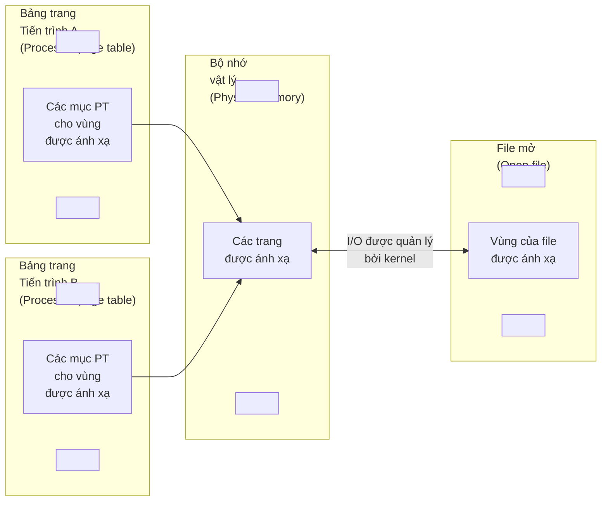
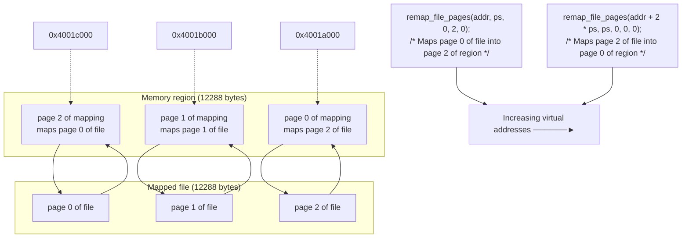

# Chương 49: Ánh xạ bộ nhớ (Memory Mappings)

Chương này thảo luận về việc sử dụng system call `mmap()` để tạo ra các ánh xạ bộ nhớ (memory mappings). Ánh xạ bộ nhớ có thể được sử dụng cho tiến trình liên lạc (IPC - Interprocess Communication), cũng như cho nhiều mục đích khác. Chúng ta bắt đầu với tổng quan về một số khái niệm cơ bản trước khi đi sâu xem xét `mmap()`.

## 49.1 Tổng quan

System call `mmap()` tạo ra một ánh xạ bộ nhớ mới trong không gian địa chỉ ảo (virtual address space) của tiến trình gọi. Một ánh xạ có thể thuộc hai loại:

- Ánh xạ tệp (File mapping): Ánh xạ tệp ánh xạ trực tiếp một vùng của tệp vào bộ nhớ ảo của tiến trình gọi. Một khi tệp đã được ánh xạ, nội dung của nó có thể được truy cập thông qua các thao tác trên các byte trong vùng bộ nhớ tương ứng. Các trang (pages) của ánh xạ được tải (tự động) từ tệp khi cần thiết. Loại ánh xạ này còn được gọi là ánh xạ dựa trên tệp (file-based mapping) hoặc tệp được ánh xạ bộ nhớ (memory-mapped file).
- Ánh xạ ẩn (Anonymous mapping): Ánh xạ ẩn không có tệp tương ứng. Thay vào đó, các trang của ánh xạ được khởi tạo bằng 0.

Một cách khác để hình dung về ánh xạ ẩn (và đây là một cách khá sát với thực tế) đó là nó là ánh xạ của một tệp ảo mà nội dung của nó luôn được khởi tạo bằng các số không.

Bộ nhớ trong ánh xạ của một tiến trình có thể được chia sẻ với các ánh xạ trong các tiến trình khác (nghĩa là, các mục bảng trang - page-table entries của mỗi tiến trình trỏ đến cùng các trang RAM). Điều này có thể xảy ra theo hai cách:

- Khi hai tiến trình ánh xạ cùng một vùng của tệp, chúng chia sẻ cùng các trang bộ nhớ vật lý.
- Một tiến trình con được tạo bởi `fork()` kế thừa các bản sao từ các ánh xạ của tiến trình cha, và các ánh xạ này tham chiếu đến cùng các trang bộ nhớ vật lý như các ánh xạ tương ứng ở tiến trình cha.

Khi hai hoặc nhiều tiến trình chia sẻ cùng các trang, mỗi tiến trình có thể thấy các thay đổi đối với nội dung trang được thực hiện bởi các tiến trình khác hay không, tùy thuộc vào việc ánh xạ là riêng tư (private) hay được chia sẻ (shared):

- Ánh xạ riêng tư (`MAP_PRIVATE`): Các sửa đổi đối với nội dung của ánh xạ không hiển thị đối với các tiến trình khác và, đối với ánh xạ tệp, không được ghi ngược lại tệp cơ sở (underlying file). Mặc dù các trang của ánh xạ riêng tư ban đầu được chia sẻ trong các trường hợp được mô tả ở trên, các thay đổi đối với nội dung của ánh xạ vẫn là riêng tư đối với từng tiến trình. Kernel thực hiện điều này bằng cách sử dụng kỹ thuật copy-on-write (ghi khi sao chép) (Mục 24.2.2). Điều này có nghĩa là bất cứ khi nào một tiến trình cố gắng sửa đổi nội dung của một trang, kernel trước tiên sẽ tạo ra một bản sao mới, riêng biệt của trang đó cho tiến trình (và điều chỉnh bảng trang của tiến trình). Vì lý do này, ánh xạ `MAP_PRIVATE` đôi khi được gọi là ánh xạ riêng tư, copy-on-write.
- Ánh xạ chia sẻ (`MAP_SHARED`): Các sửa đổi đối với nội dung của ánh xạ hiển thị đối với các tiến trình khác chia sẻ cùng ánh xạ đó và, đối với ánh xạ tệp, được ghi ngược lại tệp cơ sở.

Hai thuộc tính ánh xạ được mô tả ở trên (tệp so với ẩn và riêng tư so với chia sẻ) có thể được kết hợp theo bốn cách khác nhau, như được tóm tắt trong [Bảng 49-1](#page-141-0).

**Bảng 49-1:** Mục đích của các loại ánh xạ bộ nhớ khác nhau

| Khả năng hiển thị của | Loại ánh xạ | |
|----------------------|--------------------------------------------------------------|-------------------------------------------|
| các sửa đổi | Tệp | Ánh xạ ẩn |
| Riêng tư (Private) | Khởi tạo bộ nhớ từ nội dung của tệp | Cấp phát bộ nhớ |
| Chia sẻ (Shared) | I/O ánh xạ bộ nhớ; chia sẻ bộ nhớ<br>giữa các tiến trình (IPC) | Chia sẻ bộ nhớ giữa<br>các tiến trình (IPC) |

Bốn loại ánh xạ bộ nhớ khác nhau được tạo và sử dụng như sau:

- Ánh xạ tệp riêng tư (Private file mapping): Nội dung của ánh xạ được khởi tạo từ một vùng tệp. Nhiều tiến trình cùng ánh xạ một tệp ban đầu chia sẻ các trang bộ nhớ vật lý giống nhau, nhưng kỹ thuật copy-on-write được áp dụng, do đó các thay đổi đối với ánh xạ bởi một tiến trình sẽ không hiển thị với các tiến trình khác. Mục đích chính của loại ánh xạ này là khởi tạo một vùng bộ nhớ từ nội dung của tệp. Một số ví dụ phổ biến là khởi tạo các đoạn mã (text segments) và dữ liệu đã khởi tạo (initialized data segments) của tiến trình từ các phần tương ứng của tệp thực thi nhị phân (binary executable file) hoặc tệp thư viện chia sẻ (shared library file).
- Ánh xạ ẩn riêng tư (Private anonymous mapping): Mỗi lần gọi `mmap()` để tạo một ánh xạ ẩn riêng tư sẽ tạo ra một ánh xạ mới tách biệt với (nghĩa là không chia sẻ các trang vật lý với) các ánh xạ ẩn khác được tạo bởi cùng một tiến trình (hoặc tiến trình khác). Mặc dù tiến trình con kế thừa các ánh xạ của tiến trình cha, ngữ nghĩa copy-on-write đảm bảo rằng sau hàm `fork()`, tiến trình cha và con không nhìn thấy các thay đổi được thực hiện đối với ánh xạ bởi tiến trình kia. Mục đích chính của ánh xạ ẩn riêng tư là cấp phát bộ nhớ mới (đã được lấp đầy bằng số không) cho một tiến trình (ví dụ: `malloc()` sử dụng `mmap()` cho mục đích này khi cấp phát các khối bộ nhớ lớn).

- Shared file mapping (Ánh xạ tệp chia sẻ): Tất cả các tiến trình (process) cùng ánh xạ (map) một vùng của một tệp sẽ chia sẻ chung các trang (page) bộ nhớ vật lý, được khởi tạo từ một vùng tệp đó. Các sửa đổi đối với nội dung của ánh xạ sẽ được phản ánh trực tiếp vào tệp. Loại ánh xạ này phục vụ hai mục đích. Thứ nhất, nó cho phép thực hiện I/O ánh xạ bộ nhớ (memory-mapped I/O). Điều này có nghĩa là một tệp được tải vào một vùng bộ nhớ ảo (virtual memory) của tiến trình, và các sửa đổi đối với vùng nhớ đó sẽ tự động được ghi vào tệp. Do đó, I/O ánh xạ bộ nhớ cung cấp một phương pháp thay thế cho việc sử dụng các hàm `read()` và `write()` khi thực hiện I/O tệp. Mục đích thứ hai của loại ánh xạ này là cho phép các tiến trình không có quan hệ họ hàng chia sẻ một vùng bộ nhớ nhằm thực hiện cơ chế IPC (Inter-Process Communication) (nhanh chóng) theo cách tương tự như các phân đoạn bộ nhớ chia sẻ System V (System V shared memory segments) (Chương [48](#page-120-0)).
- Shared anonymous mapping (Ánh xạ ẩn chia sẻ): Giống như ánh xạ ẩn riêng tư (private anonymous mapping), mỗi lời gọi `mmap()` để tạo một ánh xạ ẩn chia sẻ sẽ tạo ra một ánh xạ mới, hoàn toàn riêng biệt và không chia sẻ trang bộ nhớ với bất kỳ ánh xạ nào khác. Điểm khác biệt là các trang của ánh xạ này không áp dụng cơ chế sao chép khi ghi (copy-on-write). Điều này có nghĩa là khi một tiến trình con kế thừa ánh xạ sau một lời gọi `fork()`, tiến trình cha và tiến trình con sẽ chia sẻ chung các trang RAM, và các thay đổi được thực hiện đối với nội dung của ánh xạ bởi một tiến trình sẽ hiển thị đối với tiến trình còn lại. Ánh xạ ẩn chia sẻ cho phép thực hiện IPC theo cách tương tự như các phân đoạn bộ nhớ chia sẻ System V, nhưng chỉ giữa các tiến trình có quan hệ họ hàng.

Chúng ta sẽ xem xét chi tiết hơn về từng loại ánh xạ này trong phần còn lại của chương này.

Các ánh xạ sẽ bị mất khi một tiến trình thực hiện hàm `exec()`, nhưng sẽ được kế thừa bởi tiến trình con của hàm `fork()`. Loại ánh xạ (`MAP_PRIVATE` hoặc `MAP_SHARED`) cũng được kế thừa.

Thông tin về tất cả các ánh xạ của một tiến trình có thể xem được trong tệp cụ thể của Linux `/proc/PID/maps`, mà chúng ta đã mô tả ở Mục [48.5.](#page-129-0)

> [!NOTE]
> Một công dụng khác của `mmap()` là dùng với các đối tượng bộ nhớ chia sẻ POSIX (POSIX shared memory objects), cho phép một vùng bộ nhớ được chia sẻ giữa các tiến trình không có quan hệ họ hàng mà không cần phải tạo một tệp đĩa liên kết (như yêu cầu đối với ánh xạ tệp chia sẻ). Chúng ta sẽ mô tả các đối tượng bộ nhớ chia sẻ POSIX trong Chương 54.

## 49.2 Tạo một ánh xạ: mmap()

System Call (System Call) `mmap()` tạo ra một ánh xạ mới trong không gian địa chỉ ảo (virtual address space) của tiến trình gọi.

```c
## include <sys/mman.h>
void *mmap(void *addr, size_t length, int prot, int flags, int fd, off_t offset);
          Returns starting address of mapping on success, or MAP_FAILED on error
```

Tham số `addr` chỉ định địa chỉ ảo nơi ánh xạ sẽ được đặt. Nếu chúng ta chỉ định `addr` là `NULL`, kernel sẽ tự chọn một địa chỉ phù hợp cho ánh xạ. Đây là cách được ưu tiên để tạo một ánh xạ. Ngoài ra, chúng ta có thể chỉ định một giá trị khác `NULL` trong `addr`, giá trị này được kernel coi như một gợi ý về địa chỉ nên đặt ánh xạ. Trong thực tế, kernel sẽ tối thiểu là làm tròn địa chỉ đến ranh giới trang (page boundary) gần nhất. Dù ở trường hợp nào đi nữa, kernel cũng sẽ chọn một địa chỉ không xung đột với bất kỳ ánh xạ nào đang tồn tại. (Nếu giá trị `MAP_FIXED` được bao gồm trong `flags`, thì `addr` bắt buộc phải căn chỉnh theo trang (page-aligned). Chúng ta sẽ mô tả cờ này ở Mục [49.10.](#page-163-0))

Khi thành công, `mmap()` trả về địa chỉ bắt đầu của ánh xạ mới. Khi xảy ra lỗi, `mmap()` trả về `MAP_FAILED`.

> [!NOTE]
> Trên Linux (và trên hầu hết các bản cài đặt UNIX khác), hằng số `MAP_FAILED` tương đương với `((void *) –1)`. Tuy nhiên, SUSv3 quy định cụ thể hằng số này vì các chuẩn C không thể đảm bảo rằng `((void *) –1)` khác biệt với giá trị trả về của một lần gọi `mmap()` thành công.

Tham số `length` chỉ định kích thước của ánh xạ tính bằng byte. Mặc dù `length` không bắt buộc phải là một bội số của kích thước trang hệ thống (được trả về bởi `sysconf(_SC_PAGESIZE)`), kernel vẫn tạo các ánh xạ theo đơn vị kích thước này, do đó `length` trên thực tế sẽ được làm tròn lên thành bội số tiếp theo của kích thước trang.

Tham số `prot` là một bit mask chỉ định quyền bảo vệ được thiết lập cho ánh xạ. Nó có thể là `PROT_NONE` hoặc sự kết hợp (dùng phép toán OR) của bất kỳ ba cờ nào khác được liệt kê trong [Bảng 49-2](#page-143-1).

| Bảng 49-2: Các giá trị bảo vệ bộ nhớ |  |  |
|--------------------------------------|--|--|
|--------------------------------------|--|--|

| Giá trị    | Mô tả                                       |
|------------|---------------------------------------------|
| PROT_NONE  | Vùng nhớ không được phép truy cập           |
| PROT_READ  | Nội dung của vùng nhớ có thể được đọc       |
| PROT_WRITE | Nội dung của vùng nhớ có thể bị sửa đổi     |
| PROT_EXEC  | Nội dung của vùng nhớ có thể được thực thi  |

Tham số `flags` là một bit mask gồm các tùy chọn điều khiển các khía cạnh khác nhau của thao tác ánh xạ. Bắt buộc phải có đúng một trong các giá trị sau nằm trong mask này:

### MAP\_PRIVATE

Tạo một ánh xạ riêng tư (private mapping). Các sửa đổi đối với nội dung của vùng nhớ sẽ không hiển thị đối với các tiến trình khác sử dụng cùng ánh xạ đó, và trong trường hợp ánh xạ tệp, sẽ không được phản ánh vào tệp cơ sở bên dưới.

### MAP\_SHARED

Tạo một ánh xạ chia sẻ (shared mapping). Các chỉnh sửa đối với nội dung của vùng nhớ sẽ hiển thị với các tiến trình khác đang ánh xạ cùng vùng nhớ đó với thuộc tính `MAP_SHARED` và trong trường hợp ánh xạ tệp (file mapping), các thay đổi sẽ được ghi xuống tệp cơ sở (underlying file). Các bản cập nhật cho tệp không được đảm bảo là sẽ diễn ra ngay lập tức; hãy xem phần thảo luận về System Call `msync()` tại Mục [49.5](#page-154-0).

Ngoài `MAP_PRIVATE` và `MAP_SHARED`, các giá trị cờ (flag) khác có thể được kết hợp bằng phép toán OR trong tham số `flags`. Chúng ta sẽ thảo luận về các cờ này tại Mục [49.6](#page-156-0) và [49.10](#page-163-0).

Các tham số còn lại, `fd` và `offset`, được sử dụng với các ánh xạ tệp (chúng bị bỏ qua đối với ánh xạ ẩn danh - anonymous mapping). Tham số `fd` là một File Descriptor định danh tệp cần ánh xạ. Tham số `offset` chỉ định điểm bắt buộc bắt đầu của ánh xạ trong tệp, và phải là một bội số của kích thước trang nhớ hệ thống (system page size). Để ánh xạ toàn bộ tệp, chúng ta sẽ chỉ định `offset` là 0 và `length` là kích thước của tệp. Chúng ta sẽ nói nhiều hơn về ánh xạ tệp tại Mục [49.5](#page-154-0).

## Chi tiết hơn về bảo vệ bộ nhớ (Memory Protection)

Như đã lưu ý ở trên, tham số `prot` của `mmap()` chỉ định quyền bảo vệ trên một memory mapping mới. Nó có thể chứa giá trị `PROT_NONE`, hoặc một mặt nạ (mask) gồm một hoặc nhiều cờ `PROT_READ`, `PROT_WRITE`, và `PROT_EXEC`. Nếu một tiến trình cố gắng truy cập vào một vùng nhớ theo cách vi phạm quyền bảo vệ của vùng đó, kernel sẽ gửi tín hiệu `SIGSEGV` tới tiến trình đó.

> [!NOTE]
> Mặc dù SUSv3 quy định rằng `SIGSEGV` nên được sử dụng để báo hiệu các trường hợp vi phạm bảo vệ bộ nhớ, nhưng trên một số tiến trình thực thi (implementation), `SIGBUS` lại được sử dụng thay thế.

Một trường hợp sử dụng các trang nhớ được đánh dấu `PROT_NONE` là làm các trang bảo vệ (guard pages) ở đầu hoặc cuối của một vùng nhớ mà tiến trình đã cấp phát. Nếu tiến trình vô tình bước vào một trong các trang được đánh dấu `PROT_NONE`, kernel sẽ thông báo cho tiến trình biết thực tế đó bằng cách tạo ra một tín hiệu `SIGSEGV`.

Các cơ chế bảo vệ bộ nhớ nằm trong các bảng bộ nhớ ảo riêng tư của tiến trình (process-private virtual memory tables). Do đó, các tiến trình khác nhau có thể ánh xạ cùng một vùng nhớ với các quyền bảo vệ khác nhau.

Quyền bảo vệ bộ nhớ có thể được thay đổi bằng cách sử dụng System Call `mprotect()` (Mục 50.1).

Trên một số tiến trình thực thi UNIX, các quyền thực tế được thiết lập trên các trang của một ánh xạ có thể không hoàn toàn giống với các quyền được chỉ định trong `prot`. Cụ thể, những hạn chế về độ chi tiết bảo vệ của phần cứng nền tảng (ví dụ: các kiến trúc x86-32 cũ) đồng nghĩa với việc trên nhiều tiến trình thực thi UNIX, `PROT_READ` đồng nghĩa với `PROT_EXEC` và ngược lại; và trên một số tiến trình thực thi, việc chỉ định `PROT_WRITE` đồng nghĩa với `PROT_READ`. Tuy nhiên, các ứng dụng không nên phụ thuộc vào hành vi này; `prot` luôn phải chỉ định chính xác các quyền bảo vệ bộ nhớ được yêu cầu.

Các kiến trúc x86-32 hiện đại cung cấp hỗ trợ phần cứng để đánh dấu các bảng trang (page tables) là NX (no-execute), và kể từ kernel 2.6.8, Linux đã tận dụng tính năng này để tách biệt đúng đắn các quyền `PROT_READ` và `PROT_EXEC` trên Linux/x86-32.

## Các ràng buộc căn chỉnh được quy định trong tiêu chuẩn đối với offset và addr

SUSv3 quy định rằng đối số `offset` của hàm mmap() phải được căn chỉnh theo trang (page-aligned), và đối số `addr` cũng phải được căn chỉnh theo trang nếu chỉ định cờ `MAP_FIXED`. Linux tuân thủ các yêu cầu này. Tuy nhiên, người ta sau đó nhận thấy rằng các yêu cầu của SUSv3 khác với các tiêu chuẩn trước đó, vốn áp đặt các yêu cầu lỏng lẻo hơn đối với các đối số này. Hệ quả từ câu chữ của SUSv3 là làm cho (một cách không cần thiết) một số triển động từng tuân thủ tiêu chuẩn trước đây trở thành không tuân thủ. SUSv4 quay trở lại với yêu cầu lỏng lẻo hơn:

- Một bản triển khai (implementation) có thể yêu cầu `offset` phải là bội số của kích thước trang hệ thống (system page size).
- Nếu `MAP_FIXED` được chỉ định, thì bản triển khai có thể yêu cầu `addr` phải được căn chỉnh theo trang.
- Nếu `MAP_FIXED` được chỉ định và `addr` khác không, thì `addr` và `offset` phải có cùng phần dư khi chia cho kích thước trang hệ thống.

Một tình huống tương tự phát sinh đối với đối số `addr` của các hàm mprotect(), msync(), và munmap(). SUSv3 quy định rằng đối số này phải được căn chỉnh theo trang. SUSv4 nêu rằng bản triển khai có thể yêu cầu đối số này phải được căn chỉnh theo trang.

## Chương trình ví dụ

[Liệt kê 49-1](#page-167-0) minh họa việc sử dụng hàm mmap() để tạo một ánh xạ tệp riêng tư (private file mapping). Chương trình này là một phiên bản đơn giản của lệnh cat(1). Nó ánh xạ (toàn bộ) tệp được chỉ định trong đối số dòng lệnh của nó, và sau đó ghi nội dung của vùng ánh xạ ra đầu ra chuẩn (standard output).

**Liệt kê 49-1:** Sử dụng mmap() để tạo một ánh xạ tệp riêng tư

```
–––––––––––––––––––––––––––––––––––––––––––––––––––––––––––– mmap/mmcat.c
## include <sys/mman.h>
## include <sys/stat.h>
## include <fcntl.h>
## include "tlpi_hdr.h"
int
main(int argc, char *argv[])
{
 char *addr;
 int fd;
 struct stat sb;
 if (argc != 2 || strcmp(argv[1], "--help") == 0)
 usageErr("%s file\n", argv[0]);
 fd = open(argv[1], O_RDONLY);
 if (fd == -1)
 errExit("open");
```

```
 /* Lấy kích thước của tệp và sử dụng nó để chỉ định kích thước
 của vùng ánh xạ và kích thước của bộ đệm cần ghi */
 if (fstat(fd, &sb) == -1)
 errExit("fstat");
 addr = mmap(NULL, sb.st_size, PROT_READ, MAP_PRIVATE, fd, 0);
 if (addr == MAP_FAILED)
 errExit("mmap");
 if (write(STDOUT_FILENO, addr, sb.st_size) != sb.st_size)
 fatal("partial/failed write");
 exit(EXIT_SUCCESS);
}
–––––––––––––––––––––––––––––––––––––––––––––––––––––––––––– mmap/mmcat.c
```

## 49.3 Hủy ánh xạ một vùng đã ánh xạ: munmap()

System Call munmap() thực hiện thao tác ngược lại với mmap(), gỡ bỏ một ánh xạ khỏi không gian địa chỉ ảo (virtual address space) của tiến trình gọi (calling process).

## include <sys/mman.h>

int munmap(void *addr, size_t length);
Trả về 0 khi thành công, hoặc –1 khi lỗi

```

Đối số `addr` là địa chỉ bắt đầu của dải địa chỉ cần hủy ánh xạ. Nó phải được căn chỉnh theo biên trang (page boundary). (SUSv3 quy định rằng `addr` phải được căn chỉnh theo trang. SUSv4 nêu rằng bản triển khai có thể yêu cầu đối số này phải được căn chỉnh theo trang).

Đối số `length` là một số nguyên không âm chỉ định kích thước (tính bằng byte) của vùng cần hủy ánh xạ. Dải địa chỉ lên đến bội số tiếp theo của kích thước trang hệ thống sẽ bị hủy ánh xạ.

Thông thường, chúng ta hủy ánh xạ toàn bộ một vùng ánh xạ. Do đó, chúng ta chỉ định `addr` là địa chỉ được trả về bởi lời gọi mmap() trước đó, và chỉ định giá trị `length` giống như đã dùng trong lời gọi mmap(). Dưới đây là một ví dụ:

```

addr = mmap(NULL, length, PROT_READ | PROT_WRITE, MAP_PRIVATE, fd, 0);
if (addr == MAP_FAILED)
errExit("mmap");
/* Mã nguồn làm việc với vùng được ánh xạ */
if (munmap(addr, length) == -1)
errExit("munmap");

```

Ngoài ra, chúng ta có thể hủy ánh xạ một phần của vùng ánh xạ, trong trường hợp đó vùng ánh xạ sẽ bị thu nhỏ lại hoặc bị cắt đôi, tùy thuộc vào vị trí xảy ra việc hủy ánh xạ. Cũng có thể chỉ định một dải địa chỉ trải dài qua nhiều vùng ánh xạ, trong trường hợp đó tất cả các vùng ánh xạ đó sẽ bị hủy ánh xạ.

Nếu không có vùng ánh xạ nào nằm trong dải địa chỉ được chỉ định bởi `addr` và `length`, thì munmap() không có tác dụng gì và trả về 0 (thành công).

Trong quá trình hủy ánh xạ, kernel sẽ gỡ bỏ mọi khóa bộ nhớ (memory lock) mà tiến trình đang giữ cho dải địa chỉ được chỉ định. (Khóa bộ nhớ được thiết lập bằng cách sử dụng mlock() hoặc mlockall(), như được mô tả trong Mục 50.2).

Tất cả các ánh xạ của một tiến trình sẽ tự động bị hủy ánh xạ khi tiến trình đó kết thúc (terminate) hoặc thực thi lời gọi exec().

Để đảm bảo rằng nội dung của một ánh xạ tệp chia sẻ (shared file mapping) được ghi xuống tệp cơ sở (underlying file), cần thực hiện một lời gọi tới msync() (Mục [49.5](#page-154-0)) trước khi hủy ánh xạ bằng munmap().

## 49.4 Ánh xạ tệp (File Mappings)

Để tạo một ánh xạ tệp, chúng ta thực hiện các bước sau:

- 1. Lấy một bộ mô tả tệp (File Descriptor - fd) cho tệp, thường thông qua một lời gọi tới open().
- 2. Truyền bộ mô tả tệp đó làm đối số `fd` trong lời gọi tới mmap().

Kết quả của các bước này là mmap() ánh xạ nội dung của tệp đang mở vào không gian địa chỉ của tiến trình gọi. Một khi mmap() đã được gọi, chúng ta có thể đóng bộ mô tả tệp mà không ảnh hưởng đến vùng ánh xạ. Tuy nhiên, trong một số trường hợp, việc giữ cho bộ mô tả tệp này mở có thể hữu ích—ví dụ, hãy xem [Liệt kê 49-1](#page-167-0) và cả Chương 54.

> Cũng giống như các tệp đĩa (disk file) thông thường, chúng ta có thể sử dụng hàm `mmap()` để ánh xạ (map) nội dung của các thiết bị thực và ảo khác nhau, chẳng hạn như ổ đĩa cứng, ổ đĩa quang, và `/dev/mem`.

Tệp được trỏ tới bởi bộ mô tả tệp (File Descriptor - fd) bắt buộc phải được mở với các quyền phù hợp với các giá trị được chỉ định trong `prot` và `flags`. Cụ thể, tệp luôn phải được mở ở chế độ đọc (reading), và nếu `PROT_WRITE` cùng với `MAP_SHARED` được chỉ định trong `flags`, thì tệp đó bắt buộc phải được mở ở cả hai chế độ đọc và ghi (reading and writing).

Tham số `offset` chỉ định byte bắt đầu của vùng cần ánh xạ từ tệp, và bắt buộc phải là bội số của kích thước trang hệ thống (system page size). Việc chỉ định `offset` là 0 sẽ khiến tệp được ánh xạ từ điểm khởi đầu. Tham số `length` chỉ định số lượng byte cần ánh xạ. Sự kết hợp giữa hai tham số `offset` và `length` sẽ quyết định vùng nào của tệp được ánh xạ vào bộ nhớ (memory), như được minh họa trong Hình 49-1.

> Trên Linux, các trang (page) của một ánh xạ tệp (file mapping) sẽ được đưa vào bộ nhớ (mapped in) ngay tại thời điểm truy cập đầu tiên. Điều này có nghĩa là nếu các thay đổi được thực hiện đối với một vùng tệp sau lệnh gọi `mmap()`, nhưng trước khi phần tương ứng (tức là trang) của ánh xạ được truy cập, thì các thay đổi đó có thể hiển thị đối với tiến trình (process), nếu trang đó chưa được tải vào bộ nhớ từ trước. Hành vi này phụ thuộc vào cài đặt cụ thể của hệ thống (implementation-dependent); các ứng dụng có khả năng diportable (portable) nên tránh việc phụ thuộc vào một hành vi kernel cụ thể trong trường hợp này.

### 49.4.1 Ánh xạ Tệp Riêng tư (Private File Mappings)

Hai mục đích phổ biến nhất của ánh xạ tệp riêng tư (private file mapping) bao gồm:

Cho phép nhiều tiến trình (process) cùng thực thi một chương trình hoặc sử dụng chung một thư viện chia sẻ (shared library) để cùng chia sẻ một phân đoạn mã (text segment) (chỉ đọc), vốn được ánh xạ từ phần tương ứng của tệp thực thi hoặc tệp thư viện bên dưới.

Mặc dù phân đoạn mã thực thi thông thường được bảo vệ để chỉ cho phép quyền đọc và thực thi (`PROT_READ | PROT_EXEC`), nó lại được ánh xạ bằng cách sử dụng `MAP_PRIVATE` thay vì `MAP_SHARED`. Lý do là một trình gỡ lỗi (debugger) hoặc một chương trình tự sửa đổi mã (self-modifying program) có thể thay đổi mã chương trình (sau khi đã thay đổi quyền bảo vệ trên bộ nhớ), và những thay đổi như vậy không được phép lan truyền ngược lại tệp gốc hoặc ảnh hưởng đến các tiến trình khác.

Để ánh xạ phân đoạn dữ liệu đã được khởi tạo (initialized data segment) của một tệp thực thi hoặc thư viện chia sẻ. Các ánh xạ này được thiết lập ở chế độ riêng tư (private) nhằm đảm bảo mọi chỉnh sửa đối với nội dung của phân đoạn dữ liệu được ánh xạ sẽ không bị lan truyền ngược lại tệp gốc.

Cả hai cách sử dụng `mmap()` này thông thường đều vô hình đối với một chương trình, bởi vì các ánh xạ này được tạo ra bởi trình nạp chương trình (program loader) và bộ liên kết động (dynamic linker). Ví dụ về cả hai loại ánh xạ có thể được quan sát trong phần đầu ra của `/proc/PID/maps` được trình bày tại Mục [48.5.](#page-129-0)

Một mục đích ít phổ biến hơn của ánh xạ tệp riêng tư là để đơn giản hóa logic đầu vào tệp (file input logic) của một chương trình. Điều này tương tự như việc sử dụng ánh xạ tệp chia sẻ cho cơ chế I/O ánh xạ bộ nhớ (memory-mapped I/O) (được mô tả ở phần tiếp theo), nhưng chỉ hỗ trợ cho phần đầu vào của tệp (file input).

```text

Process virtual
memory
┌─────────┐
▲         │         │
│         ├─────────┤─ ─ ─ ─ ─ ─ ─ ─ ─ ─ ─ ─ ─ ─ -┐
increasing    │         │
memory address │ mapped  │                             │
│         │ region  │
│         │         │
address ──────>├─────────┤─ ─ ─ ─ ─ ─ -┐
returned       │         │             │               │
by mmap()      │         │             │
└─────────┘             │               │
│
◄── offset ──┘ ◄── length ───┤│
│
┌───────────────┴───────────────┘
│         │  mapped   │         │
│         │  region   │         │
└─────────┴───────────┴─────────┘
Open file (fd)

```

**Hình 49-1:** Tổng quan về tệp ánh xạ bộ nhớ (memory-mapped file)

### 49.4.2 Vùng nhớ ánh xạ file chia sẻ (Shared File Mappings)

Khi nhiều tiến trình (process) tạo các ánh xạ chia sẻ (shared mapping) của cùng một vùng file, tất cả chúng đều chia sẻ chung các trang (page) bộ nhớ vật lý. Ngoài ra, mọi sửa đổi đối với nội dung của vùng ánh xạ sẽ được phản ánh trực tiếp vào file. Trên thực tế, file được đối xử như một thiết bị lưu trữ phân trang (paging store) cho vùng bộ nhớ này, như được minh họa trong [Hình 49-2](#page-149-1). (Chúng tôi đơn giản hóa sơ đồ này bằng cách lược bỏ chi tiết rằng các trang được ánh xạ thường không nằm liên tục trong bộ nhớ vật lý).

Các vùng nhớ ánh xạ file chia sẻ phục vụ hai mục đích chính: I/O ánh xạ bộ nhớ (memory-mapped I/O) và IPC (Inter-Process Communication - Giao tiếp giữa các tiến trình). Chúng ta sẽ xem xét từng mục đích này dưới đây.



**Hình 49-2:** Hai tiến trình với một vùng ánh xạ chia sẻ của cùng một vùng file

## I/O ánh xạ bộ nhớ (Memory-mapped I/O)

Vì nội dung của vùng ánh xạ file chia sẻ được khởi tạo từ file, và bất kỳ sửa đổi nào đối với nội dung ánh xạ cũng được tự động cập nhật vào file, chúng ta có thể thực hiện file I/O đơn giản bằng cách truy cập các byte bộ nhớ, dựa vào kernel để đảm bảo rằng các thay đổi đối với bộ nhớ được truyền tải (propagate) đến file được ánh xạ. (Thông thường, một chương trình sẽ định nghĩa một kiểu dữ liệu có cấu trúc tương ứng với nội dung của file trên đĩa, sau đó sử dụng kiểu dữ liệu đó để ép kiểu (cast) nội dung của vùng ánh xạ). Kỹ thuật này được gọi là I/O ánh xạ bộ nhớ (memory-mapped I/O), và là một giải pháp thay thế cho việc sử dụng các System Call `read()` và `write()` để truy cập nội dung file.

Memory-mapped I/O có hai ưu điểm tiềm năng:

- Bằng cách thay thế các System Call `read()` và `write()` bằng các thao tác truy cập bộ nhớ, nó có thể đơn giản hóa logic của một số ứng dụng.
- Trong một số trường hợp, nó có thể mang lại hiệu năng tốt hơn so với file I/O thực hiện thông qua các System Call I/O thông thường.

Lý do tại sao memory-mapped I/O có thể mang lại lợi ích về hiệu năng như sau:

- Một thao tác `read()` hoặc `write()` thông thường liên quan đến hai lần chuyển dữ liệu (transfer): một lần giữa file và bộ đệm cache của kernel (kernel buffer cache), và lần thứ hai giữa buffer cache và bộ đệm không gian người dùng (user-space buffer). Việc sử dụng `mmap()` loại bỏ lần chuyển dữ liệu thứ hai này. Đối với dữ liệu đầu vào (input), dữ liệu sẵn sàng cho tiến trình người dùng (user process) ngay khi kernel ánh xạ các khối file tương ứng vào bộ nhớ. Đối với dữ liệu đầu ra (output), tiến trình người dùng chỉ cần sửa đổi nội dung bộ nhớ, sau đó có thể dựa vào trình quản lý bộ nhớ của kernel (kernel memory manager) để tự động cập nhật file gốc.
- Ngoài việc tiết kiệm một lần chuyển dữ liệu giữa không gian kernel (kernel space) và không gian người dùng (user space), `mmap()` còn có thể cải thiện hiệu năng bằng cách giảm nhu cầu sử dụng bộ nhớ. Khi sử dụng `read()` hoặc `write()`, dữ liệu được duy trì trong hai bộ đệm: một ở user space và một ở kernel space. Khi sử dụng `mmap()`, một bộ đệm duy nhất được chia sẻ giữa kernel space và user space. Hơn nữa, nếu nhiều tiến trình đang thực hiện I/O trên cùng một file, thì bằng cách sử dụng `mmap()`, tất cả chúng có thể chia sẻ chung một bộ đệm kernel, dẫn đến việc tiết kiệm bộ nhớ bổ sung.

Lợi ích hiệu năng từ memory-mapped I/O có nhiều khả năng đạt được nhất khi thực hiện các thao tác truy cập ngẫu nhiên lặp đi lặp lại trên một file lớn. Nếu chúng ta thực hiện truy cập tuần tự (sequential access) vào một file, thì `mmap()` có lẽ sẽ mang lại ít hoặc không có sự cải thiện nào so với `read()` và `write()`, giả sử rằng chúng ta thực hiện I/O bằng các kích thước bộ đệm đủ lớn để tránh việc phải gọi một số lượng lớn các System Call I/O. Lý do có ít lợi ích về hiệu năng là bất kể chúng ta sử dụng kỹ thuật nào, toàn bộ nội dung của file sẽ được chuyển giữa đĩa và bộ nhớ đúng một lần, và hiệu quả đạt được từ việc loại bỏ một lần chuyển dữ liệu giữa user space và kernel space cũng như giảm việc sử dụng bộ nhớ thường không đáng kể so với thời gian cần thiết cho disk I/O.

> Memory-mapped I/O cũng có thể có các nhược điểm. Đối với các thao tác I/O nhỏ, chi phí của memory-mapped I/O (ví dụ: khởi tạo ánh xạ, xử lý lỗi trang - page fault, hủy ánh xạ, và cập nhật bộ đệm chuyển đổi địa chỉ TLB - Translation Lookaside Buffer của đơn vị quản lý bộ nhớ phần cứng - MMU) thực tế có thể cao hơn so với một lệnh `read()` hoặc `write()` đơn giản. Thêm vào đó, đôi khi kernel có thể gặp khó khăn trong việc xử lý hiệu quả quá trình ghi lùi (write-back) đối với các vùng ánh xạ có quyền ghi (writable mapping) (việc sử dụng `msync()` hoặc `sync_file_range()` có thể giúp cải thiện hiệu quả trong trường hợp này).

## IPC sử dụng ánh xạ tệp chia sẻ (shared file mapping)

Vì tất cả các process (tiến trình) có chung một ánh xạ tới cùng một vùng tệp đều chia sẻ chung các trang bộ nhớ vật lý (physical memory pages), nên công dụng thứ hai của ánh xạ tệp chia sẻ là dùng làm phương pháp IPC (Interprocess Communication - giao tiếp liên tiến trình) (tốc độ cao). Tính năng phân biệt loại vùng nhớ chia sẻ này với đối tượng System V shared memory (Bộ nhớ chia sẻ System V) (Chương [48](#page-120-0)) là các thay đổi đối với nội dung của vùng nhớ sẽ được ghi đồng bộ xuống tệp được ánh xạ ở bên dưới (underlying mapped file). Tính năng này rất hữu ích trong các ứng dụng yêu cầu nội dung bộ nhớ chia sẻ phải được duy trì (persist) qua các lần khởi động lại của ứng dụng hoặc hệ thống.

## Chương trình ví dụ

[Listing 49-2](#page-167-1) cung cấp một ví dụ đơn giản về việc sử dụng `mmap()` để tạo một ánh xạ tệp chia sẻ. Chương trình này bắt đầu bằng cách ánh xạ tệp được chỉ định trong đối số dòng lệnh (command-line argument) đầu tiên của nó. Sau đó, nó in ra giá trị của chuỗi nằm ở phần đầu của vùng được ánh xạ. Cuối cùng, nếu đối số dòng lệnh thứ hai được cung cấp, chuỗi đó sẽ được sao chép vào vùng nhớ chia sẻ.

Nhật ký phiên shell sau đây minh họa việc sử dụng chương trình này. Chúng ta bắt đầu bằng cách tạo một tệp 1024 byte được điền các giá trị không (zeros):

```

$ dd if=/dev/zero of=s.txt bs=1 count=1024
1024+0 records in
1024+0 records out

```

Sau đó, chúng ta sử dụng chương trình của mình để ánh xạ tệp và sao chép một chuỗi vào vùng được ánh xạ:

```

$ ./t_mmap s.txt hello
Current string=
Copied "hello" to shared memory

```

Chương trình không hiển thị gì cho chuỗi hiện tại vì giá trị ban đầu của tệp được ánh xạ bắt đầu bằng một byte null (tức là chuỗi có độ dài bằng không).

Tiếp theo, chúng ta sử dụng lại chương trình để ánh xạ tệp và sao chép một chuỗi mới vào vùng được ánh xạ:

```

$ ./t_mmap s.txt goodbye
Current string=hello
Copied "goodbye" to shared memory

```

Cuối cùng, chúng ta kết xuất (dump) nội dung của tệp, 8 ký tự trên mỗi dòng, để xác minh nội dung của nó:

```

$ od -c -w8 s.txt
0000000 g o o d b y e nul
0000010 nul nul nul nul nul nul nul nul
*
0002000

```

Chương trình đơn giản của chúng ta không sử dụng bất kỳ cơ chế nào để đồng bộ hóa việc truy cập vào tệp được ánh xạ bởi nhiều process. Tuy nhiên, các ứng dụng thực tế thường cần đồng bộ hóa quyền truy cập vào các ánh xạ chia sẻ. Việc này có thể được thực hiện bằng nhiều kỹ thuật khác nhau, bao gồm semaphore (Chương [47](#page-88-0) và 53) và khóa tệp (file locking) (Chương 55).

Chúng tôi giải thích về system call (lời hệ thống) `msync()` được sử dụng trong [Listing 49-2](#page-167-1) tại Mục [49.5.](#page-154-0)

**Listing 49-2:** Sử dụng mmap() để tạo một ánh xạ tệp chia sẻ

```

––––––––––––––––––––––––––––––––––––––––––––––––––––––––––– mmap/t_mmap.c

## include <sys/mman.h>

## include <fcntl.h>

## include "tlpi_hdr.h"

## define MEM_SIZE 10

int
main(int argc, char *argv[])
{
char *addr;
int fd;
if (argc < 2 || strcmp(argv[1], "--help") == 0)
usageErr("%s file [new-value]\n", argv[0]);
fd = open(argv[1], O_RDWR);
if (fd == -1)
errExit("open");

```

```

addr = mmap(NULL, MEM_SIZE, PROT_READ | PROT_WRITE, MAP_SHARED, fd, 0);
if (addr == MAP_FAILED)
errExit("mmap");
if (close(fd) == -1) /* Không cần dùng 'fd' nữa */
errExit("close");
printf("Current string=%.*s\n", MEM_SIZE, addr);
/* Thực hành bảo mật: xuất tối đa MEM_SIZE byte */
if (argc > 2) { /* Cập nhật nội dung của vùng nhớ */
if (strlen(argv[2]) >= MEM_SIZE)
cmdLineErr("'new-value' quá lớn\n");
memset(addr, 0, MEM_SIZE); /* Xóa sạch vùng nhớ về 0 */
strncpy(addr, argv[2], MEM_SIZE - 1);
if (msync(addr, MEM_SIZE, MS_SYNC) == -1)
errExit("msync");
printf("Đã sao chép \"%s\" vào bộ nhớ chia sẻ\n", argv[2]);
}
exit(EXIT_SUCCESS);
}
––––––––––––––––––––––––––––––––––––––––––––––––––––––––––– mmap/t_mmap.c

```

### 49.4.3 Các Trường Hợp Biên (Boundary Cases)

Trong nhiều trường hợp, kích thước của một vùng ánh xạ (mapping) là một bội số của kích thước trang hệ thống (system page size), và vùng ánh xạ này nằm hoàn toàn trong giới hạn của tệp được ánh xạ (mapped file). Tuy nhiên, điều này không phải lúc nào cũng xảy ra, và chúng ta sẽ xem xét điều gì xảy ra khi các điều kiện này không được thỏa mãn.

Hình 49-3 mô tả trường hợp vùng ánh xạ nằm hoàn toàn trong giới hạn của tệp, nhưng kích thước của vùng này không phải là bội số của kích thước trang hệ thống (mà chúng ta giả định là 4096 byte cho mục đích thảo luận này).

```text

mmap(0, 6000, prot, MAP_SHARED, fd, 0);

byte offset:  0                           5999 6000    8191 8192
┌─────────────────────────────────┬────────────┐
Memory     │  requested size of mapping      │ remainder  │
region     │                                 │  of page   │
└─────────────────────────────────┴────────────┘
◄─────────────────────────────────►◄────────────────────►
│  accessible, mapped to file     │   references
│                                 │   yield SIGSEGV
│                                 │
┌─────────────────────────────────┬────────┐
Mapped file│   actual mapped region of file  │unmapped│
(9500 bytes)│                                 │        │
└─────────────────────────────────┴────────┘
file offset: 0                           8191 8192    9499

```

**Hình 49-3:** Ánh xạ bộ nhớ có chiều dài không phải là bội số của kích thước trang hệ thống

Vì kích thước của vùng ánh xạ không phải là bội số của kích thước trang hệ thống, nó được làm tròn lên (rounded up) thành bội số tiếp theo của kích thước trang hệ thống. Do tệp lớn hơn kích thước sau khi được làm tròn này, các byte tương ứng của tệp được ánh xạ như minh họa trong Hình 49-3.

Các cố gắng truy cập vào các byte vượt quá phần cuối của vùng ánh xạ sẽ dẫn đến việc tạo ra một tín hiệu `SIGSEGV` (giả sử rằng không có vùng ánh xạ nào khác tại vị trí đó). Hành vi mặc định đối với tín hiệu này là chấm dứt tiến trình (terminate the process) cùng với việc tạo tệp lõm (core dump).

Khi vùng ánh xạ kéo dài vượt quá phần cuối của tệp cơ sở (xem [Hình 49-4](#page-153-0)), tình hình trở nên phức tạp hơn. Như trước đây, do kích thước của vùng ánh xạ không phải là bội số của kích thước trang hệ thống, nó được làm tròn lên. Tuy nhiên, trong trường hợp này, mặc dù các byte trong vùng được làm tròn lên (tức là từ byte 2200 đến 4095 trong sơ đồ) có thể truy cập được, nhưng chúng không được ánh xạ tới tệp cơ sở (vì không có byte tương ứng tồn tại trong tệp). Thay vào đó, chúng được khởi tạo về giá trị 0 (SUSv3 yêu cầu điều này). Dù vậy, các byte này vẫn sẽ được chia sẻ với các tiến trình khác đang ánh xạ tệp đó, nếu chúng chỉ định một đối số chiều dài (length argument) đủ lớn. Các thay đổi đối với các byte này không được ghi vào tệp.

Nếu vùng ánh xạ bao gồm các trang vượt ra ngoài vùng được làm tròn lên (tức là từ byte 4096 trở đi trong [Hình 49-4](#page-153-0)), thì các cố gắng truy cập vào các địa chỉ trong các trang này sẽ dẫn đến việc tạo ra tín hiệu `SIGBUS`, cảnh báo tiến trình rằng không có vùng nào của tệp tương ứng với các địa chỉ này. Giống như trước, các cố gắng truy cập vào các địa chỉ vượt quá phần cuối của vùng ánh xạ sẽ dẫn đến việc tạo ra tín hiệu `SIGSEGV`.

Từ mô tả trên, có vẻ như việc tạo ra một vùng ánh xạ có kích thước vượt quá kích thước của tệp cơ sở là vô nghĩa. Tuy nhiên, bằng cách mở rộng kích thước của tệp (ví dụ: sử dụng `ftruncate()` hoặc `write()`), chúng ta có thể làm cho các phần trước đây không thể truy cập được của một vùng ánh xạ như vậy trở nên khả dụng.

```text

mmap(0, 8192, prot, MAP_SHARED, fd, 0);

byte offset:  0      2199 2200    4095 4096              8191 8192
┌─────────┬────────────┬─────────────────────────┐
Memory     │         │ remainder  │                         │
region     │         │of page (0s)│                         │
└─────────┴────────────┴─────────────────────────┘
◄─────────►◄───────────►◄────────────────────────►◄──────►
│accessible│ accessible,│    references           references
│ mapped   │ not mapped │    yield SIGBUS         yield SIGSEGV
│ to file  │  to file   │
│          │            │
┌──────────┐
Mapped file│          │
(2200 bytes)│          │
└──────────┘
file offset: 0      2199

```

**Hình 49-4:** Ánh xạ bộ nhớ kéo dài vượt quá phần cuối của tệp được ánh xạ

### 49.4.4 Tương tác giữa Bảo vệ Bộ nhớ và Chế độ Truy cập File

Một điểm mà chúng ta chưa giải thích chi tiết cho đến nay là sự tương tác giữa cơ chế bảo vệ bộ nhớ (memory protection) được chỉ định trong tham số `prot` của hàm `mmap()` và chế độ mà file được ánh xạ (mapped file) được mở. Về nguyên tắc chung, chúng ta có thể nói rằng các quyền bảo vệ `PROT_READ` và `PROT_EXEC` yêu cầu file được ánh xạ phải được mở với cờ `O_RDONLY` hoặc `O_RDWR`, và quyền bảo vệ `PROT_WRITE` yêu cầu file được ánh xạ phải được mở với cờ `O_WRONLY` hoặc `O_RDWR`.

Tuy nhiên, tình hình trở nên phức tạp do độ chi tiết (granularity) hạn chế của các cơ chế bảo vệ bộ nhớ được cung cấp bởi một số kiến trúc phần cứng (Mục [49.2](#page-143-2)). Đối với các kiến trúc như vậy, chúng ta rút ra các quan sát sau:

- Tất cả các kết hợp bảo vệ bộ nhớ đều tương thích với việc mở file bằng cờ `O_RDWR`.
- Không có sự kết hợp nào giữa các quyền bảo vệ bộ nhớ—thậm chí ngay cả `PROT_WRITE`—tương thích với file được mở với cờ `O_WRONLY` (lỗi `EACCES` sẽ xảy ra). Điều này phù hợp với thực tế là một số kiến trúc phần cứng không cho phép chúng ta quyền truy cập chỉ-ghi (write-only) vào một trang (page). Như đã lưu ý trong Mục [49.2](#page-143-2), `PROT_WRITE` ngầm bao gồm `PROT_READ` trên các kiến trúc đó, có nghĩa là nếu trang có thể được ghi, thì nó cũng có thể được đọc. Thao tác đọc không tương thích với `O_RDONLY`, vốn không được phép tiết lộ nội dung ban đầu của file. *(Lưu ý: phần dịch chuẩn theo ngữ cảnh kỹ thuật: O_WRONLY)*
- Kết quả khi một file được mở với cờ `O_RDONLY` phụ thuộc vào việc chúng ta chỉ định `MAP_PRIVATE` hay `MAP_SHARED` khi gọi `mmap()`. Đối với một ánh xạ `MAP_PRIVATE`, chúng ta có thể chỉ định bất kỳ sự kết hợp bảo vệ bộ nhớ nào trong `mmap()`—vì các sửa đổi đối với nội dung của trang `MAP_PRIVATE` không bao giờ được ghi vào file, nên việc không thể ghi vào file không phải là vấn đề. Đối với một ánh xạ `MAP_SHARED`, các quyền bảo vệ bộ nhớ duy nhất tương thích với `O_RDONLY` là `PROT_READ` và `(PROT_READ | PROT_EXEC)`. Điều này là hợp logic, vì ánh xạ `PROT_WRITE, MAP_SHARED` cho phép cập nhật file được ánh xạ.

## 49.5 Đồng bộ hóa Vùng được Ánh xạ: msync()

Kernel tự động chuyển các sửa đổi nội dung của một ánh xạ `MAP_SHARED` xuống file cơ sở (underlying file), nhưng theo mặc định, không cung cấp đảm bảo nào về thời điểm quá trình đồng bộ hóa đó sẽ diễn ra. (SUSv3 không yêu cầu một bản cài đặt (implementation) phải cung cấp các đảm bảo như vậy).

System call `msync()` cung cấp cho ứng dụng khả năng kiểm soát tường minh (explicit control) về thời điểm một ánh xạ chia sẻ (shared mapping) được đồng bộ hóa với file được ánh xạ. Việc đồng bộ hóa một ánh xạ với file cơ sở rất hữu ích trong các kịch bản khác nhau. Ví dụ, để đảm bảo tính toàn vẹn dữ liệu (data integrity), một ứng dụng cơ sở dữ liệu có thể gọi `msync()` để ép dữ liệu phải được ghi xuống ổ đĩa. Việc gọi `msync()` cũng cho phép ứng dụng đảm bảo rằng các cập nhật đối với một vùng nhớ ánh xạ có thể ghi được sẽ hiển thị đối với một tiến trình (process) khác thực hiện thao tác `read()` trên file đó.

```c

## include <sys/mman.h>

int msync(void *addr, size_t length, int flags);
Trả về 0 khi thành công, hoặc –1 nếu lỗi

```

Các tham số `addr` và `length` trong `msync()` chỉ định địa chỉ bắt đầu và kích thước của vùng nhớ cần đồng bộ hóa. Địa chỉ được chỉ định trong `addr` phải căn chỉnh theo trang (page-aligned), và `len` được làm tròn lên thành bội số tiếp theo của kích thước trang hệ thống (system page size). (SUSv3 quy định rằng `addr` phải được căn chỉnh theo trang. SUSv4 nêu rằng một bản cài đặt có thể yêu cầu tham số này phải được căn chỉnh theo trang).

Các giá trị có thể có cho tham số `flags` bao gồm một trong các giá trị sau:

`MS_SYNC`

Thực hiện ghi file đồng bộ (synchronous file write). Lời gọi hàm sẽ chặn (block) cho đến khi tất cả các trang bị sửa đổi của vùng nhớ đã được ghi xuống ổ đĩa.

`MS_ASYNC`

Thực hiện ghi file bất đồng bộ (asynchronous file write). Các trang bị sửa đổi của vùng nhớ được ghi xuống ổ đĩa tại một thời điểm sau đó và ngay lập tức được làm cho hiển thị đối với các tiến trình khác đang thực hiện `read()` trên vùng file tương ứng.

Một cách khác để phân biệt hai giá trị này là sau một thao tác `MS_SYNC`, vùng nhớ được đồng bộ hóa với ổ đĩa, trong khi sau một thao tác `MS_ASYNC`, vùng nhớ chỉ đơn giản là được đồng bộ hóa với bộ nhớ đệm bộ đệm của kernel (kernel buffer cache).

> Nếu chúng ta không thực hiện hành động nào thêm sau một thao tác `MS_ASYNC`, thì các trang bị sửa đổi trong vùng nhớ cuối cùng sẽ được xả (flush) như một phần của quá trình xả bộ đệm tự động được thực hiện bởi tiến trình kernel `pdflush` (`kupdated` trong Linux 2.4 trở về trước). Trên Linux, có hai phương pháp (không chuẩn) để khởi ộng quá trình xuất dữ liệu sớm hơn. Chúng ta có thể theo sau lời gọi `msync()` bằng một lời gọi `fsync()` (hoặc `fdatasync()`) trên file descriptor tương ứng với ánh xạ đó. Lời gọi này sẽ chặn cho đến khi buffer cache được đồng bộ hóa với ổ đĩa. Hoặc cách khác, chúng ta có thể khởi động quá trình ghi bất đồng bộ các trang bằng cách sử dụng thao tác `posix_fadvise()` với `POSIX_FADV_DONTNEED`. (Các chi tiết đặc thù của Linux trong hai trường hợp này không được quy định bởi SUSv3).

Một giá trị khác có thể được chỉ định bổ sung cho `flags`:

### MS\_INVALIDATE

Vô hiệu hóa (invalidate) các bản sao được lưu trong bộ nhớ đệm (cached copy) của dữ liệu đã được ánh xạ (mapped data). Sau khi bất kỳ trang nào (page) đã bị sửa đổi trong vùng bộ nhớ (memory region) được đồng bộ hóa với tệp (file), tất cả các trang của vùng nhớ không đồng nhất với dữ liệu tệp cơ sở sẽ được đánh dấu là không hợp lệ (invalid). Khi được truy tham chiếu (reference) lần tiếp theo, nội dung của các trang sẽ được sao chép từ các vị trí tương ứng trong tệp. Kết quả là, bất kỳ cập nhật nào được thực hiện đối với tệp bởi một tiến trình (process) khác đều sẽ hiển thị trong vùng nhớ đó.

Giống như nhiều hệ thống UNIX hiện đại khác, Linux cung cấp cái gọi là hệ thống bộ nhớ ảo hợp nhất (unified virtual memory system). Điều này có nghĩa là, khi có thể, các ánh xạ bộ nhớ (memory mapping) và các khối của bộ đệm (buffer cache) sẽ chia sẻ chung các trang bộ nhớ vật lý (physical memory). Do đó, góc nhìn về một tệp thu được thông qua ánh xạ và thông qua các System Call (lệnh gọi hệ thống) I/O (`read()`, `write()`, v.v.) luôn nhất quán, và mục đích duy nhất của `msync()` là buộc nội dung của một vùng được ánh xạ phải được ghi xuống đĩa (flush to disk).

Tuy nhiên, hệ thống bộ nhớ ảo hợp nhất không bắt buộc phải có theo tiêu chuẩn SUSv3 và không được sử dụng trên tất cả các cài đặt UNIX. Trên các hệ thống như vậy, một lệnh gọi `msync()` là bắt buộc để làm cho các thay đổi đối với nội dung của một ánh xạ hiển thị đối với các tiến trình khác thực hiện `read()` trên tệp, và cờ `MS_INVALIDATE` là cần thiết để thực hiện thao tác ngược lại: làm cho các thao tác ghi vào tệp bởi một tiến trình khác hiển thị trong vùng được ánh xạ. Các ứng dụng đa tiến trình (multiprocess application) sử dụng cả `mmap()` và các System Call I/O để thao tác trên cùng một tệp cần được thiết kế để sử dụng `msync()` một cách thích hợp nếu muốn tính di động (portable) trên các hệ thống không có hệ thống bộ nhớ ảo hợp nhất.

## 49.6 Các cờ mmap() bổ sung

Ngoài `MAP_PRIVATE` và `MAP_SHARED`, Linux cho phép một số giá trị khác được bao gồm (thực hiện phép toán OR) trong tham số cờ (flags argument) của `mmap()`. [Bảng 49-3](#page-156-1) tóm tắt các giá trị này. Ngoại trừ `MAP_PRIVATE` và `MAP_SHARED`, chỉ có cờ `MAP_FIXED` được quy định trong SUSv3.

**Bảng 49-3:** Các giá trị mặt nạ bit (bit-mask) cho tham số cờ của mmap()

| Giá trị | Mô tả | SUSv3 |
|-------------------|-------------------------------------------------------------|-------|
| MAP_ANONYMOUS     | Tạo một ánh xạ ẩn danh (anonymous mapping)                  |       |
| MAP_FIXED         | Giải thích chính xác tham số addr (Mục 49.10)               | •     |
| MAP_LOCKED        | Khóa các trang được ánh xạ vào bộ nhớ (từ Linux 2.6)        |       |
| MAP_HUGETLB       | Tạo ánh xạ sử dụng trang kích thước lớn - huge pages (từ Linux 2.6.32) | |
| MAP_NORESERVE     | Kiểm soát việc cấp trước dung lượng swap space (Mục 49.9)    |       |
| MAP_PRIVATE       | Các sửa đổi đối với dữ liệu được ánh xạ là riêng tư         | •     |
| MAP_POPULATE      | Nạp sẵn các trang của ánh xạ (từ Linux 2.6)                 |       |
| MAP_SHARED        | Các sửa đổi đối với dữ liệu được ánh xạ hiển thị với các tiến trình khác và được truyền lan đến tệp cơ sở (ngược lại với MAP_PRIVATE) | • |
| MAP_UNINITIALIZED | Không xóa sạch ánh xạ ẩn danh (từ Linux 2.6.33)             |       |

Danh sách sau đây cung cấp thêm chi tiết về các giá trị cờ được liệt kê trong [Bảng 49-3](#page-156-1) (ngoại trừ `MAP_PRIVATE` và `MAP_SHARED`, đã được thảo luận trước đó):

### MAP\_ANONYMOUS

Tạo một ánh xạ ẩn danh (anonymous mapping) — nghĩa là một ánh xạ không được hậu thuẫn bởi một tệp nào. Chúng tôi sẽ mô tả cờ này chi tiết hơn ở Mục [49.7](#page-157-0).

### MAP\_FIXED

Chúng tôi mô tả cờ này ở Mục [49.10](#page-163-0).

### MAP\_HUGETLB (từ Linux 2.6.32)

Cờ này có cùng mục đích đối với `mmap()` giống như cờ `SHM_HUGETLB` đối với các phân vùng bộ nhớ chia sẻ System V (System V shared memory segment). Xem Mục [48.2](#page-121-1).

### MAP\_LOCKED (từ Linux 2.6)

Nạp trước và khóa các trang được ánh xạ vào bộ nhớ theo cách thức của `mlock()`. Chúng tôi mô tả các đặc quyền (privilege) cần thiết để sử dụng cờ này cũng như các giới hạn chi phối hoạt động của nó ở Mục 50.2.

### MAP\_NORESERVE

Cờ này được sử dụng để kiểm soát việc có thực hiện cấp trước (reserve) không gian swap space cho ánh xạ hay không. Xem Mục [49.9](#page-161-1) để biết thêm chi tiết.

### MAP\_POPULATE (từ Linux 2.6)

Nạp sẵn (populate) các trang của một ánh xạ. Đối với ánh xạ tệp (file mapping), thao tác này sẽ thực hiện đọc trước (read-ahead) trên tệp. Điều này có nghĩa là các lần truy cập sau đó vào nội dung của ánh xạ sẽ không bị chặn (block) bởi các lỗi trang - page fault (giả định rằng áp lực bộ nhớ không làm cho các trang bị hoán đổi ra ngoài - swapped out trong khoảng thời gian đó).

MAP\_UNINITIALIZED (từ Linux 2.6.33)

Việc chỉ định cờ này ngăn chặn việc các trang của một ánh xạ ẩn danh bị gán về giá trị không (zeroed). Nó mang lại lợi ích về hiệu năng, nhưng đi kèm với rủi ro bảo mật, bởi vì các trang được cấp phát có thể chứa thông tin nhạy cảm để lại từ một tiến trình trước đó. Do đó, cờ này chỉ được thiết kế để sử dụng trên các hệ thống nhúng (embedded system), nơi hiệu năng mang tính sống còn và toàn bộ hệ thống nằm dưới sự kiểm soát của (các) ứng dụng nhúng. Cờ này chỉ được tôn trọng (honored) nếu kernel được cấu hình với tùy chọn `CONFIG_MMAP_ALLOW_UNINITIALIZED`.

## 49.7 Vùng nhớ ánh xạ vô danh (Anonymous Mappings)

Vùng nhớ ánh xạ vô danh (anonymous mapping) là vùng nhớ không có tệp (file) tương ứng. Trong phần này, chúng ta sẽ tìm hiểu cách tạo các vùng nhớ ánh xạ vô danh và xem xét các mục đích sử dụng của vùng nhớ ánh xạ vô danh riêng tư (private) và chia sẻ (shared).

## MAP\_ANONYMOUS và /dev/zero

Trên Linux, có hai phương pháp khác nhau nhưng tương đương để tạo một vùng nhớ ánh xạ vô danh bằng `mmap()`:

Chỉ định `MAP_ANONYMOUS` trong tham số `flags` và truyền `fd` là `-1`. (Trên Linux, giá trị của `fd` sẽ bị bỏ qua khi `MAP_ANONYMOUS` được chỉ định. Tuy nhiên, một số hệ triển khai UNIX yêu cầu `fd` phải là `-1` khi sử dụng `MAP_ANONYMOUS`, và các ứng dụng tính di động cao (portable applications) nên đảm bảo tuân thủ điều này.)

> Chúng ta phải định nghĩa macro kiểm tra tính năng (feature test macro) `_BSD_SOURCE` hoặc `_SVID_SOURCE` để lấy định nghĩa của `MAP_ANONYMOUS` từ `<sys/mman.h>`. Linux cung cấp hằng số `MAP_ANON` như một từ đồng nghĩa với `MAP_ANONYMOUS` để tương thích với một số hệ triển khai UNIX khác sử dụng tên thay thế này.

Mở tệp thiết bị `/dev/zero` và truyền file descriptor nhận được vào `mmap()`.

`/dev/zero` là một thiết bị ảo (virtual device) luôn trả về các byte số 0 khi chúng ta đọc từ nó. Các thao tác ghi vào thiết bị này sẽ luôn bị loại bỏ. Một ứng dụng phổ biến của `/dev/zero` là điền các giá trị số 0 vào một tệp (ví dụ: sử dụng lệnh `dd(1)`).

Với cả hai kỹ thuật `MAP_ANONYMOUS` và `/dev/zero`, các byte của vùng nhớ ánh xạ tạo ra được khởi tạo bằng 0. Đối với cả hai kỹ thuật này, tham số `offset` sẽ bị bỏ qua (vì không có tệp cơ sở nào để chỉ định offset). Chúng ta sẽ xem các ví dụ cho từng kỹ thuật ngay sau đây.

> Các kỹ thuật `MAP_ANONYMOUS` và `/dev/zero` không được quy định trong SUSv3, mặc dù hầu hết các hệ triển khai UNIX đều hỗ trợ một trong hai hoặc cả hai kỹ thuật này. Lý do tồn tại hai kỹ thuật khác nhau nhưng có cùng ngữ nghĩa là vì một kỹ thuật (`MAP_ANONYMOUS`) bắt nguồn từ BSD, trong khi kỹ thuật kia (`/dev/zero`) bắt nguồn từ System V.

## Vùng nhớ ánh xạ vô danh MAP\_PRIVATE (MAP\_PRIVATE anonymous mappings)

Vùng nhớ ánh xạ vô danh `MAP_PRIVATE` được sử dụng để cấp phát các khối bộ nhớ riêng tư của tiến trình (process-private memory) được khởi tạo bằng 0. Chúng ta có thể sử dụng kỹ thuật `/dev/zero` để tạo một vùng nhớ ánh xạ vô danh `MAP_PRIVATE` như sau:

```c

fd = open("/dev/zero", O_RDWR);
if (fd == -1)
errExit("open");
addr = mmap(NULL, length, PROT_READ | PROT_WRITE, MAP_PRIVATE, fd, 0);
if (addr == MAP_FAILED)
errExit("mmap");

```

Thư viện glibc triển khai hàm `malloc()` sử dụng các vùng nhớ ánh xạ vô danh `MAP_PRIVATE` để cấp phát các khối bộ nhớ lớn hơn `MMAP_THRESHOLD` byte. Điều này giúp cho việc giải phóng các khối bộ nhớ đó trở nên hiệu quả hơn (thông qua `munmap()`) nếu sau đó chúng được chuyển cho `free()`. (Nó cũng làm giảm khả năng phân mảnh bộ nhớ (memory fragmentation) khi liên tục cấp phát và giải phóng các khối bộ nhớ lớn.) `MMAP_THRESHOLD` mặc định là 128 kB, nhưng tham số này có thể điều chỉnh thông qua hàm thư viện `mallopt()`.

### Ánh xạ ẩn danh MAP\_SHARED (MAP\_SHARED anonymous mappings)

Một ánh xạ ẩn danh `MAP\_SHARED` cho phép các tiến trình có liên quan (ví dụ: tiến trình cha và tiến trình con) chia sẻ một vùng nhớ (memory region) mà không cần phải có một tệp được ánh xạ tương ứng.

Ánh xạ ẩn danh `MAP\_SHARED` chỉ có sẵn từ phiên bản Linux 2.4 trở lên.

Chúng ta có thể sử dụng kỹ thuật `MAP\_ANONYMOUS` để tạo một ánh xạ ẩn danh `MAP\_SHARED` như sau:

```c

addr = mmap(NULL, length, PROT_READ | PROT_WRITE,
MAP_SHARED | MAP_ANONYMOUS, -1, 0);
if (addr == MAP_FAILED)
errExit("mmap");

```

Nếu đoạn mã trên được tiếp nối bằng một lời gọi hàm `fork()`, thì do tiến trình con được tạo ra bởi `fork()` kế thừa ánh xạ này, cả hai tiến trình sẽ cùng chia sẻ vùng nhớ đó.

## Chương trình ví dụ (Example program)

Chương trình trong [Liệt kê 49-3](#page-167-2) minh họa việc sử dụng `MAP\_ANONYMOUS` hoặc `/dev/zero` để chia sẻ một vùng được ánh xạ giữa tiến trình cha và tiến trình con. Việc lựa chọn kỹ thuật nào được quyết định bởi việc `USE\_MAP\_ANON` có được định nghĩa (define) khi biên dịch chương trình hay không. Tiến trình cha khởi tạo một số nguyên (integer) trong vùng được chia sẻ thành giá trị 1 trước khi gọi `fork()`. Tiến trình con sau đó tăng giá trị của số nguyên được chia sẻ lên và thoát, trong khi tiến trình cha chờ tiến trình con kết thúc và sau đó in ra giá trị của số nguyên đó. Khi chúng ta chạy chương trình này, kết quả thu được như sau:

```bash

$ ./anon_mmap
Child started, value = 1
In parent, value = 2

```

**Liệt kê 49-3:** Chia sẻ một ánh xạ ẩn danh giữa tiến trình cha và tiến trình con

```c

––––––––––––––––––––––––––––––––––––––––––––––––––––––––– mmap/anon_mmap.c

## ifdef USE_MAP_ANON

## define _BSD_SOURCE /* Get MAP_ANONYMOUS definition */

## endif

## include <sys/wait.h>

## include <sys/mman.h>

## include <fcntl.h>

## include "tlpi_hdr.h"

int
main(int argc, char *argv[])
{
int *addr; /* Pointer to shared memory region */

## ifdef USE_MAP_ANON /* Use MAP_ANONYMOUS */

addr = mmap(NULL, sizeof(int), PROT_READ | PROT_WRITE,
MAP_SHARED | MAP_ANONYMOUS, -1, 0);
if (addr == MAP_FAILED)
errExit("mmap");

## else /* Map /dev/zero */

int fd;
fd = open("/dev/zero", O_RDWR);
if (fd == -1)
errExit("open");
addr = mmap(NULL, sizeof(int), PROT_READ | PROT_WRITE, MAP_SHARED, fd, 0);
if (addr == MAP_FAILED)
errExit("mmap");
if (close(fd) == -1) /* No longer needed */
errExit("close");

## endif

*addr = 1; /* Initialize integer in mapped region */
switch (fork()) { /* Parent and child share mapping */
case -1:
errExit("fork");
case 0: /* Child: increment shared integer and exit */
printf("Child started, value = %d\n", *addr);
(*addr)++;
if (munmap(addr, sizeof(int)) == -1)
errExit("munmap");
exit(EXIT_SUCCESS);
default: /* Parent: wait for child to terminate */
if (wait(NULL) == -1)
errExit("wait");
printf("In parent, value = %d\n", *addr);

```

```c

if (munmap(addr, sizeof(int)) == -1)
errExit("munmap");
exit(EXIT_SUCCESS);
}
}
––––––––––––––––––––––––––––––––––––––––––––––––––––––––– mmap/anon_mmap.c

```

## 49.8 Ánh xạ lại một vùng đã ánh xạ: mremap()

Trên hầu hết các hệ thống UNIX, một khi ánh xạ đã được tạo, vị trí và kích thước của nó không thể thay đổi. Tuy nhiên, Linux cung cấp system call `mremap()` (không di động / phi chuẩn - nonportable), cho phép thực hiện các thay đổi này.

```c

## define _GNU_SOURCE

## include <sys/mman.h>

void *mremap(void *old_address, size_t old_size, size_t new_size, int flags, ...);
Trả về địa chỉ bắt đầu của vùng được ánh xạ lại khi thành công,
hoặc MAP_FAILED khi có lỗi

```

Các tham số `old\_address` và `old\_size` chỉ định vị trí và kích thước của một ánh xạ hiện có mà chúng ta muốn mở rộng hoặc thu nhỏ. Địa chỉ được chỉ định trong `old\_address` phải được căn chỉnh theo trang (page-aligned), và thông thường là giá trị được trả về từ lời gọi `mmap()` trước đó. Kích thước mới mong muốn của ánh xạ được chỉ định trong `new\_size`. Các giá trị được chỉ định trong `old\_size` và `new\_size` đều được làm tròn lên thành bội số tiếp theo của kích thước trang hệ thống (system page size).

Trong quá trình thực hiện ánh xạ lại, kernel có thể di dời ánh xạ trong không gian địa chỉ ảo (virtual address space) của tiến trình. Việc này có được phép hay không được điều khiển bởi tham số `flags`, đây là một mặt nạ bit (bit mask) có thể mang giá trị 0 hoặc bao gồm các giá trị sau:

### MREMAP\_MAYMOVE

Nếu cờ này được chỉ định, thì tùy theo yêu cầu về không gian bộ nhớ, kernel có thể di dời ánh xạ trong không gian địa chỉ ảo của tiến trình. Nếu cờ này không được chỉ định và không có đủ không gian để mở rộng ánh xạ tại vị trí hiện tại, thì lỗi `ENOMEM` sẽ xảy ra.

```c

MREMAP_FIXED (kể từ Linux 2.4)

```

Cờ này chỉ có thể được sử dụng kết hợp với `MREMAP\_MAYMOVE`. Nó phục vụ cho `mremap()` một mục đích tương tự như mục đích mà `MAP_FIXED` phục vụ cho `mmap()` (Mục [49.10](#page-163-0)). Nếu cờ này được chỉ định, `mremap()` sẽ nhận thêm một tham số `void \*new_address`, chỉ định một địa chỉ đã căn chỉnh theo trang mà ánh xạ nên được chuyển đến. Bất kỳ ánh xạ trước đó nào nằm trong dải địa chỉ được chỉ định bởi `new_address` và `new_size` sẽ bị hủy ánh xạ (unmapped).

Khi thành công, `mremap()` trả về địa chỉ bắt đầu của vùng nhớ ánh xạ (mapping). Vì (nếu cờ `MREMAP_MAYMOVE` được chỉ định) địa chỉ này có thể khác với địa chỉ bắt đầu trước đó, các con trỏ trỏ vào vùng nhớ này có thể không còn hiệu lực. Do đó, các ứng dụng sử dụng `mremap()` chỉ nên dùng các độ lệch (offset) (không phải con trỏ tuyệt đối) khi tham chiếu đến các địa chỉ trong vùng nhớ được ánh xạ (xem Mục [48.6](#page-133-1)).

Trên Linux, hàm `realloc()` sử dụng `mremap()` để cấp phát lại một cách hiệu quả các khối nhớ lớn mà trước đó `malloc()` đã cấp phát bằng `mmap()` với cờ `MAP_ANONYMOUS`. (Chúng ta đã đề cập đến tính năng này của trình thực thi `malloc()` trong glibc tại Mục [49.7](#page-157-0)). Việc sử dụng `mremap()` cho tác vụ này giúp tránh được việc phải sao chép các byte dữ liệu trong quá trình cấp phát lại.

## 49.9 MAP\_NORESERVE và tính năng cấp phát vượt mức không gian Swap (Swap Space Overcommitting)

Một số ứng dụng tạo ra các vùng nhớ ánh xạ lớn (thường là ánh xạ ẩn danh riêng tư - private anonymous mappings), nhưng chỉ sử dụng một phần nhỏ của vùng nhớ được ánh xạ đó. Ví dụ, một số loại ứng dụng khoa học cấp phát một mảng rất lớn, nhưng chỉ thao tác trên một vài phần tử cách xa nhau trong mảng đó (được gọi là mảng thưa - sparse array).

Nếu kernel luôn cấp phát (hoặc dự trữ) đủ không gian swap cho toàn bộ các vùng nhớ ánh xạ như vậy, thì rất nhiều không gian swap có thể bị lãng phí. Thay vào đó, kernel có thể dự trữ không gian swap cho các trang (pages) của một vùng nhớ ánh xạ chỉ khi chúng thực sự cần thiết (tức là khi ứng dụng truy cập vào một trang). Cách tiếp cận này được gọi là dự trữ swap lười biếng (lazy swap reservation), và có ưu điểm là tổng bộ nhớ ảo (virtual memory) được sử dụng bởi các ứng dụng có thể vượt quá tổng dung lượng của RAM cộng với không gian swap.

Nói cách khác, dự trữ swap lười biếng cho phép không gian swap bị cấp phát vượt mức (overcommitted). Điều này hoạt động tốt, miễn là tất cả các tiến trình (processes) không cố gắng truy cập toàn bộ dải địa chỉ trong vùng nhớ ánh xạ của chúng. Tuy nhiên, nếu tất cả các ứng dụng đều cố gắng truy cập toàn bộ dải địa chỉ của chúng, RAM và không gian swap sẽ bị cạn kiệt. Trong tình huống này, kernel sẽ giảm áp lực bộ nhớ bằng cách tiêu diệt (kill) một hoặc nhiều tiến trình trên hệ thống. Về lý tưởng, kernel cố gắng chọn tiến trình gây ra vấn đề về bộ nhớ (xem phần thảo luận về OOM killer bên dưới), nhưng điều này không được đảm bảo chắc chắn. Vì lý do này, chúng ta có thể chọn ngăn chặn việc dự trữ swap lười biếng, thay vào đó ép hệ thống phải cấp phát toàn bộ không gian swap cần thiết ngay khi vùng nhớ ánh xạ được tạo.

Cách kernel xử lý việc dự trữ không gian swap được điều khiển bằng cách sử dụng cờ `MAP_NORESERVE` khi gọi `mmap()`, và thông qua các giao diện `/proc` ảnh hưởng đến hoạt động cấp phát vượt mức không gian swap trên toàn hệ thống (system-wide). Các yếu tố này được tóm tắt trong [Bảng 49-4](#page-161-2).

| overcommit_memory   | Có chỉ định MAP_NORESERVE trong lời gọi mmap()? |                   |  |
|---------------------|------------------------------------------------|-------------------|--|
| giá trị             | Không                                          | Có                |  |
| 0                   | Từ chối các trường hợp cấp phát vượt mức rõ ràng | Cho phép cấp phát vượt mức |  |
| 1                   | Cho phép cấp phát vượt mức                     | Cho phép cấp phát vượt mức |  |
| 2 (từ Linux 2.6)    | Cấp phát vượt mức nghiêm ngặt                  |                   |  |

**Bảng 49-4:** Xử lý việc dự trữ không gian swap trong quá trình `mmap()`

Tệp `/proc/sys/vm/overcommit_memory` đặc trưng của Linux chứa một giá trị số nguyên điều khiển cách kernel xử lý việc cấp phát vượt mức không gian swap. Các phiên bản Linux trước 2.6 chỉ phân biệt hai giá trị trong tệp này: 0, có nghĩa là từ chối các trường hợp cấp phát vượt mức rõ ràng (tuỳ thuộc vào việc sử dụng cờ `MAP_NORESERVE`), và lớn hơn 0, có nghĩa là việc cấp phát vượt mức nên được cho phép trong mọi trường hợp.

Từ chối các trường hợp cấp phát vượt mức rõ ràng có nghĩa là các vùng nhớ ánh xạ mới có kích thước không vượt quá lượng bộ nhớ trống hiện có sẽ được phép tạo. Các vùng cấp phát hiện có có thể đã bị cấp phát vượt mức (vì chúng có thể không sử dụng hết tất cả các trang mà chúng đã ánh xạ).

Kể từ Linux 2.6, giá trị 1 có ý nghĩa tương tự như giá trị dương ở các phiên bản kernel trước đó, nhưng giá trị 2 (hoặc lớn hơn) khiến hệ thống áp dụng chế độ cấp phát vượt mức nghiêm ngặt (strict overcommitting). Trong trường hợp này, kernel thực hiện việc kiểm toán nghiêm ngặt trên tất cả các vùng cấp phát `mmap()` và giới hạn tổng dung lượng trên toàn hệ thống của tất cả các vùng cấp phát đó phải nhỏ hơn hoặc bằng:

```

[swap size] + [RAM size] * overcommit_ratio / 100

```

Giá trị `overcommit_ratio` là một số nguyên — thể hiện tỷ lệ phần trăm — nằm trong tệp `/proc/sys/vm/overcommit_ratio` đặc trưng của Linux. Giá trị mặc định trong tệp này là 50, có nghĩa là kernel có thể cấp phát vượt mức lên đến 50% kích thước RAM của hệ thống và việc này sẽ thành công, miễn là không phải tất cả các tiến trình đều cố gắng sử dụng toàn bộ phần bộ nhớ được cấp phát của chúng.

Lưu ý rằng việc giám sát cấp phát vượt mức chỉ có tác dụng đối với các loại vùng nhớ ánh xạ sau:

- các vùng nhớ ánh xạ ghi được riêng tư (private writable mappings) (cả ánh xạ tệp - file mappings và ánh xạ ẩn danh - anonymous mappings), trong đó "chi phí" swap của vùng nhớ ánh xạ bằng với kích thước của vùng nhớ ánh xạ đó cho mỗi tiến trình sử dụng nó; và

- các vùng nhớ ánh xạ ẩn chia sẻ (shared anonymous mappings), trong đó "chi phí" swap của vùng nhớ ánh xạ chính là kích thước của vùng nhớ đó (vì tất cả các Process đều chia sẻ vùng nhớ ánh xạ đó).

Việc dự trữ không gian swap (swap space) cho một vùng nhớ ánh xạ riêng tư chỉ đọc (read-only private mapping) là không cần thiết: vì nội dung của vùng nhớ ánh xạ không thể bị chỉnh sửa, nên không có nhu cầu sử dụng không gian swap. Không gian swap cũng không bắt buộc đối với các vùng nhớ ánh xạ tệp chia sẻ (shared file mappings), bởi vì bản thân tệp được ánh xạ đóng vai trò là không gian swap cho vùng nhớ ánh xạ đó.

Khi một Process con (child process) kế thừa một vùng nhớ ánh xạ qua lệnh `fork()`, nó sẽ kế thừa thiết lập `MAP_NORESERVE` cho vùng nhớ ánh xạ đó. Cờ `MAP_NORESERVE` không được quy định trong SUSv3, nhưng nó được hỗ trợ trên một số ít các hệ điều hành triển khai UNIX khác.

> Trong phần này, chúng ta đã thảo luận về việc một lời gọi hàm `mmap()` có thể thất bại trong việc mở rộng không gian địa chỉ (address space) của một Process do các giới hạn của hệ thống về RAM và không gian swap. Một lời gọi `mmap()` cũng có thể thất bại do nó chạm ngưỡng giới hạn tài nguyên `RLIMIT_AS` trên từng Process (được mô tả trong Mục 36.3), đặt ra giới hạn trên cho kích thước không gian địa chỉ của Process gọi hàm.

## OOM killer

Ở trên, chúng ta đã lưu ý rằng khi áp dụng cơ chế dự trữ swap lười biếng (lazy swap reservation), bộ nhớ có thể bị cạn kiệt nếu các ứng dụng cố gắng sử dụng toàn bộ dải ánh xạ của chúng. Trong trường hợp này, Kernel sẽ giải quyết tình trạng cạn kiệt bộ nhớ bằng cách chấm dứt (kill) các Process.

Mã nguồn Kernel chịu trách nhiệm lựa chọn một Process để chấm dứt khi bộ nhớ cạn kiệt thường được gọi là OOM killer (out-of-memory killer). OOM killer cố gắng chọn Process tốt nhất để chấm dứt nhằm giải tỏa tình trạng cạn kiệt bộ nhớ, trong đó từ "tốt nhất" được xác định dựa trên một loạt các yếu tố. Ví dụ, một Process tiêu thụ càng nhiều bộ nhớ thì khả năng nó trở thành ứng viên cho OOM killer càng cao. Các yếu tố khác làm tăng khả năng bị lựa chọn của Process bao gồm việc gọi `fork()` để tạo ra nhiều Process con và có giá trị nice thấp (tức là lớn hơn 0). Kernel không khuyến khích việc chấm dứt các đối tượng sau:

- các Process có đặc quyền (privileged), vì chúng có thể đang thực hiện các tác vụ quan trọng;
- các Process đang thực hiện truy cập thiết bị thô (raw device access), vì việc chấm dứt chúng có thể để lại thiết bị ở trạng thái không thể sử dụng; và
- các Process đã chạy trong một thời gian dài hoặc tiêu thụ nhiều CPU, vì việc chấm dứt chúng sẽ dẫn đến việc mất mát rất nhiều "công sức" đã thực thi.

Để chấm dứt Process được chọn, OOM killer gửi tín hiệu `SIGKILL`.

Tệp `/proc/PID/oom_score` đặc trưng của Linux (có từ phiên bản Kernel 2.6.11) hiển thị trọng số mà Kernel gán cho một Process trong trường hợp cần phải kích hoạt OOM killer. Giá trị trong tệp này càng lớn thì Process đó càng có nhiều khả năng bị OOM killer lựa chọn khi cần thiết. Tệp `/proc/PID/oom_adj` đặc trưng của Linux, cũng có từ phiên bản Kernel 2.6.11, có thể được sử dụng để tác động đến `oom_score` của một Process. Tệp này có thể được thiết lập thành bất kỳ giá trị nào trong dải từ –16 đến +15, trong đó các giá trị âm làm giảm `oom_score` và các giá trị dương làm tăng nó. Giá trị đặc biệt –17 loại bỏ hoàn toàn Process khỏi danh sách ứng viên để OOM killer lựa chọn. Để biết thêm chi tiết, hãy xem trang hướng dẫn thủ công `proc(5)` (manual page).

## 49.10 Cờ MAP\_FIXED

Việc chỉ định `MAP_FIXED` trong đối mặt nạ cờ của hàm `mmap()` buộc Kernel phải hiểu địa chỉ trong `addr` một cách chính xác, thay vì coi nó chỉ là một gợi ý (hint). Nếu chúng ta chỉ định `MAP_FIXED`, `addr` bắt buộc phải căn chỉnh theo trang bộ nhớ (page-aligned).

Nói chung, một ứng dụng tính di động cao (portable application) nên tránh sử dụng `MAP_FIXED`, và chỉ định `addr` là `NULL`, điều này cho phép hệ thống tự chọn địa chỉ để đặt vùng nhớ ánh xạ. Lý do cho việc này cũng giống như những gì chúng ta đã nêu ở Mục [48.3](#page-122-0) khi giải thích tại sao việc chỉ định `shmaddr` là `NULL` thường được ưu tiên hơn khi đính kèm một phân đoạn bộ nhớ chia sẻ System V (System V shared memory segment) sử dụng `shmat()`.

Tuy nhiên, có một tình huống mà một ứng dụng tính di động cao có thể sử dụng `MAP_FIXED`. Nếu `MAP_FIXED` được chỉ định khi gọi `mmap()`, và vùng nhớ bắt đầu từ `addr` kéo dài một khoảng `length` byte bị chồng lấn (overlaps) lên các trang của bất kỳ vùng nhớ ánh xạ nào trước đó, thì các trang bị chồng lấn sẽ bị thay thế bởi vùng nhớ ánh xạ mới. Chúng ta có thể sử dụng tính năng này để ánh xạ một cách có tính di động nhiều phần của một tệp (hoặc nhiều tệp) vào một vùng nhớ liền kề (contiguous region), như sau:

- 1. Sử dụng `mmap()` để tạo một vùng nhớ ánh xạ ẩn (anonymous mapping) (Mục [49.7\)](#page-157-0). Trong lời gọi `mmap()`, chúng ta chỉ định `addr` là `NULL` và không chỉ định cờ `MAP_FIXED`. Điều này cho phép Kernel tự chọn một địa chỉ cho vùng nhớ ánh xạ.
- 2. Sử dụng một loạt các lời gọi `mmap()` có chỉ định cờ `MAP_FIXED` để ánh xạ (tức là chồng lớp) các vùng tệp vào các phần khác nhau của vùng nhớ ánh xạ được tạo ở bước trước đó.

Mặc dù chúng ta có thể bỏ qua bước đầu tiên và sử dụng một chuỗi các thao tác `mmap()` với `MAP_FIXED` để tạo một tập hợp các vùng nhớ ánh xạ liền kề tại một dải địa chỉ do ứng dụng lựa chọn, nhưng cách tiếp cận này ít mang tính di động hơn so với việc thực hiện cả hai bước. Như đã lưu ý ở trên, một ứng dụng tính di động cao nên tránh cố gắng tạo một vùng nhớ ánh xạ mới tại một địa chỉ cố định. Bước đầu tiên giúp tránh được vấn đề về tính di động, bởi vì chúng ta để Kernel chọn một dải địa chỉ liền kề, và sau đó tạo các vùng nhớ ánh xạ mới nằm trong dải địa chỉ đó.

Từ Linux 2.6 trở đi, system call `remap_file_pages()` (được mô tả trong phần tiếp theo) cũng có thể được sử dụng để đạt được hiệu quả tương tự. Tuy nhiên, việc sử dụng `MAP_FIXED` có khả năng di động (portable) cao hơn so với `remap_file_pages()`, vốn là hàm đặc thù riêng của Linux (Linux-specific).

## 49.11 Ánh xạ phi tuyến tính (Nonlinear Mappings): remap\_file\_pages()

Các ánh xạ tệp (file mapping) được tạo bằng `mmap()` có tính tuyến tính (linear): có một sự tương ứng tuần tự, một đối một giữa các trang (page) của tệp được ánh xạ và các trang của vùng nhớ (memory region). Đối với hầu hết các ứng dụng, ánh xạ tuyến tính là đủ. Tuy nhiên, một số ứng dụng cần tạo ra số lượng lớn các ánh xạ phi tuyến tính (nonlinear mapping) — các ánh xạ trong đó các trang của tệp xuất hiện theo một thứ tự khác bên trong vùng nhớ liên tục (contiguous memory). Chúng ta có thể xem một ví dụ về ánh xạ phi tuyến tính trong [Hình 49-5](#page-165-0).

Chúng ta đã mô tả một cách tạo ánh xạ phi tuyến tính trong phần trước: sử dụng nhiều lần gọi `mmap()` với cờ `MAP_FIXED`. Tuy nhiên, cách tiếp cận này không có khả năng mở rộng tốt (scale well). Vấn đề là mỗi lời gọi `mmap()` như vậy tạo ra một cấu trúc dữ liệu vùng nhớ ảo của kernel (kernel virtual memory area - VMA) riêng biệt. Mỗi VMA đều mất thời gian để thiết lập và tiêu tốn một lượng bộ nhớ kernel không thể hoán đổi (nonswappable kernel memory). Hơn nữa, sự hiện diện của một số lượng lớn các VMA có thể làm giảm hiệu suất của trình quản lý bộ nhớ ảo (virtual memory manager); cụ thể, thời gian xử lý mỗi lỗi trang (page fault) có thể tăng lên đáng kể khi có hàng chục nghìn VMA. (Đây từng là vấn đề đối với một số hệ thống quản lý cơ sở dữ liệu lớn duy trì nhiều góc nhìn khác nhau trong một tệp cơ sở dữ liệu).

Mỗi dòng trong tệp `/proc/PID/maps` (Phần [48.5](#page-129-0)) đại diện cho một VMA.

Từ kernel 2.6 trở đi, Linux cung cấp system call `remap_file_pages()` để tạo các ánh xạ phi tuyến tính mà không cần tạo nhiều VMA. Chúng ta thực hiện việc này như sau:

- 1. Tạo một ánh xạ bằng `mmap()`.
- 2. Sử dụng một hoặc nhiều lời gọi `remap_file_pages()` để sắp xếp lại sự tương ứng giữa các trang bộ nhớ và các trang của tệp. (Tất cả những gì `remap_file_pages()` đang làm là thao tác trên các bảng trang của tiến trình - process page tables).

Có thể sử dụng `remap_file_pages()` để ánh xạ cùng một trang của tệp vào nhiều vị trí khác nhau trong vùng được ánh xạ.

## define _GNU_SOURCE
## include <sys/mman.h>
int remap_file_pages(void *addr, size_t size, int prot, size_t pgoff, int flags);
                                             Returns 0 on success, or –1 on error
```

Các tham số `pgoff` và `size` xác định một vùng tệp mà vị trí của nó trong bộ nhớ sẽ bị thay đổi. Tham số `pgoff` chỉ định điểm bắt đầu của vùng tệp tính theo đơn vị kích thước trang hệ thống (system page size, do `sysconf(_SC_PAGESIZE)` trả về). Tham số `size` chỉ định chiều dài của vùng tệp, tính bằng byte. Tham số `addr` phục vụ hai mục đích:

- Nó xác định ánh xạ hiện có có các trang mà chúng ta muốn sắp xếp lại. Nói cách khác, `addr` phải là một địa chỉ nằm ở đâu đó bên trong vùng trước đó đã được ánh xạ bằng `mmap()`.
- Nó chỉ định địa chỉ bộ nhớ nơi các trang tệp được xác định bởi `pgoff` và `size` sẽ được đặt.

Cả `addr` và `size` đều nên được chỉ định là bội số của kích thước trang hệ thống. Nếu không, chúng sẽ bị làm tròn xuống (rounded down) thành bội số gần nhất của kích thước trang.

Giả sử rằng chúng ta sử dụng lời gọi `mmap()` sau đây để ánh xạ ba trang của tệp đang mở được tham chiếu bởi bộ mô tả tệp (file descriptor) `fd` và lời gọi đó gán địa chỉ được trả về `0x4001a000` cho `addr`:

```
ps = sysconf(_SC_PAGESIZE); /* Obtain system page size */
addr = mmap(0, 3 * ps, PROT_READ | PROT_WRITE, MAP_SHARED, fd, 0);
```

Các lời gọi sau đó sẽ tạo ra ánh xạ phi tuyến tính được hiển thị trong [Hình 49-5:](#page-165-0)

```
remap_file_pages(addr, ps, 0, 2, 0);
 /* Maps page 0 of file into page 2 of region */
remap_file_pages(addr + 2 * ps, ps, 0, 0, 0);
 /* Maps page 2 of file into page 0 of region */
```



**Hình 49-5:** Một ánh xạ tệp phi tuyến tính

Có hai tham số khác của `remap_file_pages()` mà chúng ta chưa mô tả:

Tham số `prot` bị bỏ qua và bắt buộc phải được đặt giá trị là 0. Trong tương lai, có thể tham số này sẽ được sử dụng để thay đổi quyền bảo vệ (protection) của vùng nhớ chịu ảnh hưởng bởi `remap_file_pages()`. Trong cài đặt hiện tại, quyền bảo vệ vẫn giữ nguyên như trên toàn bộ VMA (Virtual Memory Area).

> [!NOTE]
> Các máy ảo (Virtual machines) và bộ thu gom rác (garbage collectors) là những ứng dụng khác sử dụng nhiều VMA. Một số ứng dụng trong số này cần có khả năng bảo vệ ghi (write-protect)

các trang (page) riêng lẻ. Mục đích ban đầu của `remap_file_pages()` là cho phép thay đổi quyền hạn trên các trang riêng lẻ bên trong một VMA, nhưng tính năng này cho đến nay vẫn chưa được hiện thực hóa.

Tham số `flags` hiện tại không được sử dụng.

Theo cách cài đặt hiện tại, `remap_file_pages()` chỉ có thể được áp dụng cho các ánh xạ chia sẻ (shared mappings - `MAP_SHARED`).

System Call `remap_file_pages()` là đặc trưng của Linux (Linux-specific); nó không được quy định trong SUSv3 và không có sẵn trên các hệ thống cài đặt UNIX khác.

## 49.12 Tổng kết

System Call `mmap()` tạo ra một ánh xạ bộ nhớ (memory mapping) mới trong không gian địa chỉ ảo (virtual address space) của tiến trình gọi. System Call `munmap()` thực hiện thao tác ngược lại, gỡ bỏ một ánh xạ khỏi không gian địa chỉ của tiến trình.

Một ánh xạ có thể thuộc hai loại: dựa trên tệp (file-based) hoặc ẩn danh (anonymous). Ánh xạ tệp (file mapping) ánh xạ nội dung của một vùng tệp vào không gian địa chỉ ảo của tiến trình. Ánh xạ ẩn danh (anonymous mapping) (được tạo bằng cách sử dụng cờ `MAP_ANONYMOUS` hoặc bằng cách ánh xạ `/dev/zero`) không có vùng tệp tương ứng; các byte của ánh xạ được khởi tạo bằng 0.

Các ánh xạ có thể là riêng tư (`MAP_PRIVATE`) hoặc chia sẻ (`MAP_SHARED`). Sự phân biệt này quyết định khả năng nhìn thấy (visibility) của các thay đổi được thực hiện đối với bộ nhớ chia sẻ, và trong trường hợp ánh xạ tệp, quyết định việc liệu kernel có lan truyền (propagate) các thay đổi đối với nội dung ánh xạ xuống tệp cơ sở (underlying file) hay không. Khi một tiến trình ánh xạ một tệp với cờ `MAP_PRIVATE`, bất kỳ thay đổi nào mà tiến trình đó thực hiện đối với nội dung ánh xạ sẽ không hiển thị với các tiến trình khác và không được ghi ngược lại tệp được ánh xạ. Ánh xạ tệp `MAP_SHARED` thì ngược lại—các thay đổi đối với ánh xạ sẽ hiển thị với các tiến trình khác và được ghi ngược lại tệp cơ sở.

Mặc dù kernel tự động lan truyền các thay đổi đối với nội dung của ánh xạ `MAP_SHARED` xuống tệp cơ sở, nó không đưa ra bất kỳ đảm bảo nào về thời điểm việc này được thực hiện. Một ứng dụng có thể sử dụng System Call `msync()` để điều khiển một cách rõ ràng thời điểm nội dung của ánh xạ được đồng bộ hóa với tệp được ánh xạ.

Ánh xạ bộ nhớ phục vụ nhiều mục đích khác nhau, bao gồm:

- cấp phát bộ nhớ riêng tư cho tiến trình (ánh xạ ẩn danh riêng tư - private anonymous mappings);
- khởi tạo nội dung của các phân đoạn văn bản (text segment) và dữ liệu đã được khởi tạo (initialized data segment) của một tiến trình (ánh xạ tệp riêng tư - private file mappings);
- chia sẻ bộ nhớ giữa các tiến trình có liên quan thông qua `fork()` (ánh xạ ẩn danh chia sẻ - shared anonymous mappings); và
- thực hiện I/O ánh xạ bộ nhớ (memory-mapped I/O), tùy chọn kết hợp với việc chia sẻ bộ nhớ giữa các tiến trình không liên quan (ánh xạ tệp chia sẻ - shared file mappings).

Hai tín hiệu (signal) có thể xuất hiện khi truy cập nội dung của một ánh xạ. `SIGSEGV` được sinh ra nếu chúng ta cố gắng truy cập theo cách vi phạm các quyền bảo vệ trên ánh xạ (hoặc nếu chúng ta truy cập bất kỳ địa chỉ nào hiện chưa được ánh xạ). `SIGBUS` được sinh ra đối với các ánh xạ dựa trên tệp nếu chúng ta truy cập một phần của ánh xạ mà không có vùng tương ứng tồn tại trong tệp (tức là ánh xạ lớn hơn tệp cơ sở).

Việc cấp phát quá mức không gian hoán đổi (swap space overcommitting) cho phép hệ thống cấp phát cho các tiến trình nhiều bộ nhớ hơn mức thực tế có sẵn trong RAM và không gian swap. Việc cấp phát quá mức là khả thi bởi vì, thông thường, mỗi tiến trình không sử dụng hết toàn bộ phần được cấp phát của nó. Quá trình cấp phát quá mức có thể được kiểm soát trên cơ sở từng `mmap()` bằng cách sử dụng cờ `MAP_NORESERVE`, và trên toàn hệ thống bằng cách sử dụng các tệp trong thư mục `/proc`.

System Call `mremap()` cho phép thay đổi kích thước của một ánh xạ hiện có. System Call `remap_file_pages()` cho phép tạo ra các ánh xạ tệp phi tuyến tính (nonlinear file mappings).

## Thông tin thêm

Thông tin về việc cài đặt mmap() trên Linux có thể được tìm thấy trong [Bovet & Cesati, 2005]. Thông tin về việc cài đặt mmap() trên các hệ thống UNIX khác có thể được tìm thấy trong [McKusick et al., 1996] (BSD), [Goodheart & Cox, 1994] (System V Release 4), và [Vahalia, 1996] (System V Release 4).

## 49.13 Bài tập

- **49-1.** Viết một chương trình tương tự như lệnh cp(1), sử dụng các System Call `mmap()` và hàm `memcpy()` (thay vì `read()` hoặc `write()`) để sao chép một tệp nguồn sang một tệp đích. (Sử dụng `fstat()` để lấy kích thước của tệp đầu vào, từ đó có thể dùng để định kích thước cho các memory mapping (ánh xạ bộ nhớ) cần thiết, đồng thời sử dụng `ftruncate()` để thiết lập kích thước cho tệp đầu ra.)
- **49-2.** Viết lại các chương trình trong [Listing 48-2](#page-126-1) (svshm\_xfr\_writer.c, trang [1003](#page-126-1)) và [Listing 48-3](#page-128-1) (svshm\_xfr\_reader.c, trang [1005](#page-128-1)) để sử dụng shared memory mapping (ánh xạ bộ nhớ chia sẻ) thay vì cơ chế bộ nhớ chia sẻ System V (System V shared memory).
- **49-3.** Viết các chương trình để xác minh rằng các tín hiệu `SIGBUS` và `SIGSEGV` được gửi (deliver) trong các trường hợp được mô tả ở Mục [49.4.3.](#page-152-0)
- **49-4.** Viết một chương trình sử dụng kỹ thuật `MAP_FIXED` được mô tả ở Mục [49.10](#page-163-0) để tạo một ánh xạ phi tuyến tính tương tự như được minh họa trong [Figure 49-5](#page-165-0).
